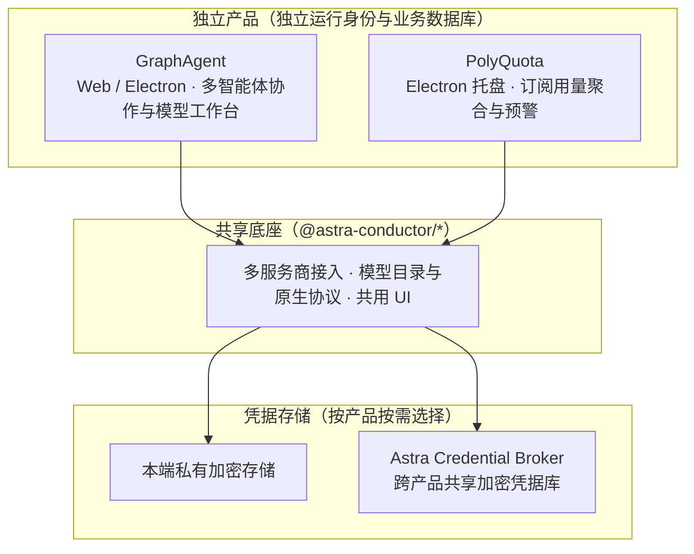
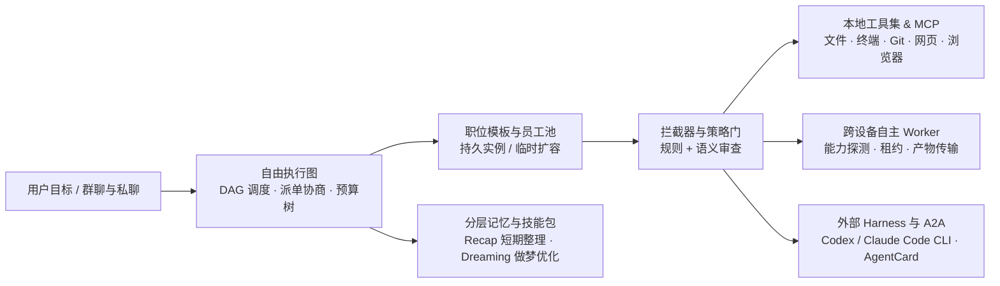

# AstraConductor

AstraConductor 是面向本地与多设备 AI 工作流的开源产品族，包含两款独立交付的产品及两者共用的多服务商、模型与安全凭据底座：

- **GraphAgent**：以自由执行图（Execution Graph）为核心的多智能体协作平台，提供独立 Web 服务与 Electron 桌面端。
- **PolyQuota**：常驻系统托盘的本地 LLM 订阅用量聚合与低额度预警工具，以 Windows 桌面端为首要形态。



## 当前进度总览

| 模块                     | 状态   | 概览                                                                                                                                                     |
| ------------------------ | ------ | -------------------------------------------------------------------------------------------------------------------------------------------------------- |
| 共享服务商与加密凭据底座 | 已实现 | 7 家订阅服务商 + 官方 API / 自定义中转站接入、双向凭据导入导出、独立 Broker 共享与切换                                                                   |
| PolyQuota 桌面端         | 已实现 | 多账号订阅配额实时聚合、分组与窗口进度、GLM 重置卡确认使用、托盘/任务栏状态指示与分级预警                                                                |
| GraphAgent 基础工作台    | 已实现 | 独立 Web / Electron 同源交付、自定义供应商与 New API 模板、模型目录与价卡配置、版本化预置包、原生多协议流式试聊                                          |
| GraphAgent 多智能体引擎  | 设计中 | 自由执行图与无限层级 Subagent、职位模板与持久实例、类 IM 群聊/私聊、Goal 预算树、跨设备派发、外部 Harness 集成、A2A、拦截器、分层记忆与 Recap / 做梦机制 |

---

## PolyQuota（已实现）

PolyQuota 聚焦「添加账号 → 定时轮询 → 统一展示 → 低额度提醒」的轻量桌面闭环，不代理模型请求、不回写官方 CLI 凭据。

- **7 家主流订阅服务商**：支持 Codex / ChatGPT、智谱 GLM（BigModel 国内与 Z.ai 国际）、Grok Build、Antigravity、Claude Code、OpenCode Go 与 GitHub Copilot，均已通过真实账号验证，支持同服务商多账号管理与独立启停。
- **多方式官方协议接入**：按各服务商原生能力支持浏览器 OAuth PKCE、设备码授权、API Key，以及 Codex CLI、Grok CLI、Claude Code、ZCode v2 凭据的只读导入。
- **直观配额卡片与状态指示**：按短周期（5 小时）/周/月窗口或模型分组呈现剩余额度与重置倒计时，页头汇总综合剩余进度环；支持 GLM 重置卡逐项查询与确认使用；系统托盘图标与 Windows 任务栏进度随综合剩余（>50% 绿、20%–50% 橙、≤20% 红）实时切换。
- **两级低额度系统通知**：剩余量 ≤ 20% 与 ≤ 5% 分级预警，同一重置周期自动去重。
- **动态代理与静态加密**：按环境变量 → Windows 系统代理 → 直连的顺序逐次解析，切换系统代理无需重启；凭据经 Electron `safeStorage` 逐账号加密落盘，界面与日志全程脱敏。

---

## GraphAgent

GraphAgent 致力于突破传统「单主控 + 固定流水线」的智能体编排限制，**完全放开 Subagent 与协作拓扑**——从一个目标出发，任意获准智能体均可按需自由派生、委托、讨论与评审，最终形成一张实时可观察、可干预、可恢复的执行图。

### 核心基础能力（已实现）

- **Web 与 Electron 同源交付**：同一套 Vue 前端与 Hono 业务服务，既可作为桌面端本地运行（支持系统加密私有凭据），也可在无 Electron 环境下以独立 Node/Web 服务运行（通过 Broker 使用已授权凭据）。
- **多服务商与 New API 中转站模板**：内置 OpenAI、DeepSeek、Google Gemini 官方 API 及 7 家主流订阅服务商接入；支持创建通用兼容供应商与 **New API 中转站**（匿名浏览站点公开模型与挂牌报价、按 Key 发现可用模型与端点、查询 Key 用量及通过 PAT 选取站点 Key）。
- **精细化模型目录与版本化预置包**：按能力特征、请求参数模板、自定义规则与多维度价卡管理模型，支持版本化 JSON 预置包的导入、在线更新地址配置与一键回滚。
- **原生多协议代理与流式试聊**：提供 OpenAI（Chat Completions / Responses）、Anthropic Messages 与 Gemini 原生协议代理，支持思考过程展示、图片端点配置与单轮费用试算。

### 特色功能与设计架构（设计中）

> 以下特性已完成概念与六层模块设计，详见 [GraphAgent 功能设计总览](./docs/graph-agent/design/README.md) 与 [分阶段实施计划](./docs/graph-agent/plan.md)。



#### 1. 完全放开的执行图与 Subagent 机制

- **无固定层级与流水线限制**：任意获准 Agent 均可按需派生多层 Subagent，支持多个上游同时向同一 Agent 派单，任务按数据依赖自动分叉与合流；返工评审以有上限的新轮次展开，执行图始终保持可控 DAG。
- **类职场任务协商协议**：派发不再是盲目塞任务，而是支持发起邀请、接受、结构化拒绝、排队、反报价、任务转包（保留原责任链与权限交集）、候选竞争（`any-success`）与独立评审；验收由正式交付物（`ArtifactRevision`）驱动，而非模型最后一句文本。
- **可视化任务工作台与精准干预**：实时查看每个节点的负责员工、当前步骤、等待原因、产物血缘与预算占用；支持随时修改任务要求（生成新修订版本）、加派/更换负责人、暂停或停止节点，并在进程重启后通过检查点安全恢复，避免重复执行未知副作用。

#### 2. 职位模板与持久化 Agent 实例

- **两层分离模型**：
  - **职位模板（`AgentTemplateRevision`）**：不可变版本化的岗位契约，定义职责、边界、技能契约、模型策略、工具权限、委托范围与排班规则；更新模板不影响已有员工。
  - **员工实例（`AgentInstance`）**：由模板派生的可寻址运行实体，拥有独立身份认知、串行收件箱、私有记忆与工作排班，跨任务持续积累经验。
- **持久与临时弹性混编**：支持 Goal/Workspace 级持久化员工（空闲时可 `keep-warm` 常驻或 `page-out` 释放运行资源但保留身份与记忆），也支持大批量任务按需创建、交付后自动交接释放的临时员工。
- **多维度选派与亲和调度**：支持 `sticky`、`least-loaded`、`random`、`fresh`、`parallel-diverse`、`isolated` 等选派策略，结合实例/产物/信任区亲和以及独立评审反亲和（隔离并行评审者的记忆与中间答案）。

#### 3. 类 IM 的群聊、私聊与挂起临时会话

- **直达任意 Subagent 的多模态通信**：用户或获准员工可直接私聊工作中的任意 Subagent，也可在多 Agent 群聊与讨论线程中协作，并可从群讨论中发起正式任务委托。
- **贴近真实 IM 的消息路由与屏蔽**：
  - 未屏蔽的 `@` / `@全体` 以 `interrupt` 送达正文，尚未启动的员工会被按需唤醒并在原群/线程回复；普通群消息仅投递无正文 `queue` 通知，由 Agent 自主决定 `conversation_read` 查看或直接无视。
  - 接受任务启动作业时，可分别开启「屏蔽群消息」与「屏蔽私聊」（含 `@`），消息暂存收件箱直至该任务进入终态后才以 `queue` 统一释放，不被暂停、交接或重启提前打断。
- **可控的空闲员工批量接话**：群聊支持「仅 `@` 响应」与默认「空闲批量接话」模式——在安静窗口内合并人类发言，轮选一名空闲员工决定回复或无声 `pass`（最多一次替补），配合冷却时间、每小时唤醒上限与独立聊天预算，杜绝群聊失控互回。
- **三种追加模式与挂起临时聊天**：支持 `interrupt`（打断当前工作段）、`steer`（下一安全步骤注入）与 `queue`（排入后续轮次）；用户还可在应用内管理入口挂起任意正在工作的节点并开启独立临时聊天——冻结原 Loop 的同时保留正在运行的终端命令与浏览器资源，且不主动打扰父 Agent，处理完毕后再显式校验恢复。

#### 4. 任务与 Goal 精细预算及用途分层模型策略

- **多维度层级预算树**：在 Goal → Task → Assignment 层级间建立上限树，覆盖 Token、金额、平台 Credits、时间/轮次、并发槽与服务商配额窗口；启动活动时原子预留并在结算后释放差额，防止多并发子任务超售共享预算。审查、压缩、Recap、做梦、重试与外包均显式记账。
- **软限额自动收尾**：临近总预算、配额窗口或触发限流时自动进入 `finishing` 模式，禁止新分叉、收敛可选工作并产出事实摘要与检查点，平滑转入交接或配额等待。
- **七类用途分组与调用租约**：内置主模型、计划、旗舰、工作、批量、轻量、安全七类用途策略（支持每组配置多候选模型），结合能力、隐私与成本约束动态签发调用租约（`ModelLease`），跨模型/跨协议交接自动使用可移植摘要与产物引用。

#### 5. 跨设备 Agent 派发

- **单控制面 + 多设备自主 Worker**：同一 Workspace 保持单一写入控制面，多台经配对和显式授权的个人设备可同时注册为 Worker 并行承担任务；UI 切换查看某台设备不影响其他设备的自主运行。
- **独立授权与物理资源隔离**：设备配对信任、连通状态与任务授权分离；跨设备文件与 Git 仓库通过 `(deviceId, bindingId, relativePath)` 隔离寻址，控制面与目标 Worker 本地双重校验权限，不混淆不同主机的同名路径。
- **租约 Fencing 与受控产物交付**：通过短期 `ActivityLease` 与执行 Epoch 防止断线重连导致的重复副作用，未知效果严格标记阻塞核对；跨设备产物经带 SHA-256 校验、断点续传与交付回执的受控通道流转。

#### 6. 外部 Harness 工具调用派发、原生工具集与 MCP

- **外部 Coding Agent 双向适配（Codex、Claude Code CLI 等）**：通过统一 `RemoteAgentPort` 适配厂商公开 CLI/SDK，支持两种模式：
  - **作为客户端派发**：把 Codex、Claude Code 等外部 Harness 作为受限 Worker 执行代码修改、仓库操作或独立验证，仅授予明确的工作区路径、工具与预算，支持事件流订阅、重连与取消，产物经本地重新读取核验后才纳入验收。
  - **作为服务端接入**：允许外部客户端通过受控 API 向 GraphAgent 提交目标、订阅执行流并读取产物。
- **原生结构化内置工具体系**：规划 33 类候选原生工具，涵盖精准文件读写与实时搜索/预览批改、受管终端（直接 argv 与 Windows pwsh 7/UTF-8）与一次性 Node/Python 脚本执行、具名 Git 工作流、网页研究（搜索/正文抽取/受控抓取，优先适配 Tavily）、HTTP 请求与后台下载、本地图片/短视频查看，以及结构化交互提问（`ask_user`）与循环内清单（`todo`）。
- **浏览器与桌面自动化扩展**：浏览器操作按需挂载官方 Chrome DevTools MCP；Windows 桌面自动化规划以 UI Automation 语义树加视觉回退，并施加单桌面独占锁防止并发争抢焦点。

#### 7. A2A 协议互操作

- **对外发布为标准 A2A 服务**：通过 `AgentDeployment` 将内部职位模板或职位池确定性投影（可选 JWS 签名）为标准 A2A `AgentCard` 与 Task API，支持 `contextId` 软亲和与可选扩展，未协商扩展的标准 A2A 客户端可直接使用。
- **导入第三方 A2A 智能体**：导入外部 `AgentCard` 生成受限远端模板（`RemoteAgentTemplate`），其声明能力默认标记 `unverified`，在本地预算、授权与 Artifact 验收边界内与内部员工协同工作。

#### 8. 可插拔拦截器与策略门（Interceptor & Policy Gate）

- **全链路边界管控**：覆盖用户输入、任务派发、跨实例消息、上下文读取、模型请求外发、模型响应、工具调用/结果、产物发布与记忆写入等关键拦截点，支持 `continue`、`transform`、`block`、`require-input`（审批）与 `short-circuit`（提前短路）五类决策。
- **确定性规则 + 受控语义审查**：可在执行图连线或节点上挂载审查策略，用于优化/翻译输入、拦截危险命令、阻止凭据与敏感数据外发、精简超长工具输出或修复结构化参数；内容变换后强制重验权限与审批。

#### 9. 分层记忆、技能包、Recap 与做梦（Dreaming）机制

- **原始档案与 Markdown 目录树记忆库分离**：完整消息、工具收据与调用快照持久化于 SQLite 原始档案；可编辑记忆以带 YAML Frontmatter 的 Markdown 文件保存在真实目录树中，分为短期记忆、长期记忆（`MEMORY.md` / `USER.md` 按预算自动注入）与不可变流水记忆（Journal），支持离线关键词/中文子串/时间检索与可重建索引。
- **版本化技能包（`SKILL.md`）**：程序性经验以目录包形式管理（含说明、步骤、验证方式与附件），运行中任务固定旧版本修订，合并或停用不会破坏在途执行。
- **短期整理（Recap）**：短任务或作业结算后按需触发独立整理会话，自动产出带证据引用的短期记忆与技能草稿。
- **长期自我优化（做梦 / Dreaming）**：在系统空闲、定时计划或用户主动触发时，通过批量用途的 `dreamModel` 以干净、客观的独立上下文（不带入原员工角色指令）执行 `prepare → reflect → consolidate → validate → commit → report`，跨任务识别矛盾、晋升经核验的长期记忆、合并技能、清理无效信息，并生成不可变 Journal 与可回滚变更集。
- **定时任务与管理看板**：支持配置时区化的后台定时维护任务，并在统一管理看板中聚合观测运行中的 Goal、员工容量、预算消耗、拦截审批、整理任务与外部连接健康状态。

---


## 共享凭据与跨产品协同（已实现）

两款产品默认各自使用独立的加密私有存储；当同一台 Windows 电脑同时使用 PolyQuota 与 GraphAgent 时，可通过独立的 **[Astra Credential Broker](https://github.com/SwingCosmic/astra-credential-broker/releases)** 安全共享凭据，而业务数据库保持严格隔离：

- **应用内一键安装与验签**：在 PolyQuota「设置 → 管理凭据存储」或 GraphAgent「凭据管理」中自动检索兼容发行包，验证签名与文件摘要后安装，并缓存发行包供离线重装与另一产品复用。
- **安全双向迁移**：支持私有库导出、跨产品导入、独立切换至共享库，以及显式切回私有存储（切回前先写入并验证快照，确认后再清理密钥槽）。

---

## 快速开始与安装

### Windows x64 桌面安装

| 产品             | 打包命令                   | 默认安装包产物                                        |
| ---------------- | -------------------------- | ----------------------------------------------------- |
| PolyQuota 0.6.1  | `pnpm package:polyquota`   | `apps/polyquota/release/PolyQuota-0.6.1-setup.exe`    |
| GraphAgent 0.2.1 | `pnpm package:graph-agent` | `apps/graph-agent/release/GraphAgent Setup 0.2.1.exe` |

使用 GraphAgent 独立 Web 入口时，先在桌面端完成共享凭据接入并退出桌面端，再启动 Web 服务即可复用同一 Profile 的已授权共享凭据，详见 [GraphAgent 运行说明](./apps/graph-agent/README.md)。

### 从源码运行

需要 **Node.js 22.12+** 与 **pnpm 10**。

```bash
# 1. 拉取必需参考子模块（仅协议基线校验需要）
git submodule update --init references/omniroute

# 2. 安装依赖
pnpm install

# 3. 启动开发环境
pnpm dev:polyquota        # 启动 PolyQuota 桌面端
pnpm dev:graph-agent      # 启动 GraphAgent 桌面端
pnpm start:graph-agent:web # 启动 GraphAgent 正式 Web 服务（需先执行 pnpm build）

# 4. 构建与检查
pnpm build
pnpm typecheck
pnpm test
```

---

## 文档导航

- [文档总览](./docs/README.md) · [项目架构与边界](./docs/architecture.md)
- **GraphAgent**：[产品入口](./docs/graph-agent/README.md) · [概念设计](./docs/graph-agent/concept-design.md) · [六层功能模块设计](./docs/graph-agent/design/README.md) · [跨设备任务派发设计](./docs/graph-agent/design/cross-device-dispatch-design.md) · [分阶段路线图](./docs/graph-agent/plan.md) · [运行说明](./apps/graph-agent/README.md)
- **PolyQuota**：[产品入口](./docs/polyquota/README.md) · [设计说明](./docs/polyquota/design.md)
- **共享底座**：[共享文档目录](./docs/common/README.md) · [供应商平台设计](./docs/common/core/provider/design.md) · [凭据共享设计](./docs/common/core/credential-sharing/design.md)
