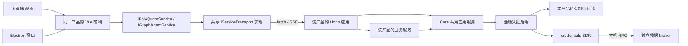

# AstraConductor 项目架构

本文是 PolyQuota 与 GraphAgent 的 workspace 包边界、依赖方向、业务通信和启动形式的权威说明。产品设计定义各自业务，专项文档定义详细实现与验收；涉及项目级边界约束时以本文为准。

## 1. 目标：两个应用，四个共享包

工作区采用「两个独立产品应用 + 四个共享包」的结构。每个应用内的 `ui/`、`src/server/`、`src/platform/` 属于所在产品的同一个 workspace 包。

```text
apps/
  polyquota/
    ui/                    本产品 Web 与 Electron 共用的前端入口
      src/pages/           用量页和产品设置
    src/server/            本产品 Hono 应用、用量投影、轮询和通知服务
    src/platform/          Electron 桌面宿主、开发测试用 Node 宿主
  graph-agent/
    ui/                    本产品 Web 与 Electron 共用的前端入口
      src/pages/           主页、模型配置及后续业务页
    src/server/            本产品 Hono 应用、模型配置和产品业务服务
    src/platform/          正式 Node/Web 宿主和 Electron 桌面宿主
packages/
  contract/                两个产品的公开 API 契约
  credentials/             独立 broker 的客户端 SDK 及按平台加载的宿主实现
  core/                    两个产品共用的供应商、账号、凭据与模型业务
  shared-ui/               共用 Vue 壳、基础组件、供应商接入页、凭据管理页
```

| 包 | 对外职责 | 可使用的 workspace 包 |
| --- | --- | --- |
| `@astra-conductor/contract` | 通过 `/common`、`/polyquota`、`/graph-agent` 子入口发布领域接口、产品 Service、共享传输抽象、HTTP 方法与路径、DTO、公开错误、事件及纯格式校验，浏览器与 Node 均可加载 | 无。不引入业务实现、Hono、Vue、Electron 或 broker SDK |
| `@astra-conductor/credentials` | 主入口提供产品无关的 broker 协议、迁移包校验、记录许可和事件；平台子入口（如 `/host/windows`）按需提供本机安装、发现与认证连接，保留独立发布能力 | 无。broker 线协议随 SDK 管理，产品 HTTP API 归 `contract` |
| `@astra-conductor/core` | 实现供应商、账号、凭据、用量、模型目录与请求映射，提供公共应用服务和宿主端口；业务主入口无框架依赖，可选 `/http` 子入口提供公共 Hono 路由适配 | `contract/common`、`credentials` 通用客户端；`/http` 按需使用 Hono |
| `@astra-conductor/shared-ui` | 共用布局、主题、组件与页面；无 Vue 依赖的 `/services` 子入口实现共享 fetch/SSE 传输及公共服务客户端 | `contract/common`（Vue 为 peer 依赖）。前端不直接调用 Core、broker 或宿主系统 API |

- 每个产品的 `ui/` 依赖 `shared-ui`、通用契约和本产品契约，注入品牌、导航和本产品 Service；共用页面的布局与交互只维护一份。
- 每个产品的 `src/server/` 挂载 Core 公共 Hono 子应用与本产品专属子应用；`src/platform/` 装配具体宿主能力。
- 两个应用独立构建、独立交付、独占各自的业务数据目录，彼此没有源码依赖。
- 独立 Credential Broker 通过本机 RPC 运行，拥有独立仓库、发布和升级周期；两产品通过它共享获准凭据，各自的用量、模型缓存与业务库留在产品内部。详见[凭据共享设计](./common/core/credential-sharing/design.md)。
- `references/` 仅作为协议研究与受控提取参考，不参与构建或运行时依赖。

## 2. 一条业务请求怎样到达 Core



- **统一请求通路**：每个产品拥有自己的 Hono 应用工厂，Node 与 Electron 宿主装配同一组路由、应用服务和错误/事件投影。浏览器通过 HTTP 访问，Electron 通过受限内部协议转发标准 `Request`，不另建绕开 Hono 的业务 IPC 通道。
- **凭据后端边界**：私有加密存储适用于 PolyQuota 及 GraphAgent Electron；GraphAgent 独立 Web 仅经已授权的 broker 访问凭据，不另设 Node 私有凭据库。
- **宿主能力抽象**：窗口、托盘、系统密钥库、目录选择器等系统交互由各宿主的平台适配器提供，并向前端公开实际可用能力。

### 2.1 产品 Service 与共享传输

- `IPolyQuotaService` 组合公共管理接口（`.providers`、`.credentials`）与 PolyQuota 用量接口；`IGraphAgentService` 组合相同公共管理接口与 GraphAgent 模型及后续业务接口。
- 公共与产品专属客户端复用单一 `IServiceTransport`（负责 fetch、SSE 握手、重连、错误转换与取消），客户端内部按业务切片组合并由产品契约接口校验。详见[产品 Service 与传输组合设计](./common/contract/service-composition.md)。
- **GraphAgent 原生协议代理**：Web 与 Electron 共用同一 Hono 应用，按协议族提供原生代理入口（OpenAI `/models`、Chat Completions、Responses 与 Anthropic `/models`、Messages），Core 负责解析所选账号的认证与公共附加参数。详见[协议与推理端口设计](./common/core/provider/protocol-design.md#41-单轮试聊使用同协议代理)。
- **供应商策略依赖方向**：公共请求入口依赖 Core 能力接口，各供应商策略由组合根统一注册；公共模型、认证、传输、计量和界面代码不直接按厂商分支。详见[供应商请求策略设计](./common/core/provider/request-dispatch.md)。

### 2.2 公共与专属 Hono 子应用

Core 主入口保持无框架依赖；可选子入口 `@astra-conductor/core/http` 封装公共应用服务的 Hono handler、契约校验与脱敏投影。两产品在各自 `src/server/` 挂载公共子应用，再组合产品专属子应用、统一中间件与唯一 `GET /api/v1/events` SSE 端点。同一产品内共用一套 Core 服务实例与事件中心；两产品之间的服务实例与业务数据库完全独立。

## 3. 产品启动与交付

| 产品及形态 | 用途 | 启动后的行为与约束 |
| --- | --- | --- |
| PolyQuota · Electron | 正式桌面交付 | 启动 Hono 与产品服务，加载 PolyQuota 前端，连接私有加密存储或已授权 broker，提供托盘与通知 |
| PolyQuota · 独立 Web | 开发、测试与联调 | 独立 Node 进程运行相同业务路由，可配合前端或显式演示模式 |
| GraphAgent · 独立 Web | 正式交付 | 无 Electron 环境下独立运行 Node 宿主，提供同源前端、Hono API 与 SSE；账号凭据仅经已授权 broker，未接入或断连时受限提示 |
| GraphAgent · Electron | 正式桌面交付 | 加载同一 GraphAgent 前端与 Hono 应用，支持系统私有加密存储或接入 broker，业务契约与 Web 保持一致 |

GraphAgent 的桌面端与独立 Web 默认共用同一个本机 profile；切换入口前先退出当前进程，并行运行时指定独立 profile。Web 侧共享目录与绑定规则见[Web 共享目录记忆](./graph-agent/design/web-shared-vault.md)。

## 4. 新功能落点与变更规则

1. **先决定功能归属**：新供应商与模型规则进 `core`，两产品复用的页面进 `shared-ui`，单产品业务进各自 `ui/` 或 `server/`，宿主差异留在 `platform/` 或凭据 SDK 平台子入口。
2. **单一契约来源**：同一操作仅在 `contract` 定义一次，由 Hono 与前端分别实现与消费；不为 Electron 新增绕开 Hono 的业务通道。
3. **变更边界先改本文**：新增 workspace 包、调整业务请求路径或交付形态时，先在本文说明理由及对两产品、两类宿主的影响。
4. **以正式入口验证一致性**：同一契约覆盖 Web HTTP 与 Electron 内部入口，分别校验 DTO、错误、SSE 失效与凭据后端约束。

## 5. 从当前仓库迁移

工作区已完成「两应用 + 四共享包」归位，下表保留旧路径到现行结构的对照，供查阅早期文档时定位。

| 迁移来源 | 现行落点与行为 |
| --- | --- |
| `polyquota-contract`、GraphAgent 原 `src/contract.ts` | `contract/common`、`contract/polyquota`、`contract/graph-agent` |
| `credential-host` | `credentials`（主入口协议 SDK，`/host/windows` 本机安装与连接） |
| `polyquota-ui`、GraphAgent 手写 renderer | 各产品 `apps/<product>/ui`，共享 `packages/shared-ui` 壳、公共页与 `/services` 传输 |
| PolyQuota 服务端与宿主平铺代码 | `src/server` 承载 Hono、用量与轮询；`src/platform` 承载 Electron、Node 与存储适配 |
| GraphAgent 原 Electron 最小导入壳 | `src/server` 组合公共 Hono 与产品服务；`src/platform/node` 与 `src/platform/electron` 提供同源服务 |
| 原各产品独立管理接口 | 统一 `/api/v1/providers`、认证/账号/凭据公共路径与 `/api/v1/events` |

### GraphAgent 业务数据库

每个 GraphAgent profile 独占一座 `graph-agent.sqlite3`，保存账号展示与启停、自定义供应商、模型目录配置、价卡以及后续按 Workspace 隔离的会话、任务与执行记录；应用偏好由设置服务单独管理。

私有或共享凭据库仅保存账号 ID、供应商 ID、账号标识与不透明凭据密文，与业务数据库解耦；PolyQuota 忽略其不识别的自定义供应商。表结构与初始化约定见[GraphAgent 业务表结构](./graph-agent/design/business-database.md)，Core 与 UI 详细设计见[Core 详细设计](./common/core/provider/core-design.md)与[共用 UI 设计](./common/ui/design.md)。
