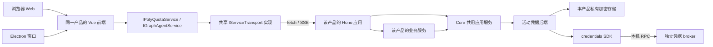

# AstraConductor 项目架构

**状态：2026-11-07 确定的目标架构，分阶段迁移。** 本文是 PolyQuota 与 GraphAgent 的 workspace 包边界、依赖方向、业务通信和启动形式的权威说明。产品设计定义各自的业务，专项文档定义实现和验收，涉及这些项目级约束时引用本文。当前代码与目标的差异列在末节。

## 1. 目标：两个应用，四个共享包

下面是迁移完成后的目录。`ui/`、`src/server/`、`src/platform/` 都属于所在产品的同一个 workspace 应用。

```text
apps/
  polyquota/
    ui/                    本产品 Web 与 Electron 共用的前端入口
      src/pages/           用量页和产品设置
    src/server/            本产品 Hono 应用、用量投影、轮询和通知服务
    src/platform/          Electron 桌面宿主、开发测试用 Node 宿主
  graph-agent/
    ui/                    本产品 Web 与 Electron 共用的前端入口
      src/pages/           主页、模型配置及后续业务页
    src/server/            本产品 Hono 应用、模型配置和产品业务服务
    src/platform/          正式 Node/Web 宿主和 Electron 桌面宿主
packages/
  contract/                两个产品的公开 API 契约
  credentials/             独立 broker 的客户端 SDK 及按平台加载的宿主实现
  core/                    两个产品共用的供应商、账号、凭据与模型业务
  shared-ui/               共用 Vue 壳、基础组件、供应商接入页、凭据管理页
```

| 包 | 对外职责 | 可使用的 workspace 包 |
| --- | --- | --- |
| `@astra-conductor/contract` | 通过 `/common`、`/polyquota`、`/graph-agent` 子入口发布领域接口、产品 Service、共享传输抽象、HTTP 方法与路径、DTO、公开错误、事件及纯格式校验。浏览器与 Node 均可加载 | 无。契约不引入业务实现、Hono、Vue、Electron 或 broker SDK |
| `@astra-conductor/credentials` | 主入口提供产品无关的 broker 协议、迁移包校验、记录许可和事件。`/host/windows` 子入口提供 Windows 本机安装、发现和认证连接，按需加载。SDK 保留独立发布能力 | 无。broker 的线协议随 SDK 管理，产品 Hono API 归 `contract` |
| `@astra-conductor/core` | 实现供应商、账号、凭据、用量、模型目录与请求映射，提供公共应用服务和宿主端口。业务主入口无框架依赖；可选 `/http` 后端子入口提供公共 Hono 路由适配 | `contract/common`、`credentials` 的通用客户端。`/http` 按需使用 Hono，具体平台入口由宿主装配 |
| `@astra-conductor/shared-ui` | 共用布局、主题、组件与页面；无 Vue 依赖的 `/services` 子入口实现共享 fetch/SSE 传输及公共服务客户端。产品注入品牌、导航和产品 Service 的公共分组 | `contract/common`，Vue 为组件的 peer 依赖。前端不能直接调用 Core、broker 或宿主系统 API |

每个产品的 `ui/` 依赖 `shared-ui`、通用契约和自己的产品契约，组合并注入本产品 Service。`src/server/` 使用对应契约、Core 和本产品服务，将公共 Hono 子应用与产品专属子应用统一挂载。`src/platform/` 负责具体宿主的组合，可以按需使用凭据 SDK 的平台入口。Core 业务保持框架无关，HTTP 适配经独立子入口按需加载。两个应用独立构建、独立交付、独占各自的业务数据目录，彼此没有源码依赖。GraphAgent 模型页和 PolyQuota 用量页分别由各自的 Web/Electron 前端共用。共用页面的布局与交互维护一份，主题图标和配色由产品提供。

独立 .NET Credential Broker 是通过本机 RPC 访问的进程，有自己的仓库、安装和升级周期。两端通过它共享获准的凭据，各自的用量、模型缓存和业务数据库留在产品内。`references/` 只提供研究和受控提取的输入。[凭据共享设计](./common/core/credential-sharing/design.md)

契约包的子入口、公开类型归属和旧包迁移由[统一契约包设计](./common/contract/design.md)展开，通用 API、错误与 fetch/SSE 协定统一在 `docs/common/contract/` 维护；`docs/common/ui/` 只展开前端重构和通用组件设计。

## 2. 一条业务请求怎样到达 Core



图中的私有加密存储适用于 PolyQuota 及 GraphAgent Electron。GraphAgent 独立 Web 没有 Electron 的 `safeStorage`，凭据只经已启用的 broker 访问，不另设 Node 私有凭据库；模型缓存、选择、参数覆盖和产品设置仍保存在 GraphAgent 自己的服务端业务库。

每个产品有自己的 Hono 应用工厂。Node 和 Electron 宿主装配同一组路由、应用服务和错误/事件投影。浏览器通过 HTTP 进入 Hono；Electron 可用受限内部协议把标准 `Request` 转交给同一 Hono 应用，无须额外监听 TCP 端口。前端入口为本产品 Service 创建一个共享传输实例，宿主差异收在请求基址和底层 fetch 适配。业务组件只调用 Service，服务客户端使用同一契约的方法、路径、DTO 和 SSE，凭据、模型和用量操作都经 Hono。

例如，目标中的 `GET /api/v1/providers` 在两产品、两种宿主中均由 `contract/common` 定义含义，并绑定同一组 Core 目录与权限判断。GraphAgent 的模型配置、PolyQuota 的用量快照分别通过产品契约注册自己的路由。Hono 做入站校验、应用服务分派和公开投影。账号用途、租约、模型解析等业务规则只维护在所属服务。Electron 的窗口、托盘、系统密钥库或目录选择器由平台适配器实现；Web 入口使用适合 Node 的实现，并向前端公开实际可用的宿主能力。

### 2.1 产品 Service 与共享传输

`IPolyQuotaService` 由公共管理接口和 PolyQuota 产品接口组合；`IGraphAgentService` 由相同公共管理接口和 GraphAgent 模型接口组合。两者以 `.providers`、`.credentials` 暴露共用能力，产品专属方法保留在各自门面顶层。共用页面接收这些公共分组，产品页面注入自己的完整 Service，不依靠一组零散组件端口替代产品入口。

接口定义归 `contract`，公共客户端与 `IServiceTransport` 的 fetch/SSE 实现归 `shared-ui/services`，产品客户端归各自 `ui/src/services`。每个产品 Service 的公共与专属功能切片复用一个传输实例和一条 SSE；传输负责握手、重连、错误转换和取消，业务命令保留自己的上下文与修订。新建 GraphAgent Service，同时从现有 PolyQuota 大客户端抽出传输，避免两端复制网络实现。

客户端实现按方向拆成独立功能切片类，通过共享泛型 mixin 辅助方法合成最终 `HttpPolyQuotaService` / `HttpGraphAgentService`，由 `implements` 校验产品接口；最终类文件只保留组合清单，创建工厂只负责实例化。基类统一持有传输与生命周期，具体切片及类型推断约定见[Service 切片组合设计](./common/contract/service-composition.md#11-通过泛型-mixin-合成功能切片类)。

### 2.2 公共与专属 Hono 子应用

Core 提供无框架的公共应用服务；新增目标子入口 `@astra-conductor/core/http` 仅封装这些服务的公共 Hono handler、契约校验和结果投影。两产品在各自 `src/server/` 中挂载同一个公共子应用工厂，再组合产品专属子应用、统一中间件和唯一 SSE 端点。Core 主入口不重导出 `/http`，浏览器和纯业务调用方不加载 Hono，公共适配器也不引用产品包。

这一补充让两产品共享公共 handler，并保留各自的 Hono 组合根；无需增加 workspace 包。PolyQuota 从现有 Hono 工厂拆出公共适配，GraphAgent 复用该适配并补模型路由。每个产品内部，公共与专属子应用共用该产品的一套 Core 服务实例和事件中心，不因拆分路由而重复构造状态；两个产品的服务实例与业务数据库保持独立。产品专属 handler 和业务仍留在产品目录。

完整接口、客户端工厂、后端组合示例与迁移约束见[产品 Service 与传输组合设计](./common/contract/service-composition.md)。这些入口为待实施目标，不表示当前已存在 `core/http` 或新的产品 Service。

## 3. 产品启动与交付

| 产品及形态 | 用途 | 启动后的行为与验收 |
| --- | --- | --- |
| PolyQuota · Electron | 正式桌面交付 | 桌面宿主启动 Hono 与产品服务，加载 PolyQuota 前端，连接私有加密存储或已启用的 broker，提供托盘和通知 |
| PolyQuota · 独立 Web | 开发、测试和联调 | 独立 Node 进程运行相同业务路由，可配合 Vite 或测试前端。缺少可用 cipher 时如实报告凭据操作不可用。显式 demo 使用夹具 |
| GraphAgent · 独立 Web | 正式交付 | 无 Electron 的机器上可单独启动 Node 宿主，提供构建后的前端静态资源、Hono API 和 SSE。账号凭据只使用已启用的 broker；未接入或断连时显示原因并禁用依赖凭据的操作 |
| GraphAgent · Electron | 正式桌面交付 | 桌面宿主加载同一 GraphAgent 前端、装配同一 Hono 应用，可使用 `safeStorage` 保存私有凭据，也可接入 broker。管理账号、配置模型和凭据共享遵守与 Web 相同的业务契约，操作能力反映实际后端和授权 |

GraphAgent 独立 Web 的基础交付是可单独运行的本地服务。宿主差异可以影响系统交互的呈现，例如桌面选择目录、Web 选择服务端可用位置；同一业务操作的权限、输入约束、状态变化和错误语义由应用服务统一。两个宿主并行测试时使用独立 profile，或接入已有数据所有者，避免两个进程各自打开同一份活动业务库。

## 4. 新功能落点与变更规则

1. **先决定功能归属。** 新供应商和模型规则进 Core，两个产品复用的页面进 `shared-ui`，只属于某个产品的功能进该产品的 `ui/` 或 `server/`。宿主差异放在 `platform/` 或现有 SDK 的平台子入口。用目录和子路径导出表达内部边界。
2. **API 契约只有一个来源。** 同一操作在 `contract` 定义一次，由 Hono 和前端分别实现、消费。新增业务能力不单设 contract/UI/IPC 包，也不为 Electron 增加绕开 Hono 的业务通道。
3. **改变项目边界时先改本文。** 若确需增加 workspace 包，说明调用方、独立依赖或发布边界，以及现有目录或子入口为何无法满足。调整请求路径或启动形式时同步说明对两个产品和两类宿主的影响。专项方案和仓库指引链接到这项决定。
4. **以正式入口验证一致性。** 同一契约样本覆盖 Web HTTP 和 Electron 内部入口，核对 DTO、错误与 SSE 失效行为。GraphAgent 另验无 Electron 的独立启动、静态页面、broker 接入与重启恢复，以及未接入、断连和授权不足时的受限状态；Electron 验证私有凭据持久化。PolyQuota 分别验正式桌面交付与开发 Web 联调。

## 5. 从当前仓库迁移

截至 2026-11-07，凭据专项 B1 已将 Windows 宿主合入凭据 SDK，仓库实际有两个应用和四个 `packages/*` 包。此次合包使协议客户端和本机宿主在同一 SDK 中维护，以子入口保留按平台加载的边界；PolyQuota 和 GraphAgent 均使用新入口，Core 继续只使用主入口。其余目标包尚待迁移，当前四包不等同于第 1 节的四个目标包。以下是迁移关系，当前可运行命令以[根 README](../README.md)和[工作区脚本](../package.json)为准。

| 当前落点或行为 | 目标 |
| --- | --- |
| `polyquota-contract`，以及 GraphAgent 最小宿主自己的 `src/contract.ts` | 归并为 `contract` 的通用与产品子入口。维持旧调用方所需的 DTO 和路径兼容，待消费方迁移后移除旧入口 |
| `credentials`（B1 已完成，原 `credential-host` 已移除） | 主入口保留协议 SDK，Windows 管理和连接能力通过 `/host/windows` 导出 JS 与声明。宿主内部使用相对模块引用，可独立构建；主入口不加载平台宿主。独立 broker 协议、数据格式与发行身份不因移动 TS 模块改变 |
| `polyquota-ui`，以及 GraphAgent 的 `renderer/index.html`、`renderer/style.css`、`src/renderer.ts` | 先将现有前端入口归入各自的 `apps/<product>/ui/` 并接通构建，再从可运行的产品页面中提取 `shared-ui`。GraphAgent 现有页面为空白主页和凭据设置，模型配置页待实现 |
| PolyQuota Web 已通过回环 HTTP `/api/v1/...` 接入 Hono，Electron 已通过 `polyquota-app://app/v1/...` 转入 Hono | 复用现有 Hono/fetch/SSE 链路，向两端提供统一的逻辑路径及共用 API。旧前缀的兼容转换留在传输适配层 |
| GraphAgent 当前以 Electron 的 `graph-agent:sharing` IPC 做导入与刷新，尚无正式 Node/Web 入口 | 先接产品 Hono、服务端业务仓储及 broker 凭据后端，Electron 另接私有加密存储，再让 Web 和 Electron 使用同一 API 客户端。Web 只支持 broker，写入能力取决于凭据专项提供的记录权限；旧 IPC 退出业务路径 |

迁移分属两个计划。凭据 SDK 与 Windows 宿主合包已完成[凭据共享实施方案](./common/core/credential-sharing/implementation-plan.md)二期第一步，落点与验证见 [B1 实施记录](./common/core/credential-sharing/b1-credentials-package-implementation.md)。其余工作区结构调整归[供应商平台三阶段实施方案](./common/core/provider/implementation-plan.md)一期，在同一阶段内先调整结构、再抽离共用 UI。Core 与 UI 的实现细节分别见[Core 详细设计](./common/core/provider/core-design.md)和[UI 详细设计](./common/ui/design.md)；产品前端契约分别见 [GraphAgent](./graph-agent/design/frontend-contract.md)和 [PolyQuota](./polyquota/frontend-contract.md)。
