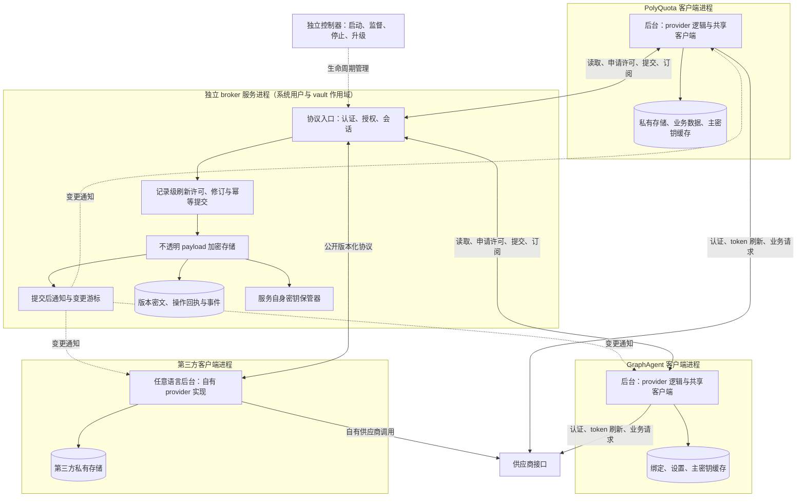
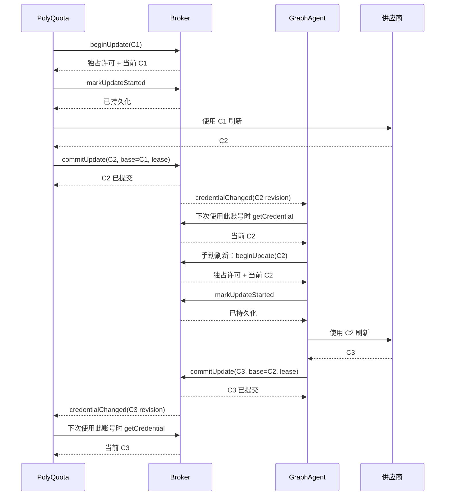

# 凭据共享设计

| 项目 | 内容 |
| --- | --- |
| 范围 | 同机、同一系统用户下的跨产品加密凭据共享；各产品业务数据库保持独立 |
| 关联设计 | [项目架构](../../../architecture.md) · [供应商平台](../provider/design.md) · [迁移状态机](./state-machine.md) |
| 实施与记录 | [实施方案](./implementation-plan.md) · [Broker 详细设计](./broker-a1-a2-detailed-design.md) · [导出与共享实施记录](./a6-a8-sharing-implementation.md) |

## 1. 目标与边界

支持本地加密存储的桌面产品默认使用各自的私有凭据库；独立 Web 入口无本地安全存储，仅经已授权的独立 Credential Broker 访问共享凭据。两端前端均通过所属产品的 Hono 服务执行凭据操作，每个产品同一时间只有一个活动凭据后端。

共享由用户主动开启：
- **双向导入导出与独立切换**：任一桌面产品均可将私有凭据加密导出为共享库并生成迁移密钥，另一产品输入迁移密钥核验后导入；共享库发布后即可由 Broker 独立服务，各端自主决定何时切换至共享后端。
- **可控回退**：任一桌面端可随时显式切回私有存储（生成一致性加密快照并核验后再清理旧共享密钥），不影响其他客户端继续使用共享库。
- **职责解耦**：供应商认证、OAuth 与 token 刷新逻辑保留在应用侧 Core；独立 Broker 只负责加密存储不透明记录、记录级互斥更新许可、原子修订提交与变更通知。

## 2. 不透明凭据服务

### 2.1 进程与数据边界

Broker 是独立安装、按需启动并独立升级的不透明凭据存储与并发协调服务。一个系统用户可注册多个 vault，每个 vault 对应一个服务实例，可同时服务多个客户端（包括第三方客户端）。



- **存储隔离**：各客户端独占自己的业务库，Broker 独占共享凭据库。
- **内存缓存与脱敏投影**：共享模式下，产品后台按授权与账号懒加载并缓存当前有效凭据（断连、失权、切后端或退出时立即清空）；账号列表与前端界面仅使用脱敏投影，原始 payload 仅在解码期短暂持有。

### 2.2 记录、元数据与发现

`astra-credential-broker` 独立发布与升级，面向任意语言提供公开版本化协议；工作区的 `@astra-conductor/credentials` 提供 TypeScript SDK 及按需加载的平台宿主安装入口。

共享记录由外壳与不透明 `payload` 组成：`{ credentialId, revision, createdByClientId, lastUpdatedByClientId, metadata, contentType, payloadFormatVersion, payload }`。业务数据（用量、通知、任务等）不进入 payload，各产品在自身业务库维护本地账号绑定。

| 字段 | 语义 |
| --- | --- |
| `createdByClientId` | 创建该记录的认证客户端 ID，创建后不可修改 |
| `lastUpdatedByClientId` | 最近一次成功提交该记录的客户端 ID，仅在成功提交时更新 |
| `metadata` | 单层字符串键值表（无秘密），保存能力声明与扩展标签，与 payload 一并受加密与完整性保护 |

- **能力发现过滤**：客户端通过 `metadata.supportsUsage`、`metadata.supportsInference`（`"true"` / `"false"`）声明记录能力；`listCredentials` 返回权限范围内的分页外壳描述（不含 payload），支持按创建/更新者与精确字符串键值筛选，使 PolyQuota 等客户端无需下载密文即可筛出适用账号。
- **核心接口**：`listCredentials`、`getCredential`、`beginUpdate`、`markUpdateStarted`、`renewUpdate`、`commitUpdate`、`abortUpdate`、`getOperation`、变更订阅与客户端解绑；按 `clientId` 与记录范围授权，全局删除、换钥与停服属于独立管理权限。

### 2.3 刷新协议

记录级更新许可覆盖完整的「读取当前版本 → 调用供应商刷新 → 提交新版本」，自动与手动刷新均须遵守：

1. 客户端携带 `credentialId`、`observedRevision` 与幂等 `operationId` 调用 `beginUpdate`。若观察修订已过期，Broker 返回最新修订与 payload，由客户端重新判断是否仍需刷新。
2. 获准时 Broker 原子返回当前 payload、`baseRevision`、`leaseId`、递增 `fence` 与服务代次。
3. 客户端先调用 `markUpdateStarted` 持久化开始事实，再向供应商发起刷新请求。
4. 刷新成功后调用 `commitUpdate` 提交新 payload；Broker 校验许可、fence 与修订，在同一事务提交密文、可选元数据、递增修订、幂等回执与变更事件并释放许可。
5. 刷新失败时客户端立即调用 `abortUpdate`（标记 `failed-released`）释放占用并唤醒等待者，无需等待租约超时；结果已提交但回执丢失时按 `operationId` 查询对账。

重新授权替换、手动编辑与全局删除复用同一更新协调机制；共用刷新授权族的多条记录可通过 `coordinationKey` 声明共享互斥组。

### 2.4 可见性



- 事务提交即刻生效：读操作始终返回最近已提交版本，不被其他客户端持有的在途更新租约阻塞；提交后向获准订阅者推送 `{ credentialId, revision, eventSequence }`，客户端据此失效旧缓存并重算筛选。
- 断线重连按事件游标补取或重读权威记录；已发出的上游请求保持原快照，不被回溯改写。

### 2.5 有界租约

正常情况下阻止并发刷新；客户端异常掉线时通过有界租约保证记录不会被永久锁死：

| 参数 | 默认值 | 语义 |
| --- | --- | --- |
| `leaseTtl` | 30 秒 | 自发放或上次成功续期起的有效窗口（短暂断线容忍窗） |
| `renewInterval` | 10 秒 | 刷新任务存活期间主动续期周期 |
| `maxHoldTime` | 120 秒 | 自首次取得许可起的绝对上限，任何续期均不可突破 |
| 单次上游请求超时 | 建议 20 秒 | 尽量在单窗口内完成请求并为提交留出余量 |

- Broker 按 `min(lastGrantOrRenewTime + leaseTtl, grantedAt + maxHoldTime)` 计算到期时间；所有状态变更均在事务内基于服务端单调时钟核对。
- 主动失败释放立即生效；租约到期或达 `maxHoldTime` 后原许可强制失效，Broker 递增 `fence` 并唤醒下一个等待者。旧持有者若迟到提交将被 `stale-fence` 拒绝。

### 2.6 运行架构选型

Broker 采用独立自包含跨平台服务（不依赖目标机器预装特定运行时，也不依赖产品内嵌的 TypeScript SDK），通过版本化 JSON 协议、标准加密原语与跨语言互操作向量面向多语言客户端开放；通信权限、系统密钥保管与进程监督按平台适配封装，核心存储、加密与租约状态机保持跨平台一致。

## 3. 存储位置、加密与密钥

### 3.1 共享目录布局

用户可通过系统目录选择器指定任意本地空目录作为共享 vault（默认位于用户本地应用数据目录的 `AstraConductor/Credentials/v1`）。Broker 不绑定物理目录身份，停服后支持手动复制、备份、迁移与重新登记。

```text
Credentials/v1/
  manifest.json                 # 布局与 vaultId（不含秘密）
  control.db                    # 唯一 currentVersion 指针与发布/切换回执
  versions/<storageVersion>/
    version.json                # attemptId、keyId、清单与摘要
    credentials.db              # 不透明记录密文、更新许可/回执与事件
    migration.json              # 加密主密钥与导入校验快照
  runtime/                      # 进程锁与本机通信端点信息
```

### 3.2 跨平台认证加密

加密使用 **AES-256-GCM**（32 字节密钥、12 字节 nonce、16 字节标签）与 **HKDF-SHA-256** 密钥派生，JSON 规范化采用 RFC 8785（JCS）：

```text
info = UTF8(JCS(["astraconductor.credential-transfer.v1",
                vaultId, storageVersion, attemptId, transferId]))
K_transfer = HKDF-SHA-256(migrationKey, salt, info, 32)
AAD = UTF8(JCS(header))
(ciphertext, tag) = AES-256-GCM(K_transfer, nonce, UTF8(JCS(payload)), AAD)
```

- 所有算法参数、长度与 schema 按版本白名单校验，header 全字段纳入 AAD 认证，认证失败前不输出明文。
- 活动记录密文的 AAD 绑定 vault、版本、attemptId、credentialId 与 revision；同一密钥绝不复用 nonce，失败重建必须更换密钥与随机参数。

### 3.3 两种密钥与本地保存

- **迁移密钥（`acm1_...`）**：发起导出时随机生成 32 字节并展示给用户，用于向接收方解密迁移包；不缓存、不落盘、不进入日志或事件，遗忘后无法在线找回。
- **存储主密钥**：由迁移包加密传递，接收方验钥后保存于本机系统安全存储（如 `safeStorage`），Broker 同时保存于服务自身独立密钥保管器；业务凭据明文仅在活跃会话内存中按需短暂驻留。

## 4. 导出、导入与后端切换

每个客户端独立维护本端迁移状态（完整状态图与异常恢复见[迁移状态机](./state-machine.md)）：

- 默认使用私有加密存储（状态 A）；完成导出发布并回读验证后进入就绪状态（B1），完成导入验钥后进入就绪状态（B2），此时两端仍继续使用原后端。
- 任一端主动确认切换并接通 Broker 后进入共享模式（C）；共享库在导出完成时即具备独立服务能力，不强依赖另一端同时在线。
- 已切换至共享模式的客户端若遇 Broker 断连，保持共享选择并显示不可用，不静默回退到过期的私有副本。

## 5. 客户端切回私有存储

桌面客户端支持随时显式退出共享（`shared` → `private-ready` → `private`），切回仅影响当前退出端，Broker 与其他客户端继续正常运行：

1. 向用户明确提示：切回后将持有独立凭据副本，后续各自刷新可能导致部分供应商的轮换令牌相互失效。
2. 后台读取一致性共享快照，加密写入本端私有库并回读校验通过（`private-ready`）；若 Broker 不可达，仅允许在存在可验证本地快照时明确提示风险后切回。
3. 用户确认切换并验证私有业务读取成功后，持久提交切回状态，随即解绑旧共享授权并清理本地缓存的共享主密钥与接入凭据；清理失败登记待补清，重启继续执行。
4. 若后续再次加入共享，须重新输入迁移密钥读取当前共享版本，不将私有副本反向覆盖共享库。

## 6. 数据版本与一致性

共享存储版本按 `building → verified → current → retired` 演进（失败候选标记为 `failed`）：

1. 所有重导出或换钥操作在候选版本 `N+1` 中完成，不原地覆写正在服务的当前版本 `N`。
2. 并发更新时建立维护屏障，等待已发放许可结算或到期失效后补齐差量，完整校验数据、迁移包与密钥后再提交。
3. 通过 `control.db` 事务原子切换唯一 `currentVersion` 并通知在线客户端；旧版本待读者与恢复流程释放后清理。
4. 日常 token 刷新只递增记录 `revision`，不产生新的存储版本。

## 7. broker 生命周期

### 7.1 控制权与运行身份

- Broker 以当前 OS 用户身份运行，由独立控制器管理启停与升级，监督进程与工作进程各自持有 OS 独占锁，不随单个客户端退出。
- 普通客户端日常仅可幂等调用 `ensureRunning` 与建立/断开会话，无权停止或升级全局服务；安装、卸载与修复通过应用内管理入口经独立控制器执行。
- 服务默认按需启动（也可配置常驻）；定时轮询由各应用自行调度，Broker 仅协调记录更新许可。

### 7.2 状态与转换

| 状态 | 语义与转换规则 |
| --- | --- |
| `STOPPED` | 未运行；收到首次连接或管理启动请求时合并拉起单一实例 |
| `STARTING` | 取得 vault OS 独占锁、恢复当前版本与操作回执、校验兼容性后发布端点 |
| `LOCKED` | 进程已启动但服务密钥保管器不可用，仅允许状态查询与授权解锁，拒绝读取或更新许可 |
| `READY` | 正常提供授权会话与凭据协调；单客户端断开不影响服务运行 |
| `IDLE` | 无活跃会话与在途操作时进入，默认空闲 60 秒后转入排空退出，新请求可立即唤醒 |
| `DRAINING` | 拒绝新操作、排空在途调用、持久化回执、清空内存密钥并释放 OS 锁后退出 |
| `FAILED` | 启动或恢复超过重试预算；保留全部数据与安全诊断供管理端修复 |

### 7.3 密钥、崩溃与升级

- Broker 持有独立的服务级密钥保管器，重启后不依赖最初导出的客户端在线。
- 异常崩溃后由控制器按有限退避重启，恢复未决操作回执并沿用原租约截止时间，不重置计时；旧服务代次的迟到提交一律拒绝。
- 升级前排空旧进程并释放 OS 锁再启动新版本；卸载某客户端只清理该客户端绑定，不删除独立 Broker 与共享库。

### 7.4 独立发布、按需安装与组件管理

- **按需下载与验签安装**：桌面客户端不捆绑 Broker 运行时，仅在用户开启共享或打开「凭据管理 → 凭据服务组件」时按需引导安装。客户端检索官方 Release 的兼容发行包，核对平台、协议与 API 能力，验证发行工作流签名与 SHA-256 摘要后调用独立控制器安装。
- **跨产品缓存复用与离线重装**：通过校验的发行包缓存在本机用户目录供两款桌面客户端复用，离线重装前仍使用随包信任根重新核验签名与清单。
- **透明状态管理**：界面将「安装状态（未安装/已安装/损坏/不兼容）」「服务运行状态」「Vault 解锁」与「共享接入状态」分别呈现；支持重检、安装、修复重装与卸载（卸载仅移除组件文件与启动注册，默认保留共享库与密钥）。

### 7.5 组件与 API 兼容性前置校验

三个版本维度职责严格分离，互不替代：

| 版本维度 | 类型 | 职责 |
| --- | --- | --- |
| 组件版本 | SemVer 字符串 | 判定发行包新旧与展示已安装版本，不作为功能兼容门槛 |
| 协议版本 | 正整数 | 约束帧封装与认证握手兼容性，仅在通信协议不兼容时递增 |
| API level | 精确十进制数 | 声明服务提供的业务能力集；客户端前置校验 `服务 API >= 所需 API` |

检查在三个边界依次生效，且前置通过不省略后续校验：

1. **安装前**：校验发行包身份、平台、摘要与清单声明，并对解压产物执行探活核对一致性后再替换组件。
2. **进入共享业务前**：只读核验本地安装登记与声明的协议/API level，不满足时提前引导升级，不触发共享写入副作用。
3. **建立业务 RPC 前**：握手阶段核实实际运行服务的协议与 API level，随后完成双向认证（认证证明覆盖版本声明防篡改）。

- **旧服务升级白名单**：若检测到缺少能力声明的旧版服务，普通凭据业务一律拒绝；独立控制器仅允许通过管理身份执行 `status`、`stop`、`disconnect` 完成排空替换。
- **演进规则**：日常缺陷修复只升组件 SemVer；新增业务能力时提升 API level，客户端仅在依赖该能力时提高要求；仅当握手或传输封装不兼容时提升协议版本。
