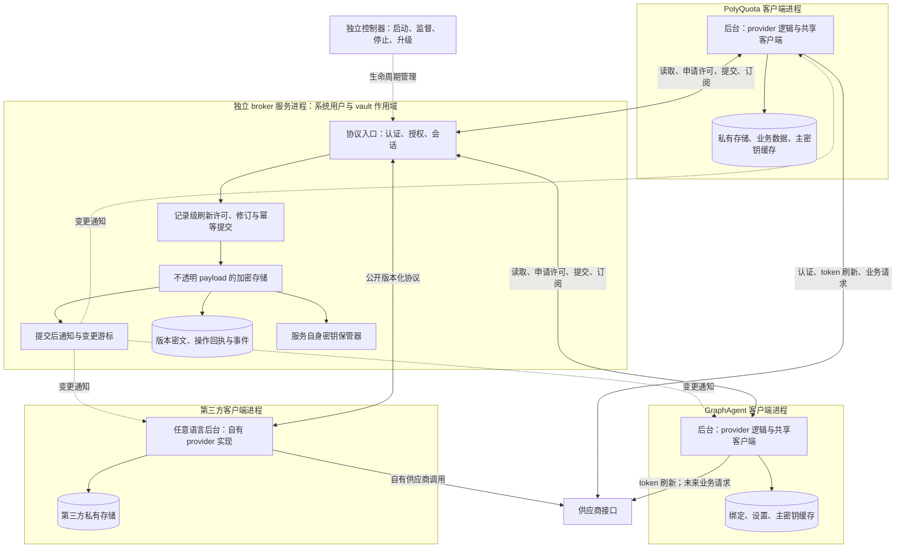
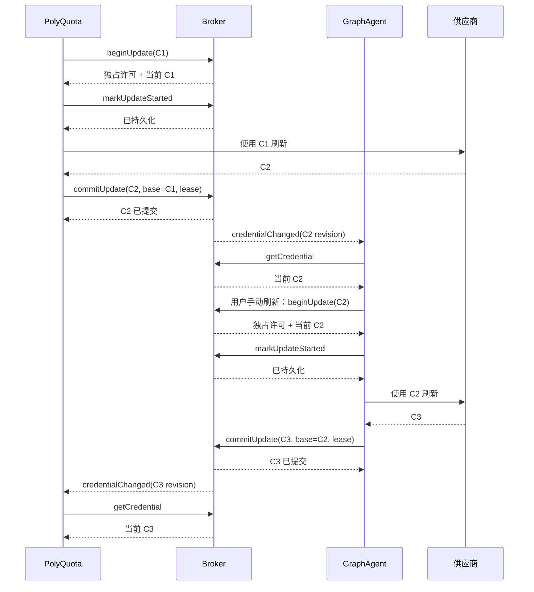

# 凭据共享设计

| 项目     | 内容                                                                                               |
| -------- | -------------------------------------------------------------------------------------------------- |
| 状态     | 总体目标设计；A1—A8 实施与历史验收分别见实施记录，组件兼容性按第 7.5 节前置校验                               |
| 更新日期 | 2026-11-07                                                                                         |
| 范围     | 同机、同一系统用户；产品业务数据库独立                                                             |
| 实施入口 | [两阶段实施方案](./implementation-plan.md)、[A1/A2 实施详细设计](./broker-a1-a2-detailed-design.md)、[A3—A5 导出侧实施](./a3-a5-export-implementation.md)、[A6—A8 接收与共享实施](./a6-a8-sharing-implementation.md)       |
| 关联     | [项目架构](../../../architecture.md)、[Provider 协议](../provider/design.md)、[服务模式](../service-mode/design.md) |

## 1. 目标与阶段边界

单产品默认使用私有凭据存储。Electron 宿主可使用 safeStorage；GraphAgent 正式独立 Web 模式由 Node 服务提供持久密钥保护。两种前端都通过所属产品的 Hono 应用执行凭据操作。共享由用户主动开启：发起方导出加密数据并交付迁移密钥，接收方输入密钥验证后导入，之后由按需启动的独立 Credential Broker 作为共享凭据来源。供应商刷新由应用执行，broker 负责互斥许可、版本提交与变更通知。每个产品同一时间只有一个活动凭据后端。

| 能力            | 一阶段                                                 | 二阶段                                          |
| --------------- | ------------------------------------------------------ | ----------------------------------------------- |
| 导出方向        | PolyQuota → 共享存储，首次单向导出                     | 两个产品均可导出                                |
| 导入方向        | 共享存储 → GraphAgent，单向导入                        | 两个产品可从受支持来源导入/切换                 |
| 建立共享        | 两侧准备完成后由同一 broker 接管                       | 沿用同一所有权机制                              |
| 切回内置        | PolyQuota 支持；恢复本次共享需重新输入迁移密钥         | 两个产品均支持完整往返切换                      |
| 数据更新        | 正常凭据刷新、首次导出的失败恢复                       | 重新导出、更新成功版本、迁移密钥与存储主密钥更新 |
| 组件交付        | A1—A8 使用本地自包含产物完成安装与单向共享验收         | 双向共享验收通过后，B4 发布 Release 并接入生产下载 |
| GraphAgent 界面 | 一个空白主页、一个设置页                               | 仅扩展设置中的共享管理                          |

一阶段 GraphAgent 只承担导入与共享接入验证，其聊天、Agent Loop、任务、工具与用量能力按独立计划推进。后续供应商配置格式和共用页面见[供应商接入与模型目录设计](../provider/connections-and-models.md)，broker 继续按本文约定处理不透明记录。双向共享、存储切换和元数据升级重新导出的步骤与验收见[凭据共享实施方案](./implementation-plan.md#双向导出与存储切换)。

## 2. 不透明凭据服务

### 2.1 进程与数据边界

broker 是独立安装、启动和升级的不透明凭据存储与并发协调服务：只处理不透明字节、字符串元数据、SQLite 事务、租约和事件，供应商协议、OAuth 与刷新实现留在应用侧。一个系统用户可注册多个 vault，每个 vault 一个服务实例，客户端数量不限。



客户端独占业务库，broker 独占共享库。共享模式下客户端只持有请求期间的内存快照、绑定和修订号，业务调用与刷新前从 broker 读取当前记录。

### 2.2 记录、元数据与发现

`astra-credential-broker` 是独立仓库与发布组件，拥有可执行入口、运行依赖、构建/安装产物和管理命令。通用协议/schema 面向任意语言的第三方客户端，TypeScript SDK 可独立发行。产品工作区的 `credentials` 包提供 SDK，Windows 组件安装、检查与发现从其 `/host/windows` 子入口按需加载。客户端安装包只包含协议客户端与安装引导，broker 的独立发行步骤见第 7.4 节。

现有 TS provider、OAuth、刷新与过期判断留在应用侧 Core，供两个产品复用，第三方使用自己的实现。服务只校验权限、通用消息结构、payload 大小、修订与操作状态。

共享记录外壳为 `{ credentialId, revision, createdByClientId, lastUpdatedByClientId, metadata, contentType, payloadFormatVersion, payload }` 及通用加密/审计字段。payload 是不透明字节，客户端可约定其为包含 provider/offering/authMethod、稳定身份和完整 secrets 的信封；具体编码、内容校验与身份去重由客户端负责。产品用量、通知、任务不进入 payload，产品保留自己的 localAccountId 绑定。

| 字段                    | 语义                                                                                                                       |
| ----------------------- | -------------------------------------------------------------------------------------------------------------------------- |
| `createdByClientId`     | 在本 vault 创建记录的客户端 ID，由 broker 依据认证身份写入，创建后不可修改。                                              |
| `lastUpdatedByClientId` | 最近一次成功提交记录的客户端 ID，由 broker 写入；创建时等于 createdByClientId，读取、失败、超时或重复回执不改变它。       |
| `metadata`              | `Record<string, string>`，默认 `{}`；保存无秘密的用途/能力声明与字符串扩展键值，不含 token、主密钥、用量数值或业务数据。 |

clientId 是服务授权登记的稳定客户端身份，重启不变，客户端注销后历史 ID 仍保留。现有共享记录的导入绑定、版本复制、重加密与换钥不改写两个归属字段；跨 vault 新建记录按新创建处理。元数据与 payload 一起受加密和完整性保护。

metadata 编码为单层对象且值只能是字符串：拒绝对象、数组、数字、布尔值与 null，不做隐式转换；删除键使用单独的 removeKeys。初始上限为 64 个键值对、键 128 字节、单值 1 KiB、整个编码 16 KiB，查询条件与修改后的完整 metadata 同样校验；字符串不再递归解释为 JSON。

能力声明按凭据实际可用的能力填写。客户端共同约定 `metadata.supportsUsage` 与 `metadata.supportsInference` 取字符串 `"true"` / `"false"`，第三方扩展键使用自己的命名空间；缺失或无法识别的值视为未知。例如只支持推理的 API Key 可声明 `{ "supportsUsage": "false", "supportsInference": "true" }`，而确实支持用量查询的凭据可声明 supportsUsage 为 `"true"`。

`listCredentials` 返回权限范围内的分页描述（外壳字段，不含 payload），支持按创建/最近更新 clientId 与 metadata 字符串键值精确匹配，多个条件按 AND 组合。键值按完整字面值处理，区分大小写，不裁剪空白、不做类型转换、不支持嵌套路径。PolyQuota 使用 `metadataEquals: { "supportsUsage": "true" }` 筛选，再由自身 provider 能力决定是否读取与绑定，无需为筛选下载全部秘密。筛选只表达发现偏好，读取、更新与订阅仍按 scope 独立校验。变更通知覆盖授权范围内的记录 ID/修订，客户端重查描述并重算筛选，因此能力从 `"true"` 改为 `"false"` 时也会移出列表。

元数据更新沿用同一记录的许可、baseRevision/fence 与事务提交：按显式键设置或删除，未提供的键保留，普通刷新不清空未知扩展。payload、元数据、lastUpdatedByClientId、revision 与事件在同一事务提交，元数据单独成功修改也递增 revision 并通知。

公开接口包括 `listCredentials`、`getCredential`、`beginUpdate`、`markUpdateStarted`、`renewUpdate`、`commitUpdate`、`abortUpdate`、`getOperation`、变更订阅与本客户端解绑。broker 按 clientId/instanceId、credentialIds/scopes 授权，不硬编码产品名；全局删除、换钥与服务停止属于独立管理权限。

读取被授权 payload 的后台可取得其中全部秘密，包括 refresh token；UI 只接收应用投影后的脱敏结果。完整迁移导入另授主密钥级权限，持有主密钥者可离线解密整个版本。

### 2.3 刷新协议

刷新许可覆盖完整的“读取当前版本 → 调供应商 → 提交新版本”，自动刷新与手动刷新都必须遵守。

1. 客户端以 credentialId、observedRevision、operationId 调用 beginUpdate。broker 串行排队；观察修订已过时则返回最新 payload/修订，客户端重新判断是否还需要刷新。
2. 获准时 broker 原子返回当前 payload、baseRevision、leaseId、递增 fence 与服务代次；仅该会话可续期与提交。
3. 客户端解析信封，调用 markUpdateStarted 并收到持久化回执后，才向供应商发送刷新请求。provider 协议与响应判断全部在客户端执行。
4. 客户端以 operationId、leaseId/fence、baseRevision 调用 commitUpdate 提交不透明 payload。broker 校验许可与修订，在同一事务提交新 payload、可选元数据、lastUpdatedByClientId、递增 revision、幂等回执与变更事件，然后释放许可。
5. 客户端判定本次刷新失败时立即调用 abortUpdate，不等待租约到期；网络错误、应用请求超时与供应商错误都适用。已得到成功结果但提交响应丢失时，按 operationId 查询或重试，不误报刷新失败；同一 operationId 的不同结果必须报冲突。

失败释放提交 `{ operationId, leaseId, fence, result: "failed", failureCode, retryable, upstreamOutcome }`，操作进入 `failed-released`。upstreamOutcome 只记录客户端已知的 unchanged/unknown。broker 不解析供应商错误，只保存受限分类与结果，在同一事务终结操作、失效许可、释放占用并唤醒一个等待者；新许可使用更大的 fence。失败不修改 payload，也不递增 credential revision，可发布无秘密的完成通知，但不发布 credentialChanged。

失败方可以停止重试，也可以退避后以新 operationId 重新排队，取得新许可并重新读取最新凭据；不能复用已终结的许可。abortUpdate 可幂等重发：若提交实际已成功则返回原成功回执，若旧许可已被接替则返回其终态，绝不释放新持有者的许可。客户端无法连接 broker 发送失败释放时，停止本次刷新与续期并记录释放未确认；恢复后查询或幂等重发，broker 按租约到期接替。

重新授权替换、手动编辑与全局删除同样经过记录的更新协调。若多条记录共用刷新授权族，客户端可在导入时声明 coordinationKey，由服务固定其互斥组，broker 不解析供应商内容推测关联。

许可与修订只约束遵守协议的共享客户端。

### 2.4 可见性



提交后立即向获准订阅者发布 `{ credentialId, revision, eventSequence }`；客户端后台重查描述与用途筛选，为仍匹配的活跃消费者读取最新内容并通知。不匹配时不读取 payload，无活跃消费者时只保留修订/失效标记，实际请求再读取。token 不进入 UI 事件或日志，临时 payload 用完即释放。

事务提交是可见性点：此后的 getCredential 返回当前已提交记录，不回退。通知可重放或去重，断线按游标补取或重读当前记录；已发出的请求仍持有旧快照，不被追溯改写。

### 2.5 有界租约

正常运行阻止并发刷新；故障超时后接受供应商侧可能重复刷新的风险，避免永久锁住记录。`update-uncertain` 只描述旧操作结果未知，不构成后续更新的锁。初始参数按下表设定，按真实刷新耗时调整：

| 参数                 | 初始值     | 含义                                                                               |
| -------------------- | ---------- | ---------------------------------------------------------------------------------- |
| leaseTtl             | 30 秒      | 从发放或最后一次成功续期起的许可有效期，也是暂时断线的容忍窗口                     |
| renewInterval        | 10 秒      | 应用刷新任务存活期间续期；普通会话心跳不替代此续期                                 |
| maxHoldTime          | 120 秒     | 从首次取得许可计算的绝对占用上限，任何续期都不能延长                               |
| 应用单次上游请求超时 | 建议 20 秒 | 正常请求尽量在一个租约窗口内结束，为提交留出时间；具体超时由应用按 provider 设置 |

broker 计算 `expiresAt = min(lastGrantOrRenewTime + leaseTtl, grantedAt + maxHoldTime)`。续期必须在许可有效时完成且匹配当前 leaseId/fence；已过期的许可不能复活，重新连接不重置 grantedAt。

- **短暂掉线**：不立即释放。原持有者在期限内恢复认证并续期或提交，等待者只等待 broker 的授权结果。
- **主动失败释放**：abortUpdate 送达后立即进入 failed-released，等待者可马上获得新许可，无需等待 TTL；上游结果 unknown 也不阻止该分支。
- **租约到期**：无论是否标记 started，原许可失效。broker 在同一控制事务中标记旧操作 expired、增加 fence，并只向一个等待者发放新许可与最新已提交 payload。
- **达到 maxHoldTime**：强制失效，独立心跳线程不能永久占锁，新请求进入正常排队。
- **清理定时器延迟**：beginUpdate、renewUpdate、commitUpdate 均在事务内检查服务端期限，配合公平队列与 operationId 去重。

markUpdateStarted 作为诊断与恢复事实保留，不改变截止时间。commitUpdate 必须同时匹配 leaseId、fence、服务代次与 baseRevision，且当前许可未到期；检查与写入在同一事务完成，过期者收到 lease-expired/stale-fence。已成功提交但回执丢失的请求按 operationId 查询或返回原回执，不重新刷新或分配修订。

旧客户端发现续期失败、许可过期或被接替时，应取消在途请求并停止提交；恢复后先读取当前修订，丢弃旧操作的迟到结果，仍需刷新则重新排队。broker 不解析 payload 判断哪个供应商 token 更新。

示例：PolyQuota 在 t=0 获得 fence=10，t=10 续期到 t=40，t=12 掉线；GraphAgent 在 t=40 后取得 fence=11 并从当前记录刷新；PolyQuota 在 t=45 返回的结果不可提交，若持续续期但不完成，最迟 t=120 失去许可。fence 阻止旧结果写入共享库，但供应商可能已处理旧请求，应用按供应商结果做有限重试或提示重新授权。

服务重启恢复原 grantedAt/expiresAt 与操作回执，不重新计时；旧服务代次的提交无效。运行中采用单调时钟计算有效期，OS 级单实例锁仍独立于租约。

### 2.6 技术选型

一阶段采用 **C# + 常规 .NET 自包含发布**：优先跨平台稳定性与构建、调试简单，不设体积或性能门槛。供应商实现继续留在应用端。

| 项目       | 一阶段约定                                                                                                              |
| ---------- | ----------------------------------------------------------------------------------------------------------------------- |
| 工具链     | 使用实施时受支持的 .NET LTS，固定 SDK 与依赖版本；采用常规托管构建、测试和调试                                          |
| 发布       | `SelfContained=true`，按目标 OS/架构发布独立目录并携带所需 .NET runtime                                                 |
| 优化开关   | `PublishAot=false`、`PublishTrimmed=false`、`PublishSingleFile=false`                                                   |
| 运行入口   | 独立服务与管理命令；支持前台控制台运行和断点调试                                                                        |
| 存储与协议 | Microsoft.Data.Sqlite 随包携带一致版本的 SQLite；固定 DTO、`Dictionary<string, string>`、标准密码实现与跨语言互操作向量 |
| 平台适配   | 单独封装通信权限、系统密钥保管、进程控制和自动启动；公共协议、加密格式与租约状态机跨平台一致                            |

自包含发布免除用户预装 .NET 并保留完整诊断能力，见 [.NET 发布模式](https://learn.microsoft.com/en-us/dotnet/core/deploying/)与 [Microsoft.Data.Sqlite 部署说明](https://learn.microsoft.com/en-us/dotnet/standard/data/sqlite/custom-versions)。Native AOT、Rust 与 Node 不作为一阶段交付或比较原型，出现明确需求再评估。JSON/schema 与互操作向量作为跨语言契约，TS SDK 不成为服务运行依赖。一阶段先验收 Windows，保留 macOS/Linux 适配边界；重点验证 SQLite、加密、通信、密钥保管以及休眠恢复、断连、租约到期、崩溃、重启与升级。

## 3. 存储位置、加密与密钥

### 3.1 共享位置

默认路径为 Windows `%LOCALAPPDATA%\AstraConductor\Credentials\v1`、macOS `~/Library/Application Support/AstraConductor/Credentials/v1`、Linux `${XDG_DATA_HOME:-~/.local/share}/AstraConductor/Credentials/v1`。一阶段先验收 Windows。用户通过桌面系统目录选择器选择本地空目录，导入方选择同一位置。broker 不限制用户所选目录的 ACL 或属主，也不绑定物理目录身份；停服后可手动复制、移动、备份与还原，并显式登记新位置。产品侧的共享后端迁移与多客户端路径切换仍属后续阶段。

```text
Credentials/v1/
  manifest.json                 # 布局、vaultId；不含秘密
  control.db                    # currentVersion、更新权、发布/切换回执
  versions/<storageVersion>/
    version.json                # attemptId、keyId、清单与摘要
    credentials.db             # 不透明记录、密文、更新许可/回执与事件
    migration.json             # 加密主密钥及导入校验快照
  runtime/                      # 锁和端点信息
```

用户目录及还原文件的已有权限不作为拒绝条件，不自动改写用户目录 ACL。broker 为自己新建的内部目录、文件、WAL 和临时数据设置权限，验证实际读写能力并保留规范化路径与重解析点检查。离线数据保护依赖加密、认证与完整性校验；普通备份不要求保留原 ACL 或文件系统 ID。版本指针只读取 control.db 的 currentVersion，manifest 不维护第二个版本指针。

### 3.2 参数明确的跨平台加密

“确定性”指双方取得明确参数后能一致加解密，不要求密文固定。使用 AES-256-GCM（32 字节密钥、12 字节 nonce、16 字节标签）；迁移密钥随机生成 32 字节，通过 HKDF-SHA-256 派生包密钥。规范依据：[GCM](https://csrc.nist.gov/pubs/sp/800/38/d/final)、[HKDF](https://www.rfc-editor.org/rfc/rfc5869)、[JCS](https://www.rfc-editor.org/rfc/rfc8785)。

```text
header = {
  format, version, vaultId, storageVersion, attemptId, transferId, keyId,
  cipher: { name: "AES-256-GCM", nonce, tagLength: 128 },
  kdf: { name: "HKDF-SHA-256", salt, info, outputLength: 32 },
  payloadSchemaVersion
}
info = UTF8(JCS(["astraconductor.credential-transfer.v1",
                vaultId, storageVersion, attemptId, transferId]))
K_transfer = HKDF-SHA-256(migrationKey, salt, info, 32)
AAD = UTF8(JCS(header))
(ciphertext, tag) = AES-256-GCM(K_transfer, nonce, UTF8(JCS(payload)), AAD)
```

JSON 使用 UTF-8，二进制采用无填充 base64url，salt 为 32 字节。header 参数全部认证；算法、长度、info 与 schema 按版本白名单校验，拒绝重复属性、未知参数和超限输入。修订号采用十进制字符串。认证通过前不输出明文。

迁移包 payload 包含版本标识、独立随机生成的存储主密钥、通用记录/修订清单与不透明记录字节的 base64url 快照，不含业务数据。活动记录同样采用 AES-GCM，AAD 绑定 vault/version、attemptId、credentialId 与 revision。密钥不硬编码、不从机器身份推导，同一密钥不复用 nonce；失败候选重建必须更换 attemptId、密钥及随机参数。

### 3.3 两种密钥与本地记忆

- **迁移密钥**：用户在发起方取得、填入接收方，显示为 `acm1_` 加 43 字符 base64url。不缓存、不写入包、日志、URL、事件或普通查询。
- **存储主密钥**：由迁移包保护，后台验证后写入本客户端安全缓存，索引包含位置、vaultId、storageVersion、attemptId、keyId；UI 与产品业务库只保存状态/引用。

系统密钥库或 safeStorage 保管客户端缓存，broker 使用自己独立的密钥保管器。普通重启与切换失败保留缓存；用户主动切回内置时删除本客户端相关版本的全部缓存与自动接入凭证，不删除服务自身持久密钥。删除失败记录 keyCleanupPending，重启继续处理。

这里记住的是加密主密钥和服务接入材料，供应商 access/refresh token 不进入客户端长期缓存；临时导入验证内容用完释放，一次性来源备份按验证/清理流程处理。

同一有效版本的迁移包保留，用户再次输入迁移密钥即可重新导入。忘记密钥后无法凭导出记录或 broker 在线自动恢复。握手采用一次性挑战，但迁移密钥不是一次性邀请。主密钥级信任与受限第三方授权分别管理，见第 2.2 节。

## 4. 导出、导入与后端切换

客户端分别记录 `exportState`、`exportedVersion`、`rememberedKeyRef`、`selectedBackend`、`activeBackend`、`switchState/operationId` 与 `keyCleanupPending`，UI 按真实阶段展示。

| 结果                        | 恢复规则                                                                        |
| --------------------------- | ------------------------------------------------------------------------------- |
| 导出成功                    | 数据已回读验证、主密钥已安全记住、currentVersion 已发布；尚未授予 broker 更新权 |
| GraphAgent 导入就绪         | 用户输入密钥并验证数据，确认后记住主密钥；等待统一接管                          |
| 切换明确失败                | 保留成功导出与密钥，重试无需再次输入；确认未移交时原后端可继续更新              |
| 切换结果未知                | 冻结受影响更新，按原 operationId 查询回执，不启动第二个更新者                   |
| broker 已接管而本地接线失败 | 根据成功回执向前恢复，不重新导出或恢复旧刷新者                                  |
| 主动切回内置                | 当前客户端保存私有副本、解绑并忘记主密钥；共享侧继续运行，再进入需重新解锁      |

一阶段顺序为 **PolyQuota 导出 → GraphAgent 解密导入就绪 → 两侧准备 → broker 接管 → 两侧确认共享**。接管前来源停止新凭据更新并排空在途操作；先验证目标，再持久化提交意图和 broker 回执，最后切换本地绑定/DI。产品数据库与共享库不假设分布式事务。

接受方应用校验包摘要、版本、账号归属与解密结果，UI 只展示脱敏预览；broker 只校验通用存储外壳与更新许可。登录是否仍有效、快照是否足够新由应用判断，身份冲突按明确规则处理。

## 5. 客户端切回私有存储

该规则适用于任意客户端，一阶段先实现 PolyQuota 入口。切回只影响退出方，broker 继续管理原共享凭据，其他客户端保持使用，不冻结其他会话、不更改共享更新权或 currentVersion。

1. 用户选择私有存储，界面说明：将保留一份独立凭据副本，后续各自刷新；供应商可能轮换或使另一副本失效，风险由用户承担。
2. 已接管的凭据由获准后台读取一致性快照，在本客户端私有后端加密保存并回读；尚未接管则继续使用来源原内置记录。保存快照不停止其他共享客户端在许可下的刷新与提交。
3. 本地提交后切换运行后端，撤销本客户端共享会话/绑定并关闭连接，删除该客户端记住的主密钥与自动接入凭证。其他客户端缓存、broker 自身密钥与共享目录保留。
4. 私有副本此后由本客户端独立刷新，可能与共享副本使用相同 token。两边不回写、不合并、不互相同步失效状态，各自按供应商结果显示失败或重新授权需求。

`switchOperationId` 记录本地快照、切换、解绑与密钥清理的进度。快照写入失败时不宣告切换完成；本地切换已完成但远端解绑失败时，退出方停止共享调用并清理本地秘密，持久化待解绑状态，由服务会话到期或后续对账清理。keyCleanupPending 用于恢复安全缓存删除，迟到响应不能回填已忘记的密钥。

broker 不可达不触发自动切换；用户主动切换时，已有可解密的本地副本或已验证导入快照可作为私有来源，并提示其时点与过期风险。没有任何可用副本时仍可选择私有后端，账号显示待导入或待授权。

再次加入共享必须重新输入迁移密钥（受限第三方重新完成授权流程），读取共享侧当前版本并新建本客户端绑定，不将私有副本的刷新结果覆盖共享库。合并或重新导出私有更新属于二阶段。

## 6. 数据版本与一致性

版本状态为 `building → verified → current → retired`，失败候选为 failed。一阶段实现初始版本与失败恢复，二阶段开放成功版本的重新导出与换钥：

1. 当前版本为 N 时，所有新写入在候选 N+1 中完成，不原地覆盖当前密文或密钥缓存。
2. 验证全量数据、迁移包、主密钥缓存与来源修订水位；已运行的服务还须先持久化自己的新版本密钥，保留旧版本槽。并发更新时设置维护屏障，拒绝新许可，等已发放许可提交或明确终止后补齐差量；许可到期按第 2.5 节失效并 fence 后可继续发布。发布只包含当前已提交数据。
3. 以控制库事务更新唯一 currentVersion 与发布回执，提交后通知客户端。版本发布与服务接管是不同事务。
4. 确定未发布的失败候选可删除重建，已成功发布过的版本号不复用；结果未知时先查询回执。
5. 旧版本与缓存待读者和恢复操作不再引用后清理，清理失败不回退 currentVersion。

普通 token 刷新只增加 credential revision，不创建导出版本。日常密文、操作回执与事件在当前 credentials.db 同事务提交；发布/交接回执在 control.db。构建新版本时带上去重索引与事件水位。

共享记录的刷新许可、替换与删除经过 broker 队列及修订检查；外部结果未知时记录操作事实，许可到期后允许其他客户端接替。共享故障不启用内置旧副本；AEAD 与版本号不提供远端 exactly-once，也不防止整库恶意回滚。

## 7. broker 生命周期

### 7.1 控制权与运行身份

服务以当前 OS 用户身份运行，独立控制器负责 start/status/stop/restart/upgrade，用户级独立监督进程负责进程监督，不随客户端退出。Windows A1/A2 按用户确认使用隐藏监督进程、默认按需启动，不依赖任务计划或 SCM；监督入口与 worker 分别持有 OS 独占锁。独立 CLI 可完成安装、初始化、授权与解锁，未安装产品也可被第三方使用。

客户端日常只调用 ensureRunning 启动已登记服务，并连接/断开自己的会话；该请求幂等，普通客户端没有 stop/kill/upgrade 权限。设置页的安装、卸载和重新下载安装由用户发起，通过独立管理通道执行；broker 未安装时也能启动安装引导。可执行文件、服务配置与数据位置分别登记，运行文件从受信任安装位置加载。

服务默认按需启动，管理员可选择常驻；刷新定时器由各应用调度，broker 只发放更新许可。serviceStatus、vault 解锁、共享记录激活与客户端接入分别报告。

### 7.2 状态与转换

| 状态     | 进入与退出规则                                                                                                      |
| -------- | ------------------------------------------------------------------------------------------------------------------- |
| STOPPED  | 首次连接或独立管理命令请求启动；多个请求合并为同一实例                                                              |
| STARTING | 控制器启动服务；取得目录/vault OS 独占锁，恢复版本和操作回执，校验协议与存储后发布端点；失败时不启动第二个写入者    |
| LOCKED   | 服务进程正常但服务密钥保管器不可用；可查询状态与授权解锁，不读取 payload 或发放更新许可；解锁成功进入 READY        |
| READY    | 接受获准会话与操作；客户端退出只释放该客户端会话，不触发服务停止                                                    |
| IDLE     | 无有效客户端会话、无在途/恢复操作且无需继续的后台任务；默认空闲 60 秒后退出，有新请求则回 READY                    |
| DRAINING | 空闲退出或管理停止/升级：停止新操作，排空在途调用、持久化回执，关闭数据库和端点，清除内存密钥，释放 OS 锁后退出     |
| FAILED   | 启动/恢复失败或异常退出超过重试预算；保留数据并提供安全诊断，由管理端修复或重试                                     |

会话通过连接和有期限的保活记录管理，客户端崩溃不会永远阻止空闲退出；保活到期只移除该会话，不用作凭据写入锁。仍有有效会话或待处理工作时，不因另一客户端退出而进入空闲停止。

### 7.3 密钥、崩溃与升级

broker 使用服务自身稳定身份的安全密钥保管器保存获准 vault 的主密钥，客户端缓存只是各自接入/切换的便利副本。首次导入经授权把已验证主密钥交给服务后，服务重启不依赖最早导出客户端在线。保管器不可用时进入 LOCKED，可由独立管理端或获准客户端解锁。

进程崩溃由服务控制器按有限退避重启，确认原进程退出且取得 OS 锁后才恢复写入。恢复时检查 currentVersion、发布/交接回执与更新许可，保留原许可截止时间；旧操作可标记结果未知，原期限到达后按第 2.5 节递增 fence 并允许接替。客户端按 operationId 查询已提交结果，provider 错误与重试留在应用侧。

stop/restart/upgrade 是单独的管理操作，明确影响全部当前客户端。停止时拒绝新许可，允许已获准操作提交或终止并查询回执；超过停止期限则持久化未决操作与原许可截止时间后退出。升级排空旧进程并释放锁后启动新版本，协议不兼容时拒绝接入，不并行运行竞争服务。

卸载某个客户端只清理它自己的注册、会话和缓存，不卸载独立 broker。服务卸载与共享数据/服务密钥删除由独立管理入口分别执行；空闲退出与正常重启不删除持久密钥和版本数据。

### 7.4 独立发布、按需安装与设置管理

一期 A1—A8 使用本地 .NET 自包含产物，包含服务、控制器及所需 runtime/SQLite。二阶段的 B4 通过独立仓库的 GitHub Releases 分发按 OS/架构区分的资产。发布清单记录组件 SemVer、API level、协议/存储兼容范围、目标平台、资产大小与校验信息。客户端根据协议与 API 选择可用候选，再按 SemVer 判断更新先后。发布源属于应用的可信发行配置。[GitHub Releases](https://docs.github.com/en/repositories/releasing-projects-on-github/about-releases)

开发阶段将本地 `dotnet publish` 的完整自包含目录复制到独立安装位置，再执行安装登记与检查，无需 Release 或网络；本地来源由安装命令显式指定，常驻服务不从源码输出目录运行。开发产物复用组件管理锁、安装登记、停止/替换与失败恢复流程，仍需检查目标平台、依赖完整性、通信协议与 API 能力。

凭据专项二阶段从 B1 合包开始，将 Windows 安装及连接适配器归入 `credentials/host/windows`，沿用既有 broker 协议完成本地回归。B3 验收两种导出方向和两端后端切换，通过后进入 B4，先发布并核验 Release 资产，再向客户端写入真实下载仓库、版本/资产标识、兼容清单与发行校验配置。详细步骤和验收以[凭据共享实施方案](./implementation-plan.md)为准。

A3 先约定下载暂存目录及版本/平台布局，由开发者手动放置打包好的完整自包含产物与本地校验清单，再由安装入口校验并安装到独立运行目录。该流程不联网，不要求已有 Release；本地产物明确标记来源，检查版本、平台、协议兼容、依赖、摘要及解包路径，不冒充生产发行签名验证。A4 与后续导出、导入、共享切换通过安装登记发现并复用该安装。B4 补齐可信下载及发行校验，下载就绪后复用同一安装入口。具体暂存路径在实现时统一配置，不将暂存目录作为服务运行位置。

生产环境需要共享时才提示下载安装：导出、导入或恢复共享前检查安装登记、文件完整性、通信协议与 API 能力；未安装时引导用户下载、校验、安装并复查，取消或失败时保留原后端与导出状态。已安装且兼容的组件直接复用，连接失败只报告服务异常。安装成功、导出成功、服务 READY 与共享接管分别判断。

两个产品设置页增加“凭据共享服务”一节，查看状态不读取 payload，也不启动服务：

| 展示项   | 行为                                                                                     |
| -------- | ---------------------------------------------------------------------------------------- |
| 安装状态 | 未安装、已安装、安装损坏、版本不兼容、无法确认；与运行状态、vault 解锁及共享接入分开      |
| 组件信息 | 组件 SemVer、已提供/所需 API level、安装位置、协议兼容结果，以及最近检查/安装错误；检测不依赖 broker 在线 |
| 操作     | 重新检查、未安装时安装、已安装时卸载、重新下载安装；运行故障另提供状态/诊断              |
| 操作进度 | 下载/校验/安装/卸载进度与失败重试；操作结果不覆盖原有导出/共享状态，完成后复查实际结果   |

安装器使用独立于 vault 的当前用户组件管理锁，合并并发安装/重装请求。生产资产先下载到临时目录，校验发布清单、摘要与发行签名后安全解包到独立版本目录；开发安装复制指定 publish 目录到暂存目录并复用后续流程。验证可执行身份、协议与依赖后再登记为可用安装。安装目录独立于客户端目录、共享 vault 与服务密钥保管位置。

卸载会暂停当前用户下所有依赖该安装的 vault/客户端；确认后进入维护状态，禁止 ensureRunning 拉起与新许可，排空并确认进程退出后删除组件文件与启动注册，默认保留共享库、主密钥、客户端绑定与迁移回执。服务不可达或无法确认进程退出时报告卸载未完成。

“重新下载安装”先下载并校验兼容包，再进入维护并替换组件；同版本重装可用于修复。下载失败保留旧安装，切换失败保留可恢复的旧安装。重装保持服务身份与密钥保管位置稳定，数据可解锁时恢复原绑定；密钥不可用则进入 LOCKED。

### 7.5 组件与 API 兼容性前置校验

三个版本分别回答“是否有更新”“能否通信”“所需功能是否具备”，不能互相替代。PolyQuota 与 GraphAgent 共用 `BROKER_COMPATIBILITY` 声明通信协议和所需 API level；`BROKER_DISTRIBUTION` 单独描述候选发行包，不参与功能兼容判断。

| 版本 | 类型 | 作用 | 不承担的职责 |
| --- | --- | --- | --- |
| 组件版本 | SemVer 字符串，可含 prerelease / build metadata | 判断发行包更新、展示已安装版本；按 SemVer 排序，build metadata 不影响更新先后 | 不设“最低可工作组件版本”，不以发布版本大小或运行版本与清单不同判定功能不兼容 |
| 协议版本 | 从 `1` 开始的正整数 | 保证帧、消息封装和认证流程能够通信；通常很少变动 | 不证明具体业务方法已实现；新增业务方法本身不要求提升协议版本 |
| API 版本 / API level | decimal，通常为整数 | 类似 Android SDK API level，声明提供的方法和能力；客户端在业务前检查 `服务 API >= 所需 API` | 不按 SemVer 分段比较，不要求服务 API 与客户端所需值或清单声明精确相等 |

当前发行候选是组件 `0.2.0`，当前通信协议为 `1`，应用要求 API level `2`；这三个值没有数值对应关系。协议兼容时，组件 `0.0.1-beta+build.7` 提供 API `2.5` 可以满足 API `2.25` 的需求，组件 `9.9.9` 只提供 API `1.9` 则不能满足。`2.10` 与 `2.1` 是同一 API 数值，`2.25 > 2.2`。

现有存储/迁移包格式版本仍单独约束数据读写，不是上述三个版本之一，也不同于某次导出的 `storageVersion` 标识或凭据记录 `revision`。本轮不改变数据格式、导出版本、主密钥或产品绑定。

检查分为以下三个边界，前一个通过不能省略后一个：

1. **执行安装前**：验证候选包的身份、平台、SemVer 元数据、协议/API 声明、数据格式、文件摘要及路径。独立安装器复制候选后运行 `component-info`，核对实际文件的版本和能力声明与清单一致，并检查 SQLite。这里的版本一致性是安装产物完整性校验，不是“旧版本不能工作”的兼容规则。通过探测后才进入维护和替换。
2. **进入共享业务前**：只读检查安装登记、清单和完整性，不启动服务、不读 payload。通信协议不受支持、缺失 API 声明或 API level 不足时，立即要求安装具备所需 API 的组件；组件 SemVer 较旧本身不会阻止业务。导入、确认、导出、接管、重试和重入在产生共享业务副作用前执行检查。明确选择离线私有副本仍按第 5 节处理。
3. **发送业务 RPC 前**：握手确认实际运行服务的协议，并按其实际 API level 判断能力。服务 level 较高或组件版本与清单不同本身不构成拒绝理由；不能以请求新方法后捕获 `method-not-found` 代替检查。通过前置判断后仍须完成双向认证，未认证 greeting 不作为可信状态。

接口字段暂沿用 `apiRevision`，但其类型和语义为十进制 API level。在线 JSON 使用 number；.NET 使用 decimal，TypeScript 的专用解析保留十进制原文，精确比较系数和小数位，不先转换成 IEEE-754 浮点再比较。支持 .NET decimal 的非负精确范围，拒绝需要舍入的值；`2`、`2.0`、`2e0` 规范化为同一数值。普通凭据/迁移包 JSON 的既有整数约束不因此放宽。两端公开状态通过 `requiredApiLevel` 和 `installedApiLevel` 的精确十进制文本展示所需/已提供 API；实际兼容判断在 SDK 执行，界面不自行比较组件版本或将 API level 当作 SemVer。

认证证明继续覆盖协议、API、组件版本等握手声明，以防篡改；绑定组件版本不等于将其用于兼容判断。两个 API 位置用归一化的十进制 JSON 数字 token，整数 API `2` 的认证字节保持原样；不把数字改为引号字符串。服务在授予会话前确认客户端需要的 API 不超过自身能力。

旧服务缺少能力字段时，普通应用连接一律拒绝。独立管理控制器为停服升级保留显式 `allowLegacyLifecycle` 分支：必须使用管理身份认证，仅允许 `status`、`stop`、`disconnect`；其他方法返回 `legacy-lifecycle-only`。此白名单只用于确认旧服务状态、排空停止和断开，不授予旧服务新的导入、读取、刷新或共享接管能力。替换前仍须确认旧进程退出及 OS 锁释放。

该生命周期白名单也支持具有新式 greeting 的服务，只检查通信协议、固定生命周期 API 和认证，不比较组件发布版本。普通管理业务按其所需 API 判断，不能借用生命周期连接执行凭据请求。

版本演进规则：发布更新按 SemVer 管理组件版本；新增需要区分的功能能力时提升 API level，应用只在开始依赖该能力时提高所需 level；只有通信封装或握手机制确实不兼容时才提升协议版本。三者不建立数值映射或同步递增规则。发布修复可以保持协议和 API 不变；功能扩展通常保持通信协议不变。已发布产物的身份与完整性仍须稳定。

兼容性校验的实现落点、升级入口与本轮交付范围见 [A6—A8 兼容性补充](./a6-a8-sharing-implementation.md#9-兼容性前置校验补充2026-11-06)。历史 `0.1.0` 修复记录保留，不据此把旧产物认定为满足当前 API 合同。
