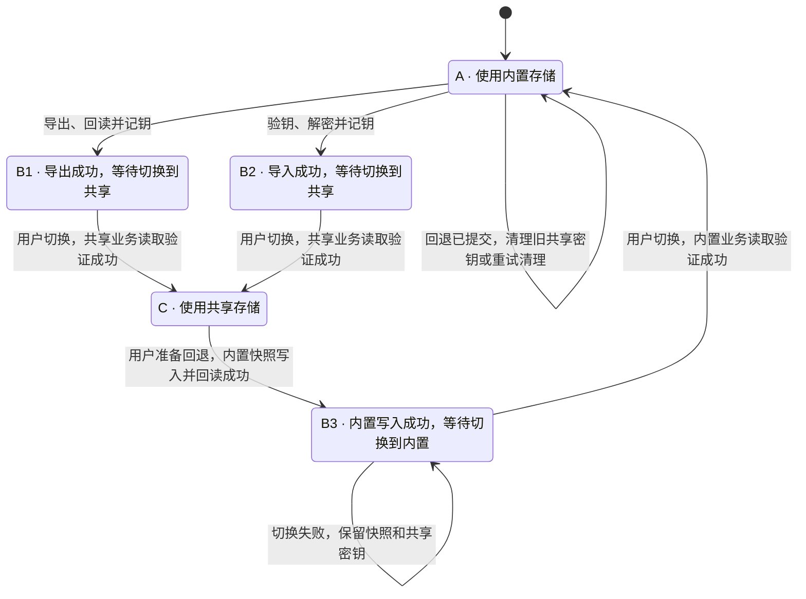

# 凭据导出、导入与本端迁移状态机

## 1. 实施范围

凭据专项 B2、B3 已完成。PolyQuota Electron 与 GraphAgent Electron 使用同一个本端迁移服务。任一端都可以发起共享或导入已有库。GraphAgent Web 使用服务端已有授权连接 broker。图中的 A、B1、B2、B3、C 表示单个产品 profile 的状态。

旧版 API 2 由 PolyQuota 发布、双方登记准备、来源端交接，GraphAgent 随后自动接线。API 3 在发布事务中授予 broker 共享库写入权。两端保留原业务后端，直到用户在本端明确迁移并完成业务读取验证。[迁移服务](../../../../packages/core/src/credential-migration-service.ts) · [一期交接记录](./a6-a8-sharing-implementation.md)

## 2. 目标状态与提交点

每个产品 profile 维护自己的迁移状态。导出向共享目录发布一份经过验证的快照；导入建立本端对该库的可信绑定；**迁移**才改变该产品处理供应商凭据时使用的后端。一个客户端进入 C 不会推进任何其他客户端。

### 目标代码状态名

两款桌面产品将本端状态保存在各自 profile 的 `credential-sharing/migration-state.json` 中。全新 profile 初始为 A。如果状态文件缺失且检测到旧绑定或钥槽，宿主会报告冲突。公共状态 DTO 使用字段 `migrationState: CredentialMigrationState`。GraphAgent Web 的 `migrationState` 为 `null`，按实际 broker 连接展示。[公共凭据状态 DTO](../../../../packages/contract/src/common/dto/credential-sharing.ts)

| 图中状态 | `CredentialMigrationState` 取值 | 写入该值的时机 |
| --- | --- | --- |
| A | `"private"` | 初始使用内置后端且无共享主密钥；回退时，本端切换到内置并通过业务读回验证后提交 A，随后清理旧绑定密钥。 |
| B1 | `"export-ready"` | 导出版本与本端密钥均已回读验证，已提交本端导出绑定。 |
| B2 | `"import-ready"` | 导入实际解密成功，已记住主密钥并提交本端导入绑定。 |
| B3 | `"private-ready"` | 本次快照已完整写入内置库并回读验证，等待用户切换。当前仍选共享，保留原共享绑定和主密钥。 |
| C | `"shared"` | 本端已完成首次共享接线与业务读取验证。此后断连仍保留该值。 |

`migrationState` 记录最近完成的转换。`selectedBackend` 表示持久选择，`activeBackend` 反映此刻实际接线，操作记录表示还欠哪一步。B3 等待期间仍用共享后端；A 已提交但旧密钥尚待删除时，页面显示「当前使用内置 · 旧共享密钥待清理」，并据实报告密钥状态。GraphAgent Web 未配置或断连时按其 broker 接入状态展示，不把不可用的后端映射为 A。

### 三条路径的统一状态图

三条路径都先写入并验证目标数据，持久保存相应的 B 状态，等待用户选择切换。重启后回到同一 B 状态；只有目标业务后端接线并验证成功，才提交终点状态。

| 转换 | 本端提交条件 | 失败或中断如何恢复 |
| --- | --- | --- |
| A → B1 | broker 在选定目录持久发布该次导出的完整版本。发起端按同一 vault、版本、attempt、keyId 解密回读，逐条核对记录、来源水位和元数据，再经系统保护保存并回读主密钥，提交本端导出绑定。 | 保持 A。按原操作查询发布回执，已发布则继续回读、记钥或交付。暂存钥槽只供该操作恢复，提交前不可作为正式绑定使用。明确未发布且候选已失效时，清理该尝试后再取快照。 |
| A → B2 | 接收端核对目录与库身份，用输入的迁移密钥实际解密、验证完整性。需要预览或同身份账号选择时，沿用当前操作确认；受保护的主密钥回读通过后提交本端导入绑定。 | 保持 A。输错密钥可在原目录改正重试；已验证且上下文仍有效时，继续未完成的记钥或绑定步骤。已有私有账号和草稿保留。 |
| B1/B2 → C | 用户在本端点「迁移到共享存储」。核验当前库、权限与密钥，排空本端在途修改，探测获准的当前共享记录；记录切换意图，切换本端凭据服务并验证业务读取，持久确认完成后返回 C。 | 提交前明确失败，撤销临时屏障，保留原 B 状态。提交或接线结果未知时，显示原 B 状态及「正在核对迁移结果」，按同一意图恢复；有切换意图期间，实际后端可暂不可用。确认已生效则向前完成，一次操作最多绑定一次。 |
| C → B3 | 用户确认准备回退。将获准范围内的一致快照加密写入内置库，回读验证后持久记录快照身份、水位和 B3，释放本端写屏障。 | 准备失败留在 C 并显示「重试准备」。共享绑定和已记住的主密钥保留。 |
| B3 → A | 用户点「切换到内置存储」。宿主按选定快照接线，用供应商业务使用的凭据服务验证内置读取；成功后原子提交内置选择、A 和旧绑定的待清理任务。 | 验证失败留在 B3，按原绑定恢复共享接线，保留快照和密钥以便重试。结果未知先查本端提交记录；只有已确认提交 A 才可执行删钥。 |

**两种顺序都可用。** 发起端可在 `(B1, A)` 时迁移到 `(C, A)`，即使接收端尚未启动。接收端也可从 `(B1, B2)` 先迁移到 `(B1, C)`；发起端可全程离线。两人同时迁移时，各自只提交本端绑定。来源端显示或确认保存迁移密钥是一次交付动作，可在 B1 或 C 恢复尚未确认的交付；交付确认不改变上述状态。

### 共享库写入权与私有副本

API 3 的 `publish` 将受保护的密钥、回读验证、共享写入权和操作回执纳入发布流程。来源退出后，broker 仍可独立解锁，获准客户端可以继续按记录许可、修订和 fence 读写。SDK 在业务调用前检查 API level。

发布回执绑定操作 ID、请求摘要与来源水位。原请求结果未明时，先查回执；已发布则按该次快照清单继续核验，即使内置库随后有变化也不能用新数据重放旧请求。确认未发布且来源已变化时，才以新操作生成候选。这样一次导出可以跨重启恢复，同时允许内置凭据在快照完成后恢复更新。

B1/B2 期间，本端业务继续使用内置存储，导出只短暂排空写入以取得一致快照，随后释放。共享库与内置库此后可以分别变化；同一供应商的轮换 token 在两份独立副本上刷新可能使另一份失效。导出时说明副本从此独立。迁移前核对导出水位、当前共享修订及本端同身份账号；发现变化时展示受影响的脱敏账号，允许继续使用共享当前值或留在内置，保留私有副本。正常路径只需一次迁移操作；重试同一选择前复核其依据。私有改动不得在迁移时自动覆盖共享的新修订，迁移失败也不得替另一端停止共享刷新。

### 显式返回内置存储

| 步骤 | 本端行为与恢复条件 |
| --- | --- |
| C 中准备 | 支持内置库的宿主提供「准备返回内置」。确认时显示快照来源、时点和独立刷新风险。在线时从同一版本和修订水位读取全部获准记录，对账删除及撤权，保留独立私有账号。离线时只允许用户选用已验证、仍可解密的副本；无可用快照则留在 C 并提示重连。零条记录须有可验证的空清单。 |
| B3 中等待 | 内置数据写入并回读成功即进入 B3。持久保存快照引用、旧共享绑定和钥槽，业务继续按共享选择运行。等待和重启均不自动切换或删钥。切换前复核已选快照；共享水位或授权有变时提示更新快照并重新对账，离线采用已选快照时显示其时点。 |
| B3 中切换 | 用同一操作 ID 记录切换意图，排空本端在途写入，在写屏障内接线内置服务并核验实际后端、账号清单及凭据可解密性。失败时恢复共享选择和接线；broker 不可达则显示「已选共享，当前不可用」。重启若查不到 A 的提交回执，按 B3 恢复；结果尚不能确定时保留密钥、阻止冲突写入并继续核对。 |
| A 中清理 | 内置业务验证成功后持久提交 A、内置选择和按旧绑定代次记录的清理任务，再开放内置写入。**只有读到这次 A 的成功提交，才能解除旧绑定并删除该绑定已记住的共享主密钥和自动接入凭证。** 删钥失败保持 A 和 `keyCleanupPending`；重试仅清理旧代次，不重复切换或用快照覆盖新的私有写入。远端解绑未确认时另记 `sessionCleanupPending` 至确认或会话到期。 |

回退只影响当前产品 profile。另一端继续使用共享库并按 broker 许可刷新。回退后重新加入时，用户重新输入当前迁移密钥，按 A → B2 → C 读取共享当前修订；旧清理任务须与新绑定、钥槽隔离。

## 3. 凭据页面与重试

状态标题由宿主的已提交状态给出。实际后端取自供应商业务使用的服务实例。组件安装、broker 运行状态、网络可达性、密钥是否可用和迁移密钥是否交付，各有独立的显示位置。GraphAgent Web 只有服务端授权的 broker 后端，未接入时显示「尚未接入共享／凭据不可用」并提供配置或重连指引；私有导出及切回仅在提供内置库的宿主展示。

页面动作与上方统一状态图一一对应。状态标题使用已提交状态，进度和错误显示在当前动作下。

| 本端状态与场景 | 页面标题与实际存储 | 用户可执行的动作 |
| --- | --- | --- |
| A，尚未操作 | 初始 · 内置存储；无共享主密钥 | 支持双角色的宿主提供「导出凭据」「导入凭据」。开始其中一项后只显示该项表单。 |
| A，导出或导入进行中 | 保持初始标题；表单内显示当前步骤和所选目录 | 执行中禁用重复提交。预览仅列脱敏账号。取消未提交操作时释放本次候选，保留其他绑定与已发布共享文件。 |
| A，导出失败 | 初始 · 内置存储；表单内临时显示失败原因 | 「重试导出」复用原目录和操作。未知回执时同一按钮先查询，已发布则续办；只有确需重新选择时才打开目录选择器。 |
| A，导入失败 | 初始 · 内置存储；表单内临时显示失败原因 | 「重试导入」保留目录、有效预览及已做的冲突选择；密钥错误或安全时效已过时，只要求补输迁移密钥或重做已过期的验证。 |
| B1 | 导出完成，未迁移 · 当前使用内置存储；显示已验证的目录、版本、条数及主密钥状态 | 主操作「迁移到共享存储」。迁移密钥待交付时，提供专用展示及「我已保存」；回执丢失可恢复交付。 |
| B2 | 导入成功，未迁移 · 当前使用内置存储；已记住主密钥；单列共享库的脱敏账号 | 主操作「迁移到共享存储」。关闭页面或重启后仍可迁移，无需再次输入有效密钥。 |
| B1/B2，迁移失败或结果未知 | 标题保持相应 B 状态；展示实际后端和本次错误或「正在核对迁移结果」 | 「重试迁移」续办同一切换。只禁用与该操作冲突的写入，并在原因消失后重新开放。 |
| C，在线 | 迁移完成 · 当前使用共享存储 | 显示共享账号；按宿主能力提供「返回内置存储」。发起端如有待交付密钥仍可恢复交付。 |
| C，离线或密钥暂不可用 | 迁移完成 · 已选共享，当前不可用；显示原因 | 「重试连接」或「重新验证密钥」；支持内置库且具备已验证快照时，也可显式选择「返回内置存储」。 |
| C，准备回退失败 | 保持共享选择；显示「写入内置快照失败」和原因 | 「重试准备」续办原操作。确认取消或快照验证失败均保留共享密钥。 |
| B3 | 内置写入成功，等待切换 · 当前仍选共享；显示快照时点、条数及实际连接状态 | 主操作「切换到内置存储」。关闭页面或重启仍保留该入口。 |
| B3，切换失败或结果未知 | 显示「切换到内置失败」或「正在核对切换结果」及实际后端 | 「重试切换」复用原快照和操作。保留共享绑定与密钥；结果未知时先查回执。 |
| A，旧绑定清理中 | 当前使用内置 · 旧共享密钥待清理；可继续使用内置账号 | 「重试密钥清理」只处理已经成功退回的旧绑定；远端解绑进度单列。 |

**操作上下文。** 宿主持久记录非秘密的操作 ID、种类、目录、vault/版本、步骤、快照水位及结果引用，返回已提交状态、实际后端、进行中的动作及允许的下一步。前端按这一份状态渲染标题和按钮。写命令带实例、后端上下文和操作身份；双击或响应丢失重发时返回同一操作的进度。另一个窗口发起冲突动作时，返回当前操作供其接续。旧版本、旧窗口或较早的状态响应不得覆盖新绑定。

**草稿与秘密。** 状态刷新、SSE 失效、可重试异常和路由重开不能无条件删除有效操作。后端可按操作恢复非秘密草稿；带 TTL 的验证结果在有效会话内可复用。关闭、超时、显式取消或产品重启时清除内存秘密；需要重输的步骤明确提示原因，保留其余上下文。提交前暂存的主密钥使用受保护的操作专属槽，确认后提升为绑定引用，放弃时清除。状态、错误、日志、SSE 和普通 IPC 响应只含脱敏信息；迁移密钥仅由专用交付操作展示。失败提示在原表单临时显示，重试开始或退出时清除，后台恢复依据来自操作记录。

**写入屏障。** 只在取一致快照、实际切换或核对未决切换的冲突写入期间使用。屏障绑定 profile、操作和受影响的凭据；异常、取消和进程重启时按持久意图及回执核对。已确定失败则释放，未知提交仅阻止可能形成双写的动作。状态 A/B1/B2/B3、预览、未确认交付或等待用户点击本身都不能持有屏障。

## 4. 验收

双端闭环在独立 profile 和真实 broker 上交换角色验证。双向及并发迁移的结果见[实施方案](./implementation-plan.md#双端验收矩阵)。下表列出回归判据。每步同时断言页面文案与按钮、持久绑定与钥槽、实际业务读取来源、写屏障和 broker 回执。原供应商阶段一的 26 项共享闭环与 10 项重新导出专项作为旧行为基线，新增目标以下列判据为准。[阶段一交付结果](../provider/stage-one-implementation.md) · [取消导出恢复记录](./cancelled-export-recovery.md)

| 场景 | 可观察的通过条件 |
| --- | --- |
| 两种迁移顺序及同时迁移 | 接收端从未启动时发起端可到 C；发起端导出后退出时接收端可先到 C。单端成功不改变另一端的后端、状态和按钮；并发时两端均绑定同一当前版本。 |
| A 中失败及原地重试 | 对权限错误、错误密钥、解密或回读失败、写钥失败、密钥已写但提交绑定失败分别注入故障。两端均留在 A，内置可写，显示对应重试；修复后完成一次导出或导入。 |
| 提交边界及重启 | 在发布后响应前、记钥后绑定前、切换意图后接线前、接线后应答前终止进程。重启核对同一操作，不重复发布、泄漏孤立钥槽、永久冻结或启用两个业务后端。 |
| 草稿、多窗口与交付 | SSE 刷新、双击、两窗交错、迟到响应、预览过期逐一覆盖。有效预览可续办，过期只补必要输入；B1 和 C 都能恢复待确认交付，确认后普通查询与重试均不回显密钥。 |
| 快照分歧与连接故障 | B1 期间本端修改、另一端先到 C 并刷新时，迁移展示受影响账号，保留共享新修订。首次迁移失败仍在 B1/B2；已经处于 C 后断连仍在 C，实际不可用，重连恢复。 |
| 显式回退与取消 | 从两种角色的 C 发起。取消确认后状态、钥槽、写屏障不变。在线回退验证完整授权清单与回读；离线分别验证可用副本、损坏副本、无副本和有效空清单。只有已写入且回读成功的快照可进入 B3；等待及重启仍选共享，另一端持续读写。 |
| 回退断点与重入 | 在写入内置前、进入 B3 后、内置接线验证失败、A 提交应答丢失和删钥失败处注入故障。断言进入 A 前旧绑定删钥调用数为零，切换失败可用原密钥恢复共享，重启仍可从 B3 重试。A 已提交且删钥失败时内置可写，重启只清理旧钥槽；重入后迟到清理不能撤销新绑定。 |
