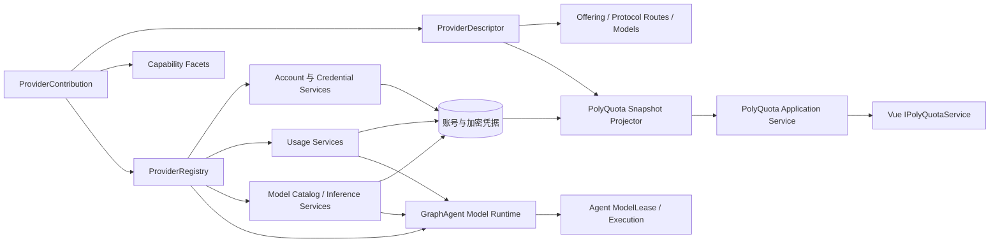

# 跨服务商服务协议设计

| 项目 | 内容 |
| --- | --- |
| 状态 | 目标设计，供共享 Core、PolyQuota 与 GraphAgent 后续实施；阶段 A–D 的 PolyQuota 部分已落地（能力注册表、接入点化认证、目录与展示收敛、重置额度一等结构），进展见第 15 节各阶段记录 |
| 更新日期 | 2026-10-13 |
| 适用范围 | 服务商目录、认证、账号、凭据刷新、用量、模型目录、API 协议族、推理执行边界与产品服务 |
| 暂缓细节 | 统一消息 IR 的全部字段、完整流事件表、路由算法、第三方可执行插件、共享凭据代理物理实现 |
| 参考输入 | [OmniRoute 原始协议探索](./omniroute-exploration.md)、[当前搬运基线](./omniroute-manual-extraction-baseline.md)、[同步工具形态设计](./omniroute-sync-tool-design.md)、[ZCode](./zcode-provider-architecture-exploration.md)、[DSH](./deepseek-harness-provider-architecture-exploration.md)、[Hermes Agent](./hermes-agent-provider-architecture-exploration.md)、[认证服务抽取设计](../../polyquota/auth-service-extraction-design.md) |

## 1. 目标

本设计建立两个产品共用的 Provider Platform，并解决以下问题：

1. PolyQuota 通过稳定应用服务读取服务商、账号、用量和设置，并发起认证、刷新和管理操作；
2. GraphAgent 通过共享 Core 取得模型目录、协议端点、能力、推理执行与用量事实，而不依赖 PolyQuota 的 UI 或 Electron 服务；
3. Codex、GLM 及后续服务商共享注册、凭据和调用主干，同时保留接入点、认证方式、API 协议、模型能力、配额结构和原生状态等真实差异；
4. 应用根据稳定标识把账号、协议端点和模型请求绑定到唯一实现，不依赖页面分支、URL 猜测或隐式回退；
5. 新服务商的认证、协议编解码、模型目录、用量解析和错误归一化可以在无真实网络、无产品宿主、无真实凭据的条件下完成大部分验证；
6. 当前从 OmniRoute 搬运的协议叶子可以继续演进，并为以后抽取翻译器、Executor 或模型能力规则预留明确位置。

设计不追求把所有差异压成最小公分母。统一的是注册、能力发现、调用生命周期、错误、安全边界和可序列化形状；差异通过协议判别联合、能力、原生状态和带版本扩展显式保留。

`IPolyQuotaService` 是 PolyQuota 的产品应用服务，不是共享 Provider Platform 本身，也不是 GraphAgent 的调用接口。两个产品复用 Core 的服务商能力端口，但分别拥有自己的应用服务、状态快照和 UI 契约。

## 2. OmniRoute 原始架构与当前搬运基线

### 2.1 OmniRoute 原始服务商结构

OmniRoute 并不存在一个包办所有职责的 `ProviderAdapter`。它的完整请求路径由多层共同组成：

1. `open-sse/config/providers/**` 的 `RegistryEntry` 是内置服务商和模型事实的主要来源，记录 `format`、`executor`、认证、端点、模型能力、模型级 `targetFormat`、备用协议与超时等信息；
2. `open-sse/executors/registry.ts` 把 provider/executor alias 绑定到 `BaseExecutor` 实现，重复 alias 直接失败，并支持延迟构造；
3. `BaseExecutor` 及专用 Executor 负责 URL、认证头、请求改写、HTTP 执行、凭据刷新回写和供应商特殊行为；
4. `open-sse/translator` 维护独立的请求/响应翻译器注册表，识别 OpenAI Chat Completions、OpenAI Responses、Anthropic Messages、Gemini GenerateContent 以及 Codex、Antigravity、Kiro、Cursor 等格式；
5. 请求翻译主要采用“来源格式 → OpenAI 中间形态 → 目标格式”的枢纽结构，但 Responses、reasoning、tool call、Gemini thought signature 等状态具有额外保留规则，并非简单 JSON 字段改名；
6. `chatCore` 负责入站格式识别、模型与目标协议解析、翻译、Executor 调用、错误恢复、流式响应转换、usage 统计和客户端格式恢复；
7. 模型目录和能力另行建模，包括上下文、输出上限、工具调用、视觉/音频/视频、推理能力、可用 endpoint、模型级协议覆盖和不支持参数；
8. OAuth、API Key、凭据刷新、用量查询和限流状态是横切能力，不等同于推理 Executor；
9. `providerPluginManifest` 是从静态注册表生成的能力投影，当前插件化仍是渐进式的，不能把它误认为已经统一了 OmniRoute 的所有运行路径。

因此，本项目不能只把 OmniRoute 理解为“用量接口来源”，也不能直接复制它现有的 `chatCore` 大编排器。可复用的是分层思想与经过筛选的协议叶子；应用注册、宿主端口和产品调度仍由本项目设计。

### 2.2 已经搬运的范围

当前 `packages/core/src/vendor/omniroute` 固定来源为 `references/omniroute` 的 `3ee283bb944d6d62cc219f74317d5186942e1780`，阶段 7 后已经搬运 49 个一一留有 diff 的产物（Claude Code 与 OpenCode Go 接入后由 38 个扩展而来），范围包括：

- 通用配额标量、配额构造、窗口标题和 Codex 配额归一化；
- Codex 浏览器 OAuth、设备授权、CLI 凭据解析、JWT/工作区映射；
- Codex token refresh、旋转刷新串行和提前刷新时间；
- Codex 用量请求、GLM Coding Plan 配额与重置卡查询、Grok Build 与 Antigravity 的认证、刷新和用量协议、Claude Code 的 CLI 凭据导入/刷新/用量，以及 OpenCode Go 的 API Key 用量；
- 为本项目注入 `fetchImpl`、收窄声明和替换路径别名所需的可审查改动。

阶段 6 起按[同步工具形态设计](./omniroute-sync-tool-design.md)的最小修改原则维护：抽取产物可以保留尚未支持厂商的纯声明与数据，只要其依赖闭包不超出清单和外部依赖白名单；vendor 的惰性声明不构成能力声明，共享 Core 的公开边界仍由 `ProviderDescriptor` 与能力 facet 决定。

当前明确没有搬运：

- provider registry、模型目录和模型能力解析；
- translator registry 及 OpenAI Chat、Responses、Anthropic、Gemini 之间的请求/响应转换；
- `BaseExecutor`、专用 Executor 和推理请求执行；
- `chatCore`、路由、模型回退、流恢复、语义缓存和上游限流编排；
- OmniRoute 数据库、Next.js 页面、完整代理栈、Cookie/Web Session 和浏览器自动化。

这些“未搬运”项不再等同于永久排除。与 GraphAgent 必需能力有关的部分应在独立范围、固定上游提交、依赖闭包审查和无网络特征测试齐备后逐层抽取；仍不得让 `references/omniroute` 成为运行时依赖，也不得因导入闭包把数据库和宿主代码一起带入。

### 2.3 已搬运代码在新架构中的位置

| 当前产物 | 新架构归属 | 后续处理 |
| --- | --- | --- |
| OAuth、设备码、CLI 解析 | `ProviderAccountCapability` 内部协议叶子 | 保留原始请求语义，由 Codex contribution 组合 |
| token refresh 与串行器 | 凭据生命周期与共享凭据服务 | 保留服务商专属旋转规则，不进入 UI 协议 |
| Codex/GLM usage 叶子 | `ProviderUsageCapability` | 继续输出 `groups + extras`，不与推理执行耦合 |
| `CodexAdapter` / `GlmAdapter` 等六家 adapter（含 Grok Build、Antigravity、Claude、OpenCode Go） | 现有过渡 facade | 分阶段拆成 account、usage 等能力实现 |
| `RefreshCoordinator` | PolyQuota 应用协调层 | 通过 ProviderRegistry 取 usage/account 能力 |
| 尚未搬运的 translator | `ProtocolCodecRegistry` 候选来源 | 先确定 IR 和状态保真规则，再选择性抽取 |
| 尚未搬运的 Executor | `ProviderInferenceCapability` 候选来源 | 只抽纯协议/执行叶子，宿主策略由本项目实现 |
| 尚未搬运的模型能力 | `ProviderModelCatalogCapability` 候选来源 | 保留来源、静态/动态目录和模型级协议覆盖 |

现有[手工抽取基线](./omniroute-manual-extraction-baseline.md)仍是当前 49 个产物的事实记录。本设计扩大未来共享 Core 的能力边界，不追溯修改该基线来假装推理协议已经搬运。

## 3. 参考架构的综合取舍

| 主题 | OmniRoute | ZCode | DSH | Hermes Agent | 本项目选择 |
| --- | --- | --- | --- | --- | --- |
| 主要模式 | 静态 provider/model registry + translator + Executor + 大型请求编排 | 预置配置分层解析 | 生命周期化插件注册 | 声明式 Profile + 插件覆盖 | 内置声明与能力实现共同注册 |
| 冲突处理 | registry 静态合并；Executor alias 重复失败 | 解析问题与有效注册表分离 | 冲突即失败、全有或全无 | 后注册覆盖前注册 | 内部冲突即启动失败 |
| 协议表达 | 来源格式、目标格式、模型级覆盖、翻译器矩阵 | API 类型是配置字段 | 统一流契约，适配器保留能力 | Profile `api_mode` + 运行时分支 | API 协议为一等判别类型，Provider 可暴露多端点 |
| 动态替换 | 部分 registry 与 lazy Executor，整体仍偏静态 | 快照整体替换 | 注册句柄原子替换与释放 | 下次会话重新发现 | 首阶段启动时构建不可变注册表 |
| 差异表达 | RegistryEntry、模型能力、Executor 特例 | 判别配置、账号状态、问题列表 | 适配器能力与不透明选项 | Profile 字段与钩子 | 共同字段 + capability facet + 原生状态 + 版本化扩展 |
| 产品投影 | 面向代理 API 与管理页面 | 设置视图与选择视图分离 | 远程服务和可配置目录 | 主要面向 CLI | 共享 Provider Platform，产品应用服务分别投影 |
| 用户插件 | manifest/sidecar 仍在渐进演进 | 不作为主要运行模型 | 完整支持 | 同名覆盖内置 Profile | 当前禁止加载第三方可执行代码 |

采用 OmniRoute 的“服务商、模型、协议格式、翻译器和 Executor 分层”以及经过筛选的协议叶子，采用 ZCode 的“来源、完整目录、可执行注册表、公开视图”分层，采用 DSH 的“唯一所有权、严格注册、同代实现完成一次操作”，采用 Hermes 的“集中声明、多个展示入口可共享一个实现”。不复制 OmniRoute 的大型宿主编排器，也不引入通用插件宿主。

## 4. 当前问题

现有实现已经有良好分层，但服务商边界仍分散（下列问题已在阶段 A–D 与 IPC 契约改造中全部解决，仅保留两处注明"部分"的遗留）：

- `ProviderId`、`AuthMethod` 在 Core 与 `polyquota-contract` 各维护一份封闭联合（已解决，2026-10 结构侧批次修订：动态集合去契约化——契约 DTO 放宽为 slug 格式 `string`、不封闭 TS 类型，core 改为从注册 descriptors 收集导出 `providerIds` / `authMethods`，运行期检测一律查 `providerCatalog` 目录内容；GraphAgent 契约出现时应上移到共享协议层）；
- UI 的 `presentation.ts` 同时承担目录、可用性、地区默认值和文案（已解决：收缩为图标资产与 iconKey 字符回退、内置枚举文本映射（含重置额度类型词汇）与窗口时长等纯展示计算；CLI 导入路径提示、配额/附加项标签回退、名称/描述/网站全部目录驱动；2026-10 结构侧批次修订：套餐匹配上移主进程——match 键不再随目录下发，快照携带主进程解析固化的 `planId` / `planLabel`，QuotaCard 只消费解析结果，未识别档位（`planId: null`）带可见提示，空 plan 的展示方式归 UI）；
- `presentation.ts` 的 `providerPresentation` 在未知 offering 时最终回退到注册表第一个条目（已解决：未知 offering 显示占位行——名称为 offeringId、字符"?"，不回退）；
- 桌面 `main.ts` 仍含约百行按供应商展开的组合代码（已解决：core `providers/<id>/bundle.ts` 组合工厂 + `createProviderContributions(ports)` 聚合，桌面组合根只注入 http/browser/callbackServer/storage/vault 端口，新增供应商零修改）；
- GLM 的 `region` 把接入点差异压成一个地区枚举（已解决：descriptor 无 region 字段，`AuthStartOptions` 仅剩 `apiKey`，账号持久化 `offeringId`，GLM 实现内部按 offeringId 选择端点，`publicMetadata.region`/`presentationId` 与 UI 的 `accountPresentationId` 恢复逻辑全部删除）；
- `AuthService.start()` 直接判断 `provider === "glm"`（已解决：认证分派由 core 各 `auth-flow.ts` 与无分支的 `AuthCoordinator` 承担）；
- `RefreshCoordinator` 构造 `Map` 时重复实现会静默覆盖（已解决：`ProviderRegistry` 构造期校验唯一所有权，任一冲突使整个注册表构造失败）；
- 账号公开元数据使用无命名空间的 primitive map（部分解决：GLM 的 region/presentationId/product 已删除；codex/grok/claude 的 workspace、组织等事实仍在 `publicMetadata`，待 §6.1 `PublicExtension` 机制落地后转换）；
- `window.llmUsage`、preload、IPC 与 UI 类型分别维护（已解决：preload 全局为 `window.polyQuotaElectronService`，channel 与校验由 `polyquota-contract` 单一来源提供）；
- 账号与用量逐项读取（已解决：`getSnapshot()` 提供带 `revision` 的单一快照与失效事件）；
- BigModel 与 Z.ai 共享 `glm` 实现，却靠 `publicMetadata.presentationId` 和页面判断恢复展示入口（已解决：账号按 `offeringId` 分组与展示）。
- 共享 Core 当前只有认证、凭据刷新、用量和套餐目录评分能力，没有模型目录、API 协议类型、推理请求与流式结果契约；
- 先前草案中的 `ProviderRuntime` 强制所有实现提供用量方法，错误地以 PolyQuota 能力定义共享服务商边界；
- GraphAgent 的 `ModelPolicy`、`ModelLease`、额度感知调度和模型执行尚无可绑定的共享协议；
- 当前 OmniRoute vendor 基线与未来推理协议抽取之间没有演进位置，容易在 GraphAgent 启动时另起一套不兼容抽象（该位置已由[同步工具形态设计](./omniroute-sync-tool-design.md)确定：现有产物与未来抽取共用同一清单、闭包规则和门禁）。

最终结构应消除这些分散判断，保留当前已经验证的凭据、刷新与用量逻辑，并在 GraphAgent 启动前固定模型与协议层的关键边界。

## 5. 概念模型

### 5.1 稳定标识

| 标识 | 含义 | 示例 | 所有者 |
| --- | --- | --- | --- |
| `providerId` | 一个服务商实现与凭据所有权域 | `codex`、`glm`、`anthropic` | Core 注册表 |
| `offeringId` | 接入点：一种完整接入形态，自带认证方式、协议端点绑定、模型目录范围与计费目录 | `codex`、`bigmodel-coding-plan`、`zai-coding-plan` | 服务商声明 |
| `authMethodId` | 一种完整认证交互 | `browser-oauth`、`device-code`、`cli-import`、`api-key` | 服务商声明与实现 |
| `accountId` | 已保存的具体账号 | UUID | 账号存储 |
| `protocolRouteId` | 一个可选择的上游 API 协议端点 | `codex-responses`、`anthropic-messages` | Provider contribution |
| `modelId` | 服务商目录中的模型标识 | `gpt-5.6-codex`、`claude-opus-4-6` | 模型目录 |

`providerId` 不是品牌卡片标识，也不是 API 协议类型。一个实现可以拥有多个接入点和多个 protocol route。BigModel 与 Z.ai 使用同一个 `glm` 实现，但作为两个接入点各自声明端点绑定、认证参数与展示事实；一个网关也可以同时提供 OpenAI Chat Completions 与 Anthropic Messages，而不因此成为两个服务商。

接入点（而不是地区枚举）才是差异的正确粒度。以 OpenAI 为例，ChatGPT Codex 订阅（OAuth、订阅配额与档位）、OpenAI 平台 API（API Key、按量计费）与 Azure OpenAI（独立端点、部署级凭据）的订阅方式、接口地址、模型目录和计费模式天差地别，应建模为同一供应商下的不同接入点；若凭据所有权域确实不同（如 Azure 部署密钥与 ChatGPT 账号），也可以实施为独立 provider——两种判定都被本机制支持，共同点是接入点级差异必须显式声明，不能靠实现内部的枚举字段暗中选择。

`modelId` 只在所属 provider 或目录命名空间中唯一。GraphAgent 的持久选择使用 `{ providerId, accountId, modelId, protocolRouteId? }`，不能只保存一条可变 URL 或展示名称。

别名只用于迁移或外部输入归一化，不作为 offering，也不写入新账号。

### 5.2 目录、实现、账号和产品投影



- `ProviderDescriptor` 是可公开投影的声明，不含秘密和网络客户端；
- capability facet 是 Node 侧能力实现，不可序列化到产品 UI；
- `ProviderContribution` 要求声明和全部能力实现以相同 `providerId` 成对注册；
- `ProviderRegistry` 校验所有权并提供不可变查询；
- 账号保存 `providerId`、`offeringId` 和认证方式；
- PolyQuota 快照把它需要的目录、账号、用量和状态投影为同一修订；
- GraphAgent 通过共享模型目录与推理服务取得 `ModelLease`，不读取 PolyQuota 快照；
- `IPolyQuotaService` 只是 PolyQuota 前端入口，不暴露注册表或 IPC 通道；GraphAgent 后续定义自己的应用服务。

### 5.3 共享平台与产品服务边界

共享 `packages/core` 应提供：

- ProviderDescriptor、ProtocolRoute、ModelDescriptor 和能力声明；
- ProviderRegistry 与严格绑定；
- 账号认证、凭据刷新、用量、模型目录和推理执行能力端口；
- API 协议标识、协议 codec/translator 注册边界和统一执行生命周期；
- 产品无关的公开事实（目录、认证方式、套餐与展示提示）、错误、usage 与成本记录；
- 从当前 OmniRoute vendor 叶子到各能力实现的适配层。

PolyQuota 自己提供：

- `IPolyQuotaService`、Electron IPC、状态快照和变更通知；
- 账号管理、轮询、额度通知、设置和展示投影；
- 普通浏览器的空白实现及 Vue 注入。

GraphAgent 自己提供：

- 模型选择、ModelLease、调用预算、任务归因、并发和回退策略；
- Agent 上下文构建、工具执行循环、任务图与 Artifact；
- Policy Gate 在模型请求前后的拦截；
- 面向其 UI 或控制面的应用服务。

GraphAgent 不重新定义 provider、protocol、model capability、credential 或 usage 的基础类型；PolyQuota 也不决定 GraphAgent 的模型路由和执行策略。

## 6. Core 服务商协议

以下 TypeScript 只规定形状和职责，名称可在实施时小幅调整。

### 6.1 JSON 与版本化扩展

```ts
type JsonValue =
  | null
  | boolean
  | number
  | string
  | JsonValue[]
  | { [key: string]: JsonValue };

interface PublicExtension {
  namespace: string;
  schemaVersion: number;
  value: JsonValue;
}
```

差异化公开信息使用反向域名或项目命名空间，例如：

- `io.astraconductor.polyquota.codex.workspace`；
- `io.astraconductor.polyquota.claude.organization`；
- `io.astraconductor.polyquota.usage.reset-credits`。

同一对象内命名空间唯一。未知扩展必须在服务传递过程中保持原值；UI 没有对应展示器时可以不显示，但不能把未知字段改造成共同字段。秘密、请求头、token、API Key、设备授权内部标识和 PKCE 数据禁止进入扩展。

扩展只承载确实无法稳定提升为共同字段的内容。认证方式、可用性、套餐和配额窗口已经有共同语义，不应重复塞入扩展。

### 6.2 服务商声明

```ts
interface ProviderDescriptor {
  provider: ProviderId;
  displayName: string;
  offerings: ProviderOfferingDescriptor[];
  // 已落地：plans 位于接入点级，查表键为 offeringId（不同接入点计费模式可以不同）：
  plans: readonly ProviderPlanDescriptor[];
  capabilities: ProviderCapability[];          // 阶段 B 落地
  protocolRoutes: ProtocolRouteDescriptor[];   // 阶段 E 落地，由接入点引用
  extensions?: PublicExtension[];
}

type ProviderCapability =
  | "account"
  | "usage"
  | "model-catalog"
  | "inference"
  | "multiple-accounts";

interface ProviderOfferingDescriptor {
  id: OfferingId;
  provider: ProviderId;
  displayName: string;
  description?: string;
  iconKey?: string;
  websiteUrl?: string;
  authMethods: ProviderAuthMethodDescriptor[];
  protocolRouteIds?: readonly ProtocolRouteId[];   // 阶段 E：接入点可用的协议端点
  extensions?: PublicExtension[];
}

interface ProviderPlanDescriptor {
  id: string;
  displayName: string;
  match: readonly string[];
  multiplier: number;
  source: "published" | "inferred";
}
```

除 `protocolRoutes`、`extensions` 与接入点的 `protocolRouteIds` 外，上述形状已在 core `providers/<id>/descriptor.ts` 落地（六家：codex、glm、grok-build、antigravity、claude、opencode-go），`capabilities` 当前全部声明 `["account", "usage"]`，`plans` 已随账号持久化 `offeringId` 迁至接入点级（GLM 两个接入点各持一份相同目录，允许独立演进），offering 不再有 `region` 字段。`providers/catalog.ts` 聚合为唯一目录端点并构造期校验：provider id 格式（slug）与重复、offering 归属与 id 格式、offering 内认证方式 id 格式与重复、iconKey 与 sourcePathHint 合法性、capability 取值、接入点内 plan 的 id/multiplier/match 合法性（2026-10 结构侧批次：供应商/认证方式集合改为从注册 descriptors 收集导出，"未知 provider"检查转为结构性校验）。快照经 `PublicProviderDescriptor` 透出 provider/displayName、offerings 全部展示字段（含 iconKey 与 sourcePathHint）与各接入点的 plans（仅 id/displayName——match 键是 core 内部数据层标识，不过 IPC，套餐展示标签由主进程解析固化进 `PublicUsage.planLabel` 下发）；倍率与 `source` 属于运行期评分事实，不进公开目录。

`displayName` 与 `description` 是 core 持有的标准表述（语言中立或与产品 UI 语言一致，一份即可）；UI 可以按 `offeringId` 覆盖更适合产品的名称与图标，但不得改变能力或可执行状态，也不得再保存一份供应商事实副本（本地化现阶段不做，归属边界见 §6.9）。

`plans` 是一次性套餐目录：运行期把上游 `usage.plan` 归一化后按 `match` 查表取 `multiplier` 参与评分，`source` 区分官方公布与一次性推断。目录只做查表，不在运行期重新猜测名称；未命中时使用统一的默认档位。`displayName` 使用上游官方、不区分语言的档位表述（如 "Plus"、"Pro 5x"、"SuperGrok Heavy"）——标准名称映射的唯一归属是 core（2026-10 结构侧批次起匹配只在主进程构造公开快照时发生：解析结果 `planId` / `planLabel` 随 `PublicUsage` 固化下发，回退顺序为目录 `displayName` → 上游原始展示名 → 原始标识串，未识别态 `planId: null` 由 UI 给出可见提示），UI 直接展示、不另存映射，也不做本地化改写。目标为接入点级：同一服务商的不同接入点计费模式可以完全不同（订阅档位与按量付费并存），账号保存 `offeringId` 后查表键从 provider 改为接入点（阶段 C 第 3 条）。

`region` 是本设计需要修正的一处：GLM 双 offering 落地时把接入点差异压成了一个地区枚举，而它在现行链路里同时承担四个职责——选择上游端点（vendor 按 `apiRegion` 区分 bigmodel 与 z.ai 的接口地址）、参与账号稳定身份（`stableIdentity` 拼接 region）、充当展示入口恢复键（`presentationId` 由 region 反推）、以及无命名空间地存进 `publicMetadata`。BigModel 与 Z.ai 实际是两个货真价实的接入点：接口地址不同，未来的模型目录与计费也可能不同。目标形态下这些差异由 offering 自身声明承载（认证方式、`protocolRouteIds`、接入点级 plans 与用量语义），地区退为 GLM 实现内部选择端点的细节，不再出现在公开 descriptor、认证输入或账号元数据中；迁移依赖账号持久化 `offeringId`（阶段 C 第 3 条），随后 `publicMetadata.region` / `presentationId`、`AuthStartOptions.region` 与 descriptor 的 `region` 字段一并退休（第 4 条）。

core 不持有用量标签映射：配额与附加项的展示直接使用上游原生 `displayName`，缺失时经窗口时长等纯展示计算回退到 key 原样；本地化现阶段整体不做，未来若做也归 UI 层（§6.9）。

`iconKey` 由 core 声明键、UI 持有资产映射；二进制图标资产不进入 core。缺失映射时 UI 使用自己的视觉回退，不虚构服务商。

`capabilities` 表示服务商贡献提供的共享能力面，不把每种认证方式或 API 端点混入同一枚举。具体认证方式由 offering 声明，模型与协议支持由后续的 route 和 model descriptor 声明。

### 6.3 认证方法

认证差异通过方法、交互与来源标签表达，而不是一个可选字段集合：

```ts
type AuthMethodInteraction =
  | "browser-callback"
  | "device-code"
  | "local-import"
  | "secret-form";

interface ProviderAuthMethodDescriptor {
  method: AuthMethod;
  interaction: AuthMethodInteraction;
  sourceLabel?: string;                      // cli-import 来源名，如 "ZCode"、"Claude Code"（已落地）
  sourcePathHint?: string;                   // cli-import 展示用凭据路径提示（阶段 D）
  fields?: readonly AuthFieldDescriptor[];   // 表单输入声明（阶段 C/D）
}

interface AuthFieldDescriptor {
  key: string;
  type: "text" | "secret" | "select";
  required: boolean;
  label: string;
  options?: readonly { value: string; label: string }[];
}
```

`method + interaction + sourceLabel` 已落地：`validateProviderCatalog` 校验 offering 内方法唯一，`AuthCoordinator` 构造期把各 flow 的 `supportedMethods` 与目录对账，两份支持矩阵无法静默漂移。core 不为 `AuthMethod`、`AuthMethodInteraction` 等内置枚举提供任何描述信息：它们是封闭协议类型而非供应商数据，前端自持一份与枚举值一一对应的文本映射（"浏览器 OAuth""设备码""API Key"等）即可，不存在按供应商漂移的问题；供应商差异由 `sourceLabel` 这类 descriptor 事实表达。

`sourcePathHint` 是展示事实（如 `~/.codex/auth.json`、`~/.zcode/v2/credentials.json`）：真实路径解析（`CODEX_HOME`、平台差异、ZCode 凭据库定位）在 core 各 auth-flow 内部，descriptor 的提示与它同源维护，UI 不得自行拼路径。

`fields` 只描述可提交输入，让 renderer 能按声明生成表单（如 GLM API Key 的区域选择）。服务商实现必须再次执行运行时校验，不能信任 renderer 根据 descriptor 生成的表单。

### 6.4 API 协议与路由声明

```ts
type ApiProtocol =
  | { kind: "openai-chat-completions"; version: "v1" }
  | { kind: "openai-responses"; version: "v1" }
  | { kind: "anthropic-messages"; version: "2023-06-01" }
  | { kind: "gemini-generate-content"; version: "v1" | "v1beta" }
  | { kind: "extension"; namespace: string; version: string };

type ProviderOperation =
  | "chat"
  | "embeddings"
  | "rerank"
  | "image-generation"
  | "video-generation"
  | "audio-speech"
  | "audio-transcription";

interface ProtocolRouteDescriptor {
  id: ProtocolRouteId;
  providerId: ProviderId;
  protocol: ApiProtocol;
  operations: readonly ProviderOperation[];
  streaming: boolean;
  authBinding: "account" | "none";
  extensions?: PublicExtension[];
}
```

API 协议类型、业务操作和服务商必须正交：OpenAI Chat Completions 与 Responses 是不同协议；同一服务商可以同时暴露多种协议；同一协议也可以由多个服务商实现。`providerId` 因此不能再兼任 `apiType`，模型选择也不能只保存服务商和模型名。

公开 route 只描述可选择的协议能力，不暴露真实密钥、请求头或内部基础地址。执行时使用的 endpoint、重试策略和认证材料属于主进程或受信 Worker 的私有绑定。

### 6.5 模型目录

```ts
interface ModelRef {
  providerId: ProviderId;
  modelId: ModelId;
}

interface ModelDescriptor {
  providerId: ProviderId;
  id: ModelId;
  displayName: string;
  protocolRouteIds: readonly ProtocolRouteId[];
  operations: readonly ProviderOperation[];
  inputModalities: readonly string[];
  outputModalities: readonly string[];
  contextWindow?: number;
  maxOutputTokens?: number;
  toolCalling?: {
    supported: boolean;
    parallel?: boolean;
  };
  structuredOutput?: "unsupported" | "json" | "schema" | "unknown";
  reasoning?: {
    mode: "none" | "effort" | "native-state" | "unknown";
    effortLevels?: readonly string[];
  };
  unsupportedParameters?: readonly string[];
  extensions?: PublicExtension[];
}

type ModelCapabilityRequirement =
  | { kind: "operation"; operation: ProviderOperation }
  | { kind: "input-modality"; modality: string }
  | { kind: "output-modality"; modality: string }
  | { kind: "tool-calling"; parallel?: boolean }
  | { kind: "structured-output"; minimum: "json" | "schema" }
  | { kind: "reasoning"; mode?: "effort" | "native-state" }
  | { kind: "extension"; namespace: string; requirement: JsonValue };

interface ModelCatalogSnapshot {
  providerId: ProviderId;
  revision: string;
  observedAt: string;
  source: "static" | "remote" | "merged";
  models: readonly ModelDescriptor[];
}
```

模型目录把 OmniRoute `RegistryModel` 中已经证明必要的能力提升为共享契约，包括模型级目标协议、上下文限制、工具调用、结构化输出、推理状态、模态和不支持参数，但不在当前阶段复制其全部字段。GraphAgent 使用结构化 `ModelCapabilityRequirement` 过滤候选，不能把能力重新退化成约定俗成的字符串标签。静态声明与远端发现可以合并，必须保留来源和 revision；远端刷新暂时失败时，现有租约不能因为目录瞬时缺失而被悄悄改绑。

### 6.6 能力化运行实现

```ts
interface ProviderAccountCapability {
  readonly providerId: ProviderId;

  startAuth(context: ProviderContext, request: ProviderAuthRequest):
    Promise<AuthFlowStart>;

  refreshCredentials?(
    context: ProviderContext,
    account: Account,
    credential: CredentialEnvelope,
    options: { force: boolean },
  ): Promise<CredentialRefreshResult>;
}

interface ProviderUsageCapability {
  readonly providerId: ProviderId;

  fetchUsage(
    context: ProviderContext,
    account: Account,
    credential: CredentialEnvelope,
  ): Promise<UsageSnapshot>;

  redeemResetCard?(
    context: ProviderContext,
    account: Account,
    credential: CredentialEnvelope,
    request: ResetCreditRedemption,
  ): Promise<void>;
}

interface ProviderModelCatalogCapability {
  readonly providerId: ProviderId;

  getModelCatalog(context: ProviderContext): Promise<ModelCatalogSnapshot>;
}

interface ProviderInferenceCapability {
  readonly providerId: ProviderId;

  prepareCall(
    context: ProviderContext,
    request: ProviderInferenceRequest,
  ): Promise<PreparedProviderCall>;
}

interface PreparedProviderCall {
  readonly selection: ProviderRouteSelection;
  readonly implementationGeneration: string;
  readonly modelCatalogRevision: string;
  execute(signal: AbortSignal): AsyncIterable<ModelStreamEvent>;
}

interface ProviderContribution {
  descriptor: ProviderDescriptor;
  account?: ProviderAccountCapability;
  usage?: ProviderUsageCapability;
  models?: ProviderModelCatalogCapability;
  inference?: ProviderInferenceCapability;

  dispose?(): Promise<void> | void;
}
```

`ProviderContext` 只包含受控端口，例如 HTTP、时钟、日志、外部浏览器、回环监听和本地凭据导入。实现不能导入 Electron，也不能直接读取产品数据库。

能力面是可选的，服务商不需要为空缺能力实现无效果方法。若声明了 `account`、`usage`、`model-catalog` 或 `inference`，对应 facet 必须存在且 `providerId` 一致；未声明能力时对应 facet 也不得伪装成可执行。`refreshCredentials` 同样只由确实有主动刷新协议的账号实现提供。API Key 是否需要轮换是账号能力内部的凭据生命周期差异，不再迫使 API Key、纯推理或纯目录实现提供无效果刷新方法。

`redeemResetCard` 是用量侧用户动作（已落地为 usage facet 的可选方法）：获得侧统一随 `fetchUsage` 的 `resetCredits` 一等字段返回（§9.3），消耗侧以判别联合表达两种形态——聚合不传卡 id、按类型消耗（多桶时指定类型，由服务端挑选），分体传对应重置卡 id；glm 分体，codex 常规分体（明细端点暂不可用时如实退回聚合计数），兑换协议在 core `providers/<id>/reset-card-redemption.ts`。应用服务经 `ProviderRegistry.requireUsage(provider).redeemResetCard` 通用分派，组合根不再维护按供应商的映射（§8.1 已达成）。

`prepareCall` 在一次调用开始前固定 provider、account、model、protocol route、实现代次和目录 revision；得到的 `PreparedProviderCall` 在完成或取消前不重新查注册表。GraphAgent 的 `ModelLease` 可以在此基础上增加预算、过期时间和任务归因，但不能把正在执行的流静默切换到另一实现。

### 6.7 规范消息与协议编解码边界

共享 Core 需要一套 `ProtocolCodecRegistry`，明确注册“原生协议与规范消息 IR”之间支持的方向；推理 facet 负责把选定 route、账号和 endpoint 绑定到 Executor。该边界对应 OmniRoute 的 translator registry、format 与 Executor 分层，但不预设所有转换都必须经过 OpenAI Chat Completions 这一中间格式。

当前先稳定以下边界，字段细节留给独立协议设计：

```ts
type ApiProtocolKind = ApiProtocol["kind"];

interface ProviderRouteSelection {
  providerId: ProviderId;
  accountId: AccountId;
  modelId: ModelId;
  protocolRouteId: ProtocolRouteId;
}

interface ProviderInferenceRequest {
  selection: ProviderRouteSelection;
  operation: ProviderOperation;
  request: CanonicalModelRequestEnvelope;
}

type ModelStreamEvent =
  | ModelOutputEvent
  | ModelToolCallEvent
  | ModelReasoningEvent
  | ModelUsageEvent
  | ModelErrorEvent
  | ModelCompletedEvent;
```

- `ApiProtocol`、`ProviderOperation`、`ProviderRouteSelection` 和 codec 注册键；
- 规范请求 envelope，以及文本、工具调用、工具结果、推理片段、错误、用量和完成原因等流事件类别；
- 原生 response id、tool call id、reasoning/thought signature 等回放状态的所有权和生命周期；
- 直接透传、可逆转换、有损转换和不支持转换四种明确结果；
- 非流式响应也归一为同一事件序列，避免 GraphAgent 维护两套工具循环。

OpenAI Chat Completions、OpenAI Responses、Anthropic Messages 和 Gemini GenerateContent 在 system 指令、工具调用、推理签名、事件顺序和续写状态上并不等价。codec 必须经过能力检查才能转换；不得丢弃未知语义后伪装为成功。原生状态只能交回产生它的 codec/route，不能被另一个服务商或协议解释。

### 6.8 内部认证开始结果

已按[认证服务抽取设计](../../polyquota/auth-service-extraction-design.md)落地为 core 的 flow 形态：

```ts
type AuthFlowStart =
  | { status: "completed"; account: Account }
  | {
      status: "pending";
      interaction: "browser-callback" | "device-code";
      finish(): Promise<Account>;
      cancel(): void;
      // 仅 device-code 携带：
      userCode?: string;
      verificationUri?: string;
    };

interface ProviderAuthFlow {
  provider: ProviderId;
  supportedMethods: readonly AuthMethod[];   // 构造期与目录对账，不参与运行期分派
  start(method: AuthMethod, options: AuthStartOptions): Promise<AuthFlowStart>;
}
```

`finish` 与 `cancel` 是闭包，携带各自的 AbortController 与回调 completion，由创建它的 flow 持有全部私有状态；`AuthCoordinator` 的会话表只存句柄，`finishAuth(sessionId)` 固定绑定创建会话的实现，即使未来注册表更新也不会按标识查到另一代实现。句柄绝不跨 IPC：公开投影 `AuthStartResult` 只含 `sessionId`、`interaction` 与设备码展示字段（用户码、验证地址），不包含上游 device auth ID、code verifier 或 token。

与完整形态的差异（该设计 §11 已列，2026-10-13 更新）：认证输入已改为 `offeringId + method`（协调器对目录交叉验证，secret-form 输入为可选 `apiKey`）；flow 已作为 account facet 并入 contribution（阶段 B 完成）。仍保留的差异：flow 内部直接调用各 provisioner 保存，尚未经 accountRepository 与 credentialService 统一收口——保存归属迁移留给后续独立实施。

### 6.9 展示元数据的归属边界

目录驱动改造后，UI `presentation.ts` 仍持有一批供应商事实。判定准则：**不依赖产品视觉决策、可由供应商目录推导的内容属于 descriptor；UI 只保留图标资产、内置枚举的文本映射与布局；本地化现阶段整体不做。** 逐项归属：

| 元数据 | 当前位置 | 目标位置 | 说明 |
| --- | --- | --- | --- |
| offering 名称 / 描述 / 网站 | descriptor，`presentation.ts` 存回退副本 | descriptor，删除副本 | 快照已透出 |
| 套餐展示名 | descriptor `plans` | 已达成 | 主进程解析并固化进 `PublicUsage.planLabel`（回退顺序：目录 `displayName` → 原始标识串），使用官方档位表述，是本次迁移的范例（2026-10 结构侧批次起前端不再匹配） |
| cli-import 来源标签（ZCode / Grok CLI / Claude Code） | descriptor `sourceLabel`，UI 存副本 | descriptor，删除副本 | UI 已优先 `sourceLabel` |
| 内置枚举展示文本（认证方式 / 交互类型 / 凭据状态…） | UI 常量表 | 留 UI | 封闭协议类型的固定映射，非供应商事实；core 不为枚举提供描述（§6.3） |
| CLI 导入路径展示（`~/.codex/auth.json` 等） | UI `cliImportPath` | descriptor `sourcePathHint` | 与 flow 内真实路径同源（§6.3） |
| 配额 / 配额组 / 附加项标签映射 | UI 四张标签映射表 | 删除 | 回退顺序：原生 `displayName` → 窗口时长等纯展示计算 → key 原样 |
| 图标 | UI 资产 | 留 UI，按 `iconKey` 映射 | 二进制资产不进 core |
| 字符回退 `mark` | UI | 留 UI 视觉层 | 作为 `iconKey` 映射的回退一并维护 |
| `available` | UI 硬编码 `true` | 删除 | 注册即可执行；账号级不可用由 `provider-unavailable` 表达 |
| 展示入口恢复 | UI `accountPresentationId` 读 `publicMetadata` | 阶段 C 账号保存 `offeringId` 后删除 | 消除按 `presentationId`/region 猜测 |

同时删除 `providerPresentation` 对 `presentationRegistry[0]` 的最终兜底：未知 offering 在展示层同样必须显式失败或显示占位，不得静默显示成第一家（对齐 §12.3）。

迁移完成（2026-10-13，随阶段 D 第 4、5 条落地）：`presentation.ts` 的职责已收缩为按 `iconKey` 解析图标与视觉回退、内置枚举的文本映射（认证方式与重置额度类型词汇）、窗口时长等纯展示计算。新增供应商时 UI 侧只需在图标资产映射中补一个 `iconKey` 条目，目录与标准名称全部在 core 一处声明并通过快照到达前端；未来若做本地化，也归这一层按 offering 扩展，不进 core。

## 7. ProviderRegistry

### 7.1 构造规则

应用组合根一次性提交全部 `ProviderContribution`。贡献同时携带声明和可选能力 facet，不再用一个以 PolyQuota 用量需求为中心的万能 runtime 包装所有服务商行为。

注册表构造必须完整校验：

1. 每个 facet 的 `providerId` 都等于 `descriptor.id`；
2. `providerId` 全局唯一；
3. `offeringId` 全局唯一，并且 `offering.providerId` 指向当前贡献；
4. 一个 offering 内 `authMethodId` 唯一；
5. `protocolRouteId` 全局唯一，并且 route 指向当前贡献；
6. capability、认证方式与实际 facet 完整相符；
7. route 的 operation、协议与 inference capability 声明相容；
8. 所有公开 URL、扩展和默认值符合 schema；
9. 实现声明的必需依赖已经提供。

任一错误都使整个注册表构造失败。禁止后注册覆盖、跳过坏条目后继续启动，或把请求交给默认实现。

动态模型目录不能在同步构造时预知。每个目录 snapshot 进入缓存前另行校验：模型引用的 route 必须存在，operation 必须相容，`providerId` 必须属于产生该 snapshot 的 facet；无效 snapshot 整体拒绝，不部分合并。

### 7.2 当前运行形态

首阶段注册表在应用启动后不可变。新增服务商通过源码、构建和发布进入应用，不从用户目录执行代码。

测试可以为每个测试实例构造独立注册表。未来若确需动态实现，再增加带 disposer 的原子替换 API；在明确签名、权限、进程隔离和升级回滚方案前，不开放第三方插件加载。

### 7.3 查找规则

- 新增认证：先由 `offeringId` 找声明，再取得其唯一 `providerId` 和实现；
- 已有账号操作：只按账号保存的 `providerId` 找 account 或 usage facet，`offeringId` 只影响展示与该账号的公开默认事实；
- 模型选择：按 `providerId + modelId + protocolRouteId` 解析模型与推理 facet，并验证账号属于同一 provider；
- 缺少实现：账号进入 `provider-unavailable` 状态，保留本地数据，禁止刷新和认证；
- 未知 offering：拒绝新增认证，不按 provider 的第一个 offering 猜测；
- 未知账号 provider：拒绝执行并保留可诊断错误，不迁移到相似标识。

## 8. 应用组合与绑定

### 8.1 唯一组合根与供应商组合工厂

桌面只负责创建宿主端口；供应商的组合细节（adapter、provisioner、auth-flow、用量侧动作如何用端口拼装）属于各供应商自己的知识，收在 core `providers/<id>/` 的组合工厂里：

```ts
// core：每家供应商一个组合工厂，宿主端口全部经参数注入
export interface ProviderBundle {
  descriptor: ProviderDescriptor;
  usage: UsageProviderAdapter;             // 阶段 B 后：ProviderUsageCapability
  authFlow: ProviderAuthFlow;             // 阶段 B 后：account facet
  redeemResetCard?: ResetCreditRedeemer;  // 用量侧动作（§6.6），当前仅 codex / glm
}

export function createCodexProvider(ports: ProviderPorts): ProviderBundle;
export function createGlmProvider(ports: ProviderPorts): ProviderBundle;
// ...其余四家同模式；ProviderPorts = http / browser / callbackServer / storage / vault / clock / logger

// core：与 providerCatalog 同一收集点的聚合，桌面一行取得全部 bundle
const bundles = createProviderBundles({ http, browser, callbackServer, storage, vault });

// 阶段 B：bundle 升级为 contribution，进入严格注册表
const providerRegistry = createProviderRegistry(bundles);

const authCoordinator = new AuthCoordinator(
  providerRegistry,
  accountRepository,
  credentialService,
);

const refreshCoordinator = new RefreshCoordinator(
  providerRegistry,
  accountRepository,
  credentialService,
  usageRepository,
);

const modelService = new ModelService(providerRegistry, credentialService);
```

过渡形态不需要等注册表：`new RefreshCoordinator(storage, vault, bundles.map((b) => b.usage))`、`new AuthCoordinator(bundles.map((b) => b.authFlow))`，应用服务的 `resetCreditRedeemers` 映射改为从 bundles 通用推导（过滤出带 `redeemResetCard` 的条目）。这些推导不含任何按供应商命名的分支，与现在 `main.ts` 里逐家展开的写法有本质区别——新增供应商时桌面组合根零修改，`providerCatalog` 与 bundle 聚合在 core 同一处登记。

同一个 `providerRegistry` 同时交给认证、刷新、模型目录、推理准备、公共快照和诊断服务。不得为每个子系统重新构造服务商表。

当前落地形态（阶段 B 完成）：六家供应商的 adapter、provisioner、auth-flow 与重置卡兑换协议全部位于 core `providers/<id>/`，各供应商的组合细节收在 `providers/<id>/bundle.ts` 组合工厂并由 `createProviderContributions(ports)` 聚合；桌面组合根只创建宿主端口（http/browser/callbackServer/storage/vault）并构造唯一 `ProviderRegistry`，无任何按供应商命名的构造与映射。`RefreshCoordinator` 与 `AuthCoordinator` 均从注册表取得对应 facet，重复 provider 或 facet 与能力声明不符在注册表构造期即失败。

### 8.2 Codex 绑定

Codex 贡献包含：

- `providerId: "codex"`；
- offering `codex`；
- 浏览器 OAuth、设备码和 Codex CLI 导入；
- OAuth 凭据刷新；
- Codex 用量查询与 `groups + extras` 归一化。

现有 `CodexAdapter` 与 `CodexAccountProvisioner` 的逻辑可以先分别包装成 account 与 usage facet，随后再把保存责任统一移到 `AuthCoordinator`。已经搬运的认证和用量协议解析本身不重写；Codex 推理 route、codec 和 Executor 在后续选择性搬运阶段单独注册，不塞回这两个 facet。

### 8.3 GLM 绑定

GLM 贡献包含一个 `providerId: "glm"` 和两个接入点：`bigmodel-coding-plan`（国内 bigmodel 端点）与 `zai-coding-plan`（国际 z.ai 端点）。两者共享 ZCode 导入与 API Key 认证及同一套账号/用量实现，但上游接口地址不同——它们是两个接入点，不是同一接入的地区变体。端点选择是 GLM 实现内部按 `offeringId` 的私有绑定，不再以 `region` 字段出现在 descriptor、认证输入或账号元数据中；账号持久化 `offeringId` 后，`publicMetadata.region` / `presentationId` 与 UI 的 `accountPresentationId` 恢复逻辑一并删除（阶段 C 第 3、4 条，背景见 §6.2）。GLM 的 OpenAI 兼容推理端点如果以后纳入 GraphAgent，应作为接入点引用的独立 protocol route 和 inference facet 能力声明，不能由“支持 API Key”推断出来。

### 8.4 GraphAgent 绑定

GraphAgent 不调用 `IPolyQuotaService`。它通过共享平台完成以下绑定：

```text
ModelPolicy
  -> ModelCatalogCapability 过滤候选
  -> ProviderRouteSelection(provider + account + model + protocol route)
  -> CredentialLease / budget / policy gate
  -> ProviderInferenceCapability.prepareCall()
  -> ModelLease 持有 PreparedProviderCall
  -> 规范 ModelStreamEvent 驱动上下文和工具循环
```

PolyQuota 汇总的用量与额度事实可以作为调度输入，但不能直接替 GraphAgent 选择模型、协议或回退路线。GraphAgent 的策略层负责质量、隐私、成本、上下文、工具能力、并发和失败回退；共享平台负责说明候选是否真实存在、协议是否可执行以及调用如何被固定到同一代实现。

### 8.5 预告但未实现的服务商

Grok Build 与 Antigravity 曾按此原则停留在“预告”状态，如今连同 Claude、OpenCode Go 都已注册完整可执行实现；本节原则继续面向未来服务商。若产品需要提前展示尚未接入的服务商，应作为“产品候选目录”由 UI 自己维护，不伪装成已注册 ProviderDescriptor。正式进入主进程公开目录的条目必须具备可执行实现。

如果产品确实需要主进程返回“已知但未安装”的目录，应建立独立 `ProviderCatalogEntry` 并把 `availability: "unavailable"` 作为明确状态；它不能出现在可执行注册表，也不能接受认证请求。

## 9. PolyQuota 统一公开数据

### 9.1 一致状态快照

前端不再分别读取账号列表和每个账号的用量。应用服务返回一份快照：

```ts
interface PolyQuotaSnapshot {
  revision: number;
  generatedAt: string;
  providers: PublicProviderDescriptor[];
  accounts: PublicAccountDto[];
  usageByAccountId: Record<string, PublicUsageDto | null>;
  operations: PublicOperationState[];
  settings: PublicSettingsDto;
}
```

快照投影过程从一个已提交的应用状态读取数据，`revision` 只在公开状态真正变化后递增。UI 收到变更通知后重新读取快照；事件本身只是失效提示，不携带零散业务状态。

删除账号后，下一修订必须同时移除账号、用量和相关操作状态。后台刷新完成后，账号凭据状态与新用量在同一修订出现。

### 9.2 账号公开 DTO

`PublicAccountDto` 保留当前稳定共同字段，并增加：

- `offeringId`；
- `availability` 与稳定原因码；
- `extensions: PublicExtension[]`；
- 可选的 `capabilities` 有效子集。

现有 `publicMetadata` 在迁移期只读兼容，写入新记录时转换为明确共同字段或命名空间扩展。转换完成后删除该无命名空间 map。

### 9.3 用量公开 DTO

当前 `UsageSnapshot` 的 `groups + extras` 继续作为跨服务商共同结构：

- `groups[].quotas[]` 表达配额组、窗口、绝对值、剩余百分比和重置时间；
- `extras[]` 表达无法归入配额窗口但需要展示的信息；
- 上游原生 `displayName` 与 `windowSeconds` 都保留；
- 缺失值保持 `null` 或省略，不能编造 0、无限或默认窗口；
- 套餐展示名消费主进程固化进快照的 `planLabel`（匹配只在主进程构造公开快照时发生），未识别档位（`planId: null`）由 UI 给出可见提示；配额、配额组与附加项的展示回退顺序为上游原生 `displayName` → 窗口时长等纯展示计算 → key 原样，本地化现阶段不做。

重置额度（reset credits）是第一个超出通用 `extras` 能力的结构，升级为 `UsageSnapshot` 的一等字段，并按两种形态建模：

```ts
type ResetCredits =
  | {
      /**
       * 聚合次数：上游只提供计数、无法逐项区分；按消耗类型分桶，
       * 不区分窗口的供应商也声明为单桶。消耗时不传重置信息 id。
       */
      kind: "aggregate";
      totals: readonly { type: string; total: number }[];
    }
  | {
      /** 分体次数：每张重置卡有完整类型与过期时间；消耗时传对应 id。 */
      kind: "itemized";
      items: readonly ResetCreditItem[];
    };

interface ResetCreditItem {
  id: string;              // 上游不透明标识，仅回传所属 provider 的兑换协议
  type: string;            // 如 "five-hour"、"weekly"
  expiresAt: string | null;
}

type ResetCreditRedemption =
  | {
      /** 聚合消耗：按类型消耗，由服务端在该类型的计数中挑选；单桶时可省略 type。 */
      kind: "aggregate";
      type?: string;
    }
  | { kind: "item"; itemId: string };  // 分体消耗：带对应重置卡 id
```

- **获得侧统一随 `fetchUsage` 返回**，不设独立的"查询重置次数"方法——与用量同一次请求、同一 `revision`，不产生第二份状态；**消耗侧统一为 `redeemResetCredit`**（§6.6、§10.1）。
- 两种形态是供应商事实：glm 为分体（每张卡携带类型、过期时间与 id，消耗传对应 id）；codex 现行为聚合展示，但其官方明细端点（`rate-limit-reset-credits` GET）逐卡携带 id、类型与过期时间——目标同为分体，用量刷新合并拉取该明细端点。聚合形态服务"只开放计数"的上游：计数不区分窗口时声明单桶，区分 5 小时 / 周时按类型分桶，此时消耗必须指定类型（`type` 多桶必填、单桶可省略，由实现校验与 `totals` 一致）。
- `request.kind` 必须与快照中 `resetCredits.kind` 一致，聚合 `type`（如给出）必须是 `totals` 中声明的类型，均由实现校验；分体 `itemId` 不跨快照持久信任——两家兑换前都重新校验列表，失效即报"所选重置卡已不可用，请刷新"。
- UI 按 `kind` 渲染：聚合计数按类型分桶展示，每桶一个带类型的"使用"入口（单桶不标注类型）；分体逐卡展示类型与有效期，各带消耗入口。
- 消耗成功后随刷新对账：分体按 `itemId` 从下一快照移除该项；聚合计数以服务端刷新为准，不做本地扣减。
- 迁移动机与现状问题：现行实现把重置额度装在 extras 里（`key: "reset-credits"`），codex 以常量 `actionToken` 伪装逐项、adapter 忽略该 token，对账只按分体语义实现——聚合形态套用后，兑换后每次刷新都会把仍存在的合成项过滤掉，剩余计数被持续显示为 0，直到上游真正归零。codex 现行的"聚合成一个 + 未提供有效期"来自用量端点只暴露 `rate_limit_reset_credits.available_count` 标量，与导入 / 订阅方式无关（三种接入读同一端点，档位只决定字段是否出现）；逐卡明细在独立端点，当前仅在兑换时拉取。grok 现行同样只展示计数（grpc 帧解码已产出逐项 token 与过期时间，但无类型字段且未接入消耗协议，升级分体时另行评估）。本结构随阶段 D 第 6 条迁移修正。

当 `extras` 中未来出现超出 `value/items` 能力的结构时，同样升级为判别联合或 `PublicExtension`，不能继续叠加互相无关的可选字段。

## 10. PolyQuota 前端服务契约

### 10.1 IPolyQuotaService

公共契约位于 UI、preload 与主进程都能依赖的轻量包 `packages/polyquota-contract` 中（已落地，见第 15 节阶段 D 进展记录）。该包只能包含类型、schema 和纯序列化辅助函数，不依赖 Vue、Electron、数据库或 Node API。

```ts
interface IPolyQuotaService {
  getSnapshot(): Promise<ServiceResult<PolyQuotaSnapshot>>;
  subscribe(listener: (event: PolyQuotaChangedEvent) => void): () => void;

  setAccountEnabled(accountId: string, enabled: boolean): Promise<ServiceResult<void>>;
  deleteAccount(accountId: string): Promise<ServiceResult<void>>;
  refreshAccount(accountId: string): Promise<ServiceResult<RefreshOutcomeDto>>;
  refreshAll(): Promise<ServiceResult<RefreshBatchOutcomeDto>>;
  refreshCredentials(accountId: string): Promise<ServiceResult<CredentialRefreshOutcomeDto>>;
  redeemResetCredit(
    accountId: string,
    request: ResetCreditRedemption,   // 聚合 / 分体，见 §9.3
  ): Promise<ServiceResult<RedeemResetCreditOutcome>>;

  startAuth(request: StartAuthRequest): Promise<ServiceResult<AuthStartResultDto>>;
  finishAuth(sessionId: string): Promise<ServiceResult<PublicAccountDto>>;
  cancelAuth(sessionId: string): Promise<ServiceResult<void>>;

  saveSettings(settings: PublicSettingsDto): Promise<ServiceResult<PublicSettingsDto>>;
  getSystemStatus(): Promise<ServiceResult<PublicSystemStatusDto>>;
}
```

`ServiceResult<T>` 使用 `{ ok: true, value } | { ok: false, error }`。错误包含稳定 `code`、用户安全消息、是否可重试和可选公开详情，不包含原始响应、堆栈或秘密。

公开接口不提供“取得某服务商实现”“发送任意 IPC”“传入 URL 后代请求”等通用逃生口。

### 10.2 Electron 实现

preload 只在 `window.polyQuotaElectronService` 暴露 `IPolyQuotaService`。每个方法调用固定 IPC 通道，订阅只监听固定状态变更事件，并在 disposer 中移除对应 listener。

主进程 IPC 层负责：

1. 用共享 schema 校验输入；
2. 调用应用服务；
3. 把领域错误转换为 `ServiceResult`；
4. 对输出再次执行公开 schema 校验；
5. 不向 renderer 暴露 Core 实现或秘密对象。

IPC 层不判断具体服务商，也不解析配额响应。

### 10.3 空白实现与测试实现

前端提供三种实现角色：

- `ElectronPolyQuotaService`：实际由 preload 暴露；
- `EmptyPolyQuotaService`：普通浏览器默认实现；
- `FakePolyQuotaService`：仅在 UI 测试中使用，可显式设置快照和操作结果。

空白实现返回修订号为 0 的空快照和有效默认设置；订阅返回无副作用 disposer；所有写操作返回明确的 `service-unavailable`，不得伪造成功。相比“写方法什么都不做并返回成功”，明确失败可以避免浏览器预览误导用户，同时仍保持页面可运行。

固定前端入口完成一次实例选择，并在 Vue 初始化时注入：

```ts
const service = resolvePolyQuotaService(window.polyQuotaElectronService);
createApp(App).provide(polyQuotaServiceKey, service).mount("#app");
```

组件只通过 `usePolyQuotaService()` 获取接口。不得再读取 `window`，也不得各自判断 Electron、开发或生产环境。

## 11. 变更通知与并发

`PolyQuotaChangedEvent` 至少包含新 `revision` 和原因集合，例如 `providers`、`accounts`、`usage`、`settings`。前端只把它当成失效通知：若事件修订高于当前快照，就合并短时间内的事件并读取一次新快照。

并发规则：

- 同账号刷新继续串行并合并重复请求；
- 不同账号可以并行；
- 账号删除、凭据刷新、重置额度消耗和用量刷新通过同一账号操作队列协调；重置额度消耗成功后按 §9.3 的对账规则并入下一修订；
- OAuth refresh token 轮换继续遵守服务商自己的跨账号串行规则；
- `finishAuth` 和 `cancelAuth` 对同一 session 至多一个成功；
- 应用退出时先停止新调用，再取消认证会话和刷新，最后关闭存储与注册实现；
- 共享凭据服务落地后，凭据写入还必须遵守[跨产品凭据共享与迁移](./credential-sharing.md)的单一写入者约束。

## 12. 安全边界

### 12.1 不进入 renderer 的数据

- access token、refresh token、id token、API Key；
- PKCE verifier、上游 device auth ID、授权码；
- 原始认证文件内容；
- 任意请求头和 Cookie；
- 原始上游错误体；
- Provider contribution、各能力 facet、PreparedProviderCall、HTTP client 或函数引用；
- GraphAgent 的完整提示词、工具参数和模型原始响应，除非产品明确以脱敏审计记录保存。

### 12.2 输入约束

- 所有标识使用长度和字符集受限的 schema；
- `offeringId`、`authMethodId` 必须从注册表交叉验证；
- `providerId`、`accountId`、`modelId` 和 `protocolRouteId` 必须作为一个 selection 交叉验证；
- `fields` 只允许 descriptor 声明的键，并限制字符串长度；
- 重置额度分体 `itemId` 只回传给所属 provider 的兑换协议并限制长度，不做跨 provider 解释；
- secret 字段只在当前调用中存在，不写日志和公开操作状态；
- 外部 URL 来自服务商声明或实现返回的已校验交互，renderer 不能让主进程打开任意协议；
- 扩展 namespace 和 schemaVersion 必须由注册贡献声明，不能由页面任意注入；
- 模型请求只交给 selection 绑定的 route，不能由请求体中的 `baseUrl`、模型名前缀或兼容格式覆盖账号归属。

### 12.3 未知与缺失实现

未知服务商、未注册实现、版本不支持或能力缺失都必须安全失败。禁止：

- 退回第一个服务商；
- 因 API 形状相似而改用通用实现；
- 根据基础地址选择其他账号的凭据；
- 因 codec 转换失败而静默改用另一个 API 协议；
- 在 UI 隐藏错误后继续调用；
- 让后注册实现静默覆盖现有实现。

## 13. 新服务商接入流程

一个只接入 PolyQuota 账号与用量的服务商按以下顺序接入：

1. 建立固定协议夹具：认证成功/失败、凭据刷新、用量成功、缺字段、认证失败、限流和服务端错误；
2. 在 Core 实现纯解析器和错误归一化；
3. 使用注入的 fake `HttpPort` 实现 account 与 usage facet，不接 Electron；
4. 声明 descriptor、offering、认证方式、能力和扩展 schema；
5. 运行通用 Provider contract suite；
6. 在应用组合根注册 contribution；
7. 为 UI 增加 `iconKey` 图标映射等前端侧物料（本地化现阶段不做）；
8. 验证主进程公开快照与服务调用绑定到正确实现；
9. 只有在协议与绑定通过后，才做一次可选的真实凭据烟测。

前七步不需要真实网络请求。真实网络只验证上游仍接受请求和实际凭据闭环，不承担基础数据结构测试。

若该服务商还要供 GraphAgent 调用，则继续：

10. 声明 protocol route、operation 和模型目录夹具；
11. 为每个原生协议建立请求、响应、流事件、工具调用、推理状态和错误的黄金夹具；
12. 实现或复用 codec，并明确直接透传、可逆、有损和不支持转换；
13. 用 fake Executor 验证 `prepareCall` 固定 selection、实现代次和目录 revision；
14. 运行模型目录、codec、流事件顺序、取消、凭据隔离和 GraphAgent lease contract suite；
15. 最后才以最小真实调用验证 endpoint、认证和流式传输。

因此，“不包含真实网络请求的新供应商测试更简单”仍然成立，但测试对象不再只有用量 DTO：账号/用量和模型/协议/推理各有独立 contract suite，只有服务商真正声明的能力面才需要执行。

## 14. 测试策略

### 14.1 通用注册表测试

- descriptor 与任一 facet 的 `providerId` 不一致时拒绝；
- 重复 `providerId`、`offeringId`、认证方式时拒绝；
- 重复 `protocolRouteId`、模型引用未知 route 或声明能力缺少 facet 时拒绝；
- 候选集合中任一项无效时没有部分注册；
- 未知 offering、provider、account 明确失败；
- GLM 两个 offering 都解析到同一组账号/用量 facet；
- Codex 请求不会解析到 GLM facet，反之亦然；
- 相同 API 协议的两个 provider route 不会因格式相同而互换账号。

### 14.2 Provider contract suite

每个账号/用量实现复用对应的行为测试：

- descriptor 和能力完整；
- 每个认证方式只接受声明的输入；
- pending 认证支持完成、取消、重复完成与退出取消；
- 不提供主动刷新方法的 API Key 账号继续使用现有凭据，不调用伪造的 refresh；
- OAuth 在需要时刷新，认证失败只强制重试一次；
- `fetchUsage` 只返回所属 `accountId` 的规范快照；
- 重置额度两种形态完整：聚合计数按类型分桶且消耗带类型（单桶可省略），分体逐项含 id / 类型 / 过期时间且消耗按 id，消耗后按形态正确对账；
- 错误转换后没有秘密；
- AbortSignal 能终止等待和请求；
- 上游缺字段时保持未知，不编造值。

测试传入脚本化 fake fetch 和 fixture，不监听真实端口，不打开浏览器，不读用户目录。

### 14.3 模型与协议 contract suite

- 模型目录引用的 route、operation 与能力一致；
- Chat Completions、Responses、Anthropic 和 Gemini 的黄金夹具分别保留原生语义；
- 文本、工具调用/结果、reasoning 状态、usage、错误和完成原因映射为稳定事件；
- 不可逆或未知字段产生显式转换结果，不静默丢弃；
- 同一原生状态只能交回原 codec/route；
- `prepareCall` 后注册表或目录更新不改变进行中的调用；
- fake Executor 可以验证请求、流事件顺序、取消和错误映射，全程不访问网络。

### 14.4 公开投影测试

- 快照中的目录、账号和用量属于同一 revision；
- 内部 CredentialEnvelope 不可序列化进 DTO；
- 未知版本扩展可透传且不会破坏共同字段；
- 原生配额名称和窗口信息保留；
- 账号缺失实现时仍可显示和删除，但不能刷新；
- 变更事件只在新状态提交后发送。

### 14.5 UI 测试

UI 测试直接注入 `FakePolyQuotaService`：

- 不修改 `window`；
- 不构造不完整的类型断言；
- 可以独立模拟空状态、多个服务商、认证等待、刷新失败和差异扩展；
- 可以断言组件只发送 `offeringId`、`authMethodId`、`accountId` 和声明字段。

### 14.6 Electron 边界测试

Electron 测试只覆盖共享 schema、固定通道、订阅释放、CSP、preload 暴露名以及一次端到端绑定。不重复测试每个服务商的协议解析。

## 15. 分阶段迁移

### 阶段 A：盘点基线并建立共享类型

1. 以 OmniRoute 探索文档和 vendor 产物清单（成文时 24 个，现为 49 个）固定“上游原始结构/当前已搬运/尚未搬运”三种事实；
2. 建立 provider、offering、account、protocol route、model、operation 和 capability 的轻量公共类型及运行时 schema；
3. 明确当前 Codex、GLM 实现只覆盖 account/usage，不伪装成已支持 inference；
4. 为 GraphAgent 的 `ModelPolicy` 和未来 `ModelLease` 引用共享标识，不再自建 provider/apiType 字符串体系。

这一阶段只建立可演进边界，不要求立即搬运 OmniRoute 的 translator、Executor 或完整模型表。

进展记录（2026-09-30）：provider / offering / 认证方式的轻量声明与统一目录端点已落地——core 按供应商建立 `src/providers/<id>/` 目录（adapter 与 descriptor 同处一目录），`providers/catalog.ts` 聚合全部声明并在重复 provider、offering 或认证方式时构造失败；快照 `providers` 字段（`PublicProviderDescriptor[]`）经 IPC 提供给前端，schemaVersion 升至 2（其后随快照契约演进，当前 `POLYQUOTA_SCHEMA_VERSION` 为 3）；UI 接入页的结构改为目录驱动。capability 类型与声明已随阶段 B 落地（当前全部为 account/usage）；protocol route、model 与 operation 类型属于阶段 E，仍未落地。

### 阶段 B：能力注册表包装现有实现

1. 各 `providers/<id>/` 提供组合工厂并聚合为 `createProviderBundles(ports)`：adapter、provisioner、auth-flow 与重置卡兑换的构造全部收进 core，桌面组合根删除按供应商展开的构造与 `resetCreditRedeemers` 映射，只注入端口（§8.1 过渡形态，可先于注册表独立落地）；
2. 定义 descriptor、capability facet、contribution 和严格注册表；
3. 用 account/usage facade 包装各家 adapter 与 provisioner，bundle 升级为 contribution；
4. 在组合根注册全部 contribution；
5. 让 RefreshCoordinator 从注册表取得对应 facet；
6. 增加重复注册、缺失实现和 offering 绑定测试。

进展记录（2026-10-13）：第 1—6 条全部落地。每家供应商的 `providers/<id>/bundle.ts` 组合工厂以 `ProviderPorts`（http/browser/callbackServer/storage/vault/clock）注入端口并产出 `ProviderContribution`，`providers/contributions.ts` 的 `createProviderContributions(ports)` 聚合六家；由于与注册表同批实施，§8.1 的 ProviderBundle 过渡形态被跳过，工厂直接产出 contribution。`providers/registry.ts` 的 `ProviderRegistry` 构造期校验 facet 与 descriptor 的 providerId 绑定、providerId 唯一、capability 声明与 facet 完整相符（声明 `model-catalog`/`inference` 即失败，防止伪装推理能力），任一错误整体失败；`AuthCoordinator` 与 `RefreshCoordinator` 改为注册表驱动，`refreshCredentials` 成为 account facet 的可选方法（glm/opencode-go 的 API Key 无效果刷新已删除）。注册表测试覆盖重复贡献、facet 错绑、能力缺声明/多声明、GLM 双接入点同一 facet、跨 provider 不互换、`createProviderContributions` 与 `providerCatalog` 聚合一致。保存归属（provisioner 统一收口到 accountRepository/credentialService）仍按 §6.8 差异清单留待后续。

### 阶段 C：认证分派收敛

1. 将 Codex 与 GLM 的认证分支移入各自 account facet；
2. AuthCoordinator 只管理 session、保存、取消和公开结果；
3. 账号正式保存 `offeringId`，`plans` 随之具备迁至接入点级的条件；
4. 退休 `region`：认证输入以 `offeringId` 取代 `AuthStartOptions.region`，GLM 实现内部按 `offeringId` 选择端点与展示事实，删除 descriptor 的 `region` 字段及 `publicMetadata.region` / `presentationId`（接入点差异由双 offering 声明承载，见 §6.2、§8.3）；
5. 删除 UI 与 IPC 中按服务商校验具体字段的分支，改为共享 schema 与实现校验。

第 1、2 条先行落地：桌面 `auth-service.ts` 的认证分支按供应商拆进 core `providers/<id>/auth-flow.ts`，回调处理逻辑（校验、超时、应答页）抽为 core 回调处理器而监听启动由桌面端口执行，CLI 凭据读取与解析全部收进 core，无分支的 `AuthCoordinator` 只管会话表并与 providerCatalog 对账——方案与边界见[认证服务抽取设计](../../polyquota/auth-service-extraction-design.md)。

进展记录（2026-10-13）：第 3—5 条全部落地。`Account` 增加必填 `offeringId`（SQLite migration 4：`offering_id` 列，GLM 旧账号按 `presentationId`/`region` 回填两个接入点，其余回填 provider 同名接入点），全部 provisioner 结果携带接入点；`plans` 随之迁至接入点级，评分查表键改为 `matchOfferingPlan(offeringId, plan)`（`composite-remaining` 与快照投影同步）。`region` 退休：descriptor 与公开 DTO 无 region，`AuthStartOptions` 仅剩 `apiKey`，契约 `StartAuthRequest` 改为 `{ offeringId, method, apiKey? }`，GLM 实现内部经 `glmRegionForOffering` 选择端点（`zcode-credentials` 同步改按 offeringId 读凭据），`publicMetadata.region`/`presentationId`/`product` 与 UI 的 `accountPresentationId` 恢复逻辑删除。IPC 的 `parseStartAuthRequest` 不再按 provider 分支校验字段，方法与接入点合法性由 `AuthCoordinator` 对目录交叉验证、由各 flow 实现二次校验；AuthModal 的按供应商白名单分支删除，表单行为由方法 `interaction`（`secret-form` 显示 API Key 输入）驱动。

### 阶段 D：PolyQuota 应用服务、目录与展示收敛

1. 实现 `IPolyQuotaService`、空白实现和类型化 Vue 注入；
2. 将 `window.llmUsage` 重命名为 `window.polyQuotaElectronService`；
3. 用带 revision 的 `getSnapshot()` 与状态失效通知替代分散读取；
4. descriptor 补齐展示事实：`iconKey` 与 cli-import 的 `sourcePathHint`（清单见 §6.9）；
5. 删除 `presentation.ts` 中的供应商事实副本：`cliImportPath`、四张标签映射表、目录缺失时的名称/描述/网站回退、硬编码 `available` 与 `presentationRegistry[0]` 兜底，只保留图标资产、视觉回退与内置枚举文本映射（plan 文案映射已随 `plans` 目录化完成；本地化现阶段不做）；
6. 重置额度从 extras 升级为一等 `resetCredits` 判别结构（§9.3）：聚合按类型分桶、消耗请求带类型（多桶必填），分体消耗带 id；codex 迁移为分体——用量刷新合并拉取明细端点，删除伪造的常量 `actionToken` 与"未提供有效期"显示；对账按形态区分（聚合计数以服务端刷新为准），UI 消耗入口按 `kind` 渲染，schemaVersion 随之升级；
7. 删除 Core 与 UI 重复的 `ProviderId`、`AuthMethod` 定义；
8. 清理旧 `publicMetadata` 和逐账号读取 API。

进展记录：第 1—3 条已随[运行流程与通信机制现状报告](../../polyquota/runtime-and-communication-review.md)第 7.1、7.2 节实施完成——`packages/polyquota-contract` 已建立为 UI、preload 与主进程的共同契约来源，preload 全局已更名为 `window.polyQuotaElectronService`，带 `revision` 的 `getSnapshot()` 与失效事件已替代分散读取。2026-10-12 修订：第 4、5 条按 §6.9 的归属清单细化为可执行项；2026-10-13 增补第 6 条（重置额度结构升级：聚合按类型分桶、codex 迁移为分体、修正聚合形态对账错位）。

进展记录（2026-10-13，第 4—8 条全部落地）：descriptor 补齐 `iconKey`（七枚：codex/bigmodel/zai/grok/antigravity/claude/opencode）与 cli-import 的 `sourcePathHint`（与各 auth-flow 的真实路径解析同源维护并透传到公开 DTO）；`presentation.ts` 收缩为图标资产映射、iconKey 字符回退、内置枚举文本映射（认证方式 + 重置额度类型词汇 `resetCreditTypeLabel`）与窗口时长等纯展示计算，四张标签映射表、目录缺失副本、硬编码 `available` 与 `presentationRegistry[0]` 兜底全部删除，配额/附加项标签回退顺序为原生 `displayName` → 窗口时长计算 → key 原样。重置额度升级为 `UsageSnapshot` 与 `PublicUsage` 的一等 `resetCredits` 判别结构（schemaVersion 4）：codex 常规路径合并拉取明细端点输出分体（逐卡 id/类型/过期时间），明细暂不可用时如实退回聚合计数（单桶 banked），消耗侧 `ResetCreditRedemption` 分体带 `itemId`（兑换协议重新校验列表）、聚合按类型且由服务端挑选，伪造的常量 `actionToken` 与 extras 内的 reset-credits 展示删除，对账按形态区分（分体按 itemId 本地移除直至上游停止报告，聚合计数不做本地扣减），UI 按 `kind` 渲染分桶/逐卡两种消耗入口，grok 的计数展示暂留 extras（升级分体另行评估）。封闭标识（providerIds/authMethods/ProviderId/AuthMethod 等）的唯一来源改为契约包，core re-export（core → contract 为新增依赖方向，GraphAgent 契约出现时应上移共享协议层）；`UsageExtraItem.actionToken` 删除。旧 `publicMetadata` 的退休键（region/presentationId/product）已清理，codex/grok/claude 的工作区与组织事实待 §6.1 PublicExtension 机制落地后转换；逐账号读取 API 此前已随快照完成。

进展记录（2026-10-15，[2026-10 漂移排查](./2026-10-drift-review/README.md)第一批·结构侧落地，schemaVersion 4 → 5）：上条记录的"封闭标识唯一来源改为契约包"已被单源反转取代——供应商/认证方式是随目录扩张的动态集合，契约 DTO 放宽为 slug 格式 `string` 且不封闭 TS 类型，`providerIds` / `authMethods` 改由 core `providers/catalog.ts` 从注册 descriptors 收集导出，契约包 `parseStartAuthRequest` 只做结构校验、方法可用性由主进程交叉查目录（AuthCoordinator 既有校验）。套餐匹配上移主进程：`match` 键退出公开目录（`PublicPlanDescriptor` 只剩 id/displayName），主进程构造公开快照时经 core 唯一实现（`matchOfferingPlan`）解析出 `planId` / `planLabel` 固化进 `PublicUsage`（回退顺序：目录 `displayName` → 原始标识串；上游原始展示名的附带待数据侧叶子改造），契约包的 `normalizePlanMatch` / `matchPublicPlan` / `publicPlanDisplayName` 退役，未识别态（`planId: null`）倍率仍走默认 5 但 UI 套餐标签带可见提示。校验归属迁移：主进程自产快照的 `parseSnapshot` 自检取消，preload 收包解析全部退役、只留 schemaVersion 比对与传输错误映射（错误消息正则抠 path 的 hack 随之消失），请求侧维持 main `ipc.ts` 一道校验。usage/account DTO 家族照 ResetCredits 先例收敛为契约单源 re-export（core `models.ts` 删除 `PublicAccountDto` / `PublicUsageDto` 与 quota 族副本定义）；契约包单文件按域拆分为 vocabularies / channels / dto/* / validation（约 611 行，原 1031 行）。

### 阶段 E：在 GraphAgent 可运行前固定推理骨架

1. 实现 `ApiProtocol`、`ProtocolRouteDescriptor`、`ModelDescriptor` 和 `ProviderRouteSelection` schema；
2. 建立 codec registry、规范请求 envelope 与最小 `ModelStreamEvent` 分类；
3. 以 fake provider + fake Executor 完成 model catalog、`prepareCall` 和 lease contract suite；
4. 至少为 OpenAI Chat Completions、OpenAI Responses、Anthropic Messages 和 Gemini GenerateContent 建立协议黄金夹具，即使首版只执行其中一种；
5. 将 GraphAgent `ModelPolicy -> selection -> ModelLease` 路径绑定到共享契约。

这一阶段不要求完成通用路由器或所有字段转换，但必须在 GraphAgent 业务代码出现前固定职责和稳定标识，避免以后从 PolyQuota 用量 runtime 反向拆架构。

### 阶段 F：选择性继续搬运 OmniRoute

1. 以固定上游 commit 审核 registry model、format、translator 和 Executor 的最小依赖闭包；
2. 优先抽取纯类型、纯转换器和 fixture，宿主编排留在产品层；
3. 每批搬运以 `tools/omniroute-sync` 清单条目的形式登记来源路径、上游 commit、规则与补丁，并更新基线文档；闭包、拒绝路径和幂等门禁按[同步工具形态设计](./omniroute-sync-tool-design.md)执行；
4. 不让 `references/omniroute` 成为运行时依赖，也不机械复制 `chatCore`、数据库和代理宿主；
5. 若 OmniRoute 的 OpenAI 中转语义与本项目规范 IR 冲突，以无损能力和 GraphAgent 工具循环需求为准，而不是维持源码形状。

### 阶段 G：以新服务商验证扩展性

选择一个同时具有账号/用量和至少一种推理 route 的服务商，用固定夹具完成其声明能力的协议与绑定测试，再进行最小真实烟测。只有它无需修改通用协调器、PolyQuota IPC 分派、GraphAgent provider 基础类型和已有页面组件时，才认为共享服务商平台成立。

进展记录（2026-10-14，账号/用量侧提前演练）：以 GitHub Copilot 手工接入验证阶段 B–D 模式的表达能力——`providers/github-copilot/` 四件套（descriptor/adapter/auth-flow/bundle）+ contributions/catalog/UI 图标各登记一行，桌面组合根零修改；认证为 GitHub 设备码流（`read:user`），凭据形态是"长期 OAuth 令牌 + 短期 Copilot 会话令牌"，信封 `expiresAt` 跟踪会话令牌、`refreshCredentials` 只轮换会话令牌；用量走 vendor 叶子 `open-sse/services/usage/github.ts`（同源 commit 3ee283b，含 #2876 免费档"剩余计数"语义固化测试），付费/免费两种形态映射为月度窗口配额，档位（Pro/Pro+/Business/Enterprise/Student/Free）进 offering plans 目录。发现的模式限制仅一处：`CredentialSecrets` 是封闭的可选字段集合，新密钥形态（`copilotToken`）需要改共享 models 一行——与 providerIds 的封闭枚举同级、可接受（后续已把运行时校验词表与类型统一为单一来源 `credentialSecretKeys`）；其余（新 providerId、plan 目录、设备码交互、图标键、可选 redeem/refresh facet）均在既有模式内表达，无需触碰协调器、IPC 分派与页面组件。

进展记录（2026-10-14，用量包含性统一）：真实免费 Copilot 账号暴露"订阅未包含的表被渲染为 0% 耗尽并触发告警"问题（上游只带 `percent_remaining: 0` 的高级请求表被 vendor 百分比合成放大）。对齐 OmniRoute 的展示闸门后统一为 `includedQuotas`（`providers/quota-inclusion.ts`）：无正额度、非 unlimited、却带百分比读数的表不进快照；unlimited 表保留（UI 显示"无限"、按 100% 计、`notificationCandidates` 跳过）；百分比未上报的零总额哨兵（如 antigravity 的 fractionReported=false，显示"未提供"）保留。全部七个 adapter 在组装 groups 前过闸；codex/claude 的窗口"缺席即不产出"、grok/opencode 的固定总额结构本就不会产生该形态，GLM 的 `mcp_monthly`（TIME_LIMIT 无额度）与 Copilot 免费档为真实修复点。

进展记录（2026-10-14，原始量展示标记）：`UsageQuota` 新增可选 `rawAmounts`，区分"上游真实上报的 used/total 原始量（credit/token/请求数）"与"百分比合成刻度（total=100/1000）"；UI 在重置时间行右对齐展示 `使用量 / 总量`，仅对 `rawAmounts` 为真的配额生效。全量审计结论：真实原始量只存在于 GLM 的 CREDIT_LIMIT/TIME_LIMIT 计数、Copilot 付费档 entitlement 与免费档 monthly/limited 计数；claude/codex/grok/opencode 全部为百分比合成（total=100），antigravity 为分数合成（total=1000），grok 的美元余额走 extras 通道而非配额表。vendor 叶子 `glm.ts`/`github.ts` 以 `[astra]` 注释在合成分支处标注（偏差族记入 omniroute-vendor 基线测试头注）；其余 provider 不设该字段，缺省视为 false，旧快照因此不展示原始量，刷新后自然带出，无需适配逻辑。

## 16. 完成标准

满足以下条件后，本设计可以进入完成状态：

- Core、Desktop 与 UI 只共享一份公共协议和 schema；
- 前端业务代码不直接访问 `window` 或 IPC；
- `presentation.ts` 只保留图标资产、视觉回退与内置枚举文本映射；CLI 导入路径提示与可用性来自 descriptor 或注册状态，套餐与用量展示直接使用 core 的官方表述或上游原生事实，未知 offering 不回退到第一个展示条目；
- 应用只有一个 ProviderRegistry 实例；
- 供应商组合由 core 组合工厂提供（含重置卡兑换等用量侧动作），桌面组合根只注入端口，不出现按供应商命名的构造与映射；
- Codex 与 GLM 都通过 contribution 注册，AuthService 不再按服务商分支；
- BigModel 与 Z.ai 共享 GLM 实现，但作为两个接入点各自差异完整显示，`region` 字段与按 region / presentationId 的恢复逻辑删除；
- 重复或错误绑定在启动时失败，未知实现不会回退；
- 单一快照和变更通知覆盖后台刷新、认证、删除与设置变化；
- API 协议类型不再隐含在 provider 或模型名中，route 与模型能力可以独立校验；
- GraphAgent 的 `ModelPolicy`、selection 与 `ModelLease` 使用共享 provider/model/protocol 标识；
- codec、模型目录和 fake Executor 能在无网络情况下覆盖至少四类首要 API 协议的契约；
- 当前 OmniRoute 搬运基线与后续每批选择性搬运都有来源、范围和离线验证记录；
- 固定 fixture 与 fake 端口可以完成新服务商全部已声明能力的大部分协议测试；
- renderer、日志、通知和公开扩展均不包含秘密；
- 重置额度以聚合 / 分体两种形态贯通获得、消耗与对账：聚合按类型计数、消耗带类型不带卡 id，分体逐项含 id / 类型 / 过期时间、消耗按 id；
- 现有真实 Codex、GLM 刷新行为和 `groups + extras` 展示没有回归。

## 17. 明确不做的事情

- 不从 `references/` 导入运行时代码；
- 不允许用户目录中的 JavaScript 或 TypeScript 作为服务商插件执行；
- 不让 `IPolyQuotaService` 暴露模型推理调用；推理协议属于共享 Provider Platform，由 GraphAgent 的应用服务使用；
- 不在本稿一次性定稿全部规范消息字段、路由评分、故障转移算法和第三方插件 ABI；
- 不原样复制 OmniRoute 的完整 `chatCore`、代理宿主、数据库或 UI；
- 不用一个万能 `Record<string, unknown>` 代替共同领域模型；
- 不要求 GraphAgent 采用 PolyQuota 的 Vue、Electron 或 IPC 结构；
- 不在本设计中决定共享凭据代理的进程和物理存储；
- 不为了消除所有条件分支而隐藏真实服务商差异。
