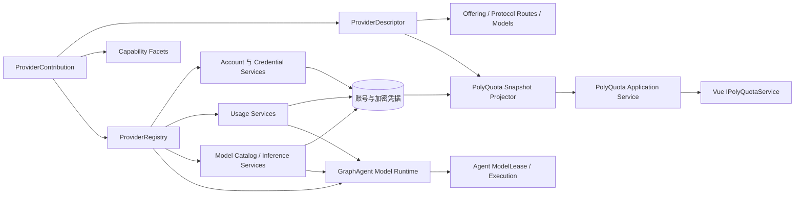

# 跨服务商服务协议设计

| 项目 | 内容 |
| --- | --- |
| 状态 | 目标设计，供共享 Core、PolyQuota 与 GraphAgent 后续实施 |
| 更新日期 | 2026-09-27 |
| 适用范围 | 服务商目录、认证、账号、凭据刷新、用量、模型目录、API 协议族、推理执行边界与产品服务 |
| 暂缓细节 | 统一消息 IR 的全部字段、完整流事件表、路由算法、第三方可执行插件、共享凭据代理物理实现 |
| 参考输入 | [OmniRoute 原始协议探索](./omniroute-exploration.md)、[当前搬运基线](./omniroute-manual-extraction-baseline.md)、[同步工具形态设计](./omniroute-sync-tool-design.md)、[ZCode](./zcode-provider-architecture-exploration.md)、[DSH](./deepseek-harness-provider-architecture-exploration.md)、[Hermes Agent](./hermes-agent-provider-architecture-exploration.md) |

## 1. 目标

本设计建立两个产品共用的 Provider Platform，并解决以下问题：

1. PolyQuota 通过稳定应用服务读取服务商、账号、用量和设置，并发起认证、刷新和管理操作；
2. GraphAgent 通过共享 Core 取得模型目录、协议端点、能力、推理执行与用量事实，而不依赖 PolyQuota 的 UI 或 Electron 服务；
3. Codex、GLM 及后续服务商共享注册、凭据和调用主干，同时保留地区、认证方式、API 协议、模型能力、配额结构和原生状态等真实差异；
4. 应用根据稳定标识把账号、协议端点和模型请求绑定到唯一实现，不依赖页面分支、URL 猜测或隐式回退；
5. 新服务商的认证、协议编解码、模型目录、用量解析和错误归一化可以在无真实网络、无产品宿主、无真实凭据的条件下完成大部分验证；
6. 当前从 OmniRoute 搬运的协议叶子可以继续演进，并为以后抽取翻译器、Executor 或模型能力规则预留明确位置。

设计不追求把所有差异压成最小公分母。统一的是注册、能力发现、调用生命周期、错误、安全边界和可序列化形状；差异通过协议判别联合、能力、原生状态和带版本扩展显式保留。

`IPolyQuotaService` 是 PolyQuota 的产品应用服务，不是共享 Provider Platform 本身，也不是 GraphAgent 的调用接口。两个产品复用 Core 的服务商能力端口，但分别拥有自己的应用服务、状态快照和 UI 契约。

## 2. OmniRoute 原始架构与当前搬运基线

### 2.1 OmniRoute 原始服务商结构

OmniRoute 并不存在一个包办所有职责的 `ProviderAdapter`。它的完整请求路径由多层共同组成：

1. `open-sse/config/providers/**` 的 `RegistryEntry` 是内置服务商和模型事实的主要来源，记录 `format`、`executor`、认证、端点、模型能力、模型级 `targetFormat`、备用协议与超时等信息；
2. `open-sse/executors/registry.ts` 把 provider/executor alias 绑定到 `BaseExecutor` 实现，重复 alias 直接失败，并支持延迟构造；
3. `BaseExecutor` 及专用 Executor 负责 URL、认证头、请求改写、HTTP 执行、凭据刷新回写和供应商特殊行为；
4. `open-sse/translator` 维护独立的请求/响应翻译器注册表，识别 OpenAI Chat Completions、OpenAI Responses、Anthropic Messages、Gemini GenerateContent 以及 Codex、Antigravity、Kiro、Cursor 等格式；
5. 请求翻译主要采用“来源格式 → OpenAI 中间形态 → 目标格式”的枢纽结构，但 Responses、reasoning、tool call、Gemini thought signature 等状态具有额外保留规则，并非简单 JSON 字段改名；
6. `chatCore` 负责入站格式识别、模型与目标协议解析、翻译、Executor 调用、错误恢复、流式响应转换、usage 统计和客户端格式恢复；
7. 模型目录和能力另行建模，包括上下文、输出上限、工具调用、视觉/音频/视频、推理能力、可用 endpoint、模型级协议覆盖和不支持参数；
8. OAuth、API Key、凭据刷新、用量查询和限流状态是横切能力，不等同于推理 Executor；
9. `providerPluginManifest` 是从静态注册表生成的能力投影，当前插件化仍是渐进式的，不能把它误认为已经统一了 OmniRoute 的所有运行路径。

因此，本项目不能只把 OmniRoute 理解为“用量接口来源”，也不能直接复制它现有的 `chatCore` 大编排器。可复用的是分层思想与经过筛选的协议叶子；应用注册、宿主端口和产品调度仍由本项目设计。

### 2.2 已经搬运的范围

当前 `packages/core/src/vendor/omniroute` 固定来源为 `references/omniroute` 的 `3ee283bb944d6d62cc219f74317d5186942e1780`，阶段 7 后已经搬运 38 个一一留有 diff 的产物，范围只有：

- 通用配额标量、配额构造、窗口标题和 Codex 配额归一化；
- Codex 浏览器 OAuth、设备授权、CLI 凭据解析、JWT/工作区映射；
- Codex token refresh、旋转刷新串行和提前刷新时间；
- Codex 用量请求、GLM Coding Plan 配额与重置卡查询、Grok Build 与 Antigravity 的认证、刷新和用量协议；
- 为本项目注入 `fetchImpl`、收窄声明和替换路径别名所需的可审查改动。

阶段 6 起按[同步工具形态设计](./omniroute-sync-tool-design.md)的最小修改原则维护：抽取产物可以保留尚未支持厂商的纯声明与数据，只要其依赖闭包不超出清单和外部依赖白名单；vendor 的惰性声明不构成能力声明，共享 Core 的公开边界仍由 `ProviderDescriptor` 与能力 facet 决定。

当前明确没有搬运：

- provider registry、模型目录和模型能力解析；
- translator registry 及 OpenAI Chat、Responses、Anthropic、Gemini 之间的请求/响应转换；
- `BaseExecutor`、专用 Executor 和推理请求执行；
- `chatCore`、路由、模型回退、流恢复、语义缓存和上游限流编排；
- OmniRoute 数据库、Next.js 页面、完整代理栈、Cookie/Web Session 和浏览器自动化。

这些“未搬运”项不再等同于永久排除。与 GraphAgent 必需能力有关的部分应在独立范围、固定上游提交、依赖闭包审查和无网络特征测试齐备后逐层抽取；仍不得让 `references/omniroute` 成为运行时依赖，也不得因导入闭包把数据库和宿主代码一起带入。

### 2.3 已搬运代码在新架构中的位置

| 当前产物 | 新架构归属 | 后续处理 |
| --- | --- | --- |
| OAuth、设备码、CLI 解析 | `ProviderAccountCapability` 内部协议叶子 | 保留原始请求语义，由 Codex contribution 组合 |
| token refresh 与串行器 | 凭据生命周期与共享凭据服务 | 保留服务商专属旋转规则，不进入 UI 协议 |
| Codex/GLM usage 叶子 | `ProviderUsageCapability` | 继续输出 `groups + extras`，不与推理执行耦合 |
| `CodexAdapter` / `GlmAdapter` | 现有过渡 facade | 分阶段拆成 account、usage 等能力实现 |
| `RefreshCoordinator` | PolyQuota 应用协调层 | 通过 ProviderRegistry 取 usage/account 能力 |
| 尚未搬运的 translator | `ProtocolCodecRegistry` 候选来源 | 先确定 IR 和状态保真规则，再选择性抽取 |
| 尚未搬运的 Executor | `ProviderInferenceCapability` 候选来源 | 只抽纯协议/执行叶子，宿主策略由本项目实现 |
| 尚未搬运的模型能力 | `ProviderModelCatalogCapability` 候选来源 | 保留来源、静态/动态目录和模型级协议覆盖 |

现有[手工抽取基线](./omniroute-manual-extraction-baseline.md)仍是当前 38 个产物的事实记录。本设计扩大未来共享 Core 的能力边界，不追溯修改该基线来假装推理协议已经搬运。

## 3. 参考架构的综合取舍

| 主题 | OmniRoute | ZCode | DSH | Hermes Agent | 本项目选择 |
| --- | --- | --- | --- | --- | --- |
| 主要模式 | 静态 provider/model registry + translator + Executor + 大型请求编排 | 预置配置分层解析 | 生命周期化插件注册 | 声明式 Profile + 插件覆盖 | 内置声明与能力实现共同注册 |
| 冲突处理 | registry 静态合并；Executor alias 重复失败 | 解析问题与有效注册表分离 | 冲突即失败、全有或全无 | 后注册覆盖前注册 | 内部冲突即启动失败 |
| 协议表达 | 来源格式、目标格式、模型级覆盖、翻译器矩阵 | API 类型是配置字段 | 统一流契约，适配器保留能力 | Profile `api_mode` + 运行时分支 | API 协议为一等判别类型，Provider 可暴露多端点 |
| 动态替换 | 部分 registry 与 lazy Executor，整体仍偏静态 | 快照整体替换 | 注册句柄原子替换与释放 | 下次会话重新发现 | 首阶段启动时构建不可变注册表 |
| 差异表达 | RegistryEntry、模型能力、Executor 特例 | 判别配置、账号状态、问题列表 | 适配器能力与不透明选项 | Profile 字段与钩子 | 共同字段 + capability facet + 原生状态 + 版本化扩展 |
| 产品投影 | 面向代理 API 与管理页面 | 设置视图与选择视图分离 | 远程服务和可配置目录 | 主要面向 CLI | 共享 Provider Platform，产品应用服务分别投影 |
| 用户插件 | manifest/sidecar 仍在渐进演进 | 不作为主要运行模型 | 完整支持 | 同名覆盖内置 Profile | 当前禁止加载第三方可执行代码 |

采用 OmniRoute 的“服务商、模型、协议格式、翻译器和 Executor 分层”以及经过筛选的协议叶子，采用 ZCode 的“来源、完整目录、可执行注册表、公开视图”分层，采用 DSH 的“唯一所有权、严格注册、同代实现完成一次操作”，采用 Hermes 的“集中声明、多个展示入口可共享一个实现”。不复制 OmniRoute 的大型宿主编排器，也不引入通用插件宿主。

## 4. 当前问题

现有实现已经有良好分层，但服务商边界仍分散：

- `ProviderId`、`AuthMethod` 在 Core 与 UI 各维护一份封闭联合；
- UI 的 `presentation.ts` 同时承担目录、可用性、地区默认值和文案；
- `AuthService.start()` 直接判断 `provider === "glm"` 或 `provider !== "codex"`；
- `RefreshCoordinator` 已按 `provider` 查 `UsageProviderAdapter`，但构造 `Map` 时重复实现会静默覆盖；
- 账号公开元数据使用无命名空间的 primitive map，字段所有权和版本不明确；
- `window.llmUsage`、preload、IPC 与 UI 类型分别维护，容易漂移；
- 账号与用量逐项读取，没有一份带修订号的一致前端快照；
- BigModel 与 Z.ai 共享 `glm` 实现，却靠 `publicMetadata.presentationId` 和页面判断恢复展示入口。
- 共享 Core 当前只有认证、凭据刷新和用量能力，没有模型目录、API 协议类型、推理请求与流式结果契约；
- 先前草案中的 `ProviderRuntime` 强制所有实现提供用量方法，错误地以 PolyQuota 能力定义共享服务商边界；
- GraphAgent 的 `ModelPolicy`、`ModelLease`、额度感知调度和模型执行尚无可绑定的共享协议；
- 当前 OmniRoute vendor 基线与未来推理协议抽取之间没有演进位置，容易在 GraphAgent 启动时另起一套不兼容抽象（该位置已由[同步工具形态设计](./omniroute-sync-tool-design.md)确定：现有产物与未来抽取共用同一清单、闭包规则和门禁）。

最终结构应消除这些分散判断，保留当前已经验证的凭据、刷新与用量逻辑，并在 GraphAgent 启动前固定模型与协议层的关键边界。

## 5. 概念模型

### 5.1 稳定标识

| 标识 | 含义 | 示例 | 所有者 |
| --- | --- | --- | --- |
| `providerId` | 一个服务商实现与凭据所有权域 | `codex`、`glm`、`anthropic` | Core 注册表 |
| `offeringId` | 面向用户的接入入口 | `codex`、`bigmodel-coding-plan`、`zai-coding-plan` | 服务商声明 |
| `authMethodId` | 一种完整认证交互 | `browser-oauth`、`device-code`、`cli-import`、`api-key` | 服务商声明与实现 |
| `accountId` | 已保存的具体账号 | UUID | 账号存储 |
| `protocolRouteId` | 一个可选择的上游 API 协议端点 | `codex-responses`、`anthropic-messages` | Provider contribution |
| `modelId` | 服务商目录中的模型标识 | `gpt-5.6-codex`、`claude-opus-4-6` | 模型目录 |

`providerId` 不是品牌卡片标识，也不是 API 协议类型。一个实现可以拥有多个 offering 和多个 protocol route。BigModel 与 Z.ai 使用同一个 `glm` 实现，但 offering 分别携带地区、网站、图标键和默认认证参数；一个网关也可以同时提供 OpenAI Chat Completions 与 Anthropic Messages，而不因此成为两个服务商。

`modelId` 只在所属 provider 或目录命名空间中唯一。GraphAgent 的持久选择使用 `{ providerId, accountId, modelId, protocolRouteId? }`，不能只保存一条可变 URL 或展示名称。

别名只用于迁移或外部输入归一化，不作为 offering，也不写入新账号。

### 5.2 目录、实现、账号和产品投影



- `ProviderDescriptor` 是可公开投影的声明，不含秘密和网络客户端；
- capability facet 是 Node 侧能力实现，不可序列化到产品 UI；
- `ProviderContribution` 要求声明和全部能力实现以相同 `providerId` 成对注册；
- `ProviderRegistry` 校验所有权并提供不可变查询；
- 账号保存 `providerId`、`offeringId` 和认证方式；
- PolyQuota 快照把它需要的目录、账号、用量和状态投影为同一修订；
- GraphAgent 通过共享模型目录与推理服务取得 `ModelLease`，不读取 PolyQuota 快照；
- `IPolyQuotaService` 只是 PolyQuota 前端入口，不暴露注册表或 IPC 通道；GraphAgent 后续定义自己的应用服务。

### 5.3 共享平台与产品服务边界

共享 `packages/core` 应提供：

- ProviderDescriptor、ProtocolRoute、ModelDescriptor 和能力声明；
- ProviderRegistry 与严格绑定；
- 账号认证、凭据刷新、用量、模型目录和推理执行能力端口；
- API 协议标识、协议 codec/translator 注册边界和统一执行生命周期；
- 产品无关的公开事实、错误、usage 与成本记录；
- 从当前 OmniRoute vendor 叶子到各能力实现的适配层。

PolyQuota 自己提供：

- `IPolyQuotaService`、Electron IPC、状态快照和变更通知；
- 账号管理、轮询、额度通知、设置和展示投影；
- 普通浏览器的空白实现及 Vue 注入。

GraphAgent 自己提供：

- 模型选择、ModelLease、调用预算、任务归因、并发和回退策略；
- Agent 上下文构建、工具执行循环、任务图与 Artifact；
- Policy Gate 在模型请求前后的拦截；
- 面向其 UI 或控制面的应用服务。

GraphAgent 不重新定义 provider、protocol、model capability、credential 或 usage 的基础类型；PolyQuota 也不决定 GraphAgent 的模型路由和执行策略。

## 6. Core 服务商协议

以下 TypeScript 只规定形状和职责，名称可在实施时小幅调整。

### 6.1 JSON 与版本化扩展

```ts
type JsonValue =
  | null
  | boolean
  | number
  | string
  | JsonValue[]
  | { [key: string]: JsonValue };

interface PublicExtension {
  namespace: string;
  schemaVersion: number;
  value: JsonValue;
}
```

差异化公开信息使用反向域名或项目命名空间，例如：

- `io.astraconductor.polyquota.glm.region`；
- `io.astraconductor.polyquota.codex.workspace`；
- `io.astraconductor.polyquota.usage.reset-credits`。

同一对象内命名空间唯一。未知扩展必须在服务传递过程中保持原值；UI 没有对应展示器时可以不显示，但不能把未知字段改造成共同字段。秘密、请求头、token、API Key、设备授权内部标识和 PKCE 数据禁止进入扩展。

扩展只承载确实无法稳定提升为共同字段的内容。地区、认证方式、可用性和配额窗口已经有共同语义，不应重复塞入扩展。

### 6.2 服务商声明

```ts
interface ProviderDescriptor {
  id: ProviderId;
  displayName: string;
  capabilities: ProviderCapability[];
  offerings: ProviderOffering[];
  protocolRoutes: ProtocolRouteDescriptor[];
  extensions?: PublicExtension[];
}

type ProviderCapability =
  | "account"
  | "usage"
  | "model-catalog"
  | "inference"
  | "multiple-accounts";

interface ProviderOffering {
  id: OfferingId;
  providerId: ProviderId;
  displayName: string;
  description?: string;
  iconKey?: string;
  websiteUrl?: string;
  authMethods: AuthMethodDescriptor[];
  defaults?: Record<string, JsonValue>;
  extensions?: PublicExtension[];
}
```

`displayName` 和 `description` 是运行时提供的安全回退文案。UI 的 presentation registry 可以按 `offeringId` 提供本地化名称、图标和更适合产品的说明，但不得改变能力或可执行状态。

`defaults` 只能包含该实现公开声明且经 schema 校验的非秘密默认输入，例如 GLM 的 `region`。它不能携带 API Key 或内部 URL。

`capabilities` 表示服务商贡献提供的共享能力面，不把每种认证方式或 API 端点混入同一枚举。具体认证方式由 offering 声明，模型与协议支持由后续的 route 和 model descriptor 声明。

### 6.3 认证方法

认证差异通过判别联合表达，而不是一个可选字段集合：

```ts
type AuthMethodDescriptor =
  | {
      id: "browser-oauth";
      interaction: "browser-callback";
      fields: readonly AuthFieldDescriptor[];
    }
  | {
      id: "device-code";
      interaction: "device-code";
      fields: readonly AuthFieldDescriptor[];
    }
  | {
      id: "cli-import";
      interaction: "local-import";
      sourceLabel: string;
      fields: readonly AuthFieldDescriptor[];
    }
  | {
      id: "api-key";
      interaction: "secret-form";
      fields: readonly AuthFieldDescriptor[];
    };

interface AuthFieldDescriptor {
  key: string;
  type: "text" | "secret" | "select";
  required: boolean;
  label: string;
  options?: readonly { value: string; label: string }[];
}
```

`fields` 只描述可提交输入。服务商实现必须再次执行运行时校验，不能信任 renderer 根据 descriptor 生成的表单。

### 6.4 API 协议与路由声明

```ts
type ApiProtocol =
  | { kind: "openai-chat-completions"; version: "v1" }
  | { kind: "openai-responses"; version: "v1" }
  | { kind: "anthropic-messages"; version: "2023-06-01" }
  | { kind: "gemini-generate-content"; version: "v1" | "v1beta" }
  | { kind: "extension"; namespace: string; version: string };

type ProviderOperation =
  | "chat"
  | "embeddings"
  | "rerank"
  | "image-generation"
  | "video-generation"
  | "audio-speech"
  | "audio-transcription";

interface ProtocolRouteDescriptor {
  id: ProtocolRouteId;
  providerId: ProviderId;
  protocol: ApiProtocol;
  operations: readonly ProviderOperation[];
  streaming: boolean;
  authBinding: "account" | "none";
  extensions?: PublicExtension[];
}
```

API 协议类型、业务操作和服务商必须正交：OpenAI Chat Completions 与 Responses 是不同协议；同一服务商可以同时暴露多种协议；同一协议也可以由多个服务商实现。`providerId` 因此不能再兼任 `apiType`，模型选择也不能只保存服务商和模型名。

公开 route 只描述可选择的协议能力，不暴露真实密钥、请求头或内部基础地址。执行时使用的 endpoint、重试策略和认证材料属于主进程或受信 Worker 的私有绑定。

### 6.5 模型目录

```ts
interface ModelRef {
  providerId: ProviderId;
  modelId: ModelId;
}

interface ModelDescriptor {
  providerId: ProviderId;
  id: ModelId;
  displayName: string;
  protocolRouteIds: readonly ProtocolRouteId[];
  operations: readonly ProviderOperation[];
  inputModalities: readonly string[];
  outputModalities: readonly string[];
  contextWindow?: number;
  maxOutputTokens?: number;
  toolCalling?: {
    supported: boolean;
    parallel?: boolean;
  };
  structuredOutput?: "unsupported" | "json" | "schema" | "unknown";
  reasoning?: {
    mode: "none" | "effort" | "native-state" | "unknown";
    effortLevels?: readonly string[];
  };
  unsupportedParameters?: readonly string[];
  extensions?: PublicExtension[];
}

type ModelCapabilityRequirement =
  | { kind: "operation"; operation: ProviderOperation }
  | { kind: "input-modality"; modality: string }
  | { kind: "output-modality"; modality: string }
  | { kind: "tool-calling"; parallel?: boolean }
  | { kind: "structured-output"; minimum: "json" | "schema" }
  | { kind: "reasoning"; mode?: "effort" | "native-state" }
  | { kind: "extension"; namespace: string; requirement: JsonValue };

interface ModelCatalogSnapshot {
  providerId: ProviderId;
  revision: string;
  observedAt: string;
  source: "static" | "remote" | "merged";
  models: readonly ModelDescriptor[];
}
```

模型目录把 OmniRoute `RegistryModel` 中已经证明必要的能力提升为共享契约，包括模型级目标协议、上下文限制、工具调用、结构化输出、推理状态、模态和不支持参数，但不在当前阶段复制其全部字段。GraphAgent 使用结构化 `ModelCapabilityRequirement` 过滤候选，不能把能力重新退化成约定俗成的字符串标签。静态声明与远端发现可以合并，必须保留来源和 revision；远端刷新暂时失败时，现有租约不能因为目录瞬时缺失而被悄悄改绑。

### 6.6 能力化运行实现

```ts
interface ProviderAccountCapability {
  readonly providerId: ProviderId;

  startAuth(context: ProviderContext, request: ProviderAuthRequest):
    Promise<ProviderAuthStart>;

  refreshCredentials?(
    context: ProviderContext,
    account: Account,
    credential: CredentialEnvelope,
    options: { force: boolean },
  ): Promise<CredentialRefreshResult>;
}

interface ProviderUsageCapability {
  readonly providerId: ProviderId;

  fetchUsage(
    context: ProviderContext,
    account: Account,
    credential: CredentialEnvelope,
  ): Promise<UsageSnapshot>;
}

interface ProviderModelCatalogCapability {
  readonly providerId: ProviderId;

  getModelCatalog(context: ProviderContext): Promise<ModelCatalogSnapshot>;
}

interface ProviderInferenceCapability {
  readonly providerId: ProviderId;

  prepareCall(
    context: ProviderContext,
    request: ProviderInferenceRequest,
  ): Promise<PreparedProviderCall>;
}

interface PreparedProviderCall {
  readonly selection: ProviderRouteSelection;
  readonly implementationGeneration: string;
  readonly modelCatalogRevision: string;
  execute(signal: AbortSignal): AsyncIterable<ModelStreamEvent>;
}

interface ProviderContribution {
  descriptor: ProviderDescriptor;
  account?: ProviderAccountCapability;
  usage?: ProviderUsageCapability;
  models?: ProviderModelCatalogCapability;
  inference?: ProviderInferenceCapability;

  dispose?(): Promise<void> | void;
}
```

`ProviderContext` 只包含受控端口，例如 HTTP、时钟、日志、外部浏览器、回环监听和本地凭据导入。实现不能导入 Electron，也不能直接读取产品数据库。

能力面是可选的，服务商不需要为空缺能力实现无效果方法。若声明了 `account`、`usage`、`model-catalog` 或 `inference`，对应 facet 必须存在且 `providerId` 一致；未声明能力时对应 facet 也不得伪装成可执行。`refreshCredentials` 同样只由确实有主动刷新协议的账号实现提供。API Key 是否需要轮换是账号能力内部的凭据生命周期差异，不再迫使 API Key、纯推理或纯目录实现提供无效果刷新方法。

`prepareCall` 在一次调用开始前固定 provider、account、model、protocol route、实现代次和目录 revision；得到的 `PreparedProviderCall` 在完成或取消前不重新查注册表。GraphAgent 的 `ModelLease` 可以在此基础上增加预算、过期时间和任务归因，但不能把正在执行的流静默切换到另一实现。

### 6.7 规范消息与协议编解码边界

共享 Core 需要一套 `ProtocolCodecRegistry`，明确注册“原生协议与规范消息 IR”之间支持的方向；推理 facet 负责把选定 route、账号和 endpoint 绑定到 Executor。该边界对应 OmniRoute 的 translator registry、format 与 Executor 分层，但不预设所有转换都必须经过 OpenAI Chat Completions 这一中间格式。

当前先稳定以下边界，字段细节留给独立协议设计：

```ts
type ApiProtocolKind = ApiProtocol["kind"];

interface ProviderRouteSelection {
  providerId: ProviderId;
  accountId: AccountId;
  modelId: ModelId;
  protocolRouteId: ProtocolRouteId;
}

interface ProviderInferenceRequest {
  selection: ProviderRouteSelection;
  operation: ProviderOperation;
  request: CanonicalModelRequestEnvelope;
}

type ModelStreamEvent =
  | ModelOutputEvent
  | ModelToolCallEvent
  | ModelReasoningEvent
  | ModelUsageEvent
  | ModelErrorEvent
  | ModelCompletedEvent;
```

- `ApiProtocol`、`ProviderOperation`、`ProviderRouteSelection` 和 codec 注册键；
- 规范请求 envelope，以及文本、工具调用、工具结果、推理片段、错误、用量和完成原因等流事件类别；
- 原生 response id、tool call id、reasoning/thought signature 等回放状态的所有权和生命周期；
- 直接透传、可逆转换、有损转换和不支持转换四种明确结果；
- 非流式响应也归一为同一事件序列，避免 GraphAgent 维护两套工具循环。

OpenAI Chat Completions、OpenAI Responses、Anthropic Messages 和 Gemini GenerateContent 在 system 指令、工具调用、推理签名、事件顺序和续写状态上并不等价。codec 必须经过能力检查才能转换；不得丢弃未知语义后伪装为成功。原生状态只能交回产生它的 codec/route，不能被另一个服务商或协议解释。

### 6.8 内部认证开始结果

```ts
type ProviderAuthStart =
  | {
      status: "completed";
      provisioning: AccountProvisioningResult;
    }
  | {
      status: "pending";
      interaction: PublicAuthInteraction;
      finish(signal: AbortSignal): Promise<AccountProvisioningResult>;
      cancel(): void;
    };
```

待完成结果内部携带 `finish` 和 `cancel`，由 `AuthCoordinator` 保存，绝不跨 IPC。这样一次认证会话固定绑定创建它的运行实现，即使未来注册表更新，`finishAuth(sessionId)` 也不会重新按标识查到另一代实现。

公开交互只包含浏览器回调状态、用户码、验证地址和可安全展示的说明，不包含上游 device auth ID、code verifier 或 token。

## 7. ProviderRegistry

### 7.1 构造规则

应用组合根一次性提交全部 `ProviderContribution`。贡献同时携带声明和可选能力 facet，不再用一个以 PolyQuota 用量需求为中心的万能 runtime 包装所有服务商行为。

注册表构造必须完整校验：

1. 每个 facet 的 `providerId` 都等于 `descriptor.id`；
2. `providerId` 全局唯一；
3. `offeringId` 全局唯一，并且 `offering.providerId` 指向当前贡献；
4. 一个 offering 内 `authMethodId` 唯一；
5. `protocolRouteId` 全局唯一，并且 route 指向当前贡献；
6. capability、认证方式与实际 facet 完整相符；
7. route 的 operation、协议与 inference capability 声明相容；
8. 所有公开 URL、扩展和默认值符合 schema；
9. 实现声明的必需依赖已经提供。

任一错误都使整个注册表构造失败。禁止后注册覆盖、跳过坏条目后继续启动，或把请求交给默认实现。

动态模型目录不能在同步构造时预知。每个目录 snapshot 进入缓存前另行校验：模型引用的 route 必须存在，operation 必须相容，`providerId` 必须属于产生该 snapshot 的 facet；无效 snapshot 整体拒绝，不部分合并。

### 7.2 当前运行形态

首阶段注册表在应用启动后不可变。新增服务商通过源码、构建和发布进入应用，不从用户目录执行代码。

测试可以为每个测试实例构造独立注册表。未来若确需动态实现，再增加带 disposer 的原子替换 API；在明确签名、权限、进程隔离和升级回滚方案前，不开放第三方插件加载。

### 7.3 查找规则

- 新增认证：先由 `offeringId` 找声明，再取得其唯一 `providerId` 和实现；
- 已有账号操作：只按账号保存的 `providerId` 找 account 或 usage facet，`offeringId` 只影响展示与该账号的公开默认事实；
- 模型选择：按 `providerId + modelId + protocolRouteId` 解析模型与推理 facet，并验证账号属于同一 provider；
- 缺少实现：账号进入 `provider-unavailable` 状态，保留本地数据，禁止刷新和认证；
- 未知 offering：拒绝新增认证，不按 provider 的第一个 offering 猜测；
- 未知账号 provider：拒绝执行并保留可诊断错误，不迁移到相似标识。

## 8. 应用组合与绑定

### 8.1 唯一组合根

Electron 主进程的启动入口负责创建平台端口和服务商贡献：

```ts
const providerRegistry = createProviderRegistry([
  createCodexProvider({ http, browser, callbackServer, cliImport, clock, logger }),
  createGlmProvider({ http, zcodeImport, clock, logger }),
]);

const authCoordinator = new AuthCoordinator(
  providerRegistry,
  accountRepository,
  credentialService,
);

const refreshCoordinator = new RefreshCoordinator(
  providerRegistry,
  accountRepository,
  credentialService,
  usageRepository,
);

const modelService = new ModelService(providerRegistry, credentialService);
```

同一个 `providerRegistry` 同时交给认证、刷新、模型目录、推理准备、公共快照和诊断服务。不得为每个子系统重新构造服务商表。

### 8.2 Codex 绑定

Codex 贡献包含：

- `providerId: "codex"`；
- offering `codex`；
- 浏览器 OAuth、设备码和 Codex CLI 导入；
- OAuth 凭据刷新；
- Codex 用量查询与 `groups + extras` 归一化。

现有 `CodexAdapter` 与 `CodexAccountProvisioner` 的逻辑可以先分别包装成 account 与 usage facet，随后再把保存责任统一移到 `AuthCoordinator`。已经搬运的认证和用量协议解析本身不重写；Codex 推理 route、codec 和 Executor 在后续选择性搬运阶段单独注册，不塞回这两个 facet。

### 8.3 GLM 绑定

GLM 贡献包含一个 `providerId: "glm"` 和两个 offering：

- `bigmodel-coding-plan`，默认 `region: "china"`；
- `zai-coding-plan`，默认 `region: "international"`。

两者都支持 ZCode 导入和 API Key。认证请求把 offering 默认值与用户输入合并后交给 GLM account facet 校验。账号持久化时明确保存 `offeringId` 和公开地区事实，不再依赖 UI 从松散 `publicMetadata.presentationId` 猜测。GLM 的 OpenAI 兼容推理端点如果以后纳入 GraphAgent，应作为独立 protocol route 和 inference facet 能力声明，不能由“支持 API Key”推断出来。

### 8.4 GraphAgent 绑定

GraphAgent 不调用 `IPolyQuotaService`。它通过共享平台完成以下绑定：

```text
ModelPolicy
  -> ModelCatalogCapability 过滤候选
  -> ProviderRouteSelection(provider + account + model + protocol route)
  -> CredentialLease / budget / policy gate
  -> ProviderInferenceCapability.prepareCall()
  -> ModelLease 持有 PreparedProviderCall
  -> 规范 ModelStreamEvent 驱动上下文和工具循环
```

PolyQuota 汇总的用量与额度事实可以作为调度输入，但不能直接替 GraphAgent 选择模型、协议或回退路线。GraphAgent 的策略层负责质量、隐私、成本、上下文、工具能力、并发和失败回退；共享平台负责说明候选是否真实存在、协议是否可执行以及调用如何被固定到同一代实现。

### 8.5 预告但未实现的服务商

Grok Build 和 Antigravity 若需要提前展示，应作为“产品候选目录”由 UI 自己维护，不伪装成已注册 ProviderDescriptor。正式进入主进程公开目录的条目必须具备可执行实现。

如果产品确实需要主进程返回“已知但未安装”的目录，应建立独立 `ProviderCatalogEntry` 并把 `availability: "unavailable"` 作为明确状态；它不能出现在可执行注册表，也不能接受认证请求。

## 9. PolyQuota 统一公开数据

### 9.1 一致状态快照

前端不再分别读取账号列表和每个账号的用量。应用服务返回一份快照：

```ts
interface PolyQuotaSnapshot {
  revision: number;
  generatedAt: string;
  providers: PublicProviderDescriptor[];
  accounts: PublicAccountDto[];
  usageByAccountId: Record<string, PublicUsageDto | null>;
  operations: PublicOperationState[];
  settings: PublicSettingsDto;
}
```

快照投影过程从一个已提交的应用状态读取数据，`revision` 只在公开状态真正变化后递增。UI 收到变更通知后重新读取快照；事件本身只是失效提示，不携带零散业务状态。

删除账号后，下一修订必须同时移除账号、用量和相关操作状态。后台刷新完成后，账号凭据状态与新用量在同一修订出现。

### 9.2 账号公开 DTO

`PublicAccountDto` 保留当前稳定共同字段，并增加：

- `offeringId`；
- `availability` 与稳定原因码；
- `extensions: PublicExtension[]`；
- 可选的 `capabilities` 有效子集。

现有 `publicMetadata` 在迁移期只读兼容，写入新记录时转换为明确共同字段或命名空间扩展。转换完成后删除该无命名空间 map。

### 9.3 用量公开 DTO

当前 `UsageSnapshot` 的 `groups + extras` 继续作为跨服务商共同结构：

- `groups[].quotas[]` 表达配额组、窗口、绝对值、剩余百分比和重置时间；
- `extras[]` 表达无法归入配额窗口但需要展示的信息；支持用户动作的条目携带不透明动作标识，由主进程执行供应商协议；
- 上游原生 `displayName` 与 `windowSeconds` 都保留；
- UI 优先使用原生事实，再用 presentation registry 补充文案；
- 缺失值保持 `null` 或省略，不能编造 0、无限或默认窗口。

当 `extras` 的结构超出当前 `value/items` 能力时，应升级为带 schemaVersion 的判别联合或 `PublicExtension`，不能继续叠加互相无关的可选字段。

## 10. PolyQuota 前端服务契约

### 10.1 IPolyQuotaService

公共契约应位于 UI、preload 与主进程都能依赖的轻量包中，例如未来的 `packages/polyquota-contract`。该包只能包含类型、schema 和纯序列化辅助函数，不依赖 Vue、Electron、数据库或 Node API。

```ts
interface IPolyQuotaService {
  getSnapshot(): Promise<ServiceResult<PolyQuotaSnapshot>>;
  subscribe(listener: (event: PolyQuotaChangedEvent) => void): () => void;

  setAccountEnabled(accountId: string, enabled: boolean): Promise<ServiceResult<void>>;
  deleteAccount(accountId: string): Promise<ServiceResult<void>>;
  refreshAccount(accountId: string): Promise<ServiceResult<RefreshOutcomeDto>>;
  refreshAll(): Promise<ServiceResult<RefreshBatchOutcomeDto>>;
  refreshCredentials(accountId: string): Promise<ServiceResult<CredentialRefreshOutcomeDto>>;

  startAuth(request: StartAuthRequest): Promise<ServiceResult<AuthStartResultDto>>;
  finishAuth(sessionId: string): Promise<ServiceResult<PublicAccountDto>>;
  cancelAuth(sessionId: string): Promise<ServiceResult<void>>;

  saveSettings(settings: PublicSettingsDto): Promise<ServiceResult<PublicSettingsDto>>;
  getSystemStatus(): Promise<ServiceResult<PublicSystemStatusDto>>;
}
```

`ServiceResult<T>` 使用 `{ ok: true, value } | { ok: false, error }`。错误包含稳定 `code`、用户安全消息、是否可重试和可选公开详情，不包含原始响应、堆栈或秘密。

公开接口不提供“取得某服务商实现”“发送任意 IPC”“传入 URL 后代请求”等通用逃生口。

### 10.2 Electron 实现

preload 只在 `window.polyQuotaElectronService` 暴露 `IPolyQuotaService`。每个方法调用固定 IPC 通道，订阅只监听固定状态变更事件，并在 disposer 中移除对应 listener。

主进程 IPC 层负责：

1. 用共享 schema 校验输入；
2. 调用应用服务；
3. 把领域错误转换为 `ServiceResult`；
4. 对输出再次执行公开 schema 校验；
5. 不向 renderer 暴露 Core 实现或秘密对象。

IPC 层不判断具体服务商，也不解析配额响应。

### 10.3 空白实现与测试实现

前端提供三种实现角色：

- `ElectronPolyQuotaService`：实际由 preload 暴露；
- `EmptyPolyQuotaService`：普通浏览器默认实现；
- `FakePolyQuotaService`：仅在 UI 测试中使用，可显式设置快照和操作结果。

空白实现返回修订号为 0 的空快照和有效默认设置；订阅返回无副作用 disposer；所有写操作返回明确的 `service-unavailable`，不得伪造成功。相比“写方法什么都不做并返回成功”，明确失败可以避免浏览器预览误导用户，同时仍保持页面可运行。

固定前端入口完成一次实例选择，并在 Vue 初始化时注入：

```ts
const service = resolvePolyQuotaService(window.polyQuotaElectronService);
createApp(App).provide(polyQuotaServiceKey, service).mount("#app");
```

组件只通过 `usePolyQuotaService()` 获取接口。不得再读取 `window`，也不得各自判断 Electron、开发或生产环境。

## 11. 变更通知与并发

`PolyQuotaChangedEvent` 至少包含新 `revision` 和原因集合，例如 `providers`、`accounts`、`usage`、`settings`。前端只把它当成失效通知：若事件修订高于当前快照，就合并短时间内的事件并读取一次新快照。

并发规则：

- 同账号刷新继续串行并合并重复请求；
- 不同账号可以并行；
- 账号删除、凭据刷新和用量刷新通过同一账号操作队列协调；
- OAuth refresh token 轮换继续遵守服务商自己的跨账号串行规则；
- `finishAuth` 和 `cancelAuth` 对同一 session 至多一个成功；
- 应用退出时先停止新调用，再取消认证会话和刷新，最后关闭存储与注册实现；
- 共享凭据服务落地后，凭据写入还必须遵守[跨产品凭据共享与迁移](./credential-sharing.md)的单一写入者约束。

## 12. 安全边界

### 12.1 不进入 renderer 的数据

- access token、refresh token、id token、API Key；
- PKCE verifier、上游 device auth ID、授权码；
- 原始认证文件内容；
- 任意请求头和 Cookie；
- 原始上游错误体；
- Provider contribution、各能力 facet、PreparedProviderCall、HTTP client 或函数引用；
- GraphAgent 的完整提示词、工具参数和模型原始响应，除非产品明确以脱敏审计记录保存。

### 12.2 输入约束

- 所有标识使用长度和字符集受限的 schema；
- `offeringId`、`authMethodId` 必须从注册表交叉验证；
- `providerId`、`accountId`、`modelId` 和 `protocolRouteId` 必须作为一个 selection 交叉验证；
- `fields` 只允许 descriptor 声明的键，并限制字符串长度；
- secret 字段只在当前调用中存在，不写日志和公开操作状态；
- 外部 URL 来自服务商声明或实现返回的已校验交互，renderer 不能让主进程打开任意协议；
- 扩展 namespace 和 schemaVersion 必须由注册贡献声明，不能由页面任意注入；
- 模型请求只交给 selection 绑定的 route，不能由请求体中的 `baseUrl`、模型名前缀或兼容格式覆盖账号归属。

### 12.3 未知与缺失实现

未知服务商、未注册实现、版本不支持或能力缺失都必须安全失败。禁止：

- 退回第一个服务商；
- 因 API 形状相似而改用通用实现；
- 根据基础地址选择其他账号的凭据；
- 因 codec 转换失败而静默改用另一个 API 协议；
- 在 UI 隐藏错误后继续调用；
- 让后注册实现静默覆盖现有实现。

## 13. 新服务商接入流程

一个只接入 PolyQuota 账号与用量的服务商按以下顺序接入：

1. 建立固定协议夹具：认证成功/失败、凭据刷新、用量成功、缺字段、认证失败、限流和服务端错误；
2. 在 Core 实现纯解析器和错误归一化；
3. 使用注入的 fake `HttpPort` 实现 account 与 usage facet，不接 Electron；
4. 声明 descriptor、offering、认证方式、能力和扩展 schema；
5. 运行通用 Provider contract suite；
6. 在应用组合根注册 contribution；
7. 为 UI presentation registry 增加本地化文案、图标和扩展展示器；
8. 验证主进程公开快照与服务调用绑定到正确实现；
9. 只有在协议与绑定通过后，才做一次可选的真实凭据烟测。

前七步不需要真实网络请求。真实网络只验证上游仍接受请求和实际凭据闭环，不承担基础数据结构测试。

若该服务商还要供 GraphAgent 调用，则继续：

10. 声明 protocol route、operation 和模型目录夹具；
11. 为每个原生协议建立请求、响应、流事件、工具调用、推理状态和错误的黄金夹具；
12. 实现或复用 codec，并明确直接透传、可逆、有损和不支持转换；
13. 用 fake Executor 验证 `prepareCall` 固定 selection、实现代次和目录 revision；
14. 运行模型目录、codec、流事件顺序、取消、凭据隔离和 GraphAgent lease contract suite；
15. 最后才以最小真实调用验证 endpoint、认证和流式传输。

因此，“不包含真实网络请求的新供应商测试更简单”仍然成立，但测试对象不再只有用量 DTO：账号/用量和模型/协议/推理各有独立 contract suite，只有服务商真正声明的能力面才需要执行。

## 14. 测试策略

### 14.1 通用注册表测试

- descriptor 与任一 facet 的 `providerId` 不一致时拒绝；
- 重复 `providerId`、`offeringId`、认证方式时拒绝；
- 重复 `protocolRouteId`、模型引用未知 route 或声明能力缺少 facet 时拒绝；
- 候选集合中任一项无效时没有部分注册；
- 未知 offering、provider、account 明确失败；
- GLM 两个 offering 都解析到同一组账号/用量 facet；
- Codex 请求不会解析到 GLM facet，反之亦然；
- 相同 API 协议的两个 provider route 不会因格式相同而互换账号。

### 14.2 Provider contract suite

每个账号/用量实现复用对应的行为测试：

- descriptor 和能力完整；
- 每个认证方式只接受声明的输入；
- pending 认证支持完成、取消、重复完成与退出取消；
- 不提供主动刷新方法的 API Key 账号继续使用现有凭据，不调用伪造的 refresh；
- OAuth 在需要时刷新，认证失败只强制重试一次；
- `fetchUsage` 只返回所属 `accountId` 的规范快照；
- 错误转换后没有秘密；
- AbortSignal 能终止等待和请求；
- 上游缺字段时保持未知，不编造值。

测试传入脚本化 fake fetch 和 fixture，不监听真实端口，不打开浏览器，不读用户目录。

### 14.3 模型与协议 contract suite

- 模型目录引用的 route、operation 与能力一致；
- Chat Completions、Responses、Anthropic 和 Gemini 的黄金夹具分别保留原生语义；
- 文本、工具调用/结果、reasoning 状态、usage、错误和完成原因映射为稳定事件；
- 不可逆或未知字段产生显式转换结果，不静默丢弃；
- 同一原生状态只能交回原 codec/route；
- `prepareCall` 后注册表或目录更新不改变进行中的调用；
- fake Executor 可以验证请求、流事件顺序、取消和错误映射，全程不访问网络。

### 14.4 公开投影测试

- 快照中的目录、账号和用量属于同一 revision；
- 内部 CredentialEnvelope 不可序列化进 DTO；
- 未知版本扩展可透传且不会破坏共同字段；
- 原生配额名称和窗口信息保留；
- 账号缺失实现时仍可显示和删除，但不能刷新；
- 变更事件只在新状态提交后发送。

### 14.5 UI 测试

UI 测试直接注入 `FakePolyQuotaService`：

- 不修改 `window`；
- 不构造不完整的类型断言；
- 可以独立模拟空状态、多个服务商、认证等待、刷新失败和差异扩展；
- 可以断言组件只发送 `offeringId`、`authMethodId`、`accountId` 和声明字段。

### 14.6 Electron 边界测试

Electron 测试只覆盖共享 schema、固定通道、订阅释放、CSP、preload 暴露名以及一次端到端绑定。不重复测试每个服务商的协议解析。

## 15. 分阶段迁移

### 阶段 A：盘点基线并建立共享类型

1. 以 OmniRoute 探索文档和 24 个 vendor 产物清单固定“上游原始结构/当前已搬运/尚未搬运”三种事实；
2. 建立 provider、offering、account、protocol route、model、operation 和 capability 的轻量公共类型及运行时 schema；
3. 明确当前 Codex、GLM 实现只覆盖 account/usage，不伪装成已支持 inference；
4. 为 GraphAgent 的 `ModelPolicy` 和未来 `ModelLease` 引用共享标识，不再自建 provider/apiType 字符串体系。

这一阶段只建立可演进边界，不要求立即搬运 OmniRoute 的 translator、Executor 或完整模型表。

进展记录（2026-09-30）：provider / offering / 认证方式的轻量声明与统一目录端点已落地——core 按供应商建立 `src/providers/<id>/` 目录（adapter 与 descriptor 同处一目录），`providers/catalog.ts` 聚合全部声明并在重复 provider、offering 或认证方式时构造失败；快照 `providers` 字段（`PublicProviderDescriptor[]`）经 IPC 提供给前端，schemaVersion 升至 2；UI 接入页的结构改为目录驱动，`presentation.ts` 只保留文案与图标。protocol route、model、operation 与 capability 类型仍未落地。

### 阶段 B：能力注册表包装现有实现

1. 定义 descriptor、capability facet、contribution 和严格注册表；
2. 用 account/usage facade 包装现有 Codex、GLM adapter 与 provisioner；
3. 在组合根注册两个 contribution；
4. 让 RefreshCoordinator 从注册表取得对应 facet；
5. 增加重复注册、缺失实现和 offering 绑定测试。

### 阶段 C：认证分派收敛

1. 将 Codex 与 GLM 的认证分支移入各自 account facet；
2. AuthCoordinator 只管理 session、保存、取消和公开结果；
3. 账号正式保存 `offeringId`；
4. 把 GLM 地区从松散 presentation metadata 迁到明确字段或版本化扩展；
5. 删除 UI 与 IPC 中按服务商校验具体字段的分支，改为共享 schema 与实现校验。

### 阶段 D：PolyQuota 应用服务、目录与展示收敛

1. 实现 `IPolyQuotaService`、空白实现和类型化 Vue 注入；
2. 将 `window.llmUsage` 重命名为 `window.polyQuotaElectronService`；
3. 用带 revision 的 `getSnapshot()` 与状态失效通知替代分散读取；
4. UI 从快照读取真实可执行目录，presentation registry 只负责本地化与视觉；
5. 把 plan、quota、extra 文案映射改为 offering 或扩展展示器；
6. 删除 Core 与 UI 重复的 `ProviderId`、`AuthMethod` 定义；
7. 清理旧 `publicMetadata` 和逐账号读取 API。

### 阶段 E：在 GraphAgent 可运行前固定推理骨架

1. 实现 `ApiProtocol`、`ProtocolRouteDescriptor`、`ModelDescriptor` 和 `ProviderRouteSelection` schema；
2. 建立 codec registry、规范请求 envelope 与最小 `ModelStreamEvent` 分类；
3. 以 fake provider + fake Executor 完成 model catalog、`prepareCall` 和 lease contract suite；
4. 至少为 OpenAI Chat Completions、OpenAI Responses、Anthropic Messages 和 Gemini GenerateContent 建立协议黄金夹具，即使首版只执行其中一种；
5. 将 GraphAgent `ModelPolicy -> selection -> ModelLease` 路径绑定到共享契约。

这一阶段不要求完成通用路由器或所有字段转换，但必须在 GraphAgent 业务代码出现前固定职责和稳定标识，避免以后从 PolyQuota 用量 runtime 反向拆架构。

### 阶段 F：选择性继续搬运 OmniRoute

1. 以固定上游 commit 审核 registry model、format、translator 和 Executor 的最小依赖闭包；
2. 优先抽取纯类型、纯转换器和 fixture，宿主编排留在产品层；
3. 每批搬运以 `tools/omniroute-sync` 清单条目的形式登记来源路径、上游 commit、规则与补丁，并更新基线文档；闭包、拒绝路径和幂等门禁按[同步工具形态设计](./omniroute-sync-tool-design.md)执行；
4. 不让 `references/omniroute` 成为运行时依赖，也不机械复制 `chatCore`、数据库和代理宿主；
5. 若 OmniRoute 的 OpenAI 中转语义与本项目规范 IR 冲突，以无损能力和 GraphAgent 工具循环需求为准，而不是维持源码形状。

### 阶段 G：以新服务商验证扩展性

选择一个同时具有账号/用量和至少一种推理 route 的服务商，用固定夹具完成其声明能力的协议与绑定测试，再进行最小真实烟测。只有它无需修改通用协调器、PolyQuota IPC 分派、GraphAgent provider 基础类型和已有页面组件时，才认为共享服务商平台成立。

## 16. 完成标准

满足以下条件后，本设计可以进入完成状态：

- Core、Desktop 与 UI 只共享一份公共协议和 schema；
- 前端业务代码不直接访问 `window` 或 IPC；
- 应用只有一个 ProviderRegistry 实例；
- Codex 与 GLM 都通过 contribution 注册，AuthService 不再按服务商分支；
- BigModel 与 Z.ai 共享 GLM 实现，但各自差异完整显示；
- 重复或错误绑定在启动时失败，未知实现不会回退；
- 单一快照和变更通知覆盖后台刷新、认证、删除与设置变化；
- API 协议类型不再隐含在 provider 或模型名中，route 与模型能力可以独立校验；
- GraphAgent 的 `ModelPolicy`、selection 与 `ModelLease` 使用共享 provider/model/protocol 标识；
- codec、模型目录和 fake Executor 能在无网络情况下覆盖至少四类首要 API 协议的契约；
- 当前 OmniRoute 搬运基线与后续每批选择性搬运都有来源、范围和离线验证记录；
- 固定 fixture 与 fake 端口可以完成新服务商全部已声明能力的大部分协议测试；
- renderer、日志、通知和公开扩展均不包含秘密；
- 现有真实 Codex、GLM 刷新行为和 `groups + extras` 展示没有回归。

## 17. 明确不做的事情

- 不从 `references/` 导入运行时代码；
- 不允许用户目录中的 JavaScript 或 TypeScript 作为服务商插件执行；
- 不让 `IPolyQuotaService` 暴露模型推理调用；推理协议属于共享 Provider Platform，由 GraphAgent 的应用服务使用；
- 不在本稿一次性定稿全部规范消息字段、路由评分、故障转移算法和第三方插件 ABI；
- 不原样复制 OmniRoute 的完整 `chatCore`、代理宿主、数据库或 UI；
- 不用一个万能 `Record<string, unknown>` 代替共同领域模型；
- 不要求 GraphAgent 采用 PolyQuota 的 Vue、Electron 或 IPC 结构；
- 不在本设计中决定共享凭据代理的进程和物理存储；
- 不为了消除所有条件分支而隐藏真实服务商差异。
