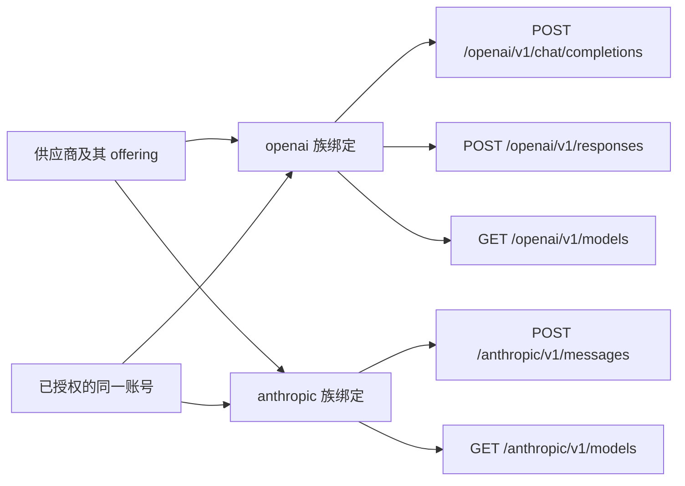

# 供应商接入、模型目录与双产品共用界面

阶段二已实现普通 Key、按明细路由保存的协议地址、目录发现、手工登记和标准协议调用；2B 补充按模型类型的自定义端点配置、条件计费与共用表单组件。第 1、2 节同时说明按协议族管理连接与目录的实现。第 3 节描述供应商阶段三的请求映射。[项目架构](../../../architecture.md) · [Core 详细设计](./core-design.md) · [实施计划](./implementation-plan.md)

## 1. 一个账号可绑定多个协议地址

GraphAgent 提供「通用兼容接口」和「New API 中转站」两种自定义模板。后者为各接入点保存独立站址，支持添加账号前浏览站点模型广场，以及绑定 Key 后按协议刷新可见目录。[New API 中转站模板](./new-api-template.md)

供应商注册表继续保存内置实现。新增一个通用兼容接入点，复用 `api-key` 认证。2A 用户为每次接入填写名称、Key 和至少一条协议路由。2B 改为先在 GraphAgent 配置自定义供应商和各 offering 的端点，再把账号绑定到一个 offering。同一中转站的两把 Key 各有独立 `accountId` 与模型权限。现有 GLM Coding Plan 等订阅接入保留自己的 `offeringId` 和认证流程。

| 数据 | 标识和归属 | 编辑或使用规则 |
| --- | --- | --- |
| 实现与接入点 | Core 注册 `providerId`、`offeringId`、支持的 `protocol`（`EndpointProtocol`）和认证方式 | 用户创建账号实例即可复用内置实现。已有订阅账号继续使用声明的固定端点 |
| 连接配置 | 2B 在本地自定义供应商的 offering 下按 `protocol` 保存协议版本、`baseUrl` 和端点修订，再结合账号授权解析有效绑定。阶段三的非秘密请求规则保存在同一供应商记录 | 账号 ID 在改名、换 Key 和改地址时保持稳定。每次改变目标、授权身份或出站规则都使相应路由的绑定版本失效 |
| 模型选择 | `providerId + accountId + protocol + modelId` | Core 同时校验账号所属 offering 和路由。版本用于校验缓存与在途请求，保存的选择不随一次刷新改名 |
| 机密 | 当前凭据后端持有 API Key 及敏感头的值 | 设置页接受一次性输入，回读只返回是否已设置。账号名称、URL、日志、公开元数据和模型缓存均不存秘密 |

`baseUrl` 是含可选路径前缀的 API 根地址。宿主接受自建域名、局域网、localhost 与非默认端口，保留路径前缀并统一尾部斜线；协议操作以相对路径拼接。URL 不接受用户信息、查询串、片段或密钥，请求与重定向都不能把凭据带到未绑定地址。完整校验与路径拼接规则见 [Core 详细设计 · 连接、记录与并发写入](./core-design.md#5-连接记录与并发写入)。

### 协议族连接与存量升级

同一供应商在 `(providerId, protocolFamily)` 上集中声明认证机制和公共额外参数，包括适用的 header、query 和原生 Body 扩展。族级扩展可以在明细协议和型号规则中细化，预览与实际请求共用合并结果。offering 采用该族配置，绑定本接入点的上游 API 根地址、协议版本、目录获取方式与启用的明细协议。Core 根据实际账号、活动凭据后端和授权解析秘密。不同账号可以使用同一个族配置，但各自保有自己的 Key、可见模型和绑定修订。[公共协议族与明细协议枚举](../../contract/common-api.md#21-协议族与明细协议枚举)



图中路径省略产品前缀 `/api/v1/graph-agent/proxy`。例如 OpenAI 的族根为 `https://relay.example/oai/v1`，Chat、Responses 和模型列表分别追加 `chat/completions`、`responses`、`models`。Anthropic 的族根为 `https://relay.example/claude/v1`，`messages` 与 `models` 都使用该族绑定。宿主从族描述取得上游相对路径，保留根地址的版本段和前缀。族 ID 与 HTTP 方法、已登记的原生路径共同决定入口。

专用族只登记一个模型业务端点并声明默认路由时，模型配置页可直接选择族，省略明细；服务端将其解析成该端点的已登记 ID。此规则适用于有目录或无目录的专用族。通用 LLM 输出始终选择具体明细端点，包括只有一条聊天路由、模型由用户手工登记的接入点。原生代理始终按已登记的具体路径转发。[默认选择与验收](../../contract/common-api.md#专用单端点族的默认选择)

共用参数声明各字段的适用位置。模型发现和推理使用同一套族认证和适用的公共 header/query，分页游标和单次推理输入归相应的原生操作。Body 默认值只在准备适用的原生 POST 时使用，原生代理收到的有效 Body 原样转发。Codex 订阅的工作空间头、Grok Build 的身份头及其 models/session 差异由已登记的供应商族绑定处理。认证值按本次账号解析，明细端点只声明自己的方法、相对路径及原生操作参数。协议相同的另一家供应商可以采用自己的认证方式与公共参数。[现有绑定与供应商专用头](../../../../packages/core/src/providers/model-routes.ts)

族地址、认证绑定或公共额外参数变化，均使依赖它的 `familyBindingRevision` 与明细有效 `bindingRevision` 失效。只改单个明细的相对路径或适用操作时，更新该明细修订并重新校验它的选择；兄弟端点与族目录保留有效性。可公开的读取投影只含族/端点 ID、能力、修订和禁用原因；秘密仍在当前凭据后端。

升级时按注册表明列的路由与族映射归组旧数据。仅合并同一供应商、offering 内，规范化根地址、版本与族公共设置等价的旧绑定，保留原始端点 ID、启停状态、模型选择与覆盖。多条旧路由的族级设置冲突，或某旧路由还未登记族归属时，保留原配置及引用并显示受影响项。用户可统一该族配置或把不同接入地址明确拆入独立 offering。消歧前不通过新族入口访问冲突目的地。

管理刷新接受账号、协议族和期望族修订，兼容原有明细刷新请求。同族并发合并为一次分页读取，New API 再按各明细的原生端点证据投影条目。写入新绑定与兼容引用一次提交，重开或重试不会重复创建。旧客户端提交明细配置时只更新它能表达的字段，若修改会导致同族公共配置分歧则返回冲突并保留原值。旧的明细目录按原作用域保留来源与时点，首次族刷新以新绑定重新取数。

### PolyQuota 如何判断是否监控

Core 按接入点声明和账号适用性计算“可查询订阅用量”，供私有查询、导出、broker 元数据和共享发现统一使用。普通按量 Key 写入 `supportsUsage: "false"`；具备推理用途的记录可独立声明 `supportsInference: "true"`，接收方仍须校验自己的执行能力。已有订阅接入在首次刷新、套餐名未知或用量接口暂时失败时仍可刷新。API Key 认证、免费档位、空套餐名和零余额都不单独决定是否监控。

| 场景 | 共用凭据管理页 | PolyQuota 用量 |
| --- | --- | --- |
| 普通推理 Key，无订阅 | 展示脱敏账号、路由和当前可用操作 | 完全跳过快照、评分、托盘、告警和后台轮询，单账号刷新、兑换等入口同样校验资格 |
| GLM Coding Plan 等有订阅用量的 Key | 按原账号管理 | 继续发现、刷新并展示现有用量 |
| 共享记录用途变更 | 按权限重读描述并更新操作 | 精确筛选 `metadata.supportsUsage === "true"`，再核对本地实现、offering、认证和账号用途。失去资格时移出用量视图并取消调度 |

现有共享读取已有第一道筛选。实施时合并 `sharedCredentialMetadata` 与 PolyQuota 导出侧重复的 provider 级判定，并补齐私有模式和直接调用入口。判定函数、刷新接线与快照范围见 [Core 详细设计 · 如何判定订阅用量](./core-design.md#6-如何判定订阅用量)；切回与导出的范围见[凭据共享实施方案](../credential-sharing/implementation-plan.md#双向导出与存储切换)。

### 配置如何随凭据迁移

2A 的兼容连接曾把地址封在凭据里。2B 只共享账号 ID、供应商 ID、账号标识文本和不透明凭据内容，自定义供应商及其所有 offering、端点 URL 和后续传参配置保存在 GraphAgent 业务库。PolyQuota 对未知自定义供应商不做业务接入或用量检查。共享换 Key 通知使对应账号重新核验；修改本地端点会使本库内使用它的账号绑定失效。[账号与供应商的表结构](../../../graph-agent/design/business-database.md#账号凭据与自定义供应商)

2A 的兼容连接使用独立的应用层 content type 和带版本的 payload 编解码器；旧账号继续使用 v1，未知记录按 opaque 处理。GraphAgent Electron 使用自己的持久私有库。两端共享新增、替换和删除已接入 broker 的获准记录操作，具体范围见[凭据共享实施方案](../credential-sharing/implementation-plan.md)的 B2/B3。编码器、分派规则和迁移边界见 [Core 详细设计 · 数据放在哪里](./core-design.md#数据放在哪里)。

## 2. 从协议目录得到可用模型

现有管理目录按族绑定合并刷新任务与快照，按明细端点投影使用资格。`discoverRouteModels` 和 `projectFamilyModels` 仍直接处理私有目录和模板差异；迁移后，刷新与读缓存共用该绑定登记的目录策略。[现有发现实现](../../../../packages/core/src/providers/model-discovery.ts) · [宿主刷新](../../../../apps/graph-agent/src/server/model-service.ts) · [分派设计](./request-dispatch.md)

| 目录来源 | 适配规则 |
| --- | --- |
| OpenAI 族 | 原生 `GET .../proxy/openai/v1/models` 返回该族绑定上游的一页原生响应。标准 OpenAI 列表按 `object: "list"` 与 `data[].id` 读取。Codex、Grok Build 等接入点的私有目录在管理刷新中沿用已登记的解析器、身份头和查询参数。只有绑定也支持标准列表时才开放这个原生 GET。标准列表未提供的模态、操作与价格保持未知。[OpenAI Docs · List models](https://developers.openai.com/api/reference/resources/models/methods/list) |
| Anthropic 族 | 原生 `GET .../proxy/anthropic/v1/models` 使用本族认证与协议版本，传递允许的分页参数及原生 `data`、`first_id`、`last_id`、`has_more`。内部完整刷新按 `has_more`、`last_id` 构造下一页的 `after_id`。[Claude API · List Models](https://platform.claude.com/docs/en/api/models/list) |
| 无列表或部署名不同 | 用户可以录入精确的上游模型 ID 或部署名，标记来源为手工。发现成功后按完整 ID 对齐，保留用户覆盖和来源 |

族级列表通过调用方所选的具体账号及路径中的协议族取得授权，宿主从账号读出 provider 和 offering，可以先取目录再选择聊天模型。原生 GET 仅转发请求的一页，完整刷新则由目录服务处理分页和模型事实解析。缓存按可见性范围、provider、offering、账号、`protocolFamily` 和 `familyBindingRevision` 隔离，在途刷新还限定在同一活动上下文。Chat 与 Responses 对同一有效 OpenAI 绑定的并发刷新只产生一轮上游分页；另一个账号或 Anthropic 族独立查询。同族各明细共用候选模型 ID，执行资格仍逐个核对明细路由、操作与能力。无列表的族可按明细端点手工登记，Suno Music、Doubao Video 等扩展也只开放实际声明的发现能力。

完整刷新成功才替换快照，失败保留原时点，切换绑定后丢弃迟到结果。模型能力与价格继续按用户覆盖、明确的绑定事实、精确预置、未知逐字段合并，界面显示来源。[发现与刷新](./core-design.md#发现与刷新) · [参数事实与合并规则](./core-design.md#参数事实与合并规则)

## 3. 中转站请求映射

GraphAgent 在自定义接入点的聊天端点下提供「模型别名与请求规则」编辑能力，在 Core 的固定 4 步链式请求管道（Step 2 与 Step 3）中执行声明式规则，保存时按供应商、offering、协议、操作和模型集合校验，调用时再核实账号绑定。配置预览与实际发送共用同一套 `applyPolicyChain` 解析。仅使用 `modelTemplate` 动态拼接上游型号时要求填写 `targets` 白名单；纯静态 `aliases` 允许省略 `targets`。协议字段编码、供应商策略回调链和用户规则的执行顺序及冲突处理见[请求参数的转换、映射与自定义调整](./protocol-design.md#5-请求参数的转换映射与自定义调整)；校验规则见[数据结构、预置资源与校验规则](./request-dispatch.md#7-数据结构预置资源与校验规则)。

下面是一个虚构的网关规则。规则只作用于所选端点。族级公共 Body、端点扩展和 `byModel` 中精确型号的扩展按此顺序合并。`defaults` 可为尚未配置的参数提供默认值。用户为网关的 `atlas-pro` 和 `atlas-mini` 系列登记了可用变体，包括 `vendor/atlas-pro-high-128k`。上下文选项 `131072` 对应该网关的 `128k` 标签。

```json
{
  "operation": "chat",
  "aliases": { "work-pro": "atlas-pro", "work-fast": "atlas-mini" },
  "models": ["work-pro", "work-fast"],
  "targets": ["vendor/atlas-pro-high-128k", "vendor/atlas-mini-high-128k"],
  "modelTemplate": "vendor/{model}-{effort}-{windowLabel}",
  "windowLabels": { "131072": "128k" },
  "consume": ["effort", "window"],
  "headers": { "x-relay-mode": "interactive" },
  "body": { "vendor_options": { "prompt_cache": true } }
}
```

选择 `work-pro`、`high`、131072 时，OpenAI Chat 请求向该绑定的 `chat/completions` 发送 `model: "vendor/atlas-pro-high-128k"`，附加上例按 `chat` 操作限定的 header 和 Body 字段；不会重复发送 `reasoning_effort`。模型发现使用所属族的认证与目录适用的公共 header/query。GraphAgent 保存的选择仍能显示本地名称、原始目录名和实际发送名供核对。

## 4. 两个产品共用哪些界面

阶段一已从 PolyQuota Vue 3 界面抽出共用壳与管理页到 `shared-ui`，提供同一份壳、导航、面板、表单、弹窗、状态提示和响应式布局。两个产品注入名称、品牌图标和主题色，在各自 UI 入口注册专属页面；供应商图标按同一套 `iconKey` 解析。

共用范围是供应商接入页和凭据管理页，GraphAgent 的模型配置页、PolyQuota 的用量页分别由所属产品实现。页面职责、组件接口与宿主差异见[共用 UI 详细设计](../../ui/design.md)；共用页面通过统一契约和 fetch/SSE 访问所属产品的 Hono 应用。既有 PolyQuota 服务模式和 GraphAgent A6—A8 导入宿主分别作为迁移起点。[PolyQuota 服务模式](../service-mode/development.md) · [GraphAgent 最小宿主实施记录](../credential-sharing/a6-a8-sharing-implementation.md#graphagent-最小宿主)

模型页需要的 DTO、HTTP 方法和路径、字段覆盖、长期选择、脱敏预览及 SSE 详见 [GraphAgent 前端契约](../../../graph-agent/design/frontend-contract.md)。GraphAgent Web 的账号凭据仅经 broker，Electron 可使用私有加密后端或 broker；模型缓存与参数覆盖仍归本产品业务库。
