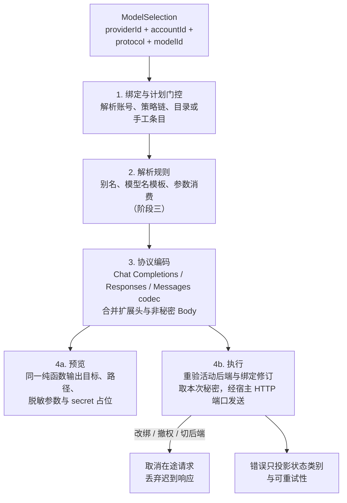

# 供应商平台 Core 功能详细设计

2026-11-15 · 阶段二已实现账号连接、目录发现、字段合并和标准单轮请求。本文同时保留完整注册表与协议的目标形状，第 8 节的自定义映射列入阶段三。数据文件、操作级能力与系列继承的后续契约见[模型结构](./model-structure.md)。[协议边界](./protocol-design.md) · [总体设计](./design.md) · [接入场景](./connections-and-models.md) · [实施方案](./implementation-plan.md)

## 1. 从现有代码扩展

| 代码落点 | 当前实现与后续边界 |
| ------------------------------------------------------------------------------ | ----------------------------------------------------------------------------------------------------------------------------------------------------------------------------------------------------------------------------- |
| `providers/types.ts`、`catalog.ts`、`registry.ts` | 已校验可选账号、用量、模型目录与推理 facet；接入点可显式声明订阅用量资格，账号的协议与地址由路由解析器确定。 |
| `providers/<provider>/descriptor.ts`、`bundle.ts`、`contributions.ts` | 已在七个既有供应商之外登记普通 API Key 接入点。固定路由和账号自定义路由均按可执行能力装配。 |
| `credential-service.ts`、`credential-vault.ts`、`shared-credential-service.ts` | 在同一个活动凭据后端提供新连接记录的读取与编辑，保留已有 adapter 使用的 `load/saveAccount/refresh`。私有密文和共享 payload 的格式分派收在这里                                                                                 |
| `services/contracts.ts`、`ports.ts` | 复用 HTTP 与存储端口。GraphAgent 模型服务使用活动业务存储保存账号目录、字段覆盖和测试选择。[模型服务](../../../../apps/graph-agent/src/server/model-service.ts) |
| `model-catalog/`、`providers/model-*.ts` | `facts.ts` 保存字段与报价的分层合并逻辑（`resolveModelFacts`），`model-discovery.ts` 解析列表，`model-chat.ts` 负责标准编码与发送。版本化预置数据包在 GraphAgent 侧交付（`apps/graph-agent/resources/model-presets.json`，按修订导入 SQLite）；自定义映射按阶段三扩展。 |

实现和现状可分别在注册表、后端选择器及端口中核对。[ProviderRegistry](../../../../packages/core/src/providers/registry.ts) · [CredentialService](../../../../packages/core/src/credential-service.ts) · [CoreServices](../../../../packages/core/src/services/contracts.ts) · [StoragePort](../../../../packages/core/src/ports.ts)

### 公共类型与旧调用方

Core 消费 `contract/common` 的公开事实与格式校验，保留自身 facet、凭据、存储行及 HTTP 端口。契约包的三个子入口、类型归属及从 `polyquota-contract` 解耦的迁移步骤统一见[契约包设计](../../contract/design.md#5-从现有契约迁移)，本节只约束 Core 不依赖产品专属契约。

### 页面操作与宿主调用

前端以 `IPolyQuotaService` / `IGraphAgentService` 组合通用管理接口和产品专属接口，共用传输。服务端由 Core 公共应用服务提供供应商与凭据能力，`core/http` 可选子入口将这些能力装配为公共 Hono 子应用，两产品再分别组合本产品的用量或模型子应用。纯业务模块不依赖 Hono，也不重新实现公开 HTTP handler。[Service 与 Hono 组合](../../contract/service-composition.md) · [架构决策](../../../architecture.md#22-公共与专属-hono-子应用)

共用 HTTP 方法、DTO、错误与 SSE 规则见[公共契约](../../contract/common-api.md)，GraphAgent 专属视图与模型命令见[产品契约](../../../graph-agent/design/frontend-contract.md)，PolyQuota 的产品快照和用量操作见[产品契约](../../../polyquota/frontend-contract.md)。Core 能力和执行端口只在服务端使用；预览调用纯编译器，实际推理仅供受信任的产品服务使用，不对页面提供通用代发入口。

## 2. 服务商声明与认证边界

本节由原总体设计第 6.1–6.3、6.8–6.9 节迁入。协议、模型和推理 facet 的目标类型另见[协议详细设计](./protocol-design.md)。新增 API 形状仍需实现为共享 schema，不能把下列草案视为当前完整实现。

### 2.1 JSON 与版本化扩展

`JsonValue`、`PublicExtension` 和公开扩展的命名空间、版本、未知值保留及秘密限制统一见[公共契约](../../contract/common-api.md#5-json-与版本化扩展)。Core 的 descriptor 与公开投影直接复用该定义，不再维护另一份公共结构。

### 2.2 服务商声明

```ts
interface ProviderDescriptor {
  provider: ProviderId;
  displayName: string;
  offerings: ProviderOfferingDescriptor[];
  capabilities: ProviderCapability[]; // 已实现
  protocolRoutes: ProtocolRouteDescriptor[]; // 待实施，由接入点引用
  extensions?: PublicExtension[];
}

type ProviderCapability = "account" | "usage" | "model-catalog" | "inference" | "multiple-accounts";

interface ProviderOfferingDescriptor {
  id: OfferingId;
  provider: ProviderId;
  displayName: string;
  description?: string;
  iconKey?: string;
  websiteUrl?: string;
  authMethods: ProviderAuthMethodDescriptor[];
  plans: readonly ProviderPlanDescriptor[]; // 接入点级，已实现
  routeConfig?: OfferingRouteConfig; // 已实现：接入点允许的协议与默认路由配置
  extensions?: PublicExtension[];
}

interface ProviderPlanDescriptor {
  key: string;
  displayName: string;
  match: readonly (string | RegExp)[]; // 仅 Core 内部使用，不进入公开 DTO
  multiplier: number;
  source: "published" | "inferred";
}
```

上表为目标形状。阶段二在原七个 descriptor 外增加 `compatible-api-key`；能力按实际实现声明，协议路由在 `providers/model-routes.ts` 中解析。`plans` 已随账号持久化 `offeringId` 迁至接入点级（GLM 两个接入点各持一份相同目录，允许独立演进），offering 不再有 `region` 字段。`providers/catalog.ts` 聚合为唯一目录端点并构造期校验：provider id 格式（slug）与重复、offering 归属与 id 格式、offering 内认证方式 id 格式与重复、iconKey 与 sourcePathHint 合法性、capability 取值、接入点内 plan 的 id/multiplier/match 合法性（2026-10 结构侧批次：供应商/认证方式集合改为从注册 descriptors 收集导出，"未知 provider"检查转为结构性校验）。快照经 `PublicProviderDescriptor` 透出 provider/displayName、offerings 全部展示字段（含 iconKey 与 sourcePathHint）与各接入点的 plans（仅 id/displayName——match 键是 core 内部数据层标识，不过 IPC，套餐展示标签由主进程解析固化进 `PublicUsage.planLabel` 下发）；倍率与 `source` 属于运行期评分事实，不进公开目录。

`displayName` 与 `description` 是 core 持有的标准表述（语言中立或与产品 UI 语言一致，一份即可）；UI 可以按 `offeringId` 覆盖更适合产品的名称与图标，但不得改变能力或可执行状态，也不得再保存一份供应商事实副本（本地化现阶段不做，归属边界见 §2.5）。

`plans` 已位于接入点级，按账号保存的 `offeringId` 查表。运行期将上游 `usage.plan` 归一化后匹配 `match`，取得评分倍率；`source` 区分官方公布与一次性推断。目录不在运行期猜测新套餐。服务端将解析的 `planKey` / `planLabel` 固化进公开用量，标签按目录 `displayName` → 上游原始展示名 → 原始标识串回退；未识别档位保留 `planKey: null`。UI 展示结果和未知提示，不另建套餐名称表。

BigModel 与 Z.ai 已由两个 offering 承载。`region` 不再出现在公开 descriptor、认证输入或账号元数据中；GLM 实现内部按 `offeringId` 选择端点。未来协议路由与模型目录继续按接入点扩展，不能恢复 `region` / `presentationId` 的展示猜测。旧问题与迁移结果见[迁移沿革](./migration-history.md#3-当前问题)。

core 不持有用量标签映射：配额与附加项的展示直接使用上游原生 `displayName`，缺失时经窗口时长等纯展示计算回退到 key 原样；本地化现阶段整体不做，未来若做也归 UI 层（§2.5）。

`iconKey` 由 core 声明键、UI 持有资产映射；二进制图标资产不进入 core。缺失映射时 UI 使用自己的视觉回退，不虚构服务商。

`capabilities` 表示服务商贡献提供的共享能力面，不把每种认证方式或 API 端点混入同一枚举。具体认证方式由 offering 声明，模型与协议支持由后续的 route 和 model descriptor 声明。

### 2.3 认证方法

认证差异通过方法、交互与来源标签表达，而不是一个可选字段集合：

```ts
type AuthMethodInteraction = "browser-callback" | "device-code" | "local-import" | "secret-form";

interface ProviderAuthMethodDescriptor {
  method: AuthMethod;
  interaction: AuthMethodInteraction;
  sourceLabel?: string; // cli-import 来源名，如 "ZCode"、"Claude Code"（已落地）
  sourcePathHint?: string; // 已实现：cli-import 展示用凭据路径提示
  fields?: readonly AuthFieldDescriptor[]; // 待实施：通用表单输入声明
}

interface AuthFieldDescriptor {
  key: string;
  type: "text" | "secret" | "select";
  required: boolean;
  label: string;
  options?: readonly { value: string; label: string }[];
}
```

`method + interaction + sourceLabel` 已落地：`validateProviderCatalog` 校验 offering 内方法唯一，`AuthCoordinator` 构造期把各 flow 的 `supportedMethods` 与目录对账，两份支持矩阵无法静默漂移。core 不为 `AuthMethod`、`AuthMethodInteraction` 等内置枚举提供任何描述信息：它们是封闭协议类型而非供应商数据，前端自持一份与枚举值一一对应的文本映射（"浏览器 OAuth""设备码""API Key"等）即可，不存在按供应商漂移的问题；供应商差异由 `sourceLabel` 这类 descriptor 事实表达。

`sourcePathHint` 是展示事实（如 `~/.codex/auth.json`、`~/.zcode/v2/credentials.json`）：真实路径解析（`CODEX_HOME`、平台差异、ZCode 凭据库定位）在 core 各 auth-flow 内部，descriptor 的提示与它同源维护，UI 不得自行拼路径。

`fields` 只描述可提交输入，让 renderer 能按声明生成表单（如 API Key 输入；GLM 地区差异已由 offering 承载）。服务商实现必须再次执行运行时校验，不能信任 renderer 根据 descriptor 生成的表单。

### 2.4 内部认证开始结果

已按[认证服务抽取设计](../../../polyquota/auth-service-extraction-design.md)落地为 core 的 flow 形态：

```ts
type AuthFlowStart =
  | { status: "completed"; account: Account }
  | {
      status: "pending";
      interaction: "browser-callback" | "device-code";
      finish(): Promise<Account>;
      cancel(): void;
      // 仅 device-code 携带：
      userCode?: string;
      verificationUri?: string;
    };

interface ProviderAuthFlow {
  provider: ProviderId;
  supportedMethods: readonly AuthMethod[]; // 构造期与目录对账，不参与运行期分派
  start(method: AuthMethod, options: AuthStartOptions): Promise<AuthFlowStart>;
}
```

`finish` 与 `cancel` 是闭包，携带各自的 AbortController 与回调 completion，由创建它的 flow 持有全部私有状态；`AuthCoordinator` 的会话表只存句柄，`finishAuth(sessionId)` 固定绑定创建会话的实现，即使未来注册表更新也不会按标识查到另一代实现。句柄绝不跨 IPC：公开投影 `AuthStartResult` 只含 `sessionId`、`interaction` 与设备码展示字段（用户码、验证地址），不包含上游 device auth ID、code verifier 或 token。

与完整形态的差异（该设计 §11 已列，2026-10-13 更新）：认证输入已改为 `offeringId + method`（协调器对目录交叉验证，secret-form 输入为可选 `apiKey`）；flow 已作为 account facet 并入 contribution（阶段 B 完成）。仍保留的差异：flow 内部直接调用各 provisioner 保存，尚未经 accountRepository 与 credentialService 统一收口——保存归属迁移留给后续独立实施。

2026-11-01 补充：上述保存差异仍存在。认证会话、候选验证和 token 刷新保留在应用侧；共享模式先取得 broker 的记录级更新许可，再读取当前不透明信封、执行 provider 并提交。broker 只验证通用权限、许可、修订和字节格式，原子保存结果与回执。产品绑定通过本地事务恢复，不宣称与共享库跨库原子。

### 2.5 展示元数据的归属边界

目录驱动改造已完成以下归属迁移。判定准则：**不依赖产品视觉决策、可由供应商目录推导的内容属于 descriptor；UI 只保留图标资产、内置枚举的文本映射与布局；本地化现阶段整体不做。** 下表保留迁移前后对照：

| 元数据                                                | 当前位置                                       | 目标位置                            | 说明                                                                                                                                                            |
| ----------------------------------------------------- | ---------------------------------------------- | ----------------------------------- | --------------------------------------------------------------------------------------------------------------------------------------------------------------- |
| offering 名称 / 描述 / 网站                           | descriptor，`presentation.ts` 存回退副本       | descriptor，删除副本                | 快照已透出                                                                                                                                                      |
| 套餐展示名                                            | descriptor `plans`                             | 已达成                              | 主进程解析并固化进 `PublicUsage.planLabel`（回退顺序：目录 `displayName` → 原始标识串），使用官方档位表述，是本次迁移的范例（2026-10 结构侧批次起前端不再匹配） |
| cli-import 来源标签（ZCode / Grok CLI / Claude Code） | descriptor `sourceLabel`，UI 存副本            | descriptor，删除副本                | UI 已优先 `sourceLabel`                                                                                                                                         |
| 内置枚举展示文本（认证方式 / 交互类型 / 凭据状态…）   | UI 常量表                                      | 留 UI                               | 封闭协议类型的固定映射，非供应商事实；core 不为枚举提供描述（§2.3）                                                                                             |
| CLI 导入路径展示（`~/.codex/auth.json` 等）           | UI `cliImportPath`                             | descriptor `sourcePathHint`         | 与 flow 内真实路径同源（§2.3）                                                                                                                                  |
| 配额 / 配额组 / 附加项标签映射                        | UI 四张标签映射表                              | 删除                                | 回退顺序：原生 `displayName` → 窗口时长等纯展示计算 → key 原样                                                                                                  |
| 图标                                                  | UI 资产                                        | 留 UI，按 `iconKey` 映射            | 二进制资产不进 core                                                                                                                                             |
| 字符回退 `mark`                                       | UI                                             | 留 UI 视觉层                        | 作为 `iconKey` 映射的回退一并维护                                                                                                                               |
| `available`                                           | UI 硬编码 `true`                               | 删除                                | 注册即可执行；账号级不可用由 `provider-unavailable` 表达                                                                                                        |
| 展示入口恢复                                          | UI `accountPresentationId` 读 `publicMetadata` | 阶段 C 账号保存 `offeringId` 后删除 | 消除按 `presentationId`/region 猜测                                                                                                                             |

`providerPresentation` 对 `presentationRegistry[0]` 的最终兜底已删除：未知 offering 在展示层必须显式失败或显示占位，不得静默显示成第一家（对齐 §9.3）。

迁移完成（2026-10-13，随阶段 D 第 4、5 条落地）：`presentation.ts` 的职责已收缩为按 `iconKey` 解析图标与视觉回退、内置枚举的文本映射（认证方式与重置额度类型词汇）、窗口时长等纯展示计算。新增供应商时 UI 侧只需在图标资产映射中补一个 `iconKey` 条目，目录与标准名称全部在 core 一处声明并通过快照到达前端；未来若做本地化，也归这一层按 offering 扩展，不进 core。

## 3. ProviderRegistry

### 3.1 构造规则

应用组合根一次性提交全部 `ProviderContribution`。账号和用量 facet 已通过该注册表分派。当前目录和推理 facet 的实现签名仍引用公共模型函数，组合工厂也会按目录能力统一补齐两项；下列构造规则包含尚待落实的模型策略校验。注册项、调用时选择条件和现有公共分支的对应关系见[供应商请求策略的注册与分派](./request-dispatch.md)。

注册表构造必须完整校验：

1. 每个 facet 的 `providerId` 都等于 `descriptor.provider`；
2. `providerId` 全局唯一；
3. `offeringId` 全局唯一，并且 `offering.provider` 指向当前贡献；
4. 一个 offering 内 `authMethodId` 唯一；
5. 每个 `protocol` 在端点注册表中唯一且只属于一个 `protocolFamily`。不同供应商可以实现同一族，offering 只能启用该绑定已声明的明细端点。
6. capability、认证方式与实际 facet 完整相符；
7. route 的 operation、协议与 inference capability 声明相容；
8. 所有公开 URL、扩展和默认值符合 schema；
9. 实现声明的必需依赖已经提供。

任一错误都使整个注册表构造失败。禁止后注册覆盖、跳过坏条目后继续启动，或把请求交给默认实现。

动态模型目录在运行时发现。写入快照前核对产生目录的供应商、offering、可见账号及族绑定。返回的显式端点能力另行校验。模型仅出现在族列表时，成员端点的可执行性仍按该型号、操作与绑定的证据判定。

### 3.2 当前运行形态

首阶段注册表在应用启动后不可变。新增服务商通过源码、构建和发布进入应用，不从用户目录执行代码。

测试可以为每个测试实例构造独立注册表。未来若确需动态实现，再增加带 disposer 的原子替换 API；在明确签名、权限、进程隔离和升级回滚方案前，不开放第三方插件加载。

### 3.3 查找规则

- 新增认证：先由 `offeringId` 找声明，再取得其唯一 `providerId` 和实现；
- 已有账号操作按账号保存的 `providerId` 找对应 facet，再校验 `offeringId` 与账号用途，以决定可执行的认证、用量或协议操作。
- 模型选择先核对账号归属及 offering，再从端点注册表核对明细路由所属协议族。专用单端点族可在输入时按[默认选择规则](../../contract/common-api.md#专用单端点族的默认选择)解析缺省明细。通用 LLM 始终要求具体端点。随后在该账号的族目录或手工来源中解析 `modelId`，执行前检查端点操作能力与当前 `bindingRevision`。
- 缺少实现：账号进入 `provider-unavailable` 状态，保留本地数据，禁止刷新和认证；
- 未知 offering：拒绝新增认证，不按 provider 的第一个 offering 猜测；
- 未知账号 provider：拒绝执行并保留可诊断错误，不迁移到相似标识。

## 4. 应用组合与绑定

### 4.1 唯一组合根与供应商组合工厂

Node 和 Electron 宿主创建平台端口，注入当前产品的服务。各供应商在 Core 的 `providers/<id>/` 组合工厂中装配 adapter、provisioner、auth-flow 和用量侧动作。

```ts
// 当前形态：宿主先通过 ServiceRegistry 提供平台端口，再取得全部 contribution。
const providerRegistry = new ProviderRegistry(createProviderContributions(services));
const authCoordinator = new AuthCoordinator(providerRegistry);
const refreshCoordinator = new RefreshCoordinator(storage, credentialService, providerRegistry);
// 后续模型目录与推理服务使用同一个 providerRegistry 和活动凭据后端。
```

`providers/<id>/bundle.ts` 接受 `ServiceResolver` 并返回 contribution，`createProviderContributions(services)` 在 Core 内集中收集。模型路径完成策略拆分后，新增供应商仅需提交其 Core 实现与一条组合清单项。[当前工厂收集点](../../../../packages/core/src/providers/contributions.ts) · [注册表](../../../../packages/core/src/providers/registry.ts)

同一个 `providerRegistry` 同时交给认证、刷新、模型目录、推理准备、公共快照和诊断服务。不得为每个子系统重新构造服务商表。

当前落地形态（阶段 B 完成）：七家供应商的 adapter、provisioner、auth-flow 与重置卡兑换协议全部位于 core `providers/<id>/`，各供应商的组合细节收在 `providers/<id>/bundle.ts` 组合工厂并由 `createProviderContributions(services)` 聚合；产品服务端组合根只创建宿主端口（http/browser/callbackServer/storage/vault）并构造唯一 `ProviderRegistry`，无任何按供应商命名的构造与映射。`RefreshCoordinator` 与 `AuthCoordinator` 均从注册表取得对应 facet，重复 provider 或 facet 与能力声明不符在注册表构造期即失败。

### 4.2 Codex 绑定

Codex 贡献包含：

- `providerId: "codex"`；
- offering `codex`；
- 浏览器 OAuth、设备码和 Codex CLI 导入；
- OAuth 凭据刷新；
- Codex 用量查询与 `groups + extras` 归一化。

现有 `CodexAdapter` 与 `CodexAccountProvisioner` 已由 account / usage facet 组合；认证完成时仍由 provisioner 保存，统一保存归属的后续工作见 §2.4。已经搬运的认证和用量协议解析本身不重写；阶段二已通过独立的模型目录和推理 facet 接入 Codex Responses；完整 codec 与执行器仍由后续推理专项跟进。

### 4.3 GLM 绑定

GLM 贡献包含一个 `providerId: "glm"` 和两个接入点：`bigmodel-coding-plan`（国内 bigmodel 端点）与 `zai-coding-plan`（国际 z.ai 端点）。两者共享 ZCode 导入与 API Key 认证及同一套账号/用量实现，但上游接口地址不同——它们是两个接入点，不是同一接入的地区变体。端点选择是 GLM 实现内部按 `offeringId` 的私有绑定，不再以 `region` 字段出现在 descriptor、认证输入或账号元数据中；账号持久化 `offeringId` 后，`publicMetadata.region` / `presentationId` 与 UI 的 `accountPresentationId` 恢复逻辑一并删除（阶段 C 第 3、4 条，背景见 §2.2）。阶段二已为两个接入点分别绑定固定的 OpenAI Chat 与 Anthropic Messages 路由，按账号所属接入点解析地址。[GLM 路由](../../../../packages/core/src/providers/model-routes.ts)

### 4.4 GraphAgent 绑定

GraphAgent 不调用 `IPolyQuotaService`。单轮测试使用已保存的具体选择。完整 Agent 执行拟通过共享平台完成以下绑定。

```text
ModelPolicy
  -> ModelCatalogCapability 过滤候选
  -> ProviderRouteSelection(provider + account + model + protocol route)
  -> CredentialLease / budget / policy gate
  -> ProviderInferenceCapability.prepareCall()
  -> ModelLease 持有 PreparedProviderCall
  -> 规范 ModelStreamEvent 驱动上下文和工具循环
```

GraphAgent 通过 Core 在本产品上下文取得的用量与额度事实可以作为调度输入，但不能直接替 GraphAgent 选择模型、协议或回退路线。GraphAgent 的策略层负责质量、隐私、成本、上下文、工具能力、并发和失败回退；共享平台负责说明候选是否真实存在、协议是否可执行以及调用如何被固定到同一代实现。

### 4.5 预告但未实现的服务商

Grok Build 与 Antigravity 曾按此原则停留在“预告”状态，如今连同 Claude、OpenCode Go 都已注册完整可执行实现；本节原则继续面向未来服务商。若产品需要提前展示尚未接入的服务商，应作为“产品候选目录”由 UI 自己维护，不伪装成已注册 ProviderDescriptor。正式进入主进程公开目录的条目必须具备可执行实现。

如果产品确实需要主进程返回“已知但未安装”的目录，应建立独立 `ProviderCatalogEntry` 并把 `availability: "unavailable"` 作为明确状态；它不能出现在可执行注册表，也不能接受认证请求。

### 4.6 DeepSeek 内置 API Key 绑定

DeepSeek 的完整详细设计——包括数据驱动的 `routeConfig`、统一账号路由存储 `account.routes.<accountId>`、三条路由的参数与思考映射真值表、非推理/未知型号边界、原生只读校验及预期出站 JSON——见[DeepSeek 详细设计](./request-dispatch.md#4-deepseek-详细设计)。

DeepSeek 按内置普通 API Key 接入，注册 ID 为 `deepseek`，offering 为 `deepseek-api-key`。官方默认地址与用户自建网关地址均复用同一份 `deepSeekModelPolicy`。自定义地址保存在本机 profile，不进入共享凭据（共享凭据仅携带最小 `provider-key+json` v3 的 Key 与修订）；普通 Key 不参与 PolyQuota 订阅用量刷新。

| 明细协议 (`protocol`) | 预置地址及用途 | DeepSeek 协议行为（归属 `deepSeekModelPolicy`） |
| --- | --- | --- |
| `openai-chat` | OpenAI 族根 `https://api.deepseek.com`，追加 `chat/completions`；同族目录 `GET models`。 | 输出上限固定为 `max_tokens`；仅当型号未明确 `reasoningMode="none"` 时按开关写入 `thinking.type`（`enabled`/`disabled`），开启且未消费时写入 `reasoning_effort`。响应公开全文在 `message.reasoning_content` / `delta.reasoning_content`。 |
| `openai-responses` | 同一 OpenAI 族根，追加 `responses`，共用账号认证与目录。 | 输出上限用 `max_output_tokens`，开启时写 `reasoning.effort`，关闭时写 `reasoning.effort="none"`；抑制 `reasoning.summary`。响应公开全文在 `response.reasoning_text.delta` / `.done`。 |
| `anthropic-messages` | Anthropic 族根 `https://api.deepseek.com/anthropic/v1`，追加 `messages`（`x-api-key` + `anthropic-version: 2023-06-01`）。 | 输出上限用 `max_tokens`，按开关写入 `thinking.type`（`enabled`/`disabled`），抑制 `thinking.display: "summarized"`，开启且未消费时写入 `output_config.effort`。官方端点无目录时允许手工登记。 |

三个端点均属通用 LLM，选择中显式保存明细。共用的 `ConnectionDialog` 按 `offering.routeConfig` 数据驱动渲染，不保留任何针对 `deepseek` 的代码特判。已有指向相同域名的 `custom-*` 通用账号保留原身份与 v4 迁移固化的 `chatOutputLimitField`，不自动启用 DeepSeek 思考字段规则。

## 5. 连接、记录与并发写入

### 身份与路由

2A 创建普通 Key 时生成随机 `accountId`，并以该 ID 构造通用接入点的 `stableIdentity`。现有 SQLite 约束为 `UNIQUE(provider, stable_identity)`。用户可在同一地址建立两把 Key，明确编辑已有账号时沿用账号 ID。名称、URL 和密钥指纹均不参与自动合并。存量供应商保留各自已落盘的身份策略。[账号表](../../../../apps/polyquota/src/platform/common/migrations.ts)

拟议的宿主内部类型如下。`ModelCatalogScope`、`ProviderRouteSelection` 和 `ModelSelection` 直接使用[公共模型契约](../../contract/common-api.md#22-来源目录与选择)的定义，公开配置读取另做脱敏投影。

```ts
interface RouteBinding {
  protocol: EndpointProtocol;
  protocolFamily: ProtocolFamily; // 从端点注册表核对归属
  bindingRevision: string;
  familyBinding: { // 以下为当前账号解析的族绑定，仅在宿主使用
    familyBindingRevision: string;
    baseUrl: string;
    auth: { scheme: string; secretRef: string };
    rules: readonly RequestRule[];
  };
  rules: readonly RequestRule[];
}
```

结构以 `providerId + protocolFamily` 声明公共认证机制和非秘密额外参数。offering 提供已启用的族、受控根地址和厂商适用配置，具体账号在当前授权下提供认证材料。族目录和所属明细共享这份有效绑定，按操作应用适用的版本头、查询项等参数。测试选择引用具体账号的模型行、操作及明细协议，执行前核验协议所属族及账号授权。

配置编辑只接受根地址，例如 `https://relay.example/openai/v1`。宿主允许 HTTP(S) 自建地址、端口及子路径，拒绝 URL 内嵌认证、查询串及片段。先规范化目录结尾的斜线，再拼接协议持有的相对路径 `models`、`chat/completions`、`responses` 或 `messages`。需要的查询项以命名字段独立编码。绝对路径、含跳转段的路径、上游给出的任意下一页 URL 都不能覆盖目标。认证请求关闭自动重定向，3xx 返回可诊断的端点错误。

### 读写原子性与版本

2A 的地址和秘密曾在一份凭据记录内提交。2B 将编辑拆回各自的写入边界：修改端点校验本地供应商修订，换 Key 校验私有或 broker 凭据记录修订，改账号展示与绑定校验本地账号。跨业务库与凭据后端的创建、重绑按操作 ID 可重试，任一侧未完成时不开放出站。只读表单回显 `configured` 与可编辑的非秘密字段，秘密输入显式区分沿用、替换与删除。仍被路由引用的秘密不可单独删除。两个编辑器同时打开，先提交者更新修订，后提交者收到冲突并重新读取，不能以旧快照覆盖不相关路由。

| 版本或身份         | 用途                                                                                                                                                          |
| ------------------ | ------------------------------------------------------------------------------------------------------------------------------------------------------------- |
| 记录修订           | 整条记录的乐观并发条件。私有库用受事务保护的修订列，共享用 broker 记录修订、许可和 fence。后台换密文与旧表单写入也应校验观察到的记录，避免迟到写入            |
| `familyBindingRevision` | 固定获准账号的有效族绑定。族根地址、认证、影响目录或调用的公共参数变更时，失效该范围的目录与所有所属端点。换 Key 时失效该账号引用该 Key 的每个族。 |
| `bindingRevision` | 明细端点的有效修订，包含当前族绑定与该端点自身的配置修订。仅调整某个端点的操作映射时更新该端点；族目录和其他端点可继续使用。删除再建生成新修订。 |
| 当前后端身份和代次 | 持久命名空间区分本地 profile 与共享 vault，运行时在切换活动后端/身份后递增代次并停止旧任务。即使私有、共享使用相同账号 ID，也不能共用旧请求或缓存             |
| `catalogRevision` | 一次完整成功的族目录快照版本。刷新成功后更新目录修订；单纯刷新不会改变族绑定或明细执行修订。 |

2A 在后端选择器中以同一个活动引用提供凭据及连接记录操作。私有实现先验证、加密候选，再在事务内校验修订并一次写入账号、密文和新修订。共享编辑在记录许可内重新读取、核对编辑基线、修改和提交。公开管理列表采用描述投影，只有需要配置的操作在本次调用内读取记录。凭据刷新仍经现有 `refresh` 许可路径。只读目录请求本身不占供应商刷新许可，若需刷新授权，完成许可内刷新后重新读取绑定再发起发现。共享不可达时复用选择器的 unavailable 状态。

在 Core 内以以下操作向调用方提供连接端口。账号创建使用宿主生成的稳定 ID，传输重试沿用同一操作标识。对外返回的编辑结果始终经过脱敏投影。读取回调只交给受信任的宿主适配器，2B 在回调内把本地供应商端点与当前凭据后端获准的授权材料组合，禁止携带到调用结束以后的缓存。

```ts
interface ConnectionRecordStore {
  create(command: CreateConnectionCommand): Promise<ConnectionView>;
  edit(command: EditConnectionCommand): Promise<ConnectionView>;
  withCurrentBinding<T>(
    scope: ModelCatalogScope,
    use: (current: RequestScopedBinding) => Promise<T>,
  ): Promise<T>;
}
```

`EditConnectionCommand` 携带 `accountId`、预期记录修订和显式变更项。PolyQuota 继续使用本产品的 better-sqlite3。GraphAgent 的业务 SQLite 仓储在服务端。Electron 的私有凭据可使用 safeStorage；独立 Node/Web 的认证材料只通过已启用的 broker 保存和读取，账号的展示、启停与接入点绑定进入产品业务库，不建立 Node 私有凭据后端。未接入、锁定或权限不足时返回对应操作不可用。浏览器只经 Hono 提交本次输入并回读脱敏状态。两种正式宿主分别验证其允许后端的并发写入、失败回滚与重启恢复。[项目架构](../../../architecture.md)

### 数据放在哪里

GraphAgent 业务库使用产品 SQLite 短事务承载账号、供应商与模型配置，事务提交、回滚与重开行为已在 Electron 与 Node 宿主联调中验证。GraphAgent 正式 Web 的 broker 接入、业务数据恢复和两个入口的 Hono/SSE 联调已随供应商阶段一交付，见[阶段一交付结果](./stage-one-implementation.md)；阶段二的连接与模型持久化随 2B 交付。

**2B 的数据归属。** 2A 的兼容连接使用带 `modelRoutes` 的加密记录。2B 自定义 URL 由本地供应商配置提供，创建账号或重绑时选定 offering。[业务表结构与启动流程](../../../graph-agent/design/business-database.md#业务库启动与验收)

| 数据           | 持有者与格式                                                                                                                                                                | 读取与迁移                                                                                                                                                                                        |
| -------------- | --------------------------------------------------------------------------------------------------------------------------------------------------------------------------- | ------------------------------------------------------------------------------------------------------------------------------------------------------------------------------------------------- |
| 既有订阅账号   | 原私有 v1 `CredentialEnvelope` 及共享 `application/vnd.astraconductor.account-credential+json`                                                                              | 2A 存量用原 decoder 及秘密白名单读取。新记录遵守最小凭据格式，固定端点由注册表声明提供。旧 provider 只收到其已支持的信封                                                                                                             |
| 新兼容连接     | 业务库保存账号展示、启停与唯一 offering 绑定。自定义供应商表持有名称、可选图标、各 offering 的端点与未来传参配置 | 凭据记录仅含 `accountId`、`providerId`、账号标识文本及不透明凭据内容。出站按业务账号与端点解析并核验，PolyQuota 自动忽略不认识的自定义供应商 |
| 描述、事件     | broker 的用途与身份等有限字符串字段，本地保存获准的脱敏事实                                                                                                                 | 支持字符串精确筛选。用途变更后重新列描述。事件只用于失效，不携带或长期镜像秘密                                                                                                                    |
| 目录、本地参数 | 产品自己的目录缓存、手工条目、预置关联、模型覆盖和选择                                                                                                                      | 凭据迁移/切回只处理凭据。路由、未来的非秘密传参及出站映射归自定义供应商，参考预置、参数覆盖和测试选择归本地模型配置                                             |

原共享 decoder 对旧 content type 直接执行 v1 白名单校验。新连接若沿用该 content type，旧 GraphAgent 的混合包预览会尝试解码并失败。新类型由老客户端按未知记录处理。新实现先按 content type 和版本分派，未知记录只可显示获准的描述，已知且损坏的记录返回校验错误。只有能完整解码并编码的记录允许写回。按版本迁移的纯函数依输入产生同样的用途字段，保留未知扩展和陌生 payload。双向导出及库级升级另由凭据专项实施。[现有私有校验](../../../../packages/core/src/credential-vault.ts) · [共享编解码](../../../../packages/core/src/shared-credential-service.ts) · [导入预览](../../../../packages/core/src/credential-migration-service.ts) · [凭据专项](../credential-sharing/implementation-plan.md#双向导出与存储切换)

## 6. 如何判定订阅用量

给每个 offering 显式声明订阅用量用途。Core 提供一个纯函数，输入经校验的账号归属、offering 声明及已知账号级资格，得到 `eligible | ineligible | unknown`。已知的订阅 offering 在本地存在对应 usage 实现时可刷新。账号级事实明确排除时退出监控。通用按量 offering 为 `ineligible`。未知身份或未知记录格式按 `unknown` 处理。缺套餐名、免费档、首次刷新、网络故障和禁用开关都不改写凭据的固有用途，禁用开关仅影响本地操作许可。

导出与共享元数据使用同一个函数生成 `supportsUsage`，前两种分别写字符串 `"true"`、`"false"`，未知省略。已有已知 v1 账号按原 offering 计算。共享用量发现先按 `"true"` 查询，再核对本地 provider/offering/method、用途和使用权限。将这一判断同时接入 PolyQuota 的可见用量快照、批量/定时/单账号刷新、兑换、托盘、评分和告警。记录失去资格时取消未启动任务并移出用量视图。通用凭据列表、导出和切回快照有各自的获准范围。[导出侧现状](../../../../packages/core/src/credential-migration-snapshot.ts) · [当前刷新协调器](../../../../packages/core/src/refresh-coordinator.ts)

## 7. 模型发现、缓存和参数

### 发现与刷新

管理刷新按后端可见范围、供应商、offering、账号与 `protocolFamily` 解析族绑定并固定 `familyBindingRevision`；目录查询参数、单页解析与候选过滤统一委托给 `ProviderOfferingModelPolicy` 的 `transformCatalogQuery`、`transformCatalogPage` 与 `transformCatalogCandidates` 回调链，写入完整族目录后按明细投影。[发现与分页](../../../../packages/core/src/providers/model-discovery.ts) · [快照仓储](../../../../apps/graph-agent/src/server/model-repository.ts)

原生代理的 `GET /openai/v1/models` 和 `GET /anthropic/v1/models`（均相对产品代理前缀）分别请求对应族的一页。采用该族认证、允许的原生查询项和响应格式，调用方负责续页。GraphAgent 管理目录的刷新独立读取完整列表；Anthropic 用 `has_more`、`last_id` 和 `after_id` 续页，OpenAI 族遵循实际 offering 的列表契约。只在管理投影内提取白名单字段，限制页数与条数，拒绝重复游标或内容冲突的重复 ID。未注册目录能力的协议族允许手工登记。[目录适配依据](./connections-and-models.md#2-从协议目录得到可用模型)

建议先用产品 SQLite 的两类数据实现仓储端口，内存适配器执行同一组 contract tests。

| 存储对象     | 键与内容                                                                                                                                                   |
| ------------ | ---------------------------------------------------------------------------------------------------------------------------------------------------------- |
| 协议族目录快照 | 按 profile、后端可见范围、供应商、offering、账号、`protocolFamily` 及 `familyBindingRevision` 隔离。整份候选列表连同目录修订和成功时间原子替换；有同一模型的多个明细端点共用此快照。 |
| 本地模型设置 | 2B 按产品 profile、接入点／经核实的账号、路由、精确模型与操作保存。后端切换保留同一账号配置；授权、目录证据和路由修订单独复核。[GraphAgent 业务表](../../../graph-agent/design/business-database.md) |

默认先展示当前族的有效缓存，到期后台刷新；手动刷新跳过 TTL。相同作用域、后端代次和族绑定修订合并为一个在途刷新，切换同族端点沿用该任务。换 Key、改变族根地址或公共参数、撤权和切后端时取消受影响的旧任务。写缓存前重新核验可见性、后端代次和族修订，迟到结果丢弃。目录仅作为来源证据，过滤端点适用性后才向具体模型操作投影。

| 结果                               | 对目录与选择的影响                                                                                                                 |
| ---------------------------------- | ---------------------------------------------------------------------------------------------------------------------------------- |
| 全部分页成功                       | 一次提交，合法空列表也替换旧远端结果。已移除的选中模型仍能按 ID 显示“当前目录不可用”。新发现与手工条目按精确 ID 合并并保留手工来源 |
| 暂时失败、分页中断、限流或格式错误 | 不发布半个目录，保留相同绑定上次成功快照，记录可重试原因与时点。401/403 显示授权异常，重新授权后重新发现                           |
| 网关缺少列表端点                   | 返回发现不可用。允许保存连接并手工登记该路由的上游 ID/部署名。手工和预置均不能将一次授权失败变成可用证明                           |
| 刷新期间变更配置或退出账号 | 丢弃过时结果。同族所有明细端点共同观察目录刷新状态；另一协议族及其他账号各自独立。 |

### 参数事实与合并规则

存储四种独立输入：远端返回的事实、版本化厂商预置、手工条目和单字段用户覆盖。目录服务按需生成有效视图，为每个已知字段返回取值与来源（`remote/preset/user`）及来源修订。模型可用性单独记录发现/手工来源。预置用“厂商 + 精确标准 ID”索引。唯一同名自动命中，有歧义或带前后缀时要求显式关联。清除覆盖只移除本地值。预置更新后可重新计算目录展示，无需请求上游。

| 字段       | 表达与校验                                                                                                                                                                              |
| ---------- | --------------------------------------------------------------------------------------------------------------------------------------------------------------------------------------- |
| 限额       | `contextWindow`、`maxInputTokens`、`maxOutputTokens` 分存正整数 token，缺失返回未知。用户选定上下文档位单独记录，不能从模型名推导真实上限                                               |
| 模态和能力 | 输入/输出模态分别保存，视觉、工具调用、结构化输出和 prompt cache 的读/写可分别为支持、不支持或未知。仅对明确报告对应含义的字段填值                                                      |
| 思考       | 模式、可用强度枚举及默认值分开。明确禁用、支持可调强度和上游未说明是三种情况。请求选择的强度在有限集合内校验                                                                            |
| 报价       | 每项记录输入、输出、缓存读或缓存写、十进制金额串、币种、单位及可选时长/上下文档位。同一计价条件才逐字段覆盖。币种、单位或阶梯不同的报价独立展示，不混加。缺价显示未知，金额为零才是免费 |

字段合并次序为 **用户覆盖 → 本账号路由明确给出的值 → 精确预置 → 未知**。已知的 `false` 或零价能覆盖预置。数组视为一个值，例如网关只报告 `low/high` 两档时不会被预置的其他档位扩充。设置页展示命中的来源、预置版本、官方依据与核对时间，便于区分厂商参考价与自定义网关价。

思考模式、强度列表与默认强度分别合并并保留来源；合并后的默认值还须符合有效模式和强度范围。报价按种类、币种、单位、上下文档位与时长条件逐项定位，仅对应金额独立覆盖，不能用一次输入价编辑替换整张价表。远端的未报告或未知不压掉预置的明确值；用户显式设置未知表示遮蔽该字段，清除覆盖才恢复下层事实。共同事实形状见[公共模型契约](../../contract/common-api.md#2-模型基础事实)，产品覆盖命令见 [GraphAgent 契约](../../../graph-agent/design/frontend-contract.md#4-模型配置命令与请求预览)。

### 模型配置改版的数据契约

第一步从当前模型级事实升级到按操作、按绑定解析的结构。实现顺序、OpenAI 双接入点验证和计费交接条件见[供应商数据实施方案](./implementation-plan.md#模型配置改版的数据实施方案)。下表说明各层保存什么，以及服务如何对齐同一条数据。

| 对象 | 持久化与校验 |
| --- | --- |
| 型号和操作 | JSON 数据包分发，GraphAgent 校验后按修订导入 SQLite；以 `modelKey` 标识型号，保存原厂、家族、系列、变种。每个 `operationId` 定义自己的输入输出组合、事实、参数模板和来源。只有同代白名单内的字段可回落到系列值。[型号结构](./model-structure.md#身份能力部署与报价) |
| 部署与目录 | 部署保留具体账号、offering、明细协议与上游型号，参数、价格和操作能力仍按端点区分。目录读取固定 `familyBindingRevision`，执行固定有效 `bindingRevision`，完整目录替换更新 `catalogRevision`。公共默认以 offering 为范围，权限和远端证据归实际账号。 |
| 基础价格 | 首轮可编辑项为 `input`、`output` 两行，含币种和每百万 tokens 的非负十进制金额。只改当前作用域中对应的普通 token 行，显式零、未知和删除覆盖分别编码。其他计量及条件行保留旧键、来源和原值。 |
| 条件价卡 | 第三步为部署、操作和接入产品绑定 `rateCardId + revision`。将现有普通价投影为无条件行，再引入缓存、阶梯、日历和订阅权益。Core 计算收费明细，2B 单轮界面临时持有费用投影，关闭即释放。[报价数据结构](./model-pricing.md#一张价目表的结构) |

## 8. 从模型选择到协议请求

阶段二在已登记的账号路由上按三种标准协议预览和发送。单轮测试页接入[原生代理](./protocol-design.md#41-单轮试聊使用同协议代理)后直接提交本协议 Body，服务端复用下述绑定与认证步骤。下图的请求编译流程适用于配置预览与由服务端构造请求的执行端口。下列步骤中的规则解析、模板消费和自定义头／Body 属于阶段三验收。[标准协议实现](../../../../packages/core/src/providers/model-chat.ts)

协议族与明细端点拥有原生字段结构。型号映射、厂商字段、强制参数、公开输出与回执由对应贡献的 `ProviderOfferingModelPolicy` 回调提供。预览、旧执行、原生校验和异步回查共用同一绑定策略。见[策略分派设计](./request-dispatch.md)及[请求准备顺序](./protocol-design.md#5-请求参数的转换映射与自定义调整)。



1. **绑定。** 从 `ModelSelection` 解析固定账号、路由和当前目录或手工条目。检查本地 `inference` facet、操作、登记变体、能力与参数范围。凭据用途、上游是否列出模型及用户启停分开检查。一个路由失败不替用户改选另一把 Key。
2. **解析规则。** 自定义规则保存在供应商的 offering、端点及适用的操作／模型集合下，解析时核实具体账号的绑定。对同一字段，模型专属值优先于路由值，相同优先级相冲突则拒绝保存。输入别名精确匹配到登记的目标，拒绝循环、歧义或缺失目标。别名只改变上游名，预置关联只选择参数来源。模板允许固定变量 `model/effort/windowLabel`，替换来自已校验枚举及档位表，配置不可执行脚本。
3. **协议编码。** 先将模板消费的强度、上下文参数标记为已处理，再由 Chat Completions、Responses 或 Messages codec 编码剩余原生参数。集成直接协议调用时只发送该协议支持的结构。扩展头按大小写无关的名字合并，额外 Body 仅支持经过验证的 JSON 对象字段，数组整项替换。拒绝改写模型名、消息、工具、流模式、认证头、传输层头、冲突节点、危险对象键和头部换行。发现 GET 请求不应用推理 Body。
4. **预览与执行。** 同一个纯函数生成目标路由、相对路径、上游模型名、非秘密参数与 secret 引用。给 UI 的预览使用示例消息、脱敏的 header/Body 和秘密占位符。准备对象持有版本和不含秘密的调用计划。执行端在发出调用前检查活动后端与绑定，从本地供应商配置或固定注册表解析目的地，并从当前授权的凭据后端取该账号的秘密，复核两侧对应的绑定修订，再由宿主 HTTP 端口发送。校验前绑定已变化则取消准备结果并返回过期。订阅到另一进程的改绑或撤权事件时停止旧任务，已发送的调用用 `AbortSignal` 取消并丢弃迟到响应，上游可能已经收到请求。调用结束即释放本次解密材料。错误仅投影状态类别、可重试性和安全上下文，日志不记录原始请求、上游错误 Body、密钥或完整 URL。

**端到端例子。** 同一账号在所绑定的 offering 启用 OpenAI 和 Anthropic 两个族，根地址分别为 `https://gw.example/team/openai/v1/` 和 `https://gw.example/team/claude/v1/`。OpenAI 族目录返回 `vendor/atlas-pro-high-128k`，Anthropic 族目录返回 `atlas-pro`。在阶段三预览或宿主主动编译的 Chat 请求中，用户显式登记别名 `work-pro → atlas-pro` 和模板 `vendor/{model}-{effort}-{windowLabel}`，选择 `high` 与 `128k` 后得到 OpenAI 族根地址下的 `chat/completions` 及完整上游 ID。Chat 的操作规则保留在该端点；同一族的公共头和适用的查询项也用于该族目录。修改一族的通用参数仅影响该族；轮换此账号的 Key 会使所有引用该 Key 的族绑定失效。

对于 Azure 风格路由，部署名可作为手工目标，特定 API 的非秘密查询参数与预览头可以在对应操作上配置，认证通过 `api-key` 或该路由支持的其他绑定注入。需要不同部署路径形状时由受支持的协议实现提供分段编码的路径模板，用户输入不直接成为 URL 路径模板。

## 9. 安全边界

### 9.1 不进入 renderer 的数据

- access token、refresh token、id token、API Key；
- PKCE verifier、上游 device auth ID、授权码；
- 原始认证文件内容；
- 原始或含秘密的请求头和 Cookie；允许回显经白名单校验的非秘密配置与脱敏预览；
- 原始上游错误体；
- Provider contribution、各能力 facet、PreparedProviderCall、HTTP client 或函数引用；
- 配置页面不返回 GraphAgent 完整提示词、工具参数或模型原始响应；未来工作台的获准业务内容由产品查询契约单独投影。

### 9.2 输入约束

共享迁移向导允许一次性显示系统生成的迁移密钥，并由用户填入接受方后台；这是显式设计的迁移交互，不开放供应商 token 或存储主密钥读取。加密包只在后台解密，UI 取得脱敏预览；迁移密钥不进入普通查询、事件、缓存或日志，具体规则见[凭据共享设计](../credential-sharing/design.md)。

- 所有标识使用长度和字符集受限的 schema；
- `offeringId`、`authMethod` 必须从注册表交叉验证；
- `providerId`、`accountId`、`modelId` 和 `protocol` 必须作为一个 selection 交叉验证；
- `fields` 只允许 descriptor 声明的键，并限制字符串长度；
- 重置额度分体 `itemId` 只回传给所属 provider 的兑换协议并限制长度，不做跨 provider 解释；
- secret 字段只在当前调用中存在，不写日志和公开操作状态；
- 外部 URL 来自服务商声明或实现返回的已校验交互，renderer 不能让主进程打开任意协议；
- 扩展 namespace 和 schemaVersion 必须由注册贡献声明，不能由页面任意注入；
- 模型请求只交给 selection 绑定的 route，不能由请求体中的 `baseUrl`、模型名前缀或兼容格式覆盖账号归属。

### 9.3 未知与缺失实现

未知服务商、未注册实现、版本不支持或能力缺失都必须安全失败。禁止：

- 退回第一个服务商；
- 因 API 形状相似而改用通用实现；
- 根据基础地址选择其他账号的凭据；
- 因 codec 转换失败而静默改用另一个 API 协议；
- 在 UI 隐藏错误后继续调用；
- 让后注册实现静默覆盖现有实现。

## 10. 新服务商接入流程

一个只接入 PolyQuota 账号与用量的服务商按以下顺序接入：

1. 建立固定协议夹具：认证成功/失败、凭据刷新、用量成功、缺字段、认证失败、限流和服务端错误；
2. 在 Core 实现纯解析器和错误归一化；
3. 使用注入的 fake `HttpPort` 实现 account 与 usage facet，不接 Electron；
4. 声明 descriptor、offering、认证方式、能力和扩展 schema；
5. 运行通用 Provider contract suite；
6. 在 Core 的贡献清单登记工厂，由各宿主现有的组合根构建注册表；
7. 为 UI 增加 `iconKey` 图标映射等前端侧物料（本地化现阶段不做）；
8. 验证主进程公开快照与服务调用绑定到正确实现；
9. 只有在协议与绑定通过后，才做一次可选的真实凭据烟测。

前七步不需要真实网络请求。真实网络只验证上游仍接受请求和实际凭据闭环，不承担基础数据结构测试。

若该服务商还要供 GraphAgent 调用，则继续：

10. 声明 protocol route、operation 和模型目录夹具；
11. 为每个原生协议建立请求、响应、流事件、工具调用、推理状态和错误的黄金夹具；
12. 实现或复用 codec，并明确直接透传、可逆、有损和不支持转换；
13. 用 fake Executor 验证 `prepareCall` 固定 selection、实现代次和目录 revision；
14. 运行模型目录、codec、流事件顺序、取消、凭据隔离和 GraphAgent lease contract suite；
15. 最后才以最小真实调用验证 endpoint、认证和流式传输。

因此新服务商的离线测试保持不依赖真实网络：账号/用量和模型/协议/推理各有独立 contract suite，只有服务商真正声明的能力面才需要执行。

## 11. 交付和验证

### 11.1 本轮交付样本

| 交付边界         | 正式入口与验证样本                                                                                                                                                                                                                               |
| ---------------- | ------------------------------------------------------------------------------------------------------------------------------------------------------------------------------------------------------------------------------------------------ |
| 注册与契约迁移   | 从两个产品的 Hono 组合根分别构建注册表。检验声明与实现缺一、错归属、重复路由被拒。已有七个 provider 的认证、刷新和历史用量投影继续通过。浏览器契约的构建产物不含 Core、Node 或 Electron 依赖                                                     |
| 连接持久化与资格 | 从 Electron 私有后端及获准的 broker 后端分别新增同 URL 的两把 Key，换 Key、改名和并发编辑后重启，核对稳定 ID、冲突和秘密回读。旧私有 v1、旧共享 v1、新连接、未知 content type 混合测试。普通 Key 用量请求为零，订阅 Key 首次获取或未知套餐仍刷新 |
| 目录与参数       | 受控 HTTP 返回不同账号/路由的列表、多页、重复游标、空列表及拒绝授权。令旧响应晚于改址与私有/共享切换，验证缓存隔离与重启行为。覆盖视觉三态、强度子集、缓存读写差价、零价、清除覆盖、同名歧义和手工部署名                                         |
| 请求准备与执行   | fake HTTP 捕获真实构造的 URL、头和 Body，对照预览的结构与占位符。用前缀、组别名、已消费的强度/上下文、部署头及嵌套对象组合，并覆盖改绑后执行、重定向、取消和错误脱敏。GraphAgent 的独立 Web 与 Electron 共用 Hono 路由验收此流程                 |

交付顺序见[三阶段实施方案](./implementation-plan.md)。Core 离线用例落在 `packages/core/test/`，两个宿主分别验证实际持久化、传输和脱敏投影。协议叶子如需从 OmniRoute 引入，须按既有同步清单固定来源并补基线用例。[供应商抽取基线](../omniroute-manual-extraction-baseline.md)

### 11.2 通用行为测试

#### 通用注册表测试

- descriptor 与任一 facet 的 `providerId` 不一致时拒绝；
- 重复 `providerId`、`offeringId`、认证方式时拒绝；
- 重复 `protocol`、模型引用未知协议或声明能力缺少实现时拒绝；
- 候选集合中任一项无效时没有部分注册；
- 未知 offering、provider、account 明确失败；
- GLM 两个 offering 都解析到同一组账号/用量 facet；
- Codex 请求不会解析到 GLM facet，反之亦然；
- 相同 API 协议的两个 provider route 不会因格式相同而互换账号。

#### Provider contract suite

每个账号/用量实现复用对应的行为测试：

- descriptor 和能力完整；
- 每个认证方式只接受声明的输入；
- pending 认证支持完成、取消、重复完成与退出取消；
- 不提供主动刷新方法的 API Key 账号继续使用现有凭据，不调用伪造的 refresh；
- OAuth 在需要时刷新，认证失败只强制重试一次；
- `fetchUsage` 只返回所属 `accountId` 的规范快照；
- 重置额度两种形态完整：聚合计数按类型分桶且消耗带类型（单桶可省略），分体逐项含 id / 类型 / 过期时间且消耗按 id，消耗后按形态正确对账；
- 错误转换后没有秘密；
- AbortSignal 能终止等待和请求；
- 上游缺字段时保持未知，不编造值。

测试传入脚本化 fake fetch 和 fixture，不监听真实端口，不打开浏览器，不读用户目录。

#### 模型与协议 contract suite

- 模型目录引用的 route、operation 与能力一致；
- Chat Completions、Responses、Anthropic 和 Gemini 的黄金夹具分别保留原生语义；
- 文本、工具调用/结果、reasoning 状态、usage、错误和完成原因映射为稳定事件；
- 不可逆或未知字段产生显式转换结果，不静默丢弃；
- 同一原生状态只能交回原 codec/route；
- `prepareCall` 后注册表或目录更新不改变进行中的调用；
- fake Executor 可以验证请求、流事件顺序、取消和错误映射，全程不访问网络。

#### 公开投影测试

- 快照中的目录、账号和用量属于同一 revision；
- 内部 CredentialEnvelope 不可序列化进 DTO；
- 未知版本扩展可透传且不会破坏共同字段；
- 原生配额名称和窗口信息保留；
- 账号缺失实现时仍可显示和删除，但不能刷新；
- 变更事件只在新状态提交后发送。

#### UI 测试

UI 测试直接注入 `FakePolyQuotaService`：

- 不修改 `window`；
- 不构造不完整的类型断言；
- 可以独立模拟空状态、多个服务商、认证等待、刷新失败和差异扩展；
- 可以断言组件只发送 `offeringId`、`authMethodId`、`accountId` 和声明字段。

#### 产品宿主边界测试

同一套通用 API 用例覆盖两产品的 Web 与 Electron，核对方法、相对路径、DTO、错误和 SSE 订阅释放。Electron 验证沙箱及宿主桥对系统能力的限制。GraphAgent 另从独立 Node/Web 启动，验证无需 Electron 的 broker 凭据读写及重启恢复，未接入 broker 时凭据操作明确不可用。Electron 私有后端单独验证。PolyQuota 的独立 Web 用例验证开发测试入口。
