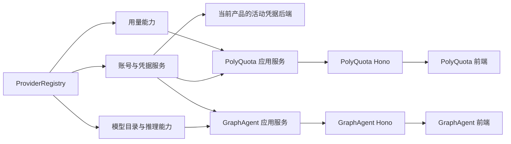

# 供应商平台总体设计

| 项目     | 内容                                                                                                            |
| -------- | --------------------------------------------------------------------------------------------------------------- |
| 状态     | 账号、认证、用量与 PolyQuota 应用服务基线已实现；账号多协议连接、模型目录、请求映射与共用 UI 为目标设计，待实施 |
| 更新日期 | 2026-11-07                                                                                                      |
| 范围     | 两产品共用的供应商、接入点、账号、凭据、协议路由、模型事实与能力边界                                            |
| 架构依据 | [项目架构](../../../architecture.md)：包边界、依赖方向、Hono 请求路径和产品交付形态                             |

本文确定整体职责与不变量。字段、接口、缓存算法、产品 DTO 和历史迁移分别由下列文档维护。

| 文档                                                                    | 拥有的内容                                                           |
| ----------------------------------------------------------------------- | -------------------------------------------------------------------- |
| [接入与模型目录](./connections-and-models.md)                           | 普通 Key、多协议地址、订阅用量资格、模型来源与请求映射的用户场景     |
| [Core 详细设计](./core-design.md)                                       | 声明、注册、认证、组合、连接记录、目录缓存、字段合并、请求编译及测试 |
| [协议与推理端口](./protocol-design.md)                                  | API 协议、操作、模型基础事实、能力 facet、准备调用和 codec/IR 边界   |
| [GraphAgent 前端契约](../../../graph-agent/design/frontend-contract.md) | 产品 Service、模型页投影、专属命令、路径与产品事件                   |
| [PolyQuota 前端契约](../../../polyquota/frontend-contract.md)           | 产品快照、用量操作、IPolyQuotaService 与通知并发规则                 |
| [共用 UI](../../ui/design.md)                                           | 共用壳、页面、组件端口、主题与 Web/Electron 前端接线                 |
| [产品 Service 与共享传输](../../contract/service-composition.md)        | 产品门面、公共/专属接口组合、单一传输与 Hono 子应用装配              |
| [实施方案](./implementation-plan.md)                                    | 结构与 UI 抽离 → Core 扩展 → 新页面和双产品联调的三阶段交付          |
| [参考取舍与迁移沿革](./migration-history.md)                            | OmniRoute 等参考分析、原问题清单与 A–G 历史阶段                      |

## 1. 目标与现状

两个产品复用 Provider Platform：PolyQuota 负责订阅用量，GraphAgent 负责模型配置与后续 Agent 执行。新供应商通过稳定标识和能力注册接入，页面依据目录与操作能力工作。

统一的是注册、能力发现、调用生命周期、错误、安全边界和可序列化事实。认证方式、协议、计费、能力和原生状态的差异保留在接入点、路由、能力 facet 与版本化扩展中。

当前已有七家供应商的账号、认证、刷新和用量能力，通过严格 ProviderRegistry 组合；模型目录、API 协议路由和推理 facet 尚未实现。GraphAgent 已交付凭据共享 A6—A8 的空白主页与设置页，现有 GraphApi 只描述导入和共享刷新。它不等于本轮目标中的 Vue 模型页或 GraphAgent Hono API。

凭据 SDK 与 Windows 宿主合包已由凭据专项 B1 完成；其余共享写入授权、双向切换和发行升级按[凭据实施方案](../credential-sharing/implementation-plan.md)推进。[A6—A8 实施记录](../credential-sharing/a6-a8-sharing-implementation.md) · [B1 实施记录](../credential-sharing/b1-credentials-package-implementation.md)

OmniRoute 当前搬运的是认证、刷新和用量协议叶子。推理 translator、Executor 和模型目录仍属后续选择性引入范围。固定来源及产物清单见[手工抽取基线](../omniroute-manual-extraction-baseline.md)，分析与取舍见[迁移沿革](./migration-history.md)。

## 2. 标识与领域关系

| 标识            | 含义与所有者                                                 |
| --------------- | ------------------------------------------------------------ |
| providerId      | Core 注册的服务商实现与凭据所有权域，不是品牌卡片或 API 协议 |
| offeringId      | 服务商声明的完整接入点，拥有认证方式、协议路由与套餐目录     |
| authMethodId    | 接入点支持的一种完整认证交互                                 |
| accountId       | 一次实际接入的稳定账号 ID，由账号存储持有                    |
| protocolRouteId | contribution 声明的上游协议路由，账号为它绑定地址与认证      |
| modelId         | 该账号与路由目录内的精确上游模型 ID，或显式登记的手工目标    |

一个实现可以提供多个接入点和协议路由。BigModel 与 Z.ai 共享 glm 实现，差异由两个 offering 承载；同一网关的 OpenAI 与 Anthropic 入口通过路由表达。订阅 OAuth、按量 API Key、独立部署的认证和计费差异必须明确建模，不能靠地区枚举或 URL 猜测。

账号保存 providerId、offeringId 与认证方式。同一地址的两把 Key 是两个账号；改名、换 Key 和改地址不改变账号 ID。长期模型选择为四元组 providerId + accountId + protocolRouteId + modelId，执行时从账号反查 offering 并交叉验证。

bindingRevision 是账号内一条路由的配置版本，用于固定一次请求和使目录缓存失效。它与记录修订、产品快照修订、目录修订分别管理；普通目录刷新不会改写长期选择。模型别名和出站模板必须在已登记的账号路由范围内解析。

## 3. 共享能力与产品所有权

| 所有者          | 职责                                                                                                                  |
| --------------- | --------------------------------------------------------------------------------------------------------------------- |
| contract/common | 两端共用的标识、公开事实、管理 API、错误、事件与纯格式校验，无业务实现和宿主依赖                                      |
| Core            | 服务商声明与注册，认证/刷新、账号用途、用量、模型发现、参数合并、请求映射和协议能力端口                               |
| PolyQuota       | 产品快照、订阅用量视图、评分、轮询、通知与设置；专属 API 归 contract/polyquota                                        |
| GraphAgent      | 模型配置与选择、ModelPolicy、ModelLease、预算、任务归因、并发/回退和 Agent/工具循环；专属 API 归 contract/graph-agent |
| shared-ui       | 共用布局、表单、供应商接入页和凭据管理页；产品注入品牌与业务页面                                                      |
| 产品宿主        | Hono 装配、数据存储、网络与平台端口；Web/Electron 使用同一业务路径                                                    |
| 独立 broker     | 不透明凭据记录、授权、修订、更新许可与事件；自身仓库、发布与安装周期独立                                              |

GraphAgent 不调用 IPolyQuotaService，不读取 PolyQuota 的数据库、快照或设置。需要的基础用量事实通过 Core 在本产品上下文取得，自己的推理 usage 与成本记录归自己的存储。共用类型和页面不意味着共用产品业务数据库。

## 4. 前端契约与调用路径

每款产品的 Web 与 Electron 前端通过本产品 Service 调用业务。`IPolyQuotaService` 和 `IGraphAgentService` 各自组合公共管理接口与产品专属接口，复用底层 `IServiceTransport` 经 fetch/SSE 访问本产品 Hono 应用。公共 handler 由 Core 的可选 `/http` 子入口提供，产品组合公共与专属 Hono 子应用；Core 业务保持框架无关。Electron 平台桥只承担窗口、目录选择等系统能力，不增加绕过 Hono 的业务通道。

两端供应商和凭据页复用 contract/common 的管理操作。GraphAgent 模型页使用自己的目录视图、覆盖、手工条目、长期选择和请求预览契约；PolyQuota 用量页使用产品快照与刷新/兑换契约。前端不导入 Core、broker SDK、能力 facet 或 PreparedProviderCall。

GraphAgent 独立 Web 的账号和凭据仅使用 broker；未接入或授权不足时由宿主返回受限操作与原因。Electron 可使用私有加密后端或 broker。模型缓存、参数覆盖和产品设置仍由 GraphAgent 持久保存。两个入口共用 DTO、业务校验与事件语义，按实际后端报告操作能力。

模型配置预览使用受限样本和纯编译器，不触发供应商请求。实际推理只能由受信任的 GraphAgent 服务发起，在执行前校验活动后端、路由和修订。完整聊天、任务、图与逐 token 事件尚待对应产品专项固定，不能以 Core 的 ModelStreamEvent 直接充当前端契约。

## 5. 注册、状态与安全不变量

- 应用组合根创建唯一 ProviderRegistry；声明与全部 facet 同 providerId 注册，重复、归属错误或能力不匹配使构造整体失败。
- 每种能力可选，只声明实际可执行的能力。API Key 不需要伪造 refresh，用量实现也不暗示存在模型或推理能力。
- 未知 provider、offering、路由或 codec 显式失败；不回退第一家，不因协议相似替换账号或路由，不执行用户提供的供应商代码。
- 目录按当前后端、账号、路由和绑定版本隔离。完整成功才替换；失败保留有时点的旧快照，改绑和切后端后丢弃迟到结果。
- 模型字段按用户覆盖 → 账号路由明确事实 → 精确预置 → 未知合并，false 与零价属于明确事实；每字段保留来源。
- 普通推理 Key 可管理且不参与 PolyQuota 用量、评分、轮询或告警；订阅资格以 offering 和账号事实统一计算。
- 公开快照和失效事件只在本地状态提交后发布。实例标识、快照修订和命令预期修订分工明确，事件重连后重读。
- token、Key、授权内部状态、原始认证文件和上游错误体不进入公开 DTO、事件或日志；用户本次秘密输入只经专用写操作提交。
- 共享模式每次业务操作按权威修订读取凭据，刷新须持记录级许可；过期 revision/fence 不能提交。跨产品数据库不宣称原子提交。
- 模型原生 response/tool/reasoning 状态只交回匹配的 codec/route，转换有损或不支持必须显式报告。

字段级校验、未知实现和新服务商测试分别见 [Core 安全边界](./core-design.md#9-安全边界)、[接入流程](./core-design.md#10-新服务商接入流程)与[协议编解码](./protocol-design.md#4-规范消息与协议编解码边界)。凭据迁移、许可、密钥和切换规则由[凭据共享设计](../credential-sharing/design.md)统一维护。

## 6. 实施与验收

本轮交付分三阶段：先迁移统一契约、产品目录与构建，再抽取共用 UI；随后实现 Core 的连接、目录与请求配置；最后接通新页面和双产品联调。历史 A–G 是演进记录，不能代替当前三阶段实施状态。

验收需要同时观察服务端和前端：

1. 原有七家账号/用量、Codex 与 GLM 的认证刷新及 groups + extras 展示保持可用；服务商组合由 Core 工厂提供，产品组合根注入平台端口。
2. provider、offering、route、模型能力和账号归属可独立校验，错误绑定在构造或输入边界失败；BigModel/Z.ai 不再依赖 region/presentationId 恢复展示。
3. 两产品供应商与凭据管理使用同一契约和共用页面；PolyQuota 的产品快照与通知保持一致，重置额度聚合/分体的获得、消耗与对账保持原行为。
4. GraphAgent 前端契约覆盖目录读取/刷新、手工条目、字段来源与覆盖、长期选择、请求预览以及错误/冲突/事件重连，不只交付 Core 类型。
5. 正式 GraphAgent Web/Electron 和 PolyQuota Electron 从各自入口验证 DTO、错误和 SSE；PolyQuota Web 作为开发测试入口。Web 的 broker 约束和 Electron 的私有能力分别验收。
6. fixture 与 fake 端口覆盖每个已声明能力。至少四类首要 API 协议具有协议样本；完整 IR、codec 和真实推理接入按后续执行需求逐步交付，不以类型草案冒充实现。
7. 当前和后续 vendor 产物均保留上游 commit、来源、范围与离线特征测试，references 不成为运行时依赖；renderer、日志和通知不暴露秘密。

各阶段退出条件与凭据 B2/B3 依赖见[实施方案](./implementation-plan.md)，Core 样本见[交付和验证](./core-design.md#11-交付和验证)，前端样本见两款产品的契约文档。

## 7. 范围边界

本轮不引入第三方可执行插件、不复制 OmniRoute 的 chatCore/代理宿主/数据库，不以通用 JSON map 替代共同领域模型。完整规范消息字段、路由评分、故障转移算法与插件 ABI 留给后续专项。

模型推理不进入 IPolyQuotaService。GraphAgent 的模型页也不提供任意 URL/任意请求代理；其完整 Agent 运行和工作台契约由[功能模块设计](../../../graph-agent/design/README.md)逐项定义。凭据 broker 的进程、存储与共享切换继续遵循凭据专项。
