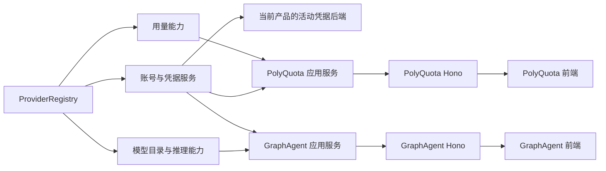

# 供应商平台总体设计

| 项目 | 内容 |
| --- | --- |
| 范围 | PolyQuota 与 GraphAgent 共用的供应商、接入点、账号、凭据、协议路由、模型事实与能力边界 |
| 架构依据 | [项目架构](../../../architecture.md)：包边界、依赖方向、Hono 请求路径与交付形态 |

本文定义供应商平台的整体职责、领域模型与不变量。字段细节、协议编解码、实施顺序与历史演进分别由以下专项文档维护：

| 文档 | 覆盖内容 |
| --- | --- |
| [接入与模型目录](./connections-and-models.md) | 普通 API Key、多协议地址、订阅用量资格、模型来源与请求映射场景 |
| [New API 中转站模板](./new-api-template.md) | New API 站点目录浏览、Key 模型发现、用量查询与 PAT 选 Key |
| [Core 详细设计](./core-design.md) | 声明、注册、认证、连接记录、目录缓存、字段合并与请求编译 |
| [协议与推理端口](./protocol-design.md) | API 协议族、操作类型、模型基础事实、能力 facet 与 codec/IR 边界 |
| [供应商请求策略分派](./request-dispatch.md) | 供应商请求策略接口与链式分派管道 |
| [模型结构与报价](./model-structure.md) · [模型报价](./model-pricing.md) | 模型预置目录结构、订阅权益与条件费率 |
| [GraphAgent 前端契约](../../../graph-agent/design/frontend-contract.md) · [PolyQuota 前端契约](../../../polyquota/frontend-contract.md) | 两产品各自的 Service、DTO 与事件契约 |
| [共用 UI 设计](../../ui/design.md) · [Service 组合设计](../../contract/service-composition.md) | 共用供应商/凭据页面与传输组合 |
| [实施方案](./implementation-plan.md) · [迁移沿革](./migration-history.md) | 分阶段实施验收与历史演进记录 |

## 1. 目标与能力边界

两款产品共同复用 Provider Platform：PolyQuota 使用账号管理与订阅用量能力，GraphAgent 使用账号管理、模型目录、原生协议代理与后续 Agent 推理能力。

平台统一的是**注册机制、能力发现、调用生命周期、错误模型、安全边界与可序列化事实**；各服务商在认证方式、协议格式、计费与原生状态上的差异，保留在接入点（offering）、路由、能力 facet 与版本化扩展中。

支持三类主要接入形态：
- **内置订阅服务商**：Codex、GLM（BigModel / Z.ai）、Grok Build、Antigravity、Claude Code、OpenCode Go、GitHub Copilot，支持各自原生认证与用量/推理能力。
- **内置官方 API 服务商**：OpenAI API、DeepSeek、Google Gemini 等，支持 API Key 接入、自定义协议根地址与模型目录发现。
- **自定义供应商与模板**：通用兼容接口与 New API 中转站模板，按自定义 `providerId` 独立保存地址、协议族配置与模型目录。

## 2. 标识、枚举与领域关系

动态业务标识/主键以 `Id` 结尾，固定代码枚举使用语义名或 `Type` / `kind`（详见[公共 API 契约](../../contract/common-api.md#21-协议族与明细协议枚举)）：

| 字段 / 枚举 | 类别与语义 |
| --- | --- |
| `providerId` | 内置或自定义服务商标识，界定实现与凭据所有权域 |
| `offeringId` | 服务商声明或用户创建的接入点，绑定协议族、明细协议与套餐体系 |
| `accountId` | 一次实际接入的稳定账号主键 |
| `modelId` | 上游目录返回的精确模型 ID 或手工登记目标 |
| `authMethod` | 认证方式枚举：`oauth-browser` / `device-code` / `cli-import` / `api-key` |
| `protocolFamily` | 原生 API 协议族，声明共同认证机制、附加参数与目录协议 |
| `protocol` | 归属协议族的明细端点协议，决定实际请求路径与数据格式 |

- 一个服务商实现可提供多个接入点与协议族（如 GLM 同时提供 BigModel 与 Z.ai；同一网关可同时绑定 OpenAI 与 Anthropic 协议族）。
- 账号保存 `providerId`、`offeringId` 与认证方式；长期模型选择由 `providerId + accountId + protocol + modelId` 四元组锚定。
- `familyBindingRevision` 固定账号在该接入点下的族连接与授权，用于目录读取与缓存失效；执行期结合明细端点配置构成完整 `bindingRevision`。

## 3. 共享能力与产品所有权

| 所有者 | 职责 |
| --- | --- |
| `contract/common` | 两产品共用的标识、公开事实、管理 API、错误、事件与纯格式校验 |
| `core` | 服务商声明与注册、认证/刷新、账号用途、用量、模型发现、参数合并、请求映射与协议端口 |
| PolyQuota | 订阅用量快照、综合评分、轮询、托盘与通知 |
| GraphAgent | 模型配置与选择、`ModelPolicy`、`ModelLease`、预算归因、回退策略与 Agent 执行循环 |
| `shared-ui` | 共用外壳、供应商接入页与凭据管理页 |
| 产品宿主 | Hono 装配、产品业务库、网络与系统能力适配 |
| 独立 Broker | 不透明凭据存储、授权、修订、记录级更新许可与变更通知 |

GraphAgent 不调用 PolyQuota 服务，也不访问 PolyQuota 数据库；两款产品共用类型、Core 逻辑与公共页面，但业务数据库彼此独立。

## 4. 前后端契约与调用边界

- 每款产品的 Web 与 Electron 前端通过各自产品 Service（`IPolyQuotaService` / `IGraphAgentService`）经共享传输以 fetch/SSE 访问本产品 Hono 应用，不直接导入 Core、Broker SDK 或宿主原生能力。
- 公共管理路由由 Core 的可选 `/http` 子入口提供，产品组合公共与专属 Hono 子应用。
- 模型配置预览仅使用受限样本与纯编译器，不发起外部请求；真实推理与代理调用由受信任的产品后端校验活动凭据后端、路由与修订后发起。

## 5. 注册、状态与安全不变量

- 应用组合根创建唯一 `ProviderRegistry`；声明与全部能力 facet 按 `providerId` 匹配注册，冲突或归属不匹配时立即失败。
- 能力按需声明：只声明实际可执行的能力，API Key 无需伪造刷新，具备用量能力不暗示具备推理能力。
- 未知 provider、offering、路由或 codec 显式报错，不静默回退到其他供应商或账号，不执行用户提交的任意代码。
- 族目录按后端可见范围、服务商、接入点、账号、协议族与绑定修订隔离；失败保留带时点的旧快照，换绑或切后端后丢弃迟到结果。
- 模型字段合并优先级固定为：`用户覆盖 → 账号路由事实 → 精确预置 → 未知`，保留字段来源，`false` 与零价视为明确事实。
- 普通按量 API Key 不参与 PolyQuota 订阅用量轮询与预警；订阅资格由接入点与账号事实统一判定。
- 凭据秘密、内部授权状态与原始上游错误体不进入公开 DTO、前端状态、事件或日志。
- 共享模式下每次业务操作按权威修订读取凭据，刷新须持记录级更新许可，过期 revision/fence 拒绝提交。
- 供应商原生响应/推理状态（如 tool/reasoning 状态）只交回匹配的 codec/route，有损转换显式声明。

## 6. 范围边界

- 不引入第三方可执行插件，不复制上游网关的完整运行时或代理宿主，不以无类型 JSON map 替代领域模型。
- 模型推理与代理调用不属于 PolyQuota；GraphAgent 的完整多智能体调度与工作台契约由[GraphAgent 功能模块设计总览](../../../graph-agent/design/README.md)定义；凭据共享与进程生命周期遵循[凭据共享设计](../credential-sharing/design.md)。
- 分阶段实施验收与演进沿革见[实施方案](./implementation-plan.md)与[迁移沿革](./migration-history.md)。
