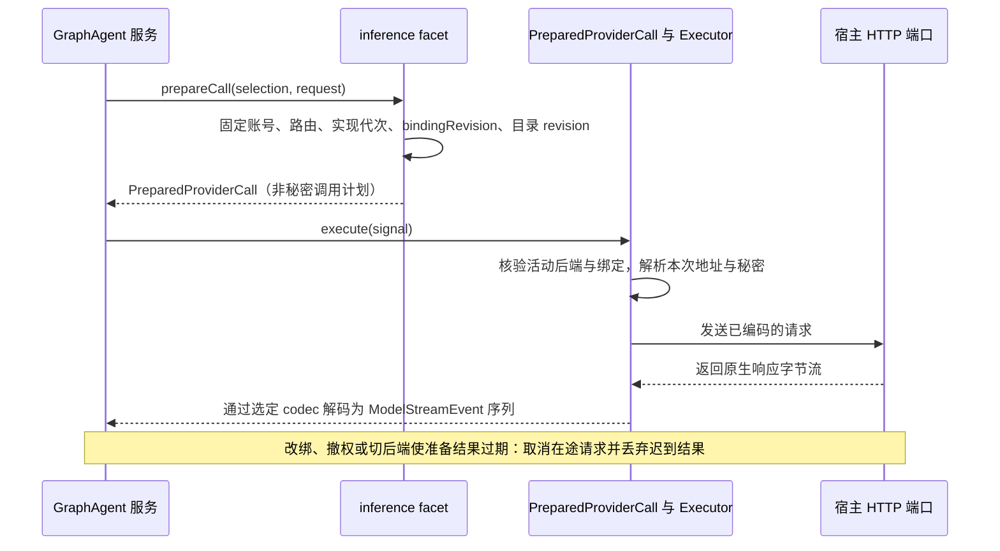
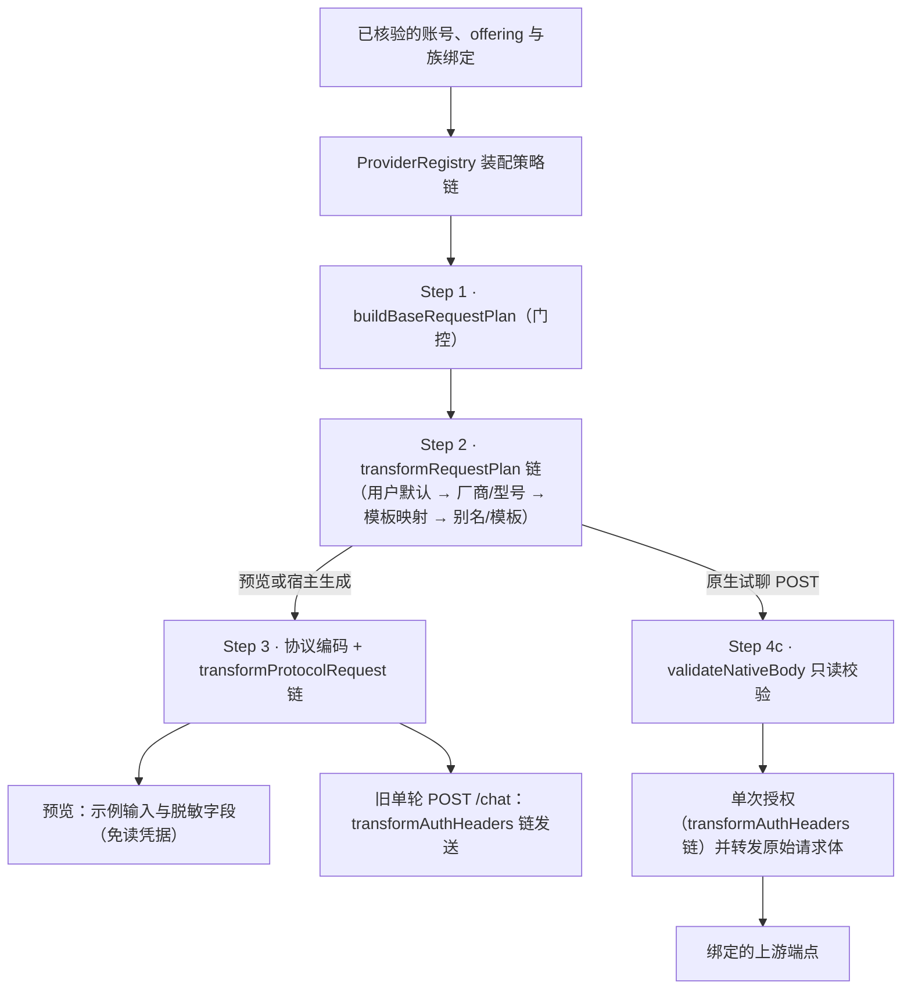

# 供应商协议、模型与推理端口详细设计

本文描述服务端协议目标。阶段二已注册目录发现和标准对话的推理 facet，实际协议为 OpenAI Chat、OpenAI Responses、Anthropic Messages。GraphAgent 代理按协议族挂载原生目录与业务端点。规范消息 IR 与执行事件是未来 Agent Loop 的独立设计。[现有组合](../../../../packages/core/src/providers/contributions.ts) · [已实现的对话编码](../../../../packages/core/src/providers/model-chat.ts) · [Core 详细设计](./core-design.md) · [GraphAgent 前端契约](../../../graph-agent/design/frontend-contract.md)

下列 TypeScript 表达目标形状。标识、公开协议与模型事实归 `contract/common`。带函数、凭据、端口和执行句柄的类型留在 Core。第 3 节的准备对象与执行事件面向未来服务端 Loop。当前试聊按第 4 节收发所选路由的原生协议。

## 1. API 协议与路由声明

**公共契约使用 `ProtocolFamily`（字段 `protocolFamily`）与 `EndpointProtocol`（字段 `protocol`）。** 固定代码枚举不以 `Id` 结尾。同一套 API 的入口、认证和目录规则提升到协议族级，明细协议继续区分实际调用。[当前端点码表](../../../../packages/contract/src/common/dto/model-endpoint.ts) · [公共契约](../../contract/common-api.md#21-协议族与明细协议枚举)

| 枚举或绑定 | 职责 | 例子 |
| --- | --- | --- |
| `protocolFamily` (`ProtocolFamily`) | 稳定的协议族枚举。族描述符声明原生版本路径、可选的模型目录方法及分页方言。 | `openai`、`anthropic`。`suno-music`、`doubao-video` 是音乐、视频接入的扩展示例，具体路径、目录能力及执行器在接入时登记。 |
| `protocol` (`EndpointProtocol`) | 明确属于某个族的明细端点协议枚举，声明方法、相对路径、输入输出及适用操作。族归属通过注册表查找。 | `openai-chat`、`openai-responses` 都属于 `openai`，`anthropic-messages` 属于 `anthropic`。 |
| 供应商的族配置 | 同一 `providerId + protocolFamily` 维护认证机制和公共附加参数。offering 提供该族的 API 根地址及可用明细协议，调用时按获准账号和活动后端取得密钥与有效配置。 | 一个中转供应商可同时发布 OpenAI 和 Anthropic 两个族；同一族也可由其他供应商独立提供。 |

**默认明细只用于专用单端点族。** 族描述符可显式指定唯一业务协议 `defaultProtocol`。此时调用方提供 `protocolFamily`，省略的 `protocol` 与显式 `null` 等价；宿主解析出真实协议后执行与持久化。模型列表和同一操作的状态查询不参与端点计数。通用 LLM 的 Chat、Responses、Messages 选择始终显式，即使 offering 只启用了其中一个端点或完全没有目录接口。[输入与默认路由规则](../../contract/common-api.md#专用单端点族的默认选择)

目录 GET、Chat POST 和 Responses POST 在同一个 OpenAI 族绑定上共用认证与适用的附加 header、query。共同的原生 Body 默认值用于适用的有体请求，GET 使用族目录声明的查询参数。厂商确实要求的用途差异由同一族策略按动作附加，例如 Codex 订阅列模型的 `client_version` 或 Grok Build 的目录头与会话头。出站凭据始终取自所选账号的授权；族 ID 本身不授予账号访问权。[当前授权实现](../../../../packages/core/src/providers/model-routes.ts) · [族连接与存量升级](./connections-and-models.md#协议族连接与存量升级)

## 2. 模型目录

GraphAgent 已接入 [New API 中转站模板](./new-api-template.md)。接入点可独立浏览站点原生 `/api/pricing`；账号目录仍从所选协议的 `/v1/models` 读取，并按站点声明的端点筛选。站点管理接口归该供应商模板，面向模型的 OpenAI 和 Anthropic 调用各自保留原生协议。

`ModelCatalogScope`、`ModelRef`、`ModelDescriptor`、`ModelCatalogSnapshot` 和解析后的模型选择使用[公共来源目录与选择](../../contract/common-api.md#22-来源目录与选择)中的同一类型。以下 `ModelCapabilityRequirement` 是 Core 内部的业务过滤条件：

```ts
type ModelCapabilityRequirement =
  | { kind: "operation"; operation: ProviderOperation }
  | { kind: "input-modality"; modality: string }
  | { kind: "output-modality"; modality: string }
  | { kind: "tool-calling"; parallel?: boolean }
  | { kind: "structured-output"; minimum: "json" | "schema" }
  | { kind: "reasoning"; mode?: "effort" | "native-state" }
  | { kind: "extension"; namespace: string; requirement: JsonValue };
```

模型目录把 OmniRoute `RegistryModel` 中已经证明必要的能力提升为共享契约，包括模型级目标协议、上下文限制、工具调用、结构化输出、推理状态、模态和不支持参数，但不在当前阶段复制其全部字段。GraphAgent 使用结构化 `ModelCapabilityRequirement` 过滤候选，不能把能力重新退化成约定俗成的字符串标签。静态声明与远端发现可以合并，必须保留来源和 revision；远端刷新暂时失败时，现有租约不能因为目录瞬时缺失而被悄悄改绑。

`ModelDescriptor` 是一个来源提供的候选事实；`facts` 中省略的字段表示该来源未报告，不能填入推测的默认值。`ModelFacts` 与 `ModelPrice` 是同一套 `contract/common` 基础事实，其完整字段见 [公共有效模型参数与报价](../../contract/common-api.md#23-有效模型参数与报价)。它们包括操作、输入/输出模态、容量、并行工具、结构化输出级别、独立的思考参数、缓存能力、不支持参数及按计价条件区分的金额。Core 合并远端、预置和用户输入后产生有效事实；产品读取投影额外附上每字段来源和修订，不另建一套供应商模型体系。

模型管理按具体账号、供应商、offering 与 `protocolFamily` 发现目录。可见范围和 `familyBindingRevision` 相同的 Chat 与 Responses 共用一次完整刷新。修订变化时丢弃旧结果。模型出现在族目录中只表明该绑定可见，执行前仍需具体明细端点、操作与能力匹配。模型参数包括缓存能力和输入、输出、缓存的价格，预置按同名模型逐字段补充。字段来源、覆盖顺序、刷新与失效规则见[供应商接入与模型目录](./connections-and-models.md)。

## 3. 能力化运行实现

下列端口与时序图描述未来 Loop 作为服务端调用方的情形。试聊的 HTTP 请求与响应见第 4 节。

```ts
interface ProviderAccountCapability {
  readonly providerId: ProviderId;
  readonly supportedMethods: readonly AuthMethod[];
  startAuth(
    offeringId: string,
    method: AuthMethod,
    options: AuthStartOptions,
  ): Promise<AuthFlowStart>;
  refreshCredentials?(
    account: Account,
    credential: CredentialEnvelope,
    options: { force: boolean },
  ): Promise<CredentialRefreshResult>;
}

interface ProviderUsageCapability {
  readonly providerId: ProviderId;

  fetchUsage(account: Account, credential: CredentialEnvelope): Promise<UsageSnapshot>;

  redeemResetCard?(
    account: Account,
    credential: CredentialEnvelope,
    request: ResetCreditRedemption,
  ): Promise<void>;
}

interface ProviderModelCatalogCapability {
  readonly providerId: ProviderId;

  getModelCatalog(
    context: ProviderContext,
    scope: ModelCatalogScope,
    familyBindingRevision: BindingRevision,
  ): Promise<ModelCatalogSnapshot>;
}

/** 后续 Agent Loop 的服务端端口。单轮测试代理直接消费 HTTP Response。 */
interface ProviderInferenceCapability {
  readonly providerId: ProviderId;

  prepareCall(
    context: ProviderContext,
    request: ProviderInferenceRequest,
  ): Promise<PreparedProviderCall>;
}

interface PreparedProviderCall {
  readonly selection: ProviderRouteSelection;
  readonly bindingRevision: BindingRevision;
  readonly implementationGeneration: string;
  readonly modelCatalogRevision: string;
  execute(signal: AbortSignal): AsyncIterable<ModelStreamEvent>;
}

// 未来 Loop 的进程内候选接口，随工具循环和多轮上下文设计细化。
interface ProviderInferenceRequest {
  selection: ProviderRouteSelection;
  operation: ProviderOperation;
  request: CanonicalModelRequestEnvelope;
}

type ModelStreamEvent =
  | ModelOutputEvent
  | ModelToolCallEvent
  | ModelReasoningEvent
  | ModelUsageEvent
  | ModelErrorEvent
  | ModelCompletedEvent;

interface ProviderContribution {
  descriptor: ProviderDescriptor;
  account?: ProviderAccountCapability;
  usage?: ProviderUsageCapability;
  models?: ProviderModelCatalogCapability;
  inference?: ProviderInferenceCapability;

  dispose?(): Promise<void> | void;
}
```

账号与用量 facet 沿用当前注册表的签名；端口在组合工厂中注入。新增模型与推理 facet 使用的 `ProviderContext` 只包含受控端口，例如 HTTP、时钟、日志，以及当前调用的凭据绑定解析能力。实现不能导入 Electron，也不能自行打开产品数据库或持有请求结束后的解密材料。[当前 facet](../../../../packages/core/src/providers/registry.ts) · [组合与绑定](./core-design.md#4-应用组合与绑定)

能力面是可选的，服务商不需要为空缺能力实现无效果方法。若声明了 `account`、`usage`、`model-catalog` 或 `inference`，对应 facet 必须存在且 `providerId` 一致；未声明能力时对应 facet 也不得伪装成可执行。`refreshCredentials` 同样只由确实有主动刷新协议的账号实现提供。API Key 是否需要轮换是账号能力内部的凭据生命周期差异，不再迫使 API Key、纯推理或纯目录实现提供无效果刷新方法。

`redeemResetCard` 是用量侧用户动作（已落地为 usage facet 的可选方法）：获得侧统一随 `fetchUsage` 的 `resetCredits` 一等字段返回（[公共用量 DTO](../../contract/common-api.md#6-用量事实与重置额度)），消耗侧以判别联合表达两种形态——聚合不传卡 id、按类型消耗（多桶时指定类型，由服务端挑选），分体传对应重置卡 id；glm 分体，codex 常规分体（明细端点暂不可用时如实退回聚合计数），兑换协议在 core `providers/<id>/reset-card-redemption.ts`。应用服务经 `ProviderRegistry.requireUsage(provider).redeemResetCard` 通用分派，组合根不再维护按供应商的映射（[Core 组合根](./core-design.md#41-唯一组合根与供应商组合工厂)已达成）。

`prepareCall` 在一次调用开始前固定账号、模型、协议路由、实现代次、`bindingRevision` 与目录 revision。准备对象只持有非秘密调用计划，执行前重新核验活动后端和权威绑定修订；匹配后在本次请求内解析地址与秘密。改绑、撤权或后端切换使旧准备结果过期，在途请求取消并丢弃迟到结果。目录普通刷新不自动更换已选账号或路由。完整处理见 [Core 请求编译与执行](./core-design.md#8-从模型选择到协议请求)。GraphAgent 的 `ModelLease` 可以在此基础上增加预算、过期时间和任务归因。



## 4. 规范消息与协议编解码边界

原单轮 JSON 接口保留最终文本与计量。原生试聊经独立的 OpenAI、Anthropic 入口按原生字节流显示回答。模型请求的供应商分派统一收口到 Core 的同构链式回调策略与固定 4 步管道。[原生路由](../../../../apps/graph-agent/src/server/native-proxy-routes.ts) · [请求策略分派设计](./request-dispatch.md)

### 4.1 单轮试聊使用同协议代理

GraphAgent Hono 在 `/api/v1/graph-agent/proxy/{protocolFamily}` 下登记该族允许的方法与原生路径。注册时以协议族、HTTP 方法和带版本的原生路径作为唯一键，两族可以各自登记 `GET /v1/models`，同一族内重复登记则拒绝。路径中的 `v1` 属于对应族的 API 版本。将下表中的上游相对路径追加到已配置的族 API 根地址（含其实际版本或网关前缀），无需把本地的族名和 `v1` 再拼入上游 URL。

| 族 | GraphAgent 本地入口（省略 `/api/v1/graph-agent`） | 归属 | 上游相对路径 |
| --- | --- | --- | --- |
| `openai` | `GET /proxy/openai/v1/models` | 族目录 | `models` |
| `openai` | `POST /proxy/openai/v1/chat/completions` | `openai-chat` | `chat/completions` |
| `openai` | `POST /proxy/openai/v1/responses` | `openai-responses` | `responses` |
| `anthropic` | `GET /proxy/anthropic/v1/models` | 族目录 | `models` |
| `anthropic` | `POST /proxy/anthropic/v1/messages` | `anthropic-messages` | `messages` |

两个 `GET` 各转发当前账号相应族绑定的**原生单页**。OpenAI 官方列表含 `object: "list"`，模型可带 `created`、`owned_by`；Anthropic 列表保留 `first_id`、`last_id`、`has_more` 及原生模型信息，可用 `after_id` 请求下一页。符合该族列表形状的供应商扩展字段也随原页通过。Codex 订阅、Grok Build 等接入点如只提供私有目录形状（例如顶层 `models` 或数组），管理服务用该族绑定读取并解析；标准 `/models` 只在绑定确实支持该原生目录时开放。这样 OpenAI 客户端始终获得 OpenAI 列表或相应协议错误。只有 GraphAgent 的模型管理服务翻页、合并并投影为内部目录快照。未声明列表能力的族可手工登记候选模型。[OpenAI 列表](https://developers.openai.com/api/reference/resources/models/methods/list) · [Anthropic 列表](https://platform.claude.com/docs/en/api/models/list) · [当前管理目录实现](../../../../packages/core/src/providers/model-discovery.ts)

每个 handler 按族、方法和原生路径查表。目录 GET 只校验获准的账号、族与族绑定修订，可在选择测试模型之前调用。测试 POST 另核对所选模型行、明细路由与有效 `bindingRevision`。族或路由不匹配、原生 `model` 与当前绑定修订已解析出的实际上游 ID 不符时在出站前拒绝。共用转发逻辑从有效族绑定解析地址、凭据和附加参数，调用 `HttpPort.fetch` 并管理取消及响应生命周期。只有服务端为本次绑定决定目的地、认证和协议版本。对已获准的原生 JSON 可读副本做校验，发送收到的原始请求体字节，保留选项、未知扩展、数组与原生内容块。[绑定校验](../../../../apps/graph-agent/src/server/model-service.ts) · [地址与认证](../../../../packages/core/src/providers/model-routes.ts)

成功响应保留原生媒体类型、正文和事件顺序。JSON 按整包交付，SSE 按上游进度交付；HTTP 分块边界可以变化。计量、费用回执和密钥回显检查可以观察数据，正常通过的内容按原字节发送。宿主错误、上游错误体与凭据的处理见[原生代理的转发边界](../../../graph-agent/design/test-chat-streaming.md#转发与错误)。传输层不生成产品聊天帧。

### 4.2 旧入口与未来执行层

现有 `testChat`、`sendDetailed` 和配置页请求预览按已有调用契约维护。新试聊直接选择上表对应入口。Codex 固定指令、强制流式及参数禁用，Grok Build 的原生 include 与模型级 effort，以及 Chat 的输出上限字段，均属于原协议或 offering 的调用要求。试聊调用方按已保存选择组装原生参数，代理只校验适用约束。详见[原生请求示例](../../../graph-agent/design/test-chat-streaming.md#原生请求与绑定)。

未来 Loop 如果需要跨协议续写、工具参数转换或规范消息 IR，再由执行层单独确定 `ProtocolCodecRegistry` 的方向、可逆性与原生状态归属。目录与业务代理均以各自协议族的原生入口为边界。正式会话可以复用已绑定的出站连接和消息展示组件。[消息聊天设计](../../../graph-agent/design/02_conversation-and-messaging.md#单轮试聊与正式会话的衔接) · [实施与验收](./implementation-plan.md#测试对话与协议重构)

## 5. 请求参数的转换、映射与自定义调整

**当前实现。** 自定义供应商编辑器在明细端点维护 `requestRule`。Core 先匹配本地模型、应用参数默认及别名，再由端点准备器与内置供应商规则生成原生 Body。预览返回实际发送名和已消费参数，原生 POST 校验后转发原文。[规则契约](../../../../packages/contract/src/common/dto/model-request-rule.ts) · [模型映射](../../../../packages/core/src/providers/model-request-rule.ts) · [请求准备](../../../../packages/core/src/providers/model-chat.ts)

### 各层负责的规则

| 归属 | 负责什么 | 实例 |
| --- | --- | --- |
| 协议族与明细端点 | 声明原生路径、操作、标准字段的形状与位置、可用的流事件。每次准备只选一个原生端点。 | Chat 写 `messages`，Responses 写 `input`，Messages 在自己的请求结构中写 `max_tokens`。 |
| 内置供应商 contribution | 在 `providers/<providerId>/` 登记该厂商针对族、offering、端点或型号的 `ProviderOfferingModelPolicy` 回调，包括字段名差异、开关映射、缺省值、禁止组合及返回的思考字段语义。内置规则区分可覆盖的默认值与必须满足的约束。 | DeepSeek 拥有 `thinking.type`、Chat 输出上限字段和公开 `reasoning_content` 的处理；Codex 订阅要求固定指令和 SSE；Grok Build 负责特定型号的 effort 默认和允许值。[Grok 策略实现](../../../../packages/core/src/providers/grok-build/model-policy.ts) |
| 用户配置与中转规则 | 在自己的供应商／offering 下登记族级非秘密公共参数，以及按明细、操作、模型限定的别名、模板和扩展字段。指定另一个 endpoint 只修改目的地，采用哪套供应商规则由绑定的 `providerId` 决定。 | 同族模型列表与推理共用租户 header。仅某个模型的 Chat 调用附加 `vendor_options.prompt_cache`。表单保存声明式数据，宿主执行已登记的规则。[中转规则样例](./connections-and-models.md#3-中转站请求映射) |
| 宿主执行与代理 | 核验选择和修订，按本次账号注入认证和受控 header/query，取消失效调用。供应商的模型准备与预览可产生原生 Body，已经以原生格式进入透明代理的 Body 校验后按原字节转发。 | 正文、工具、签名与未知原生扩展通过原协议。计量由回执逻辑旁路观察，显示组件只消费获准的可见文本。 |

**硬约束。** 公共请求代码只按已核验的绑定取得 `ProviderOfferingModelPolicy` 并经 `applyPolicyChain` 执行，禁止直接按供应商 ID、offering、域名、型号前缀或厂商私有字段分派，也禁止在公共模块用映射表间接选择厂商实现。协议族与明细协议决定原生格式，同构回调链决定该绑定的差异。策略接口、链式组合示例、DeepSeek 详细设计与命名规范见[供应商模型与请求策略分派设计](./request-dispatch.md)。

同一绑定内，参数映射与约束准备按调用执行一次，认证头链按实际出站尝试次数执行，旁路计量在响应完成时提取。各环节执行次数与失败/重试边界见[请求管道的扩展点取舍与出站契约](./request-hooks.md)。

### 应用顺序与冲突

1. **基础计划与思考门控（Step 1）。** 解析显式或专用默认 `protocol`，固定 `providerId`、offering、`protocolFamily`、真实 `protocol`、本地所选型号和修订。若 `thinkingEnabled=false` 或 `facts.reasoningMode="none"`，强制关闭思考并将 `effort` 与 `returnFullReasoning` 归一。
2. **计划变换链（Step 2 · `transformRequestPlan` 链）。** 经 `applyPolicyChain` 按显式顺序执行：`applyUserRuleDefaults` → 适用型号/厂商策略的 `transformRequestPlan`（如 Grok 思考强度映射、DeepSeek 上限与开关约束）→ 模板策略的 `transformRequestPlan`（如 New API 目录匹配得到真实上游模型名）→ `applyUserAliasesAndTemplate`（展开 `aliases`/`modelTemplate` 并记录 `consumedParameters`）。仅使用 `modelTemplate` 时强制校验 `targets` 白名单；纯静态别名允许省略 `targets`。最终产出包含 `upstreamModelId` 与 `constraints`（`requiredFields` / `forbiddenFields`）的 `RequestPlan`。
3. **协议编码与草稿变换链（Step 3 · 仅预览与宿主生成）。** 协议编码器仅按 `protocol` 写入标准字段得到 `ProtocolRequestDraft`，再经 `applyPolicyChain` 依次执行适用策略的 `transformProtocolRequest`（写入厂商专属 Body 字段）与 `applyUserExtensions`（按 `familyPolicy.body` → `endpoint requestRule.body` → `byModel.body` 递归合并普通对象、数组整项替换，并合并 `headers` 与 `query`）。仅顶层协议保留键与与已设值冲突的字段报字段级错误。header 禁止覆盖认证头、逐跳头与内部控制头。
4. **出口分流与单次授权（Step 4）。**
   - **配置预览**：代入示例消息，对本地自定义供应商与内置路由零凭据读取，严格按 `ModelRequestPreview` DTO 返回脱敏结果。
   - **宿主生成（`POST /chat`）**：代入真实 prompt，单次取凭据并经 `transformAuthHeaders` 链注入认证头后发送。
   - **原生试聊代理（`POST /proxy/...`）**：跳过 Step 3，仅用 Step 1 + Step 2 产出的 `RequestPlan` 对入站 JSON 做 `validateNativeBody` 只读校验，通过后单次取凭据并经 `transformAuthHeaders` 链转发原始请求体，不重复编译。



例如内置 DeepSeek 的 OpenAI Chat 绑定切到自建网关时，依然命中 `deepSeekModelPolicy`，按型号能力与三条协议真值表准备或校验请求。另一条独立的 `custom-*` 通用兼容连接即使填入相同地址，也命中 `generic` 策略，不继承 DeepSeek 的思考字段规则。[DeepSeek 详细设计](./request-dispatch.md#4-deepseek-详细设计) · [DeepSeek 内置接入](./core-design.md#46-deepseek-内置-api-key-绑定)
