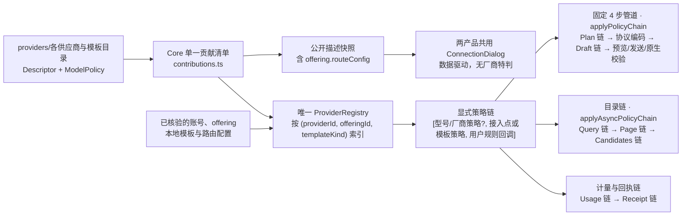
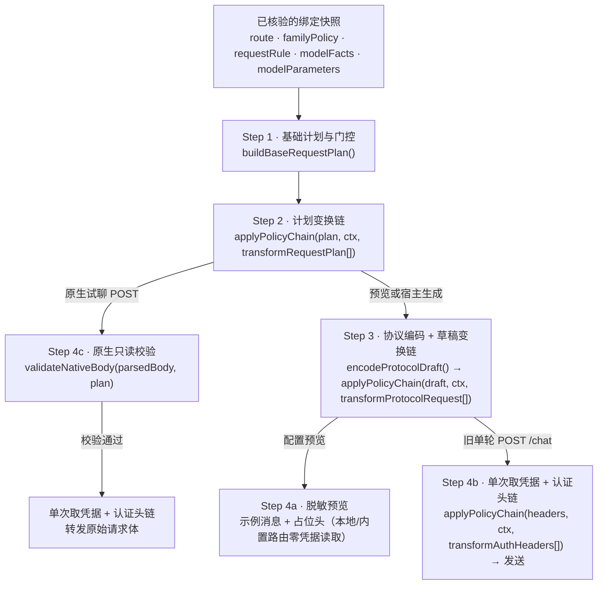
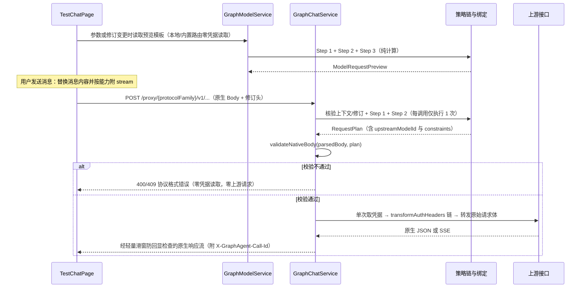

# 供应商模型与请求策略分派设计

**状态：已落地。** 协议族代理、OmniChat 流式试聊、New API 中转站模板、声明式 `ModelRequestRule` 与内置供应商差异已统一收敛至**同构链式回调策略（`ProviderOfferingModelPolicy`）+ 固定 4 步请求管道**，并完成固定枚举命名规范重构、DeepSeek 完整接入、数据与校验精简，以及随包模型预置直读与 SQLite v5 迁移。[扩展点取舍与出站契约](./request-hooks.md) · [2026-11 专项重构实施与完成状态](../2026-11-provider-policy-refactor.md)

## 1. 重构前的现状问题

重构前，供应商差异与请求校验以硬编码分支和碎片文件散落在 Core、契约包、共用表单与 GraphAgent 服务端：

| 问题类别 | 重构前落点 | 存在的问题与交叉影响 |
| --- | --- | --- |
| 空壳 Facet 与碎片化文件 | `contributions.ts`、`registry.ts` 与 6 个碎片文件（`model-destination.ts`、`native-model-policy.ts`、`codex/chat-profile.ts`、`grok-build/chat-profile.ts`、`grok-build/model-profile.ts`、`deepseek/profile.ts`） | `contributions.ts` 给所有供应商贴上同一套通用包装函数，再在公共函数内写 `if (account.provider === ...)`；修改一家供应商需同步改动 7–9 处。 |
| 公共契约与共用 UI 泄漏 DeepSeek 特判 | `contract/common/dto/connection.ts`、`ConnectionDialog.vue`、`provider-application-service.ts`、`model-routes.ts` | `contract/common` 硬编码 `deepSeekDefaultRoutes` 和 `if (deepSeek)`；两产品共用的 `ConnectionDialog.vue` 硬编码 DeepSeek 复选框；自定义路由按 `deepseek.routes.<keyRevision>` 写入只增不删的设置键；默认路由比对忽略 `requestRule` 导致官方地址附加规则被丢弃。 |
| 单条试聊消息触发 3 次编译 | `TestChatPage.vue`、`model-service.ts`、`chat-service.ts` | 页面先请求预览（服务端为此解密凭据并编译第 1 次），发起原生代理后 `beforeRefresh` 与主回调又各自重复编译与校验。 |
| 事实、发现与回执分散硬编码 | `model-discovery.ts`、`model-chat.ts`、`model-chat-receipt.ts`、`model-resolution.ts` | 公共发现与解析混入 Codex / Grok / New API / DeepSeek / Claude 分支；对话与代理直接硬编码 OpenRouter 回执调用。 |
| 过度防御校验、预置重复落库与枚举误用 `xxxId` | `model-endpoint.ts`、`model-request-rule.ts`、`native-proxy-routes.ts`、`native-proxy-body.ts`、`model-repository.ts` | 固定协议与操作枚举误用 `protocolRouteId` / `protocolFamilyId` / `operationId` / `profileId` / `vendorId` / `planId`；`reserved` 正则递归误杀嵌套扩展键；`parseFamilyPolicy` 封杀 `x-idempotency-key` 等合法头；纯别名强制填 `targets`；原生代理限 64 KB 且手写正则扫描 JSON 重复键；`SecretGuard` 逐帧全树 DFS 并复制三协议字段名；`previewRequest` 泄漏 `ruleHeaders`；随包预置 JSON 被复制进 SQLite 导致版本升级滞后。 |

**公共层与策略层的边界。** 凭据归属核验（`account.provider === envelope.provider`）、按 `protocol` 分派标准协议格式与错误壳、绑定修订校验和取消/超时管理归公共层。按供应商、接入点、模板、主机名或型号前缀决定请求、目录与计量行为，全部收拢到策略回调。

## 2. 目标架构：同构链式回调与 `ProviderOfferingModelPolicy`

**核心决定：用统一的 `(current, context) => next` 普通回调取代多阶段动态钩子引擎。** Core 不引入拓扑排序、JSON Pointer 所有权表或动态私有阶段。`ProviderOfferingModelPolicy` 上的每一项行为能力都抽离为扁平的普通回调方法：**接收待修改参数与只读上下文，调整后返回新值**。多个策略通过极简顺序函数 `applyPolicyChain` / `applyAsyncPolicyChain` 显式链式组合，既零魔法又天然支持跨层叠加（例如先执行 Grok 思考强度映射，再执行 New API 模型目录匹配映射得到真实上游模型名，最后叠加用户 `requestRule`）。



### 2.1 同构回调与链式组合工具

```ts
/** 通用同步/异步变换回调：注入待修改值与只读上下文，返回调整后的新值 */
export type PolicyTransform<TValue, TContext> = (current: TValue, context: TContext) => TValue;
export type AsyncPolicyTransform<TValue, TContext> = (
  current: TValue,
  context: TContext,
) => TValue | Promise<TValue>;

/** 显式顺序链式执行：调用方决定顺序，每步接收上一步返回值，未声明的回调直接跳过 */
export function applyPolicyChain<TValue, TContext>(
  initial: TValue,
  context: TContext,
  transforms: readonly (PolicyTransform<TValue, TContext> | undefined)[],
): TValue {
  let current = initial;
  for (const transform of transforms) {
    if (transform) current = transform(current, context);
  }
  return current;
}

export async function applyAsyncPolicyChain<TValue, TContext>(
  initial: TValue,
  context: TContext,
  transforms: readonly (AsyncPolicyTransform<TValue, TContext> | undefined)[],
): Promise<TValue> {
  let current = initial;
  for (const transform of transforms) {
    if (transform) current = await transform(current, context);
  }
  return current;
}
```

### 2.2 `ProviderOfferingModelPolicy` 接口定义

下列接口全部使用重构后的规范字段名（`protocol: EndpointProtocol`、`protocolFamily: ProtocolFamily`、`operation: ProviderOperation`，见第 6 节命名规范）：

```ts
export interface DefaultProtocolRoute {
  readonly protocol: EndpointProtocol;
  readonly baseUrl: string;
  readonly protocolVersion?: string | null;
}

/** 公开可投影的连接路由声明，归属 ProviderOfferingDescriptor，取代各处硬编码 */
export interface OfferingRouteConfig {
  readonly mode: "fixed" | "editable";
  readonly allowedProtocols: readonly EndpointProtocol[];
  readonly defaults: readonly DefaultProtocolRoute[];
  /** 为 true 时，同协议族端点在表单中共用一个根地址输入并勾选启用的协议 */
  readonly groupByFamily?: boolean;
}

/** 协议编码前的请求意图计划：生成路径与原生只读校验共用同一份 constraints */
export interface RequestPlan {
  readonly localModelId: string;
  readonly upstreamModelId: string;
  readonly parameters: ModelParameters;
  readonly thinkingActive: boolean;
  readonly consumedParameters: readonly ("effort" | "window")[];
  readonly outputLimitField?: "max_tokens" | "max_completion_tokens";
  readonly suppressEffortField?: boolean;
  readonly suppressSummaryRequest?: boolean;
  readonly constraints: {
    readonly requiredFields: Record<string, JsonValue>;
    readonly forbiddenFields: readonly string[];
  };
  readonly warnings: readonly { code: string; message: string }[];
}

/** 协议编码后的原生请求草稿：用于注入厂商专属 Body 字段、扩展头与查询参数 */
export interface ProtocolRequestDraft {
  readonly relativePath: string;
  readonly body: Record<string, JsonValue>;
  readonly headers: Record<string, string>;
  readonly query: Record<string, string>;
}

/**
 * Core 内部策略接口：每项能力均为扁平的 (current, context) => next 回调，
 * 支持单策略独立运行，也支持多策略经 applyPolicyChain 按顺序链式组合。
 */
export interface ProviderOfferingModelPolicy {
  readonly offeringId: string;
  /** 静态路由配置（供连接表单投影与服务端校验） */
  readonly routeConfig?: OfferingRouteConfig;
  /** 目录获取模式（省略时按协议族默认） */
  readonly catalogMode?: "native" | "vendor" | "none";

  /** 1. 模型基础事实与聊天可用性 */
  transformModelFacts?: PolicyTransform<Partial<ModelFacts>, ModelFactsContext>;
  transformChatAvailability?: PolicyTransform<ActionAvailability, ChatAvailabilityContext>;

  /** 2. 目录查询参数、单页解析与候选列表加工/端点过滤 */
  transformCatalogQuery?: PolicyTransform<Record<string, string>, CatalogQueryContext>;
  transformCatalogPage?: PolicyTransform<CatalogPage, CatalogPageContext>;
  transformCatalogCandidates?: AsyncPolicyTransform<DiscoveredModel[], CatalogCandidatesContext>;

  /** 3. 请求计划（参数/思考强度/上游模型名映射/约束）与协议请求草稿 */
  transformRequestPlan?: PolicyTransform<RequestPlan, RequestPlanContext>;
  transformProtocolRequest?: PolicyTransform<ProtocolRequestDraft, ProtocolRequestContext>;

  /** 4. 出站认证头（仅在凭据回调作用域内调用） */
  transformAuthHeaders?: PolicyTransform<Record<string, string>, AuthHeadersContext>;

  /** 5. 响应计量补充与可选延迟回执 */
  transformUsage?: PolicyTransform<ModelChatUsage, UsageTransformContext>;
  transformReceipt?: AsyncPolicyTransform<ActualChargeReceipt | null, ReceiptContext>;
}
```

### 2.3 链式组合示例：Grok 思考强度映射 → New API 目录匹配 → 用户规则

当多个能力需要叠加时，无需设计复杂插件总线，调用方只需按确定顺序构造策略链并交给 `applyPolicyChain`：

```ts
// 例如：通过 New API 中转站调用 Grok 型号，同时叠加用户自定义规则
const plan = applyPolicyChain(basePlan, planContext, [
  applyUserRuleDefaults,                    // 1. 填充 requestRule.defaults（思考关闭时跳过 effort）
  grokModelPolicy.transformRequestPlan,     // 2. 校验/补齐 Grok 思考强度与思考约束
  newApiTemplatePolicy.transformRequestPlan,// 3. 结合 New API 目录匹配映射真实上游模型名
  applyUserAliasesAndTemplate,              // 4. 应用用户 aliases / modelTemplate 与 consumedParameters
]);
```

每一步只关心自己负责的字段并返回新的 `RequestPlan` 对象（不原地偷偷改写共享状态）：
- **直连 Grok Build**：链为 `[applyUserRuleDefaults, grokBuildPolicy.transformRequestPlan, applyUserAliasesAndTemplate]`；
- **New API 中转站访问 Grok 型号**：链中先执行 Grok 思考强度映射，再由 New API 模板根据站点目录映射真实上游模型名称；
- **直连或代理访问 DeepSeek**：链为 `[applyUserRuleDefaults, deepSeekModelPolicy.transformRequestPlan, applyUserAliasesAndTemplate]`。

### 2.4 注册表索引与启动校验

1. **单一清单。** `packages/core/src/providers/contributions.ts` 是唯一收集内置供应商与自定义模板（`generic`、`new-api`）的入口，`catalog.ts` 从同一清单派生 `providerCatalog`、`providerIds` 与 `authMethods`。
2. **绑定解析。** `ProviderRegistry.resolveModelPolicy(binding)` 按 `{ providerId, offeringId, templateKind? }` 精确索引：
   - 内置绑定：按 `(providerId, offeringId)` 查找，`codex` 订阅与 `openai-api-key` 官方 Key 命中独立策略；
   - 自定义实例（`custom-*`）：按业务库保存的 `templateKind`（`"generic"` | `"new-api"`）查找，移除 `registry.ts` 将 `custom-*` 改写为 `compatible-api-key` 的分支；
   - 历史兼容连接（`compatible-api-key`）：命中 `generic` 策略；
   - 未知 `providerId`、`offeringId` 或 `templateKind` 在出站前抛 `capability-unavailable`，不回退默认实现。
3. **启动校验。** `ProviderRegistry` 构造期校验 `offeringId` 全局唯一、策略归属与 `descriptor.offerings` 一致、`routeConfig.defaults` 均属于 `allowedProtocols` 且同族根地址一致。

## 3. 固定 4 步请求准备与执行管道

所有聊天请求出口——**配置页预览（`previewRequest`）**、**宿主生成发送（`POST /chat`）**、**原生试聊代理（`POST /proxy/...`）**——统一经由同一套纯函数管道，消除 3 次重复编译。



### 3.1 四步执行规则

| 步骤 | 输入与输出 | 确定性规则与错误处理 |
| --- | --- | --- |
| **Step 1 · 基础计划与门控** `buildBaseRequestPlan` | 输入：`localModelId`、`modelFacts`、`modelParameters`；输出：初始 `RequestPlan` | 若 `modelParameters.thinkingEnabled === false` 或 `modelFacts.reasoningMode === "none"`，强制 `thinkingActive = false`、`parameters.effort = null`、`parameters.returnFullReasoning = false`。 |
| **Step 2 · 计划变换链** `transformRequestPlan` 链 | 输入：初始 `RequestPlan` + `RequestPlanContext`；输出：最终 `RequestPlan` | 依次执行：`applyUserRuleDefaults` → 适用厂商/型号策略 `transformRequestPlan` → 模板策略 `transformRequestPlan` → `applyUserAliasesAndTemplate`。最终固定 `upstreamModelId`、`effectiveParameters`、`consumedParameters`、`outputLimitField`、`suppress*` 与 `constraints`（`requiredFields` / `forbiddenFields`）。仅使用 `modelTemplate` 时强制校验 `targets`；纯静态 `aliases` 允许省略 `targets`。 |
| **Step 3 · 协议编码与草稿变换链** `encodeProtocolDraft` + `transformProtocolRequest` 链 | 输入：最终 `RequestPlan` + `prompt`；输出：最终 `ProtocolRequestDraft` | 1. 协议编码器仅按 `route.protocol`（`openai-chat` / `openai-responses` / `anthropic-messages`）生成标准 `ProtocolRequestDraft`。<br/>2. 经 `applyPolicyChain` 依次执行：适用策略的 `transformProtocolRequest`（写入厂商专属 Body 字段并检查 `forbiddenFields`）→ `applyUserExtensions`（按 `familyPolicy.body` → `endpoint requestRule.body` → `byModel.body` 递归合并普通对象、数组整项替换，并合并 `headers` 与 `query`）。覆写顶层保留键或与已设值冲突时返回字段级 `validation` 错误。 |
| **Step 4 · 出口分流与单次授权** | 预览 / `POST /chat` / `POST /proxy/...` | - **预览（4a）**：使用示例消息，对本地自定义供应商与内置路由**零凭据读取**（仅历史 v2 加密连接需解密旧路由）；严格投影为 `ModelRequestPreview` DTO，不泄漏内部字段。<br/>- **宿主生成（4b）**：单次进入凭据回调，运行 `transformAuthHeaders` 链（协议标准认证头 → 策略自定义认证头 → 非秘密 `draft.headers`），发送请求。<br/>- **原生试聊代理（4c）**：跳过 Step 3，仅运行 Step 1 + Step 2 一次得到 `plan`，用 `validateNativeBody(parsedBody, plan)` 校验入站 JSON，通过后再进入凭据回调并运行 `transformAuthHeaders` 链转发原始请求体，**不在 `beforeRefresh` 与主回调重复编译**。 |

### 3.2 原生代理只读校验与试聊协作



`validateNativeBody(parsedBody, plan)` 只断言声明的约束，不构造假预览体做全字段深度比对：
1. `parsedBody.model === plan.upstreamModelId`。
2. `plan.constraints.forbiddenFields` 中的顶层键均不存在于 `parsedBody`。
3. `plan.constraints.requiredFields` 中的路径在 `parsedBody` 上具有相同值。
4. 若 `plan.thinkingActive === false`，检查当前 `protocol` 对应的标准思考字段未被开启。
5. 若 `plan.consumedParameters.includes("effort")`，禁止当前 `protocol` 对应位置重复出现强度字段（`reasoning_effort` / `reasoning.effort` / `output_config.effort`）。
6. 其余原生消息、工具、采样参数与兼容扩展字段原样放行。

## 4. DeepSeek 详细设计

DeepSeek 作为首个落地同构回调策略的内置 API Key 供应商，全部实现集中于 `packages/core/src/providers/deepseek/index.ts`，移除分散在 `connection.ts`、`ConnectionDialog.vue`、`provider-application-service.ts`、`model-routes.ts`、`model-destination.ts`、`model-chat.ts`、`model-resolution.ts` 的全部 DeepSeek 特判。

### 4.1 身份、连接存储与 UI 边界

| 维度 | 设计决定 |
| --- | --- |
| 标识与能力 | `providerId: "deepseek"`、`offeringId: "deepseek-api-key"`、`authMethod: "api-key"`、`supportsSubscriptionUsage: false`；PolyQuota 将其作为普通推理 Key 管理，订阅用量请求数为 0。 |
| 数据驱动 `routeConfig` | 在 `deepSeekDescriptor.offerings[0].routeConfig` 声明：`mode: "editable"`、`groupByFamily: true`、`allowedProtocols: ["openai-chat", "openai-responses", "anthropic-messages"]`；`defaults` 为：`openai-chat` 与 `openai-responses` 共用 OpenAI 族根 `https://api.deepseek.com`，`anthropic-messages` 使用 `https://api.deepseek.com/anthropic/v1`（版本 `2023-06-01`）。 |
| 共用表单与契约清理 | 删除 `contract/common/dto/connection.ts` 的 `deepSeekDefaultRoutes` 与 `if (deepSeek)`；删除 `ConnectionDialog.vue` 全部 `deepSeek` 变量和条件分支。`ConnectionDialog.vue` 统一读取 `offering.routeConfig` 渲染，PolyQuota 与 `shared-ui` 零厂商特判。 |
| 统一账号路由存储 | 删除按修订号堆积的孤儿键 `deepseek.routes.<keyRevision>`。所有 `routeConfig.mode === "editable"` 的内置账号统一以 **`account.routes.<accountId>`** 单条存储覆写路由，随账号删除清理。凭据信封继续使用最小 `provider-key+json` v3（仅含 `apiKey` 与 `credentialBindingRevision`）。 |
| 修复默认路由折叠缺口 | 比较输入路由是否等价于 `routeConfig.defaults` 时，必须逐条核对 `protocol`、`baseUrl`、`protocolVersion`、`chatOutputLimitField`、`requestRule` 五项；任一项偏离默认即落盘到 `account.routes.<accountId>` 并生成新绑定修订。 |
| 配置入口边界 | 两产品共用的 `ConnectionDialog` 只编辑 API Key、账号名称与协议族根地址/启用协议，不塞入 GraphAgent 的 JSON 请求规则编辑器。需要针对中转站配置自定义别名、模板和扩展 Body 时，由 GraphAgent 自定义供应商或后续专属端点规则入口提供。 |

### 4.2 三条协议的参数映射真值表

设经 Step 1 与 `applyUserRuleDefaults` 后：
- `supportsToggle = (facts.reasoningMode !== "none")`；
- `thinkingActive = (parameters.thinkingEnabled !== false) && supportsToggle`；
- `effectiveEffort = (thinkingActive && !consumedParameters.includes("effort")) ? parameters.effort : null`。

| 协议 (`protocol`) | `outputLimitField` | `thinkingActive = true`（思考开启） | `thinkingActive = false`（思考关闭） | `facts.reasoningMode === "none"`（明确非推理型号） | 响应思考展示（仅 UI 按 `returnFullReasoning` 控制） |
| --- | --- | --- | --- | --- | --- |
| `openai-chat` | 固定 `"max_tokens"` | `body.thinking = { type: "enabled" }`；`effectiveEffort != null` 时写 `reasoning_effort` | `body.thinking = { type: "disabled" }`；不写 `reasoning_effort`；约束 `required: { "thinking.type": "disabled" }`、`forbidden: ["reasoning_effort"]` | 不写 `thinking` 与 `reasoning_effort`；约束 `forbidden: ["thinking", "reasoning_effort"]` | 不写入请求体。JSON 读 `choices[0].message.reasoning_content`，SSE 读 `choices[0].delta.reasoning_content`；仅 `returnFullReasoning === true` 时展示全文。 |
| `openai-responses` | 标准 `"max_output_tokens"` | `suppressSummaryRequest = true`（DeepSeek Responses 不生成 `reasoning.summary`）；`effectiveEffort != null` 时写 `reasoning: { effort }` | `suppressSummaryRequest = true`；`body.reasoning = { effort: "none" }`；约束 `required: { "reasoning.effort": "none" }` | `suppressSummaryRequest = true`；不写 `reasoning`；约束 `forbidden: ["reasoning"]` | 不写入请求体。SSE 读 `response.reasoning_text.delta` / `.done`，JSON 读 `reasoning` 项的 `reasoning_text` 块；仅 `returnFullReasoning === true` 时展示全文。 |
| `anthropic-messages` | 标准 `"max_tokens"`（缺省 1024） | `suppressSummaryRequest = true`（不写 `thinking.display: "summarized"`）；`body.thinking = { type: "enabled" }`；`effectiveEffort != null` 时写 `output_config: { effort }` | `suppressSummaryRequest = true`；`body.thinking = { type: "disabled" }`；不写 `output_config.effort`；约束 `required: { "thinking.type": "disabled" }`、`forbidden: ["output_config.effort"]` | `suppressSummaryRequest = true`；不写 `thinking` 与 `output_config.effort`；约束 `forbidden: ["thinking"]` | 不写入请求体。读 `thinking` 块 / `thinking_delta.thinking`；仅 `returnFullReasoning === true` 时展示全文。 |

**边界规则：**
1. `transformModelFacts`：仅在 `operation === "chat"` 时，按 `facts.reasoningMode === "none" ? "none" : "full"` 返回默认 `reasoningOutputMode`（可被目录事实、预置或用户覆盖）。
2. `reasoningMode === "unknown"` 时，默认按 `supportsToggle = true` 编码并在 `plan.warnings` 附带“思考开关能力尚未核实”提示；DeepSeek 三条协议均有原生关闭字段，思考关闭时不产生“上游仍可能自行推理”的通用告警。
3. 模板消费 `effort` 时，`effectiveEffort` 为 `null`，编码器跳过强度字段，`thinking.type` 仍按 `thinkingActive` 决定。
4. 同址隔离：内置 `deepseek` 账号无论指向官方地址还是自建网关均命中 `deepSeekModelPolicy`；`custom-*` 通用供应商即使填 `https://api.deepseek.com` 也命中 `generic` 策略，不启用 DeepSeek 思考字段规则。

### 4.3 DeepSeek 策略实现与预期出站 JSON

```ts
export const deepSeekModelPolicy: ProviderOfferingModelPolicy = {
  offeringId: "deepseek-api-key",
  routeConfig: {
    mode: "editable",
    groupByFamily: true,
    allowedProtocols: ["openai-chat", "openai-responses", "anthropic-messages"],
    defaults: [
      { protocol: "openai-chat", baseUrl: "https://api.deepseek.com" },
      { protocol: "openai-responses", baseUrl: "https://api.deepseek.com" },
      {
        protocol: "anthropic-messages",
        baseUrl: "https://api.deepseek.com/anthropic/v1",
        protocolVersion: "2023-06-01",
      },
    ],
  },

  transformModelFacts(facts, { operation }) {
    if (operation !== "chat" || facts.reasoningOutputMode) return facts;
    return {
      ...facts,
      reasoningOutputMode: facts.reasoningMode === "none" ? "none" : "full",
    };
  },

  transformRequestPlan(plan, { protocol, facts }) {
    const supportsToggle = facts.reasoningMode !== "none";
    const warnings =
      facts.reasoningMode === "unknown"
        ? [
            ...plan.warnings,
            { code: "reasoning-unverified", message: "该型号的思考开关能力尚未从目录或预置核实。" },
          ]
        : plan.warnings;
    const requiredFields = { ...plan.constraints.requiredFields };
    const forbiddenFields = [...plan.constraints.forbiddenFields];

    if (protocol === "openai-chat") {
      if (!supportsToggle) {
        forbiddenFields.push("thinking", "reasoning_effort");
        return {
          ...plan,
          outputLimitField: "max_tokens",
          suppressEffortField: true,
          constraints: { requiredFields, forbiddenFields },
          warnings,
        };
      }
      const type = plan.thinkingActive ? "enabled" : "disabled";
      requiredFields["thinking.type"] = type;
      if (!plan.thinkingActive) forbiddenFields.push("reasoning_effort");
      return {
        ...plan,
        outputLimitField: "max_tokens",
        suppressEffortField: !plan.thinkingActive,
        constraints: { requiredFields, forbiddenFields },
        warnings,
      };
    }

    if (protocol === "openai-responses") {
      if (!supportsToggle) {
        forbiddenFields.push("reasoning");
        return {
          ...plan,
          suppressEffortField: true,
          suppressSummaryRequest: true,
          constraints: { requiredFields, forbiddenFields },
          warnings,
        };
      }
      if (!plan.thinkingActive) requiredFields["reasoning.effort"] = "none";
      return {
        ...plan,
        suppressEffortField: !plan.thinkingActive,
        suppressSummaryRequest: true,
        constraints: { requiredFields, forbiddenFields },
        warnings,
      };
    }

    // anthropic-messages
    if (!supportsToggle) {
      forbiddenFields.push("thinking");
      return {
        ...plan,
        suppressEffortField: true,
        suppressSummaryRequest: true,
        constraints: { requiredFields, forbiddenFields },
        warnings,
      };
    }
    const type = plan.thinkingActive ? "enabled" : "disabled";
    requiredFields["thinking.type"] = type;
    if (!plan.thinkingActive) forbiddenFields.push("output_config.effort");
    return {
      ...plan,
      suppressEffortField: !plan.thinkingActive,
      suppressSummaryRequest: true,
      constraints: { requiredFields, forbiddenFields },
      warnings,
    };
  },

  transformProtocolRequest(draft, { protocol, plan, facts }) {
    if (facts.reasoningMode === "none") return draft;
    if (protocol === "openai-responses") {
      if (plan.thinkingActive) return draft;
      return {
        ...draft,
        body: { ...draft.body, reasoning: { effort: "none" } },
      };
    }
    return {
      ...draft,
      body: {
        ...draft.body,
        thinking: { type: plan.thinkingActive ? "enabled" : "disabled" },
      },
    };
  },
};
```

**同一模型设置（`deepseek-flash`、`maxOutputTokens = 512`、`effort = "high"`、`returnFullReasoning = true`）下的预期原生出站 Body：**

- **`openai-chat`（思考开启）**：`{"model":"deepseek-flash","messages":[{"role":"user","content":"你好"}],"max_tokens":512,"reasoning_effort":"high","thinking":{"type":"enabled"}}`
- **`openai-chat`（思考关闭）**：`{"model":"deepseek-flash","messages":[{"role":"user","content":"你好"}],"max_tokens":512,"thinking":{"type":"disabled"}}`
- **`openai-responses`（思考关闭）**：`{"model":"deepseek-flash","input":[{"role":"user","content":[{"type":"input_text","text":"你好"}]}],"store":false,"max_output_tokens":512,"reasoning":{"effort":"none"}}`
- **`anthropic-messages`（思考开启）**：`{"model":"deepseek-flash","messages":[{"role":"user","content":"你好"}],"max_tokens":512,"output_config":{"effort":"high"},"thinking":{"type":"enabled"}}`

## 5. 供应商与模板的策略实现清单

| 供应商 / 模板 | 落点文件 | 使用的回调方法 | 职责说明 |
| --- | --- | --- | --- |
| DeepSeek (`deepseek-api-key`) | [providers/deepseek/index.ts](../../../../packages/core/src/providers/deepseek/index.ts) | `routeConfig`、`transformModelFacts`、`transformRequestPlan`、`transformProtocolRequest` | 内置可编辑按族路由、三条协议思考开关与输出上限映射、聊天默认 `reasoningOutputMode` |
| Codex 订阅 (`codex`) | [providers/codex/model-policy.ts](../../../../packages/core/src/providers/codex/model-policy.ts) | `routeConfig`（fixed）、`catalogMode: "vendor"`、`transformAuthHeaders`、`transformCatalogQuery`、`transformCatalogPage`、`transformModelFacts`、`transformRequestPlan`、`transformProtocolRequest` | 订阅专用头、`client_version` 与 slug/可见性解析、禁采样/输出上限参数、强制 `stream`/`store`/`instructions` |
| OpenAI 官方 (`openai-api-key`) | [providers/codex/model-policy.ts](../../../../packages/core/src/providers/codex/model-policy.ts) | `routeConfig`（fixed：`openai-chat` + `openai-responses`）、`transformModelFacts`、`transformChatAvailability` | 官方标准 Chat / Responses 端点与非聊天型号拦截提示 |
| Grok Build (`grok-build`) | [providers/grok-build/model-policy.ts](../../../../packages/core/src/providers/grok-build/model-policy.ts) | `routeConfig`（fixed）、`catalogMode: "vendor"`、`transformAuthHeaders`、`transformCatalogPage`、`transformRequestPlan`、`transformProtocolRequest` | models/session 头、`_meta` 列表解析、型号级 `effort` 校验与默认值、`stream`/`include` 注入 |
| GLM (`bigmodel-coding-plan` / `zai-coding-plan`) | [providers/glm/model-policy.ts](../../../../packages/core/src/providers/glm/model-policy.ts) | `routeConfig`（fixed 两地区）、`transformRequestPlan` | 两地区固定端点与 Chat `max_tokens` 输出上限字段 |
| OpenCode Go (`opencode-go`) | [providers/opencode-go/model-policy.ts](../../../../packages/core/src/providers/opencode-go/model-policy.ts) | `routeConfig`（fixed）、`transformRequestPlan` | 固定端点与 Chat `max_tokens` 输出上限字段 |
| Claude (`claude`) | [providers/claude/model-policy.ts](../../../../packages/core/src/providers/claude/model-policy.ts) | `transformModelFacts` | Messages 推理型号默认 `reasoningOutputMode: "summary"` |
| 通用自定义模板 (`generic`) | [providers/custom-templates/generic.ts](../../../../packages/core/src/providers/custom-templates/generic.ts) | `transformRequestPlan` | 按路由保存的 `chatOutputLimitField` 设置 Chat 输出上限字段 |
| New API 模板 (`new-api`) | [providers/new-api/model-policy.ts](../../../../packages/core/src/providers/new-api/model-policy.ts) | `transformCatalogCandidates`、`transformRequestPlan` | 合并同站 `/api/pricing` 并按 `protocol` 端点过滤；支持按目录匹配映射真实上游模型名 |
| OpenRouter 回执 | [providers/openrouter-receipt.ts](../../../../packages/core/src/providers/openrouter-receipt.ts) | `transformReceipt` | 核验精确 `openrouter.ai/api/v1` 目的地与 `gen-*` 标识，异步获取实扣回执 |

重构前分散的 7 个碎片文件（`model-destination.ts`、`native-model-policy.ts`、`codex/chat-profile.ts`、`grok-build/chat-profile.ts`、`grok-build/model-profile.ts`、`deepseek/profile.ts`、`model-chat-receipt.ts`）已全部移除。

## 6. 类型与字段命名规范

**命名规则**：
- **`xxxId` 仅用于数据库主键、运行时动态生成的业务标识或上游动态条目编号**：`accountId`、`providerId`、`offeringId`、`modelId` / `upstreamModelId`、`sessionId`、`callId`、`instanceId`、`contextId`、`previewId`、`confirmationId`、`notificationId`、`eventId`、`generationId`、`itemId`、`rateCardId`、`workspaceId`、`userId` 以及幂等操作号 `operationId`。
- **固定代码枚举、协议分类、能力/操作类型禁止以 `Id` 结尾**：使用语义清晰的无后缀名或 `xxxType` / `kind` / `category`。

| 重构前名称 | 最终名称 | 说明 |
| --- | --- | --- |
| `ProtocolRouteId` / `protocolRouteId` / `protocolRouteIds` / `defaultProtocolRouteId` / `ModelEndpointDescriptor.id` | **`EndpointProtocol`** / **`protocol`**（`endpointProtocols`、`defaultProtocol`） | 与 `protocolFamily`、`protocolVersion` 形成一致三元组 |
| `ProtocolFamilyId` / `protocolFamilyId` / `protocolFamilyIds` / `ProtocolFamilyDescriptor.id` | **`ProtocolFamily`** / **`protocolFamily`**（`protocolFamilies`、`protocolFamilyDescriptors`、`family`） | 5 项固定协议族枚举 |
| 表示 `ProviderOperation` 的 `operationId` | **`operation`**（编辑手工模型变更对象中为 `modelOperation`） | 与创建接口的幂等 `operationId` 彻底区分 |
| `profileId` / `ModelIOProfile.id` | **`ioProfile`** / **`ModelIOProfile.kind`** | 表达固定 IO 组合形态而非主键 |
| `authMethodId` | **`authMethod`** / **`method`** | 与 `Account.authMethod`、`ProviderAuthMethodDescriptor.method` 统一 |
| `capabilityIds` | **`providerCapabilities`** | 5 项固定能力枚举常量 |
| `vendorId` | **`vendor`** | 与同级 `family` / `series` 统一 |
| `planId` / `ProviderPlanDescriptor.id` / `PublicPlanDescriptor.id` | **`planKey`** / **`key`** | 与 `RateCardRef.planKey`、`ModelEntryView.ratePlanKey` 统一 |
| `NativeChatRoute` / `allowedRouteIds` | **`NativeChatProtocol`** / **`allowedProtocols`** | 固定聊天协议子集 |

**持久化兼容**：SQLite 物理列名（如 `model_configs.route_id`、`model_catalogs.protocol_family_id`、`model_state.operation_id` / `profile_id`）通过仓储层别名映射保持兼容；GraphAgent v5 迁移在启动事务内自动升级旧库 `model_rate_cards`、`custom_providers` 及用户导入的 `model_packs` 中的旧键名，Core 同时兼容解码旧加密 v2 路由与旧 `<provider>.routes.<revision>` 设置键。

## 7. 数据结构、预置资源与校验规则

| 对象 / 模块 | 重构前做法 | 最终规则 |
| --- | --- | --- |
| `ModelRequestRule.body` 保留键校验 | `reserved` 正则递归作用于所有嵌套层级并按关键字拒绝嵌套扩展键。 | 仅在**顶层**拒绝协议保留键（`model`、`messages`、`input`、`prompt`、`system`、`instructions`、`tools`、`tool_choice`、`stream`、`stream_options`、`max_tokens`、`max_output_tokens`、`max_completion_tokens`、`reasoning`、`reasoning_effort`、`thinking`、`output_config`、`store`）与原型污染键；嵌套对象只拒绝原型污染键与超深/超大载荷。 |
| `ModelRequestRule.targets` 约束 | 纯静态 `aliases` 也强制填写 `targets`。 | 仅在使用 `modelTemplate` 动态拼接上游型号时要求 `targets` 白名单；纯静态 `aliases` 允许省略 `targets`（仍检查无环与标识符格式）。 |
| `ProtocolFamilyPolicy.headers` 校验 | 限定 `x-` 前缀并封杀含 `key`/`token`/`url` 的头名。 | 采用明确**禁止头黑名单**：拒绝认证头（`authorization`、`x-api-key`、`x-goog-api-key`、`proxy-authorization`）、逐跳与宿主控制头（`host`、`cookie`、`set-cookie`、`content-length`、`transfer-encoding`、`connection`、`keep-alive`、`upgrade`、`te`、`trailer`、`proxy-connection`）、内部控制头前缀（`x-graphagent-*`）及含换行/凭据特征的值；允许 `x-idempotency-key`、`x-cache-key`、`http-referer` 等常规业务头。 |
| 原生代理体上限与 JSON 解析 | 硬限制 64 KB；手写正则词法扫描重复键。 | 上限为 **4 MB**；使用标准 UTF-8 解码与 `JSON.parse` 校验结构与约束。 |
| 响应凭据防回显（`SecretGuard`） | 逐帧解析 SSE 并全树 DFS，硬编码 3 种协议字段名。 | 采用**单通道前缀感知滑窗文本扫描**：同时匹配明文密钥与 `JSON.stringify(secret).slice(1, -1)` 转义串，仅暂扣当前块尾部与密钥前缀重合的最小后缀，安全字节零延迟实时放行，命中即阻断流；旁路 `SseUsageObserver` 独立只读观察计量。 |
| 随包模型预置资源 | 启动时将 `resources/model-presets.json` 复制一份写入 SQLite `model_packs` 表。 | 默认预置经 `model_state.active_pack = "$bundled"` **直接读取随应用打包的资源文件**并做进程内缓存，不写入 `model_packs`；`model_packs` 仅保存用户手动导入或在线更新的外部预置包并支持回滚至 `$bundled`。v5 迁移自动清理旧库冗余随包副本并移除 `model_state` 对 `model_packs` 的外键约束。 |
| 契约与修订边界 | `previewRequest` 泄漏 `ruleHeaders`；清空规则依赖 `{ operation: "chat" }` 哨兵；多处手拼绑定修订哈希。 | `previewRequest` 严格返回 `ModelRequestPreview` 声明字段；清空规则使用显式 `undefined`；绑定修订计算统一由 Core `model-routes.ts` 的 `computeRouteBindingRevision` / `computeFamilyBindingRevision` 提供。 |
