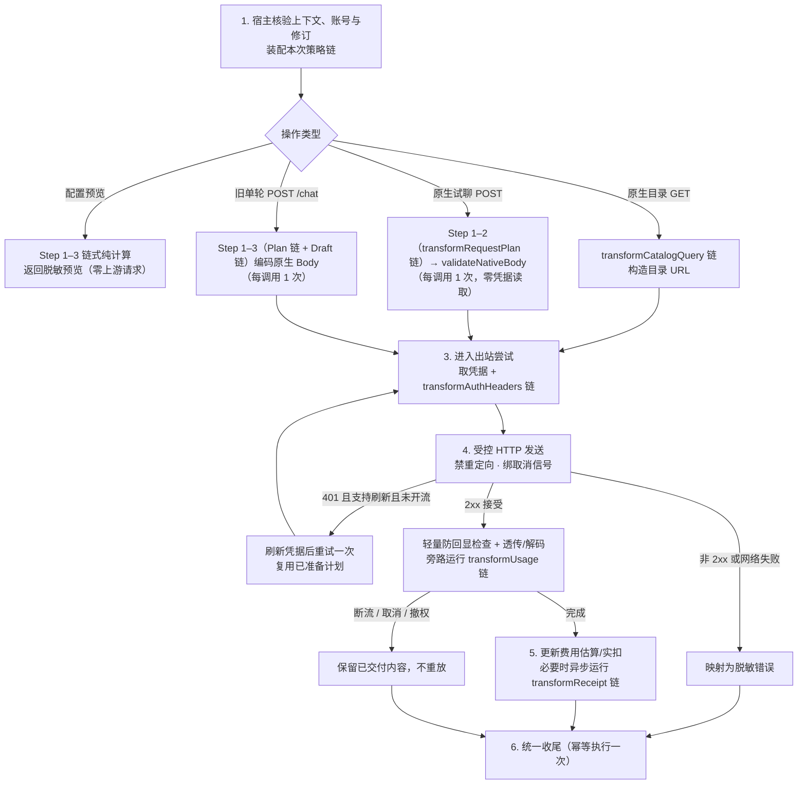

# 请求管道的扩展点取舍与出站契约

**状态：已落地。** 本文记录为何不在 Core 中构建多阶段 Hook 总线，而是将供应商能力抽离为同构的 `(current, context) => next` 普通回调并通过 `applyPolicyChain` / `applyAsyncPolicyChain` 显式链式调用，同时定义一次模型/目录调用从准备到出站尝试、认证重试、计量、取消与收尾的执行契约。[策略接口、链式示例与命名规范](./request-dispatch.md) · [2026-11 专项重构实施与完成状态](../2026-11-provider-policy-refactor.md)

## 1. 为何收敛为同构链式回调（设计取舍）

此前曾参考六个上游项目构想过一套包含 19 个生命周期阶段、同阶段 `before/after` 拓扑排序、JSON Pointer 写入所有权表、洋葱圈 `aroundSend` 与动态私有阶段的通用 Hook 总线。结合当前仓库的实际形态（3 条聊天协议 + 9 家内置供应商 + 2 种自定义模板），该方案存在三个直接问题：

1. **抽象层次远超真实需求**：当前不存在第三方动态插件，也没有跨多贡献竞争修改同一 Body 路径的场景；引入拓扑排序与运行时路径所有权仲裁只会制造难以追踪的隐式控制流。
2. **生成与原生校验容易分裂**：把一次供应商差异拆成多个松散钩子和 `privateState` 袋子，反而让同一个字段的“写入”和“校验”失去单一事实源。
3. **响应透传与钩子语义冲突**：原生试聊代理按原字节转发 SSE/JSON，前端原生读取器直接消费原协议字段；在后端定义模糊的 `observeFrame` 注入公开思考字段既不改写转发字节，又无法直接驱动前端。

因此，Core 明确选择**同构链式回调（`(current, context) => next`）+ 固定 4 步管道**：每个能力槽都是接收待修改对象并返回新对象的普通纯函数（或异步函数），由调用方按显式顺序传入 `applyPolicyChain` / `applyAsyncPolicyChain` 依次执行。例如通过 New API 接入 Grok 型号时，可先执行 Grok 的思考强度映射回调，再执行 New API 目录匹配回调得到真实上游模型名，无需任何插件总线或优先级魔法。

| 参考项目与提交 | 源码机制 | 本项目的明确取舍 |
| --- | --- | --- |
| OmniRoute · `3ee283bb94` | 执行器注册表按绑定取实现，错误准入直接终止。[执行器注册表](../../../../references/omniroute/open-sse/executors/registry.ts#L40-L63) | **采用**“启动校验 + 按绑定解析策略”；**不采用**优先级阻塞插件链。 |
| New API · `669d774976` | 生成路径在参数覆盖后应用供应商最终调整，透传路径只做只读检查。[Responses 调用顺序](../../../../references/new-api/relay/responses_request.go#L48-L97) | **采用**“生成路径编码 + 原生路径只读校验”共享同一 `RequestPlan.constraints`；**不采用**通用请求插件计划器。 |
| OpenClaw · `47a026ea3f` | 供应商分别提供推理输出模式、额外参数与传输参数。[供应商契约](../../../../references/openclaw/src/plugins/provider-plugin.types.ts#L289-L332) | **采用**扁平、同构的可选变换回调（`transformModelFacts`、`transformRequestPlan`、`transformProtocolRequest`、`transformAuthHeaders`）；**不采用**动态流包装器嵌套。 |
| Hermes Agent · `6a6766fb89` | 区分对话轮、模型调用与网络出站尝试。[供应商接口](../../../../references/hermes-agent/providers/base.py#L95-L132) | **采用**“调用级准备一次、尝试级授权每次”的边界划分；对话轮上下文留归 GraphAgent 未来 Loop，不提前塞入 Core 钩子。 |
| DeepSeek Harness · `477b4f4205` | 请求准备阶段固定版本快照；上游响应成功后确认效果并消费 SSE。[适配器接收](../../../../references/deepseek-harness/packages/llm/llm-deepseek/src/adapter.ts#L133-L149) | **采用**“调用开始固定策略与绑定修订、仅在开流前允许认证重试”；**不采用**运行时动态扩展注册表。 |
| ZCode · `29628c9acd` | 合并模型参数补丁时检测路径冲突。[路径冲突](../../../../references/zcode/packages/model-option-map/src/merge-patch.ts#L13-L57) | **采用**显式顺序链式变换加顶层保留键检查；**不采用**通用 JSON Pointer 所有权引擎。 |

未来若新增视频异步任务提交/轮询或地区签名中转站，按需在对应协议族执行器中显式新增步骤或扩展 `transformAuthHeaders` 的只读上下文（如传入请求摘要与时间戳），不为此预埋空壳通用阶段。

## 2. 调用级与尝试级执行契约

“**调用（Call）**”指一次目录读取、配置预览、旧单轮对话或原生试聊请求；“**尝试（Attempt）**”指调用内的一次实际 HTTP 出站。

| 环节 | 归属层级 | 执行次数 | 输入与回调链产出 | 失败与副作用语义 |
| --- | --- | --- | --- | --- |
| 1. 绑定与上下文核验 | 宿主（`GraphModelService` / `GraphChatService`） | 每调用 1 次 | 核验 `instanceId`、`contextId`、账号可见性、启用状态、设置修订与绑定修订，从 `ProviderRegistry` 装配本次显式策略链。 | 任一核验失败立即返回 `conflict` / `stale-binding` / `not-found`，零凭据读取、零出站。 |
| 2. 准备计划与草稿（Step 1–3） | Core 纯函数 + 策略回调链 | 每调用 **最多 1 次** | 运行 `buildBaseRequestPlan` → `transformRequestPlan` 链得到 `RequestPlan`。原生代理路径直接执行 `validateNativeBody(parsedBody, plan)`；生成与预览路径继续运行 `encodeProtocolDraft` → `transformProtocolRequest` 链得到 `ProtocolRequestDraft`。 | 纯计算，无 I/O、不接触凭据；每个回调返回新对象，不原地污染入参。校验失败返回字段级 `validation` 错误，零凭据读取、零出站。 |
| 3. 取凭据与认证头链 | 宿主凭据回调 + `transformAuthHeaders` 链 | 每次尝试 1 次 | 在 `withModelCredential` 内取当前凭据，经 `applyPolicyChain` 依次生成协议标准认证头、策略专用头并合并非秘密 `draft.headers` 与 `query`。 | 认证失败（401）且该 offering 支持主动刷新（如 OAuth 订阅）时，**仅在尚未开流且未发布响应前**刷新凭据并重试第 2 次尝试；普通 API Key 401 直接失败，零刷新。重试复用环节 2 的计划与草稿，不重复编译。 |
| 4. 发送与响应检查 | 宿主出站端口 | 每次尝试 1 次 | 禁用自动重定向（`redirect: "manual"`），携带合并取消信号（请求取消 + 绑定失效 + 超时）。检查 HTTP 状态码、媒体类型、大小上限与轻量凭据防回显滑窗。 | 非 2xx 映射为脱敏协议错误，原始上游错误体不离开宿主。开流后遇到网络中断、取消或撤权，保留客户端已收到的可见内容并终止流，不重放请求。 |
| 5. 旁路计量与回执链 | Core 计量器 + `transformUsage` / `transformReceipt` 链 | 响应完成时 1 次（延迟回执按需异步） | 从已检查的原生 JSON 或 SSE 终止帧提取标准化用量后经 `transformUsage` 链补充；若尚无实扣且策略链含 `transformReceipt`，宿主在原调用仍开放时另起受限回查，按 `(callId, eventId)` 去重。 | 计量或回执失败不影响已成功的正文回答，费用状态回退为估算或未知。调用关闭、撤权或改绑立即取消回查。 |
| 6. 统一收尾 | 宿主 | 每调用恰好 1 次 | 释放流读取器、解除绑定监听、清理超时器；未发布响应的失败调用立即释放费用占位记录。 | 正常完成、报错、撤权与用户取消竞争时保证幂等，清理只执行一次。 |

## 3. 安全与隔离不变量

1. **凭据不进入纯策略回调**：`transformModelFacts`、`transformChatAvailability`、`transformCatalogQuery`、`transformCatalogPage`、`transformRequestPlan`、`transformProtocolRequest` 与 `validateNativeBody` 均不接收 `CredentialEnvelope` 或密钥字符串；只有 `transformAuthHeaders`（及凭据刷新、`transformReceipt`）在宿主的凭据回调作用域内接触解密材料。
2. **预览默认零凭据读取**：内置供应商与 GraphAgent 本地自定义供应商的路由均不存储在加密凭据内，`previewRequest` 无需读取凭据即可完成完整预览；只有历史 v2 兼容连接在迁移前仍需读取旧加密路由。
3. **不可变返回与确定性取消**：所有策略回调不得原地修改共享配置或模型事实对象；账号撤权、换 Key、改绑或切换凭据后端立即通过 `AbortSignal` 中止在途尝试并丢弃迟到结果。
