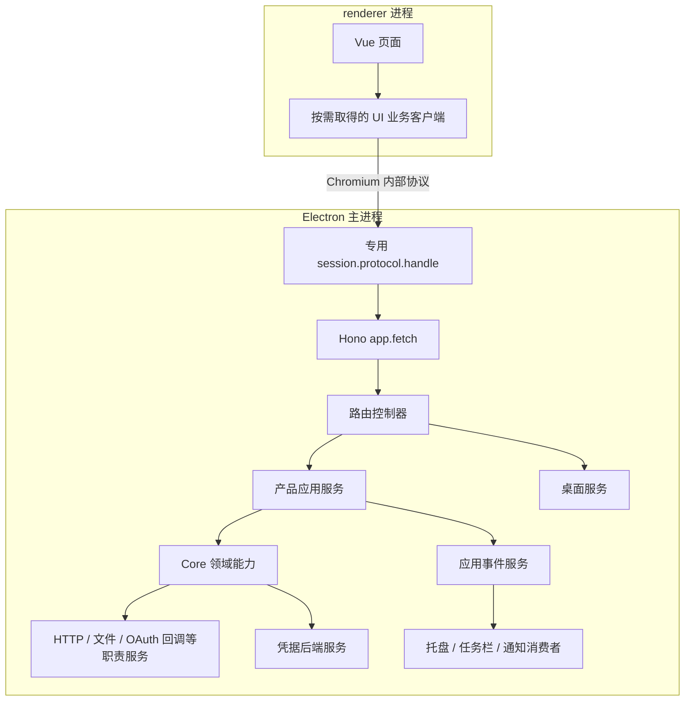
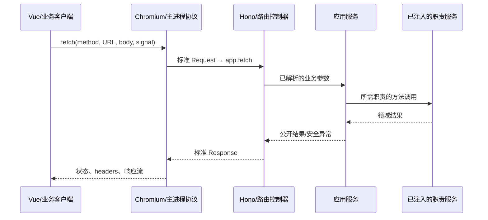

# 内置 Web 服务模式拆分与重构

| 项目     | 内容                                                                                         |
| -------- | -------------------------------------------------------------------------------------------- |
| 状态     | 设计草案；接口、类名和流程示例为实施目标                                                     |
| 日期     | 2026-10-25                                                                                   |
| 目的     | 统一 PolyQuota 业务与传输入口，通过职责服务和依赖注入准备可复用边界                          |
| 当前范围 | 正式产品采用 Electron 内嵌 Hono 与内部协议；独立 Web/server 用于开发验证，真实能力按依赖提供 |

实施拆解见[实施方案](./implementation-plan.md)，分层验证见[验收矩阵](./acceptance.md)。本文继续维护架构目标与功能边界。

## 1. 功能边界与运行场景

Core 已支持、且不依赖 Electron 的功能，在独立 Web server 中同样提供。是否可用由功能的真实依赖决定，不能仅因运行入口不是 Electron 就禁用 CLI 凭据读取、OAuth 回调、网络请求、代理检测、存储或后台调度。

正式 PolyQuota 使用 Electron 主进程内嵌 Hono，renderer 经应用内部协议访问标准 Request/Response。独立 Web + HTTP server 使用同一业务与路由，注册真实 Node 服务；自动化测试根据被测边界选择直接调用或真实宿主适配，只覆盖需要控制的依赖。这三种配置分别管理。

Electron 默认打包的 UI 内容继续使用原有 `loadFile` 和打包资源路径，开发页面继续直接 `loadURL` 到 Vite。业务 API/SSE 使用内部协议；仅少量需要动态加载的静态资源由专用 Electron 资源读取服务提供，不把整个 renderer 资源目录迁入协议或 Hono。

| 场景                   | 注册与接入                                                     |
| ---------------------- | -------------------------------------------------------------- |
| Electron 内嵌          | 通用服务 + Electron 适配覆盖；专用 session 的内部协议接入 Hono |
| 独立 Web + HTTP server | 通用服务 + 真实 Node 平台实现；浏览器经回环 HTTP 接入 Hono     |
| 单元/路由测试          | 通用业务服务，按用例覆盖依赖；通常直接 app.request             |
| Electron/网络集成测试  | 对应真实宿主配置 + 隔离测试数据，验证具体协议和系统行为        |

当前正式产品仍采用内嵌入口。独立入口的产品化部署、远程连接等在 GraphAgent 启动后按需要评估；这不影响独立入口应保留已有的通用功能。当前服务实例围绕本应用使用，不设计多客户端共享。

本次重构独立于凭据存储迁移。现有 Electron 凭据实现继续运行，凭据后端作为可替换服务注册；新凭据方案另按专门文档推进。只有真正缺失的凭据后端或桌面能力才报告不可用，不连带关闭其他通用能力。

## 2. 当前代码基线

| 能力                   | 当前落点与依赖                                                                         | 拆分方向                                           |
| ---------------------- | -------------------------------------------------------------------------------------- | -------------------------------------------------- |
| 供应商协议、认证与用量 | `packages/core/src/providers/`、`auth/`、`refresh-coordinator.ts`                      | 保留同一领域实现，两种宿主均使用                   |
| CLI 读取与解析         | 各 provider 的 auth-flow、`glm/zcode-credentials.ts`，使用 Node 文件系统/环境/用户目录 | 独立 server 使用真实读取和既有路径规则             |
| OAuth 回调处理         | core `auth/callback-handler.ts`                                                        | 保留供应商参数、state、PKCE、到期与取消规则        |
| OAuth 回调监听         | `apps/polyquota/src/auth/callback-server.ts`，已为纯 `node:http`                       | 移入通用 Node 适配，两种宿主复用                   |
| 代理检测               | `apps/polyquota/src/proxy-detection.ts`，通过 Node 系统查询实现                        | 独立 server 同样可使用；与实际出站代理应用分别处理 |
| 产品应用服务与调度     | `polyquota-application-service.ts`、`refresh-scheduler.ts`                             | 注册为应用级共享业务服务                           |
| 轮询与通知             | `polling-service.ts` 中混有 Electron 默认通知实现                                      | 通知交付独立注册，轮询业务通用                     |
| SQLite                 | `sqlite-storage.ts` 使用 `better-sqlite3` 与 Node API                                  | 按运行时提供正确 native binding，保留事务与迁移    |
| 凭据                   | core `CredentialVault` + Electron cipher + 产品 SQLite                                 | 本轮保留原实现，通过独立凭据服务接入               |
| UI 与通信              | `IPolyQuotaService`、`ipc.ts`、`preload.ts`、UI 服务注入                               | 保留公开契约，统一由 Hono 承接业务                 |
| Electron 桌面能力      | `main.ts`、`quota-chrome.ts`、Notification、powerMonitor                               | 仅真实桌面部分使用 Electron 实现                   |

独立 server 的能力清单以这些源码依赖为依据。目录在 `apps/polyquota` 下不代表其实现依赖 Electron；例如回调监听和代理检测应作为通用适配复用。

## 3. 按职责注册服务的依赖注入

### 3.1 应用级服务注册与按需获取

采用应用级、类型安全的 DI 容器/服务上下文。入口负责选择注册模块，依赖方在创建时按服务标识获取自己需要的职责服务，并持有相应实例。服务注册和依赖关系可审计，缺失必需注册或循环依赖在启动阶段明确报错。

- 通用模块注册业务服务、Core 能力、Hono 路由控制器及可复用 Node 服务。
- Electron 模块仅替换宿主差异，例如 Electron 网络、窗口、系统通知与当前凭据后端。
- 独立 server 使用真实 Node 网络、文件、回调监听、存储与计时实现。
- 测试模块覆盖本用例需要的服务，保留其他正常注册。

入口不逐个 `new` 所有业务对象再传入 Hono；Hono 也不接收 vault、文件读取器、timer 等大参数包。真正使用某项能力的类自行解析该服务，避免沿调用层级转交统一 `ProviderPorts`/deps 对象。

容器协议和服务契约保持运行时中立；Core 不依赖 Electron 或具体 DI 框架。纯协议、解析和计算函数继续使用普通参数。已有类在迁移时可由所属适配/服务工厂解析所需服务，再调用现有窄接口，逐步消除层层转交的参数包。

### 3.2 注册入口与消费类示意

以下为 DI 关系示意，`ServiceRegistry`、`ServiceResolver`、`S` 是候选中立接口与类型安全服务标识，不代表已选定容器库：

```ts
// 入口：注册职责模块，再启动应用级服务。
const services = createServiceRegistry();
registerCommonServices(services);
registerNodeServices(services, runtimeConfig);
registerElectronServices(services, electronContext); // 仅 Electron 入口加载

const honoApp = services.get(S.honoApp);
```

独立 server 入口执行通用与 Node 注册；测试入口在所选基础配置上执行 `registerTestOverrides`。Electron 模块位于独立入口依赖中，Node 启动时不静态加载 Electron。

依赖由消费类自己获取，示意如下：

```ts
class PolyQuotaRoutes {
  private readonly application: PolyQuotaApplicationService;

  constructor(services: ServiceResolver) {
    this.application = services.get(S.polyQuotaApplication);
  }

  mount(app: Hono) {
    app.get("/v1/polyquota/snapshot", async (c) =>
      c.json({ ok: true, value: await this.application.getSnapshot() }),
    );
  }
}

function createHonoApp(services: ServiceResolver) {
  const app = new Hono();
  services.get(S.polyQuotaRoutes).mount(app);
  services.get(S.desktopRoutes).mount(app);
  services.get(S.eventRoutes).mount(app);
  return app;
}
```

业务路由控制器只取产品应用服务，桌面路由控制器只取桌面服务，事件控制器只取只读事件服务。认证类按其需要取得文件、回调、授权交互或凭据服务；供应商请求类取得 HTTP 服务。获取完成后使用普通方法调用，不为每个业务操作重新构造整套依赖。

### 3.3 实例作用域与释放

每个 Electron 应用或独立 server 实例拥有自己的容器。应用服务、注册表、调度器、事件源、存储和凭据后端在该容器内共享；测试各自建立容器，避免全局单例串数据。Hono Context 仅包含当前请求数据，不创建另一套应用级实例。

注册模块明确创建、初始化、启动和释放顺序。实例默认在实际消费时构造，需要后台运行的调度/订阅由启动阶段显式激活；启动前校验当前场景必需服务。每个服务只拥有自己创建的资源，容器统一停止应用级资源，单个请求只释放它的流或临时订阅。

认证交互等会话对象由所属认证服务创建并按会话标识管理；不把当前认证 URL、请求或用户输入存成容器全局的“最后一次”状态。

### 3.4 收敛 fetch 的逐层传递

当前出站请求沿 `main.ts → ProviderPorts.http.fetch → createProviderContributions → provider bundle → Adapter → 请求方法/协议辅助函数` 传递。集合工厂和 bundle 中相当一部分代码只转交 fetch，不实际发请求。本轮将这类装配收敛为：入口注册一次 HTTP 服务，实际发请求的类在构造时获取并持有该服务，后续直接调用 `this.http.fetch(...)`。

Electron 注册现有 `net.fetch`/session 适配，保留其代理行为；独立 server 注册真实 Node HTTP 适配。Provider 集合、bundle 及不使用 HTTP 的业务类无需为下层转交 fetch 或整个 ProviderPorts。自有请求服务迁移后不再通过 `fetchImpl = fetch` 隐式回退；缺少必需注册时明确报装配错误，避免 Electron 意外使用 Node 全局 fetch。

纯函数和 vendor 协议代码仍可显式接收 fetch，由最近的 Adapter 在该边界传入。保留 vendor 的窄接口、独立测试与源码可追溯性，不使其依赖应用容器。自有辅助逻辑可随职责收敛到持有 HTTP 服务的类，纯协议、解析和计算函数不为消除参数而服务化。提取服务方法作为回调时保留必要的实例绑定。

UI 入站请求与供应商出站请求分别管理：renderer 使用原生 fetch 访问内部协议，handler 调用 Hono 的 `app.fetch(Request)`；服务端 HTTP 服务负责 OAuth、令牌和用量等出站请求。Hono 的 app.fetch 不负责选择出站网络实现。

收敛后的依赖关系为“入口注册 → 使用者获取 → 纯协议边界按需传参”。测试可在本用例容器中替换 HTTP 服务，无需重新沿每个 bundle 和构造函数传递 fetch，也不修改全局 fetch。

## 4. 内嵌调用与边界交换

### 4.1 运行结构



服务图中的引用由 DI 建立，运行时调用仍是普通函数/对象方法。容器不是消息总线，也不跨进程传递。

| 相邻层                             | 交换方式与边界                                                                            |
| ---------------------------------- | ----------------------------------------------------------------------------------------- |
| Vue → UI 客户端                    | renderer 内调用，通过 provide/inject 或 UI 服务上下文按需取得门面                         |
| UI 客户端 → Chromium               | fetch 内部协议 URL，传 method、路径、查询、headers、body、signal                          |
| Chromium/renderer → 主进程 handler | Electron 内部跨进程调度，形成标准 Request；返回状态、headers 与字节流，非共享 JS 对象引用 |
| handler → Hono                     | 剥离接入前缀后，同进程 `honoApp.fetch(request)`；交换标准 Request/Response                |
| Hono → 路由控制器 → 应用服务       | 同进程方法调用；控制器持有 DI 解析的业务依赖，处理公开输入与结果                          |
| 应用服务/Core → 职责服务           | 同进程调用 HTTP、文件、回调、凭据、存储等服务契约                                         |
| 职责实现 → 系统/供应商             | Node/Electron API 或实际网络；真正的文件读取、监听与系统动作在此执行                      |

跨进程只交换公开 DTO 与流，凭据、数据库句柄、容器、回调函数和 Electron 对象留在后台。协议适配保留 Request 的 body/取消语义及 Response 的状态、headers 和流，不重新序列化这些对象。

### 4.2 一次请求和事件返回



应用服务提交状态后向事件服务发布变更，事件控制器从只读订阅产生 SSE 格式 Response；renderer 使用 fetch 流解析事件、合并通知并重读快照。本地托盘等服务直接订阅同一事件源，不经过 renderer。

先订阅再读取首次快照，revision 变化时继续合并重读；instanceId 区分应用重启。取消读取或窗口销毁只释放该流和监听，应用级调度继续；应用退出再统一排空。事件流需要验证首包、分块、背压、异常和取消。

## 5. 独立 server 的功能保持

### 5.1 CLI 凭据读取与导入

Node 文件服务使用真实 `fs`、用户目录和环境变量，沿用 Core 对 Codex、Grok、Claude、ZCode 等已有导入规则及只读行为。独立入口可指定运行配置，但不能把真实读取替换成默认禁用或默认 recorder。

文件读取/解析、身份识别、导入落库是相邻但不同的步骤。凭据存储不可用不表示文件服务或解析器不可用：读取与解析能力继续支持；完整导入若需要保存凭据，则在该实际依赖处报告持久化不可用，不能回报“账号已添加成功”。测试读取与解析时可显式覆盖文件服务或使用临时目录。

### 5.2 OAuth 回调与授权交互

现有 `startOAuthCallbackServer` 只有 `node:http` 依赖，应作为通用 OAuth 回调服务注册，Electron 与独立 server 使用同一真实监听实现。Core 继续控制回调路径、端口、state、PKCE、超时、取消与协议处理。

“回调监听”与“向用户展示授权页面”是两个职责：

| 职责                | Electron                                     | 独立 Web/server                                                                         |
| ------------------- | -------------------------------------------- | --------------------------------------------------------------------------------------- |
| 回调监听            | 通用 Node 回调服务                           | 同一通用 Node 回调服务                                                                  |
| 供应商授权/令牌交换 | 同一 Core + 实际 HTTP 服务                   | 同一 Core + 实际 Node HTTP 服务                                                         |
| 授权页面展示        | Electron 授权交互服务使用 shell.openExternal | Web 授权交互服务将公开授权 URL/设备码信息交给当前浏览器，由页面点击或允许的打开动作展示 |
| 会话结束与取消      | 认证服务管理                                 | 同一认证服务管理                                                                        |

当前 browser-callback 的公开开始结果只有 sessionId。要在 Web 页面展示授权 URL，需在共同认证交互契约中补齐会话关联的展示信息，按契约版本演进；不能在 Node 模式把 openExternal 换成无效果成功后让页面无入口可用。授权 URL 不携带已保存的供应商密钥或令牌，展示状态按认证会话关联。

OAuth 回调、授权码处理等功能保留原逻辑；若最终凭据保存缺少后端，只在实际保存阶段给出明确结果。对于必须使用已保存凭据的刷新/兑换，读取凭据是必要依赖，其不可用错误应精确归因，不改成整个认证或网络服务不可用。

### 5.3 网络、代理、存储与调度

独立 server 注册真实 Node HTTP、系统代理检测、文件、存储、时钟和调度服务。Electron 通过模块覆盖 HTTP 传输以使用现有 net.fetch/session；两者共享 Core 的供应商逻辑。

代理检测可复用当前 Node 实现。实际请求如何应用环境/系统代理由 HTTP 实现负责，检测结果不能替代网络配置；实际不支持的配置按事实呈现。Node HTTP 提供真实出站请求；供应商单元测试可按需覆盖上游响应。

SQLite 可复用现有实现与迁移，分别加载匹配 Node/Electron 运行时的 native binding，数据目录由入口配置并保持单一所有者。普通 server 使用真实持久化；内存仓储属于显式配置或测试替身。调度器默认遵循真实设置，测试通过 clock/timer 服务覆盖时间和执行。

## 6. 凭据与桌面宿主的特殊边界

### 6.1 凭据迁移独立实施

凭据服务注册与桌面服务注册分开。当前 Electron 配置使用原 `CredentialVault(storage, cipher)`、`ElectronSafeStorageCipher` 和 PolyQuota SQLite，保留字段、密文、账号所有权和事务行为。服务重构不以新凭据代理落地为前置。

部分 provisioner 和刷新协调器在 `vault.seal()` 后仍于 `storage.transaction()` 内写 `storage.credentials`；本轮保留同一连接和事务。服务消费者按需取得凭据服务，Hono/UI 不取得原始 vault 或秘密读取能力。

独立 server 必须有明确的凭据后端注册。已有兼容后端可按契约配置；当前 Electron cipher 不可用且未配置其他真实后端时，注册明确不可用的凭据服务，保持其他通用服务正常。自动化测试可以覆盖为内存凭据 fake，但这不是独立 server 的默认能力实现。

可用性只限制实际依赖凭据读写的步骤，不统一禁止文件读取、回调监听或授权协议执行。敏感操作的结果明确区分完成、待交互、凭据存储失败等真实状态；不把未保存的结果声明为完整导入成功。

后续凭据共享与迁移按[专门设计](../credential-sharing.md)推进。当前后端包装与 DI 注册不代表已完成共享凭据方案。

### 6.2 真正 Electron 专属的服务

桌面窗口、托盘、任务栏、Electron 系统通知和 powerMonitor 可由 Electron 模块提供。独立 server 注册空桌面服务：公开能力为 false，主动桌面动作返回明确不可用，可选本地订阅跳过安装。

通知交付按使用方式注册：Electron 后台使用现有 Notification，独立 Web 由浏览器原生通知和交付回执承接。通知阈值与去重是通用业务，交付确认后才写状态。

空实现仅适用于确实缺少的宿主能力；通用 Node 文件、回调、网络、存储等职责注册真实实现。

## 7. UI 与服务侧的差异依赖清单

本节仅列出场景间存在实际功能或接入差异、代码必须显式选择的服务与配置。Hono、路由控制器、产品应用服务、Core 供应商逻辑、文件与用户环境、OAuth 回调监听、代理检测、存储事务、调度、事件和日志等沿用通用注册，不因测试可替换为 fake 而单独列项；移出清单不改变其服务职责或独立运行时的真实能力。

测试配置围绕被测功能选择基础宿主与覆盖项，不另建一套所有服务均为 fake 的运行模式。通用服务的测试隔离按用例安排，不构成产品场景差异。

### 7.1 UI 需要显式提供的内容

UI 使用独立的轻量服务上下文，由 UI 入口注册，Vue 组件/客户端类只取得自己消费的职责。UI 上下文和后台容器之间只交换请求、公开 DTO 与流。

| 差异依赖/配置 | Electron 内嵌                                               | 独立 Web + HTTP server                               | 测试时显式选择                                                  |
| ------------- | ----------------------------------------------------------- | ---------------------------------------------------- | --------------------------------------------------------------- |
| API 接入配置  | 内部协议基础 URL 与 /app 接入前缀，使用 renderer 原生 fetch | HTTP 基础 URL 与 /api 接入前缀，使用浏览器原生 fetch | 浏览器测试连接被测宿主；进程内客户端测试可接 Hono fetch adapter |
| 通知交付策略  | 委托后台 Electron 通知，不在页面重复交付                    | 浏览器原生 Notification，处理权限并返回交付回执      | 选择被测通知策略；验证权限、交付与回执流程时控制相应边界        |

业务门面、SSE 解析与重连、桌面能力客户端和认证状态组件复用同一实现。桌面能力与认证交互根据公开能力和会话 DTO 呈现，不为不同入口额外注册一套客户端。API 基础 URL 是入口配置，不拆成多套业务服务。

### 7.2 服务侧需要显式注册的差异实现

| 差异服务/适配              | Electron 内嵌注册                            | 独立 Web + HTTP server 注册                        | 测试时显式选择                                                               |
| -------------------------- | -------------------------------------------- | -------------------------------------------------- | ---------------------------------------------------------------------------- |
| 入站适配与默认 UI 入口     | 业务内部协议；默认 UI 保留原 loadFile/Vite 路径 | Node HTTP 监听、Web 资源入口                       | 路由测试直接 app.request/app.fetch；验证原 UI 路径和真实业务协议             |
| 按需动态资源读取           | 专用 Electron 读取服务，仅处理登记的少量动态资源 | 按实际页面需要提供 Web 资源来源，不注册 Electron 文件读取 | 验证默认资源不调用该服务，动态资源读取与范围限制分别生效 |
| 供应商 HTTP 与出站代理应用 | net.fetch/session 适配及 Electron 代理配置   | Node HTTP 适配及其支持的代理配置                   | 选择被测宿主传输；供应商单元测试按需覆盖 HTTP 服务，代理集成测试保留真实传输 |
| 授权交互                   | shell.openExternal 打开授权页                | 会话关联的 Web 交互，向页面提供授权 URL/设备码     | 选择被测交互实现；验证实际打开动作或页面展示及会话结果                       |
| 凭据后端                   | 原 CredentialVault、Electron cipher 与原存储 | 配置的兼容后端；缺少真实后端时显式不可用           | 显式选定后端或验证不可用；旧密文与事务兼容性使用原 Electron 后端             |
| 桌面宿主与系统事件         | 窗口、托盘、任务栏、powerMonitor 等真实实现  | 空桌面实现，能力为 false，不安装 Electron 系统订阅 | 选择被测宿主；桌面集成测试使用真实 Electron 实现                             |
| 通知交付                   | Electron Notification，后台确认交付          | 向当前页面交付通知请求，处理浏览器回执及未交付状态 | 选择对应交付实现，覆盖成功、拒绝和页面不可用等实际结果                       |

HTTP 服务包含出站代理应用的宿主差异；代理检测本身复用通用 Node 实现。通知阈值与去重仍为通用业务，UI 与后台两侧的通知策略由同一入口配置配对。

数据目录、HTTP 监听地址和匹配 Node/Electron 的 SQLite native binding 由运行入口显式配置或装配；这些是运行配置与产物差异，不另外抽出文件、数据库或调度的场景服务。凭据后端继续独立注册，不与桌面宿主实现捆绑。

清单用于明确入口必须作出的选择。消费类仅获取实际依赖的职责服务，不将清单再次汇总成沿调用链转交的统一参数包。

## 8. Hono 接口与传输适配

路由按产品域注册，路由控制器从容器取得所属应用服务。公共错误和现有请求解析器统一接线，Hono Context 保持请求局部数据。Request body 只在实际路由需要时解析，Response 保留状态、headers 与流。

### 8.1 方法与命名规则

API 按业务对象和实际操作命名，不照搬狭义 RESTful 的资源增删改映射。路径使用复数业务对象名与 kebab-case 动作名，参数使用明确的 `accountId`、`sessionId` 等名称。

1. 查询使用 GET；操作类 API 以 verb 或 verb phrase 结尾，使用 POST，例如 `accounts/:accountId/refresh`、`accounts/:accountId/set-enabled`。
2. 操作路由中的路径参数必须标识该操作唯一的实际对象。账户刷新操作的是账户，可以将 accountId 放入路径；账户只是查找凭据或兑换重置额度的上下文时，不将其当作被操作对象挂在路径上。
3. 操作无法由路径参数唯一定位实际对象，或支持多种对象选择方式时，路径不放对象参数，全部操作参数放入 JSON body。重置额度既支持卡 id，也支持类型 bucket，因此统一为 `reset-credits/redeem`，账户与兑换选择均在 body。
4. 路径最后一段为路径参数的接口只用于 GET 详情查询，例如 `GET accounts/:accountId`。操作必须有明确的末尾动作，不使用 `DELETE accounts/:accountId` 或 `PATCH accounts/:accountId`。该详情形式是命名规则，不代表本轮必须新增账户详情接口。
5. 保存操作使用明确的 POST `.../save`。一个功能若同时支持新增、修改和部分更新，仍使用同一 POST 接口，在请求契约中定义字段含义，不通过 PATCH 推断更新语义。当前仅有设置保存，不据此新增通用账户保存或部分更新能力。
6. 唯一对象已在路径中时，body 只放该对象的操作选项，不重复对象 id；不满足唯一对象规则时，所有业务操作参数统一进入 body。查询筛选放 query；不将有副作用的操作参数放入 query。

### 8.2 业务路由与方法映射

下表列出 Hono 内部实际路由，`/v1` 为接口版本，`/polyquota` 为业务域；均不包含接入前缀。沿用现有公开服务方法与 DTO，路由命名不要求同步修改现有方法名或 IPC channel。

| 能力 / 公开方法              | HTTP 与实际路由                                    | 路径对象与 body                                                                         |
| ---------------------------- | -------------------------------------------------- | --------------------------------------------------------------------------------------- |
| 就绪状态                     | GET /v1/status                                     | 无 body                                                                                 |
| 宿主公开能力                 | GET /v1/host/capabilities                          | 无 body                                                                                 |
| getSnapshot                  | GET /v1/polyquota/snapshot                         | 无 body，返回统一快照                                                                   |
| subscribe                    | GET /v1/polyquota/events                           | 无 body，返回 SSE 流                                                                    |
| setAccountEnabled            | POST /v1/polyquota/accounts/:accountId/set-enabled | 唯一对象为账户；body 为 `{ enabled }`                                                   |
| deleteAccount                | POST /v1/polyquota/accounts/:accountId/delete      | 唯一对象为账户；无业务 body                                                             |
| refreshAccount               | POST /v1/polyquota/accounts/:accountId/refresh     | 唯一对象为账户；无业务 body                                                             |
| refreshAll                   | POST /v1/polyquota/accounts/refresh-all            | 无路径参数；按现有设置刷新全部适用账户                                                  |
| refreshCredentials           | POST /v1/polyquota/credentials/refresh             | 无凭据公开 id；body 为 `{ accountId }`，账户用于定位待刷新的凭据                        |
| redeemResetCredit            | POST /v1/polyquota/reset-credits/redeem            | body 为现有 `RedeemResetCreditRequest`：`{ accountId, redemption }`                     |
| startAuth                    | POST /v1/polyquota/auth/sessions/start             | body 为现有 `StartAuthRequest`：`{ offeringId, method, apiKey? }`                       |
| finishAuth                   | POST /v1/polyquota/auth/sessions/:sessionId/finish | 唯一对象为认证会话；无业务 body                                                         |
| cancelAuth                   | POST /v1/polyquota/auth/sessions/:sessionId/cancel | 唯一对象为认证会话；无业务 body                                                         |
| 认证会话详情（新增公开查询） | GET /v1/polyquota/auth/sessions/:sessionId         | 返回所属会话的公开状态、授权 URL/设备码等展示信息；按第 5.2 节补充只读 DTO 与客户端方法 |
| saveSettings                 | POST /v1/polyquota/settings/save                   | body 为现有完整 `Settings`；沿用当前校验，不隐含部分合并语义                            |
| getSystemStatus              | GET /v1/polyquota/system-status                    | 无 body，返回当前代理等公开状态                                                         |

桌面动作与通知回执路由沿用同一规则：以实际窗口、通知等对象和动作命名；缺少唯一对象标识时使用无路径参数的动作接口，将业务参数完整放入 body。可用性仍由注入服务决定，不在路由名中加入 Electron/Web 分支。

认证会话详情仅返回面向当前 UI 的交互与结果状态，不返回供应商访问令牌、刷新令牌、PKCE verifier 或凭据后端数据。认证开始、详情和事件中引用同一 sessionId；会话所有权与结束后可查询期限由共同认证契约定义。

### 8.3 操作参数与校验

重置额度的两种调用使用同一路由，不因某个 provider 提供 itemId 就增加另一套按卡路径：

```http
POST /v1/polyquota/reset-credits/redeem
Content-Type: application/json

{"accountId":"account-1","redemption":{"kind":"item","itemId":"credit-1"}}
```

```http
POST /v1/polyquota/reset-credits/redeem
Content-Type: application/json

{"accountId":"account-1","redemption":{"kind":"aggregate","type":"weekly"}}
```

沿用 `ResetCreditRedemption` 判别联合与 `parseRedeemResetCreditRequest`：aggregate 的 type 按既有单桶规则可省略，item 必须提供 itemId。账户用于确定供应商、凭据与额度归属，不替代本次实际消耗的卡或 bucket。

路径参数与 body 由路由边界分别校验，再按现有服务签名调用。需要复用现有组合请求解析器时，仅在路由适配层组装其输入；先验证原始 body 的允许字段，禁止通过 body 重复提供或覆盖路径对象。无业务 body 的操作不接受额外业务字段。HTTP 传输不改变原有领域校验与错误语义。

`ServiceResult`、schemaVersion 与既有输入校验保持统一。凭据错误精确映射其实际依赖，缺少桌面动作可返回 501/service-unavailable。取消请求不意味着撤销已执行的业务；有副作用操作结果未知时按操作状态和上游对账处理，不因使用 POST 就自动重试。

### 8.4 接入前缀与传输适配

浏览器访问惯例 `/api`、内部协议接入前缀 `/app` 均属于入口适配层，不写入 Hono 路由定义、业务路由表或共同客户端的方法路径。UI 客户端持有逻辑路径，由接入配置拼接对应前缀；进程内测试直接使用逻辑路径。

| 接入方式               | 接入请求路径                                                                | 交给 Hono 的实际路径                     |
| ---------------------- | --------------------------------------------------------------------------- | ---------------------------------------- |
| 独立 Web + HTTP server | /api/v1/polyquota/accounts/account-1/refresh                                | /v1/polyquota/accounts/account-1/refresh |
| Electron 内部协议      | 内部 scheme 下的 /app/v1/polyquota/accounts/account-1/refresh               | /v1/polyquota/accounts/account-1/refresh |
| 进程内 Hono 测试       | app.request("/v1/polyquota/accounts/account-1/refresh", { method: "POST" }) | /v1/polyquota/accounts/account-1/refresh |

Electron 的固定协议 host 与路径前缀分别校验：下面示例中 host 为 app，业务请求 pathname 以 /app/ 开始。Node HTTP 适配同理只剥离起始 /api 前缀。两种适配各剥离一次自身的完整前缀，不做任意字符串替换，也不要求 Hono 同时兼容两套前缀路由。

以下示意只改写业务入站 URL 的路径，保留 query、method、headers、body、signal，Response 与流直接返回。`/resources/` 为少量动态资源的专用 Electron 读取入口，直接交给资源服务，不进入 Hono；默认打包 UI 仍使用原路径，其他协议路径返回 404。实际实现需验证 Electron Request 与 Node 运行时的流语义：

```ts
class ElectronProtocolAdapter {
  private readonly app: Hono;
  private readonly resources: ElectronDynamicResourceService;

  constructor(services: ServiceResolver) {
    this.app = services.get(S.honoApp);
    this.resources = services.get(S.electronDynamicResources);
  }

  handle(request: Request) {
    const url = new URL(request.url);
    if (url.hostname !== "app") return new Response(null, { status: 404 });
    if (url.pathname.startsWith("/app/")) {
      url.pathname = url.pathname.slice("/app".length);
      return this.app.fetch(new Request(url, request));
    }
    if (url.pathname.startsWith("/resources/")) {
      return this.resources.fetch(request);
    }
    return new Response(null, { status: 404 });
  }
}

const adapter = services.get(S.electronProtocolAdapter);
appSession.protocol.handle("polyquota-app", (request) => adapter.handle(request));
```

实施验收需要覆盖前缀剥离、路径对象与 body 的严格校验、所有公开方法的路由映射，以及当前 Electron 的方法、查询、JSON/空 body、错误响应、流、AbortSignal 及窗口销毁；Hono 单元测试与 Electron 传输实测分别记录。

依据：[Hono app.fetch / app.request](https://hono.dev/docs/api/hono)、[Hono Streaming Helper](https://hono.dev/docs/helpers/streaming)。

## 9. 内部协议与页面边界

正式应用使用专用 session 的内部 scheme，ready 前声明实际需要的 standard、secure、supportFetchAPI 能力，并保留 CSP、sandbox、context isolation、关闭 renderer Node integration 及 webSecurity。

该 session 只装载应用拥有的资源和可信页面；正式 UI 继续 `loadFile`，开发 UI 继续直接访问 Vite，默认打包内容的路径和加载链路保持原样。固定协议 host：业务 `/app/` 进入 Hono，仅动态资源 `/resources/` 进入专用 Electron 读取服务，其他路径返回 404。动态资源按应用登记的资源标识解析并限制读取范围，不提供任意文件路径读取，也不作为 renderer 静态文件的通用回退。

原页面来源访问内部 API/SSE 与动态资源时，分别配置所需的 CSP、跨来源访问及资源类型限制，并通过真实 renderer 验证；不能用迁移整个 UI 到内部 scheme 或关闭 webSecurity 代替验证。protocol Request 不携带 IPC senderFrame，页面边界在 session、装载、导航与 frame 管理时建立；外部页面使用系统浏览器或独立受限载体，剩余 IPC 初始化继续验证发送方。

独立 HTTP 入口按本轮开发运行范围监听回环地址。业务内部协议、开发 HTTP 监听和供应商规定的临时 OAuth 回调是分别管理的用途。普通单元测试默认无真实监听，网络/回调集成测试显式使用隔离配置。

依据：[Electron 42 protocol 与 session](https://github.com/electron/electron/blob/v42.11.6/docs/api/protocol.md)、[Electron 安全说明](https://github.com/electron/electron/blob/v42.11.6/docs/tutorial/security.md)。

## 10. 启动与退出

1. Electron 在 ready 前声明 scheme，准备单实例行为；Node 入口准备其 HTTP 运行配置。
2. 创建本应用容器，注册通用模块与当前宿主模块；测试在自己的实例中应用所需覆盖。
3. 校验注册依赖、配置和资源，按需构造服务；显式启动存储、后台调度和本地订阅等长生命周期服务。
4. 取得 Hono 应用并连接内部协议或 Node HTTP 适配，业务就绪后加载页面或对外提供接口。
5. 启动失败按已创建资源逆序释放，记录安全诊断。

窗口隐藏保留 Electron 后台。页面重载只重建客户端订阅。应用/server 退出先停止接收业务和新事件，解除宿主订阅、停调度、取消认证并关闭回调监听，然后有界排空操作和通知，结束事件流、注销入站适配，最后关闭存储及容器资源。

开发使用对应入口与 Vite；业务或宿主修改按依赖重启，先释放旧资源。Node 与 Electron 的 native 产物按运行时管理，避免覆盖同一路径。正式桌面产物仍按 Electron 分发，独立入口当前用于开发与验证。

## 11. 实施与验收

| 阶段              | 工作                                                             | 完成信号                                                                  |
| ----------------- | ---------------------------------------------------------------- | ------------------------------------------------------------------------- |
| A：职责与 DI      | 注册模块、类型安全标识、消费者按需取服务，分离 Electron 默认依赖 | 通用模块可由 Node 加载；替换配置不改变领域实现；实例和释放归属明确        |
| B：Hono/内部协议  | 控制器解析所属服务，统一 DTO、错误与事件                         | Electron 请求、流、取消和页面边界实测通过                                 |
| C：独立运行与切换 | 真实 Node 服务、Web 授权交互、测试配置分离，正式 UI 切换         | Core 通用能力在两种宿主均可用；差异只出现在实际依赖处；旧凭据后端行为保持 |

| 验收点         | 要求                                                                                               |
| -------------- | -------------------------------------------------------------------------------------------------- |
| DI 消费边界    | 入口注册模块，消费者只取自身服务；Hono/父级不逐层转交所有底层端口                                  |
| HTTP 装配收敛  | HTTP 服务按宿主注册，实际请求类按需获取；移除中间层 fetch 转交，保留纯协议/vendor 窄接口           |
| API 方法与命名 | 操作使用显式动作与 POST；路径参数只标识唯一操作对象，参数结尾仅为 GET 详情；接入前缀不进入业务路由 |
| 独立真实能力   | CLI 真实路径读取、解析，OAuth 真实回调/超时/取消，真实 HTTP、代理检测、持久化与调度可验证          |
| 授权展示       | Web 页面获得会话绑定的授权入口，Electron 保留系统浏览器动作；回调与会话结果相互关联                |
| 缺失能力       | 只在实际依赖调用处报告不可用；未配置凭据存储不使文件或回调服务退化为 fake                          |
| 凭据边界       | 保留原事务、字段与密文；服务重构独立于共享凭据迁移；未保存不回报完整成功                           |
| 桌面与通知     | 真实桌面能力按宿主注册，Web 浏览器通知与 Electron 系统通知各自交付且保留去重                       |
| 测试隔离       | 每个用例独立容器，明确覆盖网络/文件等服务，避免访问真实账号；该限制来自测试配置                    |
| 通信与事件     | 公开 DTO/字节流跨进程；首包、取消、窗口销毁和退出释放正确，后台实例不重复                          |
| 生命周期/分发  | 启动失败清理、单一数据所有者、匹配运行时的 native binding、unpacked/安装包实际验证                 |

工程实现按仓库要求执行 format:check、typecheck、test、build；涉及 Electron、协议/native 或打包时运行 package 并验证实际产物。领域、Hono、Node 运行、Electron、真实账号与安装包证据分别记录。

## 12. 关联设计

- [实施方案](./implementation-plan.md)：任务顺序、目标目录、契约与切换安排。
- [验收矩阵](./acceptance.md)：分层用例、检查命令与交付证据。
- [跨服务商服务协议设计](../cross-provider-service-protocol-design.md)：共享能力与产品边界。
- [跨产品凭据共享与迁移](../credential-sharing.md)：凭据后续方案；当前保留独立服务注册与原后端。
- [Core 与 contract 结构](../2026-10-drift-review/core-contract-structure.md)：公开 DTO、校验与展示归属。
- [认证服务抽取设计](../../../polyquota/auth-service-extraction-design.md)：Core 已有 CLI、OAuth 与回调编排。
- [运行与通信现状](../../../polyquota/runtime-and-communication-review.md)：原有宿主与生命周期参考。
- [GraphAgent 启动计划](../../../graph-agent/plan.md)：后续部署需求评估入口。
