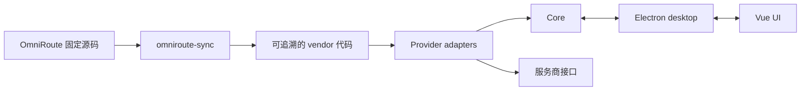

# LLM 订阅用量聚合桌面工具：设计说明

| 项目 | 内容 |
| --- | --- |
| 状态 | 草案，产品方向已确认 |
| 更新日期 | 2026-09-22 |
| 目标平台 | Windows 优先 |
| 技术方向 | pnpm monorepo、TypeScript、Vue 3、Electron |
| 协议参考 | [OmniRoute](https://github.com/diegosouzapw/OmniRoute) 固定版本源码 |
| 配套文档 | [实施计划](./plan.md) |

## 1. 产品定位

本项目是一个常驻系统托盘的本地桌面工具，用于集中查看多个 LLM 订阅账号的剩余额度，并在额度偏低时发出系统通知。

它不承担模型请求代理、路由或计费管理。首个版本只形成以下闭环：

1. 添加或导入订阅账号；
2. 定时获取用量；
3. 在统一卡片中展示配额；
4. 在达到阈值时通知用户。

登录和用量协议以 OmniRoute 已验证的实现为参考来源。项目只抽取所需的认证、刷新和用量模块，不重新推测上游协议，也不复用 OmniRoute 的界面和网关能力。

## 2. 范围

### 2.1 首个版本

- 首批支持 Codex / ChatGPT、智谱 GLM（国内与国际区域）、Grok Build、Antigravity；同一服务允许添加多个账号。
- 支持 OAuth、设备码、API Key 和官方 CLI 凭证导入；具体方式由各服务现有能力决定。
- 每个账号可单独启用或停用。停用后不再轮询，也不发送通知。
- 自动使用操作系统代理，并兼容 `HTTP_PROXY`、`HTTPS_PROXY` 和 `ALL_PROXY`。
- 展示账号、套餐、配额、重置时间、只读的额外额度、更新时间和最近错误。
- 支持手动刷新、低额度通知和本地加密存储。
- 提供传统 Electron 安装包，不以单文件可执行程序为目标。

### 2.2 后续方向

GitHub Copilot、Claude、OpenCode Go 及其他已有稳定用量实现的服务，在首批闭环稳定后按同一适配器边界逐步加入。后续支持顺序仍需结合协议稳定性、账号可验证性和维护成本评估。

### 2.3 明确不做

- 不代理、转发或路由模型请求；
- 不兑换、购买或自动补充额度；
- 不管理模型成本、路由阈值和服务商网关；
- 不运行 OmniRoute 的 Next.js 应用、React 组件、Electron 外壳或健康扫描任务；
- 不回写官方 CLI 的凭证文件；
- 不提供多用户、远程服务或云同步；
- 不在无安全存储能力时明文保存凭证。

## 3. 设计原则

1. **协议有来源。** 认证、刷新和用量请求必须能追溯到固定版本的 OmniRoute 源码或官方客户端已落盘的数据，不凭经验重写关键协议。
2. **产品边界清晰。** 只保留用量聚合所需能力，避免把网关功能带入桌面工具。
3. **核心与桌面能力分离。** 业务核心不依赖 Electron，以便独立测试和验证真实账号。
4. **凭证最小暴露。** 渲染进程不接触明文凭证，日志和错误信息必须脱敏。
5. **生成过程可复现。** 从 OmniRoute 抽取的代码由同步工具生成，不直接维护无法追溯的副本。
6. **先完成一条真实闭环。** 先以 Codex 验证从认证到通知的完整链路，再扩展其他服务。

## 4. 总体架构

项目采用 pnpm monorepo，各部分职责如下：

| 位置 | 职责 | 边界 |
| --- | --- | --- |
| `packages/core` | 账号、适配器、凭证刷新、用量归一化、轮询、存储和通知判定 | 不依赖 Electron，不包含界面 |
| `packages/ui` | Vue 3 卡片、设置和登录交互 | 不访问上游，不持有明文凭证 |
| `apps/desktop` | Electron 窗口、托盘、系统通知、安全存储、系统代理和浏览器授权 | 不包含服务商协议 |
| `tools/omniroute-sync` | 按清单抽取、转换并记录 OmniRoute 来源 | 只在开发和升级时运行 |
| `references/omniroute` | 固定提交的上游源码 | 仅作参考和同步输入，不参与应用构建 |

`packages/core` 通过抽象端口使用桌面能力，例如打开系统浏览器、解析系统代理、加解密和发送通知。这样既能在 Electron 中运行，也能用 Node 脚本对真实账号进行定向验证。

## 5. OmniRoute 源码管理

OmniRoute 放在 `references/omniroute`，以 Git 子模块记录固定提交。当前基线来自 `release/v3.8.51` 分支，固定为 `3ee283bb944d6d62cc219f74317d5186942e1780`。上游没有同名 `v3.8.51` 标签，因此版本记录以提交为准。

正式实施时增加 `tools/omniroute-sync`：

- 通过允许清单抽取认证、刷新、用量、配额归一化和错误脱敏等必要模块；
- 拒绝抽取界面、Next.js 路由、推理执行器、兑换、MITM、远程模式和完整代理栈；
- 在生成清单中记录上游提交和文件来源；
- 将与本项目存储、代理等边界有关的机械转换固化为规则；
- 保留适用的许可证和版权信息；
- 保证相同输入可产生相同结果。

应用只引用生成后的代码，不直接引用子模块。生成物提交到主仓库，使日常构建不依赖子模块内容。

## 6. 核心能力

### 6.1 服务适配器

每个服务实现统一适配器，向核心层提供以下能力：

- 声明服务标识、名称和可用认证方式；
- 启动认证或导入凭证；
- 在需要时刷新凭证；
- 获取并归一化用量快照。

服务特有的授权参数、请求头、令牌结构和用量字段留在适配器内部。界面、轮询器和通知模块不包含服务商分支逻辑。

首批服务的实现重点如下：

| 服务 | 认证方向 | 主要验证重点 |
| --- | --- | --- |
| Codex / ChatGPT | OAuth PKCE、Codex CLI 只读导入 | 固定回调端口、会话与周配额、重置额度 |
| GLM | API Key，区分国内与国际区域 | 区域选择、短周期与周配额 |
| Grok Build | 设备码为主，CLI 凭证导入为辅 | 刷新时保留账号主体信息、额外额度只读展示 |
| Antigravity | OAuth 或现有凭证导入 | 身份请求头、项目标识和上游数据库耦合的解除 |

具体上游文件由同步清单维护，不再在多份文档中重复列举。新增服务前应先确认 OmniRoute 中存在可独立抽取且可验证的实现。

### 6.2 认证

授权浏览器、设备码展示和回环回调由桌面外壳承载，协议流程由适配器负责。回环服务只在登录期间监听 `127.0.0.1`，完成、取消或超时后立即关闭。

官方 CLI 凭证只作为导入源。导入后使用本应用自己的加密副本，刷新结果不回写原文件，也不通过启动 CLI 子进程获取用量。

### 6.3 用量轮询

轮询器只处理已启用账号，并为每个账号执行“必要时刷新凭证—获取用量—保存快照—判断通知”的统一流程。

默认轮询间隔暂定为 180 秒，单账号最短间隔为 30 秒，并限制全局并发。失败只影响当前账号，采用退避策略，界面保留最近一次成功数据并显示错误状态。这些数值在真实账号验证阶段仍可调整。

### 6.4 代理

桌面外壳负责解析操作系统代理配置，核心请求层统一使用解析结果；未命中系统代理时再读取环境变量。首个版本只需支持当前服务实际使用的代理形式，PAC、SOCKS 和绕过规则的完整兼容范围需要在实施阶段验证。

项目不复制 OmniRoute 的完整代理网关，也不修改系统代理设置。

### 6.5 用量展示与通知

界面使用 Vue 3 重新实现。`docs/omniroute.png` 只用于确认信息层级，不作为视觉稿或组件来源。

每张卡片至少呈现服务名称、套餐、打码账号、配额条、重置时间、更新时间、状态开关和刷新反馈。服务商及套餐名称优先采用官方名称；缺少官方中文名称时保持清晰、克制，避免机械翻译和含义不明的缩写。

低额度通知默认采用两级阈值：提醒 20%，严重 5%。无限额度或未提供百分比的数据不触发通知。同一配额在同一重置周期内去重，额度恢复后可再次触发。阈值与去重策略将在模拟数据和真实账号上共同验证。

### 6.6 本地数据

数据保存在 `%APPDATA%/llm-usage`。逻辑上包含账号、最近用量、通知状态和设置四类信息。具体数据库与加密封装在基础骨架阶段通过 Electron 打包兼容性验证后确定。

凭证使用 Electron `safeStorage` 提供的系统保护能力。若安全存储不可用，应用拒绝保存凭证并给出明确提示。渲染进程、通知和日志只能接收打码后的账号信息。

## 7. 安全与可观测性

| 风险 | 控制方向 |
| --- | --- |
| 协议或身份头不完整导致账号风险 | 以固定上游实现为基线；真实账号逐家验证；不简化关键请求 |
| 凭证泄露 | 系统安全存储、IPC 白名单、日志脱敏、禁用渲染进程 Node 能力 |
| 回调端口暴露 | 仅监听 `127.0.0.1`，使用后立即关闭 |
| 轮询过于频繁 | 最短间隔、并发限制、缓存与失败退避 |
| 与官方 CLI 的刷新状态冲突 | 只读导入，不回写；每个账号只有一条刷新路径 |
| 代理行为不一致 | 所有上游请求统一进入代理解析层，并记录脱敏后的命中状态 |

首个版本不上传遥测。日志只记录服务标识、打码账号、耗时、状态码和脱敏错误；界面展示最后更新时间与最近错误。日志文件轮转策略在桌面壳阶段确定。

## 8. 关键决策

| 决策 | 结论 | 主要原因 |
| --- | --- | --- |
| 产品形态 | 独立托盘工具，不包装 OmniRoute | 避免携带完整网关和现有界面问题 |
| 协议来源 | 固定 OmniRoute 提交并程序化抽取 | 降低重复实现和上游升级成本 |
| 界面 | Vue 3 自行实现 | 只继承信息结构，不继承 React / Next.js 依赖 |
| 用量获取 | 直接调用抽取后的 TypeScript 模块 | 官方 CLI 接口不统一，进程调用易受版本变化影响 |
| 运行边界 | Core、UI、Desktop 分层 | 便于测试、打包和控制凭证暴露 |

其他候选方案不再逐项展开。读取 OmniRoute 本地接口可用于开发对照，CodexBar 可用于通知交互参考，但二者都不是产品运行依赖。

## 9. 待探索事项

以下问题不阻塞开始实施，但在相关阶段结束前需要给出结论：

- SQLite 方案及其 Electron 打包兼容性；
- Windows PAC、SOCKS 和环境变量代理的实际覆盖范围；
- Antigravity 与 OmniRoute 数据库耦合的最小拆分方式；
- GLM 是否能够安全地从 zcode 配置中只读发现凭证；
- 应用名称、开机启动默认值和按配额窗口设置通知阈值的必要性；
- macOS 与 Linux 的最低支持范围。

未经验证的方向应保留为探索项，不提前固化为详细接口或承诺。

## 10. 验收原则

- 首批四个服务能够使用本机真实账号完成用量获取，并与 OmniRoute 或官方页面在同一时间窗口内对照；
- 停用账号后不再请求上游或发送通知；
- 代理切换、凭证过期、网络失败和单个服务异常不会影响其他账号；
- 日志、IPC 和系统通知中不出现明文凭证；
- 应用构建不编译或打包 `references/omniroute`；
- `packages/ui` 不依赖 OmniRoute 的界面代码；
- 回环认证只短暂监听本机地址；
- 开关、刷新和登录操作均有明确的进行中、成功或失败反馈。

## 11. 参考资料

- [OmniRoute](https://github.com/diegosouzapw/OmniRoute)，MIT；本地固定源码见 `references/omniroute`
- [实施计划](./plan.md)
- [OmniRoute 用量页面截图](./omniroute.png)
- [monaco-editor 的源码抽取思路](https://github.com/microsoft/monaco-editor/blob/main/CONTRIBUTING.md)
- [CodexBar](https://github.com/steipete/CodexBar)，仅作为通知体验参考
