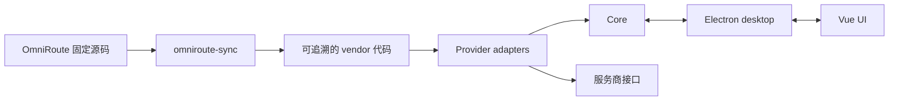

# LLM 订阅用量聚合桌面工具：设计说明

| 项目     | 内容                                                                |
| -------- | ------------------------------------------------------------------- |
| 状态     | 草案，产品方向已确认                                                |
| 更新日期 | 2026-09-24                                                          |
| 目标平台 | Windows 优先                                                        |
| 技术方向 | pnpm monorepo、TypeScript、Vue 3、Electron                          |
| 协议参考 | [OmniRoute](https://github.com/diegosouzapw/OmniRoute) 固定版本源码 |
| 配套文档 | [实施计划](./plan.md)                                               |

## 1. 产品定位

本项目是一个常驻系统托盘的本地桌面工具，用于集中查看多个 LLM 订阅账号的剩余额度，并在额度偏低时发出系统通知。

它不承担模型请求代理、路由或计费管理。首个版本只形成以下闭环：

1. 添加或导入订阅账号；
2. 定时获取用量；
3. 在统一卡片中展示配额；
4. 在达到阈值时通知用户。

登录和用量协议以 OmniRoute 已验证的实现为参考来源。对指定厂商完整抽取全部稳定认证机制及其刷新、用量模块，不重新推测上游协议，也不复用 OmniRoute 的界面和网关能力。

## 2. 范围

### 2.1 首个版本

- 首批支持 Codex / ChatGPT、智谱 GLM（国内与国际区域）、Grok Build、Antigravity；同一服务允许添加多个账号。
- 支持 OAuth、设备码、API Key 和官方 CLI 凭证导入；对已经列入范围的厂商，保留固定上游中全部稳定方式，不因界面只设置一个默认入口而删减协议能力。
- 每个账号可单独启用或停用。停用后不再轮询，也不发送通知。
- 有 `HTTP_PROXY` 或 `HTTPS_PROXY` 时走环境变量；否则使用系统代理中的显式服务器地址；都没有时直连。切换系统代理后，下一次新建请求生效。首版不执行 PAC。
- 展示账号、套餐、配额、重置时间、只读的额外额度、更新时间和最近错误。
- 支持手动刷新、低额度通知和本地加密存储。
- 提供传统 Electron 安装包，不以单文件可执行程序为目标。

### 2.2 后续方向

GitHub Copilot、Claude、OpenCode Go 及其他已有稳定用量实现的服务，在首批闭环稳定后按同一适配器边界逐步加入。后续支持顺序仍需结合协议稳定性、账号可验证性和维护成本评估。

### 2.3 明确不做

- 不代理、转发或路由模型请求；
- 不兑换、购买或自动补充额度；
- 不管理模型成本、路由阈值和服务商网关；
- 不运行 OmniRoute 的 Next.js 应用、React 组件、Electron 外壳或健康扫描任务；
- 不回写官方 CLI 的凭证文件；
- 不把 Cookie、Web session、localStorage、浏览器配置目录或裸短期令牌作为认证来源，也不通过浏览器自动化或开发者工具抓取登录状态；
- 不提供多用户、远程服务或云同步；
- 不在无安全存储能力时明文保存凭证。

## 3. 设计原则

1. **协议有来源。** 认证、刷新和用量请求必须能追溯到固定版本的 OmniRoute 源码或官方客户端已落盘的数据，不凭经验重写关键协议。
2. **产品边界清晰。** 只保留用量聚合所需能力，避免把网关功能带入桌面工具。
3. **核心与桌面能力分离。** 业务核心不依赖 Electron，以便独立测试和验证真实账号。
4. **凭证最小暴露。** 渲染进程不接触明文凭证，日志和错误信息必须脱敏。
5. **抽取过程可复现。** 同步工具完成前以固定上游和逐文件 diff 维护手工样板，完成后由工具生成；两种状态都必须可追溯。
6. **先完成一条真实闭环。** 先以 Codex 验证从认证到通知的完整链路，再扩展其他服务。

## 4. 总体架构

项目采用 pnpm monorepo，各部分职责如下：

| 位置                   | 职责                                                          | 边界                               |
| ---------------------- | ------------------------------------------------------------- | ---------------------------------- |
| `packages/core`        | 账号、适配器、凭证刷新、用量归一化、轮询、存储和通知判定      | 不依赖 Electron，不包含界面        |
| `packages/ui`          | Vue 3 卡片、设置和登录交互                                    | 不访问上游，不持有明文凭证         |
| `apps/desktop`         | Electron 窗口、托盘、系统通知、安全存储、系统代理和浏览器授权 | 不包含服务商协议                   |
| `tools/omniroute-sync` | 按清单抽取、转换并记录 OmniRoute 来源                         | 只在开发和升级时运行               |
| `references/omniroute` | 固定提交的上游源码                                            | 仅作参考和同步输入，不参与应用构建 |

`packages/core` 通过抽象端口使用桌面能力，例如打开系统浏览器、解析系统代理、加解密和发送通知。这样既能在 Electron 中运行，也能用 Node 脚本对真实账号进行定向验证。

## 5. OmniRoute 源码管理

OmniRoute 放在 `references/omniroute`，以 Git 子模块记录固定提交。当前基线来自 `release/v3.8.51` 分支，固定为 `3ee283bb944d6d62cc219f74317d5186942e1780`。上游没有同名 `v3.8.51` 标签，因此版本记录以提交为准。

先将 Codex 闭环所需源码手工抽取到主仓库，以逐文件 diff 审查裁剪结果；待真实 Codex 闭环确认最终输出形态后，再增加 `tools/omniroute-sync`：

- 通过允许清单抽取认证、刷新、用量、配额归一化和错误脱敏等必要模块；
- 拒绝抽取界面、Next.js 路由、推理执行器、兑换、MITM、远程模式和完整代理栈；
- 在生成清单中记录上游提交和文件来源；
- 将与本项目存储、代理等边界有关的机械转换固化为规则；
- 保留适用的许可证和版权信息；
- 保证相同输入可产生相同结果。

应用只引用主仓库内的 vendor 代码，不直接引用子模块。手工样板和后续工具生成物都提交到主仓库，使日常构建不依赖子模块内容。

## 6. 核心能力

### 6.1 服务适配器

每个服务实现统一适配器，向核心层提供以下能力：

- 声明服务标识、名称和可用认证方式；
- 启动认证或导入凭证；
- 在需要时刷新凭证；
- 获取并归一化用量快照。

服务特有的授权参数、请求头、令牌结构和用量字段留在适配器内部。界面、轮询器和通知模块不包含服务商分支逻辑。

首批服务的实现重点如下：

| 服务            | 认证方向                                                          | 主要验证重点                                                 |
| --------------- | ----------------------------------------------------------------- | ------------------------------------------------------------ |
| Codex / ChatGPT | 浏览器 OAuth PKCE、自定义设备授权、Codex CLI `auth.json` 只读导入 | 固定回调端口、设备授权开关、旋转刷新、会话与周配额、重置额度 |
| GLM             | API Key，区分国内与国际区域                                       | 区域选择、短周期与周配额                                     |
| Grok Build      | 设备码、浏览器 OAuth PKCE、完整 CLI `auth.json` 只读导入          | 刷新时保留账号主体信息、额外额度只读展示                     |
| Antigravity     | Google OAuth 授权码                                               | 身份请求头、项目标识和上游数据库耦合的解除                   |

Codex 所需上游文件先由手工样板和逐文件 diff 确认，真实闭环通过后再纳入同步清单。文件选择和耦合拆分的依据见 [OmniRoute 探索报告](./omniroute-exploration.md)。新增服务前应先确认 OmniRoute 中存在可独立抽取且可验证的实现。

### 6.2 认证

授权浏览器、设备码展示和回环回调由桌面外壳承载，协议流程由适配器负责。回环服务只在登录期间监听 `127.0.0.1`，完成、取消或超时后立即关闭。

官方 CLI 凭证只作为导入源。导入后使用本应用自己的加密副本，刷新结果不回写原文件，也不通过启动 CLI 子进程获取用量。

“稳定认证机制”必须有固定上游实现，能够产出可刷新凭证、长期 API Key，或从官方 CLI 文件读取包含刷新能力的凭证，并且不依赖既有 Web 登录状态。对同一厂商，符合条件的方式全部进入 vendor 和同步清单；产品可以设置推荐方式，但适配器必须如实声明其他可用方式。Cookie、ChatGPT session JSON、浏览器 localStorage、浏览器配置目录、DOM 自动化、开发者工具抓取和缺少刷新能力的裸 access token 均不在范围内。

### 6.3 用量轮询

轮询器只处理已启用账号，并为每个账号执行“必要时刷新凭证—获取用量—保存快照—判断通知”的统一流程。

默认轮询间隔暂定为 180 秒，单账号最短间隔为 30 秒，并限制全局并发。失败只影响当前账号，采用退避策略，界面保留最近一次成功数据并显示错误状态。这些数值在真实账号验证阶段仍可调整。

### 6.4 代理

每个新的上游请求在发出前解析一次代理，已经发出的请求保持它开始时的选择。用户切换系统代理开关后，下一次新建请求即使用新结果，应用不需要重启。

解析顺序如下：

1. 目标是回环或本机地址时直连，避免登录回调进入代理。
2. 存在 `HTTPS_PROXY` 或 `HTTP_PROXY`（大小写均可）时使用环境变量。`https` 请求先看 `HTTPS_PROXY`，没有再看 `HTTP_PROXY`；`http` 请求看 `HTTP_PROXY`。
3. 没有上述环境变量时，读取 Windows 系统代理里的显式代理服务器地址。Clash 一类工具写入的 `127.0.0.1:端口` 属于这一层。
4. 没有显式代理服务器地址时直连。

首版不执行 PAC 脚本，也不读取自动配置脚本地址。系统设置里只有 PAC、没有代理服务器地址时，按直连处理。应用不修改系统代理。

### 6.5 用量展示与通知

界面使用 Vue 3 重新实现。`docs/omniroute.png` 只确认卡片、套餐、配额、重置时间和刷新这些信息层级。可见文案以本节为准。

每张卡片呈现服务名称、套餐、打码账号、配额、重置时间、更新时间、状态开关和刷新反馈。套餐名称使用面向用户的服务商名称，不直接暴露协议内部值；除已经确认的名称映射外，只做首字母大小写等轻量整理，不翻译成中文。配额剩余量位于进度条右侧，重置时间位于进度条下方。停用账号仍保留最近一次用量卡片，使用弱化状态和关闭的右上角开关表示，不参与自动刷新和通知。

服务适配器只返回原始套餐值、原始展示名、窗口秒数、额度数值和重置时间等事实字段，不生成 `5-hour`、`Weekly`、`Pro 5x`、`Reset credits` 等产品文案。服务商名称、认证方式名称、套餐映射、配额标题、分组标题和附加项标题统一维护在 UI 侧服务商字典中；新增服务商时扩展字典和适配器注册，不修改公共卡片与刷新流程。

配额按组展示。一组有一个标题，组内是该组自己的配额条。供应商没有分组时，卡片只有一组，不显示组标题。Antigravity 的分组来自 `retrieveUserQuotaSummary` 的 `groups[]`：组标题用 `displayName`（如 `Gemini Models`、`Claude and GPT models`），组内每条用该组 bucket 的 `displayName`（如 `5 Hour Quota`、`Weekly Quota`）。同一组里的 5 小时和周配额都保留。模型目录里的单模型进度条不进入卡片。

配额条的可见标题使用上游已经给出的展示名；上游只给了内部键和窗口秒数时，标题用窗口长度。Codex 的 `session` 键对应 `limit_window_seconds = 18000`，标题写 `5-hour`。`weekly` 键对应 `604800` 秒，标题写 `Weekly`。

| 服务            | 套餐原文来源                                              | 已见到的原文                                                                                                  | 配额标题                                                                                                                                                                         |
| --------------- | --------------------------------------------------------- | ------------------------------------------------------------------------------------------------------------- | -------------------------------------------------------------------------------------------------------------------------------------------------------------------------------- |
| Codex / ChatGPT | 用量响应 `plan_type`，以及登录 JWT 的 `chatgpt_plan_type` | `free`、`go`、`plus`、`pro`、`team`、`enterprise`、`edu`，界面写成 Free、Go、Plus、Pro、Team、Enterprise、Edu | 短窗口 `5-hour`；长窗口 `Weekly`。另有窗口时用上游 `limit_name` 加同样的时长，例如 `GPT-5.3-Codex-Spark` 的 `5-hour` 与 `Weekly`。重置次数是单独的只读数字，标题 `Reset credits` |
| GLM             | `planName`，否则 `level`                                  | Coding Plan 的 `lite`、`pro`、`max`，界面写成 Lite、Pro、Max                                                  | `5 Hours Quota`、`Weekly Quota`。存在月度工具窗口时加 `Monthly`                                                                                                                  |
| Grok Build      | `/user` 的 `subscriptionTier`                             | `SuperGrokPro`、`SuperGrok Heavy`，以及用量页上的 `Grokpro`。字符串原样展示                                   | 产品名用计费响应里的产品名，如 `GrokChat`、`Grok Build`。账户级百分比标题为 `Weekly`。不展示余额、自动充值或其他充值相关内容                                                       |
| Antigravity     | `getAntigravityPlanLabel` 的结果                          | `Ultra`、`Pro`、`Enterprise`、`Business`、`Plus`、`Lite`、`Free`，以及原样保留的 `Starter`                    | 组标题和组内标题都用汇总响应里的 `displayName`                                                                                                                                   |

进度条采用三档颜色：剩余量高于 50% 为绿色，20% 到 50% 为橙色，不高于 20% 为红色；不高于 5% 时仍使用红色，但进入更危险的状态。卡片整体颜色按账号总用量使用同一档位，不以单个配额条的颜色替代账号总状态。

低额度通知采用两级阈值：剩余量不高于 20% 时触发系统提示，不高于 5% 时触发更危险的系统提示。无限额度或未提供百分比的数据不触发通知。同一配额在同一重置周期内去重，额度恢复后可再次触发。阈值与去重策略将在模拟数据和真实账号上共同验证。通知正文使用与卡片相同的套餐名和配额标题。

### 6.6 本地数据

数据使用 SQLite 保存，数据库位于 Electron `app.getPath("userData")` 下。Node.js 驱动选用 `better-sqlite3`，只由桌面主进程持有连接；Core 依赖存储端口，渲染进程不直接访问数据库。首版保存账号、加密凭证、最近用量、通知状态、设置和迁移记录，不保留历史用量曲线。查询使用参数化 SQL，模式演进使用仓库内显式迁移，不引入 ORM。

Node 与 Electron 使用彼此隔离的原生二进制。workspace 中的 `better-sqlite3` 始终保持 Node ABI；Electron ABI 在隔离的临时目录中构建后固定输出到 `apps/desktop/lib/better-sqlite3`，不修改 pnpm 依赖目录。首次开发或相关运行时发生变化后手动执行 `pnpm native:prepare`；生产构建通过 Desktop 的 `prebuild` 自动重新生成。主进程在开发时从应用目录、打包后从 `process.resourcesPath` 解析同一相对路径，并通过 `nativeBinding` 显式加载；安装包不携带依赖目录中面向 Node 的默认二进制。

授权材料按账号使用 Electron `safeStorage` 加密后以 SQLite `BLOB` 保存，不采用 SQLCipher 整库加密。密文包含版本和账号归属信息；access token、refresh token、id token、API Key 及其他认证秘密不得进入明文字段。若安全存储不可用，应用拒绝新增、导入、刷新或改写凭证，并保留已有密文。该方案提供与本机用户绑定的静态保护，不承诺抵御同一登录用户权限下的恶意进程，也不提供跨机器凭证迁移。渲染进程、通知和日志只能接收打码后的账号信息。

## 7. 安全与可观测性

| 风险                           | 控制方向                                                                   |
| ------------------------------ | -------------------------------------------------------------------------- |
| 协议或身份头不完整导致账号风险 | 以固定上游实现为基线；真实账号逐家验证；不简化关键请求                     |
| 凭证泄露                       | 系统安全存储、IPC 白名单、日志脱敏、禁用渲染进程 Node 能力                 |
| 回调端口暴露                   | 仅监听 `127.0.0.1`，使用后立即关闭                                         |
| 轮询过于频繁                   | 最短间隔、并发限制、缓存与失败退避                                         |
| 与官方 CLI 的刷新状态冲突      | 只读导入，不回写；每个账号只有一条刷新路径                                 |
| 代理行为不一致                 | 每个新请求按环境变量、系统代理地址、直连的顺序解析，并记录脱敏后的命中来源 |

首个版本不上传遥测。日志只记录服务标识、打码账号、耗时、状态码和脱敏错误；界面展示最后更新时间与最近错误。日志文件轮转策略在桌面壳阶段确定。

## 8. 关键决策

| 决策     | 结论                                              | 主要原因                                         |
| -------- | ------------------------------------------------- | ------------------------------------------------ |
| 产品形态 | 独立托盘工具，不包装 OmniRoute                    | 避免携带完整网关和现有界面问题                   |
| 协议来源 | 固定 OmniRoute 提交；先手工确认，闭环后程序化抽取 | 避免在输出边界未稳定时反复修改同步工具           |
| 界面     | Vue 3 自行实现                                    | 只继承信息结构；套餐用原文，配额按窗口或分组展示 |
| 代理     | 环境变量优先，其次系统代理地址，否则直连          | 与常见浏览器的系统代理开关一致；首版不执行 PAC   |
| 用量获取 | 直接调用抽取后的 TypeScript 模块                  | 官方 CLI 接口不统一，进程调用易受版本变化影响    |
| 运行边界 | Core、UI、Desktop 分层                            | 便于测试、打包和控制凭证暴露                     |
| 桌面运行时 | Electron 42.11.6；构建 Node 不低于 22.12         | 固定已完成高危修复的补丁版本，同时保留明确升级点 |
| 本地数据 | SQLite + `better-sqlite3` 12.11.1；凭证逐账号加密 | 事务边界清晰；Node/Electron ABI 隔离；不引入整库加密 |

其他候选方案不再逐项展开。读取 OmniRoute 本地接口可用于开发对照，CodexBar 可用于通知交互参考，但二者都不是产品运行依赖。

## 9. 待探索事项

以下问题不阻塞开始实施，但在相关阶段结束前需要给出结论：

- `better-sqlite3` 12.11.1 已在 Electron 42.11.6、Windows x64、asar 和 NSIS 安装包中完成加载、建库和重开验证；Electron 二进制现已与 workspace 的 Node ABI 隔离，升级 Electron、Node、驱动、平台、架构或 electron-builder 时必须重新执行预构建并重复安装包验证；
- Electron 42 将于 2026-10-20 停止上游支持；首次发布前重新检查安全公告并确定后续升级基线；
- Antigravity 与 OmniRoute 数据库耦合的最小拆分方式；
- GLM 是否能够安全地从 zcode 配置中只读发现凭证；
- 应用名称、开机启动默认值和按配额窗口设置通知阈值的必要性；
- macOS 与 Linux 的最低支持范围。

未经验证的方向应保留为探索项，不提前固化为详细接口或承诺。

## 10. 验收原则

- 首批四个服务能够使用本机真实账号完成用量获取，并与 OmniRoute 或官方页面在同一时间窗口内对照；
- 停用账号后不再请求上游或发送通知；
- 代理切换、凭证过期、网络失败和单个服务异常不会影响其他账号；系统代理开关对下一次新建请求生效；
- 套餐名称保持上游原文；配额标题使用窗口或分组展示名，Codex 短窗口显示 `5-hour`；Antigravity 以分组标题展示整组配额；
- 日志、IPC 和系统通知中不出现明文凭证；
- 应用构建不编译或打包 `references/omniroute`；
- `packages/ui` 不依赖 OmniRoute 的界面代码；
- 回环认证只短暂监听本机地址；
- 开关、刷新和登录操作均有明确的进行中、成功或失败反馈。

## 11. 参考资料

- [OmniRoute](https://github.com/diegosouzapw/OmniRoute)，MIT；本地固定源码见 `references/omniroute`
- [OmniRoute 探索报告](./omniroute-exploration.md)
- [实施计划](./plan.md)
- [OmniRoute 用量页面截图](./omniroute.png)
- [monaco-editor 的源码抽取思路](https://github.com/microsoft/monaco-editor/blob/main/CONTRIBUTING.md)
- [CodexBar](https://github.com/steipete/CodexBar)，仅作为通知体验参考
