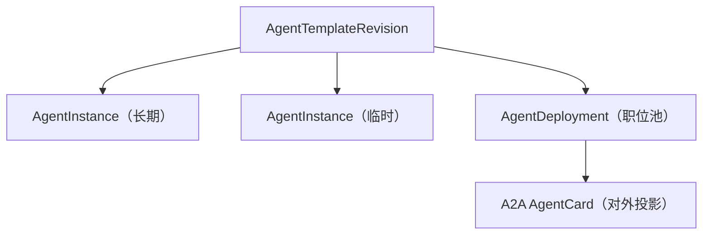
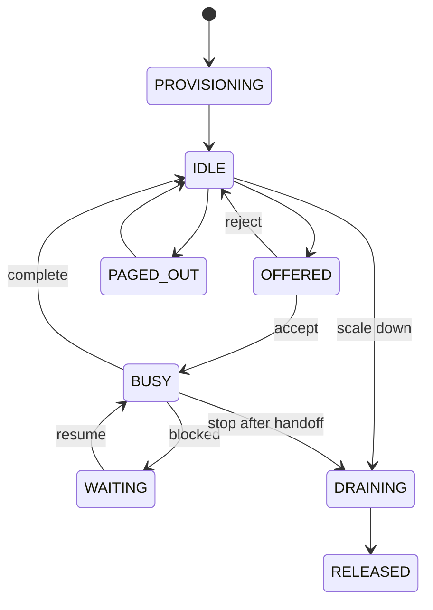

# 01_Agent 模板与实例

| 项目     | 内容                                                       |
| -------- | ---------------------------------------------------------- |
| 状态     | 目标设计；尚未建立运行实现                                 |
| 层级     | 最底层身份与能力定义                                       |
| 依赖     | 无；模型与账号目录属于共享 Core，见本文第 7 节             |
| 后续章节 | [02 消息聊天](./02_conversation-and-messaging.md)、[03 Agent Loop 与派发](./03_agent-loop-dispatch-and-execution.md) |

## 1. 两层模型

GraphAgent 把 Agent 分为两层：

1. **AgentTemplateRevision（职位模板）**：定义一类 Agent 的稳定职责、能力契约、行为边界、权限要求和实例化策略。模板以不可变修订发布。
2. **AgentInstance（员工实例）**：由模板创建的可寻址运行实体，拥有独立身份、记忆、邮箱、排班和生命周期。

同一模板可以创建多个正式或临时实例。实例满足相同的技能契约和模型最低要求，但可以有不同的经历、当前上下文和具体模型绑定。实例不是模板的副本，也不是一次任务尝试。



`AgentDeployment` 是基础设施绑定，不是第三种 Agent；它把一个模板或职位池投影为可访问服务。A2A 投影与远端导入见[06 外部对接](./06_workspace-and-integrations.md)。

## 2. 标识与地址

| 名称              | 含义                         | 可变性                     |
| ----------------- | ---------------------------- | -------------------------- |
| `templateId`      | 模板稳定标识                 | 不变                       |
| `templateVersion` | 对外语义版本                 | 新版本递增                 |
| `revisionId`      | 内部不可变修订标识           | 不变                       |
| `instanceId`      | 员工实例全局唯一地址         | 不变                       |
| `displayName`     | 员工可读名称                 | 有限可变                   |
| `deploymentId`    | 职位池部署标识               | 不变                       |
| `contextId`       | 一组关联 A2A 交互的上下文    | 不变                       |
| `taskId`          | 一项行动的标识               | 不变                       |

内部 URI 只用于 GraphAgent，不取代 A2A 服务 URL：

```text
template:  agent-template://{workspaceId}/{templateId}@{templateVersion}
revision:  agent-template-revision://{revisionId}
instance:  agent-instance://{workspaceId}/{instanceId}
```

## 3. AgentTemplateRevision

模板正文不可原地修改。修改职位定义时创建新 `revisionId`；兼容性或行为发生可观察变化时同时提升 `templateVersion`。已创建的实例固定引用原修订。

```typescript
interface AgentTemplateRevision {
  schemaVersion: "graph-agent/template/v1";
  templateId: string;
  templateVersion: string;
  revisionId: string;
  status: "draft" | "active" | "deprecated" | "disabled";

  a2aProfile: A2AProfile;
  identity: TemplateIdentity;
  skillContracts: Record<string, SkillContract>;

  modelPolicy: ModelPolicy;
  toolPolicy: ToolPolicy;
  delegationPolicy: DelegationPolicy;
  memoryPolicy: MemoryPolicy;
  contextPolicy: ContextPolicy;
  staffingPolicy: StaffingPolicy;
  securityPolicy: TemplateSecurityPolicy;

  labels?: Record<string, string>;
  createdAt: string;
  createdBy: PrincipalRef;
}
```

`status` 是目录可用性视图，与不可变正文分开存储。`disabled` 阻止新派单，不修改旧能力内容。

### 3.1 身份

```typescript
interface TemplateIdentity {
  jobTitle: string;
  mission: string;
  responsibilities: string[];
  boundaries: string[];
  identityInstructions: ContentRef[];
  behavioralTraits?: Record<string, string | number | boolean>;
  communicationStyle?: string;
}
```

`mission` 是职位的长期使命，不是当前 Goal。`boundaries` 描述必须拒绝或升级的工作。员工姓名、创建原因、当前上级和当前任务不属于模板身份。

### 3.2 技能契约

A2A `AgentSkill` 用于能力发现，不能表达输入结构、质量下限、副作用和执行约束。内部以相同 `skillId` 关联严格契约：

```typescript
interface SkillContract {
  skillId: string;
  inputSchema?: SchemaRef;
  outputSchema?: SchemaRef;
  artifactTypes?: string[];
  requiredTools?: string[];
  requiredKnowledge?: string[];
  sideEffect: "none" | "reversible" | "irreversible";
  idempotency: "required" | "supported" | "none";
  qualityFloor?: QualityRequirement;
  privacyClasses?: string[];
}
```

`skillContracts` 的键必须引用已声明的技能 ID。契约不直接塞入标准 A2A 技能对象；需要对外发布时使用扩展声明发现地址。

### 3.3 执行策略

模板声明能力范围与默认值，不保存 endpoint、凭据或具体执行器。

```typescript
interface ModelPolicy {
  requiredCapabilities: ModelCapabilityRequirement[];
  allowedProviders?: ProviderId[];
  allowedModels?: ModelRef[];
  minimumContextTokens?: number;
  privacyRequirement: "local" | "trusted" | "zero-retention" | "standard";
  supportsToolCalling?: boolean;
  supportsStructuredOutput?: boolean;
  defaultEffort?: "low" | "medium" | "high";
  fallbackPolicy?: "fail" | "degrade" | "queue" | "request-approval";
}

interface ToolPolicy {
  allowedTools: ToolRef[];
  deniedTools?: ToolRef[];
  toolProfiles?: Record<string, "read" | "write" | "admin">;
}

interface DelegationPolicy {
  mayDelegate: boolean;
  mayCreateInstances: boolean;
  allowedTemplateSelectors?: TemplateSelector[];
  maxDelegationDepth?: number;
  maxChildrenPerTask?: number;
  requireApprovalFor?: string[];
}

interface MemoryPolicy {
  instanceMemory: "disabled" | "ephemeral" | "persistent";
  assignmentMemory: "ephemeral" | "checkpointed";
  mayReadGoalWorkspace: boolean;
  mayWriteGoalWorkspace: boolean;
  promotionRequiresReview: boolean;
}

interface ContextPolicy {
  maxContextTokens?: number;
  compactionStrategy: "none" | "summary" | "artifact-first" | "custom";
  includeIdentityEveryTurn: boolean;
  includeBudgetSnapshot: boolean;
  contextBuilder: ComponentRef;
}

interface StaffingPolicy {
  minWarmInstances: number;
  maxInstances: number;
  maxConcurrentAssignmentsPerInstance: number;
  defaultSelection: InstanceSelectionStrategy;
  supportedSelections: InstanceSelectionStrategy[];
  defaultEmployment: "ephemeral" | "persistent";
  idleTtl?: Duration;
  maxAssignmentsPerEphemeralInstance?: number;
  releaseBehavior: "immediate" | "handoff-then-release" | "archive";
}
```

工具出现在 `allowedTools` 不表示实例自动拥有凭据。权限由系统、Workspace、模板、Goal 与 Assignment 的交集决定；实际执行见[04 工具执行](./04_tool-execution.md)。

## 4. AgentInstance

### 4.1 结构

```typescript
interface AgentInstance {
  schemaVersion: "graph-agent/instance/v1";
  instanceId: string;
  templateRef: {
    templateId: string;
    templateVersion: string;
    revisionId: string;
  };

  displayName: string;
  identitySeed: InstanceIdentitySeed;
  employment: Employment;
  state: AgentInstanceState;

  workspaceId: string;
  homeGoalId?: string;
  createdBy: PrincipalRef;
  spawnedByTaskId?: string;

  modelLease?: ModelLeaseSummary;
  permissionLeaseRefs: string[];
  memoryBindings: MemoryBinding[];
  mailboxRef: string;

  activeAssignmentIds: string[];
  queuedAssignmentIds: string[];
  usage: UsageSummary;

  createdAt: string;
  lastActiveAt?: string;
  expiresAt?: string;
  releasedAt?: string;
  releaseReason?: string;
}

interface InstanceIdentitySeed {
  selfName: string;
  selfDescription?: string;
  origin: {
    reason: string;
    creatorAgentId?: string;
    creatorTaskId?: string;
  };
  distinguishingTraits?: Record<string, string | number | boolean>;
  initialInstructions?: ContentRef[];
}
```

`ModelLeaseSummary` 只保存共享平台的选择结果与租约摘要，不保存 token、API Key 或请求头。实际调用的租约、预算预留和跨模型交接由[03 执行层](./03_agent-loop-dispatch-and-execution.md)持有。

### 4.2 身份块

每轮由运行时生成、不可由普通记忆覆盖的身份块至少包含：

- 自己是谁、引用哪个模板版本；
- 属于哪个 Workspace/Goal；
- 当前负责的 Assignment；
- 可委托、拒绝和访问的范围；
- 当前预算与排班状态。

模型生成的总结可以补充经验，但不得重写 `instanceId`、模板引用、权限或雇佣类型。

### 4.3 雇佣类型

```typescript
type Employment =
  | {
      kind: "ephemeral";
      releaseAfterAssignments: number;
      idleTtl?: Duration;
      memoryDisposition: "discard" | "summarize" | "archive";
    }
  | {
      kind: "persistent";
      scope: "goal" | "workspace";
      idlePolicy: "keep-warm" | "page-out";
    };
```

- 临时实例完成最后一个 Assignment 后进入 `DRAINING`，生成交接摘要后释放运行资源。
- 长期实例属于单个 Goal 或 Workspace，禁止跨租户共享私有记忆。
- `page-out` 只卸载运行资源，身份与记忆保留。
- 释放后的实例保留只读 `AgentRecord`，供执行图和审计查询。

### 4.4 生命周期

```typescript
type AgentInstanceState =
  | "PROVISIONING"
  | "IDLE"
  | "OFFERED"
  | "BUSY"
  | "WAITING"
  | "DRAINING"
  | "PAGED_OUT"
  | "RELEASED"
  | "FAILED";
```



`RELEASED` 是不可逆终态；`PAGED_OUT` 可以重新装载。实例状态不替代 Assignment 或 TaskAttempt 状态。

## 5. 用工请求与实例选择

Agent 不直接构造另一个 Agent，而是提交结构化用工请求：

```typescript
interface StaffingRequest {
  requestId: string;
  taskId: string;
  requestedByAgentId?: string;

  template?: TemplateSelector;
  requiredSkillIds?: string[];
  count: number;
  selection: InstanceSelectionStrategy;

  employment?: "ephemeral" | "persistent";
  independenceKey?: string;
  stickyInstanceId?: string;
  deadline?: string;
  budgetLeaseRequest?: BudgetLeaseRequest;
  securityContextRef: string;
}

interface StaffingDecision {
  requestId: string;
  state: "FULFILLED" | "PARTIAL" | "QUEUED" | "REJECTED";
  placements: Array<{
    instanceId: string;
    source: "REUSED" | "CREATED" | "PAGED_IN";
  }>;
  reason?: string;
  retryAfter?: string;
}
```

| 策略               | 语义                                                     |
| ------------------ | -------------------------------------------------------- |
| `sticky`           | 优先继续使用已经理解该任务或 `contextId` 的员工           |
| `least-loaded`     | 在符合条件的实例中选择负载最低者                          |
| `random`           | 在均质候选集中随机选择，降低固定选择偏差                  |
| `fresh`            | 强制创建没有既有实例记忆的新员工                          |
| `experienced`      | 按已批准的经验索引选择相似任务表现更好的员工              |
| `parallel-diverse` | 创建或选择多个隔离实例，独立完成后汇总                    |
| `isolated`         | 新实例不得读取共享经验，只能读取明确提供的任务输入        |

默认组合为 `sticky → least-loaded → create → queue`。随机和并行独立实例只用于明确需要观点多样性的任务。实际容量、预算与放置由[03 调度](./03_agent-loop-dispatch-and-execution.md)决定。

## 6. 不变量

1. `AgentTemplateRevision` 创建后不可原地修改，实例固定引用一个 `revisionId`。
2. `skillContracts` 的键必须引用已声明的技能 ID。
3. 模板与实例数据中不得出现明文凭据。
4. 实例模型绑定必须满足模板的 `ModelPolicy`。
5. 实例权限不得超过系统、Workspace、模板与当前 Assignment 权限的交集。
6. `RELEASED` 实例不能接受新 Assignment。
7. 临时实例释放前按策略生成交接摘要或明确丢弃记忆。
8. AgentCard 的 URL、协议绑定、安全方案和签名只由 Deployment 生成。
9. 外部 AgentSkill 默认是声明能力，不是可信证明。

## 7. 边界

- 模型、账号、provider、协议 route 与模型目录属于共享 Core，本文只声明 GraphAgent 自己的模板需求，不复制目录定义。
- 派单、任务图、调度、恢复与预算在[03](./03_agent-loop-dispatch-and-execution.md)。
- 私聊、群聊、通知与临时会话在[02](./02_conversation-and-messaging.md)。
- A2A AgentCard 投影、远端模板导入和管理界面在[06](./06_workspace-and-integrations.md)。
- 工具授权与执行在[04](./04_tool-execution.md)；记忆与技能版本在[05](./05_interception-memory-and-skills.md)。
