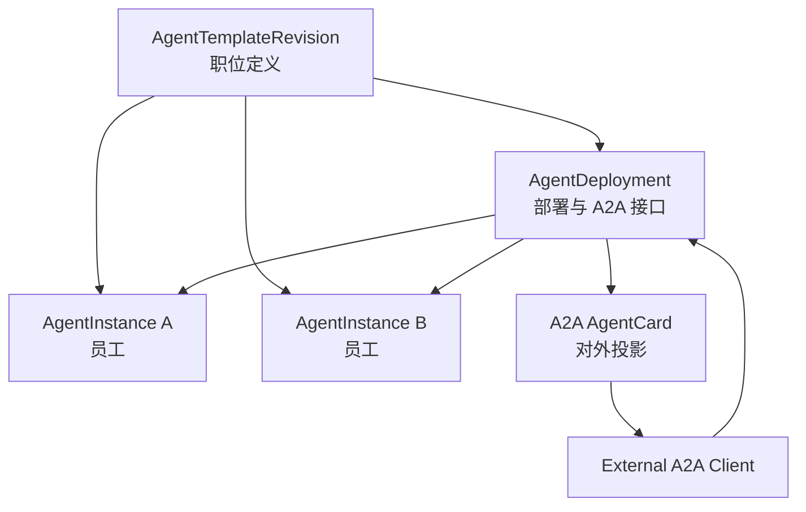
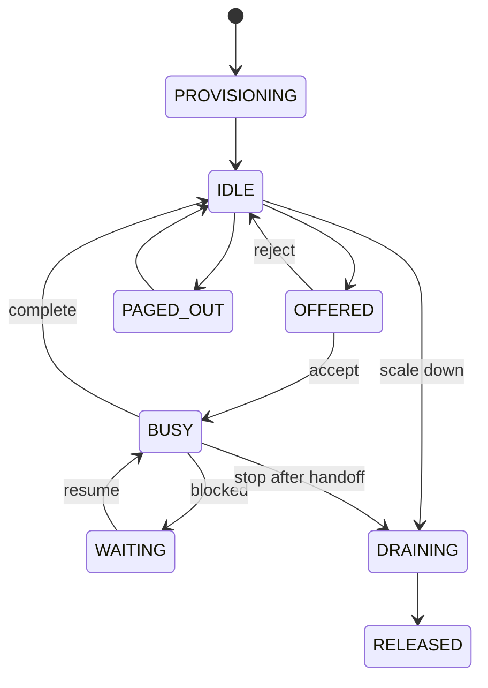
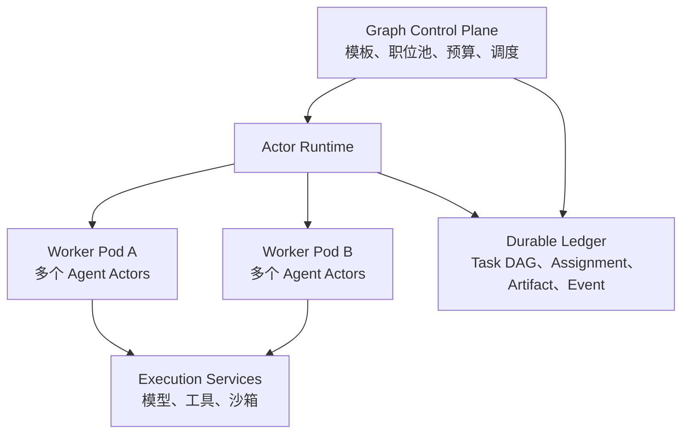

# Graph Agent：Agent 职位模板与实例模型设计

> 状态：Draft v0.2  
> 日期：2026-09-26  
> 范围：AgentTemplate、AgentInstance、初步运行架构，以及它们与 A2A AgentCard / AgentSkill / Task 的互操作边界  
> 非目标：本稿暂不完整设计任务图、调度算法、Policy Gate、预算系统和存储实现。

## 1. 目标

Graph Agent 将 Agent 分为两个业务层次：

1. **AgentTemplate（职位模板）**：定义一种 Agent 的稳定职责、能力契约、行为边界、权限要求和实例化策略。
2. **AgentInstance（Agent 实例/员工）**：由模板创建的可寻址运行实体，拥有独立身份、自我认知、上下文、记忆、邮箱、排班和生命周期。

同一模板可以同时创建多个正式或临时实例。实例在契约层面具有相同能力，但可以拥有不同经历、当前上下文和具体模型绑定。实例可以被复用、随机抽取、按负载选择、临时扩容或在任务完成后释放。

设计需要同时满足：

- 内部可以表达公司式的委托、拒绝、排队、转包和排班；
- 模板版本和实例身份可追踪、可重放；
- 运行资源释放后，历史执行主体仍可审计；
- 尽量复用 A2A 1.0 的名称、媒体类型、安全结构和任务交互模型；
- 可以导入外部 A2A Agent，也可以将内部职位池发布成标准 A2A Agent；
- 内部模型不被 A2A 当前的服务级抽象限制。

## 2. 规范基础与关键判断

A2A 1.0 的 `AgentCard` 是一个 Agent 服务的自描述清单，包含身份描述、访问接口、协议能力、技能、媒体类型和安全要求。`AgentSkill` 是偏发现用途的描述性能力，而不是严格的可执行契约。[A2A Agent Discovery Objects](https://a2a-protocol.org/latest/specification/#44-agent-discovery-objects)

A2A 的核心行动单元是 `Task`；交流使用 `Message`；正式输出使用 `Artifact`。规范明确建议不要使用 Message 交付任务结果。[A2A Messages and Artifacts](https://a2a-protocol.org/latest/specification/#37-messages-and-artifacts)

据此，本设计作出三个基础判断：

1. **AgentTemplate 不是 AgentCard。** 模板尚未部署时没有 URL、协议绑定和认证端点。
2. **AgentInstance 也不是 AgentCard。** 实例的私有记忆、工作状态和排班不应暴露为服务发现信息。
3. **默认由一个职位池发布一张 AgentCard。** 外部 A2A Task 进入职位池后，再由内部调度器选择或创建具体员工。

因此完整关系为：



`AgentDeployment` 是基础设施绑定，不是第三种 Agent。它负责把一个模板或职位池投影为可访问服务。

## 3. 术语与身份

| 名称 | 含义 | 是否可变 | 是否对外公开 |
| --- | --- | --- | --- |
| `templateId` | 职位模板的稳定标识 | 否 | 可选 |
| `templateVersion` | 对外语义版本，建议 SemVer | 新版本递增 | 是，映射到 AgentCard `version` |
| `revisionId` | 内部不可变修订标识 | 否 | 否 |
| `instanceId` | 员工实例的全局唯一地址 | 否 | 默认否 |
| `displayName` | 员工可读名称 | 有限可变 | 仅内部或授权视图 |
| `deploymentId` | 职位池的部署标识 | 否 | 否 |
| `contextId` | 一组关联 A2A 交互的上下文标识 | 否 | 是 |
| `taskId` | 一项行动的标识 | 否 | 是 |

推荐地址形式：

```text
template:  agent-template://{workspaceId}/{templateId}@{templateVersion}
revision:  agent-template-revision://{revisionId}
instance:  agent-instance://{workspaceId}/{instanceId}
```

这些是 Graph Agent 内部 URI，不取代 A2A 服务 URL。

## 4. AgentTemplateRevision

模板采用不可变修订。修改职位定义时创建新 `revisionId`；兼容性或行为发生可观察变化时，同时提升 `templateVersion`。已经创建的实例固定引用原修订，不随模板更新而静默变化。

### 4.1 顶层结构

以下为语言无关的结构表示；`?` 表示可选字段。

```typescript
interface AgentTemplateRevision {
  schemaVersion: "graph-agent/template/v1";

  templateId: string;
  templateVersion: string;
  revisionId: string;
  status: "draft" | "active" | "deprecated" | "disabled";

  // 可直接投影到 A2A AgentCard 的服务无关部分
  a2aProfile: A2AProfile;

  identity: TemplateIdentity;
  skillContracts: Record<string, SkillContract>;
  modelPolicy: ModelPolicy;
  toolPolicy: ToolPolicy;
  delegationPolicy: DelegationPolicy;
  memoryPolicy: MemoryPolicy;
  staffingPolicy: StaffingPolicy;
  securityPolicy: TemplateSecurityPolicy;
  contextPolicy: ContextPolicy;

  labels?: Record<string, string>;
  createdAt: string;
  createdBy: PrincipalRef;
}
```

### 4.2 A2AProfile

`A2AProfile` 尽可能保持 A2A 原字段名和含义，但有意排除属于部署的字段。

```typescript
interface A2AProfile {
  name: string;
  description: string;
  provider?: {
    organization: string;
    url: string;
  };
  documentationUrl?: string;

  defaultInputModes: string[];   // MIME types
  defaultOutputModes: string[];  // MIME types
  skills: AgentSkill[];

  iconUrl?: string;
}

interface AgentSkill {
  id: string;
  name: string;
  description: string;
  tags: string[];
  examples?: string[];
  inputModes?: string[];
  outputModes?: string[];
  securityRequirements?: SecurityRequirement[];
}
```

约束：

- `skills[].id` 在一个模板版本内唯一且稳定；
- `inputModes` 和 `outputModes` 使用标准 MIME type；
- 未设置技能级媒体类型时继承模板默认值；
- `description` 面向其他 Agent 的路由决策，不能只是市场宣传文字；
- 模板不得包含 API Key、Token 或其他凭据；
- `securityRequirements` 只声明需求，不保存认证材料。

A2A 1.0 的 `AgentSkill` 包含 `id/name/description/tags/examples/inputModes/outputModes/securityRequirements`，因此该部分可以直接序列化。[A2A AgentSkill](https://a2a-protocol.org/latest/specification/#445-agentskill)

### 4.3 TemplateIdentity

```typescript
interface TemplateIdentity {
  jobTitle: string;
  mission: string;
  responsibilities: string[];
  boundaries: string[];

  // 稳定的身份内核，不含具体任务目标
  identityInstructions: ContentRef[];
  behavioralTraits?: Record<string, string | number | boolean>;
  communicationStyle?: string;
}
```

设计规则：

- `mission` 是职位的长期使命，不是当前 Goal 或 Task；
- `responsibilities` 描述应该主动承担的工作；
- `boundaries` 描述必须拒绝或升级处理的工作；
- `identityInstructions` 只存内容引用或受版本控制的内联片段；
- 具体员工姓名、创建原因、当前上级和当前任务不属于模板身份。

CrewAI 的 `role / goal / backstory` 可作为身份描述参考，但本设计将其拆为职位、稳定使命和身份内核，并将具体任务目标移出模板。[CrewAI Agents](https://docs.crewai.com/en/concepts/agents)

### 4.4 SkillContract

A2A AgentSkill 主要用于能力发现，无法表达严格输入结构、质量下限、副作用和执行约束。本设计以相同 `skillId` 关联内部契约：

```typescript
interface SkillContract {
  skillId: string; // 必须引用 a2aProfile.skills[].id

  inputSchema?: SchemaRef;
  outputSchema?: SchemaRef;
  artifactTypes?: string[];
  requiredTools?: string[];
  requiredKnowledge?: string[];

  sideEffect: "none" | "reversible" | "irreversible";
  idempotency: "required" | "supported" | "none";
  qualityFloor?: QualityRequirement;
  privacyClasses?: string[];

  estimates?: {
    inputTokens?: Range;
    outputTokens?: Range;
    durationSeconds?: Range;
    toolCalls?: Range;
  };
}
```

`SkillContract` 不直接塞入标准 `AgentSkill`，以免外部 SDK 因未知字段或严格校验失败。需要对外发布时，通过 Graph Agent 扩展声明契约发现地址：

```json
{
  "uri": "urn:graph-agent:extension:skill-contract:v1",
  "description": "Machine-readable contracts for advertised A2A skills",
  "required": false,
  "params": {
    "discoveryPath": "/.well-known/graph-agent/skill-contracts"
  }
}
```

该扩展 URI 为当前项目的暂定 URN，公开发布前应确定稳定命名空间和版本策略。A2A 明确允许通过 URI 标识的扩展增加协议外能力。[A2A Extensions](https://a2a-protocol.org/latest/specification/#46-extensions)

### 4.5 模型策略

模板声明模型需求，不默认固定某个具体模型：

```typescript
interface ModelPolicy {
  requiredCapabilities: ModelCapabilityRequirement[];
  allowedProviders?: ProviderId[];
  deniedProviders?: ProviderId[];
  allowedModels?: ModelRef[];
  allowedApiProtocols?: ApiProtocolKind[];
  requiredOperations?: ProviderOperation[];

  minimumContextTokens?: number;
  minimumQualityTier?: string;
  privacyRequirement: "local" | "trusted" | "zero-retention" | "standard";
  supportsToolCalling?: boolean;
  supportsStructuredOutput?: boolean;
  modalities?: string[];

  defaultEffort?: "low" | "medium" | "high";
  fallbackPolicy?: "fail" | "degrade" | "queue" | "request-approval";
}
```

同模板实例的“能力相同”定义为满足相同 `SkillContract` 和 `ModelPolicy`。具体模型可以不同，但调度器不得绑定不满足最低契约的模型。

这里的 `ProviderId`、`ModelRef`、`ApiProtocolKind`、`ProviderOperation` 和 `ModelCapabilityRequirement` 来自共享 [Provider Platform 契约](../common/core/cross-provider-service-protocol-design.md)，不是 GraphAgent 自己维护的字符串目录。服务商、模型和 API 协议是三个独立维度：例如同一服务商可以同时提供 OpenAI Chat Completions 与 Responses route，Anthropic 或 Gemini 协议也不能仅凭模型名称推断。

`ModelPolicy` 只约束候选集合，不直接保存 endpoint、API Key 或具体 Executor。调度器先用共享模型目录过滤能力，再结合账号可用性、预算、隐私和运行区域产生 `ProviderRouteSelection`；协议 codec 和推理 facet 对该 selection 做最终可执行校验。

### 4.6 工具、委托和权限

```typescript
interface ToolPolicy {
  allowedTools: ToolRef[];
  deniedTools?: ToolRef[];
  toolProfiles?: Record<string, "read" | "write" | "admin">;
}

interface DelegationPolicy {
  mayDelegate: boolean;
  mayCreateInstances: boolean;
  allowedTemplateSelectors?: TemplateSelector[];
  maxDelegationDepth?: number;
  maxChildrenPerTask?: number;
  requireApprovalFor?: string[];
}

interface TemplateSecurityPolicy {
  clearance: string;
  allowedDataClasses: string[];
  deniedDataClasses?: string[];
  allowedExecutionZones: string[];
  requiredPolicyGates?: string[];
}
```

工具能力与授权必须分开：工具出现在 `allowedTools` 中，不表示任意实例自动拥有其凭据。实例只获得短期、范围受限的权限租约。

### 4.7 记忆与上下文策略

```typescript
interface MemoryPolicy {
  instanceMemory: "disabled" | "ephemeral" | "persistent";
  assignmentMemory: "ephemeral" | "checkpointed";
  mayReadGoalWorkspace: boolean;
  mayWriteGoalWorkspace: boolean;
  promotionRequiresReview: boolean;
  retention?: Duration;
}

interface ContextPolicy {
  maxContextTokens?: number;
  compactionStrategy: "none" | "summary" | "artifact-first" | "custom";
  includeIdentityEveryTurn: boolean;
  includeBudgetSnapshot: boolean;
  includeScheduleSnapshot: boolean;
  contextBuilder: ComponentRef;
}
```

记忆是持久数据；上下文是某次模型调用时由 `contextBuilder` 组装出的只读视图。不得将二者视为同一个对话数组。

### 4.8 StaffingPolicy

```typescript
interface StaffingPolicy {
  minWarmInstances: number;
  maxInstances: number;
  maxConcurrentAssignmentsPerInstance: number;

  defaultSelection: InstanceSelectionStrategy;
  supportedSelections: InstanceSelectionStrategy[];

  defaultEmployment: "ephemeral" | "persistent";
  idleTtl?: Duration;
  maxAssignmentsPerEphemeralInstance?: number;
  releaseBehavior: "immediate" | "handoff-then-release" | "archive";
}

type InstanceSelectionStrategy =
  | "sticky"
  | "least-loaded"
  | "random"
  | "fresh"
  | "experienced"
  | "parallel-diverse"
  | "isolated";
```

模板只声明允许范围和默认值。实际扩缩容由运行时结合任务预算、Worker 容量、Provider 限额和安全区域作出决定。

## 5. AgentInstance

### 5.1 实例结构

```typescript
interface AgentInstance {
  schemaVersion: "graph-agent/instance/v1";

  instanceId: string;
  templateRef: {
    templateId: string;
    templateVersion: string;
    revisionId: string;
  };

  displayName: string;
  identitySeed: InstanceIdentitySeed;
  employment: Employment;
  state: AgentInstanceState;

  workspaceId: string;
  homeGoalId?: string;
  createdBy: PrincipalRef;
  spawnedByTaskId?: string;

  modelLease?: ModelLease;
  permissionLeaseRefs: string[];
  memoryBindings: MemoryBinding[];
  mailboxRef: string;

  activeAssignmentIds: string[];
  queuedAssignmentIds: string[];
  usage: UsageSummary;

  createdAt: string;
  lastActiveAt?: string;
  expiresAt?: string;
  releasedAt?: string;
  releaseReason?: string;
}
```

`ModelLease` 的完整续租和故障转移协议暂缓，但它必须从一开始绑定共享平台的稳定选择：

```typescript
interface ModelLease {
  leaseId: string;
  selection: ProviderRouteSelection;
  modelCatalogRevision: string;
  implementationGeneration: string;
  budgetRef?: string;
  acquiredAt: string;
  expiresAt?: string;
}

interface ProviderRouteSelection {
  providerId: ProviderId;
  accountId: AccountId;
  modelId: ModelId;
  protocolRouteId: ProtocolRouteId;
}
```

租约建立后，一次模型调用必须固定到同一 provider、账号、模型、协议 route 和实现代次。目录刷新或注册表更新可以影响下一次选择，但不得把正在进行的流静默迁移。租约只保存凭据引用和选择结果，不保存 token、API Key 或请求头。

### 5.2 实例身份种子

```typescript
interface InstanceIdentitySeed {
  selfName: string;
  selfDescription?: string;
  origin: {
    reason: string;
    creatorAgentId?: string;
    creatorTaskId?: string;
  };
  distinguishingTraits?: Record<string, string | number | boolean>;
  initialInstructions?: ContentRef[];
}
```

实例每轮都应获得一个由运行时生成、不可由普通记忆覆盖的身份块，至少包含：

- 自己是谁；
- 引用哪个职位模板和版本；
- 属于哪个 Workspace/Goal；
- 当前负责什么；
- 可以委托、拒绝和访问什么；
- 当前预算和排班状态。

模型生成的总结可以补充实例经验，但不得重写 `instanceId`、模板引用、权限或雇佣类型。

### 5.3 雇佣类型

```typescript
type Employment =
  | {
      kind: "ephemeral";
      releaseAfterAssignments: number;
      idleTtl?: Duration;
      memoryDisposition: "discard" | "summarize" | "archive";
    }
  | {
      kind: "persistent";
      scope: "goal" | "workspace";
      idlePolicy: "keep-warm" | "page-out";
    };
```

默认建议：

- 临时工完成最后一个 Assignment 后进入 `DRAINING`，生成交接摘要，再释放运行资源；
- 长期员工只能属于单个 Goal 或 Workspace，禁止跨租户共享私有记忆；
- `page-out` 只卸载运行资源，实例身份和记忆仍保留；
- 释放后的实例保留只读 `AgentRecord`，供执行图和审计查询。

### 5.4 生命周期

```typescript
type AgentInstanceState =
  | "PROVISIONING"
  | "IDLE"
  | "OFFERED"
  | "BUSY"
  | "WAITING"
  | "DRAINING"
  | "PAGED_OUT"
  | "RELEASED"
  | "FAILED";
```



`RELEASED` 是不可逆终态；`PAGED_OUT` 可以重新装载。

## 6. 招聘与实例选择协议

Agent 不直接构造另一个 Agent 对象，而是提交结构化用工请求：

```typescript
interface StaffingRequest {
  requestId: string;
  taskId: string;
  requestedByAgentId?: string;

  template?: TemplateSelector;
  requiredSkillIds?: string[];
  count: number;
  selection: InstanceSelectionStrategy;

  employment?: "ephemeral" | "persistent";
  independenceKey?: string;
  stickyInstanceId?: string;
  deadline?: string;
  budgetLeaseRequest?: BudgetLeaseRequest;
  securityContextRef: string;
}

interface StaffingDecision {
  requestId: string;
  state: "FULFILLED" | "PARTIAL" | "QUEUED" | "REJECTED";
  placements: Array<{
    instanceId: string;
    source: "REUSED" | "CREATED" | "PAGED_IN";
  }>;
  reason?: string;
  retryAfter?: string;
}
```

选择语义：

| 策略 | 语义 |
| --- | --- |
| `sticky` | 优先继续使用已经理解该任务或 `contextId` 的员工 |
| `least-loaded` | 在符合条件的实例中选择当前负载最低者 |
| `random` | 在均质候选集中随机选择，用于降低固定选择偏差 |
| `fresh` | 强制创建没有既有实例记忆的新员工 |
| `experienced` | 按被批准的经验索引选择相似任务表现更好的员工 |
| `parallel-diverse` | 创建或选择多个相互隔离的实例，独立完成后汇总 |
| `isolated` | 新实例不得读取共享经验，只能读取明确提供的任务输入 |

`random` 不能成为有状态员工池的无条件默认值。默认建议使用 `sticky → least-loaded → create → queue` 的组合策略；只有任务明确需要观点多样性时使用随机或并行独立实例。

## 7. 与 A2A 的投影

### 7.1 AgentDeployment

```typescript
interface AgentDeployment {
  deploymentId: string;
  templateRevisionId: string;

  supportedInterfaces: AgentInterface[];
  capabilities: AgentCapabilities;
  securitySchemes?: Record<string, SecurityScheme>;
  securityRequirements?: SecurityRequirement[];

  poolRef: string;
  enabled: boolean;
}
```

A2A `AgentInterface` 原样使用：

```typescript
interface AgentInterface {
  url: string;
  protocolBinding: "JSONRPC" | "GRPC" | "HTTP+JSON" | string;
  protocolVersion: string;
  tenant?: string;
}
```

A2A 允许同一 Agent 通过多个 URL、传输绑定和协议版本暴露等价功能，接口数组首项为首选项。[A2A AgentInterface](https://a2a-protocol.org/latest/specification/#446-agentinterface)

### 7.2 生成 AgentCard

发布时执行确定性投影：

```text
AgentTemplateRevision.a2aProfile
+ AgentDeployment.supportedInterfaces
+ AgentDeployment.capabilities
+ AgentDeployment.securitySchemes/securityRequirements
= unsigned AgentCard
→ canonicalize
→ optional JWS signatures
→ published AgentCard
```

映射规则：

| AgentCard 字段 | 来源 |
| --- | --- |
| `name` | `a2aProfile.name` |
| `description` | `a2aProfile.description` |
| `version` | `templateVersion` |
| `provider` | `a2aProfile.provider` |
| `documentationUrl` | `a2aProfile.documentationUrl` |
| `supportedInterfaces` | `AgentDeployment.supportedInterfaces` |
| `capabilities` | 部署能力及 Graph Agent 扩展声明 |
| `securitySchemes` | `AgentDeployment.securitySchemes` |
| `securityRequirements` | 部署要求与技能要求的有效组合 |
| `defaultInputModes` | `a2aProfile.defaultInputModes` |
| `defaultOutputModes` | `a2aProfile.defaultOutputModes` |
| `skills` | `a2aProfile.skills` |
| `signatures` | 发布阶段生成，不能从旧卡复制 |
| `iconUrl` | `a2aProfile.iconUrl` |

### 7.3 对外请求如何选中实例

默认情况下，外部 A2A Client 只寻址职位池，不寻址某位员工：

1. Client 根据 AgentCard 选择 Agent 服务；
2. Client 发送 Message，服务创建或关联 A2A Task；
3. Graph Agent 生成内部 StaffingRequest；
4. 调度器复用或创建 AgentInstance；
5. 实例执行任务，结果以 A2A Artifact 返回。

`contextId` 用于交互连续性。部署可以在内部维持 `contextId → instanceId` 的软亲和关系，但不能把 `contextId` 等同于员工身份，因为一个上下文中可以包含多个 Task，也可能发生员工交接。

确需指定同一员工时，可以协商可选扩展：

```json
{
  "uri": "urn:graph-agent:extension:instance-affinity:v1",
  "required": false,
  "params": {
    "modes": ["prefer", "require", "avoid"]
  }
}
```

实例 ID 应放在扩展定义的 Message `metadata` 中，且只对授权调用方开放。普通 A2A Client 不理解该扩展时，职位池仍可正常工作。

### 7.4 A2A Task 与内部任务的关系

| 内部概念 | A2A 表示 |
| --- | --- |
| 外部委托 | Client `Message` |
| 可执行工作项 | `Task` |
| 工作对话 | `Task.history` 中选择性持久化的 `Message` |
| 正式交付物 | `Artifact` |
| 关联会话 | `contextId` |
| 关联其他任务 | `Message.referenceTaskIds` |
| 自定义图信息 | 扩展 URI + `metadata` |

内部任务状态到 A2A 状态的建议映射：

| 内部状态 | A2A TaskState |
| --- | --- |
| `CREATED/OFFERED/QUEUED/WAITING_DEPENDENCY` | `TASK_STATE_SUBMITTED` |
| `ACCEPTED/WORKING/REVIEWING/HANDING_OFF` | `TASK_STATE_WORKING` |
| `BLOCKED_INPUT` | `TASK_STATE_INPUT_REQUIRED` |
| `BLOCKED_AUTH` | `TASK_STATE_AUTH_REQUIRED` |
| `COMPLETED` | `TASK_STATE_COMPLETED` |
| `FAILED` | `TASK_STATE_FAILED` |
| `CANCELED` | `TASK_STATE_CANCELED` |
| `REJECTED` | `TASK_STATE_REJECTED` |

A2A 1.0 已原生支持 submitted、working、completed、failed、canceled、input-required、rejected 和 auth-required，足以表达外部粗粒度状态；排队、依赖等待和交接细节保留在 Graph Agent 内部。[A2A TaskState](https://a2a-protocol.org/latest/specification/#413-taskstate)

### 7.5 Message 的角色语义

A2A Message 的 `ROLE_USER` 和 `ROLE_AGENT` 表示客户端/服务端方向，不是 Graph Agent 中的员工职位。Agent A 委托远端 Agent B 时：

- A 在该 A2A 连接上是 Client，因此发送 `ROLE_USER`；
- B 服务返回 `ROLE_AGENT`；
- A、B 的内部 `instanceId` 通过本地事件或协商扩展记录，不能由 `role` 推断。

### 7.6 Artifact

实例完成任务后，正式结果必须进入 Artifact：

```typescript
interface Artifact {
  artifactId: string;
  name?: string;
  description?: string;
  parts: Part[];
  metadata?: Record<string, unknown>;
  extensions?: string[];
}
```

Graph Agent 内部 Artifact 可以拥有更丰富的血缘、敏感等级和版本信息；对外投影时通过 `Part.text/raw/url/data` 传递内容，并通过扩展携带可公开的血缘信息。敏感内容不能仅因为存在 URL 就自动对外暴露。

## 8. 导入外部 A2A Agent

外部 AgentCard 可以导入为一种受限模板：

```text
AgentCard
→ RemoteAgentTemplate
→ 一个或多个 RemoteAgentInstance/connection lease
```

导入规则：

- 原样保留 AgentCard、协议版本、签名和获取时间；
- `skills` 只视为对方声明的能力，不自动视为已验证能力；
- 本地可添加信任评分、健康状态和观察到的质量，但不得改写原卡；
- 没有 Graph Agent SkillContract 扩展时，根据 AgentSkill 生成宽松契约，并标记 `unverified`；
- 远端 Agent 的实例生命周期可能不可见，本地 `RemoteAgentInstance` 只表示连接、会话或租约，不声称等同于对方内部员工；
- 认证材料由本地凭据系统管理，AgentCard 只保存安全方案描述。

## 9. 示例

### 9.1 安全审查员模板

```yaml
schemaVersion: graph-agent/template/v1
templateId: outbound-security-reviewer
templateVersion: 1.0.0
revisionId: atr_01K_SECURITY_V1
status: active

a2aProfile:
  name: Outbound Security Reviewer
  description: Reviews information before it is sent to external model providers.
  defaultInputModes: [application/json, text/plain]
  defaultOutputModes: [application/json]
  skills:
    - id: review-outbound-content
      name: Review outbound content
      description: Detects secrets and private data and returns an approved or redacted payload.
      tags: [security, privacy, redaction, dlp]
      inputModes: [application/json, text/plain]
      outputModes: [application/json]

identity:
  jobTitle: Sensitive Information Review Officer
  mission: Prevent unauthorized disclosure while preserving useful task context.
  responsibilities:
    - Review content before an external provider boundary.
    - Redact or block content according to active policy.
  boundaries:
    - Never send unreviewed sensitive content to a remote model.
    - Never reveal stored credentials in explanations or audit logs.
  identityInstructions:
    - uri: prompt://security-reviewer/identity@1

skillContracts:
  review-outbound-content:
    skillId: review-outbound-content
    inputSchema: { uri: schema://security/outbound-review-input@1 }
    outputSchema: { uri: schema://security/outbound-review-result@1 }
    artifactTypes: [application/vnd.graph-agent.policy-decision+json]
    sideEffect: none
    idempotency: required
    privacyClasses: [secret, personal, confidential]

modelPolicy:
  requiredCapabilities: [structured-output]
  allowedProviders: [local]
  privacyRequirement: local
  supportsStructuredOutput: true
  defaultEffort: medium
  fallbackPolicy: fail

delegationPolicy:
  mayDelegate: false
  mayCreateInstances: false

memoryPolicy:
  instanceMemory: ephemeral
  assignmentMemory: checkpointed
  mayReadGoalWorkspace: false
  mayWriteGoalWorkspace: false
  promotionRequiresReview: true

staffingPolicy:
  minWarmInstances: 1
  maxInstances: 8
  maxConcurrentAssignmentsPerInstance: 1
  defaultSelection: least-loaded
  supportedSelections: [least-loaded, random, fresh, isolated]
  defaultEmployment: ephemeral
  idleTtl: PT10M
  maxAssignmentsPerEphemeralInstance: 20
  releaseBehavior: handoff-then-release
```

### 9.2 由模板创建的临时实例

```yaml
schemaVersion: graph-agent/instance/v1
instanceId: ai_01K_REVIEWER_07
templateRef:
  templateId: outbound-security-reviewer
  templateVersion: 1.0.0
  revisionId: atr_01K_SECURITY_V1
displayName: Reviewer 07
identitySeed:
  selfName: Reviewer 07
  selfDescription: I am the isolated outbound reviewer for this goal.
  origin:
    reason: Provider-boundary review capacity was required.
    creatorAgentId: ai_01K_COORDINATOR
    creatorTaskId: task_01K_PREPARE_REQUEST
employment:
  kind: ephemeral
  releaseAfterAssignments: 1
  memoryDisposition: summarize
state: BUSY
workspaceId: ws_example
homeGoalId: goal_01K_EXAMPLE
spawnedByTaskId: task_01K_PREPARE_REQUEST
permissionLeaseRefs: [permlease_01K_REVIEW_ONLY]
memoryBindings:
  - namespace: memory://goal_01K_EXAMPLE/reviewer_07
    access: private
    retention: PT1H
mailboxRef: mailbox://ai_01K_REVIEWER_07
activeAssignmentIds: [assignment_01K_REVIEW]
queuedAssignmentIds: []
usage:
  inputTokens: 0
  outputTokens: 0
  toolCalls: 0
createdAt: 2026-09-09T00:00:00Z
```

## 10. 校验规则

实现至少应强制以下不变量：

1. `AgentTemplateRevision` 创建后不可原地修改。
2. 一个实例固定引用一个 `revisionId`。
3. `skillContracts` 的键必须引用已声明的 `AgentSkill.id`。
4. 模板和实例数据中不得出现明文凭据。
5. 实例模型绑定必须满足模板的 ModelPolicy。
6. 实例权限不得超过模板权限与当前 Assignment 权限的交集。
7. `RELEASED` 实例不能接受新 Assignment。
8. 临时实例释放前按策略生成交接摘要或明确丢弃记忆。
9. AgentCard 的 URL、协议绑定、安全方案和签名只由 Deployment 生成。
10. 未协商扩展的 A2A Client 必须仍能使用标准 AgentCard 和 Task API。
11. A2A Message 不作为正式任务结果的唯一载体；结果必须形成 Artifact。
12. 外部 AgentSkill 默认是声明能力，不是可信证明。

## 11. 暂缓决定的问题

以下问题留给后续设计阶段：

- Workspace 长期员工的经验如何晋升为共享职位知识；
- `experienced` 选择所依赖的绩效指标和偏差控制；
- 多个实例共同负责一个 Task 时的署名、责任和 Artifact 合并规则；
- 是否将实例亲和、预算声明、图依赖和 Policy Gate 分别注册为 A2A 扩展；
- 外部 A2A 服务是否可信地支持实例亲和，及如何验证；
- 模板兼容性等级和实例热迁移协议；
- AgentInstance 的邮箱是否采用 Actor 顺序处理、可配置并发，或 Assignment 级隔离。

## 12. 实现架构方向：Kubernetes 式控制面与 Actor Runtime

当前业务模型天然适合组合两类成熟架构思想：

- 使用 **Kubernetes 风格的声明式控制面**管理职位池的期望状态、资源请求、放置约束、弹性扩缩容和实例回收；
- 使用 **Virtual Actor Runtime** 实现员工实例的稳定身份、邮箱、私有状态、按需激活和位置透明。

二者不应合并成同一个抽象：控制面决定“需要多少员工、放在哪里、分配多少资源”，Actor Runtime 负责“员工是谁、如何收件以及如何保持状态”。

### 12.1 概念映射

| Graph Agent | Kubernetes 类比 | Actor 类比 |
| --- | --- | --- |
| `AgentTemplateRevision` | Pod Template | Actor Type / Factory |
| `AgentDeployment` | Deployment | Actor Service |
| `StaffingPolicy` | ReplicaSet / HPA 策略 | 激活和回收策略 |
| `AgentInstance` | 逻辑上的 Pod | 具有稳定 ID 的 Actor |
| `StaffingRequest` | 调度请求 | 获取或激活 Actor |
| Assignment 邮箱 | 工作负载入口 | Actor Mailbox |
| `DRAINING` | Terminating + preStop | 停止接单并保存状态 |
| `PAGED_OUT` | 缩容后保留持久状态 | Virtual Actor Deactivation |
| Workspace / Goal | Namespace | Actor 状态作用域 |
| Budget | ResourceQuota | Actor 调用配额 |

该映射只是语义参考。`AgentInstance` 不应与 Kubernetes Pod 一一对应。大部分 Agent 在等待模型 API、工具或其他 Agent，单个实例通常不值得独占进程或容器。

推荐部署关系：



Kubernetes 负责调度真正消耗资源的 Worker、本地模型、浏览器和执行沙箱；一个 Worker Pod 可以承载大量轻量 AgentInstance Actor。

### 12.2 声明式实例需求

实例或 StaffingRequest 可以携带类似 PodSpec 的领域资源要求：

```yaml
templateRef: security-reviewer@1.0.0

resources:
  tokenBudget: 20000
  costBudget: 0.20
  maxConcurrentAssignments: 1
  localCpu: 500m
  localMemory: 512Mi

placement:
  required:
    trustZone: local
    dataRegion: workspace
    structuredOutput: true
  preferred:
    - sameGoal: true
    - warmModel: local-dlp
  antiAffinity:
    independenceGroup: review-round-1

lifecycle:
  employment: ephemeral
  idleTtl: 10m
  releaseBehavior: handoff-then-release
```

这里的 Resource 不限于 CPU 和内存，还包括：

- 输入、输出和缓存 Token；
- 金额或平台额度；
- Provider 滚动限额；
- 上下文窗口；
- 最大并发 Assignment；
- 工具调用次数；
- 截止时间；
- 数据地域、隐私级别和可信执行区域。

控制器通过 reconcile loop 维护期望状态：

```text
期望职位池状态
  → 检查现有实例和 Worker 容量
  → 复用、激活、新建、排队或拒绝
  → 持续观察负载、预算和健康状态
  → 扩容、Drain、Page-out 或 Release
```

### 12.3 Agent 领域的亲和性

除常规节点和资源亲和性外，Agent 调度需要以下领域约束：

| 类型 | 作用 |
| --- | --- |
| `instanceAffinity` | 优先继续使用已经理解当前任务的员工 |
| `goalAffinity` | 靠近已缓存 Goal 上下文的 Worker |
| `artifactAffinity` | 靠近大文件、代码仓库或本地数据库 |
| `providerAffinity` | 优先使用有可用额度、缓存或低延迟的模型通道 |
| `trustZoneAffinity` | 将敏感任务限制在本地或可信执行区 |
| `templateAffinity` | 将经常交互的职位放入相近运行环境 |
| `independenceAntiAffinity` | 隔离并行评审者的记忆、模型会话和中间答案 |

`independenceAntiAffinity` 不只是性能策略，也是结果可信度约束。例如三个独立验证 Agent 不得因共享上下文而失去独立性。

亲和性应分为：

- `required`：不满足就不能放置；
- `preferred`：参与调度评分，无法满足时允许降级；
- `antiAffinity`：禁止或尽量避免共享指定资源或信息域。

### 12.4 AgentInstance 作为 Virtual Actor

AgentInstance 所需的稳定地址、私有状态、邮箱、按需激活、故障恢复和位置透明与 Virtual Actor 高度吻合。

以 .NET/Orleans 风格接口为例：

```csharp
public interface IAgentGrain : IGrainWithStringKey
{
    Task<OfferResult> OfferAsync(AssignmentOffer offer);
    Task AcceptAsync(AssignmentId assignmentId);
    Task RejectAsync(AssignmentId assignmentId, string reason);
    Task<AgentSnapshot> GetStatusAsync();
    Task BeginDrainAsync(DrainReason reason);
}
```

模板对应 Actor 类型或实例工厂配置，`instanceId` 对应 Actor Key。实例未激活时，Runtime 可以按需从持久状态恢复。

但 Actor State 不是完整系统事实来源：

- Actor 保存便于决策的当前状态和私有记忆指针；
- Task DAG、Assignment、Artifact、预算流水和审计事件进入 Durable Ledger；
- Actor 损坏或重新激活时，可以从持久记录恢复或重新构建工作视图。

因此不能只依靠 Grain State 保存整个执行图。

### 12.5 多来源派单与邮箱并发

多个 Agent 可以同时向同一个实例发送 Assignment Offer：

```text
Agent A ─┐
Agent B ─┼─→ AgentInstance Mailbox → 接受 / 拒绝 / 排队 / 反报价
Agent C ─┘
```

Actor 邮箱负责顺序更新实例的身份、负载、队列和预算承诺。不过长时间执行不能持续占用邮箱处理循环。推荐分为两个阶段：

1. Actor 快速处理 Offer，原子更新 Assignment 队列并返回决策；
2. 被接受的长任务交给可取消的 Execution/Activity；
3. 执行进度以事件回写 Actor 和 Durable Ledger；
4. Actor 仍可处理新派单、优先级修改、暂停和取消命令。

是否允许同一员工同时执行多个 Assignment，由模板字段 `maxConcurrentAssignmentsPerInstance` 决定。默认值建议为 `1`；只有任务之间不存在共享可变上下文时才提高并发。

应避免依赖 Actor Reentrancy 来解决长任务阻塞，因为它会弱化实例状态的顺序一致性，并使预算预留和取消处理更难推理。

### 12.6 三类图保持分离

采用 Actor Runtime 后，必须避免将通信拓扑误认为用户任务图：

| 图 | 内容 | 主要受众 |
| --- | --- | --- |
| Task Graph | 任务依赖、尝试、审查和产物关系 | 用户与业务逻辑 |
| Workforce Graph | 委托关系、Assignment 和负责人 | 用户与调度器 |
| Runtime Topology | Actor 激活位置、Worker 和执行服务 | 运维系统 |

实例从 Worker A 迁移到 Worker B 不应改变 Task Graph；两个 Agent 交换消息，也不必自动产生任务节点。

### 12.7 Policy Gate 的位置

Policy Gate 不能只实现为 Agent Actor 内部逻辑，否则消息或敏感内容可能在进入 Actor 前已经越过安全边界。拦截至少需要覆盖：

- Control Plane 接收 StaffingRequest 和 AssignmentOffer 前；
- Actor Runtime 投递跨实例消息前后；
- Context Builder 读取记忆和 Artifact 时；
- Execution Worker 调用模型、工具和外部 A2A 服务前后；
- Artifact 发布到 Durable Ledger 或用户界面之前。

Actor 可以担任需要语义判断的审查员，但确定性安全规则仍由运行时强制执行。

### 12.8 可移植性边界

业务接口不应直接依赖 Kubernetes API：

- 本地单进程模式使用内存 Scheduler 和本地 Actor Runtime；
- 单机与分布式模式保持相同的 Template、Instance、Staffing 和 Assignment 契约；
- Kubernetes Adapter 只负责 Worker 扩缩容、节点放置、沙箱和本地模型资源；
- Actor Runtime Adapter 负责实例激活、邮箱、状态和位置透明；
- Durable Ledger 独立于两者，保证历史图和审计记录不随运行时迁移丢失。

初步结论是：**Kubernetes 调度思想 + Virtual Actor Runtime 是当前业务模型最匹配的实现方向，但二者都只是可替换的运行适配器，而不是领域模型本身。**

## 13. 下一阶段建议

下一份设计应聚焦 **Assignment 与 Staffing 协议**，具体回答：

1. 一个 Agent 如何向另一个职位池正式发出任务邀请；
2. 员工如何接受、拒绝、反报价、排队或转包；
3. 多个上游同时向同一员工派单时如何排序；
4. 一个任务由多个员工共同执行时如何形成 DAG 和 Artifact；
5. 用户插入、修改或叫停任务时，Assignment 状态如何变化。

在启动 GraphAgent 的模型执行代码前，还必须先完成共享 Provider Platform 迁移计划的“推理骨架”阶段：固定 protocol route、模型目录、codec registry、规范流事件和 `ModelLease` contract suite。它不阻塞 Assignment 领域设计，但不能推迟到具体供应商接入之后再补。

## 参考资料

- [AstraConductor 跨服务商服务协议设计](../common/core/cross-provider-service-protocol-design.md)
- [A2A Protocol 1.0 Specification](https://a2a-protocol.org/latest/specification/)
- [AutoGen Agent Identity and Lifecycle](https://microsoft.github.io/autogen/stable/user-guide/core-user-guide/core-concepts/agent-identity-and-lifecycle.html)
- [CrewAI Agents](https://docs.crewai.com/en/concepts/agents)
- [Google ADK: Simple agents with LlmAgent](https://google.github.io/adk-docs/agents/llm-agents/)
- [OpenAI Agents SDK: Agents](https://openai.github.io/openai-agents-python/agents/)
