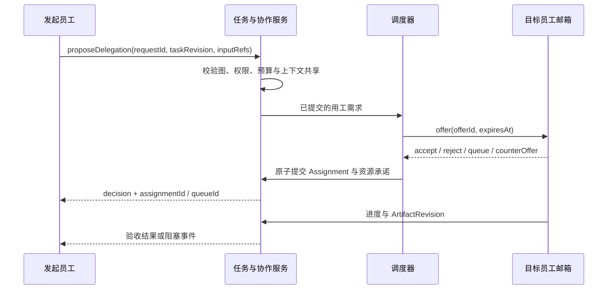

# GraphAgent 任务图与 Assignment 设计

| 项目     | 内容                                                                                              |
| -------- | ------------------------------------------------------------------------------------------------- |
| 状态     | 启动设计草案                                                                                      |
| 更新日期 | 2026-10-04                                                                                        |
| 依赖     | [总览](./design.md)、[模板与实例](./01agent-template.md)、[运行时](./03runtime-and-scheduling.md) |

## 1. 目标与对象

任务图表达“为了用户目标需要交付什么、依赖什么、由谁负责、执行到哪里”。图允许动态分叉、多个上游合流、独立评审和有限返工。通信图、员工关系图和运行部署拓扑不充当任务依赖图。

候选记录的最小内容：

| 对象              | 关键字段与规则                                                                                     |
| ----------------- | -------------------------------------------------------------------------------------------------- |
| Goal              | `goalId`、`workspaceId`、用户请求引用、验收条件、预算引用、状态、revision                          |
| Task              | `taskId`、`goalId`、当前要求版本、当前尝试、交付责任人、revision                                   |
| TaskRevision      | `taskRevisionId`、说明、输入 ArtifactRevision 引用、交付契约、授权范围、截止时间、修改来源；不可变 |
| TaskAttempt       | `attemptId`、`taskRevisionId`、轮次、状态、当前 Assignment 引用、结果引用、失败原因                |
| Assignment        | `assignmentId`、`attemptId`、`instanceId`、职责、派单来源、状态、预算与权限引用、revision          |
| GraphEdge         | `edgeId`、两端 TaskRevision/Attempt 引用、关系类别、依赖条件、创建来源                             |
| DelegationRequest | `requestId`、发起者、目标职位/实例、任务版本、输入、期望产物、预算请求、上下文共享范围             |

`Assignment` 是 TaskAttempt 内的一份职责，不是任务本身。一个尝试可以包含主执行、独立验证和汇总职责；有独立产物和依赖的工作应创建子 Task。实例的生命周期状态不替代 Assignment 状态。

Goal 状态采用 `ACTIVE / PAUSING / PAUSED / COMPLETED / FAILED / CANCELING / CANCELED`。等待用户或配额时 Goal 可以保持 ACTIVE 并显示阻塞原因；只有整体暂停已完成才进入 PAUSED。失败与完成均由目标验收规则决定，单个子任务失败不会直接终结整个 Goal。

## 2. 图关系与依赖语义

| 关系                | 是否参与就绪判定 | 语义                                   |
| ------------------- | ---------------- | -------------------------------------- |
| `depends-on`        | 是               | 消费上游指定版本的验收产物             |
| `delegates-to`      | 按声明决定       | 展示派单来源；需要结果时另声明依赖条件 |
| `reviews`           | 是               | 评审任务的验收决定是否发布被评产物     |
| `supersedes`        | 否               | 新要求或新轮次取代旧版本，保留血缘     |
| `communicates-with` | 否               | 点对点讨论或提醒，不阻塞任务           |

首版默认依赖条件为 `all-success`。可配置 `all-settled` 用于总结成功和失败，或 `any-success` 用于候选竞争；`any-success` 必须先校验获胜产物，再禁止新启动无用候选。已运行候选按原授权自然收尾，主动停止由用户在应用内执行；Agent 不能以选出获胜者为由取消其他在运行的职责。已产生的工具效果和消耗保留。

依赖绑定具体输入版本。上游后来生成新产物不会自动替换下游已读取的内容；通过显式 rebase 命令生成下游新 TaskRevision。多个来源引用同一产物可以复用只读版本，不允许共享可变上下文。

图修改以 `expectedGraphRevision` 提交，原子校验归属、权限、引用、依赖闭环和预算。校验失败不保留半张图。运行中节点新增前置条件时，应先进入安全边界、创建新要求版本，再恢复调度；不能把已开始的执行标记成“尚未开始”。

## 3. 派单与协作协议

- **接受**：确认固定版本、角色、预算和权限。offer 过期、重复提交或容量变化时由版本检查拒绝。
- **作业消息策略**：接受并启动时可分别屏蔽群消息/私聊，固定 JobMessagePolicy；屏蔽包含 `@`，至 TaskAttempt 终态后才统一释放为 queue。任务控制、工具结果和审批不受普通会话屏蔽影响。
- **拒绝**：给出结构化原因，如职责不符、权限不足、预算不足、容量不足；发起者可以修改条件或选其他职位。
- **排队**：记录 queueId、原因、优先级、截止时间和取消入口。排队不等同于已占用员工与模型槽。
- **反报价**：提出更长时间、更多预算、不同技能或更窄范围；不自动修改用户预算和验收条件。
- **转包**：创建新的 DelegationRequest，保留原责任链、授权交集和预算来源。原交付责任人继续负责验收，除非明确执行责任转移。

首版反报价由确定性约束和员工建议共同表达，不做无限协商。每个邀请有协商次数和有效期；到期返回可解释拒绝或排队。

## 4. 多来源派单与共同执行

多个上游可以同时向同一员工提交不同任务。每项邀请、Assignment、上下文和预算独立，由邮箱串行处理承诺，实际执行按调度规则排队。普通聊天提醒不自动授权创建新工作。

多个上游需要同一项工作时，默认创建各自 Task。只有输入版本、交付契约、权限和截止约束相容，且参与者显式同意，才建立共享 Task；共享 Task 固定一个责任人，各方成为请求者或消费者。新增请求者不能扩大共享任务已授权的数据范围。

共享工作统一由 Goal 预算承担消费；消费者可分摊展示，但 UsageEntry 只记一次。首版只允许同一 Goal 内共享 Task，跨 Goal/Workspace 的实时共同任务暂缓，跨目标只复用经过授权的产物。

多员工共同执行采用三种明确形式：

1. 分工形成子 Task，各自产物进入汇总 Task；
2. 同一输入下独立并行尝试，禁止读取对方中间答案，由验证 Task 选择或合并；
3. 同一尝试中的受限辅助 Assignment，只写独立区域，主负责人完成交付。

没有定义合并规则时，不允许多个 Assignment 同时覆写最终 Artifact。文件写入冲突由[工具执行模块](./04interceptor-and-tool-execution.md)仲裁。

## 5. 生命周期

TaskAttempt 使用以下状态；WAITING/BLOCKED 的原因是独立字段，避免为每种资源组合增加状态：

| 状态                   | 进入条件                                  | 后续路径                                                |
| ---------------------- | ----------------------------------------- | ------------------------------------------------------- |
| `CREATED`              | 固定工作版本，尚未就绪                    | WAITING、READY、CANCELED                                |
| `WAITING`              | 前置产物、队列、配额或交接条件未满足      | READY、PAUSED、FAILED、CANCELED                         |
| `READY`                | 依赖满足，等待可执行 Assignment           | WORKING、WAITING、PAUSED、CANCELED                      |
| `WORKING`              | 至少一个有效执行 Assignment 已启动        | WAITING、BLOCKED、REVIEWING、PAUSING、FAILED、CANCELING |
| `BLOCKED`              | 必须获得用户输入、授权或外部结果核对      | READY、WORKING、PAUSED、FAILED、CANCELED                |
| `REVIEWING`            | 产物暂存，等待验收                        | COMPLETED、FAILED、PAUSING、CANCELING                   |
| `PAUSING / PAUSED`     | 请求暂停 / 已到达可恢复边界               | 恢复到依赖与资源重新校验后的状态                        |
| `CANCELING / CANCELED` | 请求终止 / 所有活动已结算或未知效果已登记 | CANCELED 为终态                                         |
| `COMPLETED / FAILED`   | 通过验收 / 本次尝试无法完成               | 为终态；继续工作创建新尝试                              |

Assignment 使用 `OFFERED / QUEUED / ACCEPTED / WORKING / WAITING / HANDING_OFF / PAUSING / PAUSED / COMPLETED / FAILED / CANCELING / CANCELED / REJECTED / EXPIRED`。`ACCEPTED` 表示职责承诺已提交，`WORKING` 表示执行已开始。交接结算后，旧 Assignment 以 COMPLETED 结束并记录 `outcome=handed-off`；这不会令整个尝试自动完成。

Task 的当前状态由当前有效尝试投影，历史尝试保留各自终态。总图状态不靠“所有节点都是绿色”推断，Goal 需满足显式验收条件和未解决事项规则。

## 6. 可控循环与死锁

依赖图中禁止直接添加 A → B → A。评审失败要求返工时创建 `attempt/round n+1`，引用前一轮产物与失败原因，再执行下一轮；展示可折叠为循环组，实际执行保持展开后的 DAG。

循环策略至少指定最大轮次、时间/预算上限、退出验收和无进展判定。到达上限进入 BLOCKED 或失败，不让员工通过重建 taskId 绕开 Goal 的累计轮次与预算限制。

运行等待可能仍产生死锁，例如两个单并发员工各自等待对方接单。调度器维护 Assignment 等待关系，检测闭环；等待子任务时释放模型/Worker 活动槽，在允许时调度独立 Assignment。若仍受身份隔离或资源锁限制，拒绝形成闭环的派单或要求重新分工。

## 7. 用户干预

挂起、恢复和主动停止仅由用户经应用内管理能力发起；Agent 可以发送追加消息或提出调整建议，但不能使用工具、平台命令或图修改间接执行这三项管理操作。普通 interrupt 仅打断模型工作段，验收完成/失败是正常任务生命周期，均不等同于主动停止。

| 操作               | 生效语义                                                                                            |
| ------------------ | --------------------------------------------------------------------------------------------------- |
| 追加消息           | 用户或获准员工可直达任意 subagent；按 interrupt/queue/steer 投递到明确上下文，记录 accepted/applied |
| 修改要求           | 创建 TaskRevision；旧活动暂停或取消后创建新尝试，受影响下游重新确认输入                             |
| 暂停节点并临时聊天 | 冻结原工作 Loop，保留命令与资源；同一员工切换到独立临时上下文，不自动通知父员工或取消子工作         |
| 停止节点           | 取消该尝试的职责；先展示独占后继、共享消费者和在途副作用的影响                                      |
| 加派员工           | 创建辅助/独立验证 Task 或 Assignment，重新校验预算与写入范围                                        |
| 改负责人           | 执行交接，不转移旧模型原生会话和旧权限租约                                                          |
| 插入审查           | 给尚未穿过边界的操作绑定新拦截策略；不宣称已发出的数据被追回                                        |

取消传播依据工作所有权和结果依赖，不能只按 spawn 父子树。独占且无其他消费者的子工作可随父任务取消；共享工作只移除该请求者，仍有有效消费者时继续运行。明确全图停止时取消该 Goal 内所有活动。

私聊与群聊是通信关系，不因 `@`、全体消息或临时聊天自动增加 depends-on。群聊参与者分别绑定执行上下文，普通讨论不伪造 Assignment；真正委托仍走第 3 节派单协议。挂起是本地执行状态，父员工不会自动收到阻塞/终态通知，依赖仍等待原结果；挂起后的临时处理及恢复见[会话模型设计](./09conversation-and-messaging.md)。

COMPLETED 只可由验收服务提交。用户决定接受不完整结果时，要保留接受范围和未完成清单，不能把未知工具效果伪装成成功。

## 8. 交付物与验收

ArtifactRevision 包含类型、内容引用、生产 Assignment/Attempt、输入版本、敏感等级、验证记录和内容摘要。流式草稿可供观察，但默认下游只消费已验收版本；允许早期消费时标记 provisional，并承担上游失败后的失效处理。

验收按 SkillContract 和 TaskRevision 执行结构、证据与质量检查。评审结果是 `accept / reject / needs-input`，附可定位的问题。员工自报完成只是提交候选产物；失败结果可以作为 all-settled 的正式失败产物。

## 9. 验收场景与待定项

- 一个入口分成两个独立工作，再合流与评审；任一失败可重试，不重做另一已验收分支。
- 两个员工同时给同一员工派单，不丢邀请、不混上下文、不重复预留容量。
- 重复 requestId 只形成一份派单；过期邀请不能被迟到接受。
- 共享消费者之一取消后，其他消费者仍取得结果；Goal 总消费不重复计费。
- 改要求后旧响应迟到，不能完成新版本；新下游不会读取旧产物。
- 返工超过上限与运行等待闭环均有明确诊断。

任务状态与 A2A 状态的对外投影继续由部署适配器负责。新增 PAUSED、WAITING、UNKNOWN 等内部原因不得直接伪装成 A2A 新枚举；暂停期间没有终态就不发布 completed/canceled。A2A 发布和远端恢复在后续互操作阶段验证。

待定：独立验证的默认合并策略、质量评分、跨 Goal 共享工作和详细 Task/Assignment schema。以上不会改变单一责任人、版本化输入和消费归因规则。
