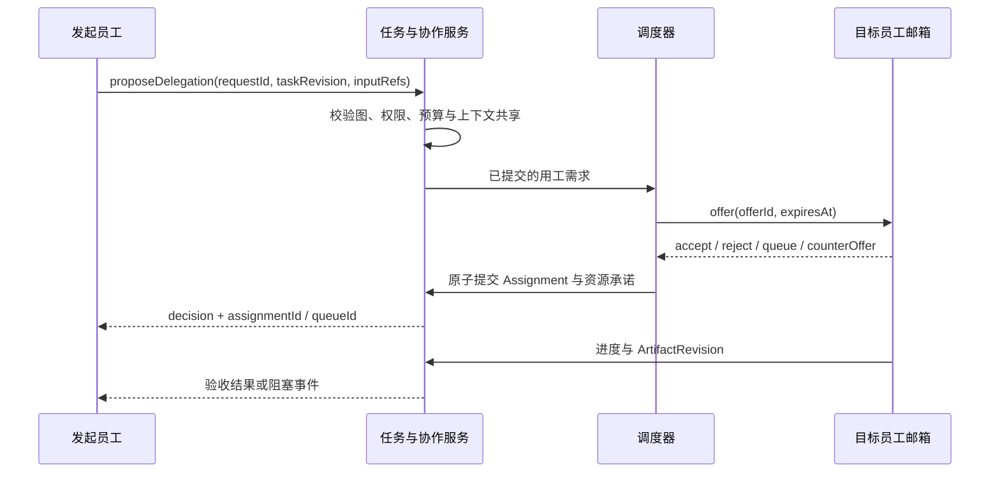
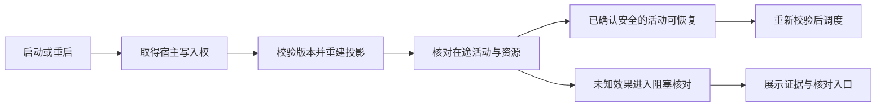
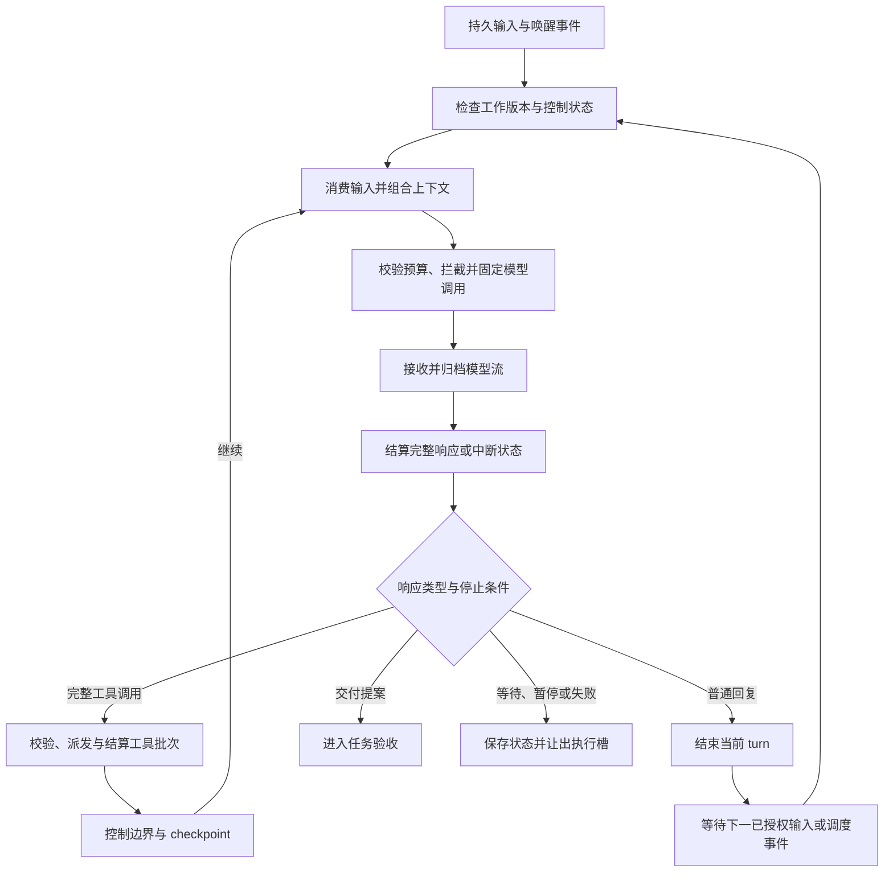

# 03_Agent Loop、派发与任务执行

| 项目     | 内容                                                           |
| -------- | -------------------------------------------------------------- |
| 状态     | 目标设计；尚未建立运行实现                                     |
| 层级     | 第 3 层：任务图、调度、执行循环与提示组合                      |
| 依赖     | [01 模板与实例](./01_agent-template-and-instance.md)、[02 消息聊天](./02_conversation-and-messaging.md) |
| 后续章节 | [04 工具执行](./04_tool-execution.md)、[05 拦截与记忆](./05_interception-memory-and-skills.md) |

## 1. 执行层次

| 层次               | 定义                                   | 结束含义                                                |
| ------------------ | -------------------------------------- | ------------------------------------------------------- |
| Goal / TaskAttempt | 目标和一次工作尝试的业务生命周期       | 由任务与验收模块决定，不由模型 `finish reason` 决定     |
| Assignment         | 一个员工承担的一项职责                 | 可工作、等待、暂停、交接或结束，不等于整个 Goal 结束    |
| AssignmentLoop     | 一个执行上下文的可恢复执行             | 私聊、群聊参与者和临时聊天也可以拥有独立 Loop           |
| Turn               | 一个已接受输入批次触发的响应/工作段    | 无工具回复、显式让出或阻塞可以结束 turn                 |
| Step               | 一次完整模型响应及其工具批次结算       | 下一 step 消费工具结果和允许追加的输入                  |
| CallAttempt        | step 内的一次真实 provider 调用        | 重试使用新 callId，分别记录费用与失败                   |

子任务返工轮次、模型 step 次数和 provider 重试次数分别计量。员工可以连续承担不同 Assignment，但每项工作拥有独立 `LoopPosition`、对话视图、待处理工具与上下文快照。Loop 不直接改任务图、凭据、文件记忆或预算数据库；这些操作通过应用服务与内置工具完成。

## 2. 任务图与 Assignment

### 2.1 对象

| 对象              | 关键字段与规则                                                                 |
| ----------------- | ------------------------------------------------------------------------------ |
| Goal              | `goalId`、用户请求引用、验收条件、预算引用、状态、revision                     |
| Task              | `taskId`、`goalId`、当前要求版本、当前尝试、交付责任人、revision               |
| TaskRevision      | 说明、输入产物引用、交付契约、授权范围、截止时间、修改来源；不可变             |
| TaskAttempt       | `attemptId`、`taskRevisionId`、轮次、状态、当前 Assignment、结果、失败原因      |
| Assignment        | `assignmentId`、`attemptId`、`instanceId`、职责、派单来源、状态、预算与权限引用 |
| GraphEdge         | 两端 TaskRevision/Attempt 引用、关系类别、依赖条件、创建来源                   |
| DelegationRequest | 发起者、目标职位/实例、任务版本、输入、期望产物、预算请求、上下文共享范围      |

`Assignment` 是 TaskAttempt 内的一份职责，不是任务本身。一个尝试可以包含主执行、独立验证和汇总职责；有独立产物和依赖的工作应创建子 Task。实例生命周期状态不替代 Assignment 状态。

Goal 状态采用 `ACTIVE / PAUSING / PAUSED / COMPLETED / FAILED / CANCELING / CANCELED`。等待用户或配额时 Goal 可以保持 ACTIVE 并显示阻塞原因；只有整体暂停完成才进入 PAUSED。单个子任务失败不会直接终结整个 Goal。

### 2.2 图关系

| 关系                | 参与就绪判定 | 语义                                   |
| ------------------- | ------------ | -------------------------------------- |
| `depends-on`        | 是           | 消费上游指定版本的验收产物             |
| `delegates-to`      | 按声明决定   | 展示派单来源；需要结果时另声明依赖条件 |
| `reviews`           | 是           | 评审决定是否发布被评产物               |
| `supersedes`        | 否           | 新要求或新轮次取代旧版本，保留血缘     |
| `communicates-with` | 否           | 点对点讨论或提醒，不阻塞任务           |

首版默认依赖条件为 `all-success`。可配置 `all-settled` 汇总成功和失败，或 `any-success` 用于候选竞争；`any-success` 必须先校验获胜产物，再禁止新启动无用候选。已运行候选按原授权自然收尾，Agent 不能以选出获胜者为由取消其他正在运行的职责。

依赖绑定具体输入版本。上游后来生成新产物不会自动替换下游已读取的内容；通过显式 rebase 命令生成下游新 TaskRevision。多个来源引用同一产物可以复用只读版本，不允许共享可变上下文。

图修改以 `expectedGraphRevision` 提交，原子校验归属、权限、引用、依赖闭环和预算。校验失败不保留半张图。运行中节点新增前置条件时，应先进入安全边界、创建新要求版本，再恢复调度。

### 2.3 派单协议



- **接受**：确认固定版本、角色、预算和权限。offer 过期、重复提交或容量变化时由版本检查拒绝。
- **拒绝**：给出结构化原因，如职责不符、权限不足、预算不足、容量不足。
- **排队**：记录 queueId、原因、优先级、截止时间和取消入口。排队不等同于已占用员工与模型槽。
- **反报价**：提出更长时间、更多预算、不同技能或更窄范围；不自动修改用户预算和验收条件。
- **转包**：创建新的 DelegationRequest，保留原责任链、授权交集和预算来源。原交付责任人继续负责验收，除非明确执行责任转移。

每个邀请有协商次数和有效期；到期返回可解释拒绝或排队。首版不做无限协商。

### 2.4 多来源与共同执行

多个上游可以同时向同一员工提交不同任务。每项邀请、Assignment、上下文和预算独立，由邮箱串行处理承诺，实际执行按调度规则排队。普通聊天提醒不自动授权创建新工作。

多个上游需要同一项工作时，默认创建各自 Task。只有输入版本、交付契约、权限和截止约束相容，且参与者显式同意，才建立共享 Task；共享 Task 固定一个责任人，各方成为请求者或消费者。新增请求者不能扩大已授权的数据范围。首版只允许同一 Goal 内共享 Task，跨 Goal 只复用经过授权的产物。

共同执行采用三种明确形式：

1. 分工形成子 Task，各自产物进入汇总 Task；
2. 同一输入下独立并行尝试，禁止读取对方中间答案，由验证 Task 选择或合并；
3. 同一尝试中的受限辅助 Assignment，只写独立区域，主负责人完成交付。

没有定义合并规则时，不允许多个 Assignment 同时覆写最终 Artifact。文件写入冲突由[04 工具执行](./04_tool-execution.md)仲裁。

### 2.5 生命周期

| 状态                   | 进入条件                             | 后续路径                                                |
| ---------------------- | ------------------------------------ | ------------------------------------------------------- |
| `CREATED`              | 固定工作版本，尚未就绪               | WAITING、READY、CANCELED                                |
| `WAITING`              | 前置产物、队列、配额或交接未满足     | READY、PAUSED、FAILED、CANCELED                         |
| `READY`                | 依赖满足，等待可执行 Assignment      | WORKING、WAITING、PAUSED、CANCELED                      |
| `WORKING`              | 至少一个有效执行 Assignment 已启动    | WAITING、BLOCKED、REVIEWING、PAUSING、FAILED、CANCELING |
| `BLOCKED`              | 需要用户输入、授权或外部结果核对     | READY、WORKING、PAUSED、FAILED、CANCELED                |
| `REVIEWING`            | 产物暂存，等待验收                   | COMPLETED、FAILED、PAUSING、CANCELING                   |
| `PAUSING / PAUSED`     | 请求暂停 / 已到达可恢复边界          | 恢复到依赖与资源重新校验后的状态                        |
| `CANCELING / CANCELED` | 请求终止 / 所有活动已结算            | CANCELED 为终态                                         |
| `COMPLETED / FAILED`   | 通过验收 / 本次尝试无法完成          | 终态；继续工作创建新尝试                                |

Assignment 使用 `OFFERED / QUEUED / ACCEPTED / WORKING / WAITING / HANDING_OFF / PAUSING / PAUSED / COMPLETED / FAILED / CANCELING / CANCELED / REJECTED / EXPIRED`。`ACCEPTED` 表示职责承诺已提交，`WORKING` 表示执行已开始。交接结算后旧 Assignment 以 COMPLETED 结束并记录 `outcome=handed-off`，不令整个尝试自动完成。

### 2.6 循环与死锁

禁止直接添加 A → B → A。评审失败要求返工时创建 `attempt/round n+1`，引用前一轮产物与失败原因。展示可折叠为循环组，实际执行保持展开后的 DAG。

循环策略至少指定最大轮次、时间/预算上限、退出验收和无进展判定。到达上限进入 BLOCKED 或失败，员工不能通过重建 taskId 绕开 Goal 的累计轮次与预算限制。

运行等待可能产生死锁，例如两个单并发员工各自等待对方接单。调度器维护 Assignment 等待关系并检测闭环；等待子任务时释放模型/Worker 活动槽，在允许时调度独立 Assignment。仍受身份隔离或资源锁限制时，拒绝形成闭环的派单或要求重新分工。

### 2.7 用户干预

挂起、恢复和主动停止只由用户经应用内管理能力发起，对 Agent 工具和消息平台不可见。其余干预通过受校验命令完成：

| 操作               | 生效语义                                                                     |
| ------------------ | ---------------------------------------------------------------------------- |
| 追加消息           | 直达任意 subagent；按 interrupt/queue/steer 投递并记录 accepted/applied      |
| 修改要求           | 创建 TaskRevision；旧活动暂停或取消后创建新尝试，受影响下游重新确认输入       |
| 暂停节点并临时聊天 | 冻结原工作 Loop，保留命令与资源；同一员工切换到独立临时上下文                |
| 停止节点           | 取消该尝试的职责；先展示独占后继、共享消费者和在途副作用影响                 |
| 加派员工           | 创建辅助/独立验证 Task 或 Assignment，重新校验预算与写入范围                 |
| 改负责人           | 执行交接，不转移旧模型原生会话和旧权限租约                                   |
| 插入审查           | 给尚未穿过边界的操作绑定新拦截策略；不宣称已发出的数据被追回                 |

取消传播依据工作所有权和结果依赖，不能只按 spawn 父子树。独占且无其他消费者的子工作可随父任务取消；共享工作只移除该请求者，仍有有效消费者时继续运行。明确全图停止时取消该 Goal 内所有活动。

聊天关系不因 `@`、全体消息或临时聊天自动增加 depends-on。挂起和临时聊天的交互细节见[02](./02_conversation-and-messaging.md)。

### 2.8 产物与验收

ArtifactRevision 包含类型、内容引用、生产 Assignment/Attempt、输入版本、敏感等级、验证记录和内容摘要。流式草稿可供观察，默认下游只消费已验收版本；允许早期消费时标记 provisional，并承担上游失败后的失效处理。

验收按 SkillContract 和 TaskRevision 执行结构、证据与质量检查。评审结果是 `accept / reject / needs-input`，附可定位的问题。员工自报完成只是提交候选产物；失败结果可以作为 `all-settled` 的正式失败产物。COMPLETED 只可由验收服务提交。

## 3. 运行时与调度

### 3.1 控制面与执行面

控制面维护模板修订、职位池、期望实例数、用工需求、任务就绪条件、预算与放置约束。执行面维护实例邮箱、短期活动、模型流和工具进程。领域状态写入 Durable Ledger，查询投影供 UI 与调度使用。

首个实现采用本机单宿主、单写入者、多逻辑实例；需要隔离的命令、浏览器或工具在受控执行进程中运行。Virtual Actor 只是稳定实例身份与顺序状态更新的语义，不要求独占线程、进程、容器或特定 Actor 框架。

| 组件                | 负责                                      | 不负责                     |
| ------------------- | ----------------------------------------- | -------------------------- |
| GraphCoordinator    | 图提交、就绪判定、验收、取消影响          | 直接执行工具               |
| WorkforceController | 期望池容量、激活、Drain、回收             | 生成模型内容               |
| Scheduler           | 过滤候选、排序、资源预留、Assignment 放置 | 修改模板职责与用户预算     |
| AgentMailbox        | 顺序处理邀请、输入、控制与活动回报        | 持续阻塞等待模型           |
| ActivityRunner      | 一次模型轮次或工具批次、取消、进度        | 独立决定任务终态           |
| Ledger / Projection | 提交事实、版本校验、重建查询视图          | 从事件回放再次调用外部系统 |

### 3.2 邮箱、Activity 与执行上下文

邮箱命令带 `messageId / commandId`、发起主体、Assignment 目标与期望版本。接受时持久化，投递可重试且按 ID 去重。每个实例的状态转移串行执行；模型调用和工具批次作为 Activity 异步执行，结果带 `activityId / attemptId / executionEpoch` 回写。

控制消息优先进入短控制队列，在下一个安全边界生效；普通输入按 accepted/applied 序号保持顺序。活动必须让出邮箱，等待子任务只保留工作状态，不占用模型槽。

默认同时一个推进中的模型 Loop。工作、群聊参与者和临时聊天使用独立 ExecutionContext；工作挂起后，临时 Loop 可取得执行槽，原命令与打开资源继续存活。可并行模板必须声明上下文隔离、工具资源范围和最大并发；共享可变历史的两个工作不能同时执行。

身份块由运行时构建：姓名与来源、模板职责、当前 Goal/Assignment、可读写范围、授权、预算、可派单职位与时间信息。实例 ID、模板修订和权限不由模型修改。

安全边界包括模型请求发出前、完整模型响应提交后、工具调用派发前、工具批次结算后和产物发布前。正在传输的流可以请求 abort；已经执行的工具必须根据能力确认效果，不能把 abort 信号当作撤销。

### 3.3 调度顺序与亲和

一次调度依次执行：

1. 检查任务版本、依赖产物和取消/暂停标记；
2. 过滤技能契约、模板修订、信任区域、授权、可用模型能力与硬预算；
3. 过滤实例并发、Worker/工具容量、账号并发及活动限额；
4. 在可行集合内采用 `sticky → least-loaded → create → queue`，需要独立验证时应用反亲和；
5. 原子预留预算、实例执行槽和必要资源，固定 Assignment；
6. 启动前再次检查运行 epoch、授权与实际工具/模型条件。

`random/fresh/isolated` 是请求明确指定且模板允许的选择策略。`experienced` 在有可追踪历史之前不参与首版评分。硬约束不满足不能通过优先级或成本偏好绕过。

队列排序先处理必须生效的控制命令；普通任务结合用户优先级、截止时间和等待年龄，使用老化避免长期饥饿。每个 Workspace/Goal 有队列与并发上限；超载时明确拒绝或排队，不能无限创建实例。排队保留工作预算分配，但不长时间占用调用预留和执行槽。

亲和条件：

| 类型                       | 作用                                             |
| -------------------------- | ------------------------------------------------ |
| `instanceAffinity`         | 优先继续使用已理解当前任务的员工                 |
| `goalAffinity`             | 靠近已缓存 Goal 上下文的 Worker                  |
| `artifactAffinity`         | 靠近大文件、代码仓库或本地数据库                 |
| `providerAffinity`         | 优先使用有额度、缓存或低延迟的模型通道           |
| `trustZoneAffinity`        | 将敏感任务限制在本地或可信执行区                 |
| `templateAffinity`         | 将经常交互的职位放入相近运行环境                 |
| `independenceAntiAffinity` | 隔离并行评审者的记忆、模型会话和中间答案         |

亲和性分 `required`（不满足不能放置）、`preferred`（参与评分，可降级）和 `antiAffinity`（禁止或尽量避免共享资源）。`independenceAntiAffinity` 不只是性能策略，也是结果可信度约束。

### 3.4 持久记录与恢复

Ledger 不绑定具体存储引擎，但至少提供：按 Goal 的有序事件、对象 revision、原子事务、持久命令收件箱、outbox、活动效果记录和 checkpoint。预算预留、Assignment 承诺与派发意图在同一事务中提交；如果后续分存储，需要等价的协调协议。

业务事件记录身份、目标、来源、版本、关联调用和内容引用。大正文进入受控内容存储，公开事件只含脱敏投影；原生会话状态另行保护。UI delta 可降频，但任务终态、审批、产物和结算事件必须持久化且有序。

Checkpoint 至少包含：任务要求版本、尝试与 epoch、模板版本、已应用输入位置、已消费产物、对话/压缩版本、待处理 tool-call ID、效果账本位置、预算结算位置、恢复建议与阻塞原因。



每次执行者恢复递增执行 epoch，旧 epoch 的迟到回报保留诊断但不能推进新执行；其合法在途效果仍按原 activity/effect 记录核对和结算。单写入者锁与 epoch 防止同时两次激活；失去租约的执行器必须停止发起新副作用，提交时校验 fencing token。外部工具无法支持 fencing 时，不自动切换执行者重做在途操作。

### 3.5 外部操作恢复分类

| 类别         | 例子                     | 恢复规则                                           |
| ------------ | ------------------------ | -------------------------------------------------- |
| 无外部效果   | 本地计算、只读查询       | 可重新调用，仍记录新 activity 与消费               |
| 可幂等效果   | 带幂等键的写入           | 使用同一效果键查询或重试，校验输入摘要             |
| 可核对效果   | 写文件、生成远端产物     | 先核对内容/版本，再决定是否继续                    |
| 不可核对效果 | 未支持查询的发送或提交   | 标记 UNKNOWN，用户或受控核对任务确认后继续         |
| 模型流中断   | 已输出部分文本或工具参数 | 不执行不完整 tool-call；结算已知用量，恢复为新调用 |

TaskAttempt 的 UNKNOWN 效果表现为 BLOCKED 的原因，不新增一个可被误读为完成的状态。审批已获得也不能授权重复未知效果。

### 3.6 暂停、交接与取消

暂停冻结目标工作 Loop 的新模型调用、工具派发、发布和自动续跑，保存 checkpoint 与 SuspensionFrame。派发闸门封闭、模型调用已结算后即可提交 PAUSED；已运行命令、浏览器与打开资源继续存活，效果与费用可在后台结算。

暂停不自动向父员工发送消息，不取消子工作；主动查询和 UI 投影仍显示真实状态。恢复需校验工作版本、授权、资源结果与预算，未核对效果保持阻塞。

取消额外撤销未执行派单和可释放预留，按能力取消/核对已启动效果，保留已发生消费与产物，并撤销 SuspensionFrame 的恢复资格。交接仍需核对和转移资源责任，不能用挂起完成信号代替交接完成。

交接顺序：停止旧 Assignment 接新工作 → 到安全边界 → 核对效果账本 → 生成事实摘要与产物引用 → 提交交接记录 → 重新取得模型/权限/预算租约 → 新 Assignment 启动。摘要失败时至少保留机械生成的事实清单和未解决事项。

关闭宿主时先停止接新命令和新活动，再 Drain、保存、结算、提交状态，最后释放事件订阅与宿主资源。异常退出在重启时显示 interrupted/recovering 原因，不把全部 WORKING 直接改成失败。

### 3.7 跨设备多客户端派发

目标设计中，控制面与执行面可以分离：一个 Workspace 仍保持单写入者 Ledger，多个设备作为 Worker 提供执行槽、工具宿主和本机资源。派发时在原有过滤条件上增加设备位置、资源亲和、在线状态和租约容量；Assignment 在指定设备上取得可取消 Activity 租约，结果按原有 activity/effect 账本回写。

- 跨设备只移动执行，不复制任务事实；设备丢失按在途效果分类核对，不能自动在另一设备重做未知副作用。
- 模型选择、预算预留和亲和策略在控制面统一计算，Worker 不能自行扩大权限或预算。
- 设备离线时任务进入等待或重新放置；已派发调用的取消与结果以租约和 epoch 判定。
- 外部客户端（A2A、Codex/Claude Code 等）只通过受控服务接入，不直接写 Ledger，见[06](./06_workspace-and-integrations.md)。

首版本机闭环不要求实现跨设备调度；该能力属于阶段 3.3。

## 4. Agent Loop

### 4.1 正常执行路径



1. **Admit**：校验 ExecutionContext、LoopOwner、executionEpoch、推进闸门、模板与 profile；工作所有权另验 Assignment/TaskRevision，讨论另验会话成员与 binding。无有效输入或恢复工作时不空调用模型。
2. **Claim**：从持久邮箱取得一个 next-turn 输入批次，原子登记 turnId 和已领取输入 ID。领取后输入仍可从 turn 记录恢复。
3. **Compose**：在安全步骤边界接纳 next-step 输入，取得当前对话视图、任务、工具能力、记忆/技能与环境快照，按 recipe 形成规范请求。先确定可行候选 route 及能力，不开始网络调用。
4. **Prepare**：内容拦截与 schema 校验后重新估算最终输入，预留调用预算，使用共享平台固定 selection、实现代次和目录 revision。记录实际发出的上下文。
5. **Stream**：记录 callId、片段序号、原生状态与 usage；UI progress 不推进任务状态。工具参数增量只用于观察，不立即执行。
6. **Settle**：先持久化完整响应或明确中断结果，再决定是否执行工具。结束原因、用量、响应 ID 和错误保留真实值。
7. **Dispatch**：完整 tool-call 经 schema、当前授权、拦截与资源仲裁后执行；工具名必须属于当前有效目录。按调用顺序把结果加入下个步骤，实际完成顺序另记。
8. **Boundary**：结算效果与费用，保存 checkpoint，处理控制消息，再决定下一 step、等待、交付或停止。等待时释放模型/Worker 活动槽，邮箱继续收件。

最终外发检查必须覆盖 codec/Executor 额外加入的可外发内容和附件；可信凭据注入保持独立。记录拦截前组合快照与实际发送快照的关联。

### 4.2 输入边界与等待

会话模块将正文或通知转成 LoopInput，Loop 按 `next-turn`、`next-step` 或 `interrupt-boundary` 消费，并记录真实生效位置。发送者身份与权限由宿主确认，provider 的消息角色不改变实际授权。

审批、用户补充与子任务等待使用结构化 `waitRef`。控制效果由可信工具结果/宿主命令提交，不从自然语言正文猜测；冲突控制动作在派发前拒绝。迟到工具回报按原调用配对并结算，但不能启动用户已挂起的工作。

### 4.3 结束、循环上限与错误

| 情况                     | Loop 处理                         | 业务影响                                             |
| ------------------------ | --------------------------------- | ---------------------------------------------------- |
| 无 tool-call 的完整文本  | 结束 turn，发布允许展示的回复     | 不直接完成 TaskAttempt；交付仍须产物与验收           |
| 提交 Artifact            | 结束当前工作段，等待验收结果      | 验收通过才完成职责/尝试；返工建立下一执行            |
| 等待输入/审批/子任务     | 保存 waitRef 并让出               | 状态投影为 BLOCKED/WAITING 的具体原因                |
| max-output/截断          | 记录 incomplete-output            | 不执行不完整工具参数；按剩余预算决定续写、摘要或阻塞 |
| 空响应/错误结构/未知工具 | 返回有上限的可解释错误与修复机会  | 重复失败达到上限后等待处理，不无限 nudging           |
| 配额或硬预算不足         | 保存事实清单、收尾或排队          | 用户暂停保持有效，不自动提高预算                     |
| 挂起/停止/交接           | 分别冻结 Loop、取消职责或转移责任 | 挂起保留命令与资源；abort 不等于工具效果撤销         |

每个 profile 定义 `maxStepsPerTurn`、`maxCallAttemptsPerStep`、`maxNoProgressSteps` 与收尾保留量，各自仍受 Goal 累计预算、返工轮次和截止时间约束。一次重试也记真实费用，不通过重置 turn/step 绕开上限。

无进展判定参考工具名/参数摘要、结果、工件版本与已解决事项，而非仅比较回复文字。重复同一失败、循环请求同一不可用资源或始终未改变交付状态时，可提示一次明确障碍并进入等待/失败处理。

模型纯文本结束后，如果职责尚未交付，宿主记录 turn-ended/work-incomplete 与下一处理入口。已授权持续 Goal 可以由调度器发出有记录的继续工作事件；Loop 不暗中无限追加“继续”提示。

### 4.4 运行 profile

| Profile                  | 默认用途选择           | 身份/历史                                      | 工具与循环                                        |
| ------------------------ | ---------------------- | ---------------------------------------------- | ------------------------------------------------- |
| work                     | 工作用途               | 模板、实例和当前 Assignment 历史               | 已授权领域工具，可多 step，等待时让出             |
| plan                     | 计划用途               | 模板、实例和当前 Assignment 历史               | 工作资源只读，允许提问/清单；执行需用户切换       |
| batch-work               | 批量用途               | 临时实例与独立明确子任务                       | 依职责提供有限工具                                |
| chat / suspended-chat    | 工作用途               | 员工身份、获准会话历史；临时聊天带原工作快照   | 多 step，按对话授权提供工具                       |
| chat（空闲自动接话预设） | 批量用途               | 员工身份、无正文通知及主动读取的本批群消息     | 最多 2 step、每 step 1 次调用，只读本群           |
| recap                    | 整理用途               | 固定结算源资料与提取规则                       | 默认提案输出；写入由提交器处理                    |
| dream                    | 批量用途的 dreamModel  | 新上下文，员工身份只作环境资料                 | 分阶段整理提案，受控提交                          |
| compaction               | 整理用途               | 固定消息区间与摘要规则                         | 一次受限摘要调用                                  |
| lightweight              | 轻量用途               | 一次性明确输入，不加载完整员工/工作历史        | 一次调用，无工具、skill 或派单                    |
| security-review          | 安全用途               | 最小必要证据与检查规则                         | 受控审查输出                                      |

用途组只选择候选模型，profile 决定上下文、输出契约和运行能力。相同 modelId 可以承担 work、dream 或 lightweight，但租约、上下文和权限相互独立。`lightweight` 固定 `maxStepsPerTurn=1`、`toolMode=none`，不启用技能或派单。

### 4.5 执行契约

```typescript
type LoopProfileId =
  | "work"
  | "plan"
  | "batch-work"
  | "chat"
  | "suspended-chat"
  | "recap"
  | "dream"
  | "compaction"
  | "lightweight"
  | "security-review";

type LoopOwner =
  | {
      kind: "assignment";
      workspaceId: string;
      goalId: string;
      assignmentId: string;
      taskAttemptId: string;
      taskRevisionId: string;
    }
  | {
      kind: "conversation";
      workspaceId: string;
      conversationId: string;
      instanceId: string;
      suspensionFrameId?: string;
    }
  | { kind: "maintenance"; workspaceId: string; jobId: string }
  | { kind: "one-shot"; requestId: string; workspaceId?: string };

interface LoopPosition {
  loopId: string;
  executionContextId: string;
  owner: LoopOwner;
  executionEpoch: number;
  turnId: string;
  stepId: string;
  callAttemptId?: string;
}

interface ExecutionContextRecord {
  executionContextId: string;
  workspaceId: string;
  instanceId?: string;
  owner: LoopOwner;
  loopId: string;
  profileRevisionId: string;
  budgetAccountId: string;
  permissionRevision: string;
  conversationViewRevision: string;
  executionEpoch: number;
  advancementGate: "open" | "suspended" | "closed";
  advancementGateRevision: string;
  revision: string;
}

interface LoopInput {
  inputId: string;
  loopId: string;
  executionContextId: string;
  inboxEntryId?: string;
  receivedSeq: number;
  senderRef: string;
  kind:
    | "user-input"
    | "agent-message"
    | "conversation-notification"
    | "tool-result"
    | "runtime-wake";
  applyAt: "next-turn" | "next-step" | "interrupt-boundary" | "control";
  contentObjectId: string;
  appliedAt?: { turnId: string; stepId: string };
}

interface LoopCheckpoint {
  checkpointId: string;
  position: LoopPosition;
  profileRevisionId: string;
  consumedInputIds: string[];
  conversationViewRevision: string;
  advancementGateRevision: string;
  suspensionFrameId?: string;
  lastPromptSnapshotId?: string;
  pendingToolCallIds: string[];
  effectLedgerCursor: string;
  usageLedgerCursor: string;
  waitRef?: string;
  stopReason?: string;
}
```

这些字段由运行时管理，模型只看到获准摘要。预算和权限 revision 是实际执行检查依据。维护/一次性调用与员工 Assignment 分开，不为标题等一次性调用伪造 TaskAttempt。

### 4.6 执行日志与恢复

重启从 checkpoint 重建邮箱消费和对话视图，核对在途工具/调用效果，递增 epoch，再重新校验授权与预算。历史调用可查看固定旧提示；恢复后的新调用按明确 profile/策略版本重新组合，并记录差异。恢复不执行旧 tool-call；不可核对的效果仍阻塞。

profile/策略更新不回写历史调用记录；后续执行在安全边界使用明确版本。输入可审查不表示模型输出确定。

## 5. 提示词组合

### 5.1 来源与权威

Prompt Composer 按来源组合可追踪区块，Prompt Compiler 将组合结果映射到共享规范请求。排列顺序、数据可信度与指令权威是三个不同维度，不能用“出现在 system 字符串里”证明更高权限。

| 来源               | 内容                                         | 权威与刷新规则                                       |
| ------------------ | -------------------------------------------- | ---------------------------------------------------- |
| 宿主策略           | 信息边界、真实权限、工具/协作协议、停止规则  | 可信代码强制执行；提示只说明规则                     |
| 工作要求           | Goal/TaskRevision、验收、最新已应用用户修正  | 当前明确要求优先于职位通用默认值                     |
| 职位与实例身份     | 职责、特长、边界、姓名、创建原因             | 固定模板修订和实例身份；普通记忆不能修改             |
| Workspace 约定     | 用户批准的项目工作规范与环境说明             | 有作用域与版本，服从当前工作要求和宿主约束           |
| 工具协议与技能     | 已授权工具 schema、调用规范、已批准程序经验  | 操作指导不能扩大权限                                 |
| 环境上下文         | 时间、排班、预算、候选模型、等待与执行区域   | 宿主事实快照，过时状态替换而非追加成历史指令         |
| 长期/短期/journal  | 偏好、事实、经验与历史整理                   | 低于职位身份与当前用户要求；固定记忆版本             |
| 对话/工具/外部证据 | 局部历史、已结算工具结果、附件和其他员工报告 | 作为有来源的资料，外部指令不自动成为本机授权         |

相同作用域存在无法解决的要求冲突时返回具体冲突，不能靠最后拼接的段落胜出。Workspace 项目规范只在明确登记/授权范围内读取；`AGENTS.md` 等文件先经工作区端口确定作用域、来源和内容版本，不遍历任意父目录。导入的外部 AgentCard/Skill 同样需要信任与授权处理。

### 5.2 组合结构

默认工作 profile 的结构：

```text
稳定指导前缀
  宿主执行协议 + 模板职责 + 实例身份 + 已可用工具使用规范
当前工作区块
  固定 TaskRevision + 已应用要求 + 交付/验收或讨论契约 + Workspace 约定
动态环境区块
  时间/预算/排班/权限事实 + 等待/挂起原因 + 当前模型能力 + 获准资源状态
知识区块
  长期记忆 + 相关短期/journal + 已选技能（全部附来源与版本）
对话视图区块
  受控摘要 + 已获准且已选择读取的群历史 + 有效私聊/工作消息
  + 完整 tool-call/result + 当前输入/无正文通知
工具 schema 与输出契约
  作为共享请求中的专用字段，不只写成提示里的工具名称列表
```

会话区块补充 conversationId、私聊/群聊/临时模式、当前接收员工、成员 revision、回复目标和唤醒规则；消息逐条带真实发送者、源 messageId、replyTo 与可见范围。群消息映射为 provider 的 user 角色不表示发言者是人类授权主体。其他员工的工具调用只作为报告/证据，不能当成本 Loop 可续接的 assistant tool-call。临时上下文显式展示被挂起的原工作和资源事实。

只有已授权工具的说明和 schema 进入本次组合；不提供的 memory/skill/delegation 工具不注入对应调用指导。记忆由内置工具或宿主授权快照提供，Composer 不把底层记忆路径交给模型。

recipe 是可信注册的不可变版本，定义区块槽位、来源允许范围、必需性、顺序和裁剪预算。用户编辑草稿并发布新 revision；模型可以建议修改提示，但不能通过文件/记忆工具写 recipe 或把资料声明为 policy。

变量只从类型化 ContextSnapshot 注入。正文、消息、代码和路径作为数据转义/分隔，不作为可执行模板表达式。重复区块按来源 ID/revision 去重，排序确定。

### 5.3 上下文预算与裁剪

上下文容量以所选模型/route 的真实限制为依据，保留最大输出、协议/tool schema 和安全余量。估算覆盖附件、工具参数及原生状态。

裁剪顺序：去重复资料 → 旧可重取工具输出改为受控引用 → 降低可选知识片段 → 在完整工具配对切点压缩历史。必需宿主规则、当前 TaskRevision/最新用户修正、未结算工具状态与有效权限不能静默丢弃；仍放不下时换获准模型、缩小工作或返回 `context-insufficient`。

### 5.4 PromptSnapshot

```typescript
interface PromptBlock {
  blockId: string;
  revisionId: string;
  sourceRef: string;
  kind:
    | "host-policy"
    | "identity"
    | "assignment"
    | "workspace-guidance"
    | "tool-guidance"
    | "environment"
    | "conversation-routing"
    | "memory"
    | "skill"
    | "history"
    | "current-input";
  mode: "instruction" | "context-data";
  segment: "stable" | "task" | "dynamic" | "knowledge" | "conversation";
  required: boolean;
  contentObjectId: string;
  estimatedTokens: number;
}

interface PromptSnapshot {
  snapshotId: string;
  position: LoopPosition;
  profileRevisionId: string;
  recipeRevisionId: string;
  templateRevisionId?: string;
  contextSnapshotId: string;
  toolCatalogRevision: string;
  permissionRevision: string;
  budgetSnapshotId: string;
  blocks: PromptBlock[];
  omitted: Array<{ blockId: string; reason: string }>;
  canonicalRequestObjectId: string;
  sentRequestObjectId?: string;
  canonicalRequestDigest: string;
  sentRequestDigest?: string;
}
```

PromptSnapshot 与 callId 存入原始档案，保留实际输入、已选记忆/技能版本、profile/recipe revision 和裁剪记录。公开诊断显示区块来源、token 与缺失原因；完整敏感正文/原生状态经过受控读取，不进入普通日志和 renderer。

修改 recipe/profile 不回写旧 PromptSnapshot。运行中更新采用安全边界并记录新 revision；要求必须使用新身份或改变模板能力时走实例迁移。对相同输入的模型重试不保证答案相同，可重现性指输入和执行事实可审查。

## 6. 模型选择、预算与亲和

### 6.1 共享边界

provider、账号、模型目录、协议 route、codec、推理执行和用量基础类型属于共享 Core，见[跨服务商服务协议设计](../common/core/cross-provider-service-protocol-design.md)与[凭据共享](../common/core/credential-sharing.md)。GraphAgent 只拥有 `ModelPolicy`、候选选择、`ModelLease`、预算、回退和亲和策略；不调用 PolyQuota 服务，不打开其数据库，也不重新定义 provider/协议基础类型。

“已接入账号”不等于“有可执行 inference route”。UI 必须分别展示账号授权与可执行模型。

### 6.2 选择与调用固定

```text
TaskRevision + TemplateRevision + Workspace 授权
  → 合并 ModelPolicy 的约束交集
  → 共享模型目录过滤能力与 route
  → 账号授权、可用性与配额事实过滤
  → 估算上下文、输出上限、时间与费用
  → 取得预算预留与账号并发槽
  → ProviderRouteSelection
  → prepareCall 固定实现代次与目录 revision
  → ModelLease 关联 Assignment 与预算
  → 最终外发拦截
  → execute(signal) 消费规范事件
```

先满足硬条件，再在可行集合内考虑成本、延迟、缓存、剩余额度与偏好。首版采用可解释的确定性排序，不让模型自由生成任意 endpoint。Agent 可以提出模型/effort/输出长度建议，策略服务核验后接受。

`ModelLease` 记录 leaseId、共享 selection、实现代次、目录 revision、Assignment、预算预留与有效期，不含秘密。实例结构中的 lease 是当前绑定摘要，实际调用租约由 Activity 持有。

一次流固定 provider/account/model/protocol route。目录更新、账号失效或额度变化只能影响下一次调用；已开始调用不可静默改绑。准备失败释放未消耗预留；准备与最终内容变换不一致时重新估算并校验。

跨 provider/protocol 回退不复制不可移植状态：形成事实摘要、已验收产物与未完成清单，再开始新调用；工具调用效果仍依据账本，不能重复执行。codec 有损转换需要明确策略与记录，若损失影响技能最低契约就拒绝候选。

### 6.3 预算维度

| 维度                  | 表达与用途                                                  |
| --------------------- | ----------------------------------------------------------- |
| 输入/输出/缓存 token  | 分别记录 observed 与 estimated；总 token 口径由 Goal 明确    |
| 金额                  | 金额、币种、价格来源与时间；币种不混加，未知价格不记为零    |
| 平台 credits          | 保留计量单位和转换依据，不能与金额直接相加                  |
| 时间与轮次            | 截止时间、活动时间、最大模型轮次、返工轮次                  |
| 并发与工具次数        | 执行槽、账号限额、工具/外包配额                             |
| Provider quota window | 服务商窗口、剩余事实、resetAt、获取时间和可信度             |

Goal 可以只设置其中几项上限，但派生工作的每项有效限制不得超过父级剩余授权。账号窗口是外部共享资源事实，不是用户给 Goal 的预算。其他客户端也可能消费，GraphAgent 不宣称本地预留锁住远端额度。

展示至少区分：总上限、已确认消耗、估算未确认消耗、已预留、可派发余额和整理/交接保留量。未知 token/价格保留 unknown 状态。

### 6.4 原子预留与结算

预算分配形成 Goal → Task → Assignment 的上限树；实际消费只写 UsageEntry 一次，各层汇总同一条目。分配不是已消费，不能把父预留与子预留重复加总。

启动活动时原子创建 BudgetReservation：固定计量维度、预估上界、使用者、call/activity ID 和价格依据。可派发余额按同维度计算：上限 − 已结算消费 − 活动预留 − 未确认风险占用 − 收尾保留量。并发活动不能各自看见同一份可用余额。

结束后用 provider usage 或工具实际费用结算，释放差额。中断而未得到 usage 时保留保守估计并标记待核对；网络 abort 不表示免费。晚到真实用量以关联账目更正估计，幂等键防止重复结算。

外部服务可能超出估算、延迟报告或继续计算，硬预算代表本地拒绝新增工作的上限控制，不能保证已发出请求精确停在供应商账单上限。首版使用输入估计、最大输出与风险余量取得保守调用上界；超出仍记真实消费并停止新增派发。

语义审查、压缩、recap、做梦、失败重试和远端外包都有明确费用类别，不作为隐藏免费活动。

### 6.5 软限额与回退

临近 Goal 上限、预计下一次调用会超过窗口、或收到限流信号时进入 `finishing` 模式：禁止新分叉，降低可选工作，生成事实摘要、checkpoint 与待办，再进入配额/预算 WAITING 或交接流程。用户暂停保持有效，窗口重置不会自动恢复；系统配额等待可按原授权在到期重新校验后恢复，并记录恢复原因。

| 情况          | 首选处理                             | 不允许的处理                   |
| ------------- | ------------------------------------ | ------------------------------ |
| 认证失效      | 共享凭据服务刷新或请求重新授权       | 从 PolyQuota 数据库读 token    |
| 限流/窗口耗尽 | 等待窗口或选择获准账号，重新检查预算 | 反复即时重试耗尽窗口           |
| 传输失败      | 有上限的退避；流部分输出则新建调用   | 无限制重试、重复工具效果       |
| 模型能力不符  | 拒绝候选，重新选择                   | 悄悄取消结构化/工具要求        |
| 上下文不足    | 保留必要资料后压缩/换获准大窗口模型  | 静默截断身份、权限与未结算调用 |
| 预算不足      | 收尾、预算等待或反报价               | 自动提高用户总预算             |
| 安全阻断      | 解释阻断，要求改变内容或授权         | 换供应商逃避 Gate              |

`fail / degrade / queue / request-approval` 均受模板最低契约约束。`degrade` 只减少可选质量或可选工作，不删除必需权限和数据限制。

## 7. 验收场景

- 一个入口分成两个独立工作，再合流与评审；任一失败可重试，不重做另一已验收分支。
- 两个员工同时给同一员工派单，不丢邀请、不混上下文、不重复预留容量；重复 requestId 只形成一份派单。
- 共享消费者之一取消后，其他消费者仍取得结果；Goal 总消费不重复计费。
- 改要求后旧响应迟到，不能完成新版本；新下游不会读取旧产物。
- 返工超过上限与运行等待闭环均有明确诊断。
- 活动等待期间邮箱仍可接受暂停和新邀请；控制消息不会被模型流阻塞。
- 重启后待处理输入、Assignment、图和预算一致；回放不会重新执行工具。
- 两次激活竞争只有一份有效执行，旧 epoch 的输出不能完成新尝试。
- 无工具回复只结束 turn，不直接完成未交付 Assignment；显式等待有恢复入口。
- partial tool arguments、截断和中断不能触发执行；完整批次逐项有配对结果。
- 同一输入重复投递或 provider 重试只应用一次；新输入按步骤边界生效。
- work/dream 可以使用相同模型且隔离上下文；lightweight 没有工具/skill/派单循环。
- 三个并发子任务加审查活动不能超售同一余额；取消后只释放未消耗部分。
- route 不支持工具/结构化输出时被过滤，目录刷新不改变在途流。
- 跨协议切换不复用 reasoning signature，旧工具效果不重做。
