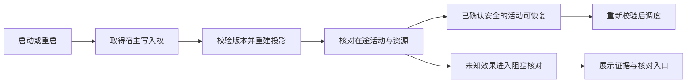

# GraphAgent 运行时与调度设计

| 项目     | 内容                                                                                       |
| -------- | ------------------------------------------------------------------------------------------ |
| 状态     | 启动设计草案；本机运行优先                                                                 |
| 更新日期 | 2026-10-04                                                                                 |
| 依赖     | [任务与 Assignment](./02task-graph-and-assignment.md)、[模板与实例](./01agent-template.md) |

## 1. 控制面与执行面

控制面维护模板修订、职位池、期望实例数、用工需求、任务就绪条件、预算与放置约束。执行面维护实例邮箱、短期活动、模型流和工具进程。领域状态写入 Durable Ledger，查询投影供 UI 与调度使用。

首个实现采用本机单宿主、单写入者、多逻辑实例；需要隔离的命令、浏览器或工具在受控执行进程中运行。Virtual Actor 是稳定实例身份与顺序状态更新的语义，不要求独占线程、进程、容器或特定 Actor 框架。

每项职责的 turn/step、输入消费、模型流与工具结果由[Agent Loop](./08agent-loop.md)驱动，提示构建由[提示词组合](./10prompt-composition.md)负责。邮箱提交短命令，Activity 执行长操作；Loop 的 turn 结束不直接等于 Assignment 或 TaskAttempt 完成。

| 组件                | 负责                                      | 不负责                     |
| ------------------- | ----------------------------------------- | -------------------------- |
| GraphCoordinator    | 图提交、就绪判定、验收、取消影响          | 直接执行工具               |
| WorkforceController | 期望池容量、激活、Drain、回收             | 生成模型内容               |
| Scheduler           | 过滤候选、排序、资源预留、Assignment 放置 | 修改模板职责与用户预算     |
| AgentMailbox        | 顺序处理邀请、输入、控制与活动回报        | 持续阻塞等待模型           |
| ActivityRunner      | 一次模型轮次或工具批次、取消、进度        | 独立决定任务终态           |
| Ledger / Projection | 提交事实、版本校验、重建查询视图          | 从事件回放再次调用外部系统 |

## 2. 员工与执行上下文

沿用既有实例状态 `PROVISIONING / IDLE / OFFERED / BUSY / WAITING / DRAINING / PAGED_OUT / RELEASED / FAILED`。`OFFERED` 是实例负载的摘要，多个邀请仍逐项存储；接一个新邀请不把 BUSY 员工改成 OFFERED。

实例保存身份、模板版本、邮箱位置、记忆绑定和 Assignment 引用；每个 Assignment 单独保存工作上下文、压缩记录、模型租约和工具调用账本。员工处理新工作时不自动带入其他任务的完整聊天，经验通过授权记忆检索进入。

默认同时一个推进中的模型 Loop。工作、群聊参与者和临时聊天使用独立 ExecutionContext；工作挂起后，临时 Loop 可取得执行槽，原命令与打开资源继续存活。可并行模板必须声明上下文隔离、工具资源范围和最大并发；共享可变历史的两个工作不能同时执行。会话/Assignment/上下文的关系见[09 会话设计](./09conversation-and-messaging.md#2-私聊群聊与明确的接收目标)。

挂起不解除原 Assignment 的责任承诺，也不将员工投影为可随意接单的 IDLE。临时 Loop 的槽位切换和普通新 Assignment 容量分别判断；原工作资源继续占用实际资源容量。一个 TaskAttempt 有多项职责时，单个 Assignment 挂起不代表整个尝试都 PAUSED，总体状态按仍运行的职责投影。

身份块由运行时构建：姓名与来源、模板职责、当前 Goal/Assignment、可读写范围、授权、预算、可派单职位与时间信息。自我描述和长期经验可按策略调整，实例 ID、模板修订和权限不由模型修改。

## 3. 调度顺序

一次调度依次执行：

1. 检查任务版本、依赖产物和取消/暂停标记；
2. 过滤技能契约、模板修订、信任区域、授权、可用模型能力与硬预算；
3. 过滤实例并发、Worker/工具容量、账号并发及活动限额；
4. 在可行集合内采用 `sticky → least-loaded → create → queue`，需要独立验证时应用反亲和；
5. 原子预留预算、实例执行槽和必要资源，固定 Assignment；
6. 启动前再次检查运行 epoch、授权与实际工具/模型条件。

`random/fresh/isolated` 是请求明确指定且模板允许的选择策略。`experienced` 的评价机制在有可追踪历史之前不参与首版评分。硬约束不满足不能通过优先级或成本偏好绕过。

队列排序先处理必须生效的控制命令；普通任务结合用户优先级、截止时间和等待年龄，使用老化避免长期饥饿。每个 Workspace/Goal 有队列与并发上限；超载时明确拒绝或排队，不能无限创建实例。

排队保留工作预算分配，但不长时间占用调用预留和执行槽。重复邀请、部分扩容失败和接受迟到通过唯一请求键、事务与版本检查处理。模型配额不足显示具体账号窗口与事实时间；无可靠 resetAt 时不显示确定倒计时。

## 4. 亲和与排班

required 条件包括数据地域、可信执行区、技能最低要求、工具权限与模型能力。preferred 条件包括热实例、同 Goal 缓存、产物位置和相同模型通道。独立评审的反亲和覆盖记忆视图、中间答案和模型原生会话；是否必须使用不同模型由验证契约决定。

员工可声明可工作时间、维护窗口和 Drain 截止时间；用户可设 Goal 截止时间。系统时间由时钟端口提供，界面按用户时区展示；租约有效期使用运行时可校验时间。Agent 建议调整排班不能覆盖用户的暂停或禁用状态。

生命周期建议：

- 临时实例：完成最后职责后生成策略要求的交接/recap，再 RELEASE；整理失败按策略记录待办，不无限占用实例。
- 长期实例：空闲 TTL 到达后 PAGED_OUT，身份与记忆保留；新派单可重新激活。
- 模板禁用：停止新派单，已有工作明确选择完成、交接或取消；不得默默换模板。
- 模板更新：新实例采用新修订，旧实例固定原版本。迁移需要新实例和交接记录。

## 5. 顺序邮箱与长活动

邮箱命令带 `messageId / commandId`、发起主体、Assignment 目标与期望版本。接受时持久化，投递可重试且按 ID 去重。每个实例的状态转移串行执行；模型调用和工具批次作为 Activity 异步执行，结果带 `activityId / attemptId / executionEpoch` 回写。

控制消息优先进入短控制队列，在下一个安全边界生效；普通输入按 accepted/applied 序号保持顺序。IM 适配器归一来源/mentions/replyTo，SessionRoute 定位上下文；会话服务将 interrupt/queue/steer 转为已有应用边界，群成员各自使用员工收件箱。活动必须让出邮箱，等待子任务只保留工作状态，不占用模型槽。挂起期间原工作队列可接受输入，但不会自动启动；获准临时聊天使用另外的 Loop。

群聊先检查本次作业的群/私聊屏蔽，命中时连 `@` 都保留到 TaskAttempt 终态后 queue；未命中时 `@` 为 interrupt 正文，普通群消息为 queue 无正文通知。通知应用不要求正文读取/回复。尚未启动的员工由未屏蔽 `@` 按需启动新会话执行段；普通通知先驻留收件箱，无任务员工可按用户配置的空闲批量接话策略由定时调度有界唤醒。作业消息策略与启动承诺一同登记，暂停、等待、交接和重启不解除屏蔽，任务终态用既有幂等 outbox 释放，后台工具/控制结果仍正常结算。聊天侧不再另建投递、通知和回执状态机。

安全边界包括模型请求发出前、完整模型响应提交后、工具调用派发前、工具批次结算后和产物发布前。正在传输的流可以请求 abort；已经执行的工具必须根据能力确认效果，不能把 abort 信号当作撤销。

空闲群聊接话复用定时任务、实例邮箱与现有 chat Loop：通知合并后每群/线程只选一人，最多一次不同员工替补，模型读取/回复最多两个 step。默认 60 秒冷却、每群每小时 6 次唤醒及独立预算，失败/替补都计数，员工回复不触发新批次。没有未终止作业、未被用户禁用且允许参与该群才是候选；工作处于 WAITING/PAUSED 也不是空闲。细节见[09 的激活策略](./09conversation-and-messaging.md#21-无任务员工的群聊激活)。

## 6. 持久记录与恢复

推荐 Ledger 能力而不固定存储引擎：按 Goal 的有序事件、对象 revision、原子事务、持久命令收件箱、outbox、活动效果记录和 checkpoint。预算预留、Assignment 承诺与派发意图在同一事务中提交；如果后续分存储，需要等价的协调协议，不能先发送再补记。

业务事件记录身份、目标、来源、版本、关联调用和内容引用。大正文进受控内容存储，公开事件仅含脱敏投影；原生会话状态另行保护。UI delta 可降频，但任务终态、审批、产物和结算事件必须持久化且有序。

Checkpoint 至少包含：任务要求版本、尝试与 epoch、模板版本、已应用输入位置、已消费产物、对话/压缩版本、待处理 tool-call ID、效果账本位置、预算结算位置、恢复建议与阻塞原因。

每次执行者恢复递增执行 epoch，旧 epoch 的迟到回报保留诊断但不能推进新执行；其合法在途效果仍按原 activity/effect 记录核对和结算。单写入者锁与 epoch 防止同时两次激活；失去租约的执行器必须停止发起新副作用，提交时校验 fencing token。外部工具无法支持 fencing 时，不自动切换执行者重做在途操作。工作与临时上下文各有 epoch，挂起切换采用推进闸门 revision，不将仍合法存活的命令标成失效。

## 7. 外部操作恢复分类

| 类别         | 例子                     | 恢复规则                                           |
| ------------ | ------------------------ | -------------------------------------------------- |
| 无外部效果   | 本地计算、只读查询       | 可重新调用，仍记录新 activity 与消费               |
| 可幂等效果   | 带幂等键的写入           | 使用同一效果键查询或重试，校验输入摘要             |
| 可核对效果   | 写文件、生成远端产物     | 先核对内容/版本，再决定是否继续                    |
| 不可核对效果 | 未支持查询的发送或提交   | 标记 UNKNOWN，用户或受控核对任务确认后继续         |
| 模型流中断   | 已输出部分文本或工具参数 | 不执行不完整 tool-call；结算已知用量，恢复为新调用 |

TaskAttempt 的 UNKNOWN 效果表现为 BLOCKED 的原因，不增加一个可被误读为完成的状态。审批已获得也不能授权重复未知效果。

## 8. 暂停、交接与取消

挂起、恢复和主动停止是仅用户可发起的应用管理命令。运行服务校验可信用户主体及管理入口，Agent 工具、消息适配器与平台 /pause、/resume、/stop 不提供这些能力；聊天中的“用户授权”文字不能替代实际管理命令。模型可请求帮助/报告建议，不能通过取消委托或释放仍工作的实例间接停止作业。宿主处理失败、验收终态和硬预算阻塞仍按既有规则执行，自动调度不会越过用户挂起/停止标记。

暂停（挂起）冻结目标工作 Loop 的新模型调用、工具派发、发布和自动续跑，保存 checkpoint 与 SuspensionFrame。派发闸门封闭、模型调用已结算后即可提交 PAUSED；已运行命令、浏览器与打开资源继续存活，效果与费用可在后台结算，不要求它们退出。挂起不自动向父员工发送消息，不取消子工作；主动查询和 UI 投影仍显示真实状态。

挂起后由用户通过应用内管理入口发起同一员工的临时聊天，独立上下文可读取获准工作与资源事实，明确选择取消哪些操作、记录工作状态并处理插入事项。关闭临时聊天不自动恢复原工作；恢复需校验工作版本、授权、资源结果与预算，未核对效果保持阻塞。完整切换和预算协议见[09 第 4 节](./09conversation-and-messaging.md#4-挂起工作并发起临时聊天)。

取消额外撤销未执行派单和可释放预留，按能力取消/核对已启动效果，保留已发生消费与产物，并撤销 SuspensionFrame 的恢复资格。交接仍需核对和转移资源责任，不能用挂起完成信号代替交接完成。

交接顺序：停止旧 Assignment 接新工作 → 到安全边界 → 核对效果账本 → 生成事实摘要与产物引用 → 提交交接记录 → 重新取得模型/权限/预算租约 → 新 Assignment 启动。摘要失败时至少保留机械生成的事实清单和未解决事项，不因总结模型不可用丢掉恢复入口。

关闭宿主时先停止接新命令和新活动，再 Drain、保存、结算、提交状态，最后释放事件订阅与宿主资源。异常退出在重启时显示 interrupted/recovering 原因，不把全部 WORKING 直接改成失败。

## 9. 验收与待定决策

- 活动等待期间邮箱仍可接受暂停和新邀请；控制消息不会被模型流阻塞。
- 原 Loop 挂起后命令与资源继续运行，临时 Loop 可安全处理资源；迟到结果不能自动恢复原工作或主动通知父员工。
- 重启后待处理输入、Assignment、图和预算一致；回放不会重新执行工具。
- 两次激活竞争只有一份有效执行，旧 epoch 的输出不能完成新尝试。
- 只读、幂等、可核对和未知效果分别恢复；未知发送不自动重试。
- 临时释放、长期 page-out 和模板禁用不丢历史实例身份。

待定：具体 Actor 库、存储引擎、持久事务实现、执行进程协议和 Worker 规模。Kubernetes 与分布式放置在本机闭环通过后单独设计。
