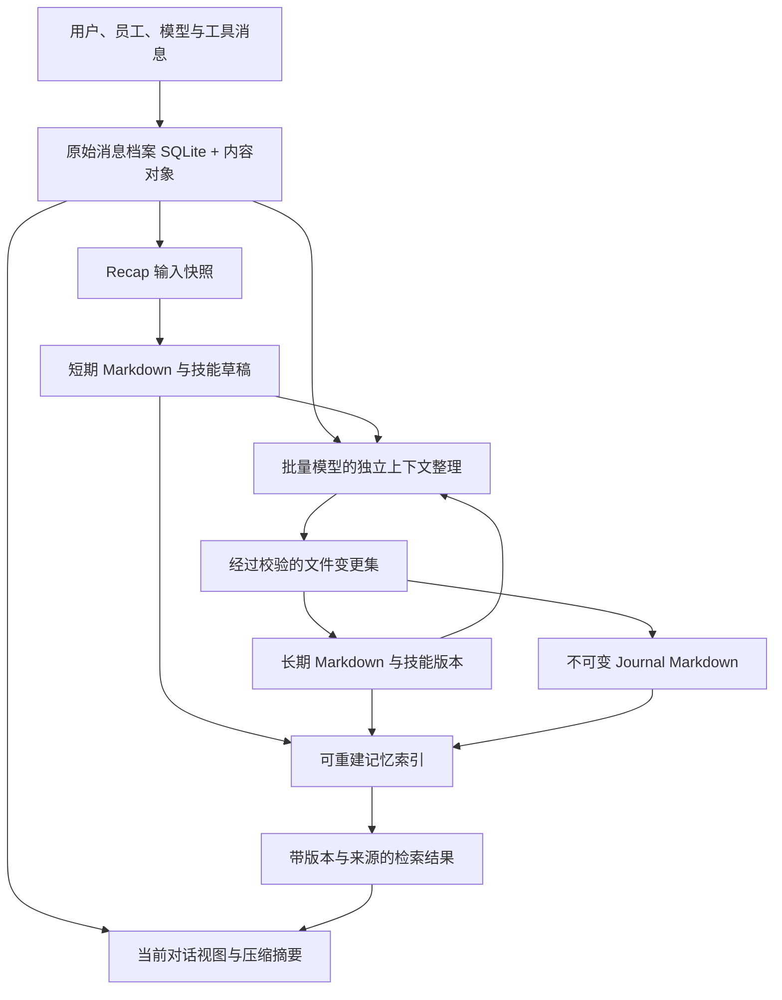

# 05_拦截器、记忆、整理与技能

| 项目     | 内容                                                         |
| -------- | ------------------------------------------------------------ |
| 状态     | 目标设计；尚未实现后端                                       |
| 层级     | 第 5 层：执行边界、知识沉淀与自我优化                        |
| 依赖     | [03 执行层](./03_agent-loop-dispatch-and-execution.md)、[04 工具调用](./04_tool-execution.md) |
| 后续章节 | [06 工作台与外部对接](./06_workspace-and-integrations.md)     |

## 1. 拦截器与策略门

Interception 包含两类机制：

- **Interceptor**：优化输入、补充环境、修复结构化结果、精简输出、脱敏或提前给出无需继续执行的结果。
- **Policy Gate**：强制权限、信任区、数据外发和执行限制。

二者经过同一调度管线，但策略等级不同：内容优化失败可以显式降级，必要安全校验失败必须阻断。

用户可以在执行图连线或节点上配置审查员；图操作生成针对消息、产物或执行边界的版本化 binding。真正拦截在运行时端口执行，不能只在 UI 或 Agent 提示词中检查。

### 1.1 拦截点

| 拦截点                        | 可处理内容                     | 强制约束                                       |
| ----------------------------- | ------------------------------ | ---------------------------------------------- |
| `user-input`                  | 提炼、翻译、识别无需执行请求   | 保留原用户意图和已授权范围                     |
| `delegation-before`           | 派单说明、共享上下文、资源请求 | 不扩大权限、预算或接收者范围                   |
| `message-before-delivery`     | 跨实例或远端消息               | 验证目标及数据授权                             |
| `context-read-before / after` | 记忆、产物与文件读取           | 读取前检查访问权；读取后检查可进入上下文的内容 |
| `model-request-before`        | 完整上下文与附件               | 覆盖所有向模型外发的内容，不仅最新一句         |
| `model-response-after`        | 完整输出与结构化调用           | 未完成或未通过检查的参数不执行                 |
| `tool-call-before`            | 工具名称、参数和资源           | 变换后重新校验权限、资源与副作用               |
| `tool-result-after`           | 输出、错误、附件               | 脱敏后才进入模型、公开日志或 UI                |
| `artifact-publish-before`     | 正式交付物                     | 验证内容版本、敏感等级与发布对象               |
| `memory / skill-write-before` | 记忆修改、晋升与技能变更       | 不能写入身份规则、秘密和未授权可执行内容       |

外部 A2A、MCP、网络工具和语义审查模型的调用同样受外发边界约束。凭据注入由可信执行层处理，普通 Interceptor 看不到认证材料。

群消息按实际成员/接收员工检查共享权限，复用原 messageId 与 Gate 收据；某接收者被阻断不宣称整条消息已对所有人交付。`@` 和全体消息只选择收件人，不提升权限。挂起、恢复和停止只接受应用内可信用户管理命令，不提供 Agent 控制工具或消息平台命令。空闲自动接话的工具预设只读本群消息，不提供资源或作业控制工具。

### 1.2 决策

拦截输入 envelope 包含 `operationId`、Workspace/Goal/Attempt/Assignment、发送与接收主体、阶段、内容引用和 digest、敏感等级、权限摘要、策略 revision 与调用链。普通处理器只获得声明所需的最小视图。

| 决策            | 含义                                         |
| --------------- | -------------------------------------------- |
| `continue`      | 内容不变，继续下一阶段                       |
| `transform`     | 返回新内容引用、结构化变更说明和新 digest    |
| `block`         | 阻止当前操作，返回可公开原因与恢复建议       |
| `require-input` | 创建关联输入/审批请求，等待满足条件          |
| `short-circuit` | 返回候选终止结果，由任务验收规则决定是否完成 |

决策不能直接把 Task 改为 COMPLETED，也不能自行执行工具。需要新增工作时提交受校验的图修改建议。结果必须是符合 schema 的判别联合，超时、无效输出、冲突和能力不支持都明确记录。

每份 InterceptionDecision 固定处理器版本、输入/输出 digest、策略 revision、原因、消耗与时间。公开审计保存脱敏差异；需要保留原文时进入受控内容存储，不能把泄露字符串复制进错误说明。

### 1.3 链顺序与重入

推荐管线：

```text
授权与访问前置检查
  → 入口/内容变换
  → 可选语义判断
  → 最终内容的确定性安全检查
  → schema、资源和权限复核
  → 固定执行 envelope
  → 派发
  → 输出处理与发布检查
```

处理器按阶段、配置优先级和稳定 ID 顺序执行，transform 的输出成为下一处理器输入。策略快照在一次操作内固定；用户插入的新规则影响尚未派发操作。多个变换冲突时按策略拒绝或返回问题，不默默选择最后一份内容。

审批绑定最终工具、参数 digest、目标资源、权限与策略 revision。变换、参数修改、资源变化或授权过期都会使旧审批失效。

语义审查员通过受控审查活动运行：先执行本地脱敏与外发校验，再向获准模型提交最小资料；审查活动不再调用自身语义拦截器，但仍通过基础安全检查。调用链携带 bypass 的指定处理器 ID 和最大重入深度，不能用“我是审查员”跳过全部规则。

禁止把未审查的秘密发给云端模型询问“有没有秘密”。无法在本地确定可外发范围时阻断、采用本地审查模型或向用户请求明确输入。规则匹配与模型判断均有误判可能，界面应显示判断来源与限制。

### 1.4 流式内容

请求检查覆盖长期记忆、压缩摘要、工具 schema/参数、文件与图片附件、原生状态和动态环境信息。SDK 自动附加的内容也须进入最终 envelope 或被可信执行层限制。

首版对敏感输出和需要修改的正文采用“完整消息检查后发布”，UI 可显示运行进度；不宣称已经展示的 token 可以撤回。后续增量发布必须由确定性规则声明可安全流式处理，跨块秘密匹配需要尾部缓冲。

模型 tool-call 参数只在调用完整、通过 schema 与权限校验后执行。结构修复保持 call ID 与语义，产生变换记录；不能用补猜危险参数的方式把无效调用变成可执行。

### 1.5 失败与审批

必要 Gate 超时或不可用时阻断，保留待恢复操作。可选翻译/压缩器失败可按声明跳过，并显示处理未完成；不能静默退回未脱敏内容。输入过滤器只有在显式启用策略下才可短路，用户能查看原因并修改请求。

首版采用内置确定性处理器与受控审查员工；任意用户脚本/可执行插件、细粒度流式脱敏、远端工具强隔离和复杂 DLP 规则编辑器另做设计。

## 2. 原始档案与记忆

### 2.1 固定决定

1. **原始消息档案与记忆库独立。** 完整输入、输出、工具消息、附件和实际调用上下文进入原始档案；记忆是从这些资料中形成的可检索知识，不替代原文。
2. **默认记忆后端是 `markdown-files/v1`。** 短期、长期、流水记忆都使用带 YAML frontmatter 的 Markdown 文件，分类就是文件系统中的真实目录。技能使用包含 `SKILL.md` 的目录包。
3. **一份文件是一条记忆。** 稳定 entryId 位于 frontmatter，文件名与分类路径是可变位置，不作为唯一身份。
4. **SQLite 原始档案不可重建；记忆索引可重建。** 知识正文与历史是 Markdown/技能目录，索引只是查询加速。提交记录、版本快照和整理游标需要备份。
5. **流水记忆按做梦批次生成。** 日期只做分组，一天可以有多份不可变 journal；短期工作笔记和 recap 不向已创建 journal 追加。
6. **模型统一使用内置记忆工具。** 工具层调用记忆应用服务，再由 `MemoryStorePort` 分派到可替换后端；模型操作逻辑条目、目录、技能和版本，不自行编辑底层 Markdown、frontmatter 或数据库。

### 2.2 数据流



原始消息是“实际收到/发出了什么”的证据，不表示所有内容都是真实事实。短期与长期记忆是有来源的结论，仍可能被纠正；journal 是某次整理的历史视图，也不是不可质疑的事实。

上下文压缩只改下一次调用采用的对话视图，新增 CompactionRecord，不覆写/删除原始消息。记忆更新不回写原始消息；原始消息到期删除后，引用保留但解析结果是 `source-unavailable`。进行中的 Task 状态、工具效果与预算仍以运行 Ledger 为准。

### 2.3 物理布局

`graphAgentDataRoot` 是宿主配置并登记的产品数据绝对目录，`workspaceDataRoot = graphAgentDataRoot/workspaces/<workspaceId>`。不默认写入用户代码仓库，不与 PolyQuota 数据目录或凭据库共用。

```text
<workspaceDataRoot>/
  runtime/
    conversations.sqlite3          # 原始消息、调用上下文、整理工作记录
  objects/
    <objectId>                     # 原始附件/大正文/协议状态
  knowledge/
    workspace/                     # Workspace 共享 namespace
      .namespace.json
      short-term/
        tasks/研究结论__mem_01.md
      long-term/
        MEMORY.md                  # 紧凑项目事实
        USER.md                    # 稳定用户偏好
        projects/astra-conductor.md
      journal/
        2026/10/2026-10-03__dream_01.md
      skills/
        coding/verify-build/
          SKILL.md
          references/notes.md
          templates/report.md
          scripts/verify.mjs
          assets/example.json
      .store/
        folder-state/
        revisions/<revisionId>/
        commits/<changeSetId>.json
        staging/<changeSetId>/
        trash/<deletionId>/
        generation.json
        write.lock
        index.sqlite3
    goals/<goalId>/                # Goal namespace，同一布局
    instances/<instanceId>/         # 员工私有 namespace，同一布局
    templates/<templateId>/         # 经批准共享的职位经验，同一布局
```

`.namespace.json` 登记 schemaVersion、namespaceId、workspaceId 与 owner；权限由可信运行配置管理，文件中自报 owner 或可见性不构成授权。用户与获准 Agent 可以建立分类目录；模型通过内置工具提交逻辑目录操作，默认适配器将其映射为真实目录。`skills` 下含 `SKILL.md` 的目录是包根，其子目录属于包附件，不继续扫描为独立技能。

目录位置映射层次，frontmatter 的 `kind` 必须与位置一致。跨层移动是 `promote/demote`，更新元数据并生成新 revision；同层移动只改变位置与 namespace generation。跨 namespace 采用有来源的新 ID 副本，不能靠移动文件绕过分享授权。

默认文件后端命名采用可读标题/slug，冲突时加稳定 ID；拒绝路径穿越、Windows 保留名、大小写冲突和符号链接/目录联接逃逸。`logicalPath` 使用 `/` 表达分类位置，不是物理路径。

### 2.4 记忆文件格式

默认 UTF-8、LF、final newline；文件内容为 YAML frontmatter + Markdown 正文。YAML 只接受 JSON 可表达的值，不接受可执行 tag/对象构造。每个文件必须有 `schemaVersion`、`id`、`kind`、`title`、`status`、`createdAt`、`updatedAt`、`sourceRefs`。

```markdown
---
schemaVersion: graph-agent/memory/v1
id: mem_01
kind: short-term
title: GraphAgent 原始消息与记忆分离
status: active
createdAt: "2026-10-03T10:50:00Z"
updatedAt: "2026-10-03T10:50:00Z"
eventTime:
  from: "2026-10-03T10:30:00Z"
  to: "2026-10-03T10:45:00Z"
tags: [architecture, memory]
verification: observed
sensitivity: workspace
injection: on-demand
sourceRefs:
  - kind: message-range
    conversationId: conv_01
    fromSeq: 12
    toSeq: 18
  - kind: artifact
    artifactId: art_01
    revisionId: ar_01
---

原始消息用于证据回溯；recap 产生的结论进入短期记忆。
尚待核验：消息内容对象的宿主加密实现。
```

时间使用 UTC ISO 8601；`eventTime` 是资料描述的发生区间，`createdAt/updatedAt` 是创建/修改时间。无证据时 `verification=unverified`，`sourceRefs` 可以为空并明确标记手写来源。

`MEMORY.md` 与 `USER.md` 使用相同 frontmatter，`kind=long-term`，默认 `injection=always`。它们是两条紧凑记忆，不是其他长期文件的自动副本。其他长期文件默认 `related`，按相关度自动参与上下文；超出注入预算时保留磁盘全文并记录未注入原因。

journal 增加 `dreamJobId`、`changeSetId`、`period`、`timezone`、`coverageRefs`，`injection=on-demand`。一个已完成批次生成一个文件，`period` 表示观察区间，`coverageRefs` 表示实际处理的消息/记忆版本。同日后到资料产生新 journal，修正以新的 `correctsEntryIds` 引用旧条目。

默认正文限制：普通记忆 64 KiB，journal/SKILL.md 256 KiB；可配置，超过限制拆分为有独立主题的文件或附件。文件容量与模型上下文 token 预算是两种不同限制。

### 2.5 原始消息档案

每个 Workspace 使用一个 `runtime/conversations.sqlite3`，WAL + foreign_keys + 单写入者，放在本机产品数据目录。FTS、索引与查询投影可以重建，但 sessions/messages/call payloads 本身是事实档案。

| 表                  | 主要内容                                                                 | 不变量                                          |
| ------------------- | ------------------------------------------------------------------------ | ----------------------------------------------- |
| conversations       | conversationId、workspaceId、kind、成员/访问快照、purpose、goalId        | 私聊/群独立于任务；不因压缩改名                 |
| messages            | messageId、conversationId、messageSeq、sender/recipients、role、stage    | `(conversationId,messageSeq)` 唯一；追加保存    |
| message_chunks      | messageId、chunkSeq、内容片段引用、receivedAt                            | 流期间持久化；中断保留已收到片段                |
| message_completions | messageId、workspaceArchiveSeq、完成状态、payloadRef、finishReason      | 一次终结；后到片段不能覆写已结束消息            |
| model_calls         | callId、共享 selection、contextSnapshotId、请求/响应对象引用、usage      | 固定实际发出内容；认证头/凭据不入档案           |
| context_snapshots   | snapshotId、executionContextId、消息范围、记忆/技能版本、实际上下文      | 读取版本固定                                    |
| compactions         | compactionId、来源消息范围、摘要引用、生成调用 ID、新对话视图引用        | 原始消息不删除；摘要保留血缘                    |
| maintenance_jobs    | jobId、recap/dream、输入快照、进度、结果 changeSetId、状态               | 去重/游标需要备份                               |
| message_search      | 可公开文字、脱敏工具名/参数、messageId 与时间                            | 派生 FTS 表；权限过滤在 snippet 返回前完成      |

`role` 表示实际消息角色（user/assistant/tool/system）；员工身份由 sender/instanceId 表达。`stage` 记录 received、intercepted、provider-request、provider-response、tool-result、delivered，关联同一 operationId，但不把多个变体当作多次独立用户发言。

聊天消息直接关联原始 messages，来源保留 transport/account binding、会话/线程、真实 sender、mentions 与 replyTo。平台协议角色不替代用户/员工身份，认证材料不归档。群消息只存一份原文，不为每个收件人复制正文。员工收件箱与 SessionRoute 复用运行时持久邮箱/上下文绑定；作业屏蔽附在作业配置，终态释放复用既有 outbox。

完整 payload 是带 schema/mediaType 的 UTF-8 消息对象或原生协议对象，保留文本、结构化工具参数、call ID、错误、供应商实际提供的 reasoning 和附件引用。大对象在 objects 下持久化后才提交消息行；先写对象再写 DB 产生的孤立对象可以延迟回收。图片/音频/文件附件默认复制至受控内容对象，不只存可能失效的远端 URL。restricted 原文/原生状态需要宿主加密内容对象与访问端口；没有安全存储能力时拒绝该类持久化。

`ConversationArchivePort` 提供 `listConversations`、`searchMessages`、`readRange`、`readAround`、`resolveSource`；原始消息追加是运行时私有写端口。公共读取通过身份与敏感等级过滤，做梦不直接执行 SQL。

### 2.6 公共结构

```typescript
type MemoryKind = "short-term" | "long-term" | "journal";
type RevisionId = string;

interface MemoryMetadata {
  schemaVersion: "graph-agent/memory/v1";
  id: string;
  kind: MemoryKind;
  title: string;
  status: "active" | "archived" | "superseded";
  createdAt: string;
  updatedAt: string;
  eventTime?: { from: string; to: string };
  verifiedAt?: string;
  validUntil?: string;
  tags: string[];
  verification: "unverified" | "observed" | "validated" | "disputed";
  sensitivity: "public" | "workspace" | "restricted";
  injection: "always" | "related" | "on-demand";
  sourceRefs: KnowledgeSourceRef[];
  supersedesEntryIds?: string[];
  conflictsWithEntryIds?: string[];
}

interface MemoryDocument {
  namespaceId: string;
  folderId: string;
  logicalPath: string;
  revisionId: RevisionId;
  metadata: MemoryMetadata;
  markdown: string;
}

interface SkillDocument {
  namespaceId: string;
  skillId: string;
  revisionId: RevisionId;
  logicalPath: string;
  metadata: {
    schemaVersion: "graph-agent/skill/v1";
    id: string;
    name: string;
    description: string;
    status: "draft" | "active" | "deprecated";
    createdAt: string;
    updatedAt: string;
    tags: string[];
    requiredToolIds: string[];
    sourceRefs: KnowledgeSourceRef[];
  };
  markdown: string;
  assets: Array<{
    relativePath: string;
    mediaType: string;
    sizeBytes: number;
    sha256: string;
  }>;
}

interface KnowledgeChangeSet {
  changeSetId: string;
  commandId: string;
  namespaceId: string;
  inputSnapshotId: string;
  expectedGeneration: string;
  operations: Array<
    | { kind: "create-memory"; folderId: string; metadata: MemoryMetadata; markdown: string }
    | { kind: "revise-memory"; entryId: string; expectedRevision: RevisionId; markdown: string }
    | { kind: "archive-memory"; entryId: string; expectedRevision: RevisionId; reason: string }
  >;
}
```

`sourceRefs` 是结构化声明，不是可信证明；author、verification、sensitivity 不能凭编辑文件自我提升。可信提交收据记录实际操作者、源权限核验与验证结果。外部编辑/导入初始按 `unverified` 处理，安全等级不能低于 namespace/来源的有效等级。

`SkillDocument.revisionId` 是完整包 manifest 摘要；改附件也会改变版本。`assets[].relativePath` 只标识可移植技能包内的附件，不提供宿主绝对路径。SKILL.md 正文描述适用前提、步骤、失败条件与验证方式；脚本存在不代表有执行授权。

### 2.7 内置工具与检索

调用层次固定为：`模型 → 内置工具 → 记忆应用服务 → MemoryStorePort / ConversationArchivePort → 后端适配器`。模型不直接调用底层存储端口。

| 内置工具            | 面向模型的能力                                                       |
| ------------------- | -------------------------------------------------------------------- |
| `memory_list`       | 列出获准 namespace、层次、逻辑目录和条目                             |
| `memory_search`     | 按关键词、标签、层次、逻辑目录与时间检索                             |
| `memory_read`       | 按 entryId 与可选 revision 读取正文、公开元数据与来源                |
| `memory_manage`     | 创建/修改/移动/晋升/归档/恢复及目录操作，写入携带 expectedRevision   |
| `skill_manage`      | 查看、创建、编辑、启用/停用技能与包内附件，发布完整技能版本          |
| `conversation_recall` | 搜索原始会话或按固定消息区间/锚点回溯，只读、脱敏、限制输出量      |

工具层从可信调用上下文取得实例/Assignment/Workspace 身份，执行授权、拦截、输入校验、来源核验与版本检查。commandId 由宿主关联 tool-call ID 做幂等登记；模型不能通过填写 author、createdAt、verification 或来源身份自行取得可信状态。

recap 和做梦复用这些逻辑读能力。固定快照可以由宿主直接作为输入提供；需要按需查询时只提供获准只读工具。做梦的写入返回结构化变更提案，由可信提交器调用 `applyChangeSet`，不给整理模型直接提交数据库事务或修改文件的能力。

默认离线关键词检索：Markdown 按标题/段落分块，保留 ID、revision、kind、tags、时间与正文范围。FTS5 用于常规词匹配，中文子串和短查询采用明确的子串检索路径，不能只依赖英文分词。支持 relevance/newest/oldest 排序和 created/updated/event 时间过滤；无 `eventTime` 的条目不匹配 event 过滤，不能猜用文件 mtime。

`index.sqlite3` 只保存派生信息。启动扫描、受控写入即时更新、文件 watcher 加周期扫描共同维护；mtime/size 只作扫描优化，revision 校验采用内容摘要。索引落后时返回 health 信息并校验命中版本；已删除/变更条目的旧片段不能作为当前结果返回。默认不要求 embedding 服务。

### 2.8 版本、外部编辑与提交恢复

写入取得 namespace 协作锁，读取当前文件并比较 `expectedRevision`，验证 frontmatter/授权，保存旧快照，写同目录临时文件并 flush，使用平台适配器原子替换。journal 使用仅允许新建的路径，冲突即拒绝。

外部重命名通过文件 id 识别条目；外部目录重命名不能可靠识别时分配新 folderId，但不改变条目 ID。duplicate-id、kind/path 不一致或非法 YAML 进入异常列表，不自动覆盖另一条记录、不注入上下文。外部新增普通 Markdown 可以查看/导入，首次登记时写入标准 frontmatter 并保留原文快照；导入前不纳入自动长期注入。

`.store/revisions` 保存旧 Markdown 原文；技能保存完整包快照。运行中的 SkillRevision 保留到引用释放及保留期结束，合并技能产生新版本，旧版本不会被正在执行的员工读成新内容。

多文件变更集通过以下发布协议获得一致视图：

1. 锁定 namespace，核验全部 `expectedRevision`，固定旧 generation 的快照；
2. 将完整新文件/技能包写入 staging，保存旧快照和 PREPARED 清单，包含路径、前后摘要、删除信息与来源收据；
3. 持久化 APPLYING 标记后逐项替换，期间后端读取旧快照，禁止其他受控写入；
4. 全部文件核对成功后记录 COMMITTED，原子发布新 generation，更新索引；
5. 返回成功前将 changeSetId 写入 `maintenance_jobs`，重试通过提交收据对账；
6. 重启先恢复未完成批次，依据前后摘要幂等续写；遇到非预期外部改动保留两份内容并阻塞核对，不能覆盖它。

跨 namespace 整理首版拆成独立提交批次，不承诺全库事务。任务/预算与记忆文件不共用 SQLite 原子提交；通过 changeSetId 的 outbox/回执对账。普通编辑器不遵守 `write.lock`，文件 watcher 和 CAS 不能消除同时外部覆写的竞态；外部批量编辑应在暂停该 namespace 写入时完成。

journal 不可变由端口和历史摘要验证，不宣称操作系统禁止用户编辑。检测到已发布 journal 被外部修改时保留原版并登记完整性冲突，不能把改后的文件当成原整理结果。

## 3. Recap、做梦与技能

### 3.1 Recap

TaskAttempt/Assignment 结算后，通过固定消息区间与产物版本创建 `purpose=recap` 的独立整理会话。默认输出 `short-term/tasks/<slug>__<entryId>.md` 和技能草稿包；必要长期更新仍按启用策略校验。recap 本身的模型对话保存在原始库，但不默认重新摄取为工作经验。

去重键为 `attemptId + outcomeRevision + recapPolicyRevision`。提案携带 sourceRefs 和 expectedRevision，使用 `applyChangeSet`；成功回执才把作业标为完成。失败不撤销原任务结算，重试不重复创建短期条目。压缩前 flush 复用同一提取/提交路径。

### 3.2 做梦

输入是固定 archive cutoff、每个 conversation 的消息区间、记忆/技能 revision 与 namespace generation。`workspaceArchiveSeq` 在消息终结提交时分配，用于确定已完成归档范围；按消息 createdAt/业务 eventTime 选择日期，但不能只依赖“上次处理到哪一天”判断完整性。活跃未结算工作暂缓或明确部分覆盖，迟到消息下次处理。

做梦使用批量模型组中的候选，配置的 `dreamModel` 表示该用途下的选择或偏好。候选可以与目标工作模型相同，甚至来自相同账号和 route；本设计不要求不同 modelId、模型家族或服务商。批量组是应用用途，不表示必须使用供应商的 Batch API。无可用候选时按配置回退或排队。

上下文与运行方式独立：新建 `purpose=dream` 的调用上下文和租约，不续接员工工作会话的原生 response ID、缓存会话状态或对话历史；职位身份只作为明确标记的环境资料，不作为整理模型的身份指令。模型输出文件变更提案及 journal 草稿，由可信提交器核验和发布。

```text
prepare → reflect(optional) → consolidate → validate → commit → report
```

1. **Prepare**：按 cutoff 摄取已结算 work、短期条目与使用信号，去重并归类候选。确定性扫描不调用模型；复杂提取可以使用批量组独立调用。只生成候选/短期提案，不改长期层。
2. **Reflect**：识别跨任务主题、矛盾、待核验事项、可合并技能和过时事实。模型输出关联建议与证据引用，不直接产生“已验证事实”；资料少或预算紧时可跳过。
3. **Consolidate**：对通过来源/有效性门槛的候选排序，选择明确需要长期保留、合并或替代的项目，形成受限操作计划。
4. **Validate / Commit**：复核来源与目标 revision、支持证据、主题作用域、固定条目、变化量和注入预算，再通过 `applyChangeSet` 发布。
5. **Report**：journal 记录实际已提交变更；未提交、冲突、被拒绝和降级记录留在作业/DreamReport 中。失败不能产生宣称已经完成的 journal。

先验证来源、授权与版本，再把短期/长期/技能变更和对应 journal 放进同一 namespace 批次，journal 描述该批实际提交的内容。成功发布后再推进作业覆盖范围；崩溃发生在文件提交后、数据库作业更新前时，按 changeSetId 补写回执，不再次生成 journal。

持续源修改没有新 archiveSeq，因此做梦输入还需记录每个文件版本的 processed 标记。默认 journal 不作为新的未处理输入自动再摄取；只在历史检索或明确修正时引用，以免整理递归放大。

### 3.3 候选、门槛与合并

模型第一步只选择 `add / merge / supersede / keep / needs-verification`，引用候选与当前 entryId/revision；默认不输出整份 `MEMORY.md` 替换文本。需要改写结论或技能步骤时，使用单独的受限提取/编写步骤，保留支持该文本的 sourceRefs，再由验证器组装变更集。

候选排序使用独立工作中的有效使用、跨 Task/Goal 的复现、证据强度和事实有效期；目录/tag 密度只辅助归类，不能通过多写标签提升可信度。

两条保留路径：

- **显式保留**：用户明确要求记住的偏好、约束，以及经过核验的关键纠错/事故经验，可以直接进入受控长期写入，不要求先满足多次召回；仍校验授权、证据类型、冲突和敏感等级。
- **经验晋升**：一般短期发现先积累独立使用与验证信号，通过配置的最低支持门槛与候选排序后再晋升。

检索相关性不是正确概率，分数高不能绕过来源限制或未解决冲突。一次源消息被转写为 recap、短期条目并再次检索，仍是一份证据；Prepare/Reflect 重读和回填重放不计作新的独立工作使用。

合并限制在同 namespace、相同主题与相容适用范围内。跨项目/角色的相似句子不自动合并；supersede 需要可核对的 lineage/新旧事实关系和修改证据。用户固定、有效期约束、已授权边界与无关条目不能为满足文件预算被自动删掉。批次变化量超过配置上限则拆批或待审。

冲突、权限/来源不满足、版本过期或预算不足时保留短期/待审并报告降级，不通过换模型、追加矛盾条目或忽略失败绕开检查。回填使用同样的准入、去重与候选管线，先 preview，再 stage；撤回只移除该批贡献，已有实时支持保留。

同 namespace 同时最多一个发布中的整理作业。模型分析在文件锁外执行，提交前再校验；等待期间不占用后台模型槽。多个触发合并处理范围，用户主动请求可提高优先级，实际并发数、费用与重试上限由全局后台预算决定。

### 3.4 技能加载与生成

技能是程序性经验的可版本目录包。加载时按任务与工具授权选择相关技能，只注入适用的 SKILL.md 摘要、前提、步骤与验证方式；包内脚本和附件不代表执行授权。

- **生成**：recap 或做梦可以产生技能草稿；草稿标 `draft`，经证据检查与用户/策略批准后发布新 revision。
- **版本**：完整包固定 revision；运行中的 Loop 继续使用旧 revision，合并或停用不破坏正在执行的工作。
- **依赖**：`requiredToolIds` 必须与当前工具目录和授权兼容；工具缺失时技能不可用并显示原因，不能临时开放工具。
- **安全**：技能正文是资料，不提升为宿主规则；脚本执行仍需工具授权与 Gate。外部导入技能默认不可信。
- **合并**：同主题技能可以合并为新版本，旧版本保留血缘；不原地覆盖正在使用的版本。

### 3.5 整理运行状态

Markdown 继续是记忆正文的默认事实来源；候选与统计属于整理运行状态，保存到 `conversations.sqlite3` 的独立表，不塞进 `.store/index.sqlite3`，也不让 Agent 自改 frontmatter 统计。

| 状态表              | 保存内容                                                                        | 作用                                               |
| ------------------- | ------------------------------------------------------------------------------- | -------------------------------------------------- |
| `memory_observations` | observationId、候选/源版本、工作 Task/Attempt、查询哈希、使用结果、时间       | 幂等记录真实使用和验证信号，区分工作使用与后台整理 |
| `dream_candidates`  | candidateId、候选修订、规范声明、sourceRefs、主题/lineage、支持信号与拒绝原因   | 候选独立于文件位置，记录一次性与持续规则           |
| `dream_stage_runs`  | jobId/phase、输入快照、政策版本、调用 ID、结果/提案引用、费用与状态             | 阶段恢复、跳过、降级与版本审查                     |
| `backfill_batches`  | batchId、来源范围、生成候选/信号、提交引用及补偿状态                            | 回填去重和撤回自身产物                             |

可信 origin、资料获取通道与验证结果由宿主收据/运行记录提供，不能由 Markdown 自报 owner/agent 取得。外部内容可供任务分析，但需要独立核验或用户明确声明后才能成为长期结论。

## 4. 验收场景

### 4.1 拦截

- 秘密分别出现在输入、长期记忆、摘要、附件、工具错误与产物时，均不通过未授权外发。
- 参数变换后旧审批失效；改变目标目录不能复用原授权。
- 语义审查不会递归调用自身，也不会借 bypass 跳过本地边界检查。
- 工具执行到一半取消，已完成、未派发、未知效果分别展示。
- 两个 Assignment 同时写同一文件，形成仲裁结果且不能互相覆盖。
- 用户暂停/停止不会被 Agent 工具、平台命令或自然语言声明绕过。

### 4.2 记忆与整理

- 不调用任何模型也能读取文件、建立目录、编辑记忆并做关键词/层次/时间检索；删除索引后可重建相同知识视图。
- 将默认 Markdown 后端替换为契约一致的 fake/数据库后端后，同一内置工具请求仍得到相同业务结果。
- 通用文件/终端工具不能越过内置记忆工具修改宿主管理资源；用户外部导入与模型逻辑写入具有不同来源收据。
- 原始档案保留完整工具参数/结果、附件与实际上下文，压缩/recap/做梦不会修改原文。
- 同层重命名保留 entryId，跨层晋升生成新版本；duplicate-id 与非法 frontmatter 明确报错。
- 同一天两次做梦生成不同 journal；旧 journal 不可通过 revise 修改，外部改动被识别。
- 两个员工同时写一条记忆只有一个 revision 被接受；多文件中途崩溃恢复不重复生成 journal、不跳过冲突资料。
- 长期条目自动参与上下文，实际采用版本可从 ContextSnapshot 回查；独立做梦模型不带员工身份指令。
- 批量组选择与工作任务相同模型仍可做梦，调用上下文、原生状态和写入权限独立。
- 高召回但未核验的候选不能晋升；用户明确保留的重要约束不必等待多次召回；后台重读不制造新的独立支持。
- 回填撤回只移除本批贡献，已有实时支持保留；失败/冲突的整理报告不宣称长期层已更新。
