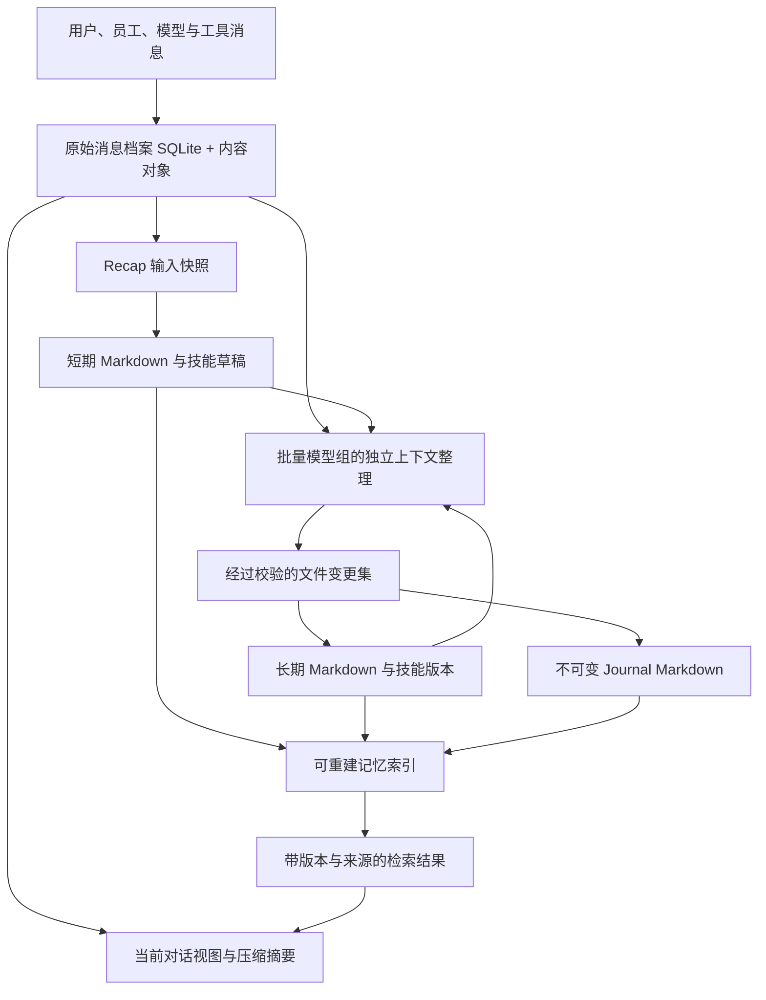

# GraphAgent 记忆、原始消息与默认 Markdown 后端设计

| 项目     | 内容                                                                                    |
| -------- | --------------------------------------------------------------------------------------- |
| 状态     | 初版设计草案确定；尚未实现后端                                                          |
| 更新日期 | 2026-10-04                                                                              |
| 默认方案 | SQLite 原始消息档案 + Markdown 文件/真实目录的知识库 + 可重建 SQLite 检索索引           |
| 输入     | [概念设计](./concept-design.md)、固定版本 Hermes 与 OpenClaw 源码；入口见本稿第 2 节    |
| 本轮范围 | 确定事实归属、目录、文件格式、公共数据结构、读写/检索契约和整理提交基础；其他模块不展开 |

## 1. 本轮固定的决定

1. **原始消息档案与记忆库独立。** 完整输入、输出、工具消息、附件和实际调用上下文进入原始档案；记忆是从这些资料中形成的可检索知识，不替代原文。
2. **默认记忆后端是 `markdown-files/v1`。** 短期、长期、流水记忆都使用有 YAML frontmatter 的 Markdown 文件，分类就是文件系统中的真实目录。技能使用包含 `SKILL.md` 的目录包。
3. **一份文件是一条记忆。** 稳定 entryId 位于 frontmatter，文件名与分类路径是可变位置，不能作为唯一身份；不采用 Hermes 的 `§` 分隔多条记录。
4. **SQLite 原始档案不可重建；记忆索引可重建。** 知识正文及其历史是 Markdown/技能目录，索引只是查询加速。提交记录、版本快照和整理游标是需要备份的状态，不能与缓存一起删除。
5. **流水记忆按做梦批次生成。** 日期只做分组，一天可以有多份不可变 journal；短期工作笔记和 recap 不向已创建 journal 追加。
6. **模型统一使用内置记忆工具。** 工具层调用记忆应用服务，再由 MemoryStorePort 分派到可替换后端；模型操作逻辑条目、目录、技能和版本，不自行编辑底层 Markdown、frontmatter 或数据库。UI、recap 与做梦的受控提交复用同一应用服务校验。

本稿确定默认原始档案存储为 SQLite，不据此决定整个 Task/Assignment Ledger、UI 宿主或凭据代理的存储方案。

## 2. 参考源码与取舍

Hermes 固定为 `6a6766fb896043ab3757a30713f1248b6054e0a6`，OpenClaw 本轮新增为 references 子模块，固定为 `47a026ea3fe6201de974628a7c80228a4434a0e4`。

| 核对入口                                                                                                                                                                                                                                                                                               | 观察到的实现                                                                                    | GraphAgent 取舍                                                                                  |
| ------------------------------------------------------------------------------------------------------------------------------------------------------------------------------------------------------------------------------------------------------------------------------------------------------ | ----------------------------------------------------------------------------------------------- | ------------------------------------------------------------------------------------------------ |
| [Hermes hermes_state.py](../../references/hermes-agent/hermes_state.py)                                                                                                                                                                                                                                | `state.db` 中 sessions/messages，工具调用、reasoning 字段，FTS5 与中文检索路径                  | 采用独立原始消息数据库与关键词回溯，增加图对象关联、稳定序号和内容对象引用                       |
| [Hermes 消息写入](../../references/hermes-agent/run_agent.py)                                                                                                                                                                                                                                          | `_flush_messages_to_session_db` 增量落盘；该路径会把部分多模态内容转成文字摘要/截图占位符       | 不照搬其有损归档；原始附件与结构化消息必须可定位，正文摘要只是查询投影                           |
| [Hermes memory_tool.py](../../references/hermes-agent/tools/memory_tool.py)                                                                                                                                                                                                                            | `memories/MEMORY.md`、`USER.md`，字符限额，`§` 分隔条目，文件锁与原子替换，会话开始冻结注入快照 | 保留可读文件、独立长期层与快照；改为一文件一条记录，增加目录、ID、版本与来源                     |
| [Hermes session_search_tool.py](../../references/hermes-agent/tools/session_search_tool.py)                                                                                                                                                                                                            | 不调用模型的原文检索、锚点窗口与会话浏览                                                        | 原文检索与整理记忆检索使用不同端口；搜索不隐式总结                                               |
| [Hermes skill_manager_tool.py](../../references/hermes-agent/tools/skill_manager_tool.py)                                                                                                                                                                                                              | YAML frontmatter 的 SKILL.md，references/templates/scripts/assets 目录                          | 保留技能目录包；整个包固定版本，附件参与版本摘要                                                 |
| [OpenClaw session-memory/handler.ts](../../references/openclaw/src/hooks/bundled/session-memory/handler.ts) 与 [capture.ts](../../references/openclaw/src/hooks/bundled/session-memory/capture.ts)                                                                                                     | 在会话边界捕获有限消息窗口，按用户时区生成 `memory/YYYY-MM-DD-<slug>.md`                        | 借鉴真实日期目录与来源锚点；其工作笔记不等同于本产品不可变 journal                               |
| [OpenClaw memory-flush.ts](../../references/openclaw/src/auto-reply/reply/memory-flush.ts)                                                                                                                                                                                                             | 接近压缩阈值时准备独立记忆保存轮次                                                              | 借鉴压缩前提取；GraphAgent 原始档案仍完整保留，flush 不替代档案                                  |
| [OpenClaw manager-db.ts](../../references/openclaw/extensions/memory-core/src/memory/manager-db.ts) 与 [keyword retrieval](../../references/openclaw/extensions/memory-core/src/memory/manager-keyword-retrieval.ts)                                                                                   | SQLite 派生索引、关键词召回、路径与行号定位                                                     | 默认提供离线关键词/时间检索；正文与数据库索引职责分开                                            |
| [OpenClaw dreaming-state.ts](../../references/openclaw/extensions/memory-core/src/dreaming-state.ts)、[ingestion state](../../references/openclaw/extensions/memory-core/src/dreaming-ingestion-state.ts)、[dreams file](../../references/openclaw/extensions/memory-core/src/dreaming-dreams-file.ts) | 整理状态有 SQLite 存储，日文件与会话摄取有游标，DREAMS.md 可原子更新                            | 借鉴明确摄取进度与重复抑制；GraphAgent 以不可变批次 journal 记录整理结果，不复制其可更新日记机制 |

以上是固定源码观察。GraphAgent 的分层语义、结构化来源、文件事务和不可变 journal 是本产品决定，不宣称 Hermes/OpenClaw 已提供同一套结构。参考仓库只供研究，不成为运行依赖。

## 3. 数据流与事实关系



原始消息是“实际收到/发出了什么”的证据，不表示所有内容都是真实事实。短期与长期记忆是有来源的结论，仍可能被纠正；journal 是某次整理的历史视图，也不是不可质疑的事实。

上下文压缩只改下一次调用采用的对话视图，新增 CompactionRecord，不覆写/删除原始消息。记忆更新不回写原始消息；原始消息到期删除后，引用保留但解析结果是 `source-unavailable`，不能伪造原文或重新绑定同名来源。

进行中的 Task 状态、工具效果与预算仍以运行 Ledger 为准。长期记忆中的“待办”只能是带同步时间的描述，做梦提出更新建议时需通过任务模块命令生效。

## 4. 默认物理布局

`graphAgentDataRoot` 是宿主配置并登记的产品数据绝对目录，`workspaceDataRoot = graphAgentDataRoot/workspaces/<workspaceId>`。不默认写入用户代码仓库，不与 PolyQuota 数据目录或凭据库共用。下面都是未来运行数据路径，本轮不创建样例运行库。

```text
<workspaceDataRoot>/
  runtime/
    conversations.sqlite3          # 原始消息、调用上下文、整理工作记录；不可重建
  objects/
    <objectId>                     # 原始附件/大正文/协议状态；受控内容对象
  knowledge/
    workspace/                     # Workspace 共享 namespace
      .namespace.json
      short-term/
        tasks/研究结论__mem_01.md
      long-term/
        MEMORY.md                  # 紧凑项目事实；普通 MemoryEntry
        USER.md                    # 稳定用户偏好；普通 MemoryEntry
        projects/astra-conductor.md
      journal/
        2026/10/2026-10-03__dream_01.md
      skills/
        coding/verify-build/
          SKILL.md
          references/notes.md
          templates/report.md
          scripts/verify.mjs
          assets/example.json
      .store/
        folder-state/              # 真实目录 ID/revision 的持久记录
        revisions/<revisionId>/    # 旧 Markdown/完整技能包快照
        commits/<changeSetId>.json  # 成功、失败、恢复及可信写入来源
        staging/<changeSetId>/      # 提交中的新文件与清单
        trash/<deletionId>/         # 归档/删除恢复资料
        generation.json            # 已发布 namespace 修订
        write.lock                 # 协作写入锁
        index.sqlite3              # 可删除重建的派生索引
    goals/<goalId>/                # Goal namespace，采用同一内部布局
    instances/<instanceId>/         # 员工私有 namespace，采用同一内部布局
    templates/<templateId>/         # 经批准共享的职位经验，采用同一内部布局
```

`.namespace.json` 登记 schemaVersion、namespaceId、workspaceId 与 owner；namespace 权限由可信运行配置管理，文件中自报 owner 或可见性不构成授权。普通员工不能改这些管理文件。

用户与获准 Agent 可以建立分类目录；模型通过内置工具提交逻辑目录操作，默认适配器才将其映射为 short-term/long-term 下的真实目录。journal 的年/月目录由后端管理。skills 下的分类目录是真实目录，含 SKILL.md 的目录是包根，其子目录属于包附件，不继续扫描为独立技能。

目录位置映射层次，frontmatter 的 kind 必须与位置一致。跨层移动是 `promote/demote` 命令，更新元数据并生成新 revision；同层移动只改变位置与 namespace generation。跨 namespace 采用有来源的新 ID 副本，不能靠移动文件绕过分享授权。

默认文件后端命名采用可读标题/slug，冲突时加稳定 ID；拒绝路径穿越、Windows 保留名、大小写冲突和符号链接/目录联接逃逸。公共 logicalPath 使用 `/` 表达分类位置，不是物理路径；后端负责将逻辑 ID/目录映射到文件、数据库记录或远端对象。

## 5. 记忆文件格式

默认 UTF-8、LF、final newline；文件内容为 YAML frontmatter + Markdown 正文。YAML 只接受 JSON 可表达的值，不接受可执行 tag/对象构造。每个文件必须有 schemaVersion、id、kind、title、status、createdAt、updatedAt、sourceRefs；其他字段按公共结构补全。

```markdown
---
schemaVersion: graph-agent/memory/v1
id: mem_01
kind: short-term
title: GraphAgent 原始消息与记忆分离
status: active
createdAt: "2026-10-03T10:50:00Z"
updatedAt: "2026-10-03T10:50:00Z"
eventTime:
  from: "2026-10-03T10:30:00Z"
  to: "2026-10-03T10:45:00Z"
tags: [architecture, memory]
verification: observed
sensitivity: workspace
injection: on-demand
sourceRefs:
  - kind: message-range
    conversationId: conv_01
    fromSeq: 12
    toSeq: 18
  - kind: artifact
    artifactId: art_01
    revisionId: ar_01
---

原始消息用于证据回溯；recap 产生的结论进入短期记忆。
尚待核验：消息内容对象的宿主加密实现。
```

时间使用 UTC ISO 8601；eventTime 是资料描述的发生区间，createdAt/updatedAt 是创建/修改时间，验证时间和有效期另存。无证据时 verification 是 `unverified`，sourceRefs 可以为空并明确标记手写来源，不能默认补成 observed。

`MEMORY.md` 与 `USER.md` 都使用相同 frontmatter，kind 为 long-term，默认 injection 为 always。它们是两条紧凑记忆，不是其他 long-term 文件的自动副本。其他长期文件默认 related，按相关度自动参与上下文；超出注入预算时保留磁盘全文并记录未注入原因。

journal 增加 dreamJobId、changeSetId、period、timezone、coverageRefs，injection 默认 on-demand。一个已完成批次生成一个文件，period 表示观察区间，coverageRefs 表示实际处理的消息/记忆版本；不把某天全部消息自动视为已整理。同日后到资料产生新 journal，修正以新的 `correctsEntryIds` 引用旧条目。

初始默认正文限制：普通记忆 64 KiB，journal/SKILL.md 256 KiB；可配置，超过限制拆分为有独立主题的文件或附件。文件容量与模型上下文 token 预算是两种不同限制。

## 6. 公共数据结构

以下是待落地的产品契约，不是运行实现。稳定标识复用任务、模型平台定义；不在此重建 provider/protocol schema。

```typescript
type MemoryKind = "short-term" | "long-term" | "journal";
type RevisionId = string; // 默认后端：sha256:<文件字节或技能包摘要>
type MemoryOwner =
  | { kind: "workspace"; workspaceId: string }
  | { kind: "goal"; goalId: string }
  | { kind: "instance"; instanceId: string }
  | { kind: "template"; templateId: string };

interface MemoryNamespace {
  schemaVersion: "graph-agent/memory-namespace/v1";
  namespaceId: string;
  workspaceId: string;
  owner: MemoryOwner;
  generation: string;
  backendId: string; // 默认 markdown-files/v1；其他后端也必须满足必需契约
}

interface MemoryFolder {
  folderId: string;
  namespaceId: string;
  collection: MemoryKind | "skill";
  parentFolderId: string | null;
  logicalPath: string;
  name: string;
  revisionId: RevisionId;
}

type KnowledgeSourceRef =
  | {
      kind: "message-range";
      conversationId: string;
      fromSeq: number;
      toSeq: number;
    }
  | { kind: "runtime-event"; goalId: string; eventId: string }
  | { kind: "artifact"; artifactId: string; revisionId: string }
  | {
      kind: "memory";
      namespaceId: string;
      entryId: string;
      revisionId: RevisionId;
    }
  | {
      kind: "skill";
      namespaceId: string;
      skillId: string;
      revisionId: RevisionId;
    };

interface MemoryMetadata {
  schemaVersion: "graph-agent/memory/v1";
  id: string;
  kind: MemoryKind;
  title: string;
  status: "active" | "archived" | "superseded";
  createdAt: string;
  updatedAt: string;
  eventTime?: { from: string; to: string };
  verifiedAt?: string;
  validUntil?: string;
  tags: string[];
  verification: "unverified" | "observed" | "validated" | "disputed";
  sensitivity: "public" | "workspace" | "restricted";
  injection: "always" | "related" | "on-demand";
  sourceRefs: KnowledgeSourceRef[];
  supersedesEntryIds?: string[];
  conflictsWithEntryIds?: string[];
}

type MemoryDocumentMetadata =
  | (MemoryMetadata & { kind: "short-term" | "long-term" })
  | (MemoryMetadata & {
      kind: "journal";
      dreamJobId: string;
      changeSetId: string;
      period: { from: string; to: string };
      timezone: string;
      coverageRefs: KnowledgeSourceRef[];
      correctsEntryIds?: string[];
    });

interface MemoryDocument {
  namespaceId: string;
  folderId: string;
  logicalPath: string;
  revisionId: RevisionId; // 读取时计算，不写入 frontmatter，避免自引用哈希
  metadata: MemoryDocumentMetadata;
  markdown: string; // 正文，不含 frontmatter
}

interface SkillDocument {
  namespaceId: string;
  skillId: string;
  revisionId: RevisionId; // 完整包的 manifest 摘要
  logicalPath: string; // 技能在逻辑分类树中的位置，不是 SKILL.md 的物理目录
  metadata: {
    schemaVersion: "graph-agent/skill/v1";
    id: string;
    name: string;
    description: string;
    status: "draft" | "active" | "deprecated";
    createdAt: string;
    updatedAt: string;
    tags: string[];
    requiredToolIds: string[];
    sourceRefs: KnowledgeSourceRef[];
  };
  markdown: string;
  assets: Array<{
    relativePath: string;
    mediaType: string;
    sizeBytes: number;
    sha256: string;
  }>;
}

interface MemorySearchHit {
  namespaceId: string;
  collection: MemoryKind | "skill";
  id: string;
  revisionId: RevisionId;
  logicalPath: string;
  title: string;
  snippet: string;
  bodyLines?: { from: number; to: number }; // 对固定版本 Markdown 正文，1-based
  matchedBy: Array<"keyword" | "path" | "tag" | "time" | "semantic">;
  score?: number; // 只在该后端/查询内排序，不做跨后端可信度
}
```

MemoryNamespace/Folder/Document 的位置字段表达逻辑分类，由服务返回，不复制进每份 frontmatter。默认后端的正文修订摘要包含 frontmatter 与正文的规范写入字节；同层路径移动不改变文档 revision。Skill revision 根据排序后的“包内相对路径、文件摘要”清单计算，改附件也会改变版本。assets[].relativePath 只标识可移植技能包内的附件，由技能工具读取/修改，不提供宿主绝对路径。模型将 revisionId 作为不透明并发令牌使用，不依赖 SHA-256 或文件格式。

sourceRefs 是结构化声明，不是可信证明；author、verification、sensitivity 也不能凭编辑文件自我提升。可信提交收据记录实际操作者、源权限核验与验证结果。外部编辑/导入初始按 unverified 处理，安全等级不能低于 namespace/来源的有效等级。

SKILL.md 的 frontmatter 使用 SkillDocument.metadata 的字段；正文描述适用前提、步骤、失败条件与验证方式。references/templates/scripts/assets 是包内惯例目录，不是必须全部创建。附件清单由后端扫描返回，不能只相信 Markdown 自报附件；脚本存在不代表有执行授权。

## 7. 原始消息档案结构

默认每个 Workspace 使用一个 `runtime/conversations.sqlite3`，WAL + foreign_keys + 单写入者。数据库放在本机产品数据目录；网络共享路径不作为首版受支持位置。FTS、索引与查询投影可以重建，但 sessions/messages/call payloads 本身是事实档案。

### 7.1 逻辑表

| 表                  | 主键与主要内容                                                                                                 | 不变量                                                                          |
| ------------------- | -------------------------------------------------------------------------------------------------------------- | ------------------------------------------------------------------------------- |
| conversations       | conversationId、workspaceId、kind、成员/访问快照与 revision、purpose、goalId（可选）、createdAt                | 私聊/群独立于任务，临时讨论通过 purpose/线程标记；不因压缩改名                  |
| messages            | messageId、conversationId、messageSeq、sender/recipients、role、stage、初始内容引用、createdAt、operationId    | `(conversationId,messageSeq)` 唯一；追加保存，重投递按 operationId + stage 去重 |
| message_chunks      | messageId、chunkSeq、内容片段引用、receivedAt                                                                  | 流期间持久化；中断时保留已收到片段，不伪装完整输出                              |
| message_completions | messageId、workspaceArchiveSeq、completed/interrupted/failed、完整或部分 payloadRef、finishReason、completedAt | 一次终结；archiveSeq 在终结提交时递增，不能用后到片段覆写已结束消息             |
| model_calls         | callId、共享 selection、contextSnapshotId、请求/响应对象引用、usage 引用                                       | 固定实际发出内容及协议状态，认证头/凭据不入档案                                 |
| context_snapshots   | snapshotId、executionContextId、调用所用跨会话消息范围/delivery 引用、记忆/技能版本、完整实际上下文引用        | 读取版本固定；不能只保存一份后来会变化的 MEMORY.md 路径                         |
| compactions         | compactionId、来源消息范围、摘要引用、生成调用 ID、新对话视图引用                                              | 原始消息不删除；摘要可重新生成并保留血缘                                        |
| maintenance_jobs    | jobId、recap/dream、输入快照、处理进度、结果 changeSetId、状态                                                 | 去重/游标需要备份；不会因重建搜索索引重置                                       |
| message_search      | 可公开文字、工具名/参数的脱敏文本、messageId 与时间                                                            | 派生 FTS 表；权限过滤在 snippet 返回前完成                                      |

role 表示实际消息角色，例如 user/assistant/tool/system；员工身份由 sender/instanceId 表达。stage 分别记录 received、intercepted、provider-request、provider-response、tool-result、delivered，关联同一 operationId，但不把多个变体当作多次独立用户发言。

聊天适配采用[09 会话设计的简化结构](./09conversation-and-messaging.md#7-候选公共结构)：ChatMessage 直接关联原始 messages，来源保留 transport/account binding、会话/线程、真实 sender、mentions 与 replyTo。平台协议角色不替代用户/员工身份，认证材料仍不归档。群消息只存一份原文，不为每个收件人复制正文。

员工收件箱与 SessionRoute 复用运行时持久邮箱/上下文绑定；作业屏蔽附在作业配置，终态释放复用既有 outbox。它们属于运行记录，不要求在原始档案再建成员投递、通知、已读回执等成套表。消息是否实际进入提示由 LoopInput/PromptSnapshot 记录，正文读取由已有工具日志与固定来源记录；已读数/忽略可作为可选游标投影，不是新的原始消息事实。

purpose 区分 work、discussion、temporary、recap、dream、compaction、review。默认整理摄取获准的结算 work 与显式准入的讨论/临时决定；源群消息经多个员工引用仍是一份证据。无正文通知只注入会话/消息锚点元信息；conversation_read 后才带入正文。被屏蔽或未读/无视的群消息不通过历史回填、压缩、recap 或记忆预取进入作业；管理员原文回溯不表示员工已经读过。整理模型输出继续排除自反馈。

### 7.2 公共查询记录

```typescript
interface ContentObjectRef {
  objectId: string;
  sha256: string;
  mediaType: string;
  sizeBytes: number;
}

interface ArchivedMessage {
  schemaVersion: "graph-agent/archived-message/v1";
  messageId: string;
  conversationId: string;
  messageSeq: number;
  workspaceArchiveSeq: number | null; // 未终结消息没有整理 cutoff 序号
  operationId: string;
  role: "user" | "assistant" | "tool" | "system";
  stage:
    | "received"
    | "intercepted"
    | "provider-request"
    | "provider-response"
    | "tool-result"
    | "delivered";
  senderId: string;
  recipientIds: string[];
  executionContextId?: string; // 群源消息本身无需绑定某一员工 Loop
  sourceMessageId?: string; // 投递/发布变体的原消息关联，不计为独立证据
  replyToMessageId?: string;
  payloadRef: ContentObjectRef | null; // 流尚未组装时通过 chunks 查询
  attachmentRefs: ContentObjectRef[];
  toolCallIds: string[];
  completion: "streaming" | "completed" | "interrupted" | "failed";
  createdAt: string;
}

interface ArchiveRange {
  conversationId: string;
  fromSeq: number;
  toSeq: number; // 固定闭区间，不使用可增长的“当前整个会话”
}
```

完整 payload 是带 schema/mediaType 的 UTF-8 消息对象或原生协议对象，保留文本、结构化工具参数、call ID、错误、供应商实际提供的 reasoning 和附件引用。协议对象由对应共享 codec 解释，不由记忆后端尝试统一改写。大对象在 objects 下持久化后才提交消息行；先写对象再写 DB 产生的孤立对象可以延迟回收，不能先写一个指向未落盘附件的消息。

图片/音频/文件附件默认复制至受控内容对象，不只存一个可能失效的远端 URL。用户限制附件保存时必须记录 omitted/expired 等可用性原因，不能声称该段消息可完整重放。流片段按持久序号保存；终结后的正文是有版本的组装结果，UI delta 合并不影响档案。

“完整”限于产品收到和发出的内容，不要求模型未提供的隐藏推理，也不保存 Authorization/Cookie/refresh token。原始输入与脱敏输出可以分别存，但 restricted 原文/原生状态需要宿主加密内容对象与访问端口；没有安全存储能力时拒绝该类持久化并明确缺失，不能偷偷落成明文。

ConversationArchivePort 提供 listConversations、searchMessages、readRange、readAround、resolveSource 与读取固定上下文的能力；原始消息追加是运行时私有写端口。公共读取通过身份与敏感等级过滤，UI 取得脱敏内容；做梦不直接执行 SQL。

## 8. MemoryStorePort 与默认检索

### 8.1 内置工具与应用服务

调用层次固定为：`模型 → 内置工具 → 记忆应用服务 → MemoryStorePort / ConversationArchivePort → 后端适配器`。模型不直接调用底层存储端口；文件布局、frontmatter 序列化、SQL、锁和提交日志均由适配器与可信运行服务处理。

| 内置工具            | 面向模型的能力与参数                                                                                             |
| ------------------- | ---------------------------------------------------------------------------------------------------------------- |
| memory_list         | 列出获准 namespace、层次、逻辑目录和条目；以 namespaceId、folderId、分页 cursor 定位                             |
| memory_search       | 按关键词、标签、层次、逻辑目录与时间检索；返回条目 ID、revision、正文片段与来源引用                              |
| memory_read         | 按 namespaceId、entryId、可选 revision 读取正文、可公开元数据与来源；历史读取按权限限制                          |
| memory_manage       | 以 action 提交创建/修改/移动/晋升/归档/恢复及目录操作；写入携带 expectedRevision，参数为正文与允许修改的业务字段 |
| skill_manage        | 查看、创建、编辑、启用/停用技能与包内附件；通过 skillId、revision 和包内资源键定位，发布完整技能版本             |
| conversation_recall | 搜索原始会话或按固定消息区间/锚点回溯；只读、脱敏并限制输出量，不提供 SQL 或数据库路径                           |

上述名称为候选内置工具契约，后端替换不改变工具名称、业务参数、输出形状与权限语义。Markdown 正文是统一的内容表示；模型不提交完整 frontmatter、磁盘文件名或任意绝对路径。工具 schema 按实际授权收窄，journal 普通编辑与物理清理不作为员工常规操作提供。

工具层从可信调用上下文取得实例/Assignment/Workspace 身份，调用服务执行授权、拦截、输入校验、来源核验与版本检查。commandId 由宿主关联 tool-call ID 做幂等登记；模型不能通过填写 author、createdAt、verification 或来源身份字段自行取得可信状态。模型可提出验证/敏感等级建议，服务依据证据和策略决定有效值。

recap 和做梦复用这些逻辑读能力。固定快照可以由宿主直接作为输入提供；需要按需查询时只提供获准只读工具。做梦的写入返回结构化变更提案，由可信提交器调用 applyChangeSet，不给整理模型直接提交数据库事务或修改文件的能力。普通工作员工的 memory_manage/skill_manage 写权限则由模板与 Assignment 的记忆策略决定。

管理用的 reindex、后端切换、备份、物理删除与恢复清理由应用服务专用入口执行，不把全部管理端口机械映射成模型工具。模型视图也不包含 backendId、实际数据根、索引库、staging 或提交清单路径。

默认记忆数据根、原始档案和运行状态属于宿主管理资源，应从模型的通用文件/终端执行区隔离；通用工具的实际执行权限不能绕过记忆工具写这些资源。后续工具宿主需要用资源隔离/沙箱验证该边界，不能只靠提示词约定或命令字符串匹配。用户在产品管理界面导入/编辑文件是独立入口，不据此给模型开放底层文件编辑。

### 8.2 后端端口与查询契约

必需端口与具体请求约束：

| 操作                                    | 请求与返回                                                                                                   |
| --------------------------------------- | ------------------------------------------------------------------------------------------------------------ |
| listNamespaces                          | 仅返回当前主体授权的 namespace                                                                               |
| listFolders / createFolder / moveFolder | namespace、collection、parentFolderId、名称、expectedRevision；返回稳定 Folder                               |
| listDocuments / readDocument            | folderId/entryId、可选历史 revision、分页；返回元数据或固定版本全文                                          |
| createDocument                          | namespace、folderId、元数据与正文、commandId；journal 仅整理提交器可创建                                     |
| reviseDocument                          | entryId、expectedRevision、变更正文/元数据、commandId；journal 返回 immutable-entry                          |
| moveDocument / promote / demote         | 目标目录与 expectedRevision；同层移动不改 ID，跨层生成新内容版本                                             |
| archive / restore / deleteDocument      | expectedRevision、原因、commandId；生成可追踪记录；journal 删除仅用户管理/保留策略可做                       |
| readSkill / reviseSkill                 | 固定技能包版本、expectedRevision、文件变更集；整个包校验与发布                                               |
| search                                  | 授权 namespace 集、关键词/路径/标签/层次/时间过滤、排序、limit/cursor                                        |
| captureSnapshot                         | namespace generations + entry/skill revisions，返回可重复读取的 snapshotId                                   |
| applyChangeSet                          | inputSnapshotId、预期 revisions、结构化操作、commandId；返回 committed/conflict/recovering/failed 与逐项结果 |
| reindex / getHealth                     | 索引进度、异常文件、来源缺失；重建不改知识正文与整理游标                                                     |

调用方权限由可信宿主上下文确定。MemoryStorePort 不接受调用方自报“管理员”字段，也不暴露 `.store` 和任意绝对路径。

查询与固定输入的公共结构如下，namespaceIds 必须先被权限服务缩减到有效集合；cursor 绑定查询条件及 namespace generation，失效时返回 cursor-expired，不能混入另一版本的页。

```typescript
interface MemoryQuery {
  namespaceIds: string[];
  collections?: Array<MemoryKind | "skill">;
  folderId?: string;
  recursive?: boolean;
  keyword?: string;
  tags?: string[];
  time?: {
    field: "created" | "updated" | "event";
    from: string;
    to: string;
  };
  order: "relevance" | "newest" | "oldest";
  limit: number;
  cursor?: string;
}

interface KnowledgeSnapshot {
  snapshotId: string;
  createdAt: string;
  namespaces: Array<{ namespaceId: string; generation: string }>;
  documents: Array<{
    namespaceId: string;
    collection: MemoryKind | "skill";
    id: string;
    revisionId: RevisionId;
  }>;
}

interface MemoryRevisionWrite {
  commandId: string;
  namespaceId: string;
  entryId: string;
  expectedRevision: RevisionId;
  metadata: MemoryDocumentMetadata;
  markdown: string;
}

interface KnowledgeChangeSet {
  changeSetId: string;
  commandId: string;
  namespaceId: string; // 一批只提交一个 namespace
  inputSnapshotId: string;
  expectedGeneration: string;
  operations: Array<
    | {
        kind: "create-memory";
        folderId: string;
        metadata: MemoryDocumentMetadata;
        markdown: string;
      }
    | ({ kind: "revise-memory" } & MemoryRevisionWrite)
    | {
        kind: "archive-memory";
        entryId: string;
        expectedRevision: RevisionId;
        reason: string;
      }
  >;
}
```

上述 KnowledgeChangeSet 固定记忆操作的最小形状；移动、晋升、目录与技能文件变更在实施 schema 中以独立判别项扩展，不以任意 JSON patch 修改全部对象。普通 MemoryRevisionWrite 不适用于 journal；journal 只能由获准整理批次创建，后端校验来源及 changeSetId。

首版默认离线关键词检索：Markdown 按标题/段落分块，保留 ID、revision、kind、tags、时间与正文范围；文件行号仅作适配器诊断，模型结果使用固定版本正文范围。FTS5 用于常规词匹配，中文子串和短查询采用明确的子串检索路径，不能只依赖英文分词。提供 relevance/newest/oldest 排序和时间字段 created/updated/event 的选择；无 eventTime 的条目不匹配 event 过滤，不能猜用文件 mtime。

index.sqlite3 只保存 folders、documents、chunks、FTS 与可选 embedding cache 等派生信息。启动扫描、受控写入即时更新、文件 watcher 加周期扫描共同维护；mtime/size 只作扫描优化，revision 校验采用内容摘要。索引落后时返回 health 信息并校验命中版本；已删除/变更条目的旧片段不能作为当前结果返回。

默认不要求 embedding 服务。语义检索后续通过可选能力加入；结果结构不变，matchedBy/score 明确来源。原始消息搜索和记忆搜索在 UI 可并列，但仍分别标注来源，不能把 FTS 原文命中自动晋升为长期记忆。

## 9. 文件版本、外部编辑与提交恢复

### 9.1 单文件与技能版本

本节的直接文件处理专指默认适配器和用户管理入口。模型创建、修改与移动记忆/技能始终经过第 8.1 节内置工具，不参与外部编辑协议，也不取得这些物理路径。

写入取得 namespace 协作锁，读取当前文件并比较 expectedRevision，验证 frontmatter/授权，保存旧快照，写同目录临时文件并 flush，使用平台适配器原子替换。journal 使用仅允许新建的路径，冲突即拒绝；不使用覆盖式 replace。

folderId 存在 `.store/folder-state`，同层受控移动保留 ID。外部重命名通过文件 id 识别条目；外部目录重命名不能可靠识别时分配新 folderId，但不改变条目 ID。duplicate-id、kind/path 不一致或非法 YAML 进入异常列表，不自动覆盖另一条记录、不注入上下文。

外部新增普通 Markdown 可以查看/导入，首次登记时写入标准 frontmatter 并保留原文快照；导入前不纳入自动长期注入。用户编辑合法正文后生成新 revision，可信收据记 external-edit，来源/verification 的提升需重新核验；旧 snapshot 继续读取旧版本。

`.store/revisions` 保存旧 Markdown 原文；技能保存完整包快照，包括文本与二进制附件。运行中的 SkillRevision 保留到引用释放及保留期结束，合并技能产生新版本，旧版本不会被正在执行的员工读成新内容。

### 9.2 多文件变更集

文件系统多次 rename **不是**一个跨文件原子事务。默认通过以下发布协议让后端读者获得一致视图，并提供崩溃恢复：

1. 锁定 namespace，核验全部 expectedRevision，固定旧 generation 的快照；
2. 将完整新文件/技能包写入 staging，保存旧快照和 PREPARED 清单，包含路径、前后摘要、删除信息与来源收据；
3. 持久化 APPLYING 标记后逐项替换，期间后端读取旧快照，禁止其他受控写入；
4. 全部文件核对成功后记录 COMMITTED 并原子发布新 generation，更新索引；
5. 返回成功前将 changeSetId 写入 maintenance_jobs，重试通过提交收据对账；
6. 重启先恢复未完成批次，依据前后摘要幂等续写；遇到非预期外部改动保留两份内容并阻塞核对，不能覆盖它。

跨 namespace 整理首版拆成独立提交批次，不承诺全库事务。任务/预算与记忆文件也不共用 SQLite 原子提交；通过 changeSetId 的 outbox/回执对账，而不是假装一次 SQL transaction 覆盖 Markdown。

普通编辑器不遵守 write.lock，文件 watcher 和 CAS 不能消除同时外部覆写的竞态。外部批量编辑应在暂停该 namespace 写入时完成；受控编辑全程走端口。磁盘上的目录可能在 APPLYING 时被外部工具观察到混合版本，一致快照保证只覆盖 MemoryStorePort 的读取。

journal 不可变由端口和历史摘要验证，不宣称操作系统禁止用户编辑。检测到已发布 journal 被外部修改时保留原版并登记完整性冲突，不能把改后的文件当成原整理结果。用户修正通过新 journal 或显式删除/重建处理。

## 10. 这些结构如何支撑 Recap 与做梦

### 10.1 Recap

TaskAttempt/Assignment 结算后，通过 ArchiveRange 与产物版本固定输入，创建 purpose=recap 的独立整理会话。默认输出 `short-term/tasks/<slug>__<entryId>.md` 和技能草稿包；必要长期更新仍按启用策略校验。recap 本身的模型对话保存在原始库，但不默认重新摄取为工作经验。

去重键为 `attemptId + outcomeRevision + recapPolicyRevision`。提案携带 sourceRefs 和 expectedRevision，使用 applyChangeSet；成功回执才把作业标为完成。失败不撤销原任务结算，重试不重复创建短期条目。压缩前 flush 复用同一提取/提交路径，触发原因不同，不另建一套文件格式。

### 10.2 做梦

输入是固定 archive cutoff、每个 conversation 的消息区间、记忆/技能 revision 与 namespace generation。SQLite 的 workspaceArchiveSeq 在消息终结提交时分配，用于确定已完成归档范围；按消息 createdAt/业务 eventTime 选择日期，但不能只依赖“上次处理到哪一天”判断完整性。活跃未结算工作暂缓或明确部分覆盖，迟到消息下次处理。

做梦按[概念设计的用途分组](./concept-design.md)使用批量模型组中的候选，配置的 dreamModel 表示该用途下的选择或偏好。候选可以与目标工作模型相同，甚至来自相同账号和 route；本设计不再要求不同 modelId、模型家族或服务商。批量组是应用用途，不表示必须使用供应商的 Batch API。具体绑定仍经共享模型目录、隐私、预算和能力校验；无可用候选时按配置的用途回退策略处理或排队，不能仅因候选与工作模型相同而拒绝。

上下文与运行方式独立：新建 purpose=dream 的调用上下文和租约，不续接员工工作会话的原生 response ID、缓存会话状态或对话历史；职位身份只作为明确标记的环境资料，不作为整理模型的身份指令。可读取经过授权的长期记忆和源片段，但作为待审资料，不自动套用员工自己的上下文构建器。模型输出文件变更提案及 journal 草稿，由可信提交器核验和发布。

先验证来源、授权与版本，再把短期/长期/技能变更和对应 journal 放进同一 namespace 批次，journal 描述该批实际提交的内容。同一模型的新上下文不会天然保证客观或消除偏差，仍需下面的证据、候选门槛和提交校验。

成功发布后再推进作业覆盖范围；崩溃发生在文件提交后、数据库作业更新前时，按 changeSetId 补写回执，不再次生成 journal。无冲突项可拆批，冲突项保留为待处理，不能全局推进游标后跳过未处理项。

持续源修改没有新 archiveSeq，因此做梦输入还需记录每个文件版本的 processed 标记。默认 journal 不作为新的未处理输入自动再摄取；只在历史检索或明确修正时引用，以免整理递归放大。

### 10.3 上下文与长期记忆

完整提示来源、语义优先级与调用快照归入[10 提示词组合](./10prompt-composition.md)，用途 profile 与执行限制见[08 Agent Loop](./08agent-loop.md#6-运行-profile-与模型用途)。本节规定知识如何参与组合，不另建一套循环或 system-role 编译规则。

每次模型调用固定 ContextSnapshot：宿主规则/权限 → 模板与员工身份 → 当前工作与用户修正 → 环境预算 → 长期条目 → 相关短期/journal/技能 → 局部对话。知识作为资料，不因 frontmatter 的 injection=always 获得系统权限。

always 的 MEMORY.md/USER.md 优先自动注入，related 长期文件按任务相关度加入；本轮采用的版本在调用期间固定，后续轮次才刷新。记录纳入与裁剪的条目/版本/token，不能截断工具配对和最新用户修正来给记忆让位。

### 10.4 OpenClaw dreaming 的可借鉴机制

这一轮在固定提交 `47a026ea…` 上进一步核对了 dreaming 执行代码。以下分清“参考仓库已实现的机制”与“GraphAgent 的采用建议”，不把参考数值和个人助手假设直接变成产品规则。

| OpenClaw 机制与源码                                                                                                                                                                                      | GraphAgent 采用建议                                                                                              |
| -------------------------------------------------------------------------------------------------------------------------------------------------------------------------------------------------------- | ---------------------------------------------------------------------------------------------------------------- |
| [Light / REM / Deep 编排](../../references/openclaw/extensions/memory-core/src/dreaming-phases.ts)、[Deep 执行](../../references/openclaw/extensions/memory-core/src/dreaming.ts)                        | 分离摄取准备、主题反思和受控长期提交；主题反思可跳过，阶段产物独立持久化，不强制每次整理跑三轮模型               |
| [召回信号记录](../../references/openclaw/extensions/memory-core/src/short-term-promotion-record.ts)、[候选评分](../../references/openclaw/extensions/memory-core/src/short-term-promotion.ts)            | 记录独立使用、跨任务/跨天复现、相关性与时间信号；频率用于重要性排序，不表示真实性                                |
| [来源门槛](../../references/openclaw/extensions/memory-core/src/dreaming-consolidation-candidates.ts)、[会话摄取](../../references/openclaw/extensions/memory-core/src/session-ingestion.ts)             | 在生成整理提示前过滤来源与用途；允许受控子智能体 work 成果，排除整理自反馈和未核验外部声明                       |
| [候选重新取源](../../references/openclaw/extensions/memory-core/src/short-term-promotion-rehydrate.ts)、[写入前复核](../../references/openclaw/extensions/memory-core/src/short-term-promotion-apply.ts) | 基于 sourceRefs + revision 重新读取，确认来源仍存在、仍获准且目标版本未变；不沿用旧 snippet 或只按行号猜位置     |
| [结构化合并计划](../../references/openclaw/extensions/memory-core/src/dreaming-consolidation.ts)                                                                                                         | 模型返回候选/目标 ID 的 added、merged、superseded 等决策，可信代码形成文件变更；删除、技能脚本和权限提升另作操作 |
| [旧内容保护与来源保留](../../references/openclaw/extensions/memory-core/src/dreaming-consolidation.ts)、[预算处理](../../references/openclaw/extensions/memory-core/src/memory-budget.ts)                | 保护用户固定条目和无关内容，限制批次变化量，控制常驻上下文体积；知识容量、注入体积与本次模型费用分别计量         |
| [回填工具](../../references/openclaw/extensions/memory-core/src/rem-harness.ts)、[来源摄取状态](../../references/openclaw/extensions/memory-core/src/dreaming-ingestion-state.ts)                        | 用相同候选管线提供 preview/stage/apply 与可追踪回填批次，默认不直接改长期层                                      |
| [单一管理调度声明](../../references/openclaw/extensions/memory-core/src/dreaming-cron-contract.ts)、[叙述与降级结果](../../references/openclaw/extensions/memory-core/src/dreaming-narrative.ts)         | 同 namespace 的手动/空闲/定时触发归并，共享后台预算；独立报告 completed/degraded/blocked，不把全部失败记成成功   |

OpenClaw 的 Dream Diary 使用第一人称叙述提示，并允许用近期日记保持叙述连续性；本产品采用客观 journal，不复制该风格或日记连续上下文。journal/DreamReport 只用于审计、历史查询和明确修正，不成为自动晋升来源。

### 10.5 建议采用的阶段与门槛

一次 DreamJob 建议采用 `prepare → reflect(optional) → consolidate → validate → commit → report`，每段记录输入快照、政策版本、费用与阶段结果：

1. **Prepare（对应 Light）**：按 cutoff 摄取已结算 work、短期条目与使用信号，去重并归类候选。可用确定性规则完成的扫描不调用模型；复杂提取可以使用批量组独立调用。只生成候选/短期提案，不改长期层。
2. **Reflect（对应 REM）**：识别跨任务主题、矛盾、待核验事项、可合并技能和过时事实。模型输出关联建议与证据引用，不直接产生“已验证事实”；资料少或预算紧时可跳过。
3. **Consolidate（对应 Deep）**：对通过来源/有效性门槛的候选排序，选择明确需要长期保留、合并或替代的项目，形成受限操作计划。
4. **Validate / Commit**：复核来源与目标 revision、支持证据、主题作用域、固定条目、变化量和注入预算，再通过 applyChangeSet 发布。生成文本与文件写入分开。
5. **Report**：journal 记录实际已提交变更；未提交、冲突、被拒绝和降级记录留在作业/DreamReport 中。失败不能产生宣称已经完成的 journal。

候选排序可以借鉴 OpenClaw 的相关性、频率、查询多样性、时效性、跨天复现和概念信号；其固定权重不直接采用。GraphAgent 首版优先独立工作中的有效使用、跨 Task/Goal 的复现、证据强度和事实有效期。目录/tag 密度只辅助归类，不能通过多写标签提升可信度。过期时间敏感事实需要核验，稳定规则不因很久没查询自动被删除。

区分两条保留路径：

- **显式保留**：用户明确要求记住的偏好、约束，以及经过核验的关键纠错/事故经验，可以直接进入受控长期写入，不要求先满足多次召回。此路径仍校验授权、证据类型、冲突和敏感等级。
- **经验晋升**：一般短期发现先积累独立使用与验证信号，通过配置的最低支持门槛与候选排序后再晋升。检索相关性不是正确概率，分数高不能绕过来源限制或未解决冲突。

一次源消息被转写为 recap、短期条目并再次检索，仍是一份证据。Prepare/Reflect 重读和回填重放不计作新的独立工作使用；复制摘要、同任务反复查询与人工制造 query 变体不能增加独立支持数。用户查询内容默认只保留规范化摘要哈希，不将含隐私原文写入统计字段。

### 10.6 需要增加的运行状态

Markdown 继续是记忆正文的默认事实来源；候选与统计是整理运行状态，保存到 conversations.sqlite3 的独立表，不塞进 `.store/index.sqlite3` 或让 Agent 自改 frontmatter 统计。

| 状态表              | 保存内容                                                                                      | 作用                                               |
| ------------------- | --------------------------------------------------------------------------------------------- | -------------------------------------------------- |
| memory_observations | observationId、候选/源版本、工作 Task/Attempt、用户查询哈希、使用结果、时间、可信来源         | 幂等记录真实使用和验证信号，区分工作使用与后台整理 |
| dream_candidates    | candidateId、候选修订、规范声明、sourceRefs、主题/lineage、适用范围、支持信号与 rejected 原因 | 候选独立于文件位置，记录一次性与持续规则的不同处理 |
| dream_stage_runs    | jobId/phase、输入快照、政策版本、调用 ID、结果/提案引用、费用与状态                           | 阶段恢复、跳过、降级与版本审查                     |
| backfill_batches    | batchId、来源范围、生成候选/信号、提交引用及补偿状态                                          | 回填去重和撤回自身产物，不误删实时经验             |

`DreamCandidate` 的候选字段包括 candidateId、revisionId、namespaceId、claim、claimKind（事实/偏好/约束/程序经验）、topicKey、可选 lineageKey、sourceRefs、verification、保留路径、独立支持数与状态。claim 是待判断的表述，不是已验证的 MemoryDocument；完整提案和原始证据进入受控内容对象。

可信 origin、资料获取通道与验证结果由宿主收据/运行记录提供，不能由 Markdown 自报 owner/agent 取得。OpenClaw 排除 cron/heartbeat/subagent 等会话适合其个人助手边界；GraphAgent 必须允许已授权、已结算的子智能体工作和确定性工具证据进入候选。外部内容可供任务分析，但需要独立核验或用户明确声明后才能成为长期结论；来源种类与隐私等级分别判断。

### 10.7 合并、降级与回填

模型第一步只选择 `add / merge / supersede / keep / needs-verification`，引用候选与当前 entryId/revision；默认不输出整份 MEMORY.md 替换文本。需要改写结论或技能步骤时，使用单独的受限提取/编写步骤，保留支持该文本的 sourceRefs，再由验证器组装变更集。

合并限制在同 namespace、相同主题与相容适用范围内。跨项目/角色的相似句子不自动合并；supersede 需要可核对的 lineage/新旧事实关系和修改证据。用户固定、有效期约束、已授权边界与无关条目不能为满足文件预算被自动删掉。批次变化量超过配置上限则拆批或待审，不以删除条目数量衡量整理效果。

OpenClaw 合并失败时可退回只追加；GraphAgent 只对已经通过门槛、与现有结论不冲突的候选允许确定性追加。存在冲突、权限/来源不满足、版本过期或预算不足时保留短期/待审并报告降级，不通过换模型、追加矛盾条目或忽略失败绕开检查。

回填使用同样的准入、去重与候选管线，先 preview，再 stage；长期 apply 仍走正常门槛。撤回移除该批贡献的候选/信号；如果某候选还有实时或其他批次支持则保留。已提交长期知识按新修订补偿，原不可变 journal 继续保留并由更正条目引用。

同 namespace 同时最多一个发布中的整理作业，模型分析在文件锁外执行，提交前再校验；等待期间不占用后台模型槽。多个触发合并处理范围，用户主动请求可提高优先级，实际并发数、费用与重试上限由 GraphAgent 全局后台预算决定，不复制 OpenClaw 的固定并发数。

## 11. 备份、删除与来源寿命

完整备份包含 conversations.sqlite3 的一致备份、objects、knowledge 当前文件、历史快照、提交收据和 namespace 状态；不直接只复制处于 WAL 写入中的主数据库文件。index.sqlite3 可排除并在恢复时重建。

仅导出 Markdown 是可移植知识导出，不能宣称包含完整历史/可恢复运行。导入另一 Workspace 分配 namespace 映射，保留旧 sourceRefs 为外部/不可解析来源，不直接授予原权限；知识内容可以使用，证据缺失必须可见。

删除原始消息与删除记忆是独立操作。原始来源删除后保留引用 ID 和 tombstone，不级联删掉所有结论；用户要求连同衍生知识删除时，依据 sourceRefs 查找当前与历史快照并执行显式范围清理。物理删除须覆盖归档、版本、staging、索引与相关对象，不能只删可见 Markdown 后声称内容消失。

## 12. 验收与后续深化

- 不调用任何模型也能读取文件、建立目录、编辑记忆并做关键词/层次/时间检索；删除索引后可重建相同知识视图。
- 将默认 Markdown 后端替换为契约一致的 fake/数据库后端后，同一内置工具请求仍得到相同业务结果；模型无需获得底层文件路径或改变提示词。
- 通用文件/终端工具不能越过内置记忆工具修改宿主管理资源；用户外部导入与模型逻辑写入具有不同来源收据。
- 原始档案保留完整工具参数/结果、附件与实际上下文，压缩/recap/做梦不会修改原文；搜索可按锚点回到真实消息。
- 同层重命名保留 entryId，跨层晋升生成新版本；duplicate-id 与非法 frontmatter 明确报错。
- 同一天两次做梦生成不同 journal；旧 journal 不可通过 revise 修改，外部改动被识别。
- 两个员工同时写一条记忆只有一个 revision 被接受；多文件中途崩溃恢复不重复生成 journal、不跳过冲突资料。
- 外部编辑、备份恢复、source 删除与运行中旧技能版本均有明确行为。
- 长期条目自动参与上下文，实际采用版本可从 ContextSnapshot 回查；独立做梦模型不带员工身份指令。
- 批量组选择与工作任务相同模型仍可做梦，调用上下文、原生状态和写入权限独立；身份资料不会成为整理身份指令。
- 高召回但未核验的候选不能晋升；用户明确保留的重要约束不必等待多次召回；后台重读不制造新的独立支持。
- 回填撤回只移除本批贡献，已有实时支持保留；失败/冲突的整理报告不宣称长期层已更新。

下一轮可基于本稿的 ArchiveRange、MemoryDocument、SkillDocument、候选/阶段状态与 applyChangeSet 固定完整提案 schema、保留路径、评分校准和质量评估。OpenClaw 机制采用建议尚待实施样本验证；SQLite 驱动/迁移、跨平台文件替换与加密端口、大小阈值和最终运行 schema 也仍须验证，默认文件布局与数据归属已确定。
