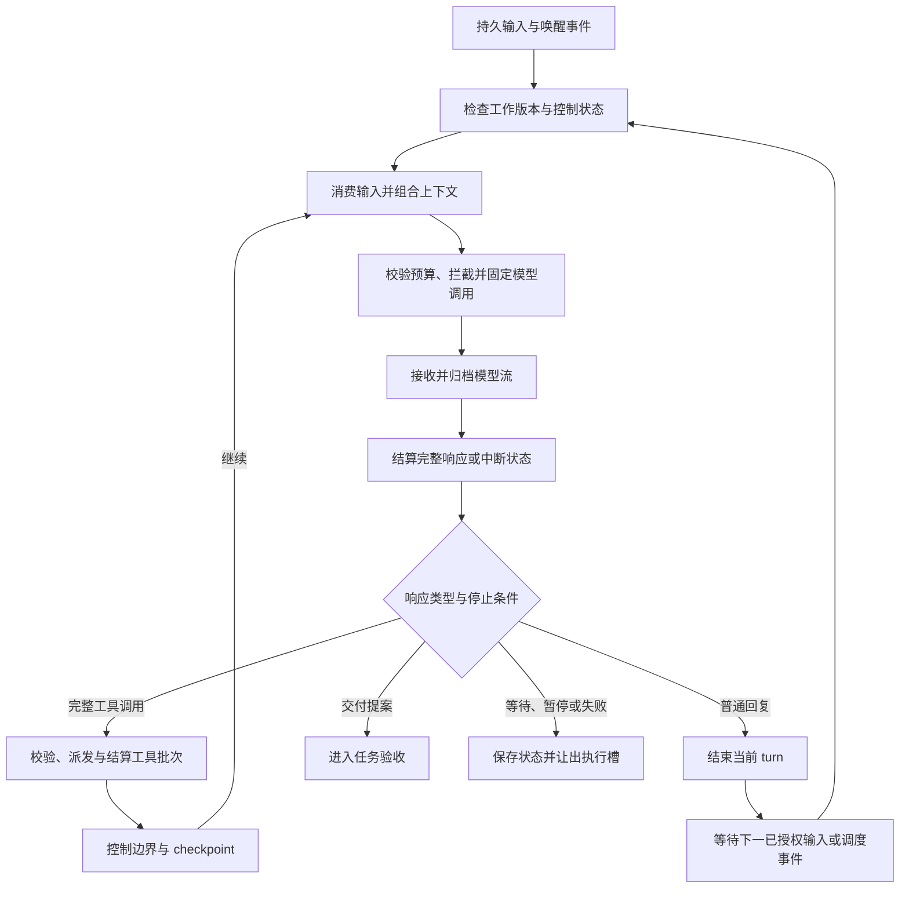

# GraphAgent Agent Loop 设计

| 项目     | 内容                                                                                                                                                                                                               |
| -------- | ------------------------------------------------------------------------------------------------------------------------------------------------------------------------------------------------------------------ |
| 状态     | 启动设计草案；尚未建立运行实现                                                                                                                                                                                     |
| 更新日期 | 2026-10-04                                                                                                                                                                                                         |
| 范围     | 执行层次、输入消费、模型/工具循环、运行 profile、checkpoint 与恢复                                                                                                                                                 |
| 依赖     | [运行时](./03runtime-and-scheduling.md)、[工具](./04interceptor-and-tool-execution.md)、[模型预算](./05model-policy-and-budget.md)、[会话](./09conversation-and-messaging.md)、[提示词](./10prompt-composition.md) |

## 1. 职责与循环层次

Agent Loop 驱动一个执行上下文的连续工作：消费输入、构建上下文、调用模型、处理工具与结果、等待条件、提交候选交付物，并响应用户控制。工作 Loop 归属 Assignment；私聊、群聊参与者和挂起后的临时聊天也可以拥有独立 Loop，不为普通讨论伪造 TaskAttempt。它是 GraphAgent 的基础模块，由 Activity 驱动，不持续占用员工邮箱。

| 层次               | 定义                                  | 结束含义                                                   |
| ------------------ | ------------------------------------- | ---------------------------------------------------------- |
| Goal / TaskAttempt | 目标和一次工作尝试的业务生命周期      | 由任务与验收模块决定，不由模型 finish reason 决定          |
| AssignmentLoop     | 一个员工承担一项职责的可恢复执行      | 可工作、等待、暂停、交接或结束，不等于整个 Goal 结束       |
| Turn               | 一个已接受输入批次触发的一段响应/工作 | 无工具回复、显式让出或阻塞可以结束 turn；Assignment 可继续 |
| Step               | 一次完整模型响应及其工具批次结算      | 下一 step 消费工具结果和允许追加的输入                     |
| CallAttempt        | step 内的一次真实 provider 调用       | 重试使用新 callId，分别记录费用与失败，不重复消费原输入    |

子任务返工轮次、模型 step 次数和 provider 重试次数分别计量。员工实例可以连续承担不同 Assignment，但每项工作拥有独立 LoopPosition、对话视图、待处理工具与上下文快照。

Loop 不直接改任务图、凭据、文件记忆或预算数据库。委托、交付、读取记忆和资源执行通过相应应用服务/内置工具；任务服务负责验收，模型平台负责协议，工具模块负责权限和副作用。

消息如何定位上下文、群聊投递和用户管理边界见[09 会话与消息交互](./09conversation-and-messaging.md)。提示构建与协议渲染见[10 提示词组合](./10prompt-composition.md)。

## 2. 参考源码与采用方向

| 固定源码入口                                                                                                                                                                                                 | 已核对机制                                                         | 采用与补足                                                      |
| ------------------------------------------------------------------------------------------------------------------------------------------------------------------------------------------------------------ | ------------------------------------------------------------------ | --------------------------------------------------------------- |
| [DSH agent-loop/agent.ts](../../references/deepseek-harness/packages/core/agent-loop/src/agent.ts)                                                                                                           | turn/step/request 分层，步骤前准备、流结算、工具批次、请求错误重试 | 借鉴循环边界；补 TaskAttempt/Assignment、预算、epoch 和交付验收 |
| [DSH inbox.ts](../../references/deepseek-harness/packages/core/agent-loop/src/inbox.ts)                                                                                                                      | 持久 next-turn/next-step 输入与去重                                | 借鉴安全边界消费，增加输入实际生效位置与权限来源                |
| [DSH assistant-stream.ts](../../references/deepseek-harness/packages/core/agent-loop/src/assistant-stream.ts)、[tool-calls.ts](../../references/deepseek-harness/packages/core/agent-loop/src/tool-calls.ts) | 流尝试与终结关联、受限并发工具与结果顺序                           | 借鉴先结算再循环；未知效果与无效参数保持真实状态                |
| [Hermes conversation_loop.py](../../references/hermes-agent/agent/conversation_loop.py)                                                                                                                      | 模型调用、工具、压缩、重试、干预与迭代限制组成连续循环             | 借鉴完整执行场景，不搬运单体 provider/宿主分支                  |

参考提交沿用[源码映射](./reference-code-map.md)中的固定值，参考仓库只作为研究输入。

## 3. 正常执行路径



1. **Admit**：校验 ExecutionContext、LoopOwner、executionEpoch、推进闸门、模板与 profile；工作所有权另验 Assignment/TaskRevision，讨论另验会话成员与 binding。处理已到达的挂起/取消，无有效输入或恢复工作时不空调用模型。
2. **Claim**：从持久邮箱取得一个 next-turn 输入批次，原子登记 turnId 和已领取输入 ID。领取后输入仍可从 turn 记录恢复，不先删队列再补记消费。
3. **Compose**：在安全步骤边界接纳 next-step 输入，取得当前对话视图、任务、工具能力、记忆/技能与环境快照，按 recipe 形成规范请求。先确定可行候选 route 及能力，但不开始网络调用。
4. **Prepare**：内容拦截与 schema 校验后重新估算最终输入，预留调用预算，使用共享平台 prepareCall 固定 selection/实现代次/目录 revision。请求改变需重新校验预算与调用绑定；记录实际发出的上下文，原生编解码由共享 codec 完成。
5. **Stream**：记录 callId、片段序号、原生状态与 usage；UI progress 不推进任务状态。工具参数增量只用于观察，不立即执行。
6. **Settle**：先持久化完整响应或明确中断结果，再决定是否执行工具。结束原因、用量、响应 ID 和错误保留真实值；不能用最后一句文本推断供应商成功。
7. **Dispatch**：完整 tool-call 经 schema、当前授权、拦截与资源仲裁后执行；工具名必须属于当前有效目录。按调用顺序把结果加入下个步骤，实际完成顺序另记。
8. **Boundary**：结算效果与费用，保存 checkpoint，处理控制消息，再决定下一 step、等待、交付或停止。等待时释放模型/Worker 活动槽，邮箱继续收件。

最终外发检查必须覆盖 codec/Executor 额外加入的可外发内容和附件；可信凭据注入保持独立。记录拦截前组合快照与实际发送快照的关联，不能只保存原提示再执行变换后的内容。

## 4. 输入边界与等待

会话模块将正文或通知转成 LoopInput，Loop 按 next-turn、next-step 或 interrupt-boundary 消费，并记录真实生效位置。发送者身份与权限由宿主确认，provider 的消息角色不改变实际授权。interrupt/queue/steer 的产品语义与作业屏蔽见[09 第 3 节](./09conversation-and-messaging.md#3-非挂起追加interruptqueuesteer)。

审批、用户补充与子任务等待使用结构化 waitRef。控制效果由可信工具结果/宿主命令提交，不从自然语言正文猜测；冲突控制动作在派发前拒绝。迟到工具回报按原调用配对并结算，但不能启动用户已挂起的工作。工具批次和控制边界继续复用[工具设计](./04interceptor-and-tool-execution.md)与[运行时](./03runtime-and-scheduling.md)。

用户管理的挂起、恢复和主动停止不注册为模型工具；Loop 仅应用已经由应用管理服务校验的命令。临时聊天与原工作切换见[09 第 4 节](./09conversation-and-messaging.md#4-挂起工作并发起临时聊天)。

## 5. 结束、循环上限与错误

| 情况                     | Loop 处理                         | 业务影响                                             |
| ------------------------ | --------------------------------- | ---------------------------------------------------- |
| 无 tool-call 的完整文本  | 结束 turn，发布允许展示的回复     | 不直接完成 TaskAttempt；若需交付，仍须产物与验收     |
| 提交 Artifact            | 结束当前工作段，等待验收结果      | 验收通过才完成职责/尝试；返工按任务模块建立下一执行  |
| 等待输入/审批/子任务     | 保存 waitRef 并让出               | 状态投影为 BLOCKED/WAITING 的具体原因                |
| max-output/截断          | 记录 incomplete-output            | 不执行不完整工具参数；按剩余预算决定续写、摘要或阻塞 |
| 空响应/错误结构/未知工具 | 返回有上限的可解释错误与修复机会  | 重复失败达到上限后等待处理，不无限 nudging           |
| 配额或硬预算不足         | 保存事实清单、收尾或排队          | 用户暂停保持有效，不自动提高预算                     |
| 挂起/停止/交接           | 分别冻结 Loop、取消职责或转移责任 | 挂起保留命令与资源；abort 不等于工具效果撤销         |

每个 profile 定义 maxStepsPerTurn、maxCallAttemptsPerStep、maxNoProgressSteps 与收尾保留量；各自仍受 Goal 累计预算、返工轮次和截止时间约束。一次重试也记真实费用，不通过重置 turn/step 绕开上限。

无进展判定参考工具名/参数摘要、结果、工件版本与已解决事项，而非仅比较回复文字。重复同一失败、循环请求同一不可用资源或始终未改变交付状态时，可提示一次明确障碍并进入等待/失败处理。

模型纯文本结束后，如果职责尚未交付，宿主记录 turn-ended/work-incomplete 与下一处理入口。已授权持续 Goal 可以由调度器发出有记录的继续工作事件；Loop 不暗中无限追加“继续”提示，也不能把未完成责任静默标为成功。

provider 重试不重复领取输入或执行已完成工具；换 route/模型需经 05 号稿的可移植上下文重建。流失败保留原 CallAttempt，新增调用不将两次回答或工具 ID 混为一份成功响应。无法核对的工具效果进入 BLOCKED，不能补造成功结果以恢复配对。

## 6. 运行 profile 与模型用途

| Profile                  | 默认用途选择                    | 身份/历史                                      | 工具与循环                                                        |
| ------------------------ | ------------------------------- | ---------------------------------------------- | ----------------------------------------------------------------- |
| work / plan              | 工作/计划用途；依配置主模型兜底 | 模板、实例和当前 Assignment 历史               | 已授权领域工具，可多 step，等待时让出                             |
| batch-work               | 批量用途                        | 临时实例与独立明确子任务                       | 依职责提供有限工具；不能因使用 Flash 就开放全部权限               |
| chat / suspended-chat    | 工作用途；依配置主模型兜底      | 员工身份、获准会话历史；临时聊天另带原工作快照 | 多 step，按对话授权提供工具；不自动完成或恢复原工作               |
| chat（空闲自动接话预设） | 批量用途；显式配置可选工作用途  | 员工身份、无正文通知及主动读取的本批群消息     | 最多 2 step、默认每 step 1 次调用，只读本群和固定 reply/pass 输出 |
| recap                    | 按记忆策略配置整理用途          | 固定结算源资料与提取规则                       | 默认提案输出；按需开放获准只读记忆/原文工具，写入由提交器处理     |
| dream                    | 批量用途的 dreamModel           | 新上下文，员工身份只作环境资料，不续接工作会话 | 分阶段整理提案，获准读取与受控提交；允许与工作模型相同            |
| compaction               | 配置的整理用途                  | 固定消息区间与摘要规则                         | 默认一次受限摘要调用，不执行来源中的工具指令                      |
| lightweight              | 轻量用途                        | 一次性明确输入，不加载完整员工/工作历史        | 一次调用，不提供工具、skill 或派单；失败重试单独计量              |
| security-review          | 安全用途                        | 最小必要证据与检查规则                         | 受控审查输出；外发与本地模型边界遵循概念设计及 Gate               |

用途组仅选择候选模型，profile 决定上下文、输出契约和运行能力。相同 modelId 可同时承担 work、dream 或 lightweight，但租约、上下文和权限相互独立。不能把 batch 用途等同于单次无工具，也不能给 lightweight 套用完整 Agent Loop 的自动工具循环。

profile 注册时校验用途与能力约束：lightweight 固定 maxStepsPerTurn=1、toolMode=none，不启用技能或派单；调整 recipe 或候选模型不能放宽这些限制。其他 profile 的工具范围仍取运行权限交集，模型名称和用途标签本身不授予任何工具能力。

计划/旗舰等用途的详细路由仍由模型模块审查；本稿只规定执行能力边界。安全用途采用本地模型，按概念要求使用非本地模型时须经过明确警告与确认；当前授权不能由模型自己声称，配置状态由服务校验。

## 7. 候选公共结构

以下是执行契约片段，profile 规定运行能力；提示区块与快照定义在[10 第 4 节](./10prompt-composition.md#4-候选公共结构)，消息、路由与挂起元数据在[09 第 7 节](./09conversation-and-messaging.md#7-候选公共结构)。实施时跨模块类型引用同一产品契约，不复制定义，也不在此规定未来源码路径。

```typescript
type LoopProfileId =
  | "work"
  | "plan"
  | "batch-work"
  | "chat"
  | "suspended-chat"
  | "recap"
  | "dream"
  | "compaction"
  | "lightweight"
  | "security-review";

type LoopOwner =
  | {
      kind: "assignment";
      workspaceId: string;
      goalId: string;
      assignmentId: string;
      taskAttemptId: string;
      taskRevisionId: string;
    }
  | {
      kind: "conversation";
      workspaceId: string;
      conversationId: string;
      instanceId: string;
      suspensionFrameId?: string;
    }
  | { kind: "maintenance"; workspaceId: string; jobId: string }
  | { kind: "one-shot"; requestId: string; workspaceId?: string };

interface LoopPosition {
  loopId: string;
  executionContextId: string;
  owner: LoopOwner;
  executionEpoch: number;
  turnId: string;
  stepId: string;
  callAttemptId?: string;
}

interface ExecutionContextRecord {
  executionContextId: string;
  workspaceId: string;
  instanceId?: string; // 维护/一次性调用可以没有员工
  owner: LoopOwner;
  loopId: string;
  profileRevisionId: string;
  budgetAccountId: string;
  permissionRevision: string;
  conversationViewRevision: string;
  executionEpoch: number;
  advancementGate: "open" | "suspended" | "closed";
  advancementGateRevision: string;
  revision: string;
}

interface LoopProfileRevision {
  profileId: LoopProfileId;
  revisionId: string;
  promptRecipeRevisionId: string;
  modelPurpose: string; // 引用产品用途组，不定义 provider/model 基础目录
  maxStepsPerTurn: number;
  maxCallAttemptsPerStep: number;
  maxNoProgressSteps: number;
  toolMode: "none" | "read-only" | "assignment-policy";
  outputContractRevisionId: string;
}

interface LoopInput {
  inputId: string;
  loopId: string;
  executionContextId: string;
  inboxEntryId?: string; // 聊天关联员工收件箱，工具结果/宿主唤醒沿用原运行来源
  receivedSeq: number;
  senderRef: string;
  kind:
    | "user-input"
    | "agent-message"
    | "conversation-notification"
    | "tool-result"
    | "runtime-wake";
  applyAt: "next-turn" | "next-step" | "interrupt-boundary" | "control";
  contentObjectId: string;
  appliedAt?: { turnId: string; stepId: string };
}

interface LoopCheckpoint {
  checkpointId: string;
  position: LoopPosition;
  profileRevisionId: string;
  consumedInputIds: string[];
  conversationViewRevision: string;
  advancementGateRevision: string;
  suspensionFrameId?: string;
  lastPromptSnapshotId?: string;
  pendingToolCallIds: string[];
  effectLedgerCursor: string;
  usageLedgerCursor: string;
  waitRef?: string;
  stopReason?: string;
}
```

这些字段由运行时管理，模型只看到获准摘要。预算和权限 revision 是实际执行检查依据。maintenance/one-shot 所有权与员工 Assignment 分开，不为标题等一次性调用伪造 TaskAttempt；无员工模板时不带 templateRevisionId，仍有调用主体与 requestId/jobId、用途归因。

## 8. 执行日志与恢复

重启从 checkpoint 重建邮箱消费和对话视图，核对在途工具/调用效果，递增 epoch，再重新校验授权与预算。历史调用可查看固定旧提示；恢复后的新调用按明确 profile/策略版本重新组合，并记录差异。恢复不执行旧 tool-call；不可核对的效果仍阻塞。

profile/策略更新不回写历史调用记录；后续执行在安全边界使用明确版本，输入可审查不表示模型输出确定。实际调用快照和 recipe 更新规则见[10 第 5 节](./10prompt-composition.md#5-调用快照与版本更新)。

## 9. 最小贯通样本与验收

首个 fake 样本：用户要求读取资料并交付报告 → 模型完整提出只读工具 → 工具结果结算 → 用户在下一步骤追加格式要求 → 新 PromptSnapshot 包含已应用修正 → 模型提交报告候选 → 验收服务判定完成。每段均可按 LoopPosition 和 callId 定位。

- 无工具回复只结束 turn，不直接完成未交付 Assignment；显式等待有恢复入口。
- partial tool arguments、截断和中断不能触发执行；完整批次逐项有配对结果。
- 同一输入重复投递或 provider 重试只应用一次；新输入按步骤边界生效。
- 模型流与工具等待期间仍能接收控制，暂停后迟到结果不自动恢复。
- work/dream 可以使用相同模型且隔离上下文；lightweight 没有工具/skill/派单循环。
- 超长内容保留必要块与工具配对，重启不重做已发生效果，费用不会因错误被归零。

会话专项验收见[09 第 8 节](./09conversation-and-messaging.md#8-验收场景)，提示专项验收见[10 第 6 节](./10prompt-composition.md#6-验收场景)。

后续实施先固定 schema、fake stream/tool/inbox 和四类协议的提示映射 fixture，再用真实 route 验证完整循环。默认次数/余量、模型参数、技能激活协议和实际 profile 注册位置需随样本校准；本轮不建立运行包或供应商特例。
