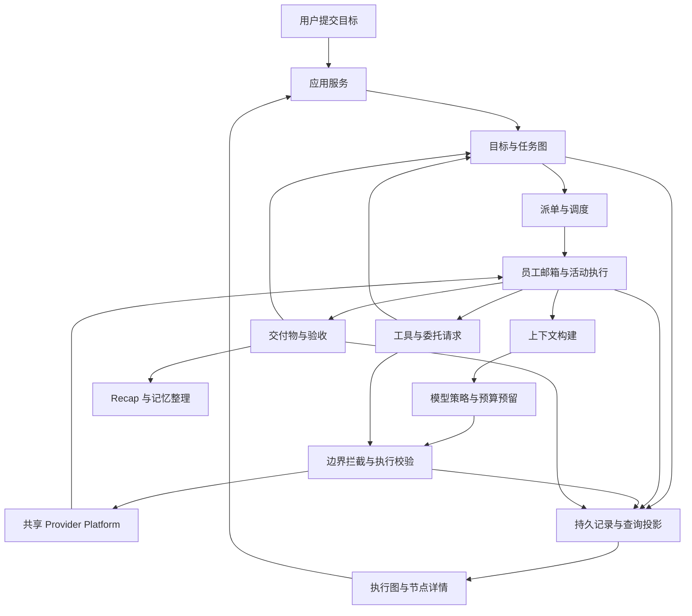

# GraphAgent 功能模块设计总览

| 项目         | 内容                                                         |
| ------------ | ------------------------------------------------------------ |
| 状态         | 启动阶段设计草案；本轮只细化设计，不建立运行工程             |
| 输入         | [概念设计](./concept-design.md)、[参考源码映射](./reference-code-map.md) |
| 首个验收目标 | 用户提交目标后，多个员工可动态协作，执行图可观察、可干预、可恢复，预算与信息边界受控 |

## 1. 产品范围

GraphAgent 是以执行图为中心的智能体协作产品。用户提交目标后进入任务工作台，可以查看任务分叉、依赖、员工、当前步骤、交付物、预算和等待原因；可以深入节点，暂停、修改要求、追加工作或调整负责人。

“没有数量和顺序的限制”指业务拓扑不限定为固定层级或固定流水线。任何获准员工可以向符合条件的职位池或员工派单，同一员工可以收到多个来源的邀请；实际规模仍受预算、实例容量、权限、队列上限和循环终止条件约束。

本阶段包含：任务图与协作、职位模板与实例、Agent Loop 与提示词组合、调度与恢复、模型与工具执行、拦截器、预算、分层记忆、recap/做梦、技能管理和工作台。实现按[启动计划](./plan.md)逐步形成闭环。

首页下方的 2.5D 办公室、Q 版人物、动作、表情气泡和点击人物互动属于概念宣传内容，**不属于本阶段产品功能，也不进入排期与验收**。普通员工头像、名称和状态标签仍可作为执行图的信息元素。

## 2. 领域对象与事实归属

| 对象                            | 职责与所有者                                       | 关键区别                                      |
| ------------------------------- | -------------------------------------------------- | --------------------------------------------- |
| Workspace                       | 用户工作环境、资源绑定和访问范围                   | 不等同于文件系统目录，一个目录只是绑定资源    |
| Goal                            | 用户希望实现的结果、验收条件、总预算               | 聊天消息是输入，目标是持续工作的依据          |
| Task / TaskRevision             | 可交付的逻辑工作及不可变要求版本                   | 一个任务可以依赖多个来源，不等同于一个员工    |
| TaskAttempt                     | 对某个要求版本的一次执行                           | 重试和交接后的新执行保留旧尝试                |
| Assignment                      | 把一次尝试中的职责交给一个实例                     | 一项尝试可有执行、评审、汇总等多个 Assignment |
| AgentTemplateRevision           | 职位能力、身份和策略的固定版本                     | 更新模板不修改已有员工                        |
| AgentInstance                   | 有独立身份、邮箱和经验的员工                       | 可连续承担不同 Task，但任务上下文独立         |
| Conversation / ChatMessage      | 普通 IM 会话、消息与员工收件箱                     | 内置聊天与平台适配共用入口，不共享模型历史    |
| ExecutionContext                | 员工 Loop 上下文与可恢复挂起                       | 挂起工作保留运行资源，临时聊天独立执行        |
| ArtifactRevision                | 正式交付物及血缘                                   | 最后一句聊天不自动表示验收通过                |
| InterceptionDecision            | 某一内容版本过关、变换或阻断的证据                 | 图上的展示位置不决定实际执行边界              |
| BudgetReservation / UsageEntry  | 预留与已发生消耗                                   | 额度事实、消费估计和真实账单分别记录          |
| MemoryRevision / SkillRevision  | 可编辑记忆和程序性经验的版本                       | 运行事件、整理后的流水记忆和上下文彼此独立    |
| RuntimeEvent / Checkpoint       | 已提交事实与安全恢复位置                           | 回放事实不会重新执行外部副作用                |

所有产品对象带 Workspace 归属、创建来源和版本信息。历史实例、模板、任务和产物引用不可被删除后重新指向另一实体。展示名称可以调整，稳定 ID 不随之改变。

## 3. 六层文档结构

| 层级 | 主题                 | 设计入口                                                         |
| ---- | -------------------- | ---------------------------------------------------------------- |
| 1    | 职位模板与员工实例   | [01_Agent 模板与实例](./01_agent-template-and-instance.md)       |
| 2    | 消息聊天             | [02_消息聊天](./02_conversation-and-messaging.md)                |
| 3    | Loop、派发与任务执行 | [03_Agent Loop、派发与任务执行](./03_agent-loop-dispatch-and-execution.md) |
| 4    | 工具调用             | [04_工具调用](./04_tool-execution.md)                            |
| 5    | 拦截、记忆、整理与技能 | [05_拦截器、记忆、整理与技能](./05_interception-memory-and-skills.md) |
| 6    | 工作台与外部对接     | [06_工作台与外部对接](./06_workspace-and-integrations.md)        |

各层拥有自己的业务事实，通过命令和已提交事件协作。Scheduler 不直接改记忆，做梦模型不直接改进行中的 Task，UI 不直接写运行存储，Interceptor 不直接替调度器创建 Assignment。

## 4. 运行主路径

1. 用户输入经过入口拦截，形成 Goal 和初始 TaskRevision。
2. 协调员工可以提议分解和派单；运行时校验图依赖、权限、预算和实例容量，原子提交后才执行。
3. 调度器发邀请，员工接受、拒绝或提出排队/反报价；接受后创建 Assignment 并取得执行资源。
4. Agent Loop 在安全步骤边界消费输入，按版本化 recipe 组合身份、任务、权限、预算、知识和局部历史；归档实际调用快照，通过共享平台固定一次模型调用。
5. 工具、消息、委托、读取和发布经过对应拦截边界；所有动作关联原任务、尝试与调用。
6. 产物通过验收后解除依赖；失败或被修改时产生新尝试或新要求版本。
7. 短任务完成后可以触发 recap；空闲或定时的做梦任务独立运行，以版本化变更整理知识。

## 5. 跨模块不变量

- 默认一个实例同时执行一个 Assignment；邮箱始终可处理控制消息，等待外部工作不占用模型执行槽。
- 一个 TaskAttempt 有一个交付责任人；其他执行者和评审者有明确角色。多来源请求不会静默合并要求。
- 调度依赖保持 DAG。返工循环以有上限的新轮次展开，通信本身不自动产生依赖边。
- 暂停、取消和要求修改是持久命令；命令被接受与实际生效分别显示，终态以运行记录为准。
- 权限取系统、Workspace、模板、Goal 与 Assignment 的约束交集；委托和拦截不能扩大权限。
- 模型调用、审查、压缩、recap、做梦、工具收费和外包均有消耗归因；派生工作不会产生额外总预算。
- 任何内容变换后重新校验最终执行对象；已审查的旧输入不能授权变换后的新输入。
- 原始 provider 状态只能由匹配 route/codec 消费；跨模型交接使用可移植摘要和产物引用。
- 记忆与技能是低于身份和授权的资料；生成内容不能自行提升为系统规则或可信权限。
- 单写入者和版本检查约束业务修改；外部操作按可重试性分别恢复，未知结果不得自动重做。
- 挂起、恢复和主动停止只由用户在应用内发起；Agent 工具、消息平台命令和自然语言声明都不能替代。

## 6. 共享能力与实现边界

服务商、认证、账号、模型目录、API 协议、codec、推理执行和用量基础类型遵循[共享 Provider Platform](../common/core/cross-provider-service-protocol-design.md)。GraphAgent 拥有 ModelPolicy、ModelLease、预算、回退、亲和、工具循环和自己的应用服务；不调用 `IPolyQuotaService`，不复用 `packages/polyquota-ui`。

凭据遵循[共享与迁移设计](../common/core/credential-sharing.md)。两个产品的任务和设置独立存储；GraphAgent 不打开 PolyQuota 私有数据库。共享凭据代理的物理实现仍须专项验证。

## 7. 技术决策边界

建议先在现有 TypeScript/Node 工具链上验证独立、无 UI 的本机运行内核，提供 fake 端口和可取消 Activity。采用 Actor 的身份、顺序邮箱和持久恢复语义，不以 Kubernetes、Orleans 或分布式 Worker 为首版前提。

记忆模块已确定默认 Markdown 文件/真实目录后端，以及独立 SQLite 原始消息档案与派生索引。其余 UI 框架、桌面宿主、图布局库、Task Ledger 存储与共享凭据代理传输在实施前做专项选择。本设计不提前创建包名或目录占位。

工具专项默认选择原生结构化调用、按平台解析的 ripgrep、直接 argv 与 Windows pwsh 7/UTF-8，以及实时搜索/排除、正则替换和版本化提交。网页研究提供 search/extract/crawl，首版优先适配 Tavily 且不实现本地浏览器渲染；browser use 采用按需安装的 Chrome DevTools MCP；桌面能力另做扩展样本。细分设计统一进入 [tools 目录](./tools/README.md)。

本轮可固定的是事实归属、协作语义、信息边界和验收场景。各文档中的字段和端口是候选契约，实施时需转为共享 schema 并验证；不应把草案接口当作已完成实现。
