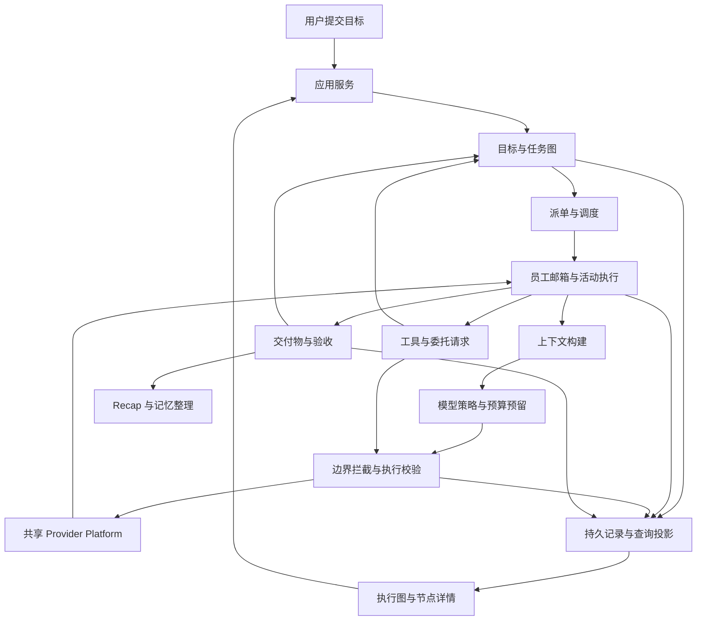

# GraphAgent 功能模块设计总览

| 项目 | 内容 |
| --- | --- |
| 状态 | 业务目标设计（按[启动与验收计划](../plan.md)分阶段实施） |
| 关联入口 | [概念设计](../concept-design.md) · [参考源码映射](../reference-code-map.md) · [项目架构](../../architecture.md) |
| 核心验收目标 | 用户提交目标后，多个智能体可动态协作，执行图可观察、可干预、可恢复，预算与信息边界受控 |

## 1. 产品范围

GraphAgent 是以自由执行图为核心的多智能体协作产品。用户提交目标后进入任务工作台，可观察任务分叉、依赖、参与员工、当前步骤、交付物、预算与等待原因，并随时深入节点执行暂停、修改要求、追加工作或调整负责人。

「完全放开 Subagent 与协作拓扑」指业务拓扑不限定为固定层级或固定流水线：任何获准员工可按需向符合条件的职位池或员工派单，同一员工可接收多来源邀请；实际规模仍受预算、实例容量、权限、队列上限与循环终止条件约束。

产品覆盖六大核心能力域：职位模板与员工实例、消息聊天（私聊/群聊/临时会话）、执行图与 Agent Loop（调度/恢复/预算/模型策略）、原生工具执行与外部扩展、拦截器与分层记忆（Recap/做梦/技能）、工作台与外部对接（跨设备/A2A/外部 Coding Agent）。首页下方的 2.5D 办公室与 Q 版人物动画属于概念宣传，不纳入本阶段产品功能与排期。

## 2. 领域对象与事实归属

| 对象 | 职责与所有者 | 关键区别 |
| --- | --- | --- |
| Workspace | 用户工作环境、资源绑定和访问范围 | 不等同于文件系统目录，一个目录只是绑定资源 |
| Goal | 用户希望实现的结果、验收条件、总预算 | 聊天消息是输入，目标是持续工作的依据 |
| Task / TaskRevision | 可交付的逻辑工作及不可变要求版本 | 一个任务可以依赖多个来源，不等同于一个员工 |
| TaskAttempt | 对某个要求版本的一次执行 | 重试和交接后的新执行保留旧尝试 |
| Assignment | 把一次尝试中的职责交给一个实例 | 一项尝试可有执行、评审、汇总等多个 Assignment |
| AgentTemplateRevision | 职位能力、身份和策略的固定版本 | 更新模板不修改已有员工 |
| AgentInstance | 有独立身份、邮箱和经验的员工 | 可连续承担不同 Task，但任务上下文独立 |
| Conversation / ChatMessage | 普通 IM 会话、消息与员工收件箱 | 内置聊天与平台适配共用入口，不共享模型历史 |
| ExecutionContext | 员工 Loop 上下文与可恢复挂起 | 挂起工作保留运行资源，临时聊天独立执行 |
| ArtifactRevision | 正式交付物及血缘 | 最后一句聊天不自动表示验收通过 |
| InterceptionDecision | 某一内容版本过关、变换或阻断的证据 | 图上的展示位置不决定实际执行边界 |
| BudgetReservation / UsageEntry | 预留与已发生消耗 | 额度事实、消费估计和真实账单分别记录 |
| MemoryRevision / SkillRevision | 可编辑记忆和程序性经验的版本 | 运行事件、整理后的流水记忆和上下文彼此独立 |
| RuntimeEvent / Checkpoint | 已提交事实与安全恢复位置 | 回放事实不会重新执行外部副作用 |

所有产品对象带 Workspace 归属、创建来源和版本信息。历史实例、模板、任务与产物引用不可删除后复用指向其他实体；展示名称可调整，稳定 ID 不变。

## 3. 六层设计文档结构

本目录按「从底层身份到外部交互」的顺序组织，编号越小越接近核心领域模型，编号越大越接近用户与外部生态：

| 层级 | 主题 | 设计入口 |
| --- | --- | --- |
| 1 | 职位模板与员工实例 | [01_Agent 模板与实例](./01_agent-template-and-instance.md) |
| 2 | 消息聊天 | [02_消息聊天](./02_conversation-and-messaging.md) |
| 3 | Loop、派发与任务执行 | [03_Agent Loop、派发与任务执行](./03_agent-loop-dispatch-and-execution.md) |
| 4 | 工具调用 | [04_工具调用](./04_tool-execution.md) · [工具专项](./tools/README.md) |
| 5 | 拦截、记忆、整理与技能 | [05_拦截器、记忆、整理与技能](./05_interception-memory-and-skills.md) |
| 6 | 工作台与外部对接 | [06_工作台与外部对接](./06_workspace-and-integrations.md) |

专项补充：

- [跨设备任务派发设计](./cross-device-dispatch-design.md)：细化第 3 层调度与第 6 层设备连接，复用既有任务与员工模型。
- [单轮测试对话设计](./test-chat-streaming.md)：说明模型试聊的流式展示及与第 2 层正式会话的衔接。
- [前端服务契约](./frontend-contract.md)与[业务表结构](./business-database.md)：定义当前模型配置页契约与 profile 业务库边界。

各层拥有自己的业务事实，通过命令和已提交事件协作：Scheduler 不直接改记忆，做梦模型不直接改进行中的 Task，UI 不直接写运行存储，Interceptor 不直接替调度器创建 Assignment。

## 4. 运行主路径

1. 用户输入经过入口拦截，形成 Goal 与初始 TaskRevision。
2. 协调员工提议分解与派单；运行时校验图依赖、权限、预算与实例容量，原子提交后进入调度。
3. 调度器发出邀请，目标员工接受、拒绝或提出排队/反报价；接受后创建 Assignment 并分配执行资源。
4. Agent Loop 在安全步骤边界消费输入，按版本化 recipe 组合身份、任务、权限、预算、知识与局部历史，归档调用快照并通过共享平台发起模型调用。
5. 工具、消息、委托、读取与发布经对应拦截边界校验，所有动作关联原任务、尝试与调用。
6. 产物经结构与质量验收后解除下游依赖；失败或要求变更时生成新尝试或新要求版本。
7. 短任务完成后按需触发 Recap；空闲或定时触发的做梦任务在独立上下文中整理知识并提交版本化变更集。

## 5. 跨模块不变量

- 默认一个实例同时执行一个 Assignment；邮箱始终可处理控制消息，等待外部工作不占用模型执行槽。
- 一个 TaskAttempt 只有一个交付责任人；其他执行者与评审者角色明确，多来源请求不静默合并要求。
- 调度依赖保持 DAG；返工循环以有上限的新轮次展开，普通聊天通信不自动产生任务依赖边。
- 暂停、取消与要求修改为持久命令；命令已接受与实际生效分别展示，终态以运行记录为准。
- 权限取系统、Workspace、模板、Goal 与 Assignment 的约束交集；委托与拦截均不能扩大权限。
- 模型调用、审查、压缩、Recap、做梦、工具费用与外包均有消耗归因；派生工作不凭空增加总预算。
- 内容经变换后必须重验最终执行对象；旧输入审批不能授权变换后的新输入。
- 原始供应商会话状态只交回匹配 route/codec 消费；跨模型交接使用可移植摘要与产物引用。
- 记忆与技能的权威低于身份与授权；生成内容不可自行提升为系统规则或可信权限。
- 单写入者与版本检查约束业务修改；外部副作用按可重试性分类恢复，未知结果不得自动重做。
- 挂起、恢复与主动停止只由用户在应用内管理入口发起，不向 Agent 工具或消息平台开放。

## 6. 架构与存储边界

- **共享 Provider 边界**：服务商认证、模型目录、协议编码、推理执行与基础用量事实由共享 Core 提供；GraphAgent 拥有模型策略（`ModelPolicy`）、租约（`ModelLease`）、预算、回退、亲和与工具循环。详见[供应商平台总体设计](../../common/core/provider/design.md)。
- **凭据与业务库分离**：Electron 支持私有加密后端或接入独立 Broker，独立 Web 仅经已授权 Broker 访问凭据；产品自身的账号配置、自定义供应商、模型目录及后续按 Workspace 隔离的运行记录统一保存于本 profile 的 SQLite 业务库，不与 PolyQuota 共用数据库。详见[凭据共享设计](../../common/core/credential-sharing/design.md)。
- **运行内核与知识后端**：采用单宿主、单写入者与 Virtual Actor 语义的本机运行内核（支持向多设备自主 Worker 扩展）；记忆默认采用可读 Markdown 目录树后端并搭配可重建索引，原始消息档案与任务账本持久化于业务库。
- **工具与扩展边界**：默认采用原生结构化工具调用；网页研究、按需挂载的浏览器 MCP 及桌面控制扩展的详细参数与契约见[工具设计目录](./tools/README.md)。

## 阅读约定

- 六层编号文档与跨设备文档均为目标功能设计，接口字段在实施时转为共享契约并验证。
- 模型、账号、服务商与协议路由归属共享 Core，本目录只阐述 GraphAgent 的策略层与编排语义。
- 每篇文档仅在本层展开职责，跨层约束通过链接指向对应归属。
