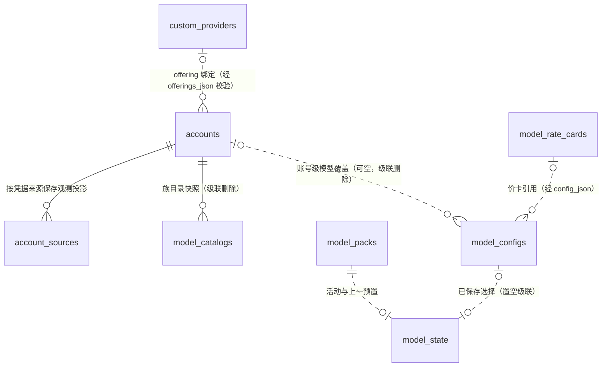

# GraphAgent 业务数据库表结构

**阶段 2B 实现。** 每个 GraphAgent profile 使用一座 `graph-agent.sqlite3`。本次定义账号、自定义供应商和模型配置。以后创建的会话、消息和请求等业务数据也进入该库，按 `workspace_id` 隔离，其表结构及关联留到对应功能设计。2B 的单轮试聊仍然关闭即丢弃。[项目架构](../../architecture.md#graphagent-业务数据库) · [2B 实施步骤](../../common/core/provider/implementation-plan.md#模型配置改版的数据实施方案)

## 建表依据

| 参考实现 | 源码中的做法 | GraphAgent 采用的部分 |
| --- | --- | --- |
| Dify | `provider_models` 以租户、供应商、模型名和模型类型联合唯一。`TenantDefaultModel` 单独记录默认选择。 | 将参与定位、关联和唯一性检查的身份存成列，测试选择只引用模型。这里的隔离单位是本地 profile、offering、账号和协议端点。[Dify 模型定义](https://github.com/langgenius/dify/blob/cfca0887c56e18daabbbf088849b028f6d206157/api/models/provider.py) |
| SuperSonic | `s2_chat_model` 一行保存一个模型实例，名称单列，服务将 `config` 序列化为有类型的 `ChatModelConfig`。 | 一个模型的能力、参数和基础价覆盖一起编辑、一起校验，放在同一行的结构化字段。认证材料仍由凭据服务单独管理。[SuperSonic 表定义](https://github.com/tencentmusic/supersonic/blob/e3928d095035ef881c6bb0f0d5e39c5843e16de8/launchers/standalone/src/main/resources/db/schema-mysql.sql) · [配置读写](https://github.com/tencentmusic/supersonic/blob/e3928d095035ef881c6bb0f0d5e39c5843e16de8/common/src/main/java/com/tencent/supersonic/common/service/impl/ChatModelServiceImpl.java) |

日常手工配置以「一个作用域、一条协议路由、一个精确上游模型 ID」为一行。预置按包更新、远端目录按一次完整发现替换，分别按各自的更新单位保存。价卡独立修订，`model_rate_cards` 表已随当前 schema 建立。增加一个参数、一个输入输出组合或一项计量，无需新增业务表。应用偏好仍由设置服务管理。

## 账号、凭据与自定义供应商

| 归属 | 键和字段 | 写入与使用 |
| --- | --- | --- |
| 凭据后端（私有或 broker） | `accountId`、`providerId`、账号标识文本（如登录名或邮箱）、不透明凭据内容。加密、授权、记录修订等由后端自身管理。 | 只共享凭据。自定义 `providerId` 对接收端是不透明引用，名称、图标、offering、URL、传参规则及模型配置均由本地业务库持有。PolyQuota 自动忽略不认识的自定义供应商，保留共享记录，跳过供应商接入和订阅轮询。 |
| `accounts` | `account_id` 主键与凭据的 `accountId` 对应，`provider_id, stable_identity, offering_id, auth_method, display_name, enabled, revision`，`provider_id, offering_id` 上有组合索引。`stable_identity` 用于核对来自不同凭据后端的账号。可用账号必须绑定该供应商的一个 offering。账号待绑定或用户显式解绑时，`offering_id` 可空，保留原账号 ID。 | 内置账号按注册表验证接入点，自定义账号按本地供应商记录验证。显示名、启用状态在此编辑。登录标识只用于识别或展示，不能用同名、同邮箱、同 URL 或相同 Key 推断两个账号为同一身份。 |
| `custom_providers` | `provider_id` 主键，`name`、可空的 `icon`、`offerings_json, revision, operation_id, creation_hash, template_kind`。一行保存一个自定义供应商，创建操作 ID 唯一，配合请求摘要校验重试。迁移 v3 将已有记录标为 `generic`。 | 每个 offering 包含稳定的 `offeringId`、名称和协议端点。`new-api` 模板的 offering 另存 `siteBaseUrl`。端点保存 API 根地址、支持的协议选项和端点修订。供应商保存族策略，offering 保存族根地址、绑定修订与各明细端点的请求规则。 |

GraphAgent 新建的私有凭据文件只保存账号 ID、供应商 ID、账号标识、密文及其加密元数据。应用设置另存 `app-settings.json`。共享新写入的 Key 和订阅分别使用 `provider-key+json` v3 与 `subscription-credential+json` v3；原有 v1/v2 由对应解码器读取。独立 Web 使用已授权的 broker。[私有存储](../../../apps/graph-agent/src/platform/storage.ts) · [共享编解码](../../../packages/core/src/shared-credential-service.ts)

**同一把 Key 的两个用法。** 中转站可以同时定义 `cn` 和 `us` 两个 offering。要在两区使用同一把 Key，分别创建两份账号配置，各有自己的 `accountId`，各自绑定一个 offering。同一 CN 账号可以用自己的同一条凭据访问 CN 已配置的多个端点。例如图片生成与图片编辑各有协议类型和地址，两份模型绑定可以使用同一个上游模型 ID。更换 CN 账号的 Key 使该账号全部端点绑定失效。修改 CN 图片编辑的 URL，则使所有使用 CN 编辑端点的账号重新核验该路由，CN 生成与 US 路由继续有效。

`providerId` 标识实际供应商。2A 的 `compatible-api-key` 是通用实现，多个自定义供应商可以复用其协议适配器，业务身份各自独立。供应商写入时检查 offering ID 在本供应商内唯一、端点种类在本 offering 内唯一，以及 URL 和协议选项合法。供应商配置允许按显示名改名并保留稳定 ID。删除或改变仍被引用的接入点后，旧绑定必须失效，不能退回同名接入点。业务库内无需为每一种地区、端点或非秘密参数建立子表。

**实际调用。** 宿主从当前授权的凭据后端核实账号身份，从本地账号和供应商配置（内置供应商从注册表）解析 offering、协议类型与目标 URL。出站前核对授权、账号归属、启用状态、当前端点及绑定修订，再在宿主内按协议注入凭据。有效绑定修订反映该账号的授权材料与具体端点，供应商改名或编辑同组的其他端点不会误伤在途调用。私有／共享切换后，只有核实为同一账号才沿用其模型配置与测试选择。新 profile 只有共享凭据且缺少本地自定义供应商时，显示待配置并停止出站。重绑操作核对本地供应商、offering 以及凭据上的供应商引用。若需更新旧凭据的引用，须具备该记录的写权限并校验修订；任一侧未完成则保持待绑定，重试沿用同一账号 ID。GraphAgent Web 通过 broker 使用凭据，账号与供应商的业务字段依然保存在本 profile 的 SQLite。

**创建与删除。** 创建模板只描述表单初始结构。每次确认创建在 `custom_providers` 中插入一行，宿主分配新的 `provider_id`；以后凭该 ID 与 `revision` 编辑或删除。删除前按供应商 ID 查询账号表中仍有 `offering_id` 的记录。停用账号、凭据暂不可用以及所选 offering 已失效都算引用。只要仍有绑定，返回引用并保留整条供应商记录。账号移走或显式解绑后，旧模型和测试选择不能再使用原端点。解绑账号保留身份及凭据，可再次绑定。删除提交与新建绑定在业务库事务内互相校验，避免检查后又出现新引用。此操作只移除本地供应商定义。[供应商页上的自定义供应商](../ui/model-configuration/interaction.md#供应商页上的自定义供应商)

账号在各凭据来源观测到的脱敏事实由 `account_sources` 按来源和账号 ID 保存，授权消失时清除该来源的可见投影。账号的本地名称、启停和接入点绑定归 `accounts`。宿主用 `business_cache` 保存来源范围内的缓存及已删除供应商的创建操作标识。[SQLite 仓储](../../../apps/graph-agent/src/platform/business-database.ts)

## 模型配置表

第一步交付下列四张模型表。类型、协议和操作的可用组合由 Core 校验。带 `_json` 的列在读写边界按 schema 校验；浏览列表先用账号、offering 和协议定位范围，再解析该范围内的配置。

| 表 | 主键和主要列 | 数据粒度与写入边界 |
| --- | --- | --- |
| `model_packs` | `revision` 主键，`schema_version, digest, content_json` | 仅保存用户手动导入或在线更新的预置包，含型号、精确 ID、操作、输入输出组合、模板、来源及随包报价；随应用打包的默认预置直接从资源文件 `resources/model-presets.json` 读取，不再复制写入数据库。导入失败保留原包。 |
| `model_catalogs` | `visibility_ref, provider_id, offering_id, account_id, protocol_family_id, family_binding_revision` 联合主键，另存 `retrieved_at, catalog_revision, entries_json`。`account_id` 引用账号，级联删除。 | 一行是当前账号在一个获准协议族上的完整目录快照。条目含原始模型 ID 和供应商实际返回的资料。完整成功后替换，`[]` 是合法空目录，失败保留原值。旧来源或旧绑定的记录不能证明当前可见。 |
| `model_configs` | `id` 主键，`provider_id, offering_id, route_id, upstream_model_id, account_id, account_identity, model_type, config_json`。非空 `account_id` 引用账号，`account_identity` 记录该账号覆盖所属的已核验身份。 | 账号行存该模型的手工登记／确认、预置关联和用户修改。公共行仅用于内置 offering 的模型默认值，`account_id IS NULL`。同一模型在生成和编辑端点各有一行。单纯浏览远端目录不写用户覆盖；选中或编辑时可创建只有身份的账号行。 |
| `model_state` | 固定单行，`settings_revision, active_pack, previous_pack, selected_config_id, operation_id, profile_id, binding_revision`。`active_pack`/`previous_pack` 使用 `$bundled` 指向随包资源或引用用户导入包修订，选择引用 `model_configs`。 | 空库默认指向 `$bundled`（直接读取打包资源）且未选模型。选择只指向具体账号、操作及其输入输出组合；不复制预算、价格或其他参数。启用及回滚包在事务内更新引用。目录刷新使用自己的修订，草稿保存与更改测试选择使用 `settings_revision` 做并发检查。 |

除可空的 `account_id` 外，两个唯一索引的组成列均为 `NOT NULL`。公共默认和账号覆盖各有一个唯一索引。用部分索引处理 SQLite 唯一约束中 NULL 可重复的情况。内置公共范围的写入仍须有当前可取样的账号；自定义供应商只允许账号级模型配置。

```sql
CREATE UNIQUE INDEX model_configs_offering ON model_configs
  (provider_id, offering_id, route_id, upstream_model_id)
  WHERE account_id IS NULL;
CREATE UNIQUE INDEX model_configs_account ON model_configs
  (account_id, provider_id, offering_id, route_id, upstream_model_id)
  WHERE account_id IS NOT NULL;
```

业务库内的表关系如下。`custom_providers` 对账号的 offering 校验与 `model_configs` 对价卡的引用分别经 `offerings_json`、`config_json` 完成，不建外键；`schema_migrations` 记录迁移版本，`business_cache` 按来源保存缓存。



`config_json` 只保存本层显式数据。不同操作及输入输出组合按稳定 ID 分组，字段保留来源与修订。手工确认绑定到当前可见来源和路由修订，不能给另一个账号或重新绑定的路由授予调用资格。草稿只提交修改的字段，服务读取当前行、应用补丁、校验完整候选，在同一事务中写回并更新配置修订。参数和价目支持三种状态，例如输出预算缺键时继承下层，显式 `null` 时显示未知，金额字符串 `"0"` 表示已知零价。恢复继承只删除指定键，保留同一行的其他操作、来源及价格。[字段取值顺序](../../common/core/provider/implementation-plan.md#模型配置改版的数据实施方案)

例如，下面是一条账号行中 `config_json` 的请求参数片段。`maxOutputTokens` 在调用参数内表示输出预算，模型事实中的同名字段表示硬上限。此行只覆盖聊天预算。操作键由操作 ID 和 profile ID 序列化生成，示例省略修订、时间戳和未覆盖的字段。

```json
{
  "operations": {
    "[\"chat\",\"text\"]": {
      "parameters": {"maxOutputTokens": 1024}
    }
  }
}
```

若内置 offering 的公共行给 `chat` 设置输出预算 2,048，账号 B 的行只需上面的覆盖。B 保存后下一轮发送读到 1,024，已经出站的请求继续使用开始时的 2,048。远端目录返回空列表时，B 的配置和测试选择仍可回读，执行资格须按当前绑定重新验证。第一步现有三种聊天协议的模型统一按「标准文本生成大语言模型」和 `chat` 登记。第三步可使用其他模型类型与匹配的协议端点。[非文本端点验收](../../common/core/provider/implementation-plan.md#自定义-api-端点与模型绑定)

## 第三步的价卡

价卡保存在 `model_rate_cards`，主键为 `(rate_card_id, revision)`，一行保存一个不可变版本的 `card_json`。同一卡的币种、来源、适用区间、计量行、分母、阶梯、日历和权益同时校验、同时发布。型号配置按操作、输入输出组合和套餐引用价卡与修订，随包价卡随活动包解析。改变本地报价时，创建新修订并在同一事务内更新相应配置引用。两种来源都应能以引用重现当次计费。[价卡字段及试算样例](../../common/core/provider/model-pricing.md)

前两步的基础价按种类、币种、单位和已有条件存入模型行。第三步将可确定分母的报价转成无条件或相应条件的收费行，保留零价、显式未知和来源，单位不明的原记录可回读。生成和编辑即使使用同一个模型名，亦可绑定不同价卡。单轮试聊只在本轮内按回执去重，用实际扣款替换估算，关闭或重启即释放。

## 协议族绑定与目录迁移

2B 的 `model_catalogs` 以明细路由 `route_id` 分区。改版后，供应商按 `protocolFamily` 声明认证机制、公共额外参数和模型列表能力，offering 绑定该族的根地址及启用的明细端点，账号提供经授权的凭据。自定义供应商的这些非秘密设置随本地供应商配置保存，内置注册表使用同一层次。编辑页在协议族处设置共同连接参数，展开后可看到哪些明细端点使用它们。模型登记、参数覆盖、价卡和测试选择均按解析后的具体路由定位；专用单端点族允许输入时采用已登记的默认路由。SQLite v5 迁移同步移除 `model_state` 对 `model_packs` 的外键依赖，将随包预置切为 `$bundled` 直读打包资源并清理冗余随包副本，同时自动归一化 `model_rate_cards`、`custom_providers` 与用户导入包中的旧枚举字段名。[默认路由选择](../../common/contract/common-api.md#专用单端点族的默认选择) · [现有模型仓储](../../../apps/graph-agent/src/server/model-repository.ts)

| 数据 | 改版后的读写规则 |
| --- | --- |
| 族绑定与修订 | `familyBindingRevision` 标识当前供应商、offering、账号上实际采用的族连接配置与授权状态。修改族根地址、认证机制、凭据或公共参数时，重算受影响账号的族修订，旧目录与依赖它的明细绑定失效。只改明细端点属性时，更新该端点的有效 `bindingRevision`。 |
| 目录快照 | 将 `model_catalogs` 唯一键迁到 `(visibility_ref, provider_id, offering_id, account_id, protocol_family_id, family_binding_revision)`。同一账号从 OpenAI Chat 或 Responses 发起刷新均访问同一 OpenAI 族目录，一次完整分页结果只写一行。Anthropic 同名模型进入独立的族目录。提交前重验族修订与当前授权；换账号、后端或授权范围后按新范围读取。族未声明列表能力时保留各端点的手工登记。 |
| 明细配置与选择 | 保留 `model_configs.id`、现有路由唯一索引以及 `model_state.selected_config_id`。按注册声明从明细端点解析唯一协议族。同一模型在族列表中出现一次，可以有多条明细配置，各自校验操作、能力、启用状态和有效绑定。列表刷新失败或返回空列表不删除这些配置。 |

**默认路由的持久化。** 写入前将专用族输入的缺省或 `null` 解析为注册表中的具体路由 ID。读写 `model_configs.route_id` 时沿用现有 `NOT NULL` 列和公共／账号两个部分唯一索引，因此显式及默认两种输入在同一作用域内更新同一行。`selected_config_id` 继续引用该行，既有显式 ID 原样保留。族默认声明的变化计入绑定修订；提交前复核原修订，过期的空选择需重读。族扩为多端点后仍按持久化的原 ID 读取部署；原端点禁用或已删除时显示失效，保留原配置供用户重新选择。

业务库 v4 将旧目录保存在 `legacy_model_catalogs`，为 `custom_providers` 添加 `family_policies_json`，并按旧连接原有行为显式保存 OpenAI Chat 输出上限字段。宿主按注册声明映射旧路由，保留已发布迁移的校验和。仅当同组旧路由的根地址、版本、认证机制与公共额外参数等效时才生成一份有效的族配置。旧值冲突或路由归属未知时保留原值与引用，配置页列出差异，由有权用户明确族配置或拆为不同 offering。选择完成前，受影响的新族入口不取得可用绑定。旧端点快照可以重新发现，升级时使其失效，避免把部分端点的旧结果当作一次完整的族发现。模型覆盖、价卡、已选账号和端点仍可回读。测试选择及手工确认只有在同一账号、授权与实际目标核实后才可按新修订使用。配置及目录键升级与迁移版本登记在同一事务内完成。[业务库迁移入口](../../../apps/graph-agent/src/platform/business-database.ts)

## 业务库启动与验收

宿主取得 profile 锁后打开 `graph-agent.sqlite3`，启用外键、WAL 和有限写等待。以业务 schema 是否已建立判断启动路径。SQL 版本由 `schema_migrations` 记录版本、摘要和应用时间。[PolyQuota 迁移](../../../apps/polyquota/src/platform/common/migrations.ts) · [SQLite 装配](../../../apps/polyquota/src/platform/common/sqlite-storage.ts)

| 启动时的状态 | 业务库处理 | 验收 |
| --- | --- | --- |
| 空库（文件尚不存在或尚未建表） | 在同一事务中建立业务表和初始模型状态，载入并启用随包预置。 | 离线开库成功，自定义供应商和测试选择为空，预置可用。即使 profile 留有 2A 模型 JSON，初始化结果也相同。 |
| 已建库 | 直接打开并使用已保存的数据，后续版本仅执行缺少的常规 schema 迁移。 | 分别重开仅完成建表的库，以及已有供应商、账号绑定、模型覆盖和测试选择的库。核对活动预置修订与保存值，用户回滚过的预置仍按所选修订生效。 |

业务库初始化只操作本库。2A 共享测试库的核对结果已作为[环境准备记录](../../common/core/provider/implementation-plan.md#业务库启动与验收)归档。旧模型设置、凭据库和共享授权均不参与启动状态判断。

用隔离 profile 验证两种宿主的首次建库、重启、离线预置及回滚、目录空结果／失败、两个窗口保存冲突、字段继承、跨凭据后端的身份核实和撤权。验证两地区各建账号、同区多端点共用凭据、只改一个端点影响的绑定、仅凭据的共享投影及 PolyQuota 忽略未知供应商。独立 Node 验证驱动 ABI，Electron 在开发与安装包中均能实际开库写入并重开。两产品各自打开自己的数据库。[原生构建参照](../../../apps/polyquota/scripts/prepare-native.mjs) · [GraphAgent 打包入口](../../../apps/graph-agent/electron-builder.json)
