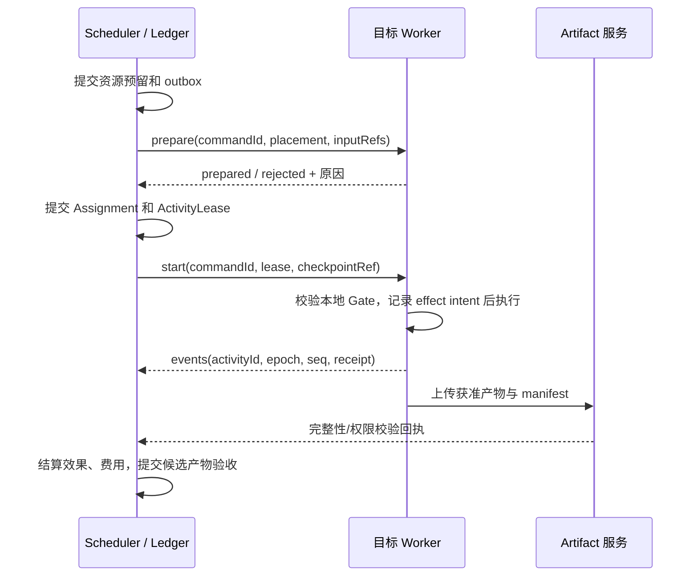

# GraphAgent 跨设备任务派发设计

| 项目   | 内容                                                                                                                                                                                                   |
| ------ | ------------------------------------------------------------------------------------------------------------------------------------------------------------------------------------------------------ |
| 状态   | 阶段 3.3 的目标设计草案；未实现，不改变当前凭据共享最小壳范围                                                                                                                                          |
| 依据   | [dots 设备连接实测报告](../../common/exploration/dots.md)                                                                                                                                            |
| 主契约 | [01 模板与实例](./01_agent-template-and-instance.md)、[03 执行层](./03_agent-loop-dispatch-and-execution.md)、[04 工具执行](./04_tool-execution.md)、[06 外部对接](./06_workspace-and-integrations.md) |

## 1. 目标、边界与领域兼容

一个 Workspace 由一个有写入权的控制面维护 Ledger。多个经用户配对和授权的设备可同时登记 Worker，分别提供运行槽、本机工具和资源。用户当前查看哪台设备只改变 UI 焦点，不应撤销其他自主 Worker 的授权。实际并发仍取决于宿主能力、预算、工具锁与第三方限制；dots 适配若未来可用，必须保留其单台个人电脑限制，不能当作通用 Worker 集群。

本设计细化[03 §3.7](./03_agent-loop-dispatch-and-execution.md#37-跨设备多客户端派发)，不另建任务系统：

- Goal、TaskRevision、TaskAttempt 和 Assignment 继续表示业务工作；设备不是 Task，也不是员工。
- AgentTemplateRevision 只声明能力、信任区域和工具需求，不写具体主机路径、endpoint 或密钥。设备选择在任务要求与放置策略中绑定，运行实例不因设备变化改身份。
- AgentInstance 仍有稳定身份与串行邮箱；Assignment 固定一次放置，Activity 只在持有租约的 Worker 上执行。身份、模板版本和设备位置分别展示。
- 同一 Assignment 的模型 Loop 默认固定一个 Worker。跨设备分工先创建子 Task；跨设备交接创建新 Assignment 并引用旧产物/checkpoint，不在运行中热迁移命令或原生模型会话。
- GraphCoordinator、WorkforceController、Scheduler、ActivityRunner 保留原职责；设备服务和传输服务提供受控端口，不直接改变任务终态。
- Provider Platform 仍拥有模型基础类型和凭据基础服务；GraphAgent 拥有 ModelPolicy、ModelLease 与预算，不复制 PolyQuota 数据库。

## 2. 设备注册、身份与资源寻址

以下为候选领域记录，不是已经发布的 wire schema。

| 记录               | 必需信息                                                                       | 规则                                                             |
| ------------------ | ------------------------------------------------------------------------------ | ---------------------------------------------------------------- |
| DeviceRegistration | `deviceId`、显示名、属主、设备公钥/指纹引用、OS/架构、trustZone、登记/撤销时间 | ID 由可信注册分配且稳定；重装可换新 ID，不用显示名或 IP 识别设备 |
| WorkerRegistration | `workerId`、`deviceId`、运行时/协议版本、工具目录 revision、能力 revision      | 一台设备可有多个 Worker；设备授权不自动等于每个 Worker 均可用    |
| WorkerSession      | `sessionId`、`bootId`、连接 epoch、最后心跳、容量与占用、会话到期              | 每次进程重启用新 bootId；声明容量由控制面策略封顶                |
| DeviceGrant        | Workspace/主体、设备/Worker、资源、操作、网络/外发范围、有效期、grant revision | 配对只建立身份信任；运行权限需单独授予，撤销可审计               |
| ResourceBinding    | `bindingId`、deviceId、逻辑资源、根路径、读写模式、版本/基线                   | 同一路径字符串在不同电脑上是不同资源                             |
| ExecutionPlacement | assignmentId、workerId、deviceId、sessionId、绑定版本、策略与权限 revision     | 固定实际去向；重放事件不重新选机                                 |

配对流程：用户在控制面申请一次性、限时、绑定 Workspace 的配对邀请 → 在目标设备确认控制面与密钥指纹 → 双方建立认证通道 → 用户按资源范围授权 → Worker 上报能力并执行最小探测 → 控制面将可用状态投影给调度器。邀请过期、重复使用或 Workspace 不符时拒绝；未经信任的自报主机不能注册可执行身份。

首个跨设备版本面向同一用户的可信设备，不提供互联网公开 Worker 市场、多租户任意代码宿主或控制面自动选主。Worker 主动建立出站认证连接；中继/直连的最终技术选型留待实施，不暴露任意远程 shell 端口。

模型看到的是获准的 `deviceId`/标签与 `bindingId`，可提出 preferred/required 选择，不能直接把 IP、显示名或任意绝对路径当作权限。实际文件定位使用 `(deviceId, bindingId, relativePath)`，宿主解析规范路径并防止 `..`、符号链接、junction、UNC 映射等逃逸授权根目录。Git 写入还固定 repo/worktree 与基线 revision。

## 3. 能力、授权与连接状态

能力分 `declared / probed / verified`，记录验证时间与版本；工具存在、具备图片解码器或登录某账号只是能力事实，不是执行或外发授权。Worker 启动前和每个工具派发前复核本地权限；控制面无法扩大宿主沙箱。

有效权限取系统、Workspace、模板、Goal、Assignment、DeviceGrant 与当前宿主限制的交集。子派单继承交集和预算，不能因换设备、换 Worker 或使用 subagent 获得额外权限。策略 revision 或目标变化使旧审批失效。凭据引用按目标受众绑定，秘密不进入模型提示、事件或普通产物；模型请求由受信执行边界取得短期凭据，不能把本机秘密自动复制到 Worker。

设备状态分维度存储，避免一个 `connected` 布尔值承担所有含义：

| 维度     | 候选值                                | 调度意义                                         |
| -------- | ------------------------------------- | ------------------------------------------------ |
| 注册信任 | pending / paired / revoked            | revoked 不可接新工作                             |
| 连通性   | online / suspect / offline            | 心跳只证明最近可达，不代表获权                   |
| 任务授权 | granted / missing / expired / revoked | 与在线独立；缺少授权时显示具体范围               |
| 调度管理 | enabled / draining / disabled         | draining 拒绝新 Assignment，按原规则处理在途工作 |
| 能力健康 | ready / degraded / incompatible       | 按任务需求过滤，不把部分工具失败视为设备全不可用 |
| 资源容量 | total / reserved / running            | 模型槽、命令槽、内存与桌面锁分别计量             |

离线不撤权，撤权也不等于命令已经停止。撤权时服务拒绝新租约/续约，在线 Worker 立即关闭派发闸门并报告在途效果；断线设备最多按未过期的本地权限和租约边界行动，不能承诺瞬时撤回已发生的数据外发。UI 焦点 `selectedDeviceId` 与授权状态无关。

## 4. 放置、并发与预算

在[03 §3.3 调度顺序](./03_agent-loop-dispatch-and-execution.md#33-调度顺序与亲和)中增加设备硬过滤，不改变 `sticky → least-loaded → create → queue` 的总体策略：

1. 校验工作/图 revision、依赖版本和暂停/取消状态。
2. 按技能、模板、trustZone、资源绑定、设备/工具授权、协议版本和已验证能力过滤 Worker。required 设备不可用时等待，不在另一电脑猜测同名路径。
3. 联合核算实例执行槽、Worker 容量、账号并发、Goal 预算、传输预算、工具与桌面资源锁。跨设备并行不能超售同一账号或预算。
4. 在可行集合内考虑上下文亲和、数据位置、负载、传输量与独立评审反亲和。大资源优先就地分析，只传清单/摘要；独立验证者不能因共享缓存读到中间答案。
5. 控制面在同一 Ledger 事务预留预算/槽位并登记派发 outbox；Worker 准备资源后，提交 Assignment 放置并签发短期 ActivityLease。失败释放预留，重复消息按 ID 对账。
6. Worker 真正启动前核对租约、epoch、期限、资源基线、权限和工具目录。此后能力变化按步骤边界处理，不静默改变正在执行的工具实现。

租约至少绑定 assignmentId、activityId、attemptId、worker/session/boot、executionEpoch、controlEpoch、授权与资源 revision、预算上限、过期时间、fencing token。设备重启、权限变化或租约过期不能复用旧 start 命令。控制面不依赖 Worker 时钟决定预算；Worker 使用协商期限和本地单调计时保守关闸。

每台设备可提供多个无冲突命令槽；同一个交互桌面只允许一个独占租约，RDP 会话变化/用户接管应使桌面快照和焦点引用失效。文件写锁按真实资源身份仲裁；对同一网络共享的两个本地路径需解析为同一资源，否则拒绝并行写入。首版跨设备不提供通用分布式文件锁替代文件系统一致性。

无法放置时 Assignment 保持 QUEUED/WAITING，TaskAttempt 按既有状态进入 WAITING 或需用户授权的 BLOCKED，附原因如 `device-offline / authorization-required / resource-unavailable / capability-mismatch / capacity-exhausted`。排队不持有模型执行槽或长期调用预留；不新增一套与任务生命周期竞争的“设备任务状态”。

## 5. 派发与回报协议

沿用原有 offer/accept 接单协议；员工确认固定职责后，再进入下述执行资源准备流程。Worker 的 prepared 只是宿主资源确认，不能代替员工接单或用户授权。

命令携带 commandId、expectedRevision 和实际认证主体；消息可重复投递但持久去重。`prepared` 只说明可准备，`start accepted` 不等于进程已经运行，Worker 完成也不等于 Task 通过验收。start 超时先查询 commandId/activityId，不直接发起第二次执行。prepared 预留须有 TTL，控制面崩溃恢复按 outbox、租约与 Worker 收件箱对账。

Worker 只提交活动事实、效果和产物提案，不能改 TaskRevision、扩预算、批准自身权限或标记整个 Goal 成功。事件带序号与 cursor，丢包重传、重复去重、缺口请求快照；临时 progress 可以降频，终态、授权、效果和结算不可丢弃。

## 6. 离线、租约与恢复

| 情况                   | 控制面行为                                             | Worker / 恢复行为                                                        |
| ---------------------- | ------------------------------------------------------ | ------------------------------------------------------------------------ |
| 未派发前离线           | 进入等待，按硬约束判断能否另选 Worker                  | 无已执行副作用可核对后重新放置                                           |
| prepare/start 应答丢失 | 查询既有 commandId，保留歧义状态                       | 从持久收件箱返回同一确认，不能重复启动                                   |
| 已运行时心跳中断       | 标记 suspect，租约到期后不新增活动；保留未知效果/用量  | 到本地租约边界关闸，尽力停止可取消工作，保存效果账本；已发外部请求需核对 |
| 控制面重启             | 重新取得单写入权并递增 controlEpoch，先 reconciliation | 旧租约不得启动新动作；合法在途结果作为证据核对                           |
| Worker 重启            | 原 session/boot 的活动不直接续跑                       | 新 session 上报 checkpoint、效果与本地暂存产物，确认无歧义后签新租约     |
| 明确撤权               | 禁止新派发/续约，记录撤权 revision                     | 在线立即关闸；已发生效果按事实结算，不假称撤回                           |
| 用户切换 UI/关闭查看端 | 只改变显示与订阅                                       | 原放置保持，宿主是否常驻依宿主生命周期策略                               |
| 收到暂停/停止          | 按既有用户专用管理命令派发，记录 accepted/applied      | 断线时显示 pending；不能仅因服务收到请求就标记已暂停/取消                |

fencing 保证受控服务拒绝旧 token 的新写入，不能让一个已经发出的、不支持 fencing 的外部请求消失。旧 epoch 的迟到结果保留诊断及费用核对，不得推进新执行状态；合法已发生的效果仍记入原 activity/effect 账本。

重试按[03 的外部操作分类](./03_agent-loop-dispatch-and-execution.md)区分纯读、可幂等、可核对和未知效果。只对已确认安全且输入版本固定的活动重试；不可判定命令进入 `unknown-effect` 阻塞。非幂等写入未确认前禁止在另一设备重新执行，也不能自动释放其资源写责任或把未知预算当作零。

换机执行只通过交接：安全边界 → 核对效果 → 固定可移植摘要和产物 → 旧 Assignment 以 handed-off 结算 → 新 Assignment 重新获权/预留/放置。不能复制旧模型原生状态、凭据租约、打开的浏览器或 shell 进程。需要“先 work 再 pro”时用两个依赖子 Task 更清晰，无需迁移同一进程。

## 7. 跨设备产物与权限

ArtifactRevision 继续是唯一正式产物模型，增加位置/传输记录作为从属信息，不把本机路径当成内容已交付。

| 记录             | 必需字段                                                                                   |
| ---------------- | ------------------------------------------------------------------------------------------ |
| ArtifactLocation | artifactRevisionId、deviceId/storeId、受控 contentRef、可用/过期状态、最后核验时间         |
| ArtifactManifest | 固定版本、生产 Assignment、来源资源/输入 revision、相对名、字节数、MIME、SHA-256、敏感级别 |
| ArtifactTransfer | transferId、源/目标、获准 revision、授权 revision、总量/上限、分块进度、完整性结果、回执   |

默认传输流程：源设备验证读取与导出权限 → 服务验证目标导入/消费权限及信任区域 → 传输获准的固定字节版本 → 目标校验大小与哈希 → 原子发布只读内容 → 更新位置并回传 delivery receipt。摘要、缩略图和哈希也属于可能敏感的数据，不能默认跨区。哈希证明字节一致，不证明文件安全或业务正确；验收仍由既有服务执行。

首版可用受控加密中继内容库，不依赖两台设备同时在线；直连优化后续验证。中继保留期限、加密、配额与清理必须可配置，不能因源设备离线让已经完整暂存的允许产物失效。分块断点续传按 transferId 与 digest 去重；传输中断不把半文件暴露为产物。校验失败进入隔离并拒绝消费，不盲目覆盖目标文件。路径规范化、压缩包展开上限和 MIME/格式验证防止导入越界。

下游就绪需同时满足“产物已按要求验收”和“目标可读取该固定版本”；上传成功但目标没有权限仍是等待。只回传摘要时可建立摘要产物及原文件出处，不宣称复制完整资源。可按业务契约接受 local-only 交付，但必须展示所属设备与不可远程读取原因；需要传输的交付未取得回执不能显示已送达。

## 8. 安全隔离与产品适配

- 控制面统一授权、预算和审计，Worker 强制本机沙箱、最小路径与网络范围；两层任一拒绝都不得执行。
- 模型产出的设备名、工具参数、网页/文件内容均不成为授权证据。配对、撤权和用户管理命令只由可信用户会话执行，不向 Agent 提供自批入口。
- Worker 接入不获得全部 Workspace 历史、记忆、技能目录或共享凭据；按 Assignment 的获准内容引用下发，敏感正文与事件投影隔离。
- 租约和传输凭证短期、受众限定、可审计，日志只存引用和脱敏原因；凭据信任根、密钥轮换与设备注销进入安全验收。
- 自主 Worker、A2A 远端 Agent、MCP 工具宿主、厂商 coding agent 是不同适配边界。A2A 使用既有 AgentCard/RemoteAgentTemplate；外部 coding agent 使用 [06 的 RemoteAgentPort](./06_workspace-and-integrations.md#82-远程-agent-与-coding-agent-适配)，不能假称都具备完整 Worker 协议。
- dots 如没有公开且获准的机器派发接口，只能作为人工协作参照，不实现绕过 UI/授权的私有协议。第三方单台限制、连接要求、能力与未知费用须作为适配器硬约束，UI 选择另一设备不自动触发权限切换。

## 9. 可观测性与用户操作

工作台仍以 Task/Attempt 为主，节点显示实际执行设备与阻塞原因；Worker 拓扑是可选诊断视图，不替代执行图。节点详情补充：deviceId/显示名、放置原因、授权/能力 revision、租约状态、最后心跳、命令 accepted/applied、未知效果、产物位置及传输回执。

“工具与连接”增加设备登记、能力验证、授权范围、Drain/禁用、撤权与待处理动作；管理看板聚合在线数、可派发数、容量、队列年龄、失败/重连、未知效果和传输积压。界面明确区分“在线但未授权”“已授权但离线”“执行结束但未交付”。不要求用户理解 epoch 才能修复，诊断详情可展开。

应用服务候选命令为 `listDevices / getDeviceDetail / beginPairing / confirmPairing / setDeviceGrant / drainWorker / revokeDevice / getPlacement / listTransfers / retryTransfer`，沿用 commandId、expectedRevision、可信操作者和 cursor。Agent 只可查询获准摘要及提出放置请求，不可配对、扩权或停止其他任务。错误统一包含稳定 code、目标设备/任务、可重试性、已完成工作、效果确定性和修复入口；等待人工连接时发一次可执行通知，不持续重试同一被拒操作。

## 10. 用本次资源任务验收

在 GraphAgent 自主 Worker 模式下，两台设备可同时保持登记和授权，work/pro 的这两个 Task 仍因数据依赖顺序执行；还可加入互不依赖的并行只读 Task 验证真实并发。34 张图片是回归样本规模，不应把之前 34/34 结果当成本设计已运行的证明。

| 验收场景                              | 必须观察到的结果                                    |
| ------------------------------------- | --------------------------------------------------- |
| work/pro 均在线且获准，另有设备仅在线 | 前两台可按容量并行，第三台明确拒绝；切 UI 不改授权  |
| 模板无具体设备、任务 required pro     | 只在 pro 对应资源绑定执行；pro 离线时等待           |
| 两台有相同绝对路径                    | 内容与权限按绑定隔离，不误读另一台                  |
| 两个并行子任务与共享账号/预算         | 资源和预算无超售，独立评审不泄漏中间答案            |
| start 应答丢失、重复事件、控制面重启  | 不重复启动/结算；cursor 缺口可对账                  |
| Worker 离线、重启、旧 epoch 迟到      | 新动作被 fence；旧结果只核对合法效果，不推进新状态  |
| 非幂等写操作断线                      | unknown-effect 可定位，不自动在另一设备重做         |
| 暂停/停止时设备断线                   | pending 与 applied 区别明确，不伪造已取消           |
| 在途撤权、路径逃逸、跨区导出          | 本地/控制面至少一层阻断；合法已发效果如实报告       |
| 产物断点续传、digest 不同、目标未授权 | 半文件不可消费；错误版本隔离；权限不足保持等待      |
| pro 产物只保存在本地                  | UI 指出所属设备，未传输时不声称在 work 可读         |
| 桌面任务和 RDP/用户接管               | 同桌面独占，焦点/快照失效后重新定位，不能并发争鼠标 |

领域测试先用 fake Worker、时钟、认证和内容库，注入断线/崩溃；随后两台真实设备测试本机文件/终端与传输闭环。桌面和厂商适配分别验收，不以纯协议测试宣称支持。验收要求零误派发、零重复非幂等效果和零已知越界；性能阈值据原型数据设定。

## 11. 阶段 3.3 的实施切分与待决项

| 子阶段            | 交付与退出条件                                                                  |
| ----------------- | ------------------------------------------------------------------------------- |
| 3.3a 身份与注册   | 配对、DeviceGrant、状态投影、能力探测；未授权设备不可派发                       |
| 3.3b 放置与执行   | 多 Worker 容量、原子预算/租约、outbox、持久去重、fencing；两设备独立任务可并行  |
| 3.3c 产物与恢复   | manifest、受控传输/回执、checkpoint 对账、未知效果；work → pro → 汇总闭环可恢复 |
| 3.3d 工作台与加固 | 放置解释、授权修复、离线/撤权/重启矩阵；与阶段 4.5 看板共享投影                 |

确定的领域规则是单写入者、显式设备授权、能力与授权分离、固定放置、不可自动重做未知副作用和显式产物交付。以下工程决策仍待原型/安全评审，不在本文冒充实现选择：

- 控制面首先运行在桌面宿主还是可选常驻服务；关闭控制面时的可用性与部署方式。
- 配对认证、双向 TLS/通道密钥、信任根存储和轮换方案；出站连接/中继的托管责任。
- 心跳间隔、租约期限、离线宽限与最大在途动作时长；需按安全性、延迟与断网样本测量。
- 内容库后端、存储/传输配额、保留策略、加密密钥归属、目标文件冲突和垃圾回收。
- 首版是否只调度完整 Assignment，何时提供独立远端工具 Activity；后者必须有同等授权和效果账本。
- 不可信或多用户 Worker 的隔离、可验证执行与远端证明；首版不纳入。
- dots、Codex Remote 和其他厂商是否存在适合的公开适配接口、版本固定与取消/费用能力；不依赖未公开接口。

这些问题在进入对应子阶段前落实；不改变[当前实施计划](../plan.md)中先完成凭据最小壳、本机闭环和简单派发的顺序。
