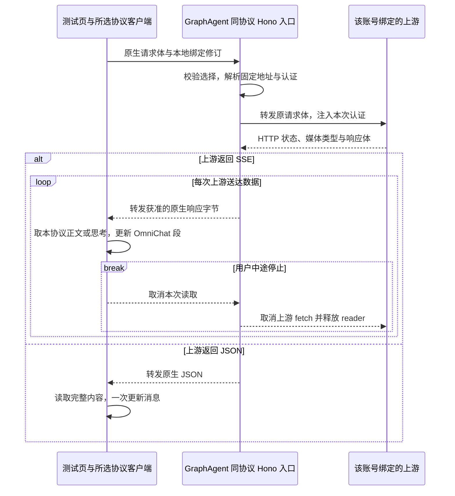

# GraphAgent 单轮测试对话重构设计

**已接入 GraphAgent Web 与 Electron，组件版本为 OmniChat 0.4.5。** 一次测试只发送当前问题。页面按模型绑定的协议族选择 API 根，再按明细路由选用原生客户端，服务端把请求转到该族的上游入口，页面从原生响应中取出正文与公开思考。正文交给 OmniChat 自带的 Markdown 渲染，思考沿用它的 AI 聊天示例。[交互原型](../ui/test-chat/prototype.html) · [实施批次](../../common/core/provider/implementation-plan.md#测试对话与协议重构)

## 已替换的旧路径

旧的 `POST /chat` 接收一段 prompt，等上游回答结束后提取文本。原生试聊页面改为按所选族发送请求，直接消费原生 SSE 或 JSON。用户消息使用 `text`，回答使用 `stream` 段，公开思考使用可折叠的 `ai-activity` 段。费用仍可按本轮 callId 回读。[页面](../../../apps/graph-agent/ui/src/pages/TestChatPage.vue) · [原生解析](../../../apps/graph-agent/ui/src/services/native-chat-reply.ts) · [Hono 入口](../../../apps/graph-agent/src/server/native-proxy-routes.ts)

## 原生请求与绑定

OpenAI 客户端使用 `/api/v1/graph-agent/proxy/openai/v1`，Anthropic 客户端使用 `/api/v1/graph-agent/proxy/anthropic/v1`。`protocolFamily` 决定根地址和目录协议，`savedSelection.selection.protocol` 在族内确定具体聊天入口。支持流式的绑定请求 `stream: true`。下表展示最小流式样例，`demo-model` 代表此次选择的精确上游 ID。

| 原生操作与本地 POST（省略 `/api/v1/graph-agent`） | 发给该入口的原生 JSON |
| --- | --- |
| Chat Completions · `/proxy/openai/v1/chat/completions` | `{"model":"demo-model","messages":[{"role":"user","content":"你好"}],"stream":true}` |
| Responses · `/proxy/openai/v1/responses` | `{"model":"demo-model","input":[{"role":"user","content":[{"type":"input_text","text":"你好"}]}],"store":false,"stream":true}` |
| Anthropic Messages · `/proxy/anthropic/v1/messages` | `{"model":"demo-model","messages":[{"role":"user","content":"你好"}],"max_tokens":1024,"stream":true}` |

聊天请求体直接使用表中的协议。实例、后端上下文、设置修订和绑定修订沿用现有命令基线，通过本地请求头 `X-GraphAgent-Instance-Id`、`X-GraphAgent-Context-Id`、`X-GraphAgent-Settings-Revision`、`X-GraphAgent-Binding-Revision` 传给 Hono，并在出站前移除。服务器从本地库读取已保存的选择，检查入口协议、上游型号、账号与修订，确认仍有权使用该绑定。本地头用于发现过期选择，授权依据是宿主当前可见的账号与后端许可。`readSavedCall` 的绑定读取只依赖这四项基线，可将其参数类型收窄，供旧入口与三个聊天 POST 共用。新 handler 无需从各自的 Body 还原 `prompt`。端点路径决定请求方言，同名模型不能触发跨路由回退。[协议入口表](../../common/core/provider/protocol-design.md#41-单轮试聊使用同协议代理) · [已保存选择](../../../apps/graph-agent/src/server/model-service.ts)

测试页只构造本协议的一条用户输入。为保留已保存的参数和订阅限制，可复用配置页已有的、按同一选择和修订取得的原生预览 Body 作为模板，只替换已知的用户文本位置，并按路由设置 `stream`。例如 Codex Responses 保留 `instructions`，Grok Build 保留适用的 `include` 和 effort，Chat 保留目的地对应的输出上限字段。预览中的地址与脱敏认证头不参与页面发送。同一次发送固定「支持思考」、强度和「返回完整思考内容」三项有效配置。请求参数由绑定的原生端点与供应商策略准备，结果按同一份配置呈现。仅支持 JSON 的上游按其能力请求一次。[参数准备顺序](../../common/core/provider/protocol-design.md#5-请求参数的转换映射与自定义调整) · [现有原生请求与预览](../../../packages/core/src/providers/model-chat.ts)

`IGraphAgentService` 的聊天切片按所选端点发起三种原生 POST，路径由产品契约固定。共享 fetch 传输提供受限的原始 `Response` 读取方式，沿用同源基址、取消和生命周期。每种客户端读取自己的响应。旧 `POST /api/v1/graph-agent/chat` 的单轮 JSON 接口继续服务既有调用者，新页面直接访问对应原生入口。[架构决定](../../architecture.md#21-产品-service-与共享传输)

## 选择模型前读取族目录

配置页已选账号后，即可按族访问 `GET /api/v1/graph-agent/proxy/openai/v1/models` 或 `GET /api/v1/graph-agent/proxy/anthropic/v1/models`。目录 GET 无 Body。除实例与后端上下文外，产品客户端通过本地头 `X-GraphAgent-Account-Id` 和 `X-GraphAgent-Family-Binding-Revision` 传入可见账号及读取时的族修订。服务端从账号解析 provider 和 offering，从路径确定族，核验目录能力和授权。此时无需模型 ID、已保存的测试选择或设置修订。

同一有效族绑定的 GET 和 POST 使用同一个认证策略、授权账号及公共附加参数。GET 转发当前页获准的族原生查询参数，保留原生响应字段；例如 Anthropic 的下一页仍使用 `after_id`。族配置控制的租户或身份参数不能被调用方的 query/header 覆盖。该 GET 不产生测试聊天的费用记录。管理页的「刷新目录」是另一项已有业务操作，可以读完整个族目录并缓存。切换同账号的 OpenAI Chat / Responses 共用这份快照，切到 Anthropic 则读取另一份。[族目录与分页](../../common/core/provider/protocol-design.md#41-单轮试聊使用同协议代理)

## 转发与错误

| 边界 | 行为 |
| --- | --- |
| 入站与出站 | 各 handler 只访问已登记的族、方法和原生路径。聊天 POST 的入站 JSON 在 **4 MB** 大小限制内经 `JSON.parse` 与 `validateNativeBody` 校验所需字段和绑定约束后转发原字节（校验在读取凭据前执行，每调用仅编译计划一次）。按授权绑定构造地址与认证，无重定向。经校验的 `Content-Type`、`Accept`、适用的 `anthropic-version` 等协议头可传递，版本须符合绑定。客户端认证头、Cookie、Host、本地路由头和逐跳头均在宿主边界终止。 |
| 成功响应 | 保留上游状态、实际 `Content-Type`、原生 JSON 或 SSE 实体内容，包括未知扩展、原生 ID、结束标记和仅有用量的尾帧。按下游读取进度转发，保留背压。HTTP 客户端已解压时移除旧的编码、长度头；过滤 Cookie 和敏感响应头。客户端依照实际媒体类型读取，单个 JSON 完成后一次显示。 |
| 错误与凭据 | 本地校验、公共 body limit 和 Hono 异常处理对目录和聊天路径按入口所属族生成安全错误（OpenAI 的 `error` 对象、Anthropic 的 `type: "error"` 对象）；上游 HTTP 错误保留状态、可公开的原协议错误类型和适用的重试信息，原始错误体留在宿主。对成功体及流中文本执行单通道前缀感知滑窗防回显检查（同时匹配明文与 JSON 转义密钥，仅暂扣与密钥前缀重合的尾部字节），命中即阻断流；旁路 `SseUsageObserver` 只读解析用量帧。开流后遇到无法安全转发的错误、超限或撤权，直接终止流。 |
| 取消与费用 | 本轮的 `track`、凭据回调、变更门禁和绑定观察覆盖读流到结束。停止、离页、撤权、改绑或超时向上游传递取消，清理只执行一次。当前凭据刷新仅可在上游明确拒绝认证且尚未接受调用时按原规则重试。流中断后由用户决定是否重新发送。 |

费用沿用现有独立查询。服务端在响应头 `X-GraphAgent-Call-Id` 返回本地调用 ID，按协议旁路读取上游已报告的计量和回执，使用开始时固定的价卡。观察计量不阻塞首段显示，也不改写或补造 usage。计量缺失时显示未知。返回响应头前登记在途调用，正文结束后页面立即回读一次 `/chat/charge`。迟到实扣经既有 `charge` 失效通知触发回读，按回执去重并替换估算。`/chat/close` 可以关闭在途调用或释放已完成的费用记录，迟到的收尾不得重新打开它。[费用与回执服务](../../../apps/graph-agent/src/server/chat-service.ts)

## 从原生响应更新 OmniChat

页面客户端按已绑定的协议和型号读取原生响应。`thinkingEnabled=false` 时只更新回答；开启后可以展示真实的阶段和明确标识的摘要，`returnFullReasoning=true` 且该绑定公开全文时才把全文片段交给思考节点。全文开关关闭时，上游仍随原协议送来的全文不进入页面消息状态。用户的展示选择不会改变代理响应字节。[模型配置与可见输出](../../common/core/provider/model-structure.md#思考参数与可见输出)

下表区分原生文本的来源。

| 协议 | 正文与公开思考如何到达气泡 | 如何判定结束 |
| --- | --- | --- |
| Chat Completions | `choices[0].delta.content` 进入正文。开启全文时逐段拼接 `delta.reasoning_content`；其他命名仅按绑定明确声明的可见字段读取。 | 记录 `finish_reason`，继续读尾部 usage 和 `[DONE]`。 |
| Responses | `response.output_text.delta` 进入正文，`response.reasoning_summary_text.delta` 标识摘要。DeepSeek Responses 的 `response.reasoning_text.delta` 在绑定支持全文且用户开启时展示。同一项的 done／最终快照只补缺失后缀，只有终态全文时显示一次。 | `response.completed`、`response.incomplete`、`response.failed` 及 `error` 分别处理。 |
| Anthropic Messages | 按原生 content block index 配对。`text_delta` 进入正文，`thinking_delta.thinking` 按该型号声明的全文或摘要语义进入活动，block stop 结束对应活动。 | `message_delta` 提供停止原因和计量，`message_stop` 完成本轮。 |

整包 JSON 走同一套消息段。Chat 取 `choices[0].message.content` 和 offering 明确公开的思考字段；Responses 按 `output` 顺序读取消息的 `content[]` 中 `type: "output_text"` 块的 `text` 及 reasoning 项的 `summary[].text`；绑定公开全文时可按厂商声明读取 reasoning 项的原生全文文本块；Messages 按 `content[]` 顺序读取 `text` 块的 `text` 和公开 `thinking` 块的 `thinking`。页面一次提交这些段并封口。

签名、`encrypted_content` 与其他续写字段可以随原生流到达本次调用的读取器。界面只提取获准展示的字段，续写材料不进入消息段、日志或持久历史。收到原生思考块开始信号时可创建同形的空活动节点，展开后采用示例的空文字提示；示例的 `appendDelta` 会跳过空串。只返回正文或只报告 reasoning token 数时，直接展示回答。

**显示沿用 OmniChat AI 示例。** 用户消息使用 `text`。收到正文时调用示例的 `appendDelta(content, "text", delta)`，更新同一助手消息的 `stream` 段，由组件自带的 renderer 读取 `{ markdown, isFinished }`。收到思考文字时调用 `appendDelta(content, "reasoning", delta)`，生成 `ai-activity` 段，`kind` 为 `reasoning`。通过外层 `OmniChat` 的 `#message-ai-activity` 挂载示例的 `ActivityPanel`，按段 ID 独立展开，默认折叠，标题沿用「思考过程」。段 ID 只需本页唯一，普通 HTTP 环境可用本轮代次和递增序号。[AI 聊天示例](https://github.com/SwingCosmic/omnichat/blob/64416029253b1af262ab9c4c2fd7446a3c28548f/src/examples/AIChatExample.vue) · [段更新与收尾](https://github.com/SwingCosmic/omnichat/blob/64416029253b1af262ab9c4c2fd7446a3c28548f/src/examples/ai/model.ts) · [思考节点](https://github.com/SwingCosmic/omnichat/blob/64416029253b1af262ab9c4c2fd7446a3c28548f/src/examples/ai/ActivityPanel.vue)

原生客户端只提交真实增量。思考转正文时封口当前活动；正常、失败和主动中止分别调用示例的 `finishContent`，保留已显示文字和对应的活动状态。限长、过滤及提前 EOF 分别提示原因。第二次发送替换当前问答，按本地请求代次丢弃迟到更新。示例里的浏览器直连上游、保存 API Key 和多轮历史均不属于单轮试聊。

**实施版本。** 产品依赖固定为 OmniChat 0.4.5，按示例的组件和插槽接线。外层 `<OmniChat>` 接 `v-model` 与 `operations`，`#message-ai-activity` 将 `message.data` 传入 `ActivityPanel`，正文交由 0.4.5 发布包为 `stream` 注册的默认 Markdown 渲染器，示例的 `appendDelta` 与 `finishContent` 分别追加文本和封口。组件类型扩展、活动展开状态和各段收尾也沿用该示例。升级以示例提交 `6441602` 所含行为为验收基线。[示例接线](https://github.com/SwingCosmic/omnichat/blob/64416029253b1af262ab9c4c2fd7446a3c28548f/src/examples/AIChatExample.vue) · [内置 Markdown 渲染](https://github.com/SwingCosmic/omnichat/blob/64416029253b1af262ab9c4c2fd7446a3c28548f/src/omnichat/messages/stream.vue)

## 与正式会话的衔接

试聊保留本轮临时消息；本地 `callId` 用于费用和取消。未来正式聊天可复用绑定出站连接、正文段和活动组件。消息服务按 `conversationId / threadId / messageId` 定位已发布的消息，由 `AgentInbox` 接纳、`SessionRoute` 定位员工上下文，Loop 管理多次模型调用和工具执行。获准的执行进度与沿原会话发布的回复分别投影，普通群通知只包含锚点与未读数。正式会话的内部消息结构由该层定义。[消息聊天](./02_conversation-and-messaging.md#单轮试聊与正式会话的衔接) · [六个参考项目的源码取舍](../reference-code-map.md#单轮试聊的原生代理与展示)
