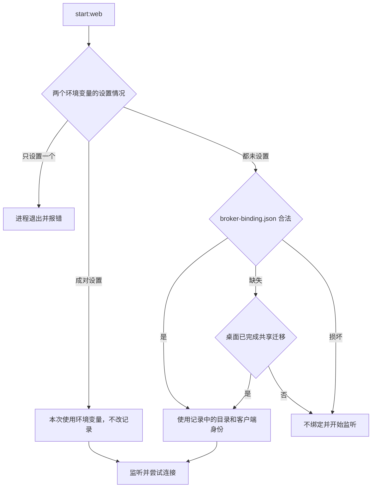
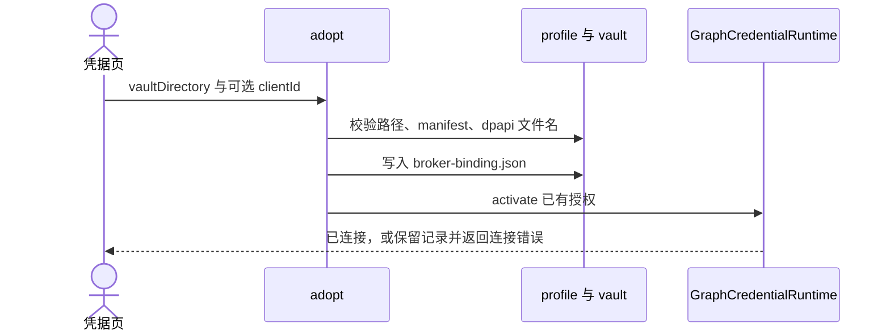
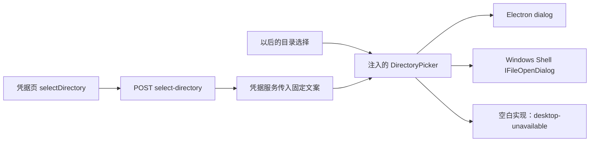

# GraphAgent Web 共享目录记忆

| 项目 | 内容 |
| --- | --- |
| 状态 | 已实施 |
| 读者 | 实现 GraphAgent Node 宿主、凭据页和公共凭据路由的人 |
| 关联 | [项目架构](../../architecture.md)、[阶段一交付结果](../../common/core/provider/stage-one-implementation.md)、[启动说明](../../../apps/graph-agent/README.md)、[凭据页](../../../packages/shared-ui/src/credentials/CredentialsPage.vue) |

`start:web` 保持 `node dist/platform/node/main.js`。变更在 Node 宿主决定 broker 绑定的方式，以及凭据页选择共享目录的方式。

## 1. 实施前的行为

[启动入口](../../../apps/graph-agent/src/platform/node/start-server.ts)在创建服务前读取环境变量：

- `GRAPH_AGENT_BROKER_VAULT` 与 `GRAPH_AGENT_BROKER_CLIENT_ID` 同时存在：解析为绝对路径后作为 `{ vaultDirectory, clientId }` 传入服务。
- 两个都没有：服务照常监听。凭据新增、删除、发现和执行按实际能力禁用。
- 只设置其中一个：进程抛出「GraphAgent broker vault and client id must be configured together」，不监听。

Web 宿主以 `existingAuthorizationOnly` 创建 broker host，连接时带 `existingGrantOnly`。授权文件位于该 profile 的 `credential-sharing/{vaultId}.{clientId}.dpapi`。没有 `safeStorage` 时不装配 `CredentialMigrationService`，因此没有私有凭据库、目录选择器和导入预览。凭据状态里 `directorySelectionAvailable` 固定为 false，`verifyImport` 与 `confirmImport` 为 hidden，重试在缺少绑定时返回「请在服务端配置共享目录和客户端身份」。

Electron 在凭据页用系统目录框选择共享目录，选择结果进入迁移状态；迁移完成后，同一 profile 在下次启动时用已保存的 `vaultDirectory` 与 `clientId` 重连。该状态机依赖安全存储中的迁移主密钥。两种入口不得同时占用同一 profile。

## 2. 目标

用户可以在 Web 凭据页选择一个 vault 目录，把它作为凭据来源，并让 profile 记住这个选择。下次执行 `start:web` 时，若没有成对设置上述环境变量，且 profile 中有合法记录，宿主使用该记录连接。成对的环境变量仍然可用。

页面和业务库在未绑定时仍可启动。未接入、断连或许可不足时，依赖凭据的操作保持不可用。

## 3. 已确认的决定

| 编号 | 决定 |
| --- | --- |
| D1 | Web 只接入本 profile 里已经存在的 DPAPI 客户端授权。不收集迁移密钥，不写私有凭据库。 |
| D2 | 记录同时保存 `vaultDirectory` 与 `clientId`。 |
| D3 | 成对的环境变量只决定本次进程，不修改已有记录。下次启动若未再设置这对变量，仍使用记录中的目录和客户端身份。 |
| D4 | 页面未填客户端身份时：该 vault 恰好一个匹配授权则采用它；零个匹配要求先由桌面宿主授权；多个匹配时，若本次选择与当前绑定指向同一目录且当前身份仍有匹配授权，则复用它，否则要求填写客户端身份。 |
| D5 | 记录是 profile 根目录的 `broker-binding.json`。Web 没有该记录时，通过 Core 读取桌面已提交的共享绑定，只取目录和客户端身份。Electron 不读取 `broker-binding.json`。 |

只设置两个环境变量中的一个时，进程仍以现有错误退出，不用记录中的另一个字段补齐。

## 4. 方案总则

Web 凭据只来自已有 DPAPI 授权上的 broker 连接。接入不创建私有凭据库，不写入迁移主密钥，不调用会新建或扩大授权的 grant。Electron 继续使用 `CredentialMigrationService` 和系统目录框。

绑定是一对绝对 `vaultDirectory` 与符合凭据 id 文法的 `clientId`。id 文法与 `@astra-conductor/credentials` 的 `id()` 相同：首字符为字母或数字，其余为字母、数字、`.`、`_`、`-`，全长 1–128。



## 5. 启动解析

解析发生在占用 profile 锁之后、创建业务服务之前。Web 与 Electron 默认共用 GraphAgent 的应用数据目录，Windows 上为 `%APPDATA%\GraphAgent`。Web 可用 `GRAPH_AGENT_DATA_DIR` 显式指定 profile，包括原 Web 目录 `~/.astra-conductor/graph-agent-web`；Electron 的覆盖变量仍为 `GRAPH_AGENT_USER_DATA`。两个入口由同一把 profile 锁互斥。[架构约定](../../architecture.md#3-产品启动与交付)

成对的环境变量经 `path.resolve` 后只用于本次进程，不读取、不写入 `broker-binding.json`。此时不要求目录已经存在，连接失败仍启动监听，与现在的 `retryWeb().catch` 相同。进程退出后，该次环境变量消失。

没有环境变量时读取 `broker-binding.json`。下列任一情况视为没有合法记录：JSON 无法解析、`version` 不是 1、路径不是绝对路径、客户端身份不符合 id 文法、出现未知字段。非法记录不阻止启动，`lastError` 为「已记住的共享目录配置无效」，绑定为空。

仅在 Web 记录缺失时，读取同一 profile 的 `credential-sharing/migration-state.json`。经 Core 校验后，若桌面已选共享后端、存在绑定且没有未完成操作，Web 以该目录与客户端身份尝试连接。只读取绑定信息，不修改迁移状态或写入 Web 记录。

只设置一个环境变量时抛出现有错误，不读取记录。

连接成功与否不删除记录。用户可在页面上重试或更换目录。

## 6. 记录

`broker-binding.json` 放在 profile 根目录，与 `app-settings.json` 并列。示例：

```json
{
  "version": 1,
  "vaultDirectory": "D:/shared/acme-vault",
  "clientId": "graph-agent-demo"
}
```

未知字段拒绝。路径最长 4096，且符合公共契约里 vault 路径的 Windows 绝对路径或 UNC 形式，不允许控制字符。写入使用临时文件、`fsync` 后替换，替换完成后删除临时文件。文件内容只有目录和客户端身份。

只有页面接入会写入记录。同一次接入先完成检查，再覆盖旧记录。同一进程内接入操作串行执行。环境变量不触发写入。

## 7. 接入

### 7.1 命令

新增公共操作 `POST /api/v1/credential-sharing/adopt`。请求体在现有凭据命令上下文上增加：

| 字段 | 约束 |
| --- | --- |
| `vaultDirectory` | 必填。沿用 `parseCredentialExportRequest` 的路径规则 |
| `clientId` | 可省略。出现时必须符合第 4 节的 id 文法 |

成功响应为空。Web 接收端实现该方法。Electron 与 PolyQuota 的迁移服务不实现，路由返回现有的「当前宿主不提供此凭据操作」。

`capabilities.adoptVault` 在 Web 接收端为 `enabled`。有进行中的账号授权时，调用返回 `conflict`，文案「请先完成或取消当前账号授权」，不修改记录。

凭据页继续使用已有 `POST /api/v1/credential-sharing/select-directory`。这条路由只服务凭据目录，不接收页面传来的标题或按钮文案。服务端用第 7.3 节的固定文案调用通用 `DirectoryPicker`。宿主始终注入该端口，所以 `directorySelectionAvailable` 为 true。页面不根据平台隐藏这个按钮。

### 7.2 目录与授权检查

页提交的目录按迁移服务的同一规则检查：必须是绝对路径；已存在时用 `realpath`，且自身不是符号链接；不得位于 profile 之内，profile 也不得位于该目录之内。不满足时返回 `invalid-vault-directory` 或 `overlapping-product-and-vault-paths`，不写记录。

然后读取 `{vaultDirectory}/manifest.json` 的 `vaultId`，并用 `id()` 校验。文件缺失时返回 `vault-directory-missing`。

客户端身份按 D4 解析：

1. 请求带了 `clientId`：只接受 `credential-sharing/{vaultId}.{clientId}.dpapi` 这一精确文件名。
2. 请求未带 `clientId`：列出 profile 的 `credential-sharing/` 中、文件名以 `{vaultId}.` 开头并以 `.dpapi` 结尾、且中间一段本身符合 id 文法的文件。
3. 恰好一个：采用其中的 `clientId`。
4. 零个：返回 `access-denied`，文案「本 profile 没有该共享库的客户端授权」。
5. 多于一个：同一目录优先使用仍匹配的当前绑定身份。其余情况返回 `validation`，文案「有多个客户端授权，请指定客户端身份」。

检查通过后先写记录，再调用现有 `runtime.activate`。激活失败时保留记录，把 broker 或应用错误返回给本次请求，状态保持所选共享、实际不可用。之后的重试使用这条记录。



### 7.3 目录选择器

现在的 `POST /api/v1/credential-sharing/select-directory` 不是通用目录选择。它挂在凭据命令下，Electron 实现把标题「选择共享凭据目录」写死在宿主里。以后别的页面要选目录时，不能复用这条路由，也不该再复制一个只会选凭据目录的对话框。

通用能力是宿主注入的 `DirectoryPicker`。Core 定义端口，任何本机功能都可以调用：

```ts
interface DirectoryPickerRequest {
  title: string;
  confirmLabel: string;
  startingDirectory?: string;
}

interface DirectoryPicker {
  selectDirectory(request: DirectoryPickerRequest): Promise<string | null>;
}
```

`title` 与 `confirmLabel` 由调用方传入。两者都必须是 1–120 个字符，且不含控制字符，否则返回 `validation`，不打开对话框。`startingDirectory` 可省略；传入时必须是已存在的绝对目录，对话框从那里打开。用户确定时返回所选目录的绝对路径。用户取消时返回 `null`。宿主无法打开对话框时抛出 `AppError("desktop-unavailable", "当前宿主不能打开目录选择器")`，HTTP 状态沿用现有的 501。空白实现忽略请求内容，只抛出这个错误。

凭据迁移和 Web 接入使用同一组文案：标题「选择共享凭据目录」，按钮「选择此文件夹」，不传 `startingDirectory`。凭据页继续调用已有的 `selectDirectory`，并用现有错误行显示宿主错误。页面不区分 Electron、Shell 或不支持的宿主，也不提交对话框文案。以后的目录选择在自己的服务里调用这个端口并传入自己的文案，不新增第二套对话框实现，也不把凭据路由改成接受浏览器提交的标题。

空白实现与 PolyQuota 里不可用的 cipher 相同。GraphAgent 与 PolyQuota 的 Node 宿主在不能打开 Shell 对话框时注入它，不再省略选择器，也不再把缺失当成返回 `null`。迁移服务改为始终调用注入的端口。

| 宿主 | 注入的实现 |
| --- | --- |
| GraphAgent Electron、PolyQuota Electron | `dialog.showOpenDialog`。使用请求中的标题、按钮和可选起始目录，属性为 `openDirectory`。有焦点窗口时以该窗口为所有者 |
| GraphAgent、PolyQuota 的 Windows Node 宿主 | Shell 公共文件对话框，见下文 |
| 其它 Node 宿主 | 空白 `DirectoryPicker` |

两个 Electron 产品在各自的主进程调用 `createElectronDirectoryPicker(dialog, BrowserWindow)`。公共适配器在每次选择时取得焦点窗口，处理两个重载和取消结果。Node 不拉起 Electron。WinForms `FolderBrowserDialog` 与 WinRT `FolderPicker` 都不是这个端口的实现。

Windows Node 的实现打开资源管理器当前的选文件夹界面：左侧导航、地址栏和搜索。COM 类型是 `CLSID_FileOpenDialog`（`IFileOpenDialog`），选项为 `FOS_PICKFOLDERS | FOS_FORCEFILESYSTEM | FOS_PATHMUSTEXIST | FOS_NOCHANGEDIR | FOS_DONTADDTORECENT`。标题和确定按钮来自本次请求。有 `startingDirectory` 时把它设为对话框的起始文件夹。结果用 `SIGDN_FILESYSPATH`。

根命令 `pnpm build:directory-picker` 使用 MSVC 和 Windows SDK 将[选择器源码](../../../native/directory-picker/main.cpp)编译为 `packages/core/bin/win32-<arch>/directory-picker.exe`。Core 构建复用该命令的脚本，已有产物和构建输入保持同步时直接复用。Node 宿主从 Core 的 `/host/node-directory-picker` 子入口取得选择器，它按模块位置和当前架构定位共享程序，通过 `execFile` 直接传入标题、按钮文字和可选起始目录。该程序使用 Windows GUI 子系统，在 STA 线程打开独立的顶层对话框，浏览器和其它应用窗口仍可操作。选定目录后，它向标准输出写入原始 UTF-16LE 路径。取消时以状态码 0 退出，输出为空，Web 接口返回 `null`。

原生调用失败时，程序以非零状态退出，并在标准错误中写入失败的操作名和 HRESULT。Node 将诊断写入宿主日志，接口返回 `desktop-unavailable`。同一选择器串行处理请求，每次打开对话框后最多等待 300 秒，超时由 Node 终止子进程。



## 8. 页面

交互原型：[Web 共享目录原型](../ui/web-shared-vault/prototype.html)。原型数据是虚构的 `D:/shared/acme-vault` 与 `graph-agent-demo`。页面路径是 D1 的已有授权接入，没有迁移密钥步骤。

表单只在 `migrationState == null` 且 `role == "receiver"` 时出现。其中的「选择目录」调用已有的 `selectDirectory`，不新增平台判断。空白实现返回的错误显示在现有状态行。桌面端的导出、导入、迁移和切回内置保持原条件。

| 状态 | 页面 |
| --- | --- |
| 未绑定 | 共享目录框、「选择目录」、可空的客户端身份、「接入此共享库」。说明文案改为「选择已授权的共享目录，或填写绝对路径」。 |
| 正在提交 | 按钮禁用，状态行显示「正在处理…」。 |
| 无授权、多个授权、路径无效 | 保留用户输入，状态行显示第 7.2 节的对应文案，不显示已连接。 |
| 已写入但未连上 | 显示共享目录和「重试连接」。重试使用已保存绑定。 |
| 已连接 | 显示共享目录、实际后端「共享存储」、脱敏账号列表。同一表单可更换目录，按钮文案为「更换共享目录」。 |
| 已连接后断连 | 保留目录显示和「重试连接」。所选后端仍是共享存储。 |

更换目录与首次接入调用同一个 `adopt`。成功后清空客户端身份输入。状态轮询发现 `vaultDirectory` 变化时，按现有世代逻辑丢弃未提交的草稿。

## 9. 实施

依赖：第 3 节已经关闭。契约字段以第 7 节为准。

1. 在 `apps/graph-agent/src/platform/broker-binding.ts` 实现记录读写和授权文件名匹配。
2. 在 Core 增加 `DirectoryPicker` 与空白实现。GraphAgent Electron 与 PolyQuota Electron 注入 `dialog.showOpenDialog`；Windows Node 注入 Shell 对话框；其余 Node 宿主注入空白实现。迁移服务改为必选端口。
3. 在 [services](../../../apps/graph-agent/src/server/services.ts) 的 Web 接收端调用注入的 `DirectoryPicker`，并实现 `adoptVault`。重试和状态读取最新绑定。[start-server](../../../apps/graph-agent/src/platform/node/start-server.ts) 按第 5 节决定绑定。
4. 为 `packages/contract` 与 `packages/core/src/http/index.ts` 增加可选 `adoptVault`。共享凭据客户端和凭据页按第 8 节接线。PolyQuota 演示桩补不可用实现。
5. 按下一节更新现有说明。

验收：

- [x] 两个环境变量都未设置，既无 Web 绑定也无已提交的桌面共享选择时，服务开始监听，凭据状态没有 `vaultDirectory`，依赖凭据的操作不可用。
- [x] Web 没有自己的绑定时，使用同一 profile 中桌面当前已完成迁移的共享库和客户端身份；两种启动方式互斥占用该 profile。
- [x] 成对设置环境变量后，本次状态中的目录是解析后的绝对路径，已有 `broker-binding.json` 的内容不变。
- [x] 去掉环境变量后再次启动，状态中的目录和客户端身份与该文件一致。
- [x] 文件中的目录与本次成对环境变量不同时，本次进程使用环境变量，文件仍是原目录和原客户端身份。
- [x] 只设置其中一个环境变量时，进程以现有错误退出，不修改已有记录。
- [x] 对恰好一个匹配授权的目录调用 `adopt` 后，记录被写入；随后的重试使用该绑定。
- [x] 无匹配授权、多个授权且无法确定当前身份、目录位于 profile 内部时，接口返回第 7.2 节的对应错误，且不写入记录。
- [x] 非法或损坏的 `broker-binding.json` 不阻止监听，状态 `lastError` 为「已记住的共享目录配置无效」。
- [x] Electron 的「选择目录」仍通过 `dialog.showOpenDialog` 返回路径，取消返回 `null`。Electron 启动和迁移不读写 `broker-binding.json`。桌面凭据页仍显示导出、导入和迁移，不显示 Web 接入表单。
- [x] 注入空白 `DirectoryPicker` 时，`POST /api/v1/credential-sharing/select-directory` 返回 `desktop-unavailable` 和「当前宿主不能打开目录选择器」。页面仍调用原来的 `selectDirectory`。

## 10. 随实施更新的现有文档

实现时修改这些句子，并链到本文：

- [架构](../../architecture.md)中 GraphAgent 独立 Web 的凭据来源：补上「未设置成对 broker 环境变量时，使用 profile 中已记住的共享目录和客户端身份；成对的环境变量只覆盖本次进程」。
- [阶段一交付结果](../../common/core/provider/stage-one-implementation.md)里关于 `GRAPH_AGENT_BROKER_VAULT` 与 `GRAPH_AGENT_BROKER_CLIENT_ID` 的句子：环境变量改为本次覆盖，授权仍必须事先存在于该 profile。
- [GraphAgent 启动说明](../../../apps/graph-agent/README.md)的 Web 段落：写明凭据页可以选择并记住目录。
- [共用 UI 设计](../../common/ui/design.md)中 GraphAgent Web 的未接入说明：补上目录选择与 `adopt` 的入口条件。
