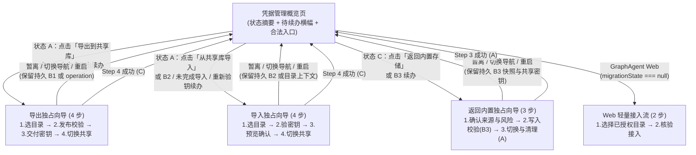
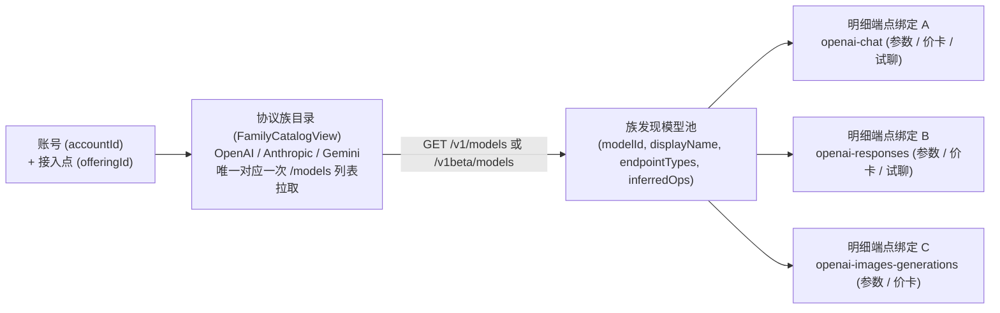

# GraphAgent 与共用 UI 交互优化及数据结构调整设计

本文承接 [模型配置 UI 实施方案](../model-configuration/ui-implementation-plan.md) 首轮界面重构后的遗留问题，针对布局与视觉密度、凭据页与服务商页交互缺陷、凭据迁移独占向导，以及影响交互的数据结构问题给出可直接指导实施的设计规则。涉及 `packages/shared-ui` 的改动同时作用于 GraphAgent 与 PolyQuota，涉及 `packages/contract`、`packages/core` 与 `apps/graph-agent` 的数据结构调整遵循 [项目架构](../../../architecture.md) 与 [前端服务契约](../../design/frontend-contract.md)。

分批交付顺序与验收条件见 [实施与验收计划](./implementation-plan.md)。

---

## 1. 视觉密度、控件尺度、层级对比与折叠过渡

### 1.1 现状问题定位

当前实现中，共用样式与 GraphAgent 页面样式分别演化，造成控件尺寸偏大、圆角混杂、同屏主操作过多以及折叠区生硬跳变：

- **控件尺寸与圆角膨胀**：`packages/shared-ui/src/styles.css` 中 `.outline-action` / `.primary-action` 为 `padding: 8px 13px; border-radius: 8px`（高度 36–38px），`RichSelect.vue` 触发器与 `_base.scss` 的 `.graph-field select` 均设为 `min-height: 40px`，`CredentialsPage.vue` 的输入框 `padding: 10px 12px`（高度 42px+），而 `.icon-action-btn` 为 `30px`，同行控件高低不齐。卡片、图标与输入框混用 `5px / 6px / 7px / 8px / 10px / 11px / 12px / 16px / 99px` 九种圆角。
- **页面单调且主次不分明**：`.provider-row` 内每个服务商都放置高饱和实心主按钮「添加账号」（`.primary-action`），一屏同时出现多个同权重主按钮；白底卡片之间缺少层级差与次级表面区分，页面标题 `28px` 与正文间留白偏松（`.content-page` 内边距 `34px 30px 44px`）。
- **折叠面板无展开收起过渡**：`ProvidersPage.vue`、`CustomProvidersPanel.vue`、`ActivityPanel.vue` 直接使用 `v-if` 切换显隐；`ModelsPage.vue`、`CatalogPanel.vue`、`ModelFactsPanel.vue`、`RateCardEditor.vue`、`CustomProviderEditor.vue` 直接使用原生 `<details>`，展开与收起均无过渡且不同浏览器箭头样式不统一。

### 1.2 紧凑桌面工具 Token 规范

在 [共用样式](../../../../packages/shared-ui/src/styles.css) 的 `.app-shell` 下定义唯一视觉 Token 阶梯，[GraphAgent 样式变量](../../../../apps/graph-agent/ui/src/styles/_mixins.scss) 直接引用同一组 CSS 变量，消除重复硬编码。

| 维度 | Token 定义 | 目标值 | 适用范围 |
| --- | --- | --- | --- |
| 圆角 | `--radius-xs` | `4px` | 状态徽章、来源短签、行内 `code` |
| 圆角 | `--radius-sm` | `6px` | 输入框、下拉框、按钮、`RichSelect` 触发器、分段控件、标签芯片 |
| 圆角 | `--radius-md` | `8px` | 常规卡片、折叠面板、下拉浮层、账号列表容器、内嵌表单区 |
| 圆角 | `--radius-lg` | `10px` | 模态框（`FormDialog` / `AuthDialog`）、测试对话主面板、向导中央卡片 |
| 控件高度 | `--control-h-sm` | `28px` | 账号行内按钮、图标操作按钮（`28×28`）、表格与筛选区紧凑控件 |
| 控件高度 | `--control-h-md` | `32px` | 常规表单输入框、原生 `select`、`RichSelect` 触发器、标准按钮 |
| 控件高度 | `--control-h-lg` | `34px` | 向导底栏主操作按钮、空状态主 CTA |
| 表面层级 | `--bg-canvas` / `--surface` / `--surface-subtle` | `#f4f6fa` / `#ffffff` / `#f7f9fc` | L0 页面底色 / L1 主卡片 / L2 卡片头、次级内嵌块与只读摘要条 |
| 边框与阴影 | `--border` / `--border-subtle` / `--shadow-card` | `#dde3ec` / `#e8edf4` / `0 1px 2px rgba(15,23,42,0.04)` | 卡片清晰边界，避免纯白平面贴合 |

字阶与留白收紧规则：

- `.content-page` 内边距调整为 `24px 28px 36px`；页面主标题 `h1` 调整为 `22px`（`font-weight: 680; line-height: 1.25`），副标题 `13px`，卡片标题 `14.5px`，分节标题 `13.5px`，字段标签 `12.5px`。
- `.provider-mark` 收紧为 `34px × 34px`、`border-radius: var(--radius-md)`（内部图标 `22px`）；`.account-avatar` 收紧为 `26px × 26px`。
- `RichSelect`、`ConfigField`、`.graph-field` 与 `CredentialsPage` 内所有常规输入框与按钮统一 `height: 32px`（多行 `textarea` 按 `line-height: 1.5; padding: 6px 10px`），确保同行输入框与按钮严格齐平。
- 数值展示（记录条数、修订号、金额、token 上限）统一开启 `font-variant-numeric: tabular-nums`。

### 1.3 按钮主次与色彩权重规则

每个可视工作区遵守单一焦点原则：

| 按钮层级 | CSS 类名 | 视觉样式 | 使用限制 |
| --- | --- | --- | --- |
| 主操作（Primary） | `.primary-action` | 实心 `--brand-accent` + 白字 | 每页/每模态框/每向导步最多 **1 个** 主 CTA（如「创建自定义供应商」「保存更改」「进入下一步」）。列表行内禁止重复放置实心主按钮。 |
| 强调次操作（Tinted） | `.accent-action` | 浅品牌底/品牌描边 + `--brand-hover` 文字 | 高频业务入口（如账号行的「模型配置 →」、单行「添加账号」），视觉权重高于普通描边但弱于页面主 CTA。 |
| 次级操作（Outline） | `.outline-action` | 白底 + `#cbd5e1` 描边 + 深灰字 | 辅助工具动作（如「重新检查」「选择目录」「导出」「更新快照」）。 |
| 低频/图标操作 | `.icon-action-btn` / `.ghost-action` | `28×28` 图标按钮或无边框文字按钮 | 编辑、刷新、删除、收起/展开、恢复继承；危险操作悬停才显示淡红底色。 |

在 [服务商接入页](../../../../packages/shared-ui/src/providers/ProvidersPage.vue) 中，各服务商卡片头部的「添加账号」由 `.primary-action` 改为 `.accent-action`（高度 `28px`），页面顶部仅「创建自定义供应商」保留 `.primary-action`。

### 1.4 统一折叠面板组件与过渡规范

在 `packages/shared-ui/src/components/` 新增公共组件 `CollapsiblePanel.vue`，替代现有 `v-if` 折叠块与原生 `<details>`。

**组件接口与结构：**

- Props：`open?: boolean`（受控）、`defaultOpen?: boolean`（非受控）、`title?: string`、`summary?: string`、`variant?: "card" | "subtle" | "inline"`、`disabled?: boolean`、`lazy?: boolean`（默认 `false`；高开销子树如价卡编辑可设为 `true` 并在收起动画结束后卸载）。
- Slots：`#header`（自定义表头，供供应商卡片头部复用）、`#default`（展开内容体）。
- Events：`update:open`。

**过渡机制与无障碍约束：**

- 内容容器采用 CSS Grid 行轨道动画，不依赖硬编码 `max-height`：
  - 外层 `.collapsible-body`：`display: grid; grid-template-rows: 0fr; opacity: 0; transition: grid-template-rows 160ms cubic-bezier(0.4, 0, 1, 1), opacity 140ms ease;`
  - 展开态 `.is-open > .collapsible-body`：`grid-template-rows: 1fr; opacity: 1; transition: grid-template-rows 200ms cubic-bezier(0.2, 0, 0, 1), opacity 180ms ease;`
  - 内层 `.collapsible-inner`：`min-height: 0; overflow: hidden;`
- 展开箭头统一复用 `ChevronIcon`，旋转过渡 `180ms ease`。
- 表头触发按钮暴露 `aria-expanded` 与 `aria-controls`，内容区标注 `role="region"` 与 `aria-labelledby`。
- 遵循 `@media (prefers-reduced-motion: reduce)`，将过渡时长降为 `0ms`。

**全仓替换清单：**

| 位置 | 当前实现 | 替换目标 |
| --- | --- | --- |
| `ProvidersPage.vue` 账号列表 | `v-if="expanded.has(provider.id)"` | `CollapsiblePanel`（受控 `open`，配合 `#header` 渲染 `.provider-summary`） |
| `CustomProvidersPanel.vue` 接入点列表 | `v-if="expanded.includes(p.providerId)"` | `CollapsiblePanel`（受控 `open`） |
| `ActivityPanel.vue` 思考过程 | `v-if="expanded"` | `CollapsiblePanel`（`variant="subtle"`） |
| `ModelsPage.vue` 预置数据包栏 | `<details class="pack-bar">` | `CollapsiblePanel`（`variant="subtle"`） |
| `CatalogPanel.vue` 筛选与手工登记 | `<details class="catalog-filters / nested-filter / manual-register">` | `CollapsiblePanel`（`variant="subtle"` / `"inline"`） |
| `ModelFactsPanel.vue` 推理与高级限制 | `<details class="editor-collapsible">` | `CollapsiblePanel`（`variant="card"`） |
| `RateCardEditor.vue` 价卡与取整/条件 | `<details>` | `CollapsiblePanel`（`variant="card"` / `"inline"`） |
| `CustomProviderEditor.vue` 高级端点与族参数 | `<details class="advanced-panel / nested-advanced">` | `CollapsiblePanel`（`variant="subtle"` / `"inline"`） |

---

## 2. 凭据页与服务商页布局修正及细粒度 Loading 机制

### 2.1 凭据管理页同行输入组合（消除文本框挤压按钮换行）

**现状根因**：[CredentialsPage.vue](../../../../packages/shared-ui/src/credentials/CredentialsPage.vue) 中，`.key-delivery label` 为 `display: grid` 且内部 `<input>` 为 `width: 100%`，紧邻的「选择目录」按钮处于 `<label>` 之外的同级流中，导致按钮始终被挤至下一行；只读路径 `code.path-value` 独占多行折行，拉伸整体高度。

**调整方案**：在 `packages/shared-ui/src/styles.css` 定义通用组合输入行 `.input-with-action` 与单行路径条 `.path-field`：

```css
.input-with-action {
  display: grid;
  grid-template-columns: minmax(0, 1fr) auto;
  gap: 8px;
  align-items: center;
}

.input-with-action > input,
.input-with-action > .path-readonly {
  min-width: 0;
  width: 100%;
  height: var(--control-h-md);
}

.input-with-action > button {
  flex: 0 0 auto;
  height: var(--control-h-md);
  white-space: nowrap;
}
```

- 表单字段拆分为独立的 `<label :for="id">` 标题行 + `.input-with-action` 控件行，输入框占满剩余宽度且设置 `min-width: 0`，右侧「选择目录」「复制」「变更共享目录」按钮保持同行且与输入框等高（`32px`）。
- 仅在容器宽度 `< 520px` 时切换为单列堆叠（`grid-template-columns: minmax(0, 1fr)`），按钮左对齐且 `justify-self: start`。
- 凭据管理概览页中只读目录路径使用单行等宽框 + `overflow: hidden; text-overflow: ellipsis; white-space: nowrap` + `title` 悬浮查看全文，不因长路径把卡片撑成多行碎片。

### 2.2 分层细粒度 Loading 与非阻塞状态反馈

**现状根因**：`CredentialsPage.vue`、`ProvidersPage.vue` 与 `CustomProvidersPanel.vue` 均以单个布尔变量 `busy = ref(false)` 绑定全页所有按钮；触发任意请求（例如点击「检查最新版本」或单个账号「刷新令牌」）后，全页所有按钮立即变灰，且被点击按钮没有任何加载动画或进行中文案，用户无法判断请求来源与进度。

**调整方案**：建立**按钮内 Loading 反馈组件** + **按冲突域隔离的状态管理**。

1. **按钮内 Loading 反馈规范**（在 `packages/shared-ui/src/components/icons/definitions/` 新增标准 `loader` 旋转图标，或封装轻量的 `ActionButton.vue`）：
   - 处于加载态的触发按钮：左侧渲染 `<AppIcon name="loader" :size="14" class="is-spinning" />`（替代原前置图标），设置 `aria-busy="true"` 与 `disabled`，可选切换为简短进行中文案（如 `检查中…`、`刷新中…`、`切换中…`），通过 `min-width` 保持按钮宽度稳定不引发同行抖动。
   - 仅当加载超过 `150ms` 或涉及网络/IO 操作时展示进行中文案，避免本地瞬时切换闪烁。
2. **三层冲突域锁定矩阵**（取代全局 `busy`）：

| 页面 | 冲突域 Key | 触发动作示例 | 锁定范围 | 保持可用的交互 |
| --- | --- | --- | --- | --- |
| 服务商接入页 | `account:<accountId>` | 刷新令牌、启用/停用、删除账号、变更绑定 | 仅锁定该账号行内的状态变更按钮，仅触发按钮展示 Spinner | 其他账号行操作、所有供应商展开/收起、「模型配置 →」跳转（非删除中）、其他供应商「添加账号」 |
| 服务商接入页 | `provider:<providerId>` | 查询删除引用、删除自定义供应商 | 仅锁定该供应商卡片的编辑/删除按钮 | 其他供应商卡片、内置供应商列表、展开/收起 |
| 凭据管理页 | `scope:component` | 检查最新版本、下载并安装、安装本地包、卸载组件 | 仅锁定「凭据服务组件」卡片内的组件操作按钮 | 顶部「重新检查」「返回设置」、上方存储状态与向导入口（卸载中除外） |
| 凭据管理页 | `scope:refresh` | 顶部「重新检查」 | 仅在「重新检查」按钮展示 Spinner 并防重入 | 已有只读信息、返回设置、展开/收起 |
| 凭据管理页 | `scope:migration` | 导出发布、验证密钥、确认导入、迁移到共享、准备快照、切换到内置、重试清理 | 仅锁定当前向导主操作及与后端写屏障冲突的写操作（当 `status.frozen === true` 时由后端能力位同步禁用） | 「暂离返回概览」（非临界提交瞬态）、查看脱敏账号、复制密钥、切换非冲突页面 |

- **SSE 刷新与局部 Loading 协作**：局部请求进行中收到 SSE 推送时，不清空其他域的表单草稿；仅按最新快照更新对应实体状态，请求完成后按 `pendingKeys.delete(key)` 精确释放该域锁。

### 2.3 服务商接入页 Flex/Grid 布局重构与账号行对齐

**现状根因**：
1. [ProvidersPage.vue](../../../../packages/shared-ui/src/providers/ProvidersPage.vue) 的 `.provider-account-row` 在 `styles.css` 中定义了 7 列固定 Grid（`auto minmax(190px, 1fr) minmax(110px, auto) minmax(100px, auto) auto auto auto`），但模板把多达 5 个带 `v-if` 的条件按钮（含 `#account-actions` 插槽里的「模型配置」）直接作为平级子元素放入 Grid，实际子元素数在 5–9 个之间变化。多于 7 个时末尾按钮直接换行掉到头像下方；少于 7 个时按钮左偏错位。
2. `.provider-summary` 定义为 5 列 Grid，当「添加账号」隐藏时，右侧展开箭头向中间漂移；描述文字与 `.method-chips` 争抢空间。
3. [CustomProvidersPanel.vue](../../../../apps/graph-agent/ui/src/pages/CustomProvidersPanel.vue) 的 `.custom-account-row` 同时叠加了 Grid 类 `.provider-account-row` 与 Flex 类 `.custom-account-row`，且内置行使用 `.account-state`（圆点+文字）、自定义行使用 `.status-pill`（底色徽章），按钮高度在 `24px / 28px / 30px / 34px` 间参差不齐。

**调整方案**：内置与自定义供应商卡片及账号行共用一套确定性三段布局：

1. **供应商卡片头部 `.provider-summary`（Flex 行布局）**：
   - **左侧身份块（`flex: 1 1 280px; min-width: 0; display: flex; gap: 12px; align-items: center`）**：`34px` 图标 `.provider-mark` + 纵向文本块（第一行：供应商名称 + 连接状态胶囊；第二行：单行/最多两行截断描述 + 内联认证方式芯片 `.method-chips`）。
   - **右侧固定操作组（`flex: 0 0 auto; margin-left: auto; display: inline-flex; align-items: center; gap: 8px`）**：始终包含本供应商的操作按钮（内置为 `.accent-action`「添加账号」，自定义为编辑/删除图标按钮），最右侧固定放置展开/收起箭头按钮。条件按钮显隐不影响展开箭头贴右定位。
2. **账号行统一三段式结构（内置与自定义共用 `.account-row`）**：
   - 删除 7 列固定 Grid 定义，改为统一 Flex 行：`display: flex; align-items: center; gap: 12px; padding: 9px 14px; min-height: 48px;`。
   - **左段 · 身份区（`flex: 1 1 220px; min-width: 0; display: flex; align-items: center; gap: 10px`）**：`26px` 圆形头像 + `.account-identity`（主标识 `font-size: 13px; font-weight: 600` 单行省略，次行 `11.5px` 展示令牌到期时间或脱敏副标识）。
   - **中段 · 元数据区（`flex: 0 0 auto; display: inline-flex; align-items: center; gap: 8px`）**：认证方式标签（固定圆角 `4px`、浅灰/浅蓝底色）+ 统一状态徽章 `.status-pill`（内置与自定义统一为圆点+文字+低饱和底色，高度 `22px`）。
   - **右段 · 操作区 `.account-row-actions`（`flex: 0 0 auto; margin-left: auto; display: inline-flex; align-items: center; gap: 6px; flex-wrap: nowrap`）**：
     - **将所有内置操作按钮与 `#account-actions` 插槽统一放入 `.account-row-actions` 容器内**，所有按钮统一高度 `28px`、垂直居中。
     - 顺序固定为：`[主业务入口：模型配置 →]` + `[高频运维：Key 与用量 / 刷新令牌 / 编辑]` + `[更多菜单 ⋯（或低频启停/删除）]`。
     - **操作项收纳阈值**：同一账号行操作总数超过 **4 个** 时（如 New API 自定义账号包含「模型配置」「Key 与用量」「编辑」「变更绑定」「停用」「删除」6 项），行内直接保留「模型配置 →」「Key 与用量」「编辑」3 个高频按钮，将「变更绑定」「停用/启用」「删除」收敛进紧凑的 `28×28`「⋯」更多操作弹出菜单（支持键盘上下选择与 Esc 关闭），彻底避免行内挤满 6 个按钮导致名称被挤压换行。
3. **窄屏响应式规则（`< 900px`）**：
   - `.account-row` 允许 `flex-wrap: wrap`；中段元数据与右段操作区整体折到第二行并左对齐于身份文字起点（`padding-left: 36px`），不会错落到头像下方。

---

## 3. 凭据导入／导出／切回独占窗口向导设计

### 3.1 设计目标与状态机映射

[凭据状态机规范](../../../common/core/credential-sharing/state-machine.md) 包含 5 个已提交状态（`A`、`B1`、`B2`、`B3`、`C`）、3 条主路径（导出、导入、显式返回内置）、密钥交付、快照分歧核对、写屏障与旧密钥清理。现行 `CredentialsPage.vue` 把全部表单、预览、交付框、状态行与组件安装堆叠在同一长页面中，用户无法判断当前所处阶段、下一动作以及中断后如何续办。

本次将凭据管理拆分为**双视图结构**：

1. **凭据存储概览页（默认视图）**：展示当前已提交状态、实际生效后端、待续办流程横幅（有未完成进度时置顶）、当前合法的向导入口卡片、共享库脱敏账号（可折叠）与独立作用域的凭据服务组件卡。
2. **独占内容区向导（Workspace-Exclusive Wizard）**：用户启动或续办任一多步骤流程后，向导完全接管右侧工作区（隐藏概览卡与组件管理区，保留左侧主导航以便随时暂离），通过**顶部向导栏 + 横向步骤条 + 中央单步任务卡 + 底部固定操作栏**四段骨架引导用户逐一完成。



### 3.2 状态机与向导步骤精确映射表

前端不自行维护独立于后端的状态机，所有步骤定位、按钮可用性与状态标题均由后端状态快照驱动（见第 4.2 节 `wizard` 投影）：

| 后端 `migrationState` | 附加条件 | 所属向导与恢复步骤 | 页面顶部状态标题 | 实际生效后端 |
| --- | --- | --- | --- | --- |
| `private` (A) | 无进行中操作、无待清理 | 概览页（提供「导出」「导入」两入口） | 初始 · 内置存储 | 内置存储 |
| `private` (A) | `operation.kind === "export"` | 导出向导 · Step 1（目录锁定）或 Step 2（续查发布回执/冲突解决） | 初始 · 内置存储（导出未完成） | 内置存储 |
| `private` (A) | `operation.kind === "import"` 且无有效 `importPreview` | 导入向导 · Step 2（保留原目录，补输密钥） | 初始 · 内置存储（等待验证密钥） | 内置存储 |
| `private` (A) | `operation.kind === "import"` 且 `importPreview` 有效 | 导入向导 · Step 3（预览与冲突核对） | 初始 · 内置存储（等待确认导入） | 内置存储 |
| `export-ready` (B1) | `!deliveryAcknowledged` | 导出向导 · Step 3（交付并确认迁移密钥） | 导出完成，等待迁移 | 内置存储 |
| `export-ready` (B1) | `deliveryAcknowledged === true` | 导出向导 · Step 4（核对变更并切换到共享） | 导出完成，等待迁移 | 内置存储 |
| `import-ready` (B2) | `rememberedKey === true` | 导入向导 · Step 4（核对变更并切换到共享，免重输密钥） | 导入成功，等待迁移 | 内置存储 |
| `import-ready` (B2) | `rememberedKey === false` | 重新验钥向导 · Step 2（目录只读，仅补验迁移密钥） | 导入成功，密钥需重新验证 | 内置存储 |
| `B1 / B2` | `operation.kind === "enable-shared"` | 对应向导 · Step 4（核对态：正在核对迁移结果） | 保持原 B1/B2 标题 | 暂不可用 / 内置存储 |
| `shared` (C) | `activeBackend === "shared"` 且 `!deliveryAcknowledged` | 概览页（顶部横幅一键直达密钥交付步骤） | 迁移完成 · 当前使用共享存储 | 共享存储 |
| `shared` (C) | `activeBackend === "shared"` 且已确认交付 | 概览页（提供「返回内置存储」入口） | 迁移完成 · 当前使用共享存储 | 共享存储 |
| `shared` (C) | `activeBackend === "unavailable"` | 概览页（提供「重试连接」「重新验证密钥」；具备已验证快照时可进入返回内置向导） | 迁移完成 · 已选共享，当前不可用 | 暂不可用 |
| `shared` (C) | `operation.kind === "prepare-private"` | 返回内置向导 · Step 2（写入内置快照与回读核验） | 迁移完成 · 正在准备内置快照 | 共享存储 |
| `private-ready` (B3) | 正常等待或 `operation.kind === "switch-private"` | 返回内置向导 · Step 3（确认切换到内置 / 核对切换结果） | 内置写入成功，等待切换 | 共享存储（核对中可能暂不可用） |
| `private` (A) | `keyCleanupPending \|\| sessionCleanupPending` | 概览页顶部横幅或返回内置向导 · Step 3 收尾态（「重试清理」） | 当前使用内置 · 旧共享密钥待清理 | 内置存储（可正常读写） |

### 3.3 三条桌面路径的单步交互细节

1. **导出凭据向导（A → B1 → C，4 步）**：
   - **Step 1 · 选择共享目录**：使用 `.input-with-action` 选择或输入目标目录；醒目列出「导出副本与内置库从此独立更新，轮换令牌在两端同时刷新可能失效」风险说明；若 `operation.kind === "export"` 存在则锁定原目录并提示正在续办。
   - **Step 2 · 发布快照与回读校验**：发起 `exportCredentials`（或 `resumeExport`），步内分项展示「排空写入 → 发布共享版本 → 回读验签 → 保存本端主密钥」进度；遇到 `export-target-conflict` 时**取消原生 `window.confirm`**，在当前卡片内切换为结构化冲突处理区（展示冲突目录、必须勾选的风险确认框、并列提供「取消导出」「更换目录」「清空目标并重新导出」）。其他可重试失败原地展示原因与「重试导出（复用原目录与操作 ID）」。
   - **Step 3 · 交付迁移密钥（已提交 B1）**：展示已验证目录、版本号、条数及主密钥已记住状态；专用等宽只读区显示一次性 `migrationKey` 与「复制迁移密钥」按钮；明确说明确认后不再明文回显。主 CTA「我已安全保存，进入下一步」调用 `acknowledgeDelivery()` 后进入 Step 4；次操作「暂离，稍后再迁移」保留 B1 且允许后续通过顶部横幅触发 `resumeExport()` 恢复交付。
   - **Step 4 · 切换到共享存储（B1 → C）**：若后端返回 `migrationReview`（快照分歧），本步内联列出受影响的脱敏账号，主 CTA 文案自动切换为「使用共享当前值并迁移」；执行 `enableShared(confirmationId)` 期间在按钮内展示 Spinner；提交结果未知时切换为核对卡片（「正在核对迁移结果…」+「重试核对」）；成功后展示完成态摘要并引导返回概览。

2. **导入凭据向导（A → B2 → C，4 步）**：
   - **Step 1 · 选择共享目录**：`.input-with-action` 选取已有共享库目录（重新验证密钥模式时目录只读带入 `status.vaultDirectory`）。
   - **Step 2 · 输入并验证迁移密钥**：密码框输入迁移密钥（提交后立即清空前端内存变量），点击「验证迁移密钥」；密钥错误原地展示报错并保留所选目录直接重输，不清空已选路径。
   - **Step 3 · 预览与冲突核对（A → B2）**：表格化展示共享版本、条数、脱敏账号列表及修订号；存在 `preview.conflicts` 时高亮标注「本端有独立副本」并说明保留内置私有副本、切换后使用共享当前值；若预览 TTL 过期（`preview-expired` / `import-preview-expired`），自动跳回 Step 2 并保留原目录，仅提示重新输入迁移密钥。点击「确认导入并记住主密钥」调用 `confirmImport(previewId)` 提交 B2。
   - **Step 4 · 切换到共享存储（B2 → C）**：与导出向导 Step 4 共用组件；应用重启后重新进入可直接从 Step 4 续办，无需再次输入有效密钥。

3. **显式返回内置存储向导（C → B3 → A，3 步）**：
   - **Step 1 · 确认快照来源与风险**：取代原生 `window.confirm`，在同一卡片明确展示快照来源（在线时为「当前获准的共享记录」，离线时为「上次已验证快照及其时点」，离线且无可用快照时禁用主按钮并提示重连），勾选理解独立刷新风险后点击「准备内置快照」。
   - **Step 2 · 写入内置快照与回读校验（C → B3）**：展示写入与完整性校验状态；失败留在 C 保留共享绑定与密钥并提供「重试准备」。校验通过提交 B3 后自动推进至 Step 3。
   - **Step 3 · 切换到内置存储与旧密钥清理（B3 → A）**：展示已验证快照时点、条数及原子切换保障说明（此刻仍选共享、未删密钥）；提供次操作「更新内置快照」应对等待期间共享水位更新，主操作「切换到内置存储」调用 `switchToPrivate()`。切换失败留在 B3 并自动恢复共享接线；成功提交 A 后，如 `keyCleanupPending` / `sessionCleanupPending` 为真，本步直接呈现「已成功切回内置存储（可正常读写）+ 旧共享密钥待清理」收尾面板与「重试清理」按钮。

4. **GraphAgent Web 宿主适配（`migrationState === null`）**：
   - Web 宿主不提供私有内置库，不展示桌面三向导；概览页直接提供「接入共享目录 / 更换共享目录」轻量两步向导（Step 1：`.input-with-action` 填选已授权共享目录与可选客户端身份 → Step 2：核验 broker 连接与脱敏账号列表），保持与桌面一致的视觉密度与细粒度 Loading。

### 3.4 中断退出与重新进入机制

为彻底消除用户“中途关闭或切页后找不到进度、担心数据损坏”的困惑，向导严格区分**「暂离」**与**「取消未提交操作」**：

- **暂离向导**（点击顶部「← 暂离返回概览」、切换侧栏其他页面、或关闭窗口/重启应用）：
  - 不撤销任何已提交状态（`B1` / `B2` / `B3`）或后端持久操作记录（`operation`），也不触发写屏障锁定。
  - 离开前立即清除纯内存秘密（输入框中的 `inputKey`、明文 `delivery` 字符串）；若当前正在展示尚未确认保存的明文迁移密钥，弹出轻提示说明“离开将隐藏明文，稍后可在概览页恢复交付”，用户确认后安全离开。
- **取消未提交操作**（仅在状态 `A` 尚未提交 `B1`/`B2` 时显示「取消本次导出 / 取消本次导入」）：
  - 调用 `cancelExport()` 或 `cancelPreview()` 释放本次临时候选，保留已有内置账号与其他绑定。
- **中断后重新进入的 3 个确定入口**：
  1. **侧栏「凭据管理」导航角标**：当 `status.wizard?.requiresAttention` 为真（存在 `B1` / `B2` / `B3` / 未确认密钥交付 / 未完成 `operation` / `keyCleanupPending`）时，侧栏导航项右侧显示琥珀色圆点，悬浮提示当前挂起摘要。
  2. **凭据概览页顶部「待续办流程横幅（Resume Banner）」**：固定置顶显示当前停在「第 X/Y 步 + 已提交状态 + 实际生效后端」，右侧唯一主按钮「继续 XX 向导 →」一步直达断点步骤（无须重选目录或重输已记住的主密钥）。
  3. **当前存储状态卡主动作**：与顶部横幅同步映射同一续办动作，避免概览页重复出现互斥的「导出/导入」按钮。

---

## 4. 影响交互的数据结构调整设计

本节梳理当前阻碍交互顺畅度的数据契约与投影问题，明确从 `contract` → `core` → `server` → `ui` 的调整规则与兼容性策略。

### 4.1 核心调整：模型目录加载与协议族解耦（不再依赖具体协议端点）

#### 现状根因

底层表 `model_catalogs`（见 [业务数据库表结构](../../design/business-database.md#协议族绑定与目录迁移)）与刷新命令 `FamilyCatalogRequest` 已按 `protocolFamily + familyBindingRevision` 存取模型列表，但以下三处契约与实现仍绑定在具体协议端点 `EndpointProtocol` 上，直接破坏交互：

1. **快照 DTO 按 `EndpointProtocol` 平铺**：[packages/contract/src/graph-agent/models.ts](../../../../packages/contract/src/graph-agent/models.ts) 中 `GraphModelSnapshot` 仅暴露 `catalogs: ModelCatalogView[]`，每条对象同时承载「协议族级远端列表状态 (`catalog`, `refreshing`, `lastRefreshError`, `refresh`)」和「单端点配置 (`protocol`, `bindingRevision`, `entries`)」。导致 [ModelsPage.vue](../../../../apps/graph-agent/ui/src/pages/ModelsPage.vue) 必须先让用户在顶部选择具体「协议端点」（如 `openai-chat`、`openai-responses`、`openai-images-generations`），在选定前既不触发 `refreshCatalog`，也显示空态「选择协议端点后查看模型」。
2. **发现能力错误挂在 `ModelEndpointDescriptor.canDiscover`**：[packages/contract/src/common/dto/model-endpoint.ts](../../../../packages/contract/src/common/dto/model-endpoint.ts) 第 139 行将 `canDiscover` 写死为 `operation === "chat"`，且 [packages/core/src/providers/model-discovery.ts](../../../../packages/core/src/providers/model-discovery.ts) 的 `projectDiscoveredModels()` 对所有 `!descriptor.canDiscover` 端点直接返回空数组 `[]`。结果是同一 OpenAI `/v1/models` 接口对图片生成、语音、向量嵌入等非 chat 端点完全不可用，页面错误提示「该端点通过手工登记模型」。
3. **Gemini 协议族缺少目录声明与响应解析**：`protocolFamilyDescriptors.gemini` 缺少 `catalogPath: "models"`，且 `model-discovery.ts` 仅解析 `data.data`，未适配 Gemini 原生 `GET /v1beta/models` 的 `{ models: [...] }` 分页格式（`nextPageToken`）。

#### 目标数据流与分层模型



#### 契约与实现调整规则

1. **协议族描述符升级（`packages/contract/src/common/dto/model-endpoint.ts`）**：
   - 扩展 `ProtocolFamilyDescriptor`：
     ```ts
     export interface ProtocolFamilyDescriptor {
       family: ProtocolFamily;
       label: string;                 // 如 "OpenAI 协议族" / "Anthropic 协议族" / "Gemini 协议族"
       nativeVersionPath: string;     // "/v1" | "/v1beta" | "/v2"
       catalogPath?: string;          // openai: "models", anthropic: "models", gemini: "models"
       supportsCatalog: boolean;      // 由 catalogPath 推导，取代端点级 canDiscover
       defaultProtocol?: EndpointProtocol;
     }
     ```
   - `gemini` 补齐 `catalogPath: "models"`、`supportsCatalog: true`；`model-discovery.ts` 增加 Gemini `models` 数组与 `pageToken / nextPageToken` 响应解析适配器（对 `models/<id>` 前缀做规范化保留原 ID）。
   - 发现资格判定统一收口到**协议族层**：只要满足 `protocolFamilyDescriptors[family].supportsCatalog && route.familyBindingRevision && route.familyCatalog !== "none" && policy?.catalogMode !== "none"`，即可对该账号的该协议族拉取 `/models`，不再要求接入点必须包含 `chat` 端点。
   - `projectDiscoveredModels(models, protocol)` 改为按模型能力线索过滤而非直接因 `!canDiscover` 返回空数组：若远端返回 `endpointTypes`（如 New API）或预置清单声明了模型适用操作，则按匹配端点投影；若上游仅返回裸 `modelId`（标准 OpenAI `/v1/models` 无能力字段），则允许该族下所有已启用端点都能引用该模型池并在编辑器中按所选端点配置参数与绑定。

2. **模型快照新增一等协议族目录（`packages/contract/src/graph-agent/models.ts`）**：
   - 在 `GraphModelSnapshot` 中新增 `familyCatalogs: FamilyCatalogView[]`（保留现有 `catalogs: ModelCatalogView[]` 作为兼容投影或逐步迁移为明细端点配置索引，确保已有测试与客户端平滑过渡）：
     ```ts
     export interface FamilyEndpointSummary {
       protocol: EndpointProtocol;
       label: string;
       modelType: ModelType;
       operation: ProviderOperation;
       bindingRevision: string;
       register: ActionAvailability;
     }

     export interface FamilyModelItem {
       modelId: string;
       displayName: string;
       /** 来自远端目录、手工登记或预置的综合存在标记 */
       presence: "remote" | "manual" | "remote-and-manual" | "missing";
       /** 该模型在当前接入点下匹配或已配置覆盖的明细端点列表 */
       availableProtocols: EndpointProtocol[];
       configuredProtocols: EndpointProtocol[];
       /** 若远端或预置已声明，可直接用于目录筛选 */
       inferredOperations: ProviderOperation[];
       isSavedTestModel: boolean;
     }

     export interface FamilyCatalogView {
       providerId: string;
       offeringId: string;
       accountId: string;           // 公共默认无取样账号时为 ""
       accountDisplayName: string;
       protocolFamily: ProtocolFamily;
       familyBindingRevision?: string;
       catalog: CatalogState;
       refreshing: boolean;
       lastRefreshError: PublicError | null;
       refresh: ActionAvailability;
       /** 该接入点在此协议族下启用的全部明细端点 */
       endpoints: FamilyEndpointSummary[];
       /** 去重后的族模型列表（远端发现 ∪ 各端点手工登记 ∪ 各端点已保存覆盖） */
       models: FamilyModelItem[];
       publicModels: FamilyModelItem[];
     }
     ```
   - `RefreshCatalogRequest` 以 `FamilyCatalogRequest`（`{ accountId, protocolFamily, expectedFamilyBindingRevision }`）作为主路径，服务端不再绕经某一条 `RouteBindingRequest` 做 `canDiscover` 校验，直接从该协议族任一有效绑定取出族根地址与认证策略执行发现。

3. **前端交互流程变更（`ModelsPage.vue` + `CatalogPanel.vue` + `ModelFactsPanel.vue`）**：
   - **顶部作用域栏**：仅保留「供应商 → 接入点（多于 1 个时显示）→ 账号（内置含全部账号）→ 协议族（仅当该账号存在 ≥ 2 个协议族时显示；仅有 1 个协议族时自动选中，不占用额外下拉框）」。
   - **自动拉取与立即展示**：选定账号且协议族确定后，立即自动触发一次 `refreshCatalog(protocolFamily)`（未加载或过期时）并展示 `FamilyCatalogView.models`，无需选择具体协议端点。
   - **端点选择下沉**：
     - 左侧目录筛选栏支持按「适用端点 / 用途 / 模态 / 价格」筛选，属于可选过滤条件而非加载前置条件。
     - 选中左侧任意模型后，右侧 `ModelFactsPanel` 头部紧接模型名称下方呈现紧凑的**「调用端点」分段切换条（或下拉）**，列出该接入点在该协议族下已启用的兼容端点（如 `OpenAI Chat Completions` | `OpenAI Responses` | `OpenAI 图片生成`），并在已有本地覆盖或当前测试选中的端点上标注圆点；切换端点时遵守现有跨端点草稿保护（`mayLeave()`）。
     - 手工登记模型表单内保留「目标端点」下拉（默认选中该族第一个已启用端点），允许在目录为空或 404 时直接登记到任意已启用端点。

### 4.2 凭据向导结构化恢复投影

**现状根因**：[packages/contract/src/common/dto/credential-sharing.ts](../../../../packages/contract/src/common/dto/credential-sharing.ts) 中 `operation.step` 仅是自然语言字符串，前端 `CredentialsPage.vue` 不得不通过 `state`、`revalidating`、`form`、`delivery`、`preview`、`operation?.kind` 多个本地与远端状态拼接决定渲染内容，SSE 刷新时容易丢失向导视图或回退到错误表单。

**调整方案**：在 `CredentialManagementStatus` 中新增由 [credential-migration-service.ts](../../../../packages/core/src/credential-migration-service.ts) 统一生成的只读 `wizard` 投影，并为 `operation` 补充机器可读的 `stepCode`：

```ts
export type CredentialWizardFlow = "export" | "import" | "return-private" | "revalidate";

export type CredentialWizardStepCode =
  | "select-directory"
  | "publish-verify"
  | "resolve-conflict"
  | "deliver-key"
  | "verify-key"
  | "preview-import"
  | "review-migrate"
  | "confirm-snapshot"
  | "prepare-snapshot"
  | "switch-private"
  | "reconcile-switch"
  | "cleanup-old-key";

export interface CredentialWizardProjection {
  /** 当前存在未完成或待确认流程时非空；正常态 A / 已确认的 C 为 null */
  flow: CredentialWizardFlow | null;
  stepCode: CredentialWizardStepCode | null;
  /** 1-based 步骤索引与总步数，用于顶部横幅与进度条 */
  stepIndex: number;
  totalSteps: number;
  /** 概览页是否应置顶展示「待续办流程横幅」 */
  resumable: boolean;
  /** 侧栏「凭据管理」是否显示提醒角标 */
  requiresAttention: boolean;
  /** 当前步骤是否允许用户执行显式取消（仅 A 中未提交操作为 true） */
  canCancelOperation: boolean;
  /** 给续办横幅与角标 Tooltip 使用的单句状态摘要 */
  summary: string | null;
}
```

- 后端在 `getStatus()` 中依据 `migrationState`、`operation`、`deliveryAcknowledged`、`rememberedKey`、`importPreview`、`migrationReview` 与 `cleanup` 原子计算出 `wizard`。
- 前端进入向导后只需比较 `status.wizard` 与当前步骤；只要不处于本地输入的第 1 步（尚未发往后端的新建流程），一切重启、切页、SSE 重连均严格以 `status.wizard.flow + stepCode` 还原到正确步骤。

### 4.3 消除前端硬编码与自定义供应商协议族建模一致化

一并收口 [2B 代码审查遗留三项](../model-configuration/ui-implementation-plan.md#2b-界面交付与验证) 与自定义供应商编辑器的协议族表单结构：

1. **显式供应商元信息替代 ID 前缀猜测**：
   - 在 `packages/contract/src/common/dto/provider.ts` 的 `ProviderSummary` / `AccountConnectionSummary` 中显式下发 `isCustom: boolean`（`true` 表示本地自定义供应商，不再在前端用 `providerId.startsWith("custom-")` 或 `provider === "compatible-api-key"` 猜测）与 `authMethodLabel: string`（服务端结合 offering 认证说明生成，消除自定义行写死「API Key」）。
2. **推理强度候选随目录条目下发与标签表收口**：
   - 在 `ModelEntryView.parameterTemplate.fields.effort.choices`（或 `fields.effortLevels`）由服务端下发可用推理档位，删除 `ModelFactsPanel.vue` 内硬编码的候选数组。
   - 将分散在 `ModelFactsPanel.vue` 中的来源短签与费用状态文案统一归并到 [catalog-labels.ts](../../../../apps/graph-agent/ui/src/pages/catalog-labels.ts)。
3. **自定义供应商编辑器按协议族聚合根地址（消除重复输入框）**：
   - 现状：[CustomProviderEditor.vue](../../../../apps/graph-agent/ui/src/pages/CustomProviderEditor.vue) 在每个明细端点行（`openai-chat`、`openai-responses`、`openai-images-generations`）都渲染一个「API 根地址」输入框，修改任一个会悄悄同步覆写同族其他行，用户难以理解为何同族出现多个相同的地址框。
   - 调整：编辑器内每个 offering 按**协议族卡片**组织——顶部填一次「协议族 API 根地址」（如 OpenAI 族 `https://relay.example/v1`）与折叠的「协议族认证与公共参数」，下方以勾选芯片/子行列表启用该族下的具体明细端点（如 `Chat Completions`、`Responses`、`图片生成`）并按需展开单端点的专属参数（`chatOutputLimitField`、`requestRule`）。底层保存仍产出相同的 `CustomOffering.routes` 与 `familyPolicies`，无需破坏现有 SQLite 表结构。

---

## 5. 待决事项与解决时点

| 事项 | 影响范围 | 解决时点 |
| --- | --- | --- |
| PolyQuota 是否在同批次启用凭据独占向导的侧栏提醒角标 | `apps/polyquota/ui/src/App.vue` 的侧栏导航配置（PolyQuota 当前凭据页挂载在设置子页内，而非顶层导航） | 批次 4 实现向导时同步确认：GraphAgent 在顶层「凭据管理」显示角标，PolyQuota 在「设置」导航项透传同一角标状态 |
| Gemini 协议族标准 `/v1beta/models` 发现响应是否纳入首轮烟测夹具 | `packages/core/test/` 与 `apps/graph-agent/test/` 的受控上游夹具 | 批次 1 完成 `ProtocolFamilyDescriptor` 与 `model-discovery.ts` 改动后，随单元测试一同补齐 Gemini mock 响应验证 |
