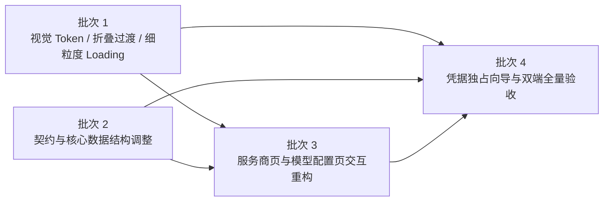

# GraphAgent 与共用 UI 交互优化实施与验收计划

本计划对应 [交互优化与数据结构调整设计](./design.md)，按依赖顺序拆分为四个批次执行：**批次 1 视觉规范、折叠过渡与细粒度 Loading → 批次 2 数据结构与契约解耦 → 批次 3 服务商接入页与模型配置页交互重构 → 批次 4 凭据独占向导与双端回归**。

除标注依赖关系的步骤外，批次 1 的 Token 规范与 `CollapsiblePanel` 组件可并行推进；批次 2 的「协议族目录」「凭据向导投影」与「PolyQuota 用量过滤」三条线可并行推进。

---

## 批次 1：视觉规范、折叠过渡与细粒度 Loading 基础设施

前置条件：现有 UI 代码已通过 `pnpm typecheck` 与 `pnpm test` 基线。  
交付物沉淀在 `packages/shared-ui` 与 `apps/graph-agent/ui/src/styles/`，完成后即可作为批次 3 与批次 4 的统一视觉与交互底座。

### 阶段 1A：紧凑桌面 Token 与按钮层级

1. 在 [styles.css](../../../../packages/shared-ui/src/styles.css) 引入圆角（`4/6/8/10px`）、控件高度（`28/32/34px`）、表面层级与阴影 CSS 变量，收敛页面内边距、标题字阶、`.provider-mark`、`.account-avatar` 与按钮尺寸，新增 `.accent-action` 次强调按钮与 `.ghost-action` 轻量按钮样式（规范见 [设计第 1.2–1.3 节](./design.md#12-紧凑桌面工具-token-规范)）。
2. 同步收敛 [RichSelect.vue](../../../../packages/shared-ui/src/components/RichSelect.vue)、[ConfigField.vue](../../../../packages/shared-ui/src/components/ConfigField.vue)、[SegmentedControl.vue](../../../../packages/shared-ui/src/components/SegmentedControl.vue)、[TagToggleGroup.vue](../../../../packages/shared-ui/src/components/TagToggleGroup.vue) 及 [GraphAgent 样式表](../../../../apps/graph-agent/ui/src/styles/) 的高度与圆角。
3. 新增通用同行输入组合样式 `.input-with-action` 与单行路径条 `.path-field`（见 [设计第 2.1 节](./design.md#21-凭据管理页同行输入组合消除文本框挤压按钮换行)）。

### 阶段 1B：公共折叠组件、菜单原语与按钮 Loading

1. 按 [设计第 1.4 节](./design.md#14-统一折叠面板组件与过渡规范) 在 `packages/shared-ui/src/components/` 实现 `CollapsiblePanel.vue`（CSS Grid `0fr → 1fr` 过渡、键盘与 `prefers-reduced-motion` 支持）、`DropdownMenu.vue`（供账号行「⋯」菜单复用），增强 `RichSelect.vue`（键盘、自动翻转与防裁切定位），并从 `packages/shared-ui/src/index.ts` 导出。
2. 按 [设计第 2.2 节](./design.md#22-分层细粒度-loading-与非阻塞状态反馈) 在 `packages/shared-ui/src/components/icons/definitions/` 新增标准 `loader` 旋转图标；新增共用加载按钮组件 `ActionButton.vue`，支持 `:loading`、`:loading-label` 与稳定最小宽度，设置 `aria-busy`。
3. 替换全仓全部无过渡折叠区（`ProvidersPage`、`CustomProvidersPanel`、`ActivityPanel`、`ModelsPage`、`CatalogPanel`、`ModelFactsPanel`、`RateCardEditor`、`CustomProviderEditor`）。

### 批次 1 验收

- [x] **控件等高与圆角一致**：常规表单行内 `input`、`select`、`RichSelect` 与标准按钮实测高度均为 `32px`、圆角 `6px`；账号行内文字按钮与图标按钮实测高度均为 `28px`，无高低错落。
- [x] **按钮层级与单焦点**：服务商行内「添加账号」改为 `.accent-action`，页面顶部仅主操作使用实心 `.primary-action`。
- [x] **折叠过渡与无障碍**：点击任意折叠面板（服务商展开、模型目录筛选、编辑器高级项、思考过程），高度与透明度平滑过渡，箭头旋转同步；开启系统「减弱动态效果」后过渡时长为 `0ms`；键盘 `Enter` / `Space` 可正常切换且 `aria-expanded` 同步更新。
- [x] **组件测试**：为 `CollapsiblePanel`、`ActionButton` 与 `DropdownMenu` 补充 Vitest 组件测试到 `packages/shared-ui/test/`，回归 PolyQuota UI 与 GraphAgent 测试全部通过。

---

## 批次 2：数据结构与契约解耦

前置条件：可与批次 1 并行推进或在批次 1 后顺序执行。  
进入批次 3/4 的准出条件：协议族目录与凭据向导投影契约在 `contract`、`core`、`apps/graph-agent` 服务端全部就绪并通过单元测试。

### 阶段 2A：模型目录与协议族解耦

1. 更新 [model-endpoint.ts](../../../../packages/contract/src/common/dto/model-endpoint.ts)，为 `ProtocolFamilyDescriptor` 增加 `label` 与 `supportsCatalog`，补齐 `gemini-generate-content` 协议与 `gemini` 族 `catalogPath: "models"`，按 [设计第 4.1 节](./design.md#41-核心调整模型目录加载与协议族解耦不再依赖具体协议端点) 收口发现资格到协议族层；新增内置供应商 `gemini`（`gemini-api-key`）并接入协议族目录与对话编译。
2. 更新 [model-discovery.ts](../../../../packages/core/src/providers/model-discovery.ts)，支持 Gemini `/v1beta/models` 响应与分页解析，调整 `projectDiscoveredModels` 使非 `chat` 端点可消费同族发现结果。
3. 扩展 [models.ts](../../../../packages/contract/src/graph-agent/models.ts) 与 [model-service.ts](../../../../apps/graph-agent/src/server/model-service.ts)，在 `GraphModelSnapshot` 中输出 `familyCatalogs: FamilyCatalogView[]`，并让 `refreshCatalog` 以 `FamilyCatalogRequest` 为主路径直接按协议族拉取，不再依赖特定 `EndpointProtocol` 入口。
4. 在 `packages/contract/src/common/dto/` 公共投影中补充 `isCustom`、`authMethodLabel` 字段，并将推理强度候选 `effort` 选项随 `parameterTemplate.fields.effort.choices` 下发（对应 [设计第 4.3 节](./design.md#43-消除前端硬编码与自定义供应商协议族建模一致化)）。
5. 同步更新 [前端服务契约](../../design/frontend-contract.md) 中 `GraphModelSnapshot` 与 `RefreshCatalogRequest` 的接口定义。

### 阶段 2B：凭据向导结构化投影（可与 2A 并行）

1. 在 [credential-sharing.ts](../../../../packages/contract/src/common/dto/credential-sharing.ts) 新增 `CredentialWizardFlow`、`CredentialWizardStepCode` 与 `CredentialWizardProjection`，为 `CredentialManagementStatus` 扩展 `wizard` 字段并为 `operation` 增加 `stepCode`。
2. 在 [credential-migration-service.ts](../../../../packages/core/src/credential-migration-service.ts) 的 `getStatus()` 中实现 `wizard` 状态推导，覆盖 `A`、`B1`、`B2`、`B3`、`C`、未确认交付、冲突、分歧、核对态与待清理态（映射表见 [设计第 3.2 节](./design.md#32-状态机与向导步骤精确映射表)）。
3. 为无内置库的 Web 凭据服务实现返回 `wizard: null` 的默认兼容投影。

### 阶段 2C：PolyQuota 供应商与账号用量能力过滤（可与 2A/2B 并行）

1. 在 [catalog.ts](../../../../packages/core/src/providers/catalog.ts) 的 `toPublicProviderDescriptor` 与对应契约类型中显式投影 `capabilities` 与 `supportsSubscriptionUsage`。
2. 在 [provider-application-service.ts](../../../../packages/core/src/provider-application-service.ts) 增加 `offeringFilter` 准入配置，并在 `getSnapshot()`、`startAuth`、`createConnection`、`editConnection` 统一执行过滤与校验。
3. 在 [start-runtime.ts](../../../../apps/polyquota/src/server/runtime/start-runtime.ts) 为 PolyQuota 注入订阅用量过滤谓词（排除 `openai-api`、`deepseek` 等非用量 offering，保留 `codex` 等订阅 offering，且不删除共享库中的非用量记录）。

### 批次 2 验收

- [x] **单协议族直接发现**：仅配置 `openai-images-generations` 或 `openai-embeddings`（未配置 `openai-chat`）的账号调用 `refreshCatalog({ protocolFamily: "openai", ... })` 时，服务成功请求 `/v1/models` 并在 `familyCatalogs` 返回发现模型，不报「该端点通过手工登记模型」。
- [x] **多端点共享一次族拉取**：同一账号同时启用 `openai-chat`、`openai-responses`、`openai-images-generations` 时，`familyCatalogs` 只生成 1 条 OpenAI 族目录，单次刷新后 3 个端点均可见该族发现模型池。
- [x] **Gemini 目录发现与供应商接入**：补齐 `gemini-generate-content` 协议与 `gemini`（`gemini-api-key`）内置供应商；受控上游返回 Gemini `{ models, nextPageToken }` 分页响应时，`discoverRouteModels` 完整解析并写入 `model_catalogs`，且对话预览与请求执行可用。
- [x] **PolyQuota 供应商准入过滤**：PolyQuota 的 `GET /api/v1/providers` 不返回 OpenAI API、DeepSeek、Gemini API 与 `compatible-api-key`，但保留 OpenAI Codex 等支持订阅用量的 offering；直接向 PolyQuota 提交创建 `openai-api-key`、`deepseek-api-key` 或 `gemini-api-key` 连接的请求被服务端拒绝；共享库中已有非用量凭据保持隐藏且不被删除。
- [x] **向导投影全状态覆盖**：单元测试覆盖 `A`（空闲 / 导出中 / 冲突 / 导入验钥 / 有效预览）、`B1`（未交付 / 已交付）、`B2`（已记钥 / 需重验）、`C`（在线 / 未交付 / 离线 / 准备回退）、`B3`（等待 / 切换核对中）与 `A`（旧密钥待清理），断言 `wizard.flow`、`stepCode`、`stepIndex`、`resumable`、`requiresAttention` 与 [状态映射表](./design.md#32-状态机与向导步骤精确映射表) 一致。
- [x] **向后兼容**：既有 `GraphModelSnapshot.catalogs` 与 `CredentialManagementStatus` 字段测试全部通过，`pnpm typecheck` 与 `pnpm test` 无报错。

---

## 批次 3：服务商接入页与模型配置页交互重构

前置条件：批次 1 与批次 2A 完成。

### 阶段 3A：服务商接入页三段布局与局部 Loading

1. 重构 [ProvidersPage.vue](../../../../packages/shared-ui/src/providers/ProvidersPage.vue) 与 [CustomProvidersPanel.vue](../../../../apps/graph-agent/ui/src/pages/CustomProvidersPanel.vue)：
   - 统一供应商头部 `.provider-summary` 右侧操作组与固定贴右展开箭头，行内「添加账号」改用 `.accent-action`。
   - 删除 7 列固定 Grid，内置与自定义账号行统一采用三段 Flex 布局（左身份、中元数据、右 `.account-row-actions`），所有条件按钮与 `#account-actions` 插槽均放入 `.account-row-actions`。
   - 操作项超过 4 个时引入紧凑「⋯」更多菜单收纳低频运维动作（见 [设计第 2.3 节](./design.md#23-服务商接入页-flexgrid-布局重构与账号行对齐)）。
2. 将两页单一全局 `busy` 替换为按实体隔离的 `pendingAccountActions` / `pendingProviders` 映射表，在触发按钮上展示 Spinner 与进行中文案，非冲突行保持可点击（见 [设计第 2.2 节](./design.md#22-分层细粒度-loading-与非阻塞状态反馈)）。
3. 调整 [CustomProviderEditor.vue](../../../../apps/graph-agent/ui/src/pages/CustomProviderEditor.vue)，按协议族聚合展示单个 API 根地址与族公共参数，族内勾选启用具体明细端点（见 [设计第 4.3 节](./design.md#43-消除前端硬编码与自定义供应商协议族建模一致化)）。

### 阶段 3B：模型配置页按协议族加载目录与端点下沉

1. 重构 [ModelsPage.vue](../../../../apps/graph-agent/ui/src/pages/ModelsPage.vue)，改为消费 `snapshot.familyCatalogs`：
   - 顶部作用域精简为「供应商 → 接入点（多选时）→ 账号 → 协议族（多族时）」。
   - 选定账号且协议族确定后立即触发族目录加载与列表渲染，不再阻塞于「选择协议端点」。
2. 重构 [CatalogPanel.vue](../../../../apps/graph-agent/ui/src/pages/CatalogPanel.vue) 与 [ModelFactsPanel.vue](../../../../apps/graph-agent/ui/src/pages/ModelFactsPanel.vue)：
   - 左侧列表渲染去重后的协议族模型，支持按「适用端点 / 用途 / 模态 / 价格」筛选。
   - 右侧模型编辑器顶部增加「调用端点」切换条，按所选模型与端点加载对应 `ModelEntryView`（草稿、参数、价卡、请求预览、设为测试模型），切换端点前执行 `mayLeave()` 保护。
   - 移除硬编码推理强度数组与 ID 前缀猜测，统一文案到 [catalog-labels.ts](../../../../apps/graph-agent/ui/src/pages/catalog-labels.ts)。

### 批次 3 验收

- [ ] **账号行对齐与操作不换行**：在 `1280px`、`960px`、`720px` 三种宽度下查看内置账号（含 2–5 个条件按钮 +「模型配置 →」）与 New API 自定义账号（6 个操作项），宽屏下单行严格水平居中对齐且不折到头像下方，窄屏下整体对齐身份文字起点换行；超过 4 个动作的账号行通过「⋯」菜单可键盘操作全部动作。
- [ ] **服务商页局部 Loading**：对某账号点击「刷新令牌」或「停用」时，仅该按钮出现旋转 Spinner 且仅锁该账号行状态按钮；同一时刻可正常展开/收起其他供应商或点击另一账号的「模型配置」。
- [ ] **按协议族直接加载模型列表**：在拥有 OpenAI Chat + OpenAI Responses + OpenAI 图片生成三个端点的账号下进入模型配置，选完供应商与账号后立即自动加载并展示 OpenAI 族全部模型；点击模型后可在右侧编辑器顶部切换 `OpenAI Chat Completions` / `OpenAI Responses` / `OpenAI 图片生成` 分别编辑参数与价卡。
- [ ] **多协议族切换**：同时启用 OpenAI 与 Anthropic 两个协议族的账号，顶部显示协议族切换器；切到 Anthropic 族时独立加载 Anthropic 目录，切回 OpenAI 族复用缓存快照。
- [ ] **自定义供应商协议族表单**：在同一 offering 下启用 OpenAI Chat 与 OpenAI Responses 时，表单中仅出现 1 个 OpenAI 族 API 根地址输入框，修改后保存正确落库到同族路由。

---

## 批次 4：凭据独占向导页面实现与全量回归

前置条件：批次 1 与批次 2B 完成。

### 阶段 4A：凭据概览页与独占向导骨架

1. 拆分 [CredentialsPage.vue](../../../../packages/shared-ui/src/credentials/CredentialsPage.vue) 为概览视图与独占向导子组件（建议置于 `packages/shared-ui/src/credentials/`）：
   - `CredentialsOverview.vue`：顶部待续办横幅（消费 `status.wizard`）、当前存储摘要卡、同行路径条 `.input-with-action`、合法向导入口卡、可折叠脱敏账号清单、独立作用域的组件管理卡。
   - `CredentialWizardShell.vue`：固定四段骨架（顶部暂离栏 + 状态机徽章、横向 Stepper、中央任务画布、底部固定操作栏）。
   - `ExportWizardFlow.vue`、`ImportWizardFlow.vue`、`ReturnPrivateWizardFlow.vue` 与 `WebAdoptVaultFlow.vue`：分别实现 [设计第 3.3 节](./design.md#33-三条桌面路径的单步交互细节) 的全部步骤，全部移除流程内 `window.confirm`，改为内联风险确认与冲突解决卡片。
2. 拆分 `CredentialsPage` 的单一 `busy` 为独立作用域 `scope:component` / `scope:refresh` / `scope:migration`，在对应触发按钮内展示 Spinner（见 [设计第 2.2 节](./design.md#22-分层细粒度-loading-与非阻塞状态反馈)）。
3. 在 [AppShell.vue](../../../../packages/shared-ui/src/shell/AppShell.vue) 的 `NavigationItem` 增加可选 `badge?: "attention"` 字段；在 [GraphAgent App.vue](../../../../apps/graph-agent/ui/src/App.vue) 与 [PolyQuota App.vue](../../../../apps/polyquota/ui/src/App.vue) 统一将「凭据管理」设为一级导航并在 `status.wizard?.requiresAttention` 为真时显示侧栏提醒角标；移除 [SettingsView.vue](../../../../apps/polyquota/ui/src/pages/SettingsView.vue) 内嵌的凭据页切换状态与 `CredentialsPage` 的 `showBack` 返回设置入口。

### 阶段 4B：端到端验证与双产品回归

1. 补充组件与集成测试覆盖凭据向导各状态步骤恢复、冲突处理、预览过期、分歧核对、切回与旧密钥清理。
2. 运行全量质量门禁：`pnpm format:check`、`pnpm typecheck`、`pnpm test`、`pnpm build`；验证 GraphAgent Web / Electron 烟测与 PolyQuota UI 回归，确认两个产品的共用页与样式主题均无回归。

### 批次 4 验收

- [ ] **凭据页同行输入与局部 Loading**：所有目录输入行中，文本框与「选择目录」按钮保持同行等高不换行；点击组件卡「检查最新版本」或「下载发行包」时，仅该按钮出现 Spinner 并锁同卡片组件按钮，顶部「重新检查」与迁移入口（非卸载场景）保持可用。
- [ ] **导出向导闭环（A → B1 → C）**：按 4 步完成目录选择、发布校验、复制并确认迁移密钥交付、切换共享；注入 `export-target-conflict` 时卡片内联展示清空确认，无原生 `window.confirm`；在 Step 3 暂离或重启后，侧栏出现角标、概览页置顶续办横幅，一键直达 Step 3 并可恢复密钥交付。
- [ ] **导入向导闭环（A → B2 → C）**：输错密钥原地重试且保留目录；预览过期自动退回 Step 2 并保留目录；存在同身份账号冲突时 Step 3 高亮展示脱敏冲突清单；进入 B2 后重启应用，点击续办横幅直接进入 Step 4 切换共享，无需重新输入密钥。
- [ ] **返回内置向导闭环（C → B3 → A）**：在 Step 1 内联确认在线/离线快照来源与独立刷新风险；进入 B3 后暂离或重启仍保持共享存储与密钥不删，通过横幅一键回到 Step 3；切换失败保留 B3 与共享接线；切回 A 但注入删钥失败时，界面明确显示「已切回内置且可写」并提供独立「重试清理」。
- [ ] **双产品一致的凭据一级导航与角标**：GraphAgent 与 PolyQuota 侧栏均直接展示「凭据管理」一级导航；PolyQuota 设置页不再重复嵌套凭据管理入口；两端存在 B1/B2/B3、未确认交付或待清理密钥时，侧栏「凭据管理」均显示提醒角标并可一键续办。
- [ ] **Web 宿主适配**：GraphAgent Web 下不展示桌面三向导，通过两步轻量接入流完成共享目录接入/更换，同行输入与局部 Loading 生效。
- [ ] **安全与隐私红线**：离开向导、刷新页面或切换路由后，内存中 `inputKey` 与明文 `delivery` 清空；确认交付后普通状态查询与重试不再回显迁移密钥；所有预览、日志与报错仅含脱敏标识。
- [ ] **双产品构建与回归**：`pnpm format:check`、`pnpm typecheck`、`pnpm test`、`pnpm build` 及两端 UI 回归测试全部通过。
