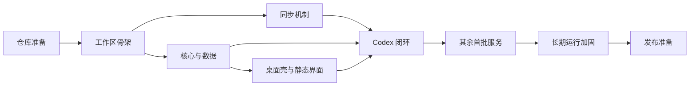

# LLM 订阅用量聚合桌面工具：实施计划

| 项目 | 内容 |
| --- | --- |
| 状态 | 草案 |
| 更新日期 | 2026-09-22 |
| 设计依据 | [设计说明](./design.md) |
| 当前准备 | OmniRoute 已按固定提交纳入 `references/omniroute` |

## 1. 实施目标

实施过程以“尽快得到可验证的真实闭环”为主线。先建立可维护的源码抽取和运行边界，再以 Codex 打通认证、存储、用量、界面和通知，随后逐家扩展。每个阶段都应交付可验证结果，而不是只增加框架或占位代码。

以下原则贯穿所有阶段：

- 服务协议必须有固定来源，不凭经验补写关键流程；
- 每次只扩大一个主要变量，便于定位协议、代理、存储或界面问题；
- 真实账号验证与自动化测试并重，但真实请求不进入默认 CI；
- 未验证的问题保留为探索项，不提前包装成确定设计；
- 子模块只用于开发参考，应用始终从可追溯的生成物构建；
- 凭证、日志和通知从第一条闭环开始就按正式安全边界处理。

## 2. 阶段与方向

### 阶段 0：仓库准备

**目的：** 为正式开发建立稳定、可追溯的起点。

**方向：**

- 初始化主仓库；
- 将 OmniRoute 放入 `references/omniroute`，记录固定提交；
- 整理设计和实施文档，统一术语、范围和未决事项；
- 补充根目录说明和最小开发约定。

**完成标志：** 新成员能够确认产品边界、上游基线和下一步工作；子模块状态可由 Git 复现。

### 阶段 1：工作区骨架

**目的：** 尽早验证技术分层和桌面打包路径，避免业务完成后再处理工程结构问题。

**方向：**

- 建立 `packages/core`、`packages/ui` 和 `apps/desktop`；
- 统一 TypeScript、构建、格式化和测试入口；
- 让 Vue 产物可由 Electron 加载；
- 用最小原生依赖验证 Windows 开发与打包流程。

**探索重点：** 本地数据库选择、Electron 原生模块重建方式、开发服务器与桌面进程的协作方式。

**完成标志：** 三部分可独立构建，桌面应用可启动并加载空界面，安装包骨架可生成。

### 阶段 2：OmniRoute 同步机制

**目的：** 在接入服务之前建立可审查、可升级的协议代码来源。

**方向：**

- 建立允许清单、拒绝规则和来源清单；
- 先抽取少量纯函数与公共类型验证流程；
- 将必要的路径替换和宿主适配固化为转换规则；
- 检查许可证、来源提交和重复执行的一致性。

**探索重点：** 哪些模块可以原样抽取，哪些必须通过本项目适配层解除数据库、Next.js 或网关依赖。

**完成标志：** 相同上游提交重复同步无差异；生成物无需子模块即可参与应用构建；拒绝范围有自动检查。

### 阶段 3：核心边界与本地数据

**目的：** 定义所有服务共享的稳定宿主，使后续适配器只处理服务差异。

**方向：**

- 建立账号、认证方式、用量快照和服务适配器的核心模型；
- 建立桌面能力端口、IPC 数据边界和错误模型；
- 实现安全存储、本地设置与最近用量缓存；
- 用假服务验证多账号、启停、刷新和错误隔离。

**探索重点：** 数据库实现、凭证加密封装和未来模型演进所需的最小字段。

**完成标志：** 无需 Electron 即可运行核心测试；渲染进程获得的数据不含凭证；无安全存储时不会降级为明文保存。

### 阶段 4：桌面壳与静态界面

**目的：** 在真实服务接入前验证用户操作链路和桌面系统能力。

这部分可与阶段 3 后半段并行推进。

**方向：**

- 桌面壳提供窗口、托盘、系统通知、浏览器打开、回环认证和系统代理能力；
- 界面使用模拟数据完成卡片、空状态、设置和登录交互；
- 所有操作均提供进行中、成功和失败反馈；
- 先验证少量卡片和多账号布局，不提前投入复杂视觉设计或列表虚拟化。

**探索重点：** Windows 通知身份、PAC 解析结果、关闭窗口后驻留托盘的行为，以及最小可用的响应式布局。

**完成标志：** 模拟账号可以走完添加、启停、刷新、错误和通知流程；明文凭证不进入 UI。

### 阶段 5：Codex 最小闭环

**目的：** 用一个真实服务验证此前所有边界，而不是同时调试四套协议。

**方向：**

- 从固定 OmniRoute 版本抽取 Codex 认证、刷新、用量和配额归一化所需模块；
- 支持浏览器授权与 Codex CLI 凭证只读导入；
- 接入系统代理、本地加密、手动刷新、周期轮询和低额度通知；
- 使用本机账号与 OmniRoute 或官方页面对照数据。

**探索重点：** 固定回调端口冲突、代理环境下的授权回调、重置额度字段以及刷新令牌的生命周期。

**完成标志：** 从添加账号到通知的完整链路稳定可重复，失败场景不会泄露凭证或破坏已有账号。

### 阶段 6：扩展首批服务

**目的：** 验证统一适配器是否能容纳不同认证和用量模型，并完成首个版本覆盖面。

按以下顺序逐家推进，每家独立评审和验收：

1. **GLM：** 先验证 API Key、区域差异和配额归一化，作为最轻量的第二个适配器；
2. **Grok Build：** 验证设备码、CLI 导入和带主体信息的令牌刷新；
3. **Antigravity：** 最后处理身份请求头、项目标识和上游数据库耦合。

每家都应先更新同步清单，再实现适配层，最后使用真实账号核对。遇到共性需求时优先修正核心边界；只对单家有效的规则留在对应适配器中。

**完成标志：** 四个首批服务均能独立添加、刷新、停用和报错；单个服务失败不影响其他服务。

### 阶段 7：轮询、代理与通知加固

**目的：** 将单次可用提升为适合长期驻留的稳定行为。

**方向：**

- 验证最短间隔、并发限制、失败退避和应用恢复后的调度行为；
- 覆盖实际使用的系统代理、环境变量代理和直连场景；
- 验证通知阈值、重置周期去重、无限额度和缺少百分比的情况；
- 增加脱敏诊断信息，支持定位单家服务问题。

**探索重点：** PAC 与 SOCKS 的最低兼容范围、休眠唤醒后的补偿策略、各服务自带缓存与全局调度的关系。

**完成标志：** 应用持续运行时不会高频请求、重复通知或因单次失败形成请求风暴。

### 阶段 8：发布准备

**目的：** 确认首个版本在真实 Windows 环境中可安装、可诊断、可安全卸载。

**方向：**

- 执行安全、日志、代理、安装和升级前置检查；
- 在干净环境验证安装包与首次启动；
- 整理用户说明、已知限制和故障排查；
- 冻结上游提交并复核生成物差异与许可证信息。

**完成标志：** 首批验收清单通过，未解决问题有明确影响范围和后续安排。

## 3. 依赖关系

阶段 2 和阶段 3 可在阶段 1 稳定后交叉推进；阶段 4 可使用模拟数据与它们并行。真实服务扩展必须建立在 Codex 闭环通过之后。

## 4. 交付切片

实施可按下表拆分为小型变更。切片名称是方向，不预先限定具体 PR 数量。

| 切片 | 核心结果 |
| --- | --- |
| 工程骨架 | Monorepo 可构建，Electron 可加载 Vue 界面 |
| 源码同步 | 固定上游、可复现抽取、来源清单与拒绝规则 |
| 核心模型 | 适配器边界、安全存储、设置、缓存和模拟服务 |
| 桌面体验 | 托盘、通知、回环认证、系统代理和静态卡片流程 |
| Codex | 首条真实端到端闭环 |
| GLM | 区域化 API Key 服务接入 |
| Grok Build | 设备码与特殊刷新流程接入 |
| Antigravity | 高耦合服务拆分与接入 |
| 稳定性 | 调度、退避、通知去重、代理与诊断加固 |
| 发布 | 安装包、文档、许可证和干净环境验证 |

每个服务切片都必须包含来源更新、自动化测试、真实账号验证记录和脱敏检查。不得把多个尚未验证的服务捆绑在一次变更中。

## 5. 首批验收清单

### 功能

- [ ] Codex 展示套餐、短周期与周配额以及只读重置额度；
- [ ] GLM 正确区分国内与国际区域，并展示短周期和周配额；
- [ ] Grok Build 展示主要配额与只读额外额度，刷新后保留账号主体信息；
- [ ] Antigravity 展示套餐及多项模型配额；
- [ ] 同一服务可添加多个账号；
- [ ] 停用账号后停止轮询和通知；
- [ ] 登录、刷新、开关和错误都有可见反馈。

### 安全与稳定性

- [ ] 日志、IPC、通知和诊断信息不含访问令牌、刷新令牌或 API Key；
- [ ] 回环服务只在登录期间监听 `127.0.0.1`；
- [ ] 无安全存储能力时拒绝保存凭证；
- [ ] 系统代理、环境变量代理和直连至少覆盖当前真实环境；
- [ ] 单个服务失败不阻塞其他账号，并触发受控退避；
- [ ] 无限额度或未提供百分比的配额不会误报；
- [ ] 应用构建不依赖或打包 `references/omniroute`；
- [ ] 界面不依赖 OmniRoute 的 React / Next.js 代码。

### 工程质量

- [ ] 同一上游提交重复同步不会产生差异；
- [ ] 生成物可追溯到具体提交和源文件；
- [ ] 真实账号测试默认不在 CI 中运行；
- [ ] 安装包可在干净 Windows 环境启动，并能生成脱敏诊断信息。

## 6. 主要风险与应对方向

| 风险 | 应对方向 |
| --- | --- |
| 上游模块依赖 OmniRoute 数据库或网关上下文 | 通过适配层逐项解除；高耦合服务后置 |
| 身份请求头或刷新字段遗漏 | 保留上游实现结构，逐家进行真实账号对照 |
| Electron 原生依赖影响打包 | 在工作区骨架阶段提前验证，不等到发布阶段 |
| 官方 CLI 与应用同时刷新产生冲突 | 只读导入、不回写，每个账号只保留一条刷新路径 |
| 代理差异导致授权或用量请求失败 | 所有请求统一经过代理边界，并记录脱敏诊断 |
| 上游升级造成生成物漂移 | 固定提交；升级时单独同步、审查和验证 |
| 未决方向过早固化 | 在对应阶段保留探索任务，以验证结果更新设计 |

## 7. 后续扩展

首个版本稳定后，再评估 GitHub Copilot、Claude 和 OpenCode Go。每次扩展都复用“确认可抽取实现—更新同步清单—接入适配器—真实账号验证”的流程。

其他服务只保留为候选目录，不在当前计划中给出详细文件、接口或排期，避免把尚未验证的方向写成既定方案。
