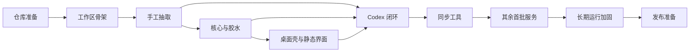

# LLM 订阅用量聚合桌面工具：实施计划

| 项目     | 内容                                              |
| -------- | ------------------------------------------------- |
| 状态     | 草案                                              |
| 更新日期 | 2026-09-22                                        |
| 设计依据 | [设计说明](./design.md)                           |
| 当前准备 | OmniRoute 已按固定提交纳入 `references/omniroute` |

## 1. 实施目标

实施过程以“尽快得到可验证的真实闭环”为主线。先建立可维护的源码抽取和运行边界，再以 Codex 打通认证、存储、用量、界面和通知，随后逐家扩展。每个阶段都应交付可验证结果，而不是只增加框架或占位代码。

以下原则贯穿所有阶段：

- 服务协议必须有固定来源，不凭经验补写关键流程；
- 每次只扩大一个主要变量，便于定位协议、代理、存储或界面问题；
- 真实账号验证与自动化测试并重，但真实请求不进入默认 CI；
- 未验证的问题保留为探索项，不提前包装成确定设计；
- 子模块只用于开发参考，应用始终从主仓库内可追溯的 vendor 副本构建；同步工具完成后，该副本再改由工具生成；
- 凭证、日志和通知从第一条闭环开始就按正式安全边界处理。

## 2. 阶段与方向

### 阶段 0：仓库准备

**目的：** 为正式开发建立稳定、可追溯的起点。

**方向：**

- 初始化主仓库；
- 将 OmniRoute 放入 `references/omniroute`，记录固定提交；
- 整理设计和实施文档，统一术语、范围和未决事项；
- 补充根目录说明和最小开发约定。

**完成标志：** 新成员能够确认产品边界、上游基线和下一步工作；子模块状态可由 Git 复现。

**状态：** 已完成。主仓库、`references/omniroute` 固定提交 `3ee283bb944d6d62cc219f74317d5186942e1780`、设计与实施文档、根目录说明和开发约定已齐备。

### 阶段 1：工作区骨架

**目的：** 尽早验证技术分层和桌面打包路径，避免业务完成后再处理工程结构问题。

**方向：**

- 建立 `packages/core`、`packages/ui` 和 `apps/desktop`；
- 统一 TypeScript、构建、格式化和测试入口；
- 让 Vue 产物可由 Electron 加载；
- 用最小原生依赖验证 Windows 开发与打包流程。

**探索重点：** 本地数据库选择、Electron 原生模块重建方式、开发服务器与桌面进程的协作方式。

**完成标志：** 三部分可独立构建，桌面应用可启动并加载空界面，安装包骨架可生成。

**状态：** 已完成。`packages/core`、`packages/ui`、`apps/desktop` 可独立构建。桌面窗口加载 Vue 示例卡片，数据写死，没有登录、刷新或开关。安装包为 NSIS + asar，骨架不含原生模块。

### 阶段 2：OmniRoute 源码手工抽取

**目的：** 在编写本项目业务层之前，先把 Codex 最小闭环真正需要的协议实现材料完整抽取出来。阶段 2 只确定“最终要保留什么”，不实现同步工具。

**当前事实：**

- `packages/core` 使用 TypeScript 5.6、ESM 和 Bundler 模块解析；源码保留上游的相对 `.ts` 导入，由 TypeScript 生成声明文件、esbuild 生成可运行的 `.js`；
- Core 使用 `@omniroute/open-sse/*` 和 `@omniroute/src/*` 指向 vendor 内部源码；边界测试禁止直接引用 `references/omniroute`、安装外部 `@omniroute/*` 包或使用含义不清的 `@/*`；
- 基础配额函数、浏览器 OAuth、设备授权、换票、旋转刷新、用量请求和 CLI 只读导入均已形成手工样板，并已通过无网络特征测试；真实账号闭环仍留到阶段 5；
- 固定上游仍是 `references/omniroute` 的提交 `3ee283bb944d6d62cc219f74317d5186942e1780`。整文件复制项保持上游原文，裁剪项保存逐文件 Git diff。

#### 2.1 两个手工抽取步骤

1. **基础协议叶子：** 配额类型、标量转换、窗口标签、Codex 配额归一化和公开客户端凭证。该步骤已经完成。
2. **Codex 完整协议：** 补齐浏览器 OAuth PKCE、自定义设备授权、授权码换票、JWT 身份映射、旋转刷新、用量请求、身份请求头和 CLI 凭证解析。该步骤先完成手工样板和无网络验证；阶段 5 确认真实输出形态前仍不编写同步工具。

两个步骤都直接在 `packages/core/src/vendor/omniroute` 中形成可运行样板，并在 `.diff/<source-path>.diff` 保存与固定上游的差异。阶段 2 不维护手工 manifest；如果真实 Codex 闭环发现遗漏，继续修正手工样板和测试，直到阶段 5 验证结束。

#### 2.2 目录和依赖边界

```text
packages/core/src/
  vendor/omniroute/       # 阶段 2 手工抽取，阶段 6 才交给同步工具生成
    .diff/                # 每个上游文件对应一份审查差异
    LICENSE
    open-sse/...
    src/...
  providers/              # 阶段 3 本项目适配器和胶水代码
  runtime/                # 阶段 3 HTTP、时钟、日志、存储等宿主端口
```

vendor 只能包含上游协议实现及为脱离 OmniRoute 宿主而必需的小型裁剪，不能包含本项目账号模型、存储实现、轮询器、Electron 或界面代码。`packages/core/src/index.ts` 不直接公开 vendor 模块。

#### 2.3 步骤 1：基础协议叶子

| 上游文件                                | 处理方式     | 保留内容                                                                       |
| --------------------------------------- | ------------ | ------------------------------------------------------------------------------ |
| `open-sse/services/usage/scalars.ts`    | 整文件复制   | 数值、对象、百分比和标题转换                                                   |
| `open-sse/services/usage/quota.ts`      | 整文件复制   | `UsageQuota`、重置时间和通用配额构造                                           |
| `open-sse/services/quotaWindowLabel.ts` | 整文件复制   | 窗口时长与显示名推导                                                           |
| `open-sse/config/codexQuotaScopes.ts`   | 整文件复制   | Codex 与 Spark 配额键、显示名和作用域判断                                      |
| `open-sse/services/codexUsageQuotas.ts` | 整文件复制   | Codex 主窗口、周窗口、附加窗口和只读重置次数归一化                             |
| `open-sse/utils/publicCreds.ts`         | 对象成员裁剪 | 解码函数，以及 `codex_id`、`grok_id`、`antigravity_id`、`antigravity_alt` 四项 |

**状态：** 已完成。5 个源码文件和许可证与上游逐字节一致，只有 `publicCreds.ts` 存在成员删除差异；Core 类型检查、特征测试、构建和编译后运行验证均已通过。

#### 2.4 步骤 2：Codex 完整协议

步骤 2 按真实调用链抽取，不只复制接口常量：

| 能力                 | 上游来源                                                                                | 手工样板要求                                                                                                                                                     |
| -------------------- | --------------------------------------------------------------------------------------- | ---------------------------------------------------------------------------------------------------------------------------------------------------------------- |
| OAuth 配置           | `src/lib/oauth/constants/oauth.ts`                                                      | 只取 `CODEX_CONFIG` 及直接依赖，保留 `prompt=login`、scope、授权端点和换票端点                                                                                   |
| PKCE                 | `src/lib/oauth/utils/pkce.ts`                                                           | 保留完整算法；只补齐严格 TypeScript 编译所需的参数和返回类型，不改随机数与摘要行为                                                                               |
| 授权与换票           | `src/lib/oauth/providers/codex.ts`                                                      | 保留授权 URL 构造、授权码换票和 `id_token` 身份映射；补齐必要类型，不带入页面或回环服务器                                                                        |
| 自定义设备授权       | `src/lib/oauth/codexDeviceFlow.ts`                                                      | 保留 user code 请求、授权轮询、带服务端 verifier 的换票、15 分钟超时、取消和错误分类；这是 OpenAI 自定义流程，不改写成 RFC 8628，也不依赖 Cookie 或现有 Web 会话 |
| Codex 身份头         | `open-sse/config/codexClient.ts`、`src/shared/constants/codexClient.ts`                 | 保留认证面与后端用量面的身份头、版本和 User-Agent 规则；把上游 `@/*` 统一改为明确的 `@omniroute/src/*`                                                           |
| 刷新请求公共逻辑     | `open-sse/services/tokenRefresh/shared.ts`                                              | 保留表单构造、OAuth 错误读取和不可恢复错误识别                                                                                                                   |
| 旋转刷新串行器       | `open-sse/services/refreshSerializer.ts`                                                | 只保留 Codex 的 `openai-auth0` 旋转组、串行执行和默认 2 秒间隔                                                                                                   |
| Codex 令牌刷新       | `open-sse/services/tokenRefresh/providers/codex.ts`、`src/lib/oauth/constants/oauth.ts` | 保留完整刷新请求、旋转 refresh token 和不可恢复错误映射；复用裁剪后的 `CODEX_CONFIG`，去掉 OmniRoute 代理上下文，并把 HTTP 传输改为可注入参数                    |
| 用量接口             | `open-sse/services/usage/codex.ts`                                                      | 保留 `getCodexUsage`、`/backend-api/wham/usage` 请求、`chatgpt-account-id` 和已有配额归一化调用                                                                  |
| JSON 批量导入        | `src/lib/oauth/services/codexImport.ts`                                                 | 保留 JWT 解码、输入展开、字段归一化和现有账号状态合并等纯函数；不创建或更新数据库                                                                                |
| CLI `auth.json` 解析 | `src/lib/oauth/utils/codexAuthImport.ts`、`src/lib/oauth/utils/codexAuthFile.ts`        | 保留 `parseAndValidateCodexAuth`、`CodexAuthFileError` 及纯解析依赖；不复制连接查询、创建、更新、回写或备份函数                                                  |
| 刷新提前量           | `open-sse/services/tokenRefresh.ts`                                                     | 只记录并保留 Codex 的 5 分钟提前刷新规则，不复制总调度器                                                                                                         |

步骤 2 同时移植或补充以下特征测试：

- 授权 URL 包含 PKCE、固定回调和 `prompt=login`；
- 换票请求使用正确端点、表单以及 `Content-Type` / `Accept` 请求头，不擅自加入用量接口的身份头；
- 设备授权正确请求 user code，将首次 404 映射为功能未启用，将轮询阶段的 403 / 404 视为等待，并覆盖默认间隔、超时、取消和最终换票；
- 刷新请求不发送 `scope`，保存新的 access token 和旋转后的 refresh token，同组刷新不会并发；
- 用量请求携带 `chatgpt-account-id`、Codex 版本和身份头，并正确解析套餐、窗口、Review、Spark 与只读重置次数；
- CLI 嵌套、扁平和 camelCase 凭证形状能够只读解析，过期时间优先取 access token，工作区和用户身份不会混淆；
- 测试使用注入传输或 mock，不发起真实网络请求，也不写入 `.codex/auth.json`。

#### 2.5 稳定认证机制的抽取边界

对已经列入首批范围的厂商，抽取目标是固定上游中所有稳定认证机制的并集，而不是只保留当前界面的默认入口。满足以下条件的方式都应进入对应厂商的手工样板和后续同步清单：

- 上游已有可定位的协议实现，并能通过固定请求、响应和错误状态测试；
- 能获得可刷新凭证、长期 API Key，或从官方 CLI 文件只读导入包含刷新能力的凭证；
- 不依赖已有浏览器登录状态、Cookie、localStorage、浏览器配置目录、DOM 自动化或开发者工具抓取；
- 能归一化为同一账号凭证模型，由本项目安全存储和刷新。

界面可以为厂商指定首选方式，阶段验收也可以先跑一条完整闭环，但不能因此从 vendor 中删除其他稳定方式。当前范围是：Codex 保留浏览器 OAuth PKCE、自定义设备授权和官方 CLI `auth.json` 只读导入；GLM 保留 API Key；Grok Build 保留设备码、浏览器 OAuth PKCE 和完整 CLI `auth.json` 只读导入；Antigravity 保留 Google OAuth 授权码流程。

#### 2.6 拒绝范围

阶段 2 明确不抽取以下内容：

- `src/app/**`、React、Next.js、OAuth 页面和 provider-limits 页面；
- `src/lib/db/**` 以及连接查询、创建、更新和云同步；
- `open-sse/utils/proxyFetch.ts`、MITM、relay、tunnel 和完整代理上下文；
- `src/lib/oauth/utils/server.ts` 的回环宿主实现；阶段 3 只定义认证回调端口，阶段 4 由桌面壳实现并只监听 `127.0.0.1`；
- `src/lib/oauth/utils/codexAuthFile.ts` 的 CLI 回写、备份和数据库逻辑；
- Cookie、ChatGPT session JSON、裸短期 access token、浏览器 localStorage、浏览器配置目录读取、DOM 自动化和开发者工具抓取等依赖 Web 登录状态的导入方式；代表实现包括 `src/lib/oauth/utils/codexSessionImport.ts` 和 `open-sse/executors/grok-web.ts`；
- 推理执行器、路由、健康检查、重置额度兑换以及 purchase / redeem / consume；
- 任何定时器、全局运行时状态或直接依赖本项目账号存储的实现。

#### 2.7 完成标志

- 步骤 2 表格中的协议能力均已形成可编译的 vendor 文件，每个来源都有独立 `.diff`；
- 浏览器 OAuth、设备授权、CLI 导入、换票、刷新和用量可以通过无网络特征测试独立运行；
- 生成的运行时代码只包含 `.js`，源码继续保留上游 `.ts` 导入；
- vendor 不含数据库、回环宿主、CLI 回写、Electron、Vue、推理执行和兑换逻辑；
- 阶段 3 可以只通过稳定函数调用和宿主端口完成拼接，不再从源仓库复制代码。

**状态：** 步骤 1、步骤 2 的手工抽取和无网络验证均已完成。步骤 2 当前包含 14 个来源文件和对应逐文件 `.diff`；真实浏览器 OAuth、设备授权与 CLI 样本验证仍按阶段 5 执行，验证发现的遗漏继续回补阶段 2。详细协议依据见 [OmniRoute 探索报告](./omniroute-exploration.md)。

### 阶段 3：核心边界、项目胶水与本地数据

**目的：** 只用本项目自行编写的代码，把阶段 2 的协议叶子接入稳定的业务边界。阶段 3 不再复制、裁剪或改写 OmniRoute 源码，也不实现同步规则。

**方向：**

- 建立账号、认证方式、凭证、用量快照和服务适配器的核心模型；
- 定义 HTTP 传输、代理、时钟、日志、凭证存储、认证回调和桌面能力端口；
- 编写 Codex 适配器与胶水代码，把 vendor 的浏览器 OAuth、设备授权、换票、刷新、用量和 CLI 解析函数接到上述端口，不在适配器中重写协议；
- 建立 IPC 数据边界和错误模型，明确哪些内部字段可以进入渲染进程；
- 实现安全存储、本地设置与最近用量缓存；
- 用假服务验证多账号、启停、刷新和错误隔离。

**探索重点：** 数据库实现、凭证加密封装、HTTP 注入方式，以及未来模型演进所需的最小字段。发现缺失的上游协议能力时回到阶段 2 补充手工样板，不能把临时协议实现塞进胶水层。

**完成标志：** 无需 Electron 即可用 mock 传输运行 Codex 核心流程测试；阶段 3 代码不含从 OmniRoute 复制的实现；渲染进程获得的数据不含凭证；无安全存储时不会降级为明文保存。

### 阶段 4：桌面壳与静态界面

**目的：** 在真实服务接入前验证用户操作链路和桌面系统能力。

这部分可与阶段 3 后半段并行推进。

**方向：**

- 桌面壳提供窗口、托盘、系统通知、浏览器打开、回环认证和系统代理能力；
- 界面使用模拟数据完成卡片、空状态、设置和登录交互；
- 所有操作均提供进行中、成功和失败反馈；
- 先验证少量卡片和多账号布局，不提前投入复杂视觉设计或列表虚拟化。

**探索重点：** Windows 通知身份、系统代理地址的读取方式、关闭窗口后驻留托盘的行为，以及最小可用的响应式布局。静态卡片需包含 Antigravity 式分组，以及 Codex 的 `5-hour` 与 `Weekly` 标题。

**完成标志：** 模拟账号可以走完添加、启停、刷新、错误和通知流程；明文凭证不进入 UI。

### 阶段 5：Codex 最小闭环

**目的：** 用一个真实服务验证此前所有边界，而不是同时调试四套协议。

**方向：**

- 使用阶段 2 的手工协议样板、阶段 3 的项目适配器和阶段 4 的桌面宿主完成拼接；
- 支持浏览器 OAuth PKCE、自定义设备授权与 Codex CLI 凭证只读导入；
- 接入系统代理、本地加密、手动刷新、周期轮询和低额度通知；
- 使用本机账号与 OmniRoute 或官方页面对照数据；
- 如果闭环暴露上游文件或声明遗漏，先回到阶段 2 更新手工样板、逐文件 diff 和特征测试，再调整本项目胶水代码。

**探索重点：** 固定回调端口冲突、代理环境下的授权回调、重置额度字段、刷新令牌生命周期，以及手工抽取边界是否覆盖真实调用链。

**完成标志：** 至少一条认证方式能从添加账号走到通知的完整链路；浏览器 OAuth 与设备授权都完成独立真实认证验证，设备授权未对账号开放时能正确呈现上游 404 而不误判为实现缺失；CLI 导入完成只读样本验证。失败场景不会泄露凭证或破坏已有账号；阶段 2 的 Codex 输出形态不再有已知缺失，能够作为同步工具的基准结果。

### 阶段 6：OmniRoute 同步工具

**目的：** 只在 Codex 真实闭环确认最终输出形态之后，把已经验证过的手工抽取过程固化为可重复执行的工具，避免同时猜测“要保留什么”和“怎样自动生成”。

**方向：**

- 在 `tools/omniroute-sync` 建立独立工具，并在此阶段首次引入机器可读同步清单；当前手工阶段不提前维护 manifest；
- 清单记录固定上游提交、源路径、目标路径、处理模式、允许的转换和预期来源哈希；
- 整文件项按字节复制；选择性裁剪和结构化改写优先使用 TypeScript Compiler API 定位声明、对象成员和导入，不引入 Babel 或 `ts-morph`；
- 只把阶段 2 样板中已经出现并经阶段 5 验证的变化编码为规则，例如成员裁剪、将单个 `@/*` 归一化为 `@omniroute/src/*`、保留 `@omniroute/open-sse/*`、移除 OmniRoute 宿主依赖和改用注入传输；
- 宽泛的正则替换不得作为主要转换方式；确需文本替换时必须匹配唯一的预期片段，并在上游结构变化时失败；
- 先生成到临时目录，执行格式化、类型检查、特征测试、许可证与拒绝范围检查，并与阶段 2 已验证样板逐文件比较；全部通过后再原子替换 vendor 目录；
- 生成来源清单和逐文件 diff；同一提交连续生成两次必须完全一致；应用构建仍不得读取 `references/omniroute`。

**命令边界：** `pnpm omniroute:sync` 更新生成物，`pnpm omniroute:check` 只在临时目录生成并检查差异，不修改工作区。上游升级必须在独立变更中更新固定提交、重新生成并审查差异。

**完成标志：** 工具生成结果与阶段 5 验证过的 Codex 样板一致；相同上游提交重复执行无差异；任一来源、AST 选择器、预期文本或拒绝规则漂移都会明确失败，而不是静默生成不完整代码。

### 阶段 7：扩展首批服务

**目的：** 验证统一适配器是否能容纳不同认证和用量模型，并完成首个版本覆盖面。

按以下顺序逐家推进，每家独立评审和验收：

1. **GLM：** 先验证 API Key、区域差异和配额归一化，作为最轻量的第二个适配器；
2. **Grok Build：** 同时保留并验证设备码、浏览器 OAuth PKCE、完整 CLI `auth.json` 导入，以及带主体信息的令牌刷新；设备码可以作为默认入口，但浏览器 OAuth 不能从抽取范围中省略；
3. **Antigravity：** 保留 Google OAuth 授权码流程，最后处理身份请求头、项目标识和上游数据库耦合。

每家先枚举固定上游中的全部稳定认证机制，再手工确认需要的上游文件、裁剪边界和目标输出；随后扩展同步清单与特征测试，实现本项目适配层并使用真实账号逐种核对。遇到共性需求时优先修正核心边界；只对单家有效的规则留在对应适配器中。不得为了尚未验证的服务预先扩展同步器。

**完成标志：** 四个首批服务均能通过各自的全部稳定认证方式独立添加账号，并能刷新、停用和报错；单个服务或单种认证方式失败不影响其他账号。

### 阶段 8：轮询、代理与通知加固

**目的：** 将单次可用提升为适合长期驻留的稳定行为。

**方向：**

- 验证最短间隔、并发限制、失败退避和应用恢复后的调度行为；
- 覆盖环境变量代理、系统代理地址和直连；切换系统代理后，下一次新建请求使用新地址；
- 验证通知阈值、重置周期去重、无限额度和缺少百分比的情况；
- 增加脱敏诊断信息，支持定位单家服务问题。

**探索重点：** 休眠唤醒后的补偿策略、各服务自带缓存与全局调度的关系，以及系统代理开关在轮询进行中被切换时的下一次请求。

**完成标志：** 应用持续运行时不会高频请求、重复通知或因单次失败形成请求风暴。

### 阶段 9：发布准备

**目的：** 确认首个版本在真实 Windows 环境中可安装、可诊断、可安全卸载。

**方向：**

- 执行安全、日志、代理、安装和升级前置检查；
- 在干净环境验证安装包与首次启动；
- 整理用户说明、已知限制和故障排查；
- 冻结上游提交并复核生成物差异与许可证信息。

**完成标志：** 首批验收清单通过，未解决问题有明确影响范围和后续安排。

## 3. 依赖关系



阶段 2 先明确完整的 Codex 协议输出，阶段 3 再用本项目代码完成适配；阶段 4 可在阶段 3 后半段使用模拟数据并行推进。同步工具必须等阶段 5 的真实 Codex 闭环确认样板后再编写，其余服务扩展建立在该工具通过验证之后。

## 4. 交付切片

实施可按下表拆分为小型变更。切片名称是方向，不预先限定具体 PR 数量。

| 切片         | 核心结果                                                   |
| ------------ | ---------------------------------------------------------- |
| 工程骨架     | Monorepo 可构建，Electron 可加载 Vue 界面                  |
| 源码手工抽取 | Codex 完整协议样板、逐文件差异与特征测试                   |
| 核心与胶水   | 项目模型、宿主端口、安全存储、适配器、设置、缓存和模拟服务 |
| 桌面体验     | 托盘、通知、回环认证、系统代理和静态卡片流程               |
| Codex        | 首条真实端到端闭环，并确认手工样板最终形态                 |
| 同步工具固化 | 从固定上游可复现生成已验证样板、来源清单与拒绝规则         |
| GLM          | 区域化 API Key 服务接入                                    |
| Grok Build   | 设备码与特殊刷新流程接入                                   |
| Antigravity  | 高耦合服务拆分与接入                                       |
| 稳定性       | 调度、退避、通知去重、代理与诊断加固                       |
| 发布         | 安装包、文档、许可证和干净环境验证                         |

每个服务切片都必须包含来源更新、自动化测试、真实账号验证记录和脱敏检查。新增服务先确认人工抽取形态，再扩展同步规则；不得把多个尚未验证的服务捆绑在一次变更中。

## 5. 首批验收清单

### 功能

- [ ] Codex 套餐保持 Plus、Pro、Team 等原文；短窗口标题为 `5-hour`，长窗口标题为 `Weekly`，并展示只读 `Reset credits`；
- [ ] GLM 正确区分国内与国际区域；套餐保持 Lite、Pro、Max 等原文；配额标题为 `5 Hours Quota` 与 `Weekly Quota`；
- [ ] Grok Build 套餐保持 `subscriptionTier` 原文；产品配额使用上游产品名，账户级配额标题为 `Weekly`；额外额度只读；刷新后保留账号主体信息；
- [ ] Antigravity 套餐保持 Starter、Pro、Ultra 等原文；按 `Gemini Models` 这类分组标题展示该组的 `5 Hour Quota` 与 `Weekly Quota`；
- [ ] 同一服务可添加多个账号；
- [ ] 停用账号后停止轮询和通知；
- [ ] 登录、刷新、开关和错误都有可见反馈；
- [ ] 每个首批厂商声明并实现固定上游中全部稳定认证方式；Cookie、Web session 和裸短期令牌不作为认证入口；

### 安全与稳定性

- [ ] 日志、IPC、通知和诊断信息不含访问令牌、刷新令牌或 API Key；
- [ ] 回环服务只在登录期间监听 `127.0.0.1`；
- [ ] 无安全存储能力时拒绝保存凭证；
- [ ] 有 `HTTP_PROXY` 或 `HTTPS_PROXY` 时走环境变量；否则走系统代理服务器地址；都没有时直连。切换系统代理后，下一次新建请求生效；
- [ ] 单个服务失败不阻塞其他账号，并触发受控退避；
- [ ] 无限额度或未提供百分比的配额不会误报；
- [ ] 应用构建不依赖或打包 `references/omniroute`；
- [ ] 界面不依赖 OmniRoute 的 React / Next.js 代码。

### 工程质量

- [ ] 同一上游提交重复同步不会产生差异；
- [ ] 生成物可追溯到具体提交和源文件；
- [ ] 真实账号测试默认不在 CI 中运行；
- [ ] 安装包可在干净 Windows 环境启动，并能生成脱敏诊断信息。

## 6. 主要风险与应对方向

| 风险                                      | 应对方向                                               |
| ----------------------------------------- | ------------------------------------------------------ |
| 上游模块依赖 OmniRoute 数据库或网关上下文 | 通过适配层逐项解除；高耦合服务后置                     |
| 身份请求头或刷新字段遗漏                  | 阶段 2 补齐协议样板与特征测试，阶段 5 再用真实账号对照 |
| Electron 原生依赖影响打包                 | 在工作区骨架阶段提前验证，不等到发布阶段               |
| 官方 CLI 与应用同时刷新产生冲突           | 只读导入、不回写，每个账号只保留一条刷新路径           |
| 代理差异导致授权或用量请求失败            | 所有请求统一经过代理边界，并记录脱敏诊断               |
| 上游升级造成生成物漂移                    | 固定提交；升级时单独同步、审查和验证                   |
| 未决方向过早固化                          | 在对应阶段保留探索任务，以验证结果更新设计             |

## 7. 后续扩展

首个版本稳定后，再评估 GitHub Copilot、Claude 和 OpenCode Go。每次扩展都复用“确认可抽取实现—更新同步清单—接入适配器—真实账号验证”的流程。

其他服务只保留为候选目录，不在当前计划中给出详细文件、接口或排期，避免把尚未验证的方向写成既定方案。
