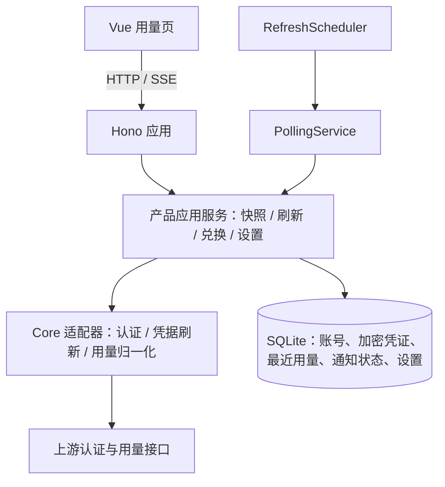

# PolyQuota 产品与功能设计

| 项目 | 内容 |
| --- | --- |
| 目标平台 | Windows 优先（Electron 桌面托盘应用） |
| 关联文档 | [项目架构](../architecture.md) · [前端服务契约](./frontend-contract.md) · [实施计划](./plan.md) |
| 协议参考 | [OmniRoute](https://github.com/diegosouzapw/OmniRoute)（仅受控提取认证与用量协议，不作为运行依赖） |

## 1. 产品定位

PolyQuota 是常驻系统托盘的本地桌面工具，用于集中查看多个 LLM 订阅账号的剩余配额，并在额度偏低时发出分级系统通知。

产品聚焦清晰的最小闭环，不承担模型请求代理、路由或计费网关职责：

1. 添加或只读导入订阅账号；
2. 按调度策略定时获取并归一化用量；
3. 在统一卡片与托盘/任务栏中直观呈现配额与重置倒计时；
4. 达到阈值时触发去重的系统预警。

## 2. 范围与边界

### 2.1 核心能力

- **7 家主流订阅服务商**：Codex / ChatGPT、智谱 GLM（界面区分为国内 BigModel 与国际 Z.ai Coding Plan）、Grok Build、Antigravity、Claude Code、OpenCode Go 与 GitHub Copilot；同一服务支持添加多个账号。
- **官方与稳定认证方式**：按各服务商原生能力支持浏览器 OAuth PKCE、设备码授权、API Key 与官方 CLI 凭据只读导入（Codex CLI、Grok CLI、Claude Code、ZCode v2）。
- **独立账号控制**：每个账号可单独启用或停用；停用后保留最近快照展示，不再参与轮询与通知。
- **动态代理跟随**：按环境变量 → Windows 系统代理 → 直连的顺序在每次新建请求前解析，切换系统代理开关无需重启。
- **配额呈现与提醒**：统一展示套餐、打码账号、分组/窗口配额、重置倒计时、综合剩余进度环、额外重置额度、更新时间与最近错误；支持手动刷新、GLM 重置卡逐项确认使用、低额度系统通知与本地加密存储。

### 2.2 明确边界

- 不代理、转发或路由模型请求，不管理模型成本与网关路由；
- 不自动购买或自动消耗重置额度（重置卡仅允许用户逐项确认后使用）；
- 不回写官方 CLI 凭据文件，不通过启动 CLI 子进程抓取用量；
- 不采集 Cookie、浏览器 Session/localStorage 或通过浏览器自动化抓取登录态；
- 不提供多用户、远程服务或云同步；无系统安全存储能力时拒绝明文保存凭据。

## 3. 设计原则

1. **协议有来源**：认证、刷新与用量请求可追溯至已验证的官方协议或固定上游参考，不凭经验猜测关键请求头与流程。
2. **产品边界清晰**：专注订阅用量聚合，与模型代理、多智能体编排能力解耦；跨产品凭据共享交由独立的 Astra Credential Broker 协调。
3. **核心与桌面解耦**：业务核心与服务商适配器归属共享 Core 且不依赖 Electron，便于独立测试与跨产品复用。
4. **凭据最小暴露**：前端渲染层不接触明文凭据，日志、接口响应与系统通知全程脱敏。

## 4. 总体架构

工作区包边界与通信路径遵循[项目架构](../architecture.md)。PolyQuota 的用量页、轮询调度、托盘与系统通知归本产品；页面通过 Hono 服务调用用量应用服务，后者复用 Core 提供的账号、凭据刷新与用量归一化能力。

## 5. 核心能力设计

### 5.1 服务商与认证方式

每个服务商实现统一适配器（声明可用认证方式、发起认证或导入、按需刷新凭据、获取并归一化用量快照），厂商特有协议与字段封装在适配器内部，界面、轮询器与通知模块不写服务商分支。

| 服务商 | 支持的认证与接入方式 | 展示与配额要点 |
| --- | --- | --- |
| Codex / ChatGPT | 浏览器 OAuth PKCE、设备码授权、Codex CLI `auth.json` 只读导入 | 5 小时短窗口与周配额、扩展模型窗口、只读 `Reset credits` |
| 智谱 GLM | Coding Plan API Key、ZCode v2 凭据只读导入（UI 分为 BigModel 与 Z.ai） | 5 小时/周/月度窗口、重置卡查询与逐项确认使用 |
| Grok Build | 设备码授权、浏览器 OAuth PKCE、Grok CLI `auth.json` 只读导入 | 产品级配额与账户级周配额、额外额度展示 |
| Antigravity | Google OAuth 授权码 | 按模型分组（如 Gemini / Claude & GPT）展示 5 小时与周配额 |
| Claude Code | `~/.claude/.credentials.json` OAuth 凭据只读导入 | 旋转刷新、5 小时/周配额与模型范围限制 |
| OpenCode Go | API Key | 5 小时、周、月三窗口用量 |
| GitHub Copilot | GitHub 设备码授权 | 订阅配额窗口与重置时间 |

- 回环回调服务仅在登录期间临时监听 `127.0.0.1`，完成、取消或超时后立即关闭。
- 官方 CLI 凭据导入后独立加密保存于本应用，后续刷新不回写原文件，避免与 CLI 状态冲突。

### 5.2 用量轮询

轮询器仅处理已启用账号，执行统一的「必要时刷新凭据 → 获取用量 → 保存快照 → 判断通知」流程。默认轮询间隔 180 秒，单账号最短间隔 30 秒，并限制全局并发；单个账号失败采用退避策略，不影响其他账号，界面保留最近一次成功数据并标注错误状态。

### 5.3 代理策略

每个新上游请求发出前按以下顺序解析代理（已发出请求保持发起时配置）：

1. 目标为回环或本机地址时直连（避免登录回调走代理）；
2. 存在 `HTTPS_PROXY` / `HTTP_PROXY` 环境变量时优先使用；
3. 否则读取 Windows 系统代理的显式代理服务器地址；
4. 均未配置时直连（首版不执行 PAC 脚本，不修改系统代理设置）。

### 5.4 用量展示、状态指示与通知

- **卡片与分组层级**：每张卡片展示服务名、套餐档位标签、打码账号、按分组/窗口排列的配额进度条、重置倒计时、更新时间与启停开关。套餐展示名统一由 Core 套餐配置下发，未命中则保留上游原文；配额标题优先使用上游展示名或窗口长度。
- **综合剩余与三档配色**：进度条与账号总状态采用统一三档配色——剩余 >50% 为绿色、20%–50% 为橙色、≤20% 为红色（≤5% 进入高危状态）。页头并排展示 5 小时与周综合剩余环形进度；系统托盘图标与 Windows 任务栏进度使用同一综合剩余口径实时切换，详见[产品信息与图标方案](./product-identity-and-runtime-icon-plan.md)。
- **两级低额度通知**：剩余量 ≤20% 触发普通低额度提醒，≤5% 触发高危提醒；无限额度或无百分比数据不触发。同一配额在同一重置周期内自动去重，额度恢复后可重新触发；仅在系统确认通知展示后记录去重状态。

### 5.5 本地数据与加密边界

- 数据持久化于产品独占的 SQLite 数据库（位于应用数据目录），仅保存账号、加密凭据、最近一次用量快照、通知状态与设置，不记录历史用量曲线。
- 凭据按账号经系统安全存储（Electron `safeStorage`）加密为密文后入库，所有 token 与 API Key 不进入明文字段；无安全存储能力时拒绝新增、导入或改写凭据。
- 需要跨产品共享凭据时，可按[凭据共享设计](../common/core/credential-sharing/design.md)导出并切换至独立 Broker；本产品业务数据库始终保持独立。

## 6. 安全与可观测性

| 风险 | 控制策略 |
| --- | --- |
| 凭据泄露 | 系统安全存储加密、服务端校验与脱敏投影、日志脱敏、渲染进程隔离 |
| 回调端口暴露 | 仅监听 `127.0.0.1`，授权结束立即关闭 |
| 轮询过频或雪崩 | 最短间隔、全局并发限制、单账号退避与缓存 |
| 与官方 CLI 刷新冲突 | 只读导入、不回写原文件，单账号单刷新路径 |
| 代理不一致 | 每次新请求按固定优先级解析，日志仅记录脱敏命中来源 |

产品不上传遥测；日志仅记录服务标识、打码账号、耗时、状态码与脱敏错误。

## 7. 关键架构决策

| 决策项 | 结论 | 原因 |
| --- | --- | --- |
| 产品形态 | 独立桌面托盘工具，不包装完整网关 | 保持轻量聚焦，避免引入网关与额外运行负担 |
| 协议来源 | 受控提取固定上游认证与用量协议，保留来源追踪 | 避免凭空推测协议，且不依赖上游界面与运行时 |
| 前端与分层 | Vue 3 前端 + Hono 服务 + 无框架 Core | 便于跨产品复用、独立测试与严格控制凭据暴露 |
| 凭据保护 | SQLite 存业务 + 逐账号系统安全存储加密 | 事务边界清晰，静态保护与本机用户绑定 |

## 8. 验收原则

- 所有已接入服务商均能使用真实账号完成认证/导入、刷新与用量获取闭环；
- 停用账号后不再请求上游或发送通知；单账号异常、网络错误或代理切换不影响其他账号；
- 日志、公开 API 响应、前端状态与系统通知均不暴露明文凭据；
- 应用构建与运行时不直接依赖 `references/` 下的参考仓库。

## 9. 后续待探索事项

- macOS 与 Linux 平台的最低支持与托盘/系统代理适配范围；
- 按配额窗口自定义通知阈值与开机自启动默认策略的必要性。

## 10. 参考资料

- [OmniRoute](https://github.com/diegosouzapw/OmniRoute)（认证与用量协议参考，抽取基线见[手工抽取基线](../common/core/omniroute-manual-extraction-baseline.md)）
- [OmniRoute 探索报告](../common/exploration/omniroute.md)
- [CodexBar](https://github.com/steipete/CodexBar)（通知交互参考）
