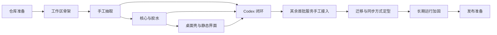

# LLM 订阅用量聚合桌面工具：实施计划

| 项目     | 内容                                              |
| -------- | ------------------------------------------------- |
| 状态     | 实施中，阶段 0—5 与 7 已完成，阶段 6 设计已定稿、工具实现待执行 |
| 更新日期 | 2026-09-30                                        |
| 设计依据 | [设计说明](./design.md)                           |
| 当前准备 | OmniRoute 已按固定提交纳入 `references/omniroute` |

## 1. 实施目标

实施过程以“尽快得到可验证的真实闭环”为主线。先建立可维护的源码抽取和运行边界，再以 Codex 打通认证、存储、用量、界面和通知，随后逐家扩展。每个阶段都应交付可验证结果，而不是只增加框架或占位代码。

以下原则贯穿所有阶段：

- 服务协议必须有固定来源，不凭经验补写关键流程；
- 每次只扩大一个主要变量，便于定位协议、代理、存储或界面问题；
- 真实账号验证与自动化测试并重，但真实请求不进入默认 CI；
- 未验证的问题保留为探索项，不提前包装成确定设计；
- 子模块只用于开发参考，应用始终从主仓库内可追溯的 vendor 副本构建；Grok Build 与 Antigravity 先继续形成手工样板，完成后再决定 vendor 副本的迁移和同步自动化程度；
- 凭证、日志和通知从第一条闭环开始就按正式安全边界处理。

## 2. 阶段与方向

### 阶段 0：仓库准备

**目的：** 为正式开发建立稳定、可追溯的起点。

**方向：**

- 初始化主仓库；
- 将 OmniRoute 放入 `references/omniroute`，记录固定提交；
- 整理设计和实施文档，统一术语、范围和未决事项；
- 补充根目录说明和最小开发约定。

**完成标志：** 新成员能够确认产品边界、上游基线和下一步工作；子模块状态可由 Git 复现。

**状态：** 已完成。主仓库、`references/omniroute` 固定提交 `3ee283bb944d6d62cc219f74317d5186942e1780`、设计与实施文档、根目录说明和开发约定已齐备。

### 阶段 1：工作区骨架

**目的：** 尽早验证技术分层和桌面打包路径，避免业务完成后再处理工程结构问题。

**方向：**

- 建立 `packages/core`、`packages/polyquota-ui` 和 `apps/polyquota`；
- 统一 TypeScript、构建、格式化和测试入口；
- 让 Vue 产物可由 Electron 加载；
- 用最小原生依赖验证 Windows 开发与打包流程。

**探索重点：** 本地数据库选择、Electron 原生模块重建方式、开发服务器与桌面进程的协作方式。

**完成标志：** 三部分可独立构建，桌面应用可启动并加载空界面，安装包骨架可生成。

**状态：** 已完成。`packages/core`、`packages/polyquota-ui`、`apps/polyquota` 可独立构建。桌面窗口加载 Vue 示例卡片，数据写死，没有登录、刷新或开关。安装包为 NSIS + asar，骨架不含原生模块；桌面运行时已精确锁定到 Electron 42.11.6，构建环境最低为 Node 22.12。

### 阶段 2：OmniRoute 源码手工抽取

**目的：** 在编写本项目业务层之前，先把 Codex 最小闭环真正需要的协议实现材料完整抽取出来。阶段 2 只确定“最终要保留什么”，不实现同步工具。

**当前事实：**

- `packages/core` 使用 TypeScript 5.6、ESM 和 Bundler 模块解析；源码保留上游的相对 `.ts` 导入，由 TypeScript 生成声明文件、esbuild 生成可运行的 `.js`；
- Core 使用 `@omniroute/open-sse/*` 和 `@omniroute/src/*` 指向 vendor 内部源码；边界测试禁止直接引用 `references/omniroute`、安装外部 `@omniroute/*` 包或使用含义不清的 `@/*`；
- 基础配额函数、浏览器 OAuth、设备授权、换票、旋转刷新、用量请求和 CLI 只读导入均已形成手工样板，并已通过无网络特征测试和阶段 5 的真实账号闭环；
- 固定上游仍是 `references/omniroute` 的提交 `3ee283bb944d6d62cc219f74317d5186942e1780`。整文件复制项保持上游原文，裁剪项保存逐文件 Git diff。

#### 2.1 两个手工抽取步骤

1. **基础协议叶子：** 配额类型、标量转换、窗口标签、Codex 配额归一化和公开客户端凭证。该步骤已经完成。
2. **Codex 完整协议：** 补齐浏览器 OAuth PKCE、自定义设备授权、授权码换票、JWT 身份映射、旋转刷新、用量请求、身份请求头和 CLI 凭证解析。该步骤先完成手工样板和无网络验证，随后由阶段 5 确认真实输出形态。

两个步骤都直接在 `packages/core/src/vendor/omniroute` 中形成可运行样板，并在 `.diff/<source-path>.diff` 保存与固定上游的差异。阶段 2 不维护手工 manifest；阶段 5 真实 Codex 闭环发现的遗漏已回补到手工样板和测试。

#### 2.2 目录和依赖边界

```text
packages/core/src/
  vendor/omniroute/       # 先保留已验证的手工抽取，后续再按阶段 6 的结论维护
    .diff/                # 每个上游文件对应一份审查差异
    LICENSE
    open-sse/...
    src/...
  providers/              # 阶段 3 本项目适配器和胶水代码
  runtime/                # 阶段 3 HTTP、时钟、日志、存储等宿主端口
```

vendor 只能包含上游协议实现及为脱离 OmniRoute 宿主而必需的小型裁剪，不能包含本项目账号模型、存储实现、轮询器、Electron 或界面代码。`packages/core/src/index.ts` 不直接公开 vendor 模块。

#### 2.3 步骤 1：基础协议叶子

| 上游文件                                | 处理方式     | 保留内容                                                                       |
| --------------------------------------- | ------------ | ------------------------------------------------------------------------------ |
| `open-sse/services/usage/scalars.ts`    | 整文件复制   | 数值、对象、百分比和标题转换                                                   |
| `open-sse/services/usage/quota.ts`      | 整文件复制   | `UsageQuota`、重置时间和通用配额构造                                           |
| `open-sse/services/quotaWindowLabel.ts` | 整文件复制   | 窗口时长与显示名推导                                                           |
| `open-sse/config/codexQuotaScopes.ts`   | 整文件复制   | Codex 与 Spark 配额键、显示名和作用域判断                                      |
| `open-sse/services/codexUsageQuotas.ts` | 整文件复制   | Codex 主窗口、周窗口、附加窗口和只读重置次数归一化                             |
| `open-sse/utils/publicCreds.ts`         | 对象成员裁剪 | 解码函数，以及 `codex_id`、`grok_id`、`antigravity_id`、`antigravity_alt` 四项 |

**状态：** 已完成。5 个源码文件和许可证与上游逐字节一致，只有 `publicCreds.ts` 存在成员删除差异；Core 类型检查、特征测试、构建和编译后运行验证均已通过。

#### 2.4 步骤 2：Codex 完整协议

步骤 2 按真实调用链抽取，不只复制接口常量：

| 能力                 | 上游来源                                                                                | 手工样板要求                                                                                                                                                     |
| -------------------- | --------------------------------------------------------------------------------------- | ---------------------------------------------------------------------------------------------------------------------------------------------------------------- |
| OAuth 配置           | `src/lib/oauth/constants/oauth.ts`                                                      | 只取 `CODEX_CONFIG` 及直接依赖，保留 `prompt=login`、scope、授权端点和换票端点                                                                                   |
| PKCE                 | `src/lib/oauth/utils/pkce.ts`                                                           | 保留完整算法；只补齐严格 TypeScript 编译所需的参数和返回类型，不改随机数与摘要行为                                                                               |
| 授权与换票           | `src/lib/oauth/providers/codex.ts`                                                      | 保留授权 URL 构造、授权码换票和 `id_token` 身份映射；补齐必要类型，不带入页面或回环服务器                                                                        |
| 自定义设备授权       | `src/lib/oauth/codexDeviceFlow.ts`                                                      | 保留 user code 请求、授权轮询、带服务端 verifier 的换票、15 分钟超时、取消和错误分类；这是 OpenAI 自定义流程，不改写成 RFC 8628，也不依赖 Cookie 或现有 Web 会话 |
| Codex 身份头         | `open-sse/config/codexClient.ts`、`src/shared/constants/codexClient.ts`                 | 保留认证面与后端用量面的身份头、版本和 User-Agent 规则；把上游 `@/*` 统一改为明确的 `@omniroute/src/*`                                                           |
| 刷新请求公共逻辑     | `open-sse/services/tokenRefresh/shared.ts`                                              | 保留表单构造、OAuth 错误读取和不可恢复错误识别                                                                                                                   |
| 旋转刷新串行器       | `open-sse/services/refreshSerializer.ts`                                                | 只保留 Codex 的 `openai-auth0` 旋转组、串行执行和默认 2 秒间隔                                                                                                   |
| Codex 令牌刷新       | `open-sse/services/tokenRefresh/providers/codex.ts`、`src/lib/oauth/constants/oauth.ts` | 保留完整刷新请求、旋转 refresh token 和不可恢复错误映射；复用裁剪后的 `CODEX_CONFIG`，去掉 OmniRoute 代理上下文，并把 HTTP 传输改为可注入参数                    |
| 用量接口             | `open-sse/services/usage/codex.ts`                                                      | 保留 `getCodexUsage`、`/backend-api/wham/usage` 请求、`chatgpt-account-id` 和已有配额归一化调用                                                                  |
| JSON 批量导入        | `src/lib/oauth/services/codexImport.ts`                                                 | 保留 JWT 解码、输入展开、字段归一化和现有账号状态合并等纯函数；不创建或更新数据库                                                                                |
| CLI `auth.json` 解析 | `src/lib/oauth/utils/codexAuthImport.ts`、`src/lib/oauth/utils/codexAuthFile.ts`        | 保留 `parseAndValidateCodexAuth`、`CodexAuthFileError` 及纯解析依赖；不复制连接查询、创建、更新、回写或备份函数                                                  |
| 刷新提前量           | `open-sse/services/tokenRefresh.ts`                                                     | 只记录并保留 Codex 的 5 分钟提前刷新规则，不复制总调度器                                                                                                         |

步骤 2 同时移植或补充以下特征测试：

- 授权 URL 包含 PKCE、固定回调和 `prompt=login`；
- 换票请求使用正确端点、表单以及 `Content-Type` / `Accept` 请求头，不擅自加入用量接口的身份头；
- 设备授权正确请求 user code，将首次 404 映射为功能未启用，将轮询阶段的 403 / 404 视为等待，并覆盖默认间隔、超时、取消和最终换票；
- 刷新请求不发送 `scope`，保存新的 access token 和旋转后的 refresh token，同组刷新不会并发；
- 用量请求携带 `chatgpt-account-id`、Codex 版本和身份头，并正确解析套餐、窗口、Review、Spark 与只读重置次数；
- CLI 嵌套、扁平和 camelCase 凭证形状能够只读解析，过期时间优先取 access token，工作区和用户身份不会混淆；
- 测试使用注入传输或 mock，不发起真实网络请求，也不写入 `.codex/auth.json`。

#### 2.5 稳定认证机制的抽取边界

对已经列入首批范围的厂商，抽取目标是固定上游中所有稳定认证机制的并集，而不是只保留当前界面的默认入口。满足以下条件的方式都应进入对应厂商的手工样板和后续维护范围：

- 上游已有可定位的协议实现，并能通过固定请求、响应和错误状态测试；
- 能获得可刷新凭证、长期 API Key，或从官方 CLI 文件只读导入包含刷新能力的凭证；
- 不依赖已有浏览器登录状态、Cookie、localStorage、浏览器配置目录、DOM 自动化或开发者工具抓取；
- 能归一化为同一账号凭证模型，由本项目安全存储和刷新。

界面可以为厂商指定首选方式，阶段验收也可以先跑一条完整闭环，但不能因此从 vendor 中删除其他稳定方式。当前范围是：Codex 保留浏览器 OAuth PKCE、自定义设备授权和官方 CLI `auth.json` 只读导入；GLM 保留 API Key，并按 ZCode 公开实现只读导入 v2 Individual Coding Plan API Key；Grok Build 保留设备码、浏览器 OAuth PKCE 和完整 CLI `auth.json` 只读导入；Antigravity 保留 Google OAuth 授权码流程。

#### 2.6 拒绝范围

阶段 2 明确不抽取以下内容：

- `src/app/**`、React、Next.js、OAuth 页面和 provider-limits 页面；
- `src/lib/db/**` 以及连接查询、创建、更新和云同步；
- `open-sse/utils/proxyFetch.ts`、MITM、relay、tunnel 和完整代理上下文；
- `src/lib/oauth/utils/server.ts` 的回环宿主实现；阶段 3 只定义认证回调端口，阶段 4 由桌面壳实现并只监听 `127.0.0.1`；
- `src/lib/oauth/utils/codexAuthFile.ts` 的 CLI 回写、备份和数据库逻辑；
- Cookie、ChatGPT session JSON、裸短期 access token、浏览器 localStorage、浏览器配置目录读取、DOM 自动化和开发者工具抓取等依赖 Web 登录状态的导入方式；代表实现包括 `src/lib/oauth/utils/codexSessionImport.ts` 和 `open-sse/executors/grok-web.ts`；
- 推理执行器、路由、健康检查、重置额度兑换以及 purchase / redeem / consume；
- 任何定时器、全局运行时状态或直接依赖本项目账号存储的实现。

#### 2.7 完成标志

- 步骤 2 表格中的协议能力均已形成可编译的 vendor 文件，每个来源都有独立 `.diff`；
- 浏览器 OAuth、设备授权、CLI 导入、换票、刷新和用量可以通过无网络特征测试独立运行；
- 生成的运行时代码只包含 `.js`，源码继续保留上游 `.ts` 导入；
- vendor 不含数据库、回环宿主、CLI 回写、Electron、Vue、推理执行和兑换逻辑；
- 阶段 3 可以只通过稳定函数调用和宿主端口完成拼接，不再从源仓库复制代码。

**状态：** 步骤 1、步骤 2 的手工抽取和无网络验证均已完成。步骤 2 当前包含 14 个来源文件和可随时重新生成的逐文件 `.diff`；Codex CLI、浏览器 OAuth 和设备授权均已在阶段 5 完成真实用量闭环验证。验证发现的遗漏继续回补阶段 2。详细协议依据见 [OmniRoute 探索报告](../common/core/omniroute-exploration.md)。

### 阶段 3：核心边界、项目胶水与本地数据

**目的：** 只用本项目自行编写的代码，把阶段 2 的协议叶子接入稳定的业务边界。阶段 3 不再复制、裁剪或改写 OmniRoute 源码，也不实现同步规则。

**状态：** 已完成。Core 已建立公开 DTO、内部凭证模型、宿主端口、内存存储、Codex 胶水和账号级刷新协调器；Desktop 已实现 SQLite 迁移、事务、`safeStorage`、受控 IPC 和单实例数据库生命周期。三种 Codex 凭证来源先通过假宿主验证到加密保存，随后已在阶段 5 完成真实账号网络闭环。

#### 3.1 已确定的选型与边界

本阶段不再把数据库和凭证保护方案作为开放选项。实现若需要偏离下表，必须先更新设计依据和本计划，并说明验证结果，不能在编码过程中直接替换技术路线。

| 事项               | 结论                                                                                                              | 边界与原因                                                                                                      |
| ------------------ | ----------------------------------------------------------------------------------------------------------------- | --------------------------------------------------------------------------------------------------------------- |
| 数据库             | 使用 SQLite，Node.js 驱动锁定 `better-sqlite3` 12.11.1                                                            | Electron 42 内置的 `node:sqlite` 仍处于 Release Candidate；12.x 提供 Node 24 预构建并已通过 Electron 重建验证 |
| 依赖归属           | `better-sqlite3` 是桌面应用的运行时依赖，由 Electron 主进程持有                                                   | Core 只定义存储端口，UI 和渲染进程不连接数据库；避免把原生模块和 Electron 生命周期带入业务层                  |
| 查询与迁移         | 使用参数化 SQL 和仓库内显式迁移，不引入 ORM                                                                       | 当前模型较小，先保持 SQL、索引和事务边界可审查；迁移按版本顺序执行，并记录版本、校验值和执行时间               |
| 数据库位置         | 使用 PolyQuota `userData` 下的 `polyquota.db`，单实例持有一条写连接                                                | `userData` 固定在系统 `appData/AstraConductor/PolyQuota`；不允许渲染进程或第二进程自行打开文件                |
| 凭证保护           | 由桌面主进程使用 Electron `safeStorage` 加密授权材料，密文以 SQLite `BLOB` 保存                                    | 加密范围包括 access token、refresh token、id token、API Key 及认证流程产生的其他秘密；Core 只依赖加密端口      |
| 加密粒度           | 按账号保存带版本的加密凭证信封，不使用 SQLCipher 对整个数据库加密                                                 | 账号状态、配额快照和设置需要正常查询；逐记录加密能缩小解密范围，也避免引入第二套 SQLite 原生构建               |
| 明文数据           | 账号展示信息和经过白名单确认的 provider 元数据可明文保存；未知 provider 字段默认进入加密信封                      | `providerSpecificData` 不得成为绕过凭证加密的通道；字段是否公开由适配器显式声明                               |
| 数据保留           | 首版只保存每个账号的最近一次用量快照和当前通知状态，不保存历史曲线                                                | 满足卡片、刷新和通知判断即可，避免阶段 3 提前演变为统计数据仓库                                                |
| 数据库运行参数     | 启用外键、WAL 和有限 `busy_timeout`；所有写入使用短事务                                                           | 保证迁移与关联数据一致性，避免长时间占用主进程；网络请求和系统通知不得放在数据库事务中                         |
| 原生模块构建       | 使用 `@electron/rebuild` 4.2.0 强制重建，再由 electron-builder 26.15.3 打包并将原生 `.node` 文件从 asar 解包        | 禁用 builder 的增量重建以避免 ABI 缓存误判；打包后恢复 Node ABI，Windows x64 打包及真实 Electron 冒烟均已通过 |

`safeStorage` 只能在 Electron `app` ready 后使用。Electron 42.11.6 已修复异步加密器在启动阶段的初始化问题，本阶段使用 `isAsyncEncryptionAvailable`、`encryptStringAsync` 和 `decryptStringAsync`，并处理临时不可用与密钥轮换提示；不再新增对同步接口的依赖。

如果系统安全存储不可用，应用可以读取非敏感设置和用量缓存，但必须拒绝新增、导入、刷新或改写凭证。已有密文无法解密时将账号标记为“凭证锁定”，保留原始数据并提示用户重新认证，不得删除密文或降级为明文。

这项保护用于降低数据库文件、普通备份或其他本机用户直接读取凭证的风险，不承诺抵御当前登录用户权限下运行的恶意进程。数据库文件可以备份，但凭证密文与本机用户的系统密钥绑定，首版不提供跨机器凭证迁移；换机后需要重新认证。

#### 3.2 数据职责

SQLite 中按职责保存以下逻辑记录；具体列名和索引在迁移实现时确定，但不得改变数据边界：

| 记录               | 内容                                                                                         | 约束                                                                                                  |
| ------------------ | -------------------------------------------------------------------------------------------- | ----------------------------------------------------------------------------------------------------- |
| 账号               | 服务、认证方式、稳定身份、打码展示信息、启用状态、公开 provider 元数据、创建与更新时间       | 不含 token、API Key、设备码、PKCE verifier 或原始认证响应                                             |
| 账号凭证           | 加密方案版本、密文和更新时间                                                                 | 与账号一对一；解密后的信封同时包含账号、服务和认证方式标识，读取时校验归属，避免密文被错误关联        |
| 最近用量           | 归一化后的最新快照、获取时间和最近错误                                                        | 每个账号只保留一份；新快照完整替换旧快照，不把半解析结果写入数据库                                    |
| 通知状态           | 配额标识、重置周期、已触发级别和最近通知结果                                                  | 用于同一重置周期去重；通知发送成功后再更新状态，失败可重试                                            |
| 设置               | 轮询、通知、代理和界面所需的非敏感设置                                                        | 不保存凭证；敏感的新设置必须进入加密信封或另建明确的加密记录                                          |
| 迁移记录           | 迁移版本、内容校验值和执行时间                                                               | 迁移只前进不回滚；启动前完成，任一步失败即停止打开业务存储                                            |

凭证信封在加密前序列化为带 `version` 的 JSON。刷新产生旋转 refresh token 时，必须先以单个事务替换凭证密文和相关账号元数据，再继续使用量结果；即使用量请求随后失败，也不能丢失已经旋转的新凭证。删除账号时，在一个事务中删除该账号的凭证、快照和通知状态。

#### 3.3 实施任务

1. **冻结核心模型和宿主端口。**
   - 建立账号、认证方式、公开身份、凭证信封、用量快照、通知状态和统一错误模型；
   - Core 定义账号仓库、凭证仓库、事务、HTTP、代理、时钟、日志、认证回调和桌面能力端口；
   - 将“可进入 IPC 的公开 DTO”与内部模型分开，类型上不允许凭证对象进入公开 DTO。

   **验证：** 使用内存实现可以创建两个同服务账号，分别启停、更新凭证和写入快照；Core 的公开导出及序列化结果不包含秘密字段。

2. **建立 SQLite 基础设施和迁移入口。**
   - 在桌面主进程侧实现存储端口、连接生命周期、事务和显式迁移；
   - 先完成开发环境、临时数据库测试和打包后数据库创建验证，再继续叠加业务功能；
   - 将 `better-sqlite3` 纳入允许构建的依赖，修正 electron-builder 的原生依赖重建与 asar 解包配置。

   **验证：** 空目录可自动建库，旧版本样例可迁移到当前版本，重复启动不会重复执行迁移；Windows x64 安装包启动后能创建、关闭并重新打开数据库。

3. **实现凭证保护适配器。**
   - 桌面主进程把 `safeStorage` 封装为 Core 所需的加密端口，数据库层只接收和返回密文；
   - 明确加密信封版本、字段白名单、解密归属校验和不可用状态；
   - 日志、异常和测试快照在写出前统一脱敏，不记录待加密明文或解密结果。

   **验证：** 数据库文件和日志中检索不到测试 token / API Key；交换两个账号的密文会被拒绝；安全存储不可用或密文损坏时不发生明文回退，也不破坏原记录。

4. **编写 Codex 适配器与认证胶水。**
   - 通过稳定函数调用连接阶段 2 的浏览器 OAuth、设备授权、换票、刷新、用量和 CLI 解析能力；
   - 认证回调、浏览器打开和 CLI 文件读取只通过宿主端口提供，适配器不直接依赖 Electron；
   - 按稳定身份去重账号，CLI 只读导入后保存本应用的加密副本，不回写官方文件；
   - 发现 vendor 协议缺失时回补阶段 2 的样板、逐文件 diff 和特征测试，不在适配器中重写协议。

   **验证：** 每种认证方式均能使用假宿主走到加密保存；重复导入更新同一账号；旋转刷新会保存新 refresh token，协议请求仍由 vendor 实现。

5. **建立统一刷新流程。**
   - 对启用账号执行“读取并解密凭证—必要时刷新—获取用量—保存最近快照—计算通知候选”；
   - 手动刷新和周期轮询复用同一流程，每个账号互斥，不同账号之间隔离失败；
   - 认证失败按既定规则最多强制刷新后重试一次，不建立无限重试或全局串行队列。

   **验证：** 停用账号不发请求；同一账号并发刷新被合并或拒绝；一个账号的网络、解密或协议错误不影响其他账号；失败不会覆盖最后一次成功快照。

6. **收紧 IPC、错误和日志边界。**
   - IPC 只暴露账号公开信息、最近快照、操作状态和可展示错误；所有命令在主进程重新校验输入；
   - 内部错误归一为认证、权限、网络、限流、上游、存储和安全存储错误，保留可重试性但移除响应体中的秘密；
   - 日志只记录服务、账号打码标识、阶段、耗时、状态码和脱敏错误，不记录请求头、表单或原始认证响应。

   **验证：** 对 IPC 返回值、通知候选和结构化日志执行秘密字段扫描；伪造账号标识不能跨账号读取或修改数据。

7. **完成分层验收。**
   - Core 测试使用假 HTTP、时钟、加密和内存仓库，无需启动 Electron 或访问网络；
   - Desktop 集成测试覆盖 SQLite 迁移、事务和损坏数据，`safeStorage` 验证在 Electron 主进程内执行；
   - 打包冒烟测试覆盖安装包启动、原生模块加载、数据库重开和无明文凭证。

#### 3.4 非目标与完成标志

本阶段不引入 SQLCipher、ORM、云同步、主密码、凭证导出、历史用量分析、多进程数据库访问或真实账号网络验证；真实浏览器回环宿主和系统通知由阶段 4 提供，真实 Codex 账号闭环由阶段 5 完成。

**完成标志：**

- Core 无需 Electron 即可通过 mock 传输和内存存储运行 Codex 核心流程测试；
- SQLite 迁移、事务、级联删除和最近快照替换均有集成测试，Windows x64 安装包可加载 `better-sqlite3` 并重开数据库；
- 凭证只以 `safeStorage` 密文进入 SQLite，安全存储不可用、密文损坏和归属不匹配均安全失败；
- 阶段 3 代码不含从 OmniRoute 复制的实现，发现的协议缺口已回补阶段 2；
- IPC、日志、通知候选和数据库非加密字段均不含凭证，渲染进程不能访问数据库或解密端口；
- 多账号启停、刷新、错误隔离和旋转凭证持久化已由假服务验证。

**验收结果：** 全工作区格式、类型检查、测试和构建通过；Core、UI、Desktop 在该阶段验收时点共 38 项测试通过。NSIS 打包后的 Electron 进程完成 `safeStorage` 加密、SQLite 建库、关闭重开、解密及数据库明文扫描，退出码为 0。后续已将 Electron ABI 二进制隔离到 `apps/polyquota/lib/better-sqlite3`，生产构建自动预构建，开发环境按需手动准备，不再改写或恢复 workspace 中的 Node ABI。

### 阶段 4：桌面壳与静态界面

**目的：** 在真实服务接入前验证用户操作链路和桌面系统能力。

这部分可与阶段 3 后半段并行推进。

**方向：**

- 桌面壳提供窗口、托盘、系统通知、浏览器打开、回环认证和系统代理能力；
- 界面使用模拟数据完成卡片、空状态、设置和登录交互；
- 所有操作均提供进行中、成功和失败反馈；
- 先验证少量卡片和多账号布局，不提前投入复杂视觉设计或列表虚拟化。

**探索重点：** Windows 通知身份、系统代理地址的读取方式、关闭窗口后驻留托盘的行为，以及最小可用的响应式布局。静态卡片需包含 Antigravity 式分组，以及 Codex 的 `5-hour` 与 `Weekly` 标题。

**完成标志：** 模拟账号可以走完添加、启停、刷新、错误和通知流程；明文凭证不进入 UI。

**状态：** 已完成。桌面壳已提供托盘驻留、系统通知、外部浏览器、仅监听 `127.0.0.1:1455` 的临时回环服务、Electron 网络栈代理解析和受控 IPC；界面已从静态示例切换为真实账号卡片，支持三种 Codex 添加入口、刷新、启停、删除、空状态、错误反馈和轮询设置。渲染进程只接收公开账号与用量 DTO，不接收凭证。

### 阶段 5：Codex 最小闭环

**目的：** 用一个真实服务验证此前所有边界，而不是同时调试四套协议。

**方向：**

- 使用阶段 2 的手工协议样板、阶段 3 的项目适配器和阶段 4 的桌面宿主完成拼接；
- 支持浏览器 OAuth PKCE、自定义设备授权与 Codex CLI 凭证只读导入；
- 接入系统代理、本地加密、手动刷新、周期轮询和低额度通知；
- 使用本机账号与 OmniRoute 或官方页面对照数据；
- 如果闭环暴露上游文件或声明遗漏，先回到阶段 2 更新手工样板、逐文件 diff 和特征测试，再调整本项目胶水代码。

**探索重点：** 固定回调端口冲突、代理环境下的授权回调、重置额度字段、刷新令牌生命周期，以及手工抽取边界是否覆盖真实调用链。

**完成标志：** 至少一条认证方式能从添加账号走到通知的完整链路；浏览器 OAuth 与设备授权都完成独立真实认证验证，设备授权未对账号开放时能正确呈现上游 404 而不误判为实现缺失；CLI 导入完成只读样本验证。失败场景不会泄露凭证或破坏已有账号；阶段 2 的 Codex 输出形态不再有已知缺失，能够作为同步工具的基准结果。

**状态：** 已完成。Codex CLI 凭据已完成“只读解析—`safeStorage` 加密—SQLite 保存—真实用量请求—配额归一化”的隔离闭环，真实响应不会进入测试日志，临时数据库在测试后删除；浏览器 OAuth PKCE 和自定义设备授权也已分别通过交互式真实认证与用量访问验证。三条路径共用同一保存与刷新链路，并保留固定端口、状态校验、15 分钟超时、取消和 404 分类。真实闭环还修正了按窗口时长返回 `Weekly` 时重复拼接 `5-hour` 的标题问题，并为授权与设备请求补齐可注入传输，使其与用量请求共同使用 Electron 网络栈。

### 阶段 6：源码迁移与同步方式定型

**目的：** 在四个首批服务都形成经过验证的手工样板后，再根据实际差异决定哪些迁移步骤适合自动化，以及同步工具应承担生成、校验还是二者兼有的职责。

本阶段在执行顺序上后于阶段 7。`tools/omniroute-sync` 目前只有 README 与空实现目录，根目录的 `pnpm omniroute:sync` 和 `pnpm omniroute:check` 脚本尚不可运行；此前关于"已能维护 24 个文件"的描述与事实不符。工具的完整形态已在阶段 7 完成后定稿为[OmniRoute 同步工具形态设计](../common/core/omniroute-sync-tool-design.md)。

**设计结论：**

- 采用全覆盖机器清单：全部产物进入 `tools/omniroute-sync` 的清单（设计定稿时 38 个，Claude Code 与 OpenCode Go 接入后为 49 个，覆盖基础叶子与六家服务商），取消"清单文件 + 清单外手工扩展"的双轨状态；
- 采用最小修改原则：抽取优先整文件复制，其次把纯上游模块扩入清单，只有依赖闭包命中拒绝路径或宿主耦合时才做声明选择；未支持厂商的纯声明默认保留，只要不引入清单外外部依赖（白名单仅 Node 内置模块与 `zod`）；
- 规则体系收敛为全局 import 规范化加 `select`、`injectFetch`、`patch` 三种条目规则；两段式生成（临时目录生成、门禁校验、原子替换 vendor）；
- 现有基线分两步收敛：先如实清单化（现状含裁剪与改名），再按最小修改逐条转换（合并 `stage7.ts`、取消成员裁剪、反内联 `grokResetCreditsFrame`、重做 `antigravityHeaders` 补丁为签名保形形式）；
- 无论采用何种形式，都保留固定上游提交、来源追溯、逐文件审查、拒绝范围和无运行时子模块依赖等边界；
- 上游升级必须作为独立变更执行（`pnpm omniroute:upgrade`），并在替换正式 vendor 目录前通过格式、类型、特征测试、许可证和拒绝范围检查。

**完成标志：** 已基于四家真实样板记录自动化取舍，确定并验证日常迁移与上游升级流程；工具覆盖范围和必须人工审查的部分都有明确边界，重复执行不会静默丢失协议能力。

**状态：** 设计已定稿，收敛方案已手动执行（产物 38 → 45，零 diff 整文件复制 8 → 20，全部 `.diff` 合计约 -5761/+1186 → -3750/+990 行，全工作区类型检查、测试、构建与编译后模块加载通过）；同步工具实现与全量清单化待执行，验收标准见工具设计第 8 节。

### 阶段 7：扩展首批服务

**目的：** 验证统一适配器是否能容纳不同认证和用量模型，并完成首个版本覆盖面。

接入其它供应商所需的服务无关契约、应用服务和桌面交互前置改造已基本完成。按以下顺序逐家推进，每家独立评审和验收：

1. **GLM：** 已完成 Coding Plan API Key、ZCode v2 凭据只读导入、国内与国际区域、配额归一化、重置卡查询和逐张使用；核心共用适配器，UI 分为 BigModel Coding Plan 与 Z.ai Coding Plan；标准 API 不进入当前闭环；
2. **Grok Build：** 同时保留并验证设备码、浏览器 OAuth PKCE、完整 CLI `auth.json` 导入，以及带主体信息的令牌刷新；设备码可以作为默认入口，但浏览器 OAuth 不能从抽取范围中省略；
3. **Antigravity：** 保留 Google OAuth 授权码流程，最后处理身份请求头、项目标识和上游数据库耦合。

Grok Build 与 Antigravity 继续沿用手工接入：先枚举固定上游中的全部稳定认证机制，再确认需要的上游文件、裁剪边界和目标输出，保存可审查差异并补充特征测试，随后实现本项目适配层并使用真实账号逐种核对。本阶段不要求把两家的抽取过程写入现有同步清单。遇到共性需求时优先修正核心边界；只对单家有效的规则留在对应适配器中。

**完成标志：** 四个首批服务均能通过各自的全部稳定认证方式独立添加账号，并能刷新、停用和报错；单个服务或单种认证方式失败不影响其他账号。

**状态：** 已完成。四家服务均已完成真实账号逐种验收：Grok Build 的设备码、浏览器 OAuth PKCE、完整 CLI 导入、主体化刷新、用量与重置卡查询，以及 Antigravity 的 Google OAuth、身份与项目发现、令牌刷新、套餐和分组用量均通过交互式验证；重置额度使用能力按既定计划后续开放。验收发现的协议遗漏已回补 vendor 样板与特征测试。其后 Claude Code 与 OpenCode Go 按同一手工样板流程接入，并于 2026-10-12 通过真实账号测试验收（见[手工抽取基线](../common/core/omniroute-manual-extraction-baseline.md)第 3.6、7 节）。

### 阶段 8：轮询、代理与通知加固

**目的：** 将单次可用提升为适合长期驻留的稳定行为。

**方向：**

- 验证最短间隔、并发限制、失败退避和应用恢复后的调度行为；
- 覆盖环境变量代理、系统代理地址和直连；切换系统代理后，下一次新建请求使用新地址；
- 验证通知阈值、重置周期去重、无限额度和缺少百分比的情况；
- 增加脱敏诊断信息，支持定位单家服务问题。

**探索重点：** 休眠唤醒后的补偿策略、各服务自带缓存与全局调度的关系，以及系统代理开关在轮询进行中被切换时的下一次请求。

**完成标志：** 应用持续运行时不会高频请求、重复通知或因单次失败形成请求风暴。

### 阶段 9：发布准备

**目的：** 确认首个版本在真实 Windows 环境中可安装、可诊断、可安全卸载。

**方向：**

- 执行安全、日志、代理、安装和升级前置检查；
- 在干净环境验证安装包与首次启动；
- 整理用户说明、已知限制和故障排查；
- 冻结上游提交并复核生成物差异与许可证信息。

**完成标志：** 首批验收清单通过，未解决问题有明确影响范围和后续安排。

## 3. 依赖关系



阶段 2 先明确完整的 Codex 协议输出，阶段 3 再用本项目代码完成适配；阶段 4 可在阶段 3 后半段使用模拟数据并行推进。阶段 5 已完成 Codex 真实闭环，阶段 7 已完成四家服务的真实账号验收，Claude Code 与 OpenCode Go 随后按同一流程接入并完成真实账号验证；阶段 6 的工具形态已定稿，收敛方案已手动执行，同步工具实现与全量清单化待执行。

## 4. 交付切片

实施可按下表拆分为小型变更。切片名称是方向，不预先限定具体 PR 数量。

| 切片         | 核心结果                                                   |
| ------------ | ---------------------------------------------------------- |
| 工程骨架     | Monorepo 可构建，Electron 可加载 Vue 界面                  |
| 源码手工抽取 | Codex 完整协议样板、逐文件差异与特征测试                   |
| 核心与胶水   | 项目模型、宿主端口、安全存储、适配器、设置、缓存和模拟服务 |
| 桌面体验     | 托盘、通知、回环认证、系统代理和静态卡片流程               |
| Codex        | 首条真实端到端闭环，并确认手工样板最终形态                 |
| GLM          | 已完成区域化 API Key 服务接入与 ZCode v2 凭据只读导入       |
| Grok Build   | 手工抽取并接入设备码、浏览器 OAuth、CLI 导入与特殊刷新流程  |
| Antigravity  | 手工拆分并接入 Google OAuth、项目发现和用量协议             |
| Claude Code / OpenCode Go | 已接入 Claude Code CLI 凭据只读导入与 OpenCode Go API Key 用量，并通过真实账号测试验收 |
| 迁移方式定型 | 对照四家样板确定自动生成、辅助迁移和差异校验的覆盖边界     |
| 稳定性       | 调度、退避、通知去重、代理与诊断加固                       |
| 发布         | 安装包、文档、许可证和干净环境验证                         |

每个服务切片都必须包含来源更新、自动化测试、真实账号验证记录和脱敏检查。新增服务先确认手工抽取形态；是否以及如何纳入同步工具，统一在阶段 6 根据四家样板决定。不得把多个尚未验证的服务捆绑在一次变更中。

## 5. 首批验收清单

### 功能

- [ ] Codex 套餐名取自套餐配置 `displayName`（如 `prolite` → Pro 5x），未知原样；短窗口标题为 `5-hour`，长窗口标题为 `Weekly`，并展示只读 `Reset credits`；
- [ ] GLM 正确区分国内与国际区域；套餐名取自套餐配置；配额标题为 `5 Hours Quota` 与 `Weekly Quota`；
- [x] GLM 重置卡只允许用户逐张确认后使用；主进程使用前重新读取列表，成功后先扣除本地对应条目并刷新服务商用量。真实账号已确认 ZCode 曾延迟约 20 分钟更新展示，但卡片实际可用且使用成功；
- [ ] Grok Build 套餐名取自套餐配置，未命中则保持 `subscriptionTier` 原文；产品配额使用上游产品名，账户级配额标题为 `Weekly`；额外额度先接入查询，使用能力后续开放；刷新后保留账号主体信息；
- [ ] Antigravity 套餐名取自套餐配置，未命中则原样；按 `Gemini Models` 这类分组标题展示该组的 `5 Hour Quota` 与 `Weekly Quota`；
- [ ] 同一服务可添加多个账号；
- [ ] 停用账号后停止轮询和通知；
- [ ] 登录、刷新、开关和错误都有可见反馈；
- [ ] 每个首批厂商声明并实现固定上游中全部稳定认证方式；Cookie、Web session 和裸短期令牌不作为认证入口；

### 安全与稳定性

- [ ] 日志、IPC、通知和诊断信息不含访问令牌、刷新令牌或 API Key；
- [ ] 回环服务只在登录期间监听 `127.0.0.1`；
- [ ] 无安全存储能力时拒绝保存凭证；
- [ ] 有 `HTTP_PROXY` 或 `HTTPS_PROXY` 时走环境变量；否则走系统代理服务器地址；都没有时直连。切换系统代理后，下一次新建请求生效；
- [ ] 单个服务失败不阻塞其他账号，并触发受控退避；
- [ ] 无限额度或未提供百分比的配额不会误报；
- [ ] 应用构建不依赖或打包 `references/omniroute`；
- [ ] 界面不依赖 OmniRoute 的 React / Next.js 代码。

### 工程质量

- [ ] 同一上游提交重复同步不会产生差异；
- [ ] 生成物可追溯到具体提交和源文件；
- [ ] 真实账号测试默认不在 CI 中运行；
- [ ] 安装包可在干净 Windows 环境启动，并能生成脱敏诊断信息。

## 6. 主要风险与应对方向

| 风险                                      | 应对方向                                               |
| ----------------------------------------- | ------------------------------------------------------ |
| 上游模块依赖 OmniRoute 数据库或网关上下文 | 通过适配层逐项解除；高耦合服务后置                     |
| 身份请求头或刷新字段遗漏                  | 回补协议样板与特征测试，并在对应服务阶段用真实账号对照 |
| Electron 原生依赖影响打包                 | 在工作区骨架阶段提前验证，不等到发布阶段               |
| 官方 CLI 与应用同时刷新产生冲突           | 只读导入、不回写，每个账号只保留一条刷新路径           |
| 代理差异导致授权或用量请求失败            | 所有请求统一经过代理边界，并记录脱敏诊断               |
| 上游升级造成生成物漂移                    | 固定提交；升级时单独同步、审查和验证                   |
| 未决方向过早固化                          | 在对应阶段保留探索任务，以验证结果更新设计             |

## 7. 后续扩展

Claude Code 与 OpenCode Go 已完成手工接入和边界验证。离线协议、契约、Core、UI 和桌面测试已通过；真实账号交互式验收仍待单独执行，因此二者暂不视为真实闭环完成。

GitHub Copilot 及其他候选服务继续复用“确认可抽取实现—形成可审查样板—接入适配器—真实账号验证—纳入既定维护方式”的流程。

其他服务只保留为候选目录，不在当前计划中给出详细文件、接口或排期，避免把尚未验证的方向写成既定方案。
