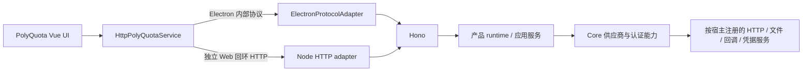

# 运行流程与通信机制现状报告

| 项目     | 内容                                                   |
| -------- | ------------------------------------------------------ |
| 状态     | 服务模式已完成；现有数据真实验证通过                   |
| 更新日期 | 2026-10-25                                             |
| 覆盖范围 | 开发、构建、打包、进程边界、通信、网络、认证与生命周期 |

本文描述当前实现。架构约定见[服务模式设计](../common/core/service-mode/plan.md)，命令见[开发说明](../common/core/service-mode/development.md)，验证证据见[验收记录](../common/core/service-mode/acceptance.md)。

## 1. 运行结构

正式 Electron 在主进程内嵌 runtime 和 Hono，renderer 使用 `polyquota-app://app/v1/...` 的 fetch/SSE。独立 Node server 提供回环 HTTP `/api/v1/...`，复用相同业务、路由和 UI 客户端。

两种宿主分别创建自己的应用级容器。Core 不依赖 Electron、Hono 或 UI；PolyQuota 的窗口、SQLite 实现、托盘与打包留在应用层。GraphAgent 当前仍为文档占位，不复用 PolyQuota UI。

## 2. 进程与页面边界

`pnpm dev` 编排一次性构建、Vite 和 Electron；Electron 管理主进程、renderer 及 Chromium 辅助进程。产品后台、调度、SQLite、safeStorage、供应商请求及 OAuth 回调监听都由主进程承载，不另起业务 HTTP 进程或常驻端口。

正式 UI 使用 `loadFile(renderer/index.html)`，开发 UI 直接加载 Vite。HTML、CSS、图片、字体及 JS chunk 均沿用默认路径；只有登记的动态资源使用 `polyquota-app://resources/<resourceId>`，由专用 Electron 读取服务处理。

页面保留 sandbox、contextIsolation、webSecurity、CSP 和导航/frame 限制。业务不再注入 preload 或注册 IPC；外部授权入口由系统浏览器打开。独立 Node 入口仅监听回环地址并检查允许的 Host/Origin。

## 3. 公共契约与状态同步

`polyquota-contract` 统一 DTO、`IPolyQuotaService`、宿主/通知接口和请求校验，当前 schemaVersion 为 6。Hono 内部只定义 `/v1/...` 逻辑路由；请求字段在入站校验，未知异常转换为安全的 `PublicError`，凭据和供应商原始响应不进入 UI。

HTTP 返回 `ServiceResult`，void 成功编码为 `value: null`，客户端恢复为 undefined。供应商刷新失败仍是业务 DTO，不等同于请求失败。完整方法与参数见[业务路由表](../common/core/service-mode/plan.md#82-业务路由与方法映射)。

SSE 先安装监听，再发送带 schemaVersion、instanceId、revision 的 ready 首包。UI 等 ready 后读取快照，合并重读以追上最高 revision；重连全量读取，后端实例变化后丢弃旧响应。队列有界，取消、窗口销毁和退出均释放订阅与心跳，不对写操作自动重试。

UI 入口显式选择 Electron、Web 或 demo 配置；连接失败展示错误，演示数据只由 `dev:ui` 启用。

## 4. 网络、认证与凭据

| 职责              | 当前实现                                                                           |
| ----------------- | ---------------------------------------------------------------------------------- |
| 供应商协议与解析  | Core `providers/`，Adapter 构造时取得 HTTP/clock 等依赖；vendor 保留窄接口         |
| Electron 出站网络 | 专用 session 的 fetch，保留环境/系统代理选择                                       |
| Node 出站网络     | 实例自有 Undici dispatcher，支持 HTTP_PROXY、HTTPS_PROXY、NO_PROXY，不改全局 fetch |
| 代理检测          | 复用 Node 实现；检测结果与实际请求代理配置分开                                     |
| CLI 凭据          | 宿主提供文件/环境服务，Core 按原路径规则读取解析，不改写源文件                     |
| OAuth 回调        | Core 定义协议参数与处理规则，宿主执行真实临时监听                                  |
| Electron 凭据     | 原 CredentialVault、safeStorage cipher、SQLite 与同连接事务                        |
| Node 凭据         | 默认不可用，仅实际保存/解密返回 `503/secure-storage`；测试可显式配置 cipher        |

认证由 Core 协调器维护会话，支持详情、终态保留、并发 finish 合并、到期和取消。浏览器回调自动推进；设备轮询由显式 finish 触发。公开详情只包含所属会话的展示信息、状态与安全结果。

UI 的 sessionStorage 仅保存 sessionId；重载查询恢复，显式关闭取消，组件卸载不取消。finish 与详情轮询只报告一次完成，关闭后的晚到 start 会话取消，后端重启后的未知会话清理本地 id。

## 5. 调度、桌面与通知

`RefreshScheduler` 负责单一 timer、设置变更、手动/托盘/定时批次合并及 resume；`PollingService` 负责刷新和通知，不创建独立调度循环。窗口隐藏时后台继续运行，应用退出才停止 runtime。

Electron 保留托盘、任务栏进度、窗口隐藏与单实例行为，系统通知由主进程交付。Web 由用户手势申请浏览器权限，通过同一 SSE 接收通知，并在 show 后提交 delivered 回执。通知按 id 去重，拒绝、失败、超时和迟到回执不写成功状态；页面按宿主能力选择交付策略。

## 6. 生命周期与数据所有权

Runtime 使用 starting、ready、stopping、stopped 状态。启动负责注册校验、取得数据目录所有权、打开存储和启动后台资源；业务就绪后连接入站并装载 UI。失败按已创建资源释放。

停止先拒绝新工作、停调度与通知生产、取消认证和结束事件流，再排空在途操作，关闭 dispatcher、SQLite 与数据锁。预算为 10 秒，超时后保留存储所有权到在途任务结束。Node 信号和开发重启消息使用同一停止流程。

Node 默认使用独立开发目录，拒绝 Electron 产品数据目录；两种宿主均对目录持有单所有者锁。Electron 使用产品 userData，原数据库、密文和事务保持。

## 7. 开发、构建与分发

| 范围                | 行为                                                                                 |
| ------------------- | ------------------------------------------------------------------------------------ |
| UI 修改             | Vite HMR                                                                             |
| Electron 主进程修改 | 编译成功后完整重启，释放旧 runtime                                                   |
| Node 服务修改       | 编译后通知旧进程排空，再启动新实例                                                   |
| Core/contract 修改  | 重新构建依赖并显式重启宿主                                                           |
| 构建                | contract → Core → UI → Electron，随后复制 renderer；清理旧 ipc/preload/channels 产物 |
| Native binding      | Node 保留自己的 binding；Electron 使用隔离的 `lib/better-sqlite3` 产物和 manifest    |
| NSIS                | 产品身份、安装逻辑与资源布局保持；Windows x64 复用工作区同版本 Electron dist         |

独立前后端使用 `dev:server`、`dev:web`；无后端演示使用 `dev:ui`。完整参数和验证命令统一维护在[开发说明](../common/core/service-mode/development.md)。

## 8. 验证状态

仓库检查、333 项测试、独立前后端、真实 Electron file/Vite 协议、正式桌面、NSIS/unpacked 及旧构建密文兼容验证通过。用户已确认使用现有数据真实验证通过。

具体覆盖范围见[验收记录](../common/core/service-mode/acceptance.md)。

## 9. 主要实现依据

- [根命令](../../package.json)、[开发编排](../../scripts/dev-polyquota.mjs)
- [Electron 组合根](../../apps/polyquota/src/main.ts)、[统一生命周期](../../apps/polyquota/src/runtime/start-runtime.ts)
- [服务注册](../../apps/polyquota/src/runtime/register-common-services.ts)、[宿主适配](../../apps/polyquota/src/platform/)
- [Hono 路由](../../apps/polyquota/src/http/create-hono-app.ts)、[UI 客户端](../../packages/polyquota-ui/src/services/http-polyquota-service.ts)
- [公共契约](../../packages/polyquota-contract/src/index.ts)、[认证协调器](../../packages/core/src/auth/coordinator.ts)
- [调度](../../apps/polyquota/src/refresh-scheduler.ts)、[轮询](../../apps/polyquota/src/polling-service.ts)
- [原生构建](../../apps/polyquota/scripts/prepare-native.mjs)、[打包](../../apps/polyquota/scripts/package.mjs)、[分发验证](../../apps/polyquota/scripts/run-distribution-smoke.mjs)
