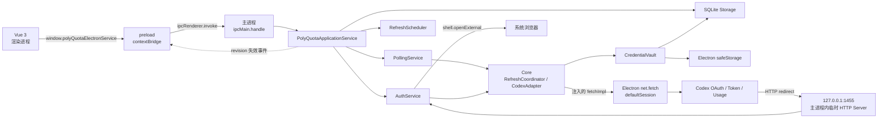
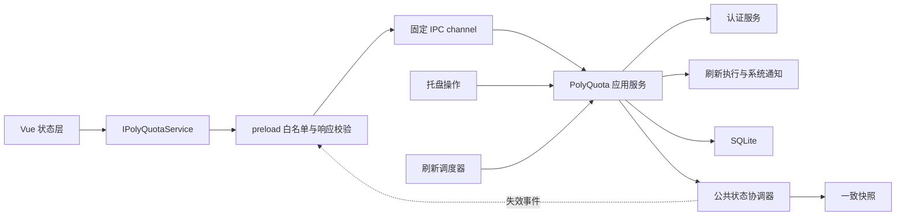

# 运行流程与通信机制现状报告

| 项目     | 内容                                                               |
| -------- | ------------------------------------------------------------------ |
| 文档性质 | Codex 闭环完成后的现状审计与扩展前设计建议                         |
| 基线提交 | `81e16d65d41736f2c04599e5c54f66578616bea0`                         |
| 审计日期 | 2026-09-25                                                         |
| 覆盖范围 | 开发、构建、打包、启动、终止、热更新、进程边界、IPC、网络与 OAuth |
| 非目标   | 本文不替代 `design.md` 和 `plan.md`，也不引入第 7.3 节的运行时抽象 |

## 1. 结论摘要

当前实现已经形成一条边界清楚的 Codex 闭环：Vue 渲染进程只通过 preload 暴露的白名单 API 访问 Electron 主进程；凭证、SQLite、`safeStorage`、轮询、通知、OAuth 会话和服务商请求均留在主进程；Core 通过注入的 `fetch` 使用 Electron 网络栈，不依赖 Electron，也不让渲染进程接触令牌。

当前结构已经在最小闭环之上完成以下横向能力：

1. **开发进程监督已经区分 UI HMR 与 Electron 重启。** Vue/Vite 保持 HMR；Electron 主进程和 preload 构建成功后完整重启，Core 及其他包仍由开发者显式重启开发入口。
2. **IPC 契约已经形成单一来源。** `polyquota-contract` 统一公开 DTO、服务接口、channel、事件和运行时校验，preload 编译为单个 CommonJS 产物。
3. **认证会话已经形成显式生命周期。** 浏览器 OAuth 与 Device Code 均返回 session ID，支持完成、取消、打开浏览器失败清理和应用退出统一中止。
4. **后台状态已经主动同步到界面。** 主进程提交公开状态后发送带 revision 的失效事件，renderer 合并事件并重新读取单一快照。
5. **原生模块 ABI 已完成隔离。** workspace 始终保留 Node ABI；Electron 二进制由独立命令生成到 `apps/polyquota/lib/better-sqlite3`，开发按需手动准备，生产构建自动生成。

以上能力保持 PolyQuota 产品通信与服务商协议实现相互独立；第 7.3 节的跨服务商运行时抽象仍未实施。

## 2. 当前运行单元与进程边界

### 2.1 开发模式的进程组成

执行 `pnpm dev` 后，能看到的逻辑层次如下：

```text
终端
└─ 根 Node 编排器 scripts/dev-polyquota.mjs
   ├─ pnpm / Core 一次性构建（完成后退出）
   ├─ pnpm / Vite 开发服务器（持续运行，127.0.0.1:5173）
   ├─ pnpm / Desktop 一次性构建（完成后退出）
   └─ pnpm / run-electron-mode.mjs
      └─ Electron 应用
         ├─ 主进程
         ├─ 渲染进程
         │  └─ preload 在该渲染进程的隔离上下文中执行
         └─ Electron/Chromium 自管的 GPU、网络等辅助进程
```

需要特别区分：

- preload 是渲染进程中的隔离执行上下文，不是项目自建的独立进程；
- OAuth 回调服务是主进程中创建的 Node HTTP Server，不是独立服务进程；
- 轮询、SQLite、`safeStorage`、通知和 Core 适配器都运行在主进程；
- 项目没有创建 Electron `utilityProcess`、Node worker、child process 或第二个业务窗口进程；
- `net.fetch` 由主进程调用，底层网络辅助进程由 Electron 管理，项目没有与其建立自定义 IPC。

### 2.2 打包后运行的进程组成

安装包运行时没有根编排器、pnpm、Vite 和 TypeScript 构建任务，只剩 Electron 应用及其自管辅助进程：

```text
Electron 主进程
├─ BrowserWindow 对应的渲染进程
│  ├─ preload 隔离上下文
│  └─ Vue 3 应用
├─ 主进程内服务
│  ├─ SQLite / migrations
│  ├─ safeStorage 凭证保护
│  ├─ IPC handlers
│  ├─ PollingService / Notification
│  ├─ CodexAuthService / 临时 OAuth HTTP Server
│  └─ Core adapter / RefreshCoordinator
└─ Electron/Chromium 自管辅助进程
```

应用使用单实例锁。第二次启动不会创建第二套存储和轮询服务，而是把已有窗口恢复并聚焦。

## 3. 开发阶段的完整流程

### 3.1 安装

`pnpm install` 根据 workspace 和 lockfile 安装依赖。根配置只允许 `better-sqlite3`、Electron 和 esbuild 执行依赖构建脚本。`references/omniroute` 不属于 pnpm workspace，不参与安装和应用构建。

工作区要求 Node.js 22.12 及以上、pnpm 10。Electron 运行时固定为 42.11.6。

### 3.2 `pnpm dev` 启动顺序

根脚本按以下顺序执行，前置步骤失败就停止，不会带着半成品继续启动：

1. **一次性构建 PolyQuota 契约与 Core。**
   - 先生成 `polyquota-contract` 的 ESM、声明文件和运行时校验代码；
   - esbuild 递归读取 `packages/core/src` 中的所有 TypeScript 入口；
   - 清空 `packages/core/dist` 后输出 Node ESM、source map 和已打包的本地 vendor 代码；
   - 复制 OmniRoute 许可证；
   - TypeScript 追加生成声明文件和 declaration map。
2. **检查并启动 Vite。**
   - 先确认 `127.0.0.1:5173` 未被占用；
   - 启动 Vite 且使用 `strictPort`，不会静默换端口；
   - 最多等待 30 秒，端口可连接后才进入下一步。
3. **一次性构建 Desktop 主进程。**
   - `tsc` 把 `apps/polyquota/src/**/*.ts` 编译到 `apps/polyquota/dist`；
   - esbuild 把 `src/preload.ts` 及所需契约代码打包为 `dist/preload.cjs`。
4. **启动 Electron。**
   - 注入 `POLYQUOTA_DEV_SERVER=http://127.0.0.1:5173`；
   - 主窗口通过 `loadURL` 加载 Vite，而不是加载 `apps/polyquota/renderer`；
   - 主进程从固定目录显式加载预先生成的 Electron ABI `better_sqlite3.node`。

首次开发前需手动执行 `pnpm native:prepare`。该命令在隔离临时目录中构建，并输出到 `apps/polyquota/lib/better-sqlite3`；`pnpm dev` 不重复检查或生成。Electron、Node、`better-sqlite3`、平台或架构变化后需重新手动执行。

主进程完成以下运行时初始化后才创建窗口：

1. 获取单实例锁；
2. 等待 Electron `app.whenReady()`；
3. 配置默认 session 的环境变量代理、系统代理或直连行为；
4. 打开 SQLite 并执行前向迁移；
5. 组合 `safeStorage`、CredentialVault、CodexAdapter、RefreshCoordinator、认证、轮询、应用服务与刷新调度器；
6. 注册 IPC handlers；
7. 启动轮询定时器；
8. 创建 BrowserWindow 并加载 Vite 页面；
9. 创建托盘。

开发模式不安装生产 CSP。渲染进程仍保持 `contextIsolation: true`、`nodeIntegration: false`、`sandbox: true` 和 `webSecurity: true`。

### 3.3 HMR、热重载与自动重启现状

| 变更范围                             | 当前行为                                   | 是否自动生效 |
| ------------------------------------ | ------------------------------------------ | ------------ |
| Vue SFC、前端 TypeScript、CSS        | 由 Vite HMR 更新；必要时由 Vite 整页刷新   | 是           |
| `packages/polyquota-ui/index.html`   | Vite 触发页面刷新                          | 是           |
| Vite 配置或前端依赖图的特殊变化      | 由 Vite 自身决定重载或内部重启             | 部分         |
| `packages/core/src`                  | 启动前只构建一次，运行中不监听             | 否           |
| `apps/polyquota/src/**/*.ts`         | 重新构建成功后完整重启 Electron            | 是           |
| `apps/polyquota/src/preload.ts`      | 重新打包成功后完整重启 Electron            | 是           |
| SQLite migration                     | 只在主进程启动并打开数据库时执行           | 否           |
| 环境变量代理                         | 只在主进程启动时配置默认 session           | 否           |
| 轮询开关和间隔                       | 保存后立即重配主进程唯一 timer              | 是           |
| OAuth 回调服务                       | 仅单次登录期间临时创建，不涉及代码热更新   | 不适用       |

严格意义上的 HMR 只覆盖 Vue 渲染层。Electron 主进程和 preload 的变化采用“构建成功后完整重启”，不是热替换；`packages/core`、`packages/polyquota-contract` 等其他包仍不监听，修改后需要显式重启开发入口。

### 3.4 开发模式的终止行为

存在三种常见终止路径：

1. **关闭窗口：不退出。** Windows 上窗口 `close` 事件会被拦截并隐藏，应用继续驻留托盘，轮询仍然运行。
2. **托盘“退出”：正常退出。** 设置 `quitting` 后调用 `app.quit()`；`before-quit` 销毁 renderer、注销 IPC、取消全部认证、停止调度并等待在途 IPC 与刷新，再销毁托盘和关闭 SQLite。Electron 退出后根编排器停止 Vite，不再执行 ABI 恢复。
3. **终端按 Ctrl+C：编排器终止。** 根脚本在 Windows 使用 `taskkill /t /f` 强制结束每个子进程树。这样能清理 Vite、pnpm wrapper 和 Electron；独立的原生二进制不受退出方式影响。

另外，Vite 在就绪后异常退出时，根编排器会停止其余子进程；Electron 非预期退出时也会停止 Vite。源码变化导致的预期退出由 Electron 监督器在完成清理后重新拉起。

## 4. 构建、打包与正式运行流程

### 4.1 `pnpm build`

根构建严格串行：

```text
PolyQuota contract build
   ↓
Core build
   ↓
UI vite build
   ↓
Desktop prebuild：隔离生成 Electron 原生二进制
   ↓
Desktop build:main
   ↓
复制 UI dist 到 Desktop renderer
```

各阶段职责如下：

- **Core：** esbuild 生成运行时代码，TypeScript 生成声明文件；构建不读取 `references/omniroute`。
- **UI：** Vite 生成静态 `packages/polyquota-ui/dist`，`base` 为 `./`，使资源可由 `file://` 相对加载。
- **Desktop prebuild：** 在临时目录中为实际 Electron、平台和架构重建 `better-sqlite3`，固定输出到 `apps/polyquota/lib/better-sqlite3`，workspace 的 Node ABI 不变。
- **Desktop main/preload：** TypeScript 输出主进程代码，preload 原样复制到 `dist`。
- **Desktop renderer：** 删除旧的 `apps/polyquota/renderer`，再完整复制 UI 构建结果。

这是一次性生产构建，没有 watch、增量常驻进程或 HMR。命令成功后自然退出。

### 4.2 `pnpm package`

打包命令先完整执行 `pnpm build`，然后：

1. Desktop `prebuild` 在隔离目录中生成 Electron ABI 二进制；
2. 使用 electron-builder 生成 Windows NSIS 包，禁止发布；
3. 应用代码进入 asar；依赖目录中的 Node ABI 二进制被排除；
4. `apps/polyquota/lib/better-sqlite3` 作为额外资源复制到安装包的 `resources/lib/better-sqlite3`。

产物位于 `apps/polyquota/release/`。安装方式为非 one-click、当前用户安装，并允许选择目录。

打包过程中没有启动 Vue、Vite 或正式应用，也不存在热重载。原生模块在临时目录中构建并在成功后替换固定产物；失败不会改变 workspace 的 Node ABI。

### 4.3 打包后启动

正式应用从 `apps/polyquota/dist/main.js` 对应的 asar 内容启动。初始化顺序与开发模式基本相同，差异是：

- 不存在 `POLYQUOTA_DEV_SERVER`，窗口通过 `loadFile` 读取打包的 `renderer/index.html`；
- 主进程为页面安装生产 CSP；
- 不运行任何 TypeScript、esbuild、Vite 或复制任务；
- 不执行原生模块重建；
- 页面和主进程代码均固定在安装产物中，不支持 HMR 或自动更新后重启。

正式退出仍通过托盘菜单完成。窗口关闭只隐藏；系统退出或托盘退出触发 `before-quit` 清理。主进程先停止状态事件并销毁 renderer，注销 IPC、取消认证和刷新调度，再等待在途 IPC 与刷新，最后关闭 SQLite；开发自动重启复用同一 shutdown barrier。

## 5. Vue、Electron、专用 fetch 与 OAuth 的通信机制

### 5.1 总体拓扑



### 5.2 Vue 到主进程：contextBridge + invoke/handle

Vue 不直接导入 Electron，也不能访问 Node、文件系统、数据库或网络凭证。调用链为：

1. `polyquota-contract` 提供 `IPolyQuotaService`、公开 DTO、固定 channel、事件名和纯校验函数；
2. 编译后的 preload 使用 `contextBridge.exposeInMainWorld` 暴露 `window.polyQuotaElectronService`；
3. 每个方法内部调用固定 channel 的 `ipcRenderer.invoke`，主进程用 `ipcMain.handle` 接收请求；
4. handler 用公共契约校验输入，只调用 `PolyQuotaApplicationService`，不自行组合业务写入；
5. 所有结果统一包装为 `{ ok: true, value }` 或 `{ ok: false, error }`，preload 再执行防御性输出校验；
6. UI 首先订阅固定状态事件，再通过 `getSnapshot()` 一次读取账号、用量、设置、操作和调度状态。

主进程事件只携带 `schemaVersion`、`revision`、变化原因和时间，不传递业务增量。renderer 忽略重复或倒序事件；同一时刻只保留一次快照读取，并在读取期间观察到更高 revision 时补读一次。页面卸载和 HMR 时通过 disposer 精确移除 listener。

事件允许重复或丢失，`getSnapshot()` 始终是唯一事实来源。窗口隐藏时继续接收事件；renderer 重载或窗口重建后重新订阅并读取最新快照，不依赖历史事件队列。

### 5.3 主进程到 Core：普通函数调用与端口注入

Core 是同一主进程内加载的工作区包，不通过 IPC 与 Desktop 通信。Desktop 在组合根创建并注入：

- `SqliteStorage`，实现 Core 的存储端口；
- `ElectronSafeStorageCipher`，实现凭证加解密端口；
- 基于 `net.fetch` 的 `fetchImpl`；
- CodexAdapter、CredentialVault、RefreshCoordinator 和 CodexAccountProvisioner。

因此 Core 保持 Electron 无关，但不是独立进程或远程服务。调用、异常和对象都在主进程内传递。

### 5.4 “专用 fetch”的真实边界

主进程构造的传输为：

```ts
const fetchImpl: typeof fetch = (input, init) =>
  net.fetch(input instanceof URL ? input.toString() : input, init);
```

它被注入 CodexAdapter，再明确传入 vendor 协议函数。当前以下出站请求都走同一个 Electron `net.fetch`：

- 浏览器 OAuth 授权码换 token；
- 设备授权码申请；
- 设备授权轮询；
- 设备授权码换 token；
- refresh token 刷新；
- 用量查询。

默认 session 在这些请求开始前完成代理配置：优先 `HTTPS_PROXY`，其次 `HTTP_PROXY`；存在环境变量时使用固定代理并应用 `NO_PROXY`，否则使用系统代理。`getProxy` 只用于把 Electron 对目标 URL 的解析结果展示给 UI。

需要避免三种误解：

- 这不是渲染进程的 `window.fetch`；业务页面不直接请求 Codex；
- 这不是独立 fetch 进程；它只是 Desktop 提供给 Core 的传输适配器；
- OAuth 回调是浏览器向本机 Node HTTP Server 发起的入站请求，不经过 `net.fetch`。

### 5.5 浏览器 OAuth PKCE

浏览器 OAuth 使用显式 session，把“启动授权”和“等待完成”分成两个服务调用：

```mermaid
sequenceDiagram
  participant UI as Vue
  participant IPC as Electron 主进程
  participant AUTH as CodexAuthService
  participant B as 系统浏览器
  participant P as Codex
  participant CB as 127.0.0.1:1455

  UI->>IPC: startAuth(browser-oauth)
  IPC->>AUTH: start()
  AUTH->>AUTH: 生成 state + PKCE，开始等待回调
  AUTH->>B: shell.openExternal(authorizationUrl)
  AUTH-->>IPC: pending + sessionId
  IPC-->>UI: AuthStartResult
  UI->>IPC: finishAuth(sessionId)
  B->>P: 用户登录与授权
  P-->>CB: GET /auth/callback?code&state
  CB->>CB: 校验路径、code、state，关闭 Server
  AUTH->>P: net.fetch 换 token
  AUTH->>AUTH: safeStorage 加密 + SQLite 事务保存
  AUTH-->>IPC: PublicAccount
  IPC-->>UI: ServiceResult&lt;PublicAccount&gt;
```

当前约束：

- redirect URI 为 `http://localhost:1455/auth/callback`；Server 实际只监听 `127.0.0.1:1455`；
- Server 仅在本次登录期间存在，最长等待 15 分钟；
- 回调校验 state，PKCE verifier 只留在主进程；
- 成功或无效回调都会关闭 Server；超时也会关闭；
- 保存前会从 token 映射稳定身份，凭证经 `safeStorage` 加密后进入 SQLite；UI 只收到 PublicAccount。

浏览器登录和设备授权共用显式 session registry。打开浏览器失败、用户关闭接入弹窗、会话完成、超时和应用退出都会取消对应 `AbortController` 并释放临时状态；同一 session 完成或取消后不能再次使用。

### 5.6 设备授权

设备授权拆成两个 IPC 调用：

1. `startAuth()` 通过 `net.fetch` 获取 device auth ID、user code、间隔和验证地址，在主进程 Map 中保存 authorization 与 AbortController，打开系统浏览器，只把 session ID、user code 和验证地址返回 UI。
2. 用户点击“我已完成授权”后，`finishAuth()` 使用 session ID 找回主进程状态，轮询上游、换 token、加密保存账号，最后删除 Map 中的 session。

应用退出时会 abort 全部设备会话。UI 不接触 device auth ID、token 或 PKCE 数据。

### 5.7 CLI 导入、手动刷新与后台轮询

- **CLI 导入：** Vue 发 IPC；主进程只读 `${CODEX_HOME}/auth.json` 或用户目录下的默认文件；Core 解析并建立稳定身份；凭证经 `safeStorage` 加密并由 SQLite 事务保存；不会回写 CLI 文件。
- **手动刷新：** Vue 发 IPC；应用服务记录公开操作并调用 PollingService 和 RefreshCoordinator；完成后递增 revision，UI 收到事件后读取完整快照。
- **后台刷新：** `RefreshScheduler` 在主进程使用单次 timer，通过应用服务进入同一批次入口。相同账号的并发刷新由 Core 合并，不同账号并行；批次完成后再计算下一次时间。
- **托盘刷新：** 托盘菜单调用应用服务的同一 `refreshAll("tray")`；手动、托盘和自动触发共享一个在途批次。
- **恢复与退出：** 系统恢复时过期计划只补执行一次；设置保存后立即重配 timer；退出时调度器停止接收新批次并等待当前批次完成。

## 6. 当前设计中值得保留的边界

以下做法已经形成良好基础，扩展时应继续保持：

1. UI、Desktop 宿主和 Core 协议分层明确，Core 不依赖 Electron；
2. 渲染进程启用 sandbox 和 context isolation，preload 只暴露白名单能力；
3. 服务商全部出站请求使用注入传输，当前已统一到 Electron session 和代理；
4. 凭证明文只在主进程短暂出现，IPC DTO、通知和 UI 不包含秘密；
5. 手动刷新、后台轮询和托盘刷新复用同一协调器；
6. 同账号刷新互斥、不同账号隔离，旋转凭证先保存再继续用量请求；
7. OAuth 回调只监听 loopback，使用 state 与 PKCE，并有固定超时；
8. 开发、生产两种 renderer 加载路径清楚，生产静态资源不依赖 Vite 服务；
9. 参考子模块不进入 workspace、运行时或安装包。

后续优化应围绕这些边界做“单一来源和生命周期完善”，不需要推翻现有分层。

## 7. 后续调整方向

以下内容按主题记录已经确认或正在细化的后续设计。每个主题独立确定边界、优先级和完成标准；某一主题的实施不得提前带入其他主题尚未确认的运行时抽象。

### 7.1 IPC 通信、Web 侧通知接收与自动刷新

**状态：** 已实施并完成开发版、打包版真实 Electron 验证。

本主题把 PolyQuota 已有的请求—响应 IPC、页面读取、状态失效通知和自动刷新收敛为一条产品级通信链路。它只处理当前应用已经具备的账号、认证、用量、设置、代理状态和刷新能力，不建立服务商注册表、服务商目录、能力发现、模型目录、推理接口或跨产品服务；这些内容仍属于第 7.3 节及其独立设计，不能作为本主题的前置实施内容。

#### 7.1.1 目标与不变边界

本主题完成后应满足以下目标：

1. UI、preload 和主进程从同一份产品契约取得方法、参数、返回值、IPC channel 和事件类型，删除三处手工同步；
2. 页面通过一份带修订号的快照读取账号、用量、设置和运行状态，不再执行“账号列表 + 每账号用量”的 N+1 组合读取；
3. 主进程提交公开状态后只发送失效通知，页面按修订号合并通知并重新读取快照；
4. 设置修改立即作用于自动刷新调度，应用从挂起恢复或错过触发时间后可以恢复到单一有效计划；
5. 手动刷新、托盘刷新和自动刷新继续复用现有 `RefreshCoordinator`，不形成第二套刷新逻辑；
6. 真实 Electron 中的 context isolation、preload 白名单、输入校验、错误脱敏和事件解绑均有可重复验证。

以下边界保持不变：

- renderer 不直接导入 Electron、Core、数据库或 Node API，也不接触明文凭据、上游原始错误体和内部对象；
- preload 只暴露明确命名的方法和一个固定状态事件，不提供任意 channel 调用、任意事件监听、传入 URL 的代理请求或通用对象访问；
- Core 继续负责单账号刷新互斥、凭据轮换和用量获取，7.1 不改变服务商协议实现；
- 系统额度通知与 Web 状态通知是两条不同链路。前者面向操作系统用户，后者只是 renderer 的状态失效提示，二者不能互相替代；
- 本阶段不把 Codex、GLM 改造成通用注册实现，也不为未来服务商预建空条目、能力声明或回退路径。

#### 7.1.2 公共契约的归属与构建形态

新增产品专用的轻量契约包 `packages/polyquota-contract`，作为 UI、preload 和主进程唯一允许共同依赖的通信定义来源。该包只包含：

- 可序列化 DTO、判别联合和 `IPolyQuotaService`；
- 固定的请求 channel 与状态事件名称；
- 请求、响应、快照和事件的纯运行时校验函数；
- 不依赖环境的序列化与错误归一化辅助函数。

该包不得依赖 Vue、Electron、SQLite、Node API、Core 的具体适配器或任何服务商运行实现，也不存放服务商展示配置。账号和用量 DTO 可以沿用当前已经公开的字段与 `groups + extras` 结构，但本阶段不增加服务商目录、能力声明或模型信息。

为使 preload 也实际使用同一份 channel 和校验逻辑，实施时将当前手写并原样复制的 `preload.cjs` 改为可导入契约包的 preload 源码，再独立编译或打包为 CommonJS 产物。契约包先生成 ESM、声明文件和供 preload 打包使用的运行时代码，preload 产物内联所需 channel 与校验函数，不在运行时从 renderer 或参考仓库解析模块。根构建相应调整为先构建契约包，再构建 Core、UI 和 Electron；契约包源码仍不进入开发自动监听，修改后按第 7.2.3 节显式重启完整开发入口。

该变化只服务于 IPC 单一来源。channel 值在契约包中按 `polyquota:<domain>:<action>` 命名并集中导出，但不是面向第三方的稳定扩展协议。preload 不能动态拼接 channel，也不能把底层 `ipcRenderer` 暴露给页面。

契约中的所有日期使用 ISO 8601 字符串，所有数据必须通过 structured clone，禁止传递类实例、`Error`、`Buffer`、函数、流、数据库行对象或 Electron 对象。`schemaVersion` 从 `1` 开始；同一安装产物中的主进程、preload 和 UI 必须使用相同版本。开发期出现版本不一致时返回明确的 `contract-mismatch`，提示完整重启 Electron，不能猜测兼容或静默降级。

通信责任链固定为：



IPC handler、托盘回调和调度器不得各自直接组合存储写入与事件发布。它们统一调用 PolyQuota 应用服务；应用服务负责标记公开操作、调用现有认证或刷新能力，并在提交完成后更新公共状态。系统通知去重记录等 renderer 不可见的内部写入不增加公共修订。

图中的方框表示职责，不要求每个方框都成为独立包、类或可注入服务。首阶段只新增 `polyquota-contract` 工作区包；主进程内部以一个 `PolyQuotaApplicationService` 承担命令编排、快照、修订和事件发布，以一个 `RefreshScheduler` 隔离 timer、恢复和重调度。事件发布可以是应用服务持有的简单回调，不引入领域事件总线、命令总线、依赖注入容器或第二套存储抽象。

#### 7.1.3 前端服务接口

`IPolyQuotaService` 在本阶段收敛为以下产品能力：

```ts
interface IPolyQuotaService {
  getSnapshot(): Promise<ServiceResult<PolyQuotaSnapshot>>;
  subscribe(listener: (event: PolyQuotaChangedEvent) => void): () => void;

  setAccountEnabled(accountId: string, enabled: boolean): Promise<ServiceResult<void>>;
  deleteAccount(accountId: string): Promise<ServiceResult<void>>;
  refreshAccount(accountId: string): Promise<ServiceResult<RefreshOutcomeDto>>;
  refreshAll(): Promise<ServiceResult<RefreshBatchOutcomeDto>>;
  refreshCredentials(accountId: string): Promise<ServiceResult<CredentialRefreshOutcomeDto>>;

  startAuth(request: StartAuthRequest): Promise<ServiceResult<AuthStartResultDto>>;
  finishAuth(sessionId: string): Promise<ServiceResult<PublicAccountDto>>;
  cancelAuth(sessionId: string): Promise<ServiceResult<void>>;

  saveSettings(settings: PublicSettingsDto): Promise<ServiceResult<void>>;
  getSystemStatus(): Promise<ServiceResult<PublicSystemStatusDto>>;
}
```

`StartAuthRequest` 只表达当前已经实现且可验证的组合：Codex 的浏览器 OAuth、Device Code 和 CLI 导入，以及 GLM 的 API Key 和 ZCode 导入。它是封闭的判别联合，API Key 只存在于当前调用参数中。7.1 不把请求改为“任意服务商 + 任意能力”，也不根据一个尚未实施的服务商目录动态生成认证协议。

`getSnapshot()` 替代现有 `listAccounts()`、`getUsage()` 和 `getSettings()`；`refreshAll()` 替代 UI 对账号逐个循环刷新。`getSystemStatus()` 只返回当前代理解析等无持久化系统状态，不接受任意目标 URL。完成迁移并通过真实 Electron 验证后删除旧方法和旧 channel，不长期维护两套协议。

普通浏览器继续使用 `EmptyPolyQuotaService`：返回修订号为 `0` 的空快照、无副作用的订阅 disposer 和可安全展示的系统空状态；所有写操作及刷新、认证操作返回 `service-unavailable`。UI 测试使用独立的 `FakePolyQuotaService` 主动发出事件，不把测试开关或夹具放入生产服务实现。

#### 7.1.4 一致状态快照

本阶段的快照不包含服务商目录，结构固定为：

```ts
interface PolyQuotaSnapshot {
  schemaVersion: 1;
  revision: number;
  generatedAt: string;
  accounts: PublicAccountDto[];
  usageByAccountId: Record<string, PublicUsageDto | null>;
  operations: PublicOperationStateDto[];
  settings: PublicSettingsDto;
  scheduler: PublicRefreshSchedulerStateDto;
}
```

主进程在 `PolyQuotaApplicationService` 内集中负责快照投影、修订递增和失效事件发布，但不接管 Core 的服务商逻辑。只有当这部分代码无法独立测试或职责明显膨胀时，才允许提取为同一主进程内的私有辅助模块；不得先建立一层公共框架。`revision` 是当前主进程实例内单调递增的安全整数，仅在 renderer 可观察状态真正改变后递增；写入与现有值相同且操作状态未变化时不得制造空修订。应用重启后可从初始修订重新开始，renderer 随窗口重建重新取得基线，不把修订号写入数据库。

快照必须满足以下一致性规则：

- 账号、用量和设置从同一个已经提交的存储状态投影；投影期间若修订发生变化，则丢弃结果并重新读取；
- `usageByAccountId` 只包含当前账号键，每个账号都有对应键，尚无快照时值为 `null`；
- 删除账号后的同一新修订同时移除账号、用量和相关公开操作，不允许页面看到孤立用量；
- 刷新完成后的账号凭据状态和用量属于同一新修订；失败但未改变持久状态时，操作状态和调度结果仍可形成新修订；
- 数组采用稳定顺序，映射键和 DTO 在发送前再次校验，renderer 不负责修复非法关系；
- `generatedAt` 表示本次投影完成时间，不伪装成各账号用量的抓取时间。

`PublicOperationStateDto` 只描述 renderer 需要显示的当前操作，例如账号刷新、全部刷新、凭据刷新和等待用户完成的认证会话；不包含 token、PKCE verifier、上游 device auth ID 或原始请求。已经结束的普通操作从列表移除，失败详情由当前命令结果或调度器最近结果表达，避免把快照变成无界历史日志。

#### 7.1.5 状态变更通知与页面重读

状态事件采用固定结构：

```ts
type PolyQuotaChangeReason =
  | "accounts"
  | "usage"
  | "settings"
  | "operations"
  | "scheduler";

interface PolyQuotaChangedEvent {
  schemaVersion: 1;
  revision: number;
  reasons: PolyQuotaChangeReason[];
  occurredAt: string;
}
```

事件只说明“某个较新修订已经可读”，不携带账号、用量或设置增量。这样即使通知重复、合并、延迟或在页面装载前丢失，`getSnapshot()` 仍是唯一事实来源。主进程必须在存储事务提交并完成公开状态更新后发布事件；成功的状态修改命令在对应修订已经发布后才完成响应。

主进程对同一事件循环内的连续变化合并原因集合并只发送最高修订。当前单窗口由组合根把明确的 `webContents` 交给事件发布器，不遍历或广播给非 PolyQuota 页面。preload 监听唯一事件 channel，校验并剥离 Electron event 对象后再调用页面 listener；disposer 只移除本次注册的 listener。

页面初始化和重读遵守以下顺序：

1. 先建立订阅，再发起第一次 `getSnapshot()`，避免读取和订阅之间出现空窗；
2. 只应用修订不低于当前状态的完整快照，忽略重复或倒序事件；
3. 通知到达时记录最高目标修订，同一时刻最多保留一次在途读取；
4. 读取结束后若快照仍低于已观察到的目标修订，再读取一次，否则不重复请求；
5. HMR、组件卸载或窗口销毁时调用 disposer，重复挂载不得累积 listener。

典型变化与原因映射如下：

| 变化来源             | 必含原因                          |
| -------------------- | --------------------------------- |
| 认证完成、启停账号   | `accounts`、`operations`          |
| 删除账号             | `accounts`、`usage`、`operations` |
| 刷新成功并提交用量   | `usage`、`accounts`、`operations` |
| 刷新开始或无状态失败 | `operations`                      |
| 保存轮询设置         | `settings`、`scheduler`           |
| 自动刷新开始或结束   | `operations`、`scheduler`         |

原因只用于诊断和可选的页面提示，首阶段不根据原因拆分局部读取。页面始终替换完整快照，避免重新引入跨字段短暂不一致。

#### 7.1.6 边界校验与错误表达

renderer 传入的所有值均视为不可信。主进程 handler 使用公共契约校验参数的类型、长度、枚举、数值范围和对象形状；账号 ID 与 session ID 使用各自 schema，不能因为当前格式相似而共用同一个含义不明的校验函数。秘密字段校验失败时不得把原值写入日志或错误详情。

主进程在发送前校验成功值和 `PublicErrorDto`，preload 对 `invoke` 结果和状态事件再做防御性校验。业务错误、校验错误和预期传输错误统一解析为：

```ts
type ServiceResult<T> =
  | { ok: true; value: T }
  | { ok: false; error: PublicErrorDto };
```

公开错误至少包含稳定 `code`、安全的 `message` 和 `retryable`。稳定错误类别覆盖 `validation`、`not-found`、`conflict`、`authentication`、`network`、`service-unavailable`、`transport`、`shutdown`、`contract-mismatch` 和 `internal`；不得透传堆栈、SQLite 文本、文件系统路径、完整账号标识、请求头、响应体或凭据。主进程可以在本地日志使用独立关联 ID 记录脱敏诊断，renderer 只得到该 ID，不得到内部异常。

刷新命令已经成功执行但某个上游请求失败时，外层仍可为成功的 `ServiceResult<RefreshOutcomeDto>`，由 outcome 的 `status: "failed"` 和公开错误表达业务结果。这样 `refreshAll()` 可以返回逐账号成功、跳过和失败结果；IPC 本身不可用、输入非法或应用正在退出时才使用外层失败。

#### 7.1.7 自动刷新调度器

现有固定 `setInterval` 调整为单实例、单次定时器驱动的刷新调度器。它读取并执行当前 `pollingEnabled` 与 `pollingIntervalMinutes`，继续调用同一 `PollingService` 和 `RefreshCoordinator`，不自行访问适配器或数据库中的秘密。

公开调度状态至少包含：

- `status`：`disabled`、`waiting`、`running` 或 `stopped`；
- 当前生效的间隔与 `nextRunAt`；
- 最近一次自动刷新开始、结束时间；
- 最近一次批次的成功、跳过和失败数量，以及可选的公开错误摘要；
- 当前运行是否由应用退出阻止继续调度。

调度规则如下：

1. 应用启动后从已提交设置建立唯一计划；禁用时不创建 timer，启用时从当前时间计算下一次执行；
2. 保存设置成功后立即重新配置。关闭轮询会取消未来触发，但不强制中断已经进入协调器的刷新；修改间隔从设置提交时间重新计算下一次执行；
3. 使用单次 timer，在本批刷新完全结束后再计算下一次，避免慢请求与 `setInterval` 叠加；
4. 手动“全部刷新”、托盘刷新和自动触发进入同一个批次入口；已有批次运行时合并重复的全部刷新请求，不启动第二个批次。单账号层面继续由 Core 合并同账号并发；
5. 系统从休眠恢复或事件循环发现计划已过期时，只补执行一次，不按错过次数连续追赶；随后从实际完成时间建立新计划；
6. 单个账号失败不终止其他账号，也不永久停止调度。批次结果写入公开状态后按正常间隔继续；
7. 应用退出先把调度器置为 `stopped` 并拒绝新触发，再清除 timer、等待在途批次和 IPC，最后关闭存储，继续遵守第 7.2 节的 shutdown barrier；
8. 自动刷新只在 PolyQuota 主进程存活时运行，不注册操作系统后台任务，也不承诺应用退出期间补齐刷新。

#### 7.1.8 分层复杂度、测试与调试约束

分层的目的仅是固定跨进程契约和状态所有权，不能把一次操作拆成难以跟踪的通用框架。首阶段生产调用栈保持为：

```text
Vue → preload → IPC handler → PolyQuotaApplicationService
                                  ├─ AuthService
                                  ├─ PollingService / RefreshCoordinator
                                  ├─ StoragePort
                                  └─ RefreshScheduler
```

实施时遵守以下复杂度约束：

- 除 `polyquota-contract` 外不新增工作区包，不建立通用 command、query、repository、event bus 或 provider facade；
- IPC handler 只做校验、调用和结果映射，但不为每个方法再创建一层单用途 handler 类；
- `PolyQuotaApplicationService` 直接依赖现有 `AuthService`、`PollingService`、`StoragePort` 和调度器，不为它们复制同形接口；
- `RefreshScheduler` 只负责时间与批次触发，不包装单账号刷新协议、系统通知或 Core 适配器；
- 快照修订和事件发布默认留在应用服务内部，不因为测试方便而引入全局事件基础设施；
- 公开 DTO 与 Core 内部模型只在应用服务边界转换一次，不在 preload 和 UI 重复映射业务字段；
- 一个异步用户操作在主进程中最多生成一个公开操作 ID。该 ID 贯穿公开操作状态和应用服务完成日志，用于关联调试，不作为新的远程调用入口；同步设置和账号写入直接通过 channel 与 revision 定位，不额外制造操作对象。

测试按有行为差异的边界划分，不要求每一层重复验证同一组成功案例：

- 契约测试只验证 schema、序列化、channel 映射和错误脱敏；
- 应用服务测试覆盖状态提交、快照关系、revision 和事件顺序，同时用简单 fake 替代认证与刷新，不 mock IPC；
- 调度器测试使用假时钟，只验证启停、重调度、合并、恢复和退出，不重复 Core 刷新结果测试；
- UI 测试只依赖 `FakePolyQuotaService`，不模拟 `ipcRenderer`；
- Electron smoke 只保留少量跨 preload 的关键路径，证明真实 contextBridge、请求和事件可用，不复制全部单元测试矩阵。

调试信息集中在应用操作结束和状态修订发布两个边界；IPC 的固定 channel 与公开错误用于判断入口失败。异步操作日志包含操作名、公开操作 ID、revision、耗时和脱敏结果，修订日志包含 revision 与原因集合，不记录参数对象、凭据、原始响应或完整账号标识。如果必须跨越更多自定义转发层才能定位，视为分层过度，不进入实施。

#### 7.1.9 实施顺序

7.1 已按以下顺序实施，每一步均保持应用可构建和可验证：

1. 建立 `polyquota-contract`，迁移 DTO、服务接口、channel、事件名与校验函数，并把 preload 纳入确定性编译；此时保持现有业务行为；
2. 在主进程应用服务中建立公共状态协调职责和 `getSnapshot()`，迁移 UI 到单快照状态；
3. 增加修订事件、preload 订阅和 UI 合并重读，随后删除分散读取 channel；
4. 将轮询改为可重配置调度器，接入设置即时生效、托盘刷新、恢复处理与公开调度状态；
5. 完成真实 Electron 验证后删除旧 channel、旧 service 方法和兼容分支，并更新本报告第 5 节的现状描述。

上述任何阶段都不得同时建立服务商注册表、把 `ProviderId` 改造成运行时插件标识、添加服务商目录或迁移 GraphAgent。若实施中发现确实依赖这些能力，应停止该部分并回到第 7.3 节单独评审，而不是在 IPC 契约中预埋通用逃生口。

#### 7.1.10 测试与完成标准

测试分为四层：

- 契约测试：覆盖每个请求、响应、快照和事件 schema，验证非法枚举、超长 ID、额外秘密字段、不可序列化值和版本不匹配均被拒绝；
- 主进程单元测试：使用临时 SQLite、假时钟和假通知端口验证修订递增、快照关系、事件时序、批次合并、设置即时生效、休眠恢复、失败后续调度和退出排空；
- UI 测试：使用 `FakePolyQuotaService` 验证订阅先于首读、通知突发合并、倒序事件忽略、在途读取后的补读、空白实现和卸载解绑；
- Electron 边界测试：在临时用户数据目录启动真实 Electron 隐藏窗口，通过实际 contextBridge 验证 `getSnapshot()`、一次状态修改及对应事件、非法输入脱敏、未知能力不可访问、disposer 生效和干净退出。该测试不访问真实网络或真实凭据。

7.1 已按以下条件完成验收：

1. renderer 只有 `IPolyQuotaService` 一条入口，仓库中不存在业务代码直接拼写 IPC channel；
2. 页面首屏和后续更新均来自单一快照，不再逐账号读取用量；
3. 后台、托盘和手动刷新完成后，已打开页面无需用户额外操作即可收敛到最新修订；
4. 设置修改即时改变唯一刷新计划，长时间刷新、休眠恢复和重复触发不会产生重叠批次或追赶风暴；
5. 认证、删除、启停、刷新和设置变化都在提交后产生正确原因的事件，失败路径不发布虚假的持久状态；
6. UI、IPC、事件、系统通知和日志中均没有 token、API Key、PKCE verifier、上游 device auth ID 或原始响应体；
7. `pnpm format:check`、`pnpm typecheck`、`pnpm test`、`pnpm build` 和 `pnpm package` 通过，并完成开发版与打包版真实 Electron smoke；
8. 实施 diff 中不包含第 7.3 节的跨服务商运行时抽象。
9. 除契约包、应用服务和调度器外未增加通用基础设施；同一行为只在所属边界完整测试一次，Electron smoke 失败时可以通过操作 ID 和 revision 定位到主进程操作。

### 7.2 构建流程、应用生命周期与开发热更新

本主题统一开发、构建、打包、启动和终止流程，并明确静态资源、运行环境适配和开发监听的边界。

#### 7.2.1 UI 静态资源与内容安全策略

- 保留 Vite 的相对公共基准，使源码导入的图片、样式、字体及其他资源在开发服务器和 Electron `file://` 页面中使用同一套引用方式。
- 为运行时动态拼接的 `public` 目录文件提供统一辅助函数。该函数以 Vite 公共基准为起点并规范化相对路径，业务组件不直接拼接根路径或判断开发、打包环境。
- 生产环境允许页面加载外部 HTTPS 图片、样式和字体，同时保留本地资源及必要的 `data:` 图片、字体支持。
- JavaScript 及其他可执行脚本仍只允许来自应用自身，不允许加载外部脚本；新增外部资源类型时必须同步检查生产 CSP，不能通过关闭 `webSecurity` 或整体放宽策略解决。
- Electron 主进程直接读取的窗口、托盘、安装包和原生资源继续使用应用资源目录及 `extraResources`，不放入 UI 的 `public` 目录。

#### 7.2.2 Electron 功能的前端服务抽象

- 使用 `IPolyQuotaService` 统一描述前端可使用的全部 Electron 能力，页面、组件和状态逻辑只依赖该接口，不直接读取全局对象或调用 IPC。
- preload 暴露的全局对象由 `window.llmUsage` 重命名为 `window.polyQuotaElectronService`，并实现 `IPolyQuotaService`；它是 Electron 环境中的主要实现，负责把服务调用转发到受控 IPC。IPC 方法、公开数据和错误契约仍由第 7.1 节统一确定。
- 前端默认提供一个同样实现 `IPolyQuotaService` 的空白占位实现。未注入 Electron bridge 时，读取方法返回类型有效的空数据或空状态，写入和操作方法不产生副作用，也不伪造账号、用量、认证成功或持久化结果。
- 在固定的前端服务入口中完成一次实现选择并保存唯一实例：存在有效的 `window.polyQuotaElectronService` 时使用 Electron 实现，否则使用空白占位实现。业务模块不自行判断运行环境，也不各自创建服务实例。
- Vue 应用初始化时从该固定入口取得 `IPolyQuotaService` 实例，通过应用级依赖注入提供给整个组件树；页面和组件通过统一的类型化注入入口取得服务，不直接访问实例存放位置或 `window`。
- 服务实例选择不依赖开发或生产构建常量。普通浏览器中的页面和 HMR 可以使用空白实现保持可运行，真实桌面交互只由 Electron 实现提供。

#### 7.2.3 开发监听与 Electron 自动重启

- 保留 Vue 渲染层的 Vite HMR；Vue、CSS 和由 UI 导入的静态资源更新时，不重启 Electron 主进程。
- 只监听 `apps/polyquota` 中的 Electron 主进程和 preload 源码。相关文件变化后重新构建 Electron 代码，并在构建成功后完整重启 Electron 应用；这不是主进程 HMR。
- Electron 重启期间保持 Vite 开发服务器运行。旧实例退出并完成认证、刷新、IPC、窗口、托盘、存储和其他资源清理后，才启动新实例，避免遗留进程、端口、监听器、定时器或存储句柄。
- `packages/core` 等其他包的源码不进入自动监听、自动构建或联动重启范围；修改后由开发者显式重新执行开发入口或对应构建命令。
- `better-sqlite3` 继续保持 Node/Electron 二进制隔离。普通开发启动和 Electron 自动重启不重复准备原生模块；依赖版本、Electron 版本、平台或架构变化后仍由开发者手动准备，生产构建自动准备。

#### 7.2.4 正式构建与验收边界

- 正式构建必须按 Core、UI、Electron 主进程和 preload、renderer 复制的确定顺序生成完整产物，不能复用无法确认新鲜度的旧 UI 构建目录。
- 将服务商协议的同步抽取纳入构建期工具链治理，保持其与应用运行时及真实凭证隔离。
- 以 UI HMR、Electron 连续修改和重复重启、显式重启后的其他包更新、正式构建及打包后运行作为这一方向的完整验证范围。

### 7.3 UI 交互、产品标识图标与跨服务商抽象

**设计状态：** 已完成；本节不表示跨服务商抽象已经实施。

跨服务商的公开数据、实现注册与前端调用边界已在[跨服务商服务协议设计](../common/core/cross-provider-service-protocol-design.md)中继续细化；本节只保留产品交互与验收范围。

本主题只确定功能形态、交互语义和跨服务商公开规范，不规定最终视觉样式、组件结构或内部接口。实施阶段以简洁、可验证的 UI 为基础。本节形成的公开状态和操作语义，后续作为第 7.1 节通信契约的输入。

当前集中在 `App.vue` 的功能按用途拆分为三个主要功能区。

#### 7.3.1 配置

- 集中管理刷新频率等应用级参数。
- 提供清除本地应用数据的入口。
- 展示当前代理模式，并提供独立的网络检查能力。
- 配置只处理应用级行为，不混入具体服务商的接入参数和认证操作。

#### 7.3.2 服务商接入

- 使用独立页面列出当前支持的大模型服务商；每个服务商占一行紧凑的卡片型列表项，并展示接入情况。
- 用户从服务商条目进入添加流程，在弹窗中选择该服务商支持的接入方式，例如 API Key、OAuth 或 Device Code，并填写对应参数。
- 接入弹窗提供凭证或授权结果的有效性测试，测试通过与正式保存是两个明确动作。
- OAuth 所需的临时回调服务只随当前接入弹窗中的授权会话存在；关闭弹窗即取消会话并停止临时服务。
- 同一套接入流程根据服务商能力展示可用方式和参数，不为每个服务商复制一套页面流程。

#### 7.3.3 用量卡片展示与更新

- 保留现有用量卡片列表及其主要刷新行为，作为应用主体页面。
- 套餐展示名来自 core 套餐配置的 `displayName`，经快照 `providers[].plans` 下发；UI 不得内置名称映射表。命中配置则显示配置名（例如 `prolite` → Pro 5x），未知档位原样展示。档位名是圆头标签，放在供应商名称右侧。
- 账号启用状态改为卡片右上角的开关，减少独立操作按钮对主体信息的干扰。
- 服务商支持配额分组时保留分组标题；不支持时不为了统一外观虚构分组层级。
- 服务商支持重置次数时，可从卡片打开详情弹窗查看重置类型和过期时间；支持实际使用的条目显示逐项确认按钮。当前 GLM 已接入，使用成功后先从本地快照扣除对应条目，再重新读取服务商用量；后续刷新继续过滤上游尚未同步的已用条目，直到服务商首次确认该条目消失。其他服务商按各自协议逐步开放。
- 综合剩余 `S_5h`、`S_weekly` 与 R 由主进程按套餐档位加权计算，写入快照 `compositeRemaining`；用量概览标题右侧并排两个小环，托盘按 R 换色，Windows 任务栏用原生进度条。UI 不内置第二套计分。
- 后台更新、手动刷新和接入状态变化应使用一致的公开状态语义，具体通知与刷新机制留到第 7.1 节确定。

#### 7.3.4 跨服务商统一规范

- 服务商统一声明展示信息、接入方式和用量能力，UI 依据公开能力决定可用功能，不直接判断具体服务商名称。
- 认证流程统一表达开始、等待、成功、失败和取消；服务商特有协议数据不进入通用 UI 状态。
- 用量展示继续采用 `groups + extras` 公共模型，允许服务商选择性提供配额分组和重置次数等附加信息。
- 套餐名称使用套餐配置中的公开 `displayName`；配额名称、重置类型和外部操作链接使用面向用户的公开描述。协议原始值只保留在服务商适配边界与未登记套餐的原文回退中。
- 建立统一的产品标识与图标资产范围，覆盖应用窗口、托盘、安装包、服务商列表和系统展示场景；本阶段不规定最终图形风格。

## 8. 后续评审方式

第 7.1 和 7.2 节已经实施并完成真实运行验证；第 7.3 节的跨服务商抽象继续作为独立主题，没有随 IPC、调度或构建改造提前落地。后续变更仍应同步更新本文中的现状、边界和验证结果，避免目标设计与已运行行为混写。

## 9. 主要实现依据

- 根命令与串行构建：[`../../package.json`](../../package.json)
- 开发进程编排：[`../../scripts/dev-polyquota.mjs`](../../scripts/dev-polyquota.mjs)
- Electron 启动和原生模块处理：[`../../apps/polyquota/scripts/run-electron-mode.mjs`](../../apps/polyquota/scripts/run-electron-mode.mjs)
- Electron 原生二进制预构建：[`../../apps/polyquota/scripts/prepare-native.mjs`](../../apps/polyquota/scripts/prepare-native.mjs)
- 打包流程：[`../../apps/polyquota/scripts/package.mjs`](../../apps/polyquota/scripts/package.mjs)
- Electron 生命周期与组合根：[`../../apps/polyquota/src/main.ts`](../../apps/polyquota/src/main.ts)
- PolyQuota 公共契约：[`../../packages/polyquota-contract/src/index.ts`](../../packages/polyquota-contract/src/index.ts)
- preload 白名单：[`../../apps/polyquota/src/preload.ts`](../../apps/polyquota/src/preload.ts)
- IPC handlers：[`../../apps/polyquota/src/ipc.ts`](../../apps/polyquota/src/ipc.ts)
- PolyQuota 应用服务：[`../../apps/polyquota/src/polyquota-application-service.ts`](../../apps/polyquota/src/polyquota-application-service.ts)
- 自动刷新调度器：[`../../apps/polyquota/src/refresh-scheduler.ts`](../../apps/polyquota/src/refresh-scheduler.ts)
- OAuth 与 CLI 认证：[`../../apps/polyquota/src/auth-service.ts`](../../apps/polyquota/src/auth-service.ts)
- 轮询与通知：[`../../apps/polyquota/src/polling-service.ts`](../../apps/polyquota/src/polling-service.ts)
- Core Codex 适配器：[`../../packages/core/src/codex-adapter.ts`](../../packages/core/src/codex-adapter.ts)
- 刷新协调器：[`../../packages/core/src/refresh-coordinator.ts`](../../packages/core/src/refresh-coordinator.ts)
- Vue 调用侧：[`../../packages/polyquota-ui/src/App.vue`](../../packages/polyquota-ui/src/App.vue)
- Vite 配置：[`../../packages/polyquota-ui/vite.config.ts`](../../packages/polyquota-ui/vite.config.ts)
- Electron Builder 配置：[`../../apps/polyquota/electron-builder.yml`](../../apps/polyquota/electron-builder.yml)
