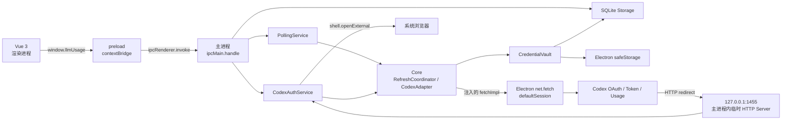

# 运行流程与通信机制现状报告

| 项目     | 内容                                                               |
| -------- | ------------------------------------------------------------------ |
| 文档性质 | Codex 闭环完成后的现状审计与扩展前设计建议                         |
| 基线提交 | `81e16d65d41736f2c04599e5c54f66578616bea0`                         |
| 审计日期 | 2026-09-25                                                         |
| 覆盖范围 | 开发、构建、打包、启动、终止、热更新、进程边界、IPC、网络与 OAuth |
| 非目标   | 本文不修改现有实现，也不替代 `design.md` 和 `plan.md`              |

## 1. 结论摘要

当前实现已经形成一条边界清楚的 Codex 闭环：Vue 渲染进程只通过 preload 暴露的白名单 API 访问 Electron 主进程；凭证、SQLite、`safeStorage`、轮询、通知、OAuth 会话和服务商请求均留在主进程；Core 通过注入的 `fetch` 使用 Electron 网络栈，不依赖 Electron，也不让渲染进程接触令牌。

现有结构适合证明最小闭环，但在扩展服务商和自动化抽取前，需要先补强以下横向能力：

1. **开发进程监督仍是一次性编排。** 只有 Vue/Vite 支持 HMR；Core、Electron 主进程和 preload 没有监听、热重载或自动重启。
2. **IPC 契约存在三处手工同步。** channel 字符串、preload 方法和 UI 类型分别维护，扩展服务商后容易出现运行时与类型声明漂移。
3. **认证会话尚未形成统一生命周期。** 浏览器 OAuth 使用一个最长挂起 15 分钟的 IPC 调用；打开浏览器失败、并发登录和应用退出时的回环服务清理没有统一会话管理。
4. **后台状态没有主动同步到界面。** 轮询会更新 SQLite 并发出系统通知，但渲染进程只在页面加载或用户操作后重新读取数据。
5. **原生模块 ABI 已完成隔离。** workspace 始终保留 Node ABI；Electron 二进制由独立命令生成到 `apps/polyquota/lib/better-sqlite3`，开发按需手动准备，生产构建自动生成。

这些问题目前没有阻断 Codex 使用，但都属于“每增加一个服务商都会放大一次”的结构性成本。后续调整按第 7 节的三个主题分别评审和推进。

## 2. 当前运行单元与进程边界

### 2.1 开发模式的进程组成

执行 `pnpm dev` 后，能看到的逻辑层次如下：

```text
终端
└─ 根 Node 编排器 scripts/dev-polyquota.mjs
   ├─ pnpm / Core 一次性构建（完成后退出）
   ├─ pnpm / Vite 开发服务器（持续运行，127.0.0.1:5173）
   ├─ pnpm / Desktop 一次性构建（完成后退出）
   └─ pnpm / run-electron-mode.mjs
      └─ Electron 应用
         ├─ 主进程
         ├─ 渲染进程
         │  └─ preload 在该渲染进程的隔离上下文中执行
         └─ Electron/Chromium 自管的 GPU、网络等辅助进程
```

需要特别区分：

- preload 是渲染进程中的隔离执行上下文，不是项目自建的独立进程；
- OAuth 回调服务是主进程中创建的 Node HTTP Server，不是独立服务进程；
- 轮询、SQLite、`safeStorage`、通知和 Core 适配器都运行在主进程；
- 项目没有创建 Electron `utilityProcess`、Node worker、child process 或第二个业务窗口进程；
- `net.fetch` 由主进程调用，底层网络辅助进程由 Electron 管理，项目没有与其建立自定义 IPC。

### 2.2 打包后运行的进程组成

安装包运行时没有根编排器、pnpm、Vite 和 TypeScript 构建任务，只剩 Electron 应用及其自管辅助进程：

```text
Electron 主进程
├─ BrowserWindow 对应的渲染进程
│  ├─ preload 隔离上下文
│  └─ Vue 3 应用
├─ 主进程内服务
│  ├─ SQLite / migrations
│  ├─ safeStorage 凭证保护
│  ├─ IPC handlers
│  ├─ PollingService / Notification
│  ├─ CodexAuthService / 临时 OAuth HTTP Server
│  └─ Core adapter / RefreshCoordinator
└─ Electron/Chromium 自管辅助进程
```

应用使用单实例锁。第二次启动不会创建第二套存储和轮询服务，而是把已有窗口恢复并聚焦。

## 3. 开发阶段的完整流程

### 3.1 安装

`pnpm install` 根据 workspace 和 lockfile 安装依赖。根配置只允许 `better-sqlite3`、Electron 和 esbuild 执行依赖构建脚本。`references/omniroute` 不属于 pnpm workspace，不参与安装和应用构建。

工作区要求 Node.js 22.12 及以上、pnpm 10。Electron 运行时固定为 42.11.6。

### 3.2 `pnpm dev` 启动顺序

根脚本按以下顺序执行，前置步骤失败就停止，不会带着半成品继续启动：

1. **一次性构建 Core。**
   - esbuild 递归读取 `packages/core/src` 中的所有 TypeScript 入口；
   - 清空 `packages/core/dist` 后输出 Node ESM、source map 和已打包的本地 vendor 代码；
   - 复制 OmniRoute 许可证；
   - TypeScript 追加生成声明文件和 declaration map。
2. **检查并启动 Vite。**
   - 先确认 `127.0.0.1:5173` 未被占用；
   - 启动 Vite 且使用 `strictPort`，不会静默换端口；
   - 最多等待 30 秒，端口可连接后才进入下一步。
3. **一次性构建 Desktop 主进程。**
   - `tsc` 把 `apps/polyquota/src/**/*.ts` 编译到 `apps/polyquota/dist`；
   - 把 `src/preload.cjs` 原样复制到 `dist/preload.cjs`。
4. **启动 Electron。**
   - 注入 `POLYQUOTA_DEV_SERVER=http://127.0.0.1:5173`；
   - 主窗口通过 `loadURL` 加载 Vite，而不是加载 `apps/polyquota/renderer`；
   - 主进程从固定目录显式加载预先生成的 Electron ABI `better_sqlite3.node`。

首次开发前需手动执行 `pnpm native:prepare`。该命令在隔离临时目录中构建，并输出到 `apps/polyquota/lib/better-sqlite3`；`pnpm dev` 不重复检查或生成。Electron、Node、`better-sqlite3`、平台或架构变化后需重新手动执行。

主进程完成以下运行时初始化后才创建窗口：

1. 获取单实例锁；
2. 等待 Electron `app.whenReady()`；
3. 配置默认 session 的环境变量代理、系统代理或直连行为；
4. 打开 SQLite 并执行前向迁移；
5. 组合 `safeStorage`、CredentialVault、CodexAdapter、RefreshCoordinator、认证与轮询服务；
6. 注册 IPC handlers；
7. 启动轮询定时器；
8. 创建 BrowserWindow 并加载 Vite 页面；
9. 创建托盘。

开发模式不安装生产 CSP。渲染进程仍保持 `contextIsolation: true`、`nodeIntegration: false`、`sandbox: true` 和 `webSecurity: true`。

### 3.3 HMR、热重载与自动重启现状

| 变更范围                             | 当前行为                                   | 是否自动生效 |
| ------------------------------------ | ------------------------------------------ | ------------ |
| Vue SFC、前端 TypeScript、CSS        | 由 Vite HMR 更新；必要时由 Vite 整页刷新   | 是           |
| `packages/polyquota-ui/index.html`   | Vite 触发页面刷新                          | 是           |
| Vite 配置或前端依赖图的特殊变化      | 由 Vite 自身决定重载或内部重启             | 部分         |
| `packages/core/src`                  | 启动前只构建一次，运行中不监听             | 否           |
| `apps/polyquota/src/**/*.ts`         | 启动前只编译一次，主进程不自动重启         | 否           |
| `apps/polyquota/src/preload.cjs`     | 启动前只复制一次，窗口不自动重建           | 否           |
| SQLite migration                     | 只在主进程启动并打开数据库时执行           | 否           |
| 环境变量代理                         | 只在主进程启动时配置默认 session           | 否           |
| 轮询开关和间隔                       | 保存到 SQLite；当前明确到下次启动才应用    | 否           |
| OAuth 回调服务                       | 仅单次登录期间临时创建，不涉及代码热更新   | 不适用       |

因此，当前严格意义上的热更新只覆盖 Vue 渲染层。项目没有 Electron 主进程热重载、preload 热重载、Core watch build 或 Electron 自动重启监督器。

### 3.4 开发模式的终止行为

存在三种常见终止路径：

1. **关闭窗口：不退出。** Windows 上窗口 `close` 事件会被拦截并隐藏，应用继续驻留托盘，轮询仍然运行。
2. **托盘“退出”：正常退出。** 设置 `quitting` 后调用 `app.quit()`；`before-quit` 注销 IPC、取消设备授权、停止轮询、销毁托盘并关闭 SQLite。Electron 退出后根编排器停止 Vite，不再执行 ABI 恢复。
3. **终端按 Ctrl+C：编排器终止。** 根脚本在 Windows 使用 `taskkill /t /f` 强制结束每个子进程树。这样能清理 Vite、pnpm wrapper 和 Electron；独立的原生二进制不受退出方式影响。

另外，Vite 在就绪后异常退出时，根编排器会停止其余子进程；Electron 命令退出时也会停止 Vite。当前没有自动拉起或崩溃重试。

## 4. 构建、打包与正式运行流程

### 4.1 `pnpm build`

根构建严格串行：

```text
Core build
   ↓
UI vite build
   ↓
Desktop prebuild：隔离生成 Electron 原生二进制
   ↓
Desktop build:main
   ↓
复制 UI dist 到 Desktop renderer
```

各阶段职责如下：

- **Core：** esbuild 生成运行时代码，TypeScript 生成声明文件；构建不读取 `references/omniroute`。
- **UI：** Vite 生成静态 `packages/polyquota-ui/dist`，`base` 为 `./`，使资源可由 `file://` 相对加载。
- **Desktop prebuild：** 在临时目录中为实际 Electron、平台和架构重建 `better-sqlite3`，固定输出到 `apps/polyquota/lib/better-sqlite3`，workspace 的 Node ABI 不变。
- **Desktop main/preload：** TypeScript 输出主进程代码，preload 原样复制到 `dist`。
- **Desktop renderer：** 删除旧的 `apps/polyquota/renderer`，再完整复制 UI 构建结果。

这是一次性生产构建，没有 watch、增量常驻进程或 HMR。命令成功后自然退出。

### 4.2 `pnpm package`

打包命令先完整执行 `pnpm build`，然后：

1. Desktop `prebuild` 在隔离目录中生成 Electron ABI 二进制；
2. 使用 electron-builder 生成 Windows NSIS 包，禁止发布；
3. 应用代码进入 asar；依赖目录中的 Node ABI 二进制被排除；
4. `apps/polyquota/lib/better-sqlite3` 作为额外资源复制到安装包的 `resources/lib/better-sqlite3`。

产物位于 `apps/polyquota/release/`。安装方式为非 one-click、当前用户安装，并允许选择目录。

打包过程中没有启动 Vue、Vite 或正式应用，也不存在热重载。原生模块在临时目录中构建并在成功后替换固定产物；失败不会改变 workspace 的 Node ABI。

### 4.3 打包后启动

正式应用从 `apps/polyquota/dist/main.js` 对应的 asar 内容启动。初始化顺序与开发模式基本相同，差异是：

- 不存在 `POLYQUOTA_DEV_SERVER`，窗口通过 `loadFile` 读取打包的 `renderer/index.html`；
- 主进程为页面安装生产 CSP；
- 不运行任何 TypeScript、esbuild、Vite 或复制任务；
- 不执行原生模块重建；
- 页面和主进程代码均固定在安装产物中，不支持 HMR 或自动更新后重启。

正式退出仍通过托盘菜单完成。窗口关闭只隐藏；系统退出或托盘退出触发 `before-quit` 清理。当前清理是同步发起，没有统一等待所有在途刷新和浏览器 OAuth 回调结束的 shutdown barrier。

## 5. Vue、Electron、专用 fetch 与 OAuth 的通信机制

### 5.1 总体拓扑



### 5.2 Vue 到主进程：contextBridge + invoke/handle

Vue 不直接导入 Electron，也不能访问 Node、文件系统、数据库或网络凭证。调用链为：

1. preload 使用 `contextBridge.exposeInMainWorld` 暴露 `window.llmUsage`；
2. 每个方法内部调用固定 channel 的 `ipcRenderer.invoke`；
3. 主进程用 `ipcMain.handle` 接收请求；
4. handler 校验账号 ID 或设置输入，调用 storage、polling 或 auth 服务；
5. 所有结果统一包装为 `{ ok: true, value }` 或 `{ ok: false, error }`；
6. UI 只处理公开账号、用量、设置、设备授权信息和脱敏错误。

当前共有账号读取/启停/删除、用量读取/刷新、三种 Codex 认证、设置读写和代理读取等 channel。通信全部是请求—响应模式，没有 `ipcRenderer.on`、MessagePort、流式响应或主进程主动事件。

这带来两个直接结果：

- 页面初始化采用“先列账号，再按账号并发读取快照”的 N+1 IPC 读取；
- 后台轮询写入新快照后不会通知 Vue，界面要等下一次用户操作或重新加载才看到变化。

### 5.3 主进程到 Core：普通函数调用与端口注入

Core 是同一主进程内加载的工作区包，不通过 IPC 与 Desktop 通信。Desktop 在组合根创建并注入：

- `SqliteStorage`，实现 Core 的存储端口；
- `ElectronSafeStorageCipher`，实现凭证加解密端口；
- 基于 `net.fetch` 的 `fetchImpl`；
- CodexAdapter、CredentialVault、RefreshCoordinator 和 CodexAccountProvisioner。

因此 Core 保持 Electron 无关，但不是独立进程或远程服务。调用、异常和对象都在主进程内传递。

### 5.4 “专用 fetch”的真实边界

主进程构造的传输为：

```ts
const fetchImpl: typeof fetch = (input, init) =>
  net.fetch(input instanceof URL ? input.toString() : input, init);
```

它被注入 CodexAdapter，再明确传入 vendor 协议函数。当前以下出站请求都走同一个 Electron `net.fetch`：

- 浏览器 OAuth 授权码换 token；
- 设备授权码申请；
- 设备授权轮询；
- 设备授权码换 token；
- refresh token 刷新；
- 用量查询。

默认 session 在这些请求开始前完成代理配置：优先 `HTTPS_PROXY`，其次 `HTTP_PROXY`；存在环境变量时使用固定代理并应用 `NO_PROXY`，否则使用系统代理。`getProxy` 只用于把 Electron 对目标 URL 的解析结果展示给 UI。

需要避免三种误解：

- 这不是渲染进程的 `window.fetch`；业务页面不直接请求 Codex；
- 这不是独立 fetch 进程；它只是 Desktop 提供给 Core 的传输适配器；
- OAuth 回调是浏览器向本机 Node HTTP Server 发起的入站请求，不经过 `net.fetch`。

### 5.5 浏览器 OAuth PKCE

浏览器 OAuth 是一个保持 IPC promise 挂起直到认证完成的同步式业务流程：

```mermaid
sequenceDiagram
  participant UI as Vue
  participant IPC as Electron 主进程
  participant AUTH as CodexAuthService
  participant B as 系统浏览器
  participant P as Codex
  participant CB as 127.0.0.1:1455

  UI->>IPC: auth:codex-browser
  IPC->>AUTH: browserLogin()
  AUTH->>AUTH: 生成 state + PKCE，开始等待回调
  AUTH->>B: shell.openExternal(authorizationUrl)
  B->>P: 用户登录与授权
  P-->>CB: GET /auth/callback?code&state
  CB->>CB: 校验路径、code、state，关闭 Server
  AUTH->>P: net.fetch 换 token
  AUTH->>AUTH: safeStorage 加密 + SQLite 事务保存
  AUTH-->>IPC: PublicAccount
  IPC-->>UI: IpcResult&lt;PublicAccount&gt;
```

当前约束：

- redirect URI 为 `http://localhost:1455/auth/callback`；Server 实际只监听 `127.0.0.1:1455`；
- Server 仅在本次登录期间存在，最长等待 15 分钟；
- 回调校验 state，PKCE verifier 只留在主进程；
- 成功或无效回调都会关闭 Server；超时也会关闭；
- 保存前会从 token 映射稳定身份，凭证经 `safeStorage` 加密后进入 SQLite；UI 只收到 PublicAccount。

当前不足是浏览器登录没有显式 session ID、取消 API 和统一 session registry。`shell.openExternal` 失败后，已经创建的回调等待可能继续占用端口直到超时；`before-quit` 的 `auth.cancelAll()` 只取消设备授权，不管理浏览器回调服务。

### 5.6 设备授权

设备授权拆成两个 IPC 调用：

1. `auth:codex-device-start` 通过 `net.fetch` 获取 device auth ID、user code、间隔和验证地址，在主进程 Map 中保存 authorization 与 AbortController，打开系统浏览器，只把 session ID、user code 和验证地址返回 UI。
2. 用户点击“我已完成授权”后，`auth:codex-device-finish` 使用 session ID 找回主进程状态，轮询上游、换 token、加密保存账号，最后删除 Map 中的 session。

应用退出时会 abort 全部设备会话。UI 不接触 device auth ID、token 或 PKCE 数据。

### 5.7 CLI 导入、手动刷新与后台轮询

- **CLI 导入：** Vue 发 IPC；主进程只读 `${CODEX_HOME}/auth.json` 或用户目录下的默认文件；Core 解析并建立稳定身份；凭证经 `safeStorage` 加密并由 SQLite 事务保存；不会回写 CLI 文件。
- **手动刷新：** Vue 发 IPC；PollingService 调用 RefreshCoordinator；后者读取账号、解密凭证、按需刷新 token、查询用量、更新快照并生成通知候选；完成后 UI 再主动读取全部账号和快照。
- **后台轮询：** 主进程定时器直接调用同一个 RefreshCoordinator，不经过渲染进程。相同账号的并发刷新由 in-flight Map 合并，不同账号并行。结果写入 SQLite，低额度时直接由主进程发送系统通知。
- **托盘刷新：** 托盘菜单直接调用 `polling.refreshAll()`，同样不经过 IPC，也不会主动刷新已打开页面。

## 6. 当前设计中值得保留的边界

以下做法已经形成良好基础，扩展时应继续保持：

1. UI、Desktop 宿主和 Core 协议分层明确，Core 不依赖 Electron；
2. 渲染进程启用 sandbox 和 context isolation，preload 只暴露白名单能力；
3. 服务商全部出站请求使用注入传输，当前已统一到 Electron session 和代理；
4. 凭证明文只在主进程短暂出现，IPC DTO、通知和 UI 不包含秘密；
5. 手动刷新、后台轮询和托盘刷新复用同一协调器；
6. 同账号刷新互斥、不同账号隔离，旋转凭证先保存再继续用量请求；
7. OAuth 回调只监听 loopback，使用 state 与 PKCE，并有固定超时；
8. 开发、生产两种 renderer 加载路径清楚，生产静态资源不依赖 Vite 服务；
9. 参考子模块不进入 workspace、运行时或安装包。

后续优化应围绕这些边界做“单一来源和生命周期完善”，不需要推翻现有分层。

## 7. 后续调整方向

以下内容只划分后续评审主题，不在本报告中展开实现方案或确定内部接口。三个主题将分别确认边界、优先级和完成标准，再逐项进入设计与实施。

### 7.1 IPC 通信、Web 侧通知接收与自动刷新

- 建立 UI、preload 与主进程共用的 IPC 公共契约，并统一边界校验、公开数据和错误表达。
- 建立主进程到 Web 页面的状态变更通知，使后台刷新、账号变化和设置变化能够及时反映到已打开页面。
- 收敛页面读取模型，保证界面每次刷新读取的是一致状态，避免账号与用量分散读取造成短暂不一致。
- 将定时轮询提升为可配置、可恢复、可观测的刷新调度能力，并继续复用现有刷新协调边界。
- 为通信、通知和自动刷新建立覆盖真实 Electron 边界的验证基线。

### 7.2 构建流程、应用生命周期与开发热更新

- 统一开发、构建、打包、启动和终止流程，明确各阶段的入口、责任与失败状态。
- 保留 Vue 渲染层 HMR，并为 Core、主进程和 preload 建立可靠的构建后自动重启机制。
- 收敛主进程服务的启动与退出生命周期，统一处理认证、刷新、IPC、窗口、托盘、存储和子进程资源。
- 保证正常退出、异常退出和开发重启都不会遗留端口、进程、监听器、定时器或存储句柄。
- 保持已经完成的 `better-sqlite3` Node/Electron 二进制隔离：开发环境按需手动预构建，生产构建自动准备并从固定目录加载 Electron 二进制。
- 将服务商协议的同步抽取纳入构建期工具链治理，保持其与应用运行时及真实凭证隔离。
- 以开发启动、重复重启、正式构建和打包后运行作为这一方向的完整验证范围。

### 7.3 UI 交互、产品标识图标与跨服务商抽象

本主题只确定功能形态、交互语义和跨服务商公开规范，不规定最终视觉样式、组件结构或内部接口。实施阶段以简洁、可验证的 UI 为基础。本节形成的公开状态和操作语义，后续作为第 7.1 节通信契约的输入。

当前集中在 `App.vue` 的功能按用途拆分为三个主要功能区。

#### 7.3.1 配置

- 集中管理刷新频率等应用级参数。
- 提供清除本地应用数据的入口。
- 展示当前代理模式，并提供独立的网络检查能力。
- 配置只处理应用级行为，不混入具体服务商的接入参数和认证操作。

#### 7.3.2 服务商接入

- 使用独立页面列出当前支持的大模型服务商；每个服务商占一行紧凑的卡片型列表项，并展示接入情况。
- 用户从服务商条目进入添加流程，在弹窗中选择该服务商支持的接入方式，例如 API Key、OAuth 或 Device Code，并填写对应参数。
- 接入弹窗提供凭证或授权结果的有效性测试，测试通过与正式保存是两个明确动作。
- OAuth 所需的临时回调服务只随当前接入弹窗中的授权会话存在；关闭弹窗即取消会话并停止临时服务。
- 同一套接入流程根据服务商能力展示可用方式和参数，不为每个服务商复制一套页面流程。

#### 7.3.3 用量卡片展示与更新

- 保留现有用量卡片列表及其主要刷新行为，作为应用主体页面。
- 面向用户展示服务商定义的友好名称，不直接暴露协议原始值；例如 Codex 套餐类型 `prolite` 显示为 `Pro 5x`。
- 账号启用状态改为卡片右上角的开关，减少独立操作按钮对主体信息的干扰。
- 服务商支持配额分组时保留分组标题；不支持时不为了统一外观虚构分组层级。
- 服务商支持重置次数时，可从卡片打开详情弹窗查看重置类型和过期时间，并通过按钮跳转服务商官网完成兑换；应用内不提供兑换操作。
- 后台更新、手动刷新和接入状态变化应使用一致的公开状态语义，具体通知与刷新机制留到第 7.1 节确定。

#### 7.3.4 跨服务商统一规范

- 服务商统一声明展示信息、接入方式和用量能力，UI 依据公开能力决定可用功能，不直接判断具体服务商名称。
- 认证流程统一表达开始、等待、成功、失败和取消；服务商特有协议数据不进入通用 UI 状态。
- 用量展示继续采用 `groups + extras` 公共模型，允许服务商选择性提供配额分组和重置次数等附加信息。
- 套餐名称、配额名称、重置类型和外部操作链接均使用面向用户的公开描述，协议原始值只保留在服务商适配边界内。
- 建立统一的产品标识与图标资产范围，覆盖应用窗口、托盘、安装包、服务商列表和系统展示场景；本阶段不规定最终图形风格。

## 8. 后续评审方式

接下来按第 7 节三个主题逐一评审。每一块先确定目标、边界和验收范围，再补充具体设计与实施计划；未完成当前主题确认前，不在本报告中预设下一块的接口和实现细节。

## 9. 主要实现依据

- 根命令与串行构建：[`../../package.json`](../../package.json)
- 开发进程编排：[`../../scripts/dev-polyquota.mjs`](../../scripts/dev-polyquota.mjs)
- Electron 启动和原生模块处理：[`../../apps/polyquota/scripts/run-electron-mode.mjs`](../../apps/polyquota/scripts/run-electron-mode.mjs)
- Electron 原生二进制预构建：[`../../apps/polyquota/scripts/prepare-native.mjs`](../../apps/polyquota/scripts/prepare-native.mjs)
- 打包流程：[`../../apps/polyquota/scripts/package.mjs`](../../apps/polyquota/scripts/package.mjs)
- Electron 生命周期与组合根：[`../../apps/polyquota/src/main.ts`](../../apps/polyquota/src/main.ts)
- preload 白名单：[`../../apps/polyquota/src/preload.cjs`](../../apps/polyquota/src/preload.cjs)
- IPC handlers：[`../../apps/polyquota/src/ipc.ts`](../../apps/polyquota/src/ipc.ts)
- OAuth 与 CLI 认证：[`../../apps/polyquota/src/auth-service.ts`](../../apps/polyquota/src/auth-service.ts)
- 轮询与通知：[`../../apps/polyquota/src/polling-service.ts`](../../apps/polyquota/src/polling-service.ts)
- Core Codex 适配器：[`../../packages/core/src/codex-adapter.ts`](../../packages/core/src/codex-adapter.ts)
- 刷新协调器：[`../../packages/core/src/refresh-coordinator.ts`](../../packages/core/src/refresh-coordinator.ts)
- Vue 调用侧：[`../../packages/polyquota-ui/src/App.vue`](../../packages/polyquota-ui/src/App.vue)
- Vite 配置：[`../../packages/polyquota-ui/vite.config.ts`](../../packages/polyquota-ui/vite.config.ts)
- Electron Builder 配置：[`../../apps/polyquota/electron-builder.yml`](../../apps/polyquota/electron-builder.yml)
